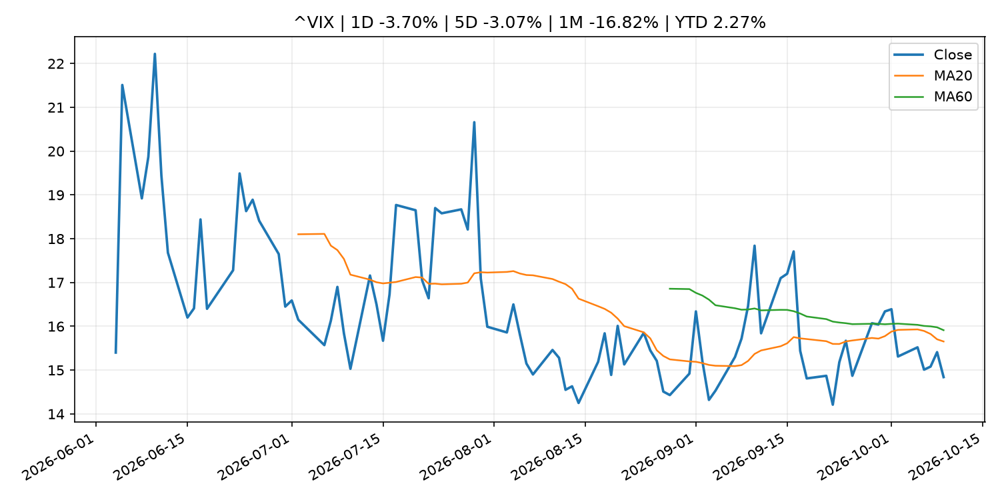
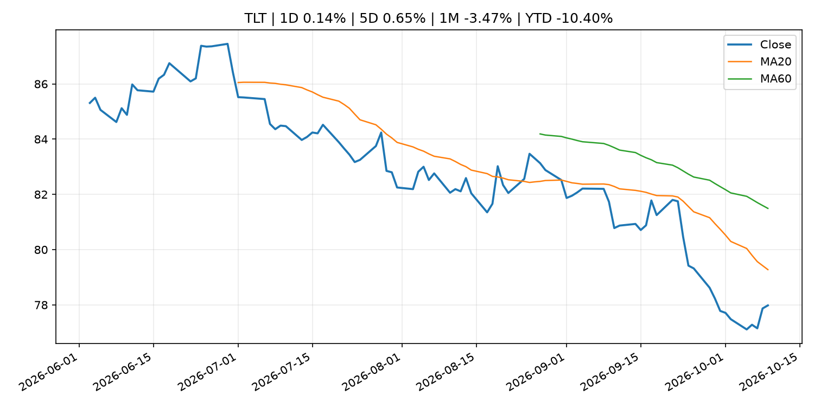
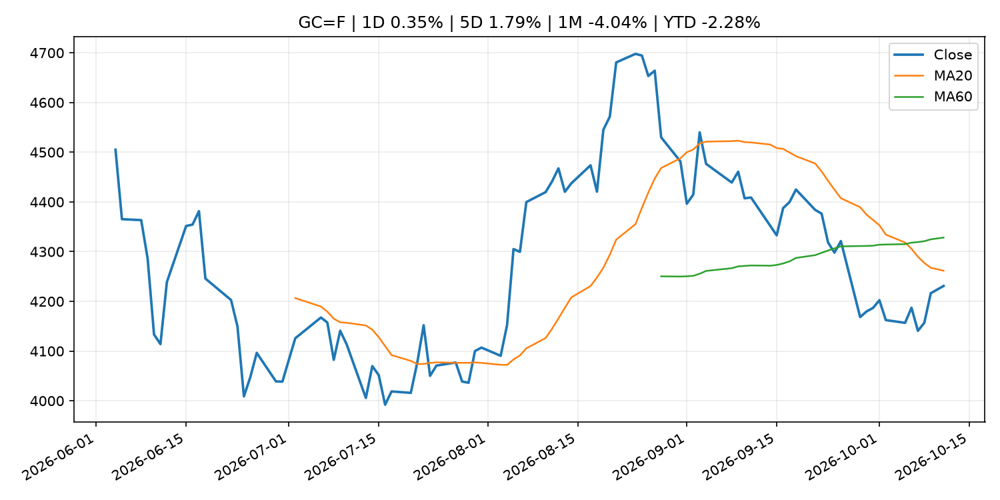
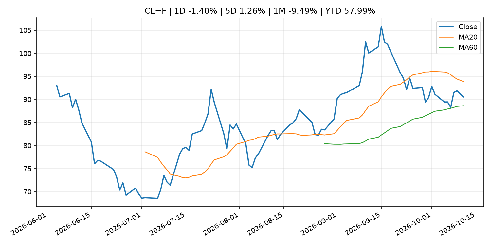
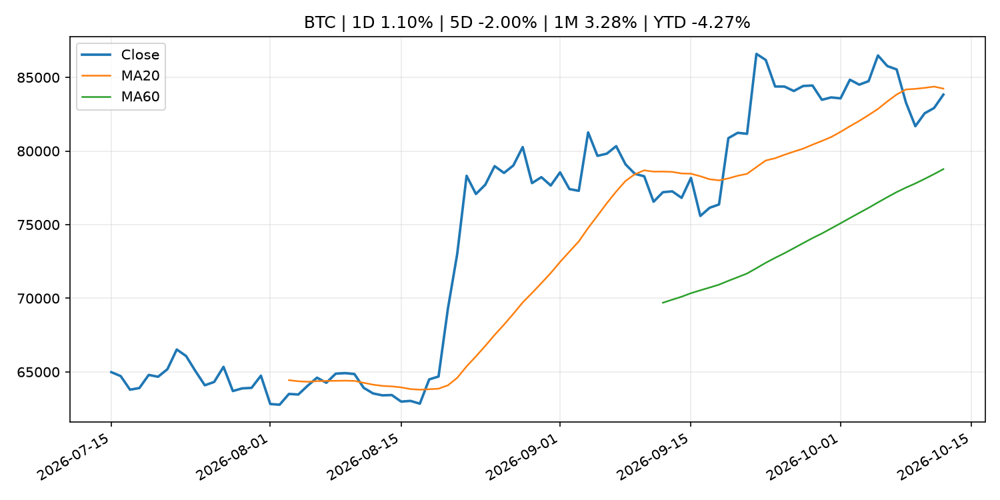
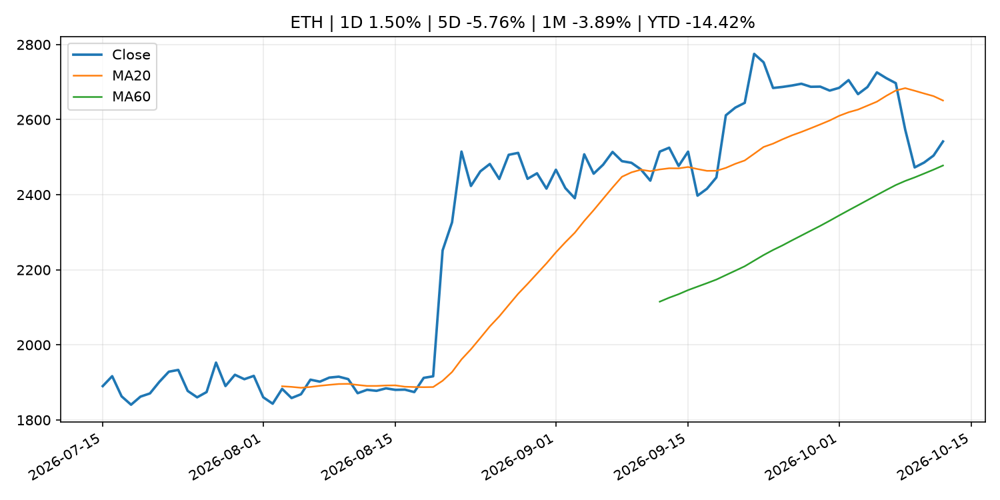
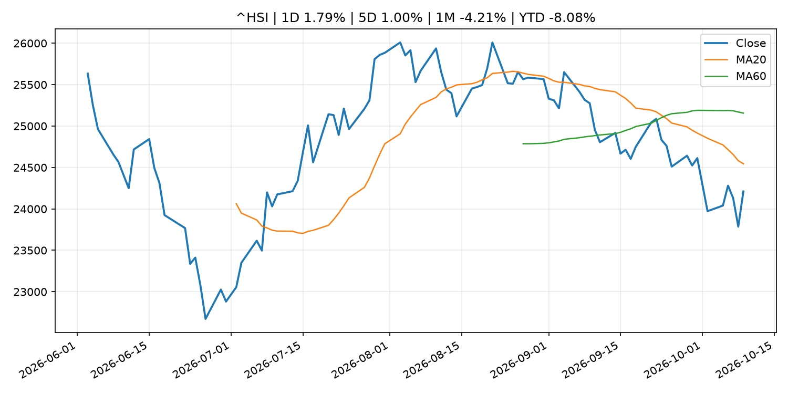

# Global Macro Morning Briefing - 2026-10-12

> Not financial advice / 非投资建议。

## 0. 今日总览
- 市场状态：risk_on。股指上涨、波动率或美元回落，市场更接近风险偏好改善。
- 今日三大主线：
  1. financial_stability: One year after 10/10 flash crash, bitcoin and ether liquidity have rebuilt, but altcoins still face risks
  2. earnings: We’re about to get a huge read on whether earnings can keep propping up the stock market
  3. earnings: Bank earnings to shed the first light on how higher yields are affecting the economy
- 一句话结论：今日晨报重点关注：金融稳定信号可能放大跨资产波动，并影响央行反应函数。；大型科技股盈利和资本开支会影响纳指、半导体和 AI 交易主线。。跨资产方面，SPY 1D 0.60%；QQQ 1D 0.49%；^VIX 1D -3.70%；TLT 1D 0.14%；GC=F 1D 0.35%；CL=F 1D -1.40%；BTC 1D 1.10%；ETH 1D 1.50%；股指上涨、波动率或美元回落，市场更接近风险偏好改善。政策、通胀、利率、美元、美债、能源和加密监管仍是主要观察线索。所有结论仅基于公开数据与短摘要整理，不构成投资建议。

## 1. 隔夜跨资产市场
- 美股：SPY 1D 0.60%，QQQ 1D 0.49%，整体趋势需结合 VIX 和利率确认。
- 美债/美元：TLT 1D 0.14%，美元指数 1D -0.07%，是判断折现率压力的核心线索。
- 黄金/原油：黄金 1D 0.35%，原油 1D -1.40%，用于观察避险、通胀和地缘风险。
- 加密：BTC 1D 1.10%，ETH 1D 1.50%，关注是否独立于纳指走出加密自身行情。
- 港股/A股：恒生 1D 1.79%，沪深300/上证 1D n/a，重点看中国政策预期与人民币线索。
- 风险观察：确认风险偏好是否扩散到小盘股、信用利差和周期品。

### US_EQUITY

| symbol | latest close | 1D | 5D | 1M | YTD | trend |
|---|---:|---:|---:|---:|---:|---|
| SPY | 778.57 | 0.60% | 1.16% | 2.74% | 13.96% | uptrend |
| QQQ | 751.27 | 0.49% | 0.23% | 6.01% | 22.53% | strong_uptrend |
| DIA | 516.11 | 0.87% | 0.98% | -0.89% | 6.72% | range_bound |
| IWM | 278.94 | 0.49% | -0.92% | -3.04% | 12.12% | strong_downtrend |
| VTI | 381.94 | 0.63% | 1.05% | 2.33% | 13.57% | uptrend |

### US_MACRO_MARKET

| symbol | latest close | 1D | 5D | 1M | YTD | trend |
|---|---:|---:|---:|---:|---:|---|
| ^VIX | 14.84 | -3.70% | -3.07% | -16.82% | 2.27% | downtrend |
| DX-Y.NYB | 102.14 | -0.07% | -0.03% | 3.05% | 3.78% | strong_uptrend |
| TLT | 77.98 | 0.14% | 0.65% | -3.47% | -10.40% | strong_downtrend |
| IEF | 89.40 | -0.06% | 0.39% | -1.95% | -6.95% | downtrend |

### COMMODITIES

| symbol | latest close | 1D | 5D | 1M | YTD | trend |
|---|---:|---:|---:|---:|---:|---|
| GC=F | 4,231.00 | 0.35% | 1.79% | -4.04% | -2.28% | strong_downtrend |
| SI=F | 61.51 | 1.38% | 1.04% | -4.72% | -12.83% | strong_downtrend |
| CL=F | 90.56 | -1.40% | 1.26% | -9.49% | 57.99% | range_bound |
| BZ=F | 103.39 | -1.27% | 3.06% | -1.17% | 70.19% | uptrend |
| NG=F | 3.16 | -1.86% | 3.07% | 11.62% | -12.66% | strong_uptrend |
| HG=F | 6.72 | 1.11% | 1.99% | 3.82% | 19.09% | uptrend |

### HK_MARKET

| symbol | latest close | 1D | 5D | 1M | YTD | trend |
|---|---:|---:|---:|---:|---:|---|
| ^HSI | 24,211.35 | 1.79% | 1.00% | -4.21% | -8.08% | strong_downtrend |
| 0700.HK | 424.80 | 3.26% | 0.85% | -2.12% | -31.81% | downtrend |
| 9988.HK | 107.00 | 2.59% | 2.49% | -2.55% | -28.19% | downtrend |
| 3690.HK | 71.50 | 3.03% | 1.85% | -8.10% | -31.64% | strong_downtrend |
| 1810.HK | 25.96 | 9.72% | 7.10% | -1.59% | -35.55% | range_bound |
| 1211.HK | 75.60 | 3.70% | 2.30% | -7.58% | -23.44% | strong_downtrend |

### CRYPTO

| symbol | latest close | 1D | 5D | 1M | YTD | trend |
|---|---:|---:|---:|---:|---:|---|
| BTC | 83,832.79 | 1.10% | -2.00% | 3.28% | -4.27% | range_bound |
| ETH | 2,541.87 | 1.50% | -5.76% | -3.89% | -14.42% | range_bound |
| SOLANA | 111.43 | 1.30% | -7.67% | 0.25% | -10.52% | range_bound |
| BINANCECOIN | 752.62 | 0.41% | -3.41% | -2.54% | -12.76% | range_bound |
| RIPPLE | 1.41 | 0.48% | -5.93% | -0.16% | -23.50% | range_bound |

## 2. 今日最重要的 10 条新闻
### 1. One year after 10/10 flash crash, bitcoin and ether liquidity have rebuilt, but altcoins still face risks
- 来源：CoinDesk
- 时间：2026-10-10T12:00:00+00:00
- 地区：global
- 事件类型：financial_stability
- 重要性层级：Tier 1
- 一句话摘要：One year after 10/10 flash crash, bitcoin and ether liquidity have rebuilt, but altcoins still face risks
- 为什么重要：金融稳定信号可能放大跨资产波动，并影响央行反应函数。
- 可能影响：可能影响利率、汇率、风险资产或大宗商品预期，但当前公开信息不足以判断明确方向。
  - 资产：暂无明确资产映射
  - 方向：unknown
  - 强度：low
  - 原因：公开信息不足以判断方向。
- 原文链接：[https://www.coindesk.com/markets/2026/10/10/one-year-after-10-10-bitcoin-and-ether-liquidity-have-rebuilt-but-other-altcoins-still-face-risks](https://www.coindesk.com/markets/2026/10/10/one-year-after-10-10-bitcoin-and-ether-liquidity-have-rebuilt-but-other-altcoins-still-face-risks)

### 2. We’re about to get a huge read on whether earnings can keep propping up the stock market
- 来源：MarketWatch Top Stories
- 时间：2026-10-11T14:00:00+00:00
- 地区：US
- 事件类型：earnings
- 重要性层级：Tier 2
- 一句话摘要：High hopes for third-quarter earnings are outweighing concerns around interest rates and oil prices — but one expert warns markets have gotten “extremely complacent.”
- 为什么重要：大型科技股盈利和资本开支会影响纳指、半导体和 AI 交易主线。
- 可能影响：主要影响 CL=F，方向为 positive，强度 high；供给扰动或 OPEC 减产通常推升 WTI 原油。
  - 资产：CL=F
    方向：positive
    强度：high
    原因：供给扰动或 OPEC 减产通常推升 WTI 原油。
  - 资产：BZ=F
    方向：positive
    强度：high
    原因：全球供给风险通常直接影响 Brent 原油。
  - 资产：SPY
    方向：mixed
    强度：medium
    原因：能源股可能受益，但通胀和成本压力不利于宽基风险资产。
- 原文链接：[https://www.marketwatch.com/story/were-about-to-get-a-huge-read-on-whether-earnings-can-keep-propping-up-the-stock-market-459b565b?mod=mw_rss_topstories](https://www.marketwatch.com/story/were-about-to-get-a-huge-read-on-whether-earnings-can-keep-propping-up-the-stock-market-459b565b?mod=mw_rss_topstories)

### 3. Bank earnings to shed the first light on how higher yields are affecting the economy
- 来源：MarketWatch Top Stories
- 时间：2026-10-11T12:00:00+00:00
- 地区：US
- 事件类型：earnings
- 重要性层级：Tier 2
- 一句话摘要：The big banks kick off earnings season on Tuesday, to provide a first read on the health of the economy in a rising-yield environment.
- 为什么重要：大型科技股盈利和资本开支会影响纳指、半导体和 AI 交易主线。
- 可能影响：可能影响利率、汇率、风险资产或大宗商品预期，但当前公开信息不足以判断明确方向。
  - 资产：暂无明确资产映射
  - 方向：unknown
  - 强度：low
  - 原因：公开信息不足以判断方向。
- 原文链接：[https://www.marketwatch.com/story/bank-earnings-to-shed-the-first-light-on-how-higher-yields-are-affecting-the-economy-cf3763ef?mod=mw_rss_topstories](https://www.marketwatch.com/story/bank-earnings-to-shed-the-first-light-on-how-higher-yields-are-affecting-the-economy-cf3763ef?mod=mw_rss_topstories)

### 4. Tokenized commodities look beyond gold as lending and oil open new markets
- 来源：CoinDesk
- 时间：2026-10-10T12:00:00+00:00
- 地区：global
- 事件类型：other
- 重要性层级：Tier 3
- 一句话摘要：Tokenized commodities look beyond gold as lending and oil open new markets
- 为什么重要：这条信息暂未匹配到重大宏观、政策或市场事件，更适合作为背景跟踪。
- 可能影响：主要影响 CL=F，方向为 positive，强度 high；供给扰动或 OPEC 减产通常推升 WTI 原油。
  - 资产：CL=F
    方向：positive
    强度：high
    原因：供给扰动或 OPEC 减产通常推升 WTI 原油。
  - 资产：BZ=F
    方向：positive
    强度：high
    原因：全球供给风险通常直接影响 Brent 原油。
  - 资产：SPY
    方向：mixed
    强度：medium
    原因：能源股可能受益，但通胀和成本压力不利于宽基风险资产。
- 原文链接：[https://www.coindesk.com/business/2026/10/05/tokenized-commodities-look-beyond-gold-as-lending-and-oil-open-new-markets](https://www.coindesk.com/business/2026/10/05/tokenized-commodities-look-beyond-gold-as-lending-and-oil-open-new-markets)

### 5. Should I put my nest egg in a 30-year Treasury bond?
- 来源：MarketWatch Top Stories
- 时间：2026-10-10T19:44:00+00:00
- 地区：US
- 事件类型：other
- 重要性层级：Tier 3
- 一句话摘要：Risk comes in many forms, even with “safe” investments.
- 为什么重要：这条信息暂未匹配到重大宏观、政策或市场事件，更适合作为背景跟踪。
- 可能影响：更偏背景信息，短期市场影响可能有限。
  - 资产：暂无明确资产映射
  - 方向：unknown
  - 强度：low
  - 原因：公开信息不足以判断方向。
- 原文链接：[https://www.marketwatch.com/story/should-i-put-my-nest-egg-in-a-30-year-treasury-bond-89db6e09?mod=mw_rss_topstories](https://www.marketwatch.com/story/should-i-put-my-nest-egg-in-a-30-year-treasury-bond-89db6e09?mod=mw_rss_topstories)

## 3. 政策与央行观察
### 1. One year after 10/10 flash crash, bitcoin and ether liquidity have rebuilt, but altcoins still face risks
- 来源：CoinDesk
- 时间：2026-10-10T12:00:00+00:00
- 地区：global
- 事件类型：financial_stability
- 重要性层级：Tier 1
- 一句话摘要：One year after 10/10 flash crash, bitcoin and ether liquidity have rebuilt, but altcoins still face risks
- 为什么重要：金融稳定信号可能放大跨资产波动，并影响央行反应函数。
- 可能影响：可能影响利率、汇率、风险资产或大宗商品预期，但当前公开信息不足以判断明确方向。
  - 资产：暂无明确资产映射
  - 方向：unknown
  - 强度：low
  - 原因：公开信息不足以判断方向。
- 原文链接：[https://www.coindesk.com/markets/2026/10/10/one-year-after-10-10-bitcoin-and-ether-liquidity-have-rebuilt-but-other-altcoins-still-face-risks](https://www.coindesk.com/markets/2026/10/10/one-year-after-10-10-bitcoin-and-ether-liquidity-have-rebuilt-but-other-altcoins-still-face-risks)

## 4. 市场异动与图表
- SPY 上涨 0.60%
- QQQ 上涨 0.49%
- VIX 下跌 -3.70%
- Oil 下跌 -1.40%

### SPY

### QQQ

### ^VIX

### TLT

### GC=F

### CL=F

### BTC

### ETH

### ^HSI

## 5. 华尔街与机构公开观点
- 暂无可靠公开观点。

## 6. 今日重点关注
- 经济数据：经济数据：暂无可靠公开日历数据；如配置经济日历源后可自动填充。
- 央行讲话：央行讲话：暂无可靠公开日历数据；重点跟踪 Fed、ECB、BoJ、PBOC 官网 RSS。
- 财报：财报：暂无可靠数据。
- 政策事件：政策事件：暂无可靠数据。
- 风险提醒：风险提醒：关注数据源失败项、突发地缘风险、利率和美元的二阶反应。

## 7. 英文金融表达与宏观概念
- **real yield**：实际收益率，名义利率扣除通胀预期后的收益率。 例句：Gold often reacts more to real yields than nominal yields.
- **risk-off**：避险模式，资金偏向美元、国债、黄金等防御资产。 例句：A geopolitical shock can push markets into risk-off mode.
- **supply disruption**：供给扰动，通常指能源或商品供应受冲突、减产或天气影响。 例句：Supply disruption can lift oil prices and inflation expectations.
- **inflation expectations**：通胀预期，指家庭、企业或市场对未来通胀的预估。 例句：Inflation expectations can shape wage bargaining and bond yields.
- **terminal rate**：终端利率，市场预期本轮加息周期的最高政策利率。 例句：A higher terminal rate can pressure growth stocks.
- **soft landing**：软着陆，指通胀回落而经济避免明显衰退。 例句：Markets often rally when data support a soft landing.

## 8. 背景材料
- [Should I put my nest egg in a 30-year Treasury bond?](https://www.marketwatch.com/story/should-i-put-my-nest-egg-in-a-30-year-treasury-bond-89db6e09?mod=mw_rss_topstories)（MarketWatch Top Stories，other）：Risk comes in many forms, even with “safe” investments.
- [Tokenized commodities look beyond gold as lending and oil open new markets](https://www.coindesk.com/business/2026/10/05/tokenized-commodities-look-beyond-gold-as-lending-and-oil-open-new-markets)（CoinDesk，other）：Tokenized commodities look beyond gold as lending and oil open new markets
- [Bitcoin's $19 billion wake-up call: One-year after flash crash, has crypto learned anything?](https://www.coindesk.com/markets/2026/10/10/bitcoin-s-usd19-billion-wake-up-call-one-year-later-has-crypto-learned-anything)（CoinDesk，other）：Bitcoin's $19 billion wake-up call: One-year after flash crash, has crypto learned anything?
- [Bitcoin's volatility has plunged, but extreme price swings are more frequent than in 2018](https://www.coindesk.com/markets/2026/10/09/bitcoin-s-volatility-has-plunged-but-extreme-price-swings-are-more-frequent-than-in-2018)（CoinDesk，other）：Bitcoin's volatility has plunged, but extreme price swings are more frequent than in 2018
- [Visa survey says nearly half of APAC consumers open to using stablecoins by 2031](https://www.coindesk.com/business/2026/10/05/1-2-billion-apac-consumers-could-adopt-stablecoins-by-2031-according-to-visa)（CoinDesk，other）：Visa survey says nearly half of APAC consumers open to using stablecoins by 2031

## 9. 数据源、失败项与免责声明
- 采集时间：2026-10-12T00:58:47
- 数据源：公开 RSS、Yahoo Finance、CoinGecko、AKShare、FRED、SEC data.sec.gov，以及用户自有 inputs/reports 文件。
- 合规说明：不绕过 WSJ、Bloomberg、FT、Reuters 等付费墙；对付费媒体只使用公开 RSS 标题、摘要、链接和发布时间。
- 免责声明：Not financial advice / 非投资建议。本项目仅供个人学习、研究和信息整理，不构成投资建议、交易建议或任何收益承诺。
- 失败或跳过的数据源：
  - crypto data failed coin=dogecoin
  - China market data failed symbol=上证指数: empty dataframe
  - China market data failed symbol=深证成指: empty dataframe
  - China market data failed symbol=创业板指: empty dataframe
  - China market data failed symbol=沪深300: empty dataframe
  - China market data failed symbol=中证500: empty dataframe
  - China market data failed symbol=科创50: empty dataframe
  - FRED_API_KEY not set; skipping FRED macro series
  - SEC failed cik=0000320193
  - SEC failed cik=0000789019
  - SEC failed cik=0001045810
  - SEC failed cik=0001318605
  - SEC failed cik=0001577552
