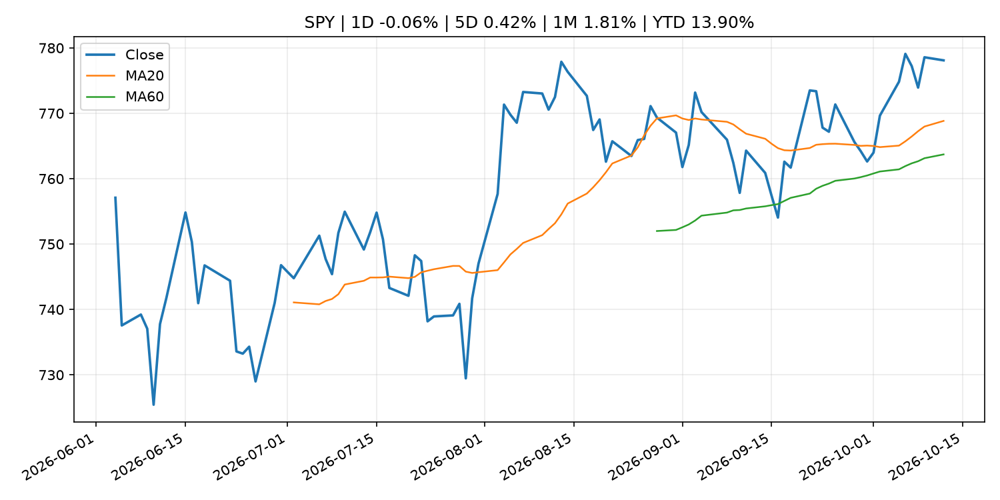
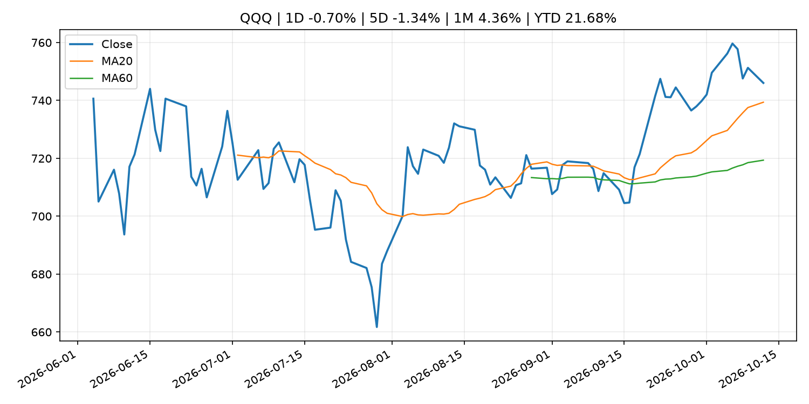
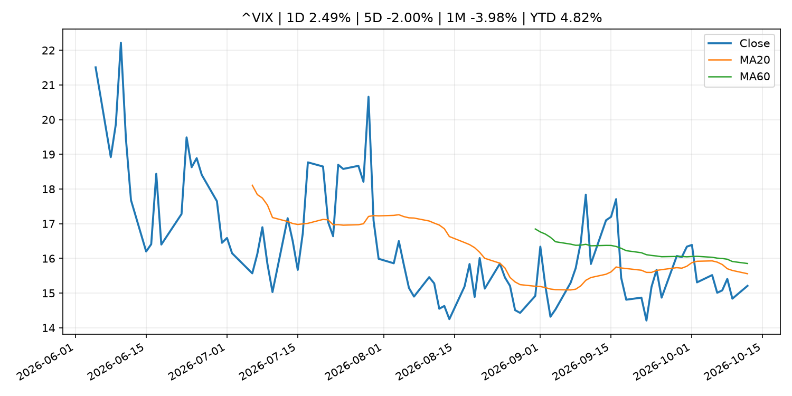
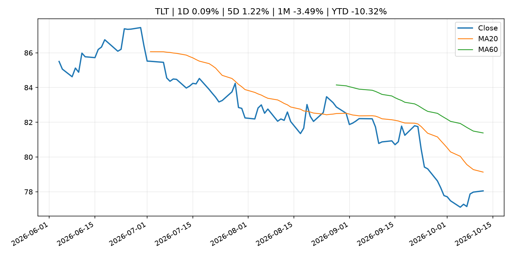
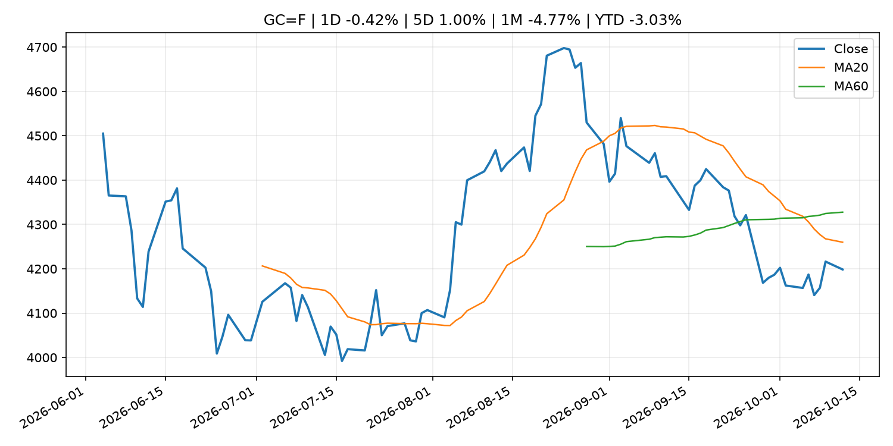
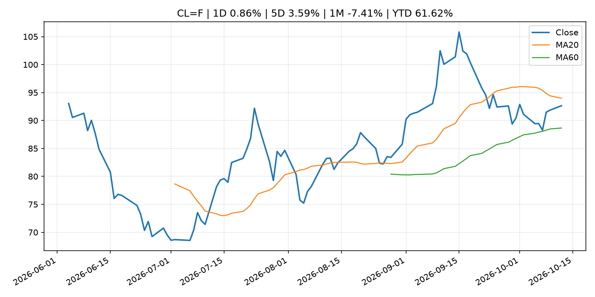
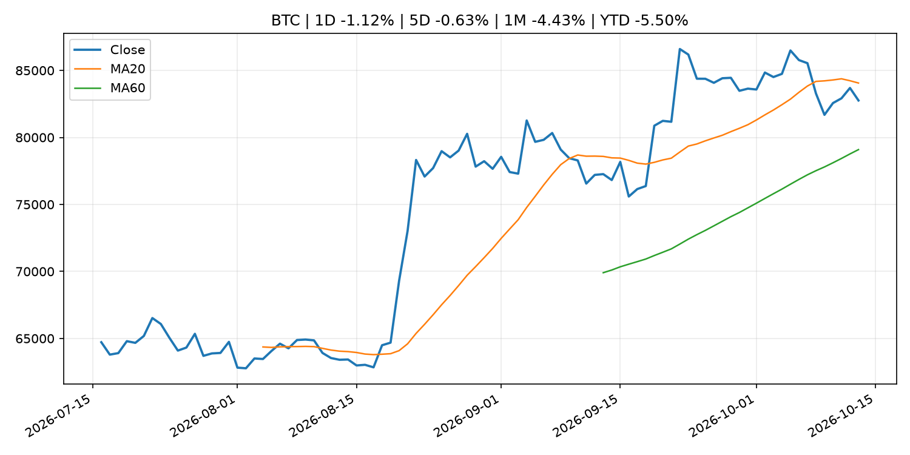
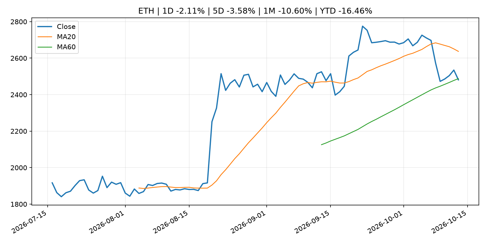
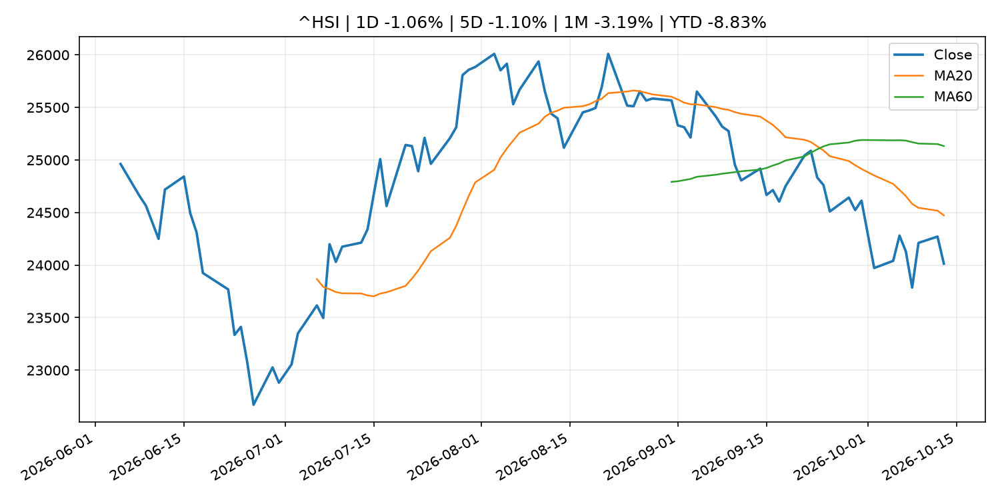

# Global Macro Morning Briefing - 2026-10-13

> Not financial advice / 非投资建议。

## 0. 今日总览
- 市场状态：unknown。市场信号不足，暂不判断明确状态。
- 今日三大主线：
  1. central_bank_speech: Higher rates could be needed to avoid 'inflationary mindset' taking hold, says Fed's Hammack
  2. crypto_market_structure: Global financial watchdog calls for cross-border information sharing, planning for stablecoin crisis
- 一句话结论：今日晨报重点关注：央行官员表态可能影响市场对下一次会议的定价。；加密市场结构和监管变化会影响 BTC、ETH 及相关股票的风险溢价。。跨资产方面，SPY 1D -0.06%；QQQ 1D -0.70%；^VIX 1D 2.49%；TLT 1D 0.09%；GC=F 1D -0.42%；CL=F 1D 0.86%；BTC 1D -1.12%；ETH 1D -2.11%；市场信号不足，暂不判断明确状态。政策、通胀、利率、美元、美债、能源和加密监管仍是主要观察线索。所有结论仅基于公开数据与短摘要整理，不构成投资建议。

## 1. 隔夜跨资产市场
- 美股：SPY 1D -0.06%，QQQ 1D -0.70%，整体趋势需结合 VIX 和利率确认。
- 美债/美元：TLT 1D 0.09%，美元指数 1D 0.20%，是判断折现率压力的核心线索。
- 黄金/原油：黄金 1D -0.42%，原油 1D 0.86%，用于观察避险、通胀和地缘风险。
- 加密：BTC 1D -1.12%，ETH 1D -2.11%，关注是否独立于纳指走出加密自身行情。
- 港股/A股：恒生 1D -1.06%，沪深300/上证 1D n/a，重点看中国政策预期与人民币线索。
- 风险观察：关注后续数据是否确认当前跨资产信号。

### US_EQUITY

| symbol | latest close | 1D | 5D | 1M | YTD | trend |
|---|---:|---:|---:|---:|---:|---|
| SPY | 778.10 | -0.06% | 0.42% | 1.81% | 13.90% | uptrend |
| QQQ | 746.04 | -0.70% | -1.34% | 4.36% | 21.68% | uptrend |
| DIA | 517.91 | 0.35% | 1.13% | -1.50% | 7.09% | range_bound |
| IWM | 277.90 | -0.37% | -1.93% | -3.80% | 11.71% | strong_downtrend |
| VTI | 381.57 | -0.10% | 0.25% | 1.40% | 13.46% | uptrend |

### US_MACRO_MARKET

| symbol | latest close | 1D | 5D | 1M | YTD | trend |
|---|---:|---:|---:|---:|---:|---|
| ^VIX | 15.21 | 2.49% | -2.00% | -3.98% | 4.82% | downtrend |
| DX-Y.NYB | 102.42 | 0.20% | 0.24% | 3.33% | 4.06% | strong_uptrend |
| TLT | 78.05 | 0.09% | 1.22% | -3.49% | -10.32% | strong_downtrend |
| IEF | 89.43 | 0.03% | 0.57% | -1.74% | -6.92% | downtrend |

### COMMODITIES

| symbol | latest close | 1D | 5D | 1M | YTD | trend |
|---|---:|---:|---:|---:|---:|---|
| GC=F | 4,198.50 | -0.42% | 1.00% | -4.77% | -3.03% | strong_downtrend |
| SI=F | 60.42 | -0.41% | -0.74% | -6.40% | -14.37% | strong_downtrend |
| CL=F | 92.64 | 0.86% | 3.59% | -7.41% | 61.62% | range_bound |
| BZ=F | 105.54 | 0.78% | 5.20% | 0.89% | 73.73% | uptrend |
| NG=F | 3.16 | -1.83% | 3.10% | 11.66% | -12.63% | strong_uptrend |
| HG=F | 6.72 | 1.18% | 2.06% | 3.89% | 19.17% | uptrend |

### HK_MARKET

| symbol | latest close | 1D | 5D | 1M | YTD | trend |
|---|---:|---:|---:|---:|---:|---|
| ^HSI | 24,013.91 | -1.06% | -1.10% | -3.19% | -8.83% | strong_downtrend |
| 0700.HK | 420.60 | -0.99% | -0.57% | -1.17% | -32.49% | downtrend |
| 9988.HK | 105.20 | -1.68% | -0.19% | -1.59% | -29.40% | downtrend |
| 3690.HK | 70.05 | -2.03% | -0.85% | -6.29% | -33.03% | strong_downtrend |
| 1810.HK | 24.08 | -7.24% | 0.84% | -7.10% | -40.22% | strong_downtrend |
| 1211.HK | 72.65 | -3.90% | -1.96% | -8.67% | -26.43% | strong_downtrend |

### CRYPTO

| symbol | latest close | 1D | 5D | 1M | YTD | trend |
|---|---:|---:|---:|---:|---:|---|
| BTC | 82,757.58 | -1.12% | -0.63% | -4.43% | -5.50% | range_bound |
| ETH | 2,481.10 | -2.11% | -3.58% | -10.60% | -16.46% | range_bound |
| SOLANA | 106.42 | -4.34% | -8.44% | -10.47% | -14.54% | range_bound |
| BINANCECOIN | 739.37 | -1.87% | -4.23% | -7.48% | -14.29% | range_bound |
| RIPPLE | 1.36 | -3.50% | -4.30% | -11.42% | -26.13% | range_bound |

## 2. 今日最重要的 10 条新闻
### 1. Higher rates could be needed to avoid 'inflationary mindset' taking hold, says Fed's Hammack
- 来源：CNBC Economy
- 时间：2026-10-12T17:15:21+00:00
- 地区：US
- 事件类型：central_bank_speech
- 重要性层级：Tier 2
- 一句话摘要：The Cleveland Fed president said that tighter monetary policy would be needed to bring down inflation.
- 为什么重要：央行官员表态可能影响市场对下一次会议的定价。
- 可能影响：主要影响 DXY，方向为 positive，强度 high；通胀压力可能推高政策利率预期并支撑美元。
  - 资产：DXY
    方向：positive
    强度：high
    原因：通胀压力可能推高政策利率预期并支撑美元。
  - 资产：TLT
    方向：negative
    强度：high
    原因：通胀上行通常推升收益率、压低长债价格。
  - 资产：QQQ
    方向：negative
    强度：high
    原因：更高利率对成长股估值折现率不利。
  - 资产：SPY
    方向：mixed
    强度：medium
    原因：名义增长可能支撑收入，但更高利率压制估值。
  - 资产：GC=F
    方向：mixed
    强度：medium
    原因：通胀对黄金是支撑，但实际利率上行会形成压力。
  - 资产：BTC
    方向：mixed
    强度：medium
    原因：抗通胀叙事和流动性收紧可能相互抵消。
- 原文链接：[https://www.cnbc.com/2026/10/12/beth-hammack-fed-inflation-policy.html](https://www.cnbc.com/2026/10/12/beth-hammack-fed-inflation-policy.html)

### 2. Global financial watchdog calls for cross-border information sharing, planning for stablecoin crisis
- 来源：CoinDesk
- 时间：2026-10-12T11:02:38+00:00
- 地区：global
- 事件类型：crypto_market_structure
- 重要性层级：Tier 2
- 一句话摘要：Global financial watchdog calls for cross-border information sharing, planning for stablecoin crisis
- 为什么重要：加密市场结构和监管变化会影响 BTC、ETH 及相关股票的风险溢价。
- 可能影响：主要影响 BTC，方向为 mixed，强度 high；加密监管或 ETF 进展会改变 BTC 的资金流和风险溢价。
  - 资产：BTC
    方向：mixed
    强度：high
    原因：加密监管或 ETF 进展会改变 BTC 的资金流和风险溢价。
  - 资产：ETH
    方向：mixed
    强度：high
    原因：监管框架会影响 ETH 产品化和机构参与度。
  - 资产：COIN
    方向：mixed
    强度：medium
    原因：监管清晰度和执法风险会影响交易平台估值。
  - 资产：crypto market
    方向：mixed
    强度：high
    原因：信息影响整个加密市场结构，但方向取决于细节。
- 原文链接：[https://www.coindesk.com/policy/2026/10/12/global-financial-watchdog-calls-for-cross-border-information-sharing-planning-for-stablecoin-crisis](https://www.coindesk.com/policy/2026/10/12/global-financial-watchdog-calls-for-cross-border-information-sharing-planning-for-stablecoin-crisis)

### 3. Inflation likely peaked for 2026 but will remain sticky, according to prediction markets
- 来源：CNBC Economy
- 时间：2026-10-12T15:37:26+00:00
- 地区：US
- 事件类型：other
- 重要性层级：Tier 3
- 一句话摘要：Traders think there's little chance core inflation, which excludes food and energy prices, will fall to 2.2% this year.
- 为什么重要：这条信息暂未匹配到重大宏观、政策或市场事件，更适合作为背景跟踪。
- 可能影响：主要影响 DXY，方向为 positive，强度 high；通胀压力可能推高政策利率预期并支撑美元。
  - 资产：DXY
    方向：positive
    强度：high
    原因：通胀压力可能推高政策利率预期并支撑美元。
  - 资产：TLT
    方向：negative
    强度：high
    原因：通胀上行通常推升收益率、压低长债价格。
  - 资产：QQQ
    方向：negative
    强度：high
    原因：更高利率对成长股估值折现率不利。
  - 资产：SPY
    方向：mixed
    强度：medium
    原因：名义增长可能支撑收入，但更高利率压制估值。
  - 资产：GC=F
    方向：mixed
    强度：medium
    原因：通胀对黄金是支撑，但实际利率上行会形成压力。
  - 资产：BTC
    方向：mixed
    强度：medium
    原因：抗通胀叙事和流动性收紧可能相互抵消。
- 原文链接：[https://www.cnbc.com/2026/10/12/inflation-will-remain-sticky-in-2026-according-to-prediction-markets.html](https://www.cnbc.com/2026/10/12/inflation-will-remain-sticky-in-2026-according-to-prediction-markets.html)

### 4. U.S. inflation, Ethereum upgrade talks: Crypto Week Ahead
- 来源：CoinDesk
- 时间：2026-10-12T08:58:24+00:00
- 地区：global
- 事件类型：other
- 重要性层级：Tier 3
- 一句话摘要：U.S. inflation, Ethereum upgrade talks: Crypto Week Ahead
- 为什么重要：这条信息暂未匹配到重大宏观、政策或市场事件，更适合作为背景跟踪。
- 可能影响：主要影响 DXY，方向为 positive，强度 high；通胀压力可能推高政策利率预期并支撑美元。
  - 资产：DXY
    方向：positive
    强度：high
    原因：通胀压力可能推高政策利率预期并支撑美元。
  - 资产：TLT
    方向：negative
    强度：high
    原因：通胀上行通常推升收益率、压低长债价格。
  - 资产：QQQ
    方向：negative
    强度：high
    原因：更高利率对成长股估值折现率不利。
  - 资产：SPY
    方向：mixed
    强度：medium
    原因：名义增长可能支撑收入，但更高利率压制估值。
  - 资产：GC=F
    方向：mixed
    强度：medium
    原因：通胀对黄金是支撑，但实际利率上行会形成压力。
  - 资产：BTC
    方向：mixed
    强度：medium
    原因：抗通胀叙事和流动性收紧可能相互抵消。
- 原文链接：[https://www.coindesk.com/markets/2026/10/12/u-s-inflation-ethereum-upgrade-talks-crypto-week-ahead](https://www.coindesk.com/markets/2026/10/12/u-s-inflation-ethereum-upgrade-talks-crypto-week-ahead)

## 3. 政策与央行观察
### 1. Higher rates could be needed to avoid 'inflationary mindset' taking hold, says Fed's Hammack
- 来源：CNBC Economy
- 时间：2026-10-12T17:15:21+00:00
- 地区：US
- 事件类型：central_bank_speech
- 重要性层级：Tier 2
- 一句话摘要：The Cleveland Fed president said that tighter monetary policy would be needed to bring down inflation.
- 为什么重要：央行官员表态可能影响市场对下一次会议的定价。
- 可能影响：主要影响 DXY，方向为 positive，强度 high；通胀压力可能推高政策利率预期并支撑美元。
  - 资产：DXY
    方向：positive
    强度：high
    原因：通胀压力可能推高政策利率预期并支撑美元。
  - 资产：TLT
    方向：negative
    强度：high
    原因：通胀上行通常推升收益率、压低长债价格。
  - 资产：QQQ
    方向：negative
    强度：high
    原因：更高利率对成长股估值折现率不利。
  - 资产：SPY
    方向：mixed
    强度：medium
    原因：名义增长可能支撑收入，但更高利率压制估值。
  - 资产：GC=F
    方向：mixed
    强度：medium
    原因：通胀对黄金是支撑，但实际利率上行会形成压力。
  - 资产：BTC
    方向：mixed
    强度：medium
    原因：抗通胀叙事和流动性收紧可能相互抵消。
- 原文链接：[https://www.cnbc.com/2026/10/12/beth-hammack-fed-inflation-policy.html](https://www.cnbc.com/2026/10/12/beth-hammack-fed-inflation-policy.html)

### 2. Global financial watchdog calls for cross-border information sharing, planning for stablecoin crisis
- 来源：CoinDesk
- 时间：2026-10-12T11:02:38+00:00
- 地区：global
- 事件类型：crypto_market_structure
- 重要性层级：Tier 2
- 一句话摘要：Global financial watchdog calls for cross-border information sharing, planning for stablecoin crisis
- 为什么重要：加密市场结构和监管变化会影响 BTC、ETH 及相关股票的风险溢价。
- 可能影响：主要影响 BTC，方向为 mixed，强度 high；加密监管或 ETF 进展会改变 BTC 的资金流和风险溢价。
  - 资产：BTC
    方向：mixed
    强度：high
    原因：加密监管或 ETF 进展会改变 BTC 的资金流和风险溢价。
  - 资产：ETH
    方向：mixed
    强度：high
    原因：监管框架会影响 ETH 产品化和机构参与度。
  - 资产：COIN
    方向：mixed
    强度：medium
    原因：监管清晰度和执法风险会影响交易平台估值。
  - 资产：crypto market
    方向：mixed
    强度：high
    原因：信息影响整个加密市场结构，但方向取决于细节。
- 原文链接：[https://www.coindesk.com/policy/2026/10/12/global-financial-watchdog-calls-for-cross-border-information-sharing-planning-for-stablecoin-crisis](https://www.coindesk.com/policy/2026/10/12/global-financial-watchdog-calls-for-cross-border-information-sharing-planning-for-stablecoin-crisis)

## 4. 市场异动与图表
- QQQ 下跌 -0.70%
- ETH 下跌 -2.11%

### SPY

### QQQ

### ^VIX

### TLT

### GC=F

### CL=F

### BTC

### ETH

### ^HSI

## 5. 华尔街与机构公开观点
- 暂无可靠公开观点。

## 6. 今日重点关注
- 经济数据：经济数据：暂无可靠公开日历数据；如配置经济日历源后可自动填充。
- 央行讲话：央行讲话：暂无可靠公开日历数据；重点跟踪 Fed、ECB、BoJ、PBOC 官网 RSS。
- 财报：财报：暂无可靠数据。
- 政策事件：政策事件：暂无可靠数据。
- 风险提醒：风险提醒：关注数据源失败项、突发地缘风险、利率和美元的二阶反应。

## 7. 英文金融表达与宏观概念
- **inflation expectations**：通胀预期，指家庭、企业或市场对未来通胀的预估。 例句：Inflation expectations can shape wage bargaining and bond yields.
- **real yield**：实际收益率，名义利率扣除通胀预期后的收益率。 例句：Gold often reacts more to real yields than nominal yields.
- **market structure**：市场结构，指交易、托管、清算、ETF、监管等制度安排。 例句：Crypto market structure rules can affect institutional participation.
- **terminal rate**：终端利率，市场预期本轮加息周期的最高政策利率。 例句：A higher terminal rate can pressure growth stocks.
- **soft landing**：软着陆，指通胀回落而经济避免明显衰退。 例句：Markets often rally when data support a soft landing.
- **risk-off**：避险模式，资金偏向美元、国债、黄金等防御资产。 例句：A geopolitical shock can push markets into risk-off mode.

## 8. 背景材料
- [Principal Figures of Financial Institutions (Sept.)](http://www.boj.or.jp/en/statistics/dl/depo/kashi/kasi2609.pdf)（Bank of Japan Announcements，other）：Principal Figures of Financial Institutions (Sept.)
- [Corporate Goods Price Index (Sept.)](http://www.boj.or.jp/en/statistics/pi/cgpi_release/cgpi2609.pdf)（Bank of Japan Announcements，other）：Corporate Goods Price Index (Sept.)
- [Inflation likely peaked for 2026 but will remain sticky, according to prediction markets](https://www.cnbc.com/2026/10/12/inflation-will-remain-sticky-in-2026-according-to-prediction-markets.html)（CNBC Economy，other）：Traders think there's little chance core inflation, which excludes food and energy prices, will fall to 2.2% this year.
- [Bitcoin falls below $83,000 as dollar strength keeps markets on edge](https://www.coindesk.com/markets/2026/10/12/bitcoin-holds-usd83-000-as-dollar-strength-keeps-markets-on-edge)（CoinDesk，other）：Bitcoin falls below $83,000 as dollar strength keeps markets on edge
- [South Korea just got its first traditional bank loans backed by bitcoin](https://www.coindesk.com/business/2026/10/12/south-korea-just-got-its-first-traditional-bank-loans-backed-by-bitcoin)（CoinDesk，other）：South Korea just got its first traditional bank loans backed by bitcoin
- [SWI raises $894 million to repurpose former FTX bitcoin miner Genesis Digital to AI](https://www.coindesk.com/business/2026/10/12/swi-raises-usd894-million-to-repurpose-former-ftx-bitcoin-miner-genesis-digital-to-ai)（CoinDesk，other）：SWI raises $894 million to repurpose former FTX bitcoin miner Genesis Digital to AI
- [Altcoins rally on thin trading as bitcoin holds below $83,500](https://www.coindesk.com/markets/2026/10/12/altcoins-rally-on-thin-trading-as-bitcoin-holds-near-usd84-000)（CoinDesk，other）：Altcoins rally on thin trading as bitcoin holds below $83,500
- [U.S. inflation, Ethereum upgrade talks: Crypto Week Ahead](https://www.coindesk.com/markets/2026/10/12/u-s-inflation-ethereum-upgrade-talks-crypto-week-ahead)（CoinDesk，other）：U.S. inflation, Ethereum upgrade talks: Crypto Week Ahead
- [Bitcoin pulls back from $84,000 as oil recovers, ETFs bleed over $600 million](https://www.coindesk.com/markets/2026/10/12/bitcoin-shrugs-off-etf-outflows-to-trade-above-usd84-000-as-oil-falls)（CoinDesk，other）：Bitcoin pulls back from $84,000 as oil recovers, ETFs bleed over $600 million

## 9. 数据源、失败项与免责声明
- 采集时间：2026-10-13T02:51:56
- 数据源：公开 RSS、Yahoo Finance、CoinGecko、AKShare、FRED、SEC data.sec.gov，以及用户自有 inputs/reports 文件。
- 合规说明：不绕过 WSJ、Bloomberg、FT、Reuters 等付费墙；对付费媒体只使用公开 RSS 标题、摘要、链接和发布时间。
- 免责声明：Not financial advice / 非投资建议。本项目仅供个人学习、研究和信息整理，不构成投资建议、交易建议或任何收益承诺。
- 失败或跳过的数据源：
  - crypto data failed coin=dogecoin
  - China market data failed symbol=上证指数: empty dataframe
  - China market data failed symbol=深证成指: empty dataframe
  - China market data failed symbol=创业板指: empty dataframe
  - China market data failed symbol=沪深300: empty dataframe
  - China market data failed symbol=中证500: empty dataframe
  - China market data failed symbol=科创50: empty dataframe
  - FRED_API_KEY not set; skipping FRED macro series
  - SEC failed cik=0000320193
  - SEC failed cik=0000789019
  - SEC failed cik=0001045810
  - SEC failed cik=0001318605
  - SEC failed cik=0001577552
