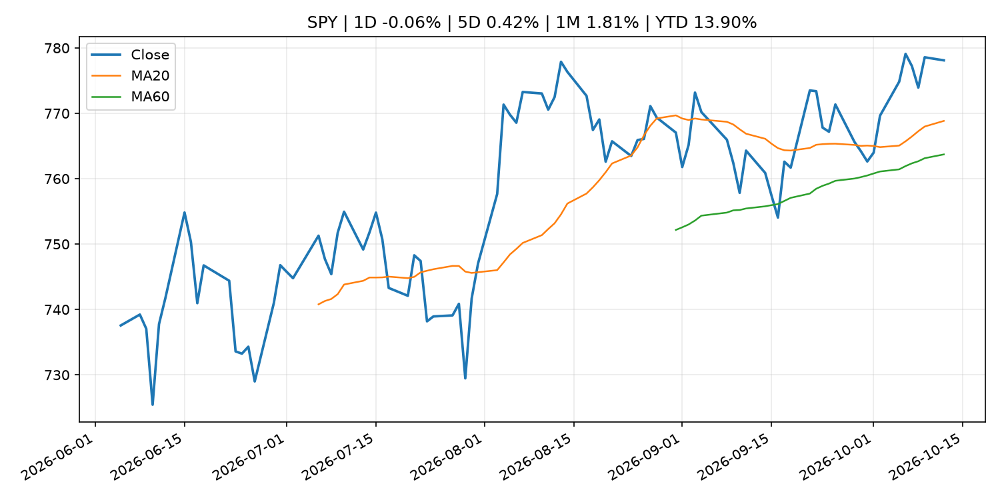
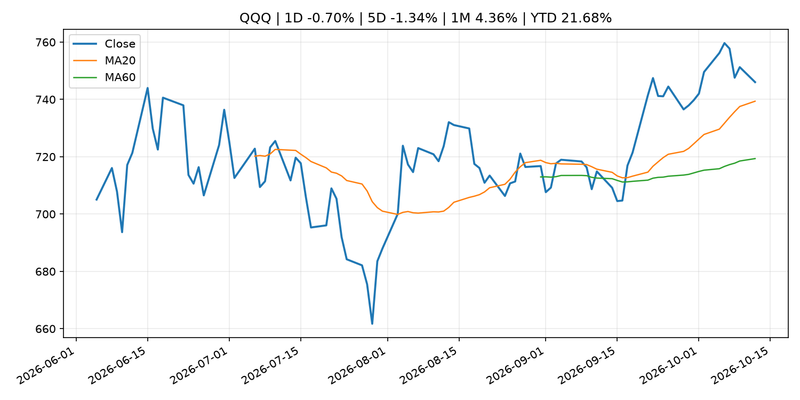
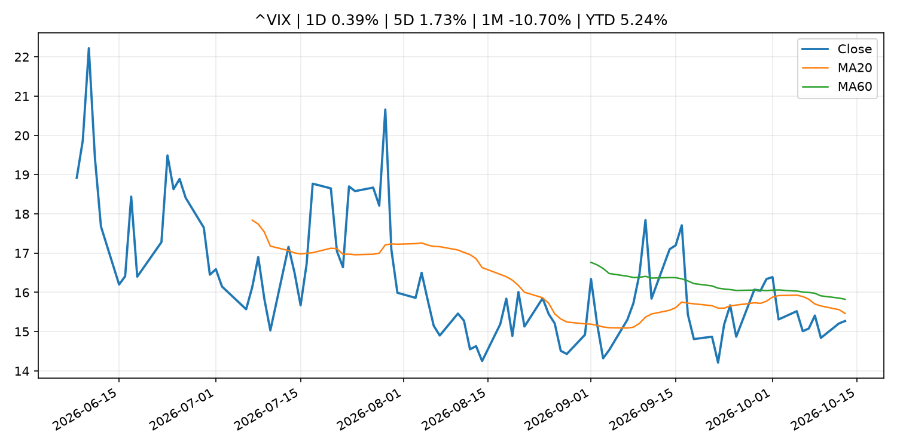
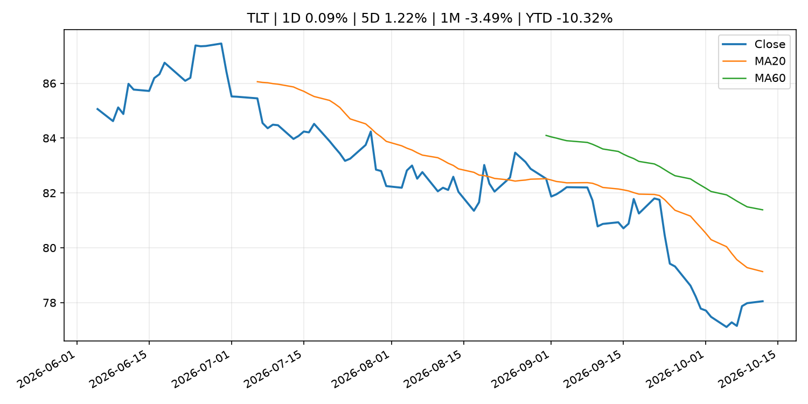
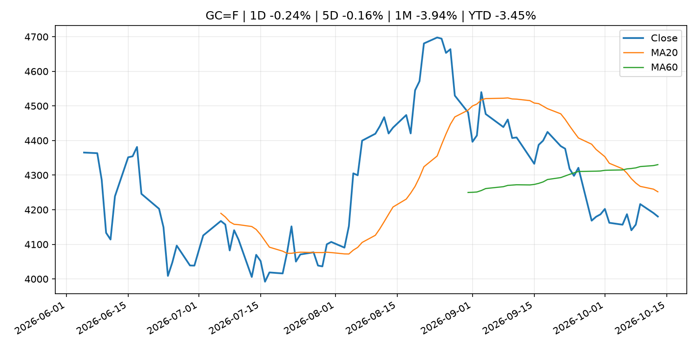
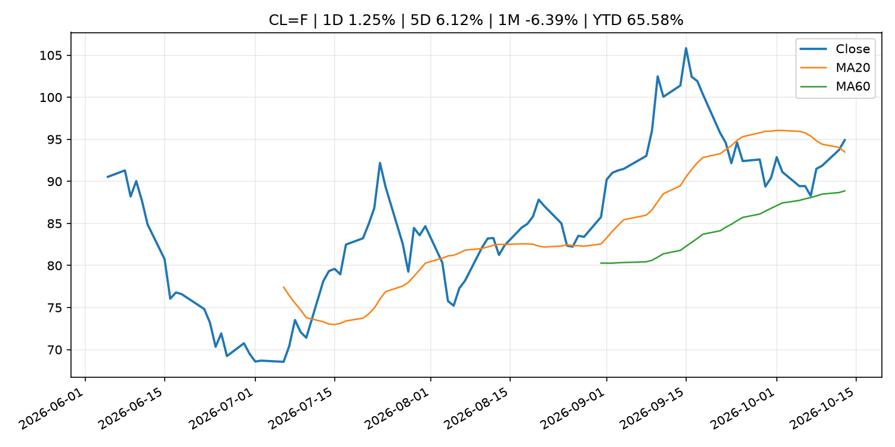
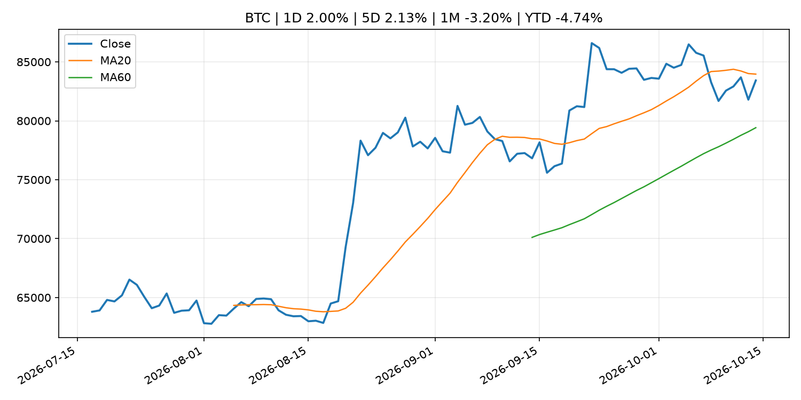
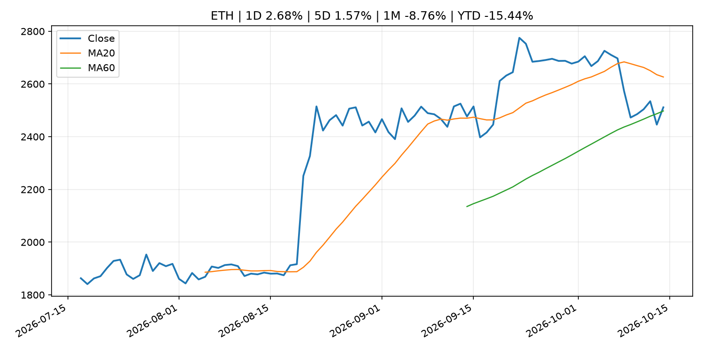
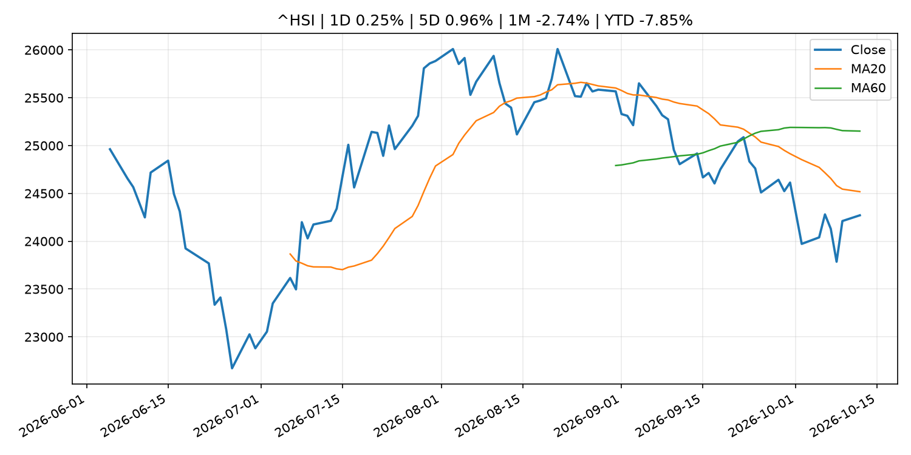

# Global Macro Morning Briefing - 2026-10-14

> Not financial advice / 非投资建议。

## 0. 今日总览
- 市场状态：unknown。市场信号不足，暂不判断明确状态。
- 今日三大主线：
  1. central_bank_decision: Williams says Fed may not have to hike rates in 2027, at odds with traders
  2. central_bank_speech: Higher rates could be needed to avoid 'inflationary mindset' taking hold, says Fed's Hammack
  3. crypto_market_structure: Global financial watchdog calls for cross-border information sharing, planning for stablecoin crisis
- 一句话结论：今日晨报重点关注：央行决策会重定价利率、汇率、久期资产和风险资产。；央行官员表态可能影响市场对下一次会议的定价。。跨资产方面，SPY 1D -0.06%；QQQ 1D -0.70%；^VIX 1D 0.39%；TLT 1D 0.09%；GC=F 1D -0.24%；CL=F 1D 1.25%；BTC 1D 2.00%；ETH 1D 2.68%；市场信号不足，暂不判断明确状态。政策、通胀、利率、美元、美债、能源和加密监管仍是主要观察线索。所有结论仅基于公开数据与短摘要整理，不构成投资建议。

## 1. 隔夜跨资产市场
- 美股：SPY 1D -0.06%，QQQ 1D -0.70%，整体趋势需结合 VIX 和利率确认。
- 美债/美元：TLT 1D 0.09%，美元指数 1D -0.41%，是判断折现率压力的核心线索。
- 黄金/原油：黄金 1D -0.24%，原油 1D 1.25%，用于观察避险、通胀和地缘风险。
- 加密：BTC 1D 2.00%，ETH 1D 2.68%，关注是否独立于纳指走出加密自身行情。
- 港股/A股：恒生 1D 0.25%，沪深300/上证 1D n/a，重点看中国政策预期与人民币线索。
- 风险观察：关注后续数据是否确认当前跨资产信号。

### US_EQUITY

| symbol | latest close | 1D | 5D | 1M | YTD | trend |
|---|---:|---:|---:|---:|---:|---|
| SPY | 778.10 | -0.06% | 0.42% | 1.81% | 13.90% | uptrend |
| QQQ | 746.04 | -0.70% | -1.34% | 4.36% | 21.68% | uptrend |
| DIA | 517.91 | 0.35% | 1.13% | -1.50% | 7.09% | range_bound |
| IWM | 277.90 | -0.37% | -1.93% | -3.80% | 11.71% | strong_downtrend |
| VTI | 381.57 | -0.10% | 0.25% | 1.40% | 13.46% | uptrend |

### US_MACRO_MARKET

| symbol | latest close | 1D | 5D | 1M | YTD | trend |
|---|---:|---:|---:|---:|---:|---|
| ^VIX | 15.27 | 0.39% | 1.73% | -10.70% | 5.24% | downtrend |
| DX-Y.NYB | 102.16 | -0.41% | 0.33% | 2.72% | 3.80% | uptrend |
| TLT | 78.05 | 0.09% | 1.22% | -3.49% | -10.32% | strong_downtrend |
| IEF | 89.43 | 0.03% | 0.57% | -1.74% | -6.92% | downtrend |

### COMMODITIES

| symbol | latest close | 1D | 5D | 1M | YTD | trend |
|---|---:|---:|---:|---:|---:|---|
| GC=F | 4,180.40 | -0.24% | -0.16% | -3.94% | -3.45% | strong_downtrend |
| SI=F | 59.28 | -1.43% | -3.09% | -6.66% | -15.98% | strong_downtrend |
| CL=F | 94.91 | 1.25% | 6.12% | -6.39% | 65.58% | uptrend |
| BZ=F | 106.57 | -0.08% | 5.96% | 0.84% | 75.42% | uptrend |
| NG=F | 3.33 | 5.08% | 6.87% | 14.92% | -8.02% | strong_uptrend |
| HG=F | 6.73 | 0.40% | 1.99% | 6.25% | 19.25% | uptrend |

### HK_MARKET

| symbol | latest close | 1D | 5D | 1M | YTD | trend |
|---|---:|---:|---:|---:|---:|---|
| ^HSI | 24,271.20 | 0.25% | 0.96% | -2.74% | -7.85% | downtrend |
| 0700.HK | 425.20 | -0.14% | -0.70% | -0.75% | -31.75% | downtrend |
| 9988.HK | 107.20 | -0.92% | -0.92% | -0.28% | -28.05% | downtrend |
| 3690.HK | 72.30 | 0.70% | 2.12% | -3.73% | -30.88% | range_bound |
| 1810.HK | 25.04 | 2.12% | 3.22% | -5.01% | -37.84% | strong_downtrend |
| 1211.HK | 73.25 | -1.48% | -2.33% | -8.27% | -25.82% | strong_downtrend |

### CRYPTO

| symbol | latest close | 1D | 5D | 1M | YTD | trend |
|---|---:|---:|---:|---:|---:|---|
| BTC | 83,427.73 | 2.00% | 2.13% | -3.20% | -4.74% | range_bound |
| ETH | 2,511.44 | 2.68% | 1.57% | -8.76% | -15.44% | range_bound |
| SOLANA | 107.55 | 1.81% | -1.79% | -9.25% | -13.63% | range_bound |
| BINANCECOIN | 744.07 | 1.61% | 1.18% | -5.59% | -13.75% | range_bound |
| RIPPLE | 1.37 | 2.36% | -0.48% | -12.64% | -25.42% | range_bound |

## 2. 今日最重要的 10 条新闻
### 1. Williams says Fed may not have to hike rates in 2027, at odds with traders
- 来源：CNBC Economy
- 时间：2026-10-13T19:46:12+00:00
- 地区：US
- 事件类型：central_bank_decision
- 重要性层级：Tier 1
- 一句话摘要：New York Fed President John Williams sees one more rate hike in 2026 but no additional increase in 2027 as inflation pressures ease.
- 为什么重要：央行决策会重定价利率、汇率、久期资产和风险资产。
- 可能影响：主要影响 DXY，方向为 positive，强度 high；通胀压力可能推高政策利率预期并支撑美元。
  - 资产：DXY
    方向：positive
    强度：high
    原因：通胀压力可能推高政策利率预期并支撑美元。
  - 资产：TLT
    方向：negative
    强度：high
    原因：通胀上行通常推升收益率、压低长债价格。
  - 资产：QQQ
    方向：negative
    强度：high
    原因：更高利率对成长股估值折现率不利。
  - 资产：SPY
    方向：mixed
    强度：medium
    原因：名义增长可能支撑收入，但更高利率压制估值。
  - 资产：GC=F
    方向：mixed
    强度：medium
    原因：通胀对黄金是支撑，但实际利率上行会形成压力。
  - 资产：BTC
    方向：negative
    强度：high
    原因：流动性收紧通常压制高 beta 加密资产。
- 原文链接：[https://www.cnbc.com/2026/10/13/john-williams-fed-rate-hikes-2027.html](https://www.cnbc.com/2026/10/13/john-williams-fed-rate-hikes-2027.html)

### 2. Higher rates could be needed to avoid 'inflationary mindset' taking hold, says Fed's Hammack
- 来源：CNBC Economy
- 时间：2026-10-13T02:58:11+00:00
- 地区：US
- 事件类型：central_bank_speech
- 重要性层级：Tier 2
- 一句话摘要：The Cleveland Fed president said that tighter monetary policy would be needed to bring down inflation.
- 为什么重要：央行官员表态可能影响市场对下一次会议的定价。
- 可能影响：主要影响 DXY，方向为 positive，强度 high；通胀压力可能推高政策利率预期并支撑美元。
  - 资产：DXY
    方向：positive
    强度：high
    原因：通胀压力可能推高政策利率预期并支撑美元。
  - 资产：TLT
    方向：negative
    强度：high
    原因：通胀上行通常推升收益率、压低长债价格。
  - 资产：QQQ
    方向：negative
    强度：high
    原因：更高利率对成长股估值折现率不利。
  - 资产：SPY
    方向：mixed
    强度：medium
    原因：名义增长可能支撑收入，但更高利率压制估值。
  - 资产：GC=F
    方向：mixed
    强度：medium
    原因：通胀对黄金是支撑，但实际利率上行会形成压力。
  - 资产：BTC
    方向：mixed
    强度：medium
    原因：抗通胀叙事和流动性收紧可能相互抵消。
- 原文链接：[https://www.cnbc.com/2026/10/12/beth-hammack-fed-inflation-policy.html](https://www.cnbc.com/2026/10/12/beth-hammack-fed-inflation-policy.html)

### 3. Global financial watchdog calls for cross-border information sharing, planning for stablecoin crisis
- 来源：CoinDesk
- 时间：2026-10-12T11:02:38+00:00
- 地区：global
- 事件类型：crypto_market_structure
- 重要性层级：Tier 2
- 一句话摘要：Global financial watchdog calls for cross-border information sharing, planning for stablecoin crisis
- 为什么重要：加密市场结构和监管变化会影响 BTC、ETH 及相关股票的风险溢价。
- 可能影响：主要影响 BTC，方向为 mixed，强度 high；加密监管或 ETF 进展会改变 BTC 的资金流和风险溢价。
  - 资产：BTC
    方向：mixed
    强度：high
    原因：加密监管或 ETF 进展会改变 BTC 的资金流和风险溢价。
  - 资产：ETH
    方向：mixed
    强度：high
    原因：监管框架会影响 ETH 产品化和机构参与度。
  - 资产：COIN
    方向：mixed
    强度：medium
    原因：监管清晰度和执法风险会影响交易平台估值。
  - 资产：crypto market
    方向：mixed
    强度：high
    原因：信息影响整个加密市场结构，但方向取决于细节。
- 原文链接：[https://www.coindesk.com/policy/2026/10/12/global-financial-watchdog-calls-for-cross-border-information-sharing-planning-for-stablecoin-crisis](https://www.coindesk.com/policy/2026/10/12/global-financial-watchdog-calls-for-cross-border-information-sharing-planning-for-stablecoin-crisis)

### 4. My wife says we can’t afford to retire, yet she wants to take an $8,000 trip to Italy. We have $4 million. Do I keep working?
- 来源：MarketWatch Top Stories
- 时间：2026-10-13T20:30:00+00:00
- 地区：US
- 事件类型：other
- 重要性层级：Tier 3
- 一句话摘要：“I worry about healthcare, long-term care, inflation, a long bear market and living to 95.”
- 为什么重要：这条信息暂未匹配到重大宏观、政策或市场事件，更适合作为背景跟踪。
- 可能影响：主要影响 DXY，方向为 positive，强度 high；通胀压力可能推高政策利率预期并支撑美元。
  - 资产：DXY
    方向：positive
    强度：high
    原因：通胀压力可能推高政策利率预期并支撑美元。
  - 资产：TLT
    方向：negative
    强度：high
    原因：通胀上行通常推升收益率、压低长债价格。
  - 资产：QQQ
    方向：negative
    强度：high
    原因：更高利率对成长股估值折现率不利。
  - 资产：SPY
    方向：mixed
    强度：medium
    原因：名义增长可能支撑收入，但更高利率压制估值。
  - 资产：GC=F
    方向：mixed
    强度：medium
    原因：通胀对黄金是支撑，但实际利率上行会形成压力。
  - 资产：BTC
    方向：mixed
    强度：medium
    原因：抗通胀叙事和流动性收紧可能相互抵消。
- 原文链接：[https://www.marketwatch.com/story/my-wife-says-we-cant-afford-to-retire-we-have-4-million-do-i-just-keep-working-f1b6b085?mod=mw_rss_topstories](https://www.marketwatch.com/story/my-wife-says-we-cant-afford-to-retire-we-have-4-million-do-i-just-keep-working-f1b6b085?mod=mw_rss_topstories)

### 5. Live updates: Bitcoin trading in tight range near $83,000 ahead of key U.S. inflation data
- 来源：CoinDesk
- 时间：2026-10-13T10:46:57+00:00
- 地区：global
- 事件类型：other
- 重要性层级：Tier 3
- 一句话摘要：Live updates: Bitcoin trading in tight range near $83,000 ahead of key U.S. inflation data
- 为什么重要：这条信息暂未匹配到重大宏观、政策或市场事件，更适合作为背景跟踪。
- 可能影响：主要影响 DXY，方向为 positive，强度 high；通胀压力可能推高政策利率预期并支撑美元。
  - 资产：DXY
    方向：positive
    强度：high
    原因：通胀压力可能推高政策利率预期并支撑美元。
  - 资产：TLT
    方向：negative
    强度：high
    原因：通胀上行通常推升收益率、压低长债价格。
  - 资产：QQQ
    方向：negative
    强度：high
    原因：更高利率对成长股估值折现率不利。
  - 资产：SPY
    方向：mixed
    强度：medium
    原因：名义增长可能支撑收入，但更高利率压制估值。
  - 资产：GC=F
    方向：mixed
    强度：medium
    原因：通胀对黄金是支撑，但实际利率上行会形成压力。
  - 资产：BTC
    方向：mixed
    强度：medium
    原因：抗通胀叙事和流动性收紧可能相互抵消。
- 原文链接：[https://www.coindesk.com/markets/2026/10/13/live-updates-bitcoin-whipsaws-between-usd81-000-and-usd84-000-as-altcoins-slide](https://www.coindesk.com/markets/2026/10/13/live-updates-bitcoin-whipsaws-between-usd81-000-and-usd84-000-as-altcoins-slide)

## 3. 政策与央行观察
### 1. Williams says Fed may not have to hike rates in 2027, at odds with traders
- 来源：CNBC Economy
- 时间：2026-10-13T19:46:12+00:00
- 地区：US
- 事件类型：central_bank_decision
- 重要性层级：Tier 1
- 一句话摘要：New York Fed President John Williams sees one more rate hike in 2026 but no additional increase in 2027 as inflation pressures ease.
- 为什么重要：央行决策会重定价利率、汇率、久期资产和风险资产。
- 可能影响：主要影响 DXY，方向为 positive，强度 high；通胀压力可能推高政策利率预期并支撑美元。
  - 资产：DXY
    方向：positive
    强度：high
    原因：通胀压力可能推高政策利率预期并支撑美元。
  - 资产：TLT
    方向：negative
    强度：high
    原因：通胀上行通常推升收益率、压低长债价格。
  - 资产：QQQ
    方向：negative
    强度：high
    原因：更高利率对成长股估值折现率不利。
  - 资产：SPY
    方向：mixed
    强度：medium
    原因：名义增长可能支撑收入，但更高利率压制估值。
  - 资产：GC=F
    方向：mixed
    强度：medium
    原因：通胀对黄金是支撑，但实际利率上行会形成压力。
  - 资产：BTC
    方向：negative
    强度：high
    原因：流动性收紧通常压制高 beta 加密资产。
- 原文链接：[https://www.cnbc.com/2026/10/13/john-williams-fed-rate-hikes-2027.html](https://www.cnbc.com/2026/10/13/john-williams-fed-rate-hikes-2027.html)

### 2. Higher rates could be needed to avoid 'inflationary mindset' taking hold, says Fed's Hammack
- 来源：CNBC Economy
- 时间：2026-10-13T02:58:11+00:00
- 地区：US
- 事件类型：central_bank_speech
- 重要性层级：Tier 2
- 一句话摘要：The Cleveland Fed president said that tighter monetary policy would be needed to bring down inflation.
- 为什么重要：央行官员表态可能影响市场对下一次会议的定价。
- 可能影响：主要影响 DXY，方向为 positive，强度 high；通胀压力可能推高政策利率预期并支撑美元。
  - 资产：DXY
    方向：positive
    强度：high
    原因：通胀压力可能推高政策利率预期并支撑美元。
  - 资产：TLT
    方向：negative
    强度：high
    原因：通胀上行通常推升收益率、压低长债价格。
  - 资产：QQQ
    方向：negative
    强度：high
    原因：更高利率对成长股估值折现率不利。
  - 资产：SPY
    方向：mixed
    强度：medium
    原因：名义增长可能支撑收入，但更高利率压制估值。
  - 资产：GC=F
    方向：mixed
    强度：medium
    原因：通胀对黄金是支撑，但实际利率上行会形成压力。
  - 资产：BTC
    方向：mixed
    强度：medium
    原因：抗通胀叙事和流动性收紧可能相互抵消。
- 原文链接：[https://www.cnbc.com/2026/10/12/beth-hammack-fed-inflation-policy.html](https://www.cnbc.com/2026/10/12/beth-hammack-fed-inflation-policy.html)

### 3. Global financial watchdog calls for cross-border information sharing, planning for stablecoin crisis
- 来源：CoinDesk
- 时间：2026-10-12T11:02:38+00:00
- 地区：global
- 事件类型：crypto_market_structure
- 重要性层级：Tier 2
- 一句话摘要：Global financial watchdog calls for cross-border information sharing, planning for stablecoin crisis
- 为什么重要：加密市场结构和监管变化会影响 BTC、ETH 及相关股票的风险溢价。
- 可能影响：主要影响 BTC，方向为 mixed，强度 high；加密监管或 ETF 进展会改变 BTC 的资金流和风险溢价。
  - 资产：BTC
    方向：mixed
    强度：high
    原因：加密监管或 ETF 进展会改变 BTC 的资金流和风险溢价。
  - 资产：ETH
    方向：mixed
    强度：high
    原因：监管框架会影响 ETH 产品化和机构参与度。
  - 资产：COIN
    方向：mixed
    强度：medium
    原因：监管清晰度和执法风险会影响交易平台估值。
  - 资产：crypto market
    方向：mixed
    强度：high
    原因：信息影响整个加密市场结构，但方向取决于细节。
- 原文链接：[https://www.coindesk.com/policy/2026/10/12/global-financial-watchdog-calls-for-cross-border-information-sharing-planning-for-stablecoin-crisis](https://www.coindesk.com/policy/2026/10/12/global-financial-watchdog-calls-for-cross-border-information-sharing-planning-for-stablecoin-crisis)

## 4. 市场异动与图表
- QQQ 下跌 -0.70%
- DXY 下跌 -0.41%
- Oil 上涨 1.25%
- ETH 上涨 2.68%

### SPY

### QQQ

### ^VIX

### TLT

### GC=F

### CL=F

### BTC

### ETH

### ^HSI

## 5. 华尔街与机构公开观点
- 暂无可靠公开观点。

## 6. 今日重点关注
- 经济数据：经济数据：暂无可靠公开日历数据；如配置经济日历源后可自动填充。
- 央行讲话：央行讲话：暂无可靠公开日历数据；重点跟踪 Fed、ECB、BoJ、PBOC 官网 RSS。
- 财报：财报：暂无可靠数据。
- 政策事件：政策事件：暂无可靠数据。
- 风险提醒：风险提醒：关注数据源失败项、突发地缘风险、利率和美元的二阶反应。

## 7. 英文金融表达与宏观概念
- **inflation expectations**：通胀预期，指家庭、企业或市场对未来通胀的预估。 例句：Inflation expectations can shape wage bargaining and bond yields.
- **real yield**：实际收益率，名义利率扣除通胀预期后的收益率。 例句：Gold often reacts more to real yields than nominal yields.
- **terminal rate**：终端利率，市场预期本轮加息周期的最高政策利率。 例句：A higher terminal rate can pressure growth stocks.
- **market structure**：市场结构，指交易、托管、清算、ETF、监管等制度安排。 例句：Crypto market structure rules can affect institutional participation.
- **soft landing**：软着陆，指通胀回落而经济避免明显衰退。 例句：Markets often rally when data support a soft landing.
- **risk-off**：避险模式，资金偏向美元、国债、黄金等防御资产。 例句：A geopolitical shock can push markets into risk-off mode.

## 8. 背景材料
- [Money Stock (Sept.)](http://www.boj.or.jp/en/statistics/money/ms/ms2609.pdf)（Bank of Japan Announcements，other）：Money Stock (Sept.)
- [Strive raising $500 million to buy additional bitcoin with new preferred share class](https://www.coindesk.com/markets/2026/10/13/strive-to-ipo-second-preferred-share-class-as-it-looks-to-further-build-bitcoin-treasury)（CoinDesk，other）：Strive raising $500 million to buy additional bitcoin with new preferred share class
- [Goldman says investors are looking for 'profitable' Chinese business growth overseas](https://www.cnbc.com/2026/10/14/goldman-says-investors-seek-profitable-chinese-business-growth-abroad.html)（CNBC Economy，other）：Sluggish consumer demand in China has pushed many companies, such as electric car brands, to accelerate plans for entering other countries.
- [BNY, Citadel Securities test tokenized U.S. Treasuries to speed up Wall Street financing](https://www.coindesk.com/business/2026/10/13/bny-citadel-securities-test-tokenized-u-s-treasuries-to-speed-up-wall-street-financing)（CoinDesk，other）：BNY, Citadel Securities test tokenized U.S. Treasuries to speed up Wall Street financing
- [My wife says we can’t afford to retire, yet she wants to take an $8,000 trip to Italy. We have $4 million. Do I keep working?](https://www.marketwatch.com/story/my-wife-says-we-cant-afford-to-retire-we-have-4-million-do-i-just-keep-working-f1b6b085?mod=mw_rss_topstories)（MarketWatch Top Stories，other）：“I worry about healthcare, long-term care, inflation, a long bear market and living to 95.”
- [Philip R. Lane: The AI opportunity for Europe](https://www.ecb.europa.eu//press/key/date/2026/html/ecb.sp261013~9db9bf4fd6.en.html)（ECB Press Releases，other）：Philip R. Lane: The AI opportunity for Europe
- [Minutes of the Board's discount rate meetings on August 17, September 9, and September 16, 2026](https://www.federalreserve.gov/newsevents/pressreleases/monetary20261013a.htm)（Federal Reserve Press Releases，other）：Minutes of the Board's discount rate meetings on August 17, September 9, and September 16, 2026
- [Stacks' STX, a Bitcoin layer-2 token, has surged by 50% in four weeks](https://www.coindesk.com/daybook-us/2026/10/13/stacks-stx-a-bitcoin-layer-2-token-has-surged-by-50-in-four-weeks)（CoinDesk，other）：Stacks' STX, a Bitcoin layer-2 token, has surged by 50% in four weeks
- [Bitcoin, ether slip and rebound as South Korean stocks slide on AI-related concerns](https://www.coindesk.com/markets/2026/10/13/bitcoin-ether-slip-and-rebound-as-south-korean-stocks-slide-on-ai-related-concerns)（CoinDesk，other）：Bitcoin, ether slip and rebound as South Korean stocks slide on AI-related concerns
- [Russia’s largest bank Sberbank secures approval to trade crypto](https://www.coindesk.com/business/2026/10/13/russia-s-largest-bank-sberbank-secures-approval-to-trade-crypto)（CoinDesk，other）：Russia’s largest bank Sberbank secures approval to trade crypto
- [Live updates: Bitcoin trading in tight range near $83,000 ahead of key U.S. inflation data](https://www.coindesk.com/markets/2026/10/13/live-updates-bitcoin-whipsaws-between-usd81-000-and-usd84-000-as-altcoins-slide)（CoinDesk，other）：Live updates: Bitcoin trading in tight range near $83,000 ahead of key U.S. inflation data
- [Bitcoin diverges from South Korean stocks as AI concerns deepen the Kospi selloff](https://www.coindesk.com/markets/2026/10/13/bitcoin-diverges-from-south-korean-stocks-as-ai-concerns-deepen-the-kospi-selloff)（CoinDesk，other）：Bitcoin diverges from South Korean stocks as AI concerns deepen the Kospi selloff
- [UK court ruling boosts government’s chances of keeping $5 billion in seized bitcoin](https://www.coindesk.com/policy/2026/10/13/u-k-court-ruling-boosts-government-s-chances-of-keeping-gbp3-8-billion-seized-bitcoin)（CoinDesk，other）：UK court ruling boosts government’s chances of keeping $5 billion in seized bitcoin
- [Basic Figures on Fails (Sept.)](http://www.boj.or.jp/en/statistics/set/bffail/sjgb2609.pdf)（Bank of Japan Announcements，other）：Basic Figures on Fails (Sept.)
- [Bitcoin whale that sat through the March 2020 crash moves $378 million](https://www.coindesk.com/markets/2026/10/13/bitcoin-whale-that-sat-through-the-march-2020-crash-moves-usd378-million)（CoinDesk，other）：Bitcoin whale that sat through the March 2020 crash moves $378 million
- [Results of the 107th Opinion Survey on the General Public's Views and Behavior](http://www.boj.or.jp/en/research/o_survey/ishiki2610.htm)（Bank of Japan Announcements，other）：Results of the 107th Opinion Survey on the General Public's Views and Behavior
- [Bitcoin rebounds above $83,000, decoupling from tumbling Korean stocks](https://www.coindesk.com/markets/2026/10/13/bitcoin-rebounds-above-usd83-000-as-it-decouples-from-tumbling-korean-stocks-and-nasdaq-futures)（CoinDesk，other）：Bitcoin rebounds above $83,000, decoupling from tumbling Korean stocks
- [Principal Figures of Financial Institutions (Sept.)](http://www.boj.or.jp/en/statistics/dl/depo/kashi/kasi2609.pdf)（Bank of Japan Announcements，other）：Principal Figures of Financial Institutions (Sept.)
- [Corporate Goods Price Index (Sept.)](http://www.boj.or.jp/en/statistics/pi/cgpi_release/cgpi2609.pdf)（Bank of Japan Announcements，other）：Corporate Goods Price Index (Sept.)
- [Inflation likely peaked for 2026 but will remain sticky, according to prediction markets](https://www.cnbc.com/2026/10/12/inflation-will-remain-sticky-in-2026-according-to-prediction-markets.html)（CNBC Economy，other）：Traders think there's little chance core inflation, which excludes food and energy prices, will fall to 2.2% this year.

## 9. 数据源、失败项与免责声明
- 采集时间：2026-10-14T00:53:03
- 数据源：公开 RSS、Yahoo Finance、CoinGecko、AKShare、FRED、SEC data.sec.gov，以及用户自有 inputs/reports 文件。
- 合规说明：不绕过 WSJ、Bloomberg、FT、Reuters 等付费墙；对付费媒体只使用公开 RSS 标题、摘要、链接和发布时间。
- 免责声明：Not financial advice / 非投资建议。本项目仅供个人学习、研究和信息整理，不构成投资建议、交易建议或任何收益承诺。
- 失败或跳过的数据源：
  - crypto data failed coin=dogecoin
  - China market data failed symbol=上证指数: empty dataframe
  - China market data failed symbol=深证成指: empty dataframe
  - China market data failed symbol=创业板指: empty dataframe
  - China market data failed symbol=沪深300: empty dataframe
  - China market data failed symbol=中证500: empty dataframe
  - China market data failed symbol=科创50: empty dataframe
  - FRED_API_KEY not set; skipping FRED macro series
  - SEC failed cik=0000320193
  - SEC failed cik=0000789019
  - SEC failed cik=0001045810
  - SEC failed cik=0001318605
  - SEC failed cik=0001577552
