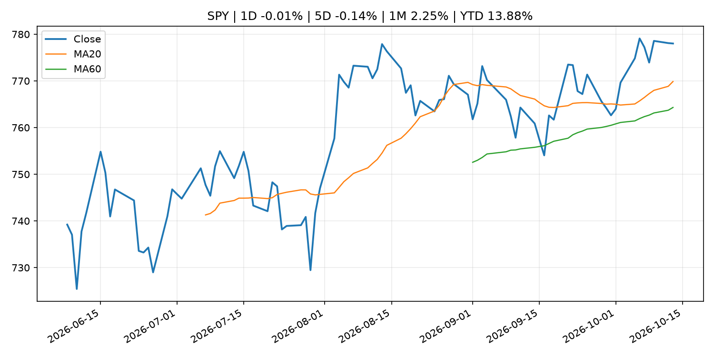
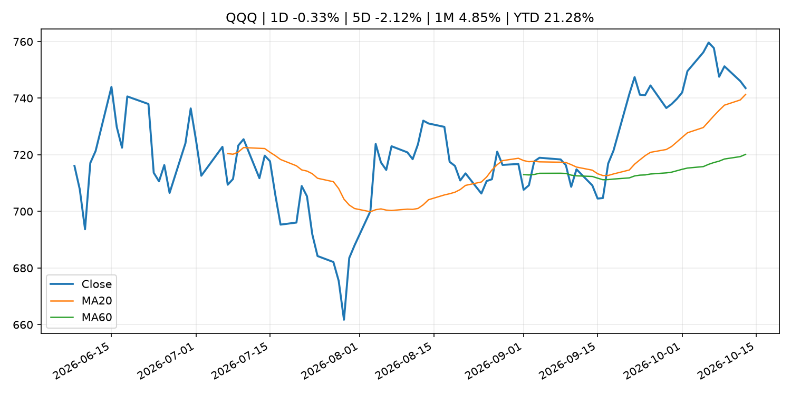
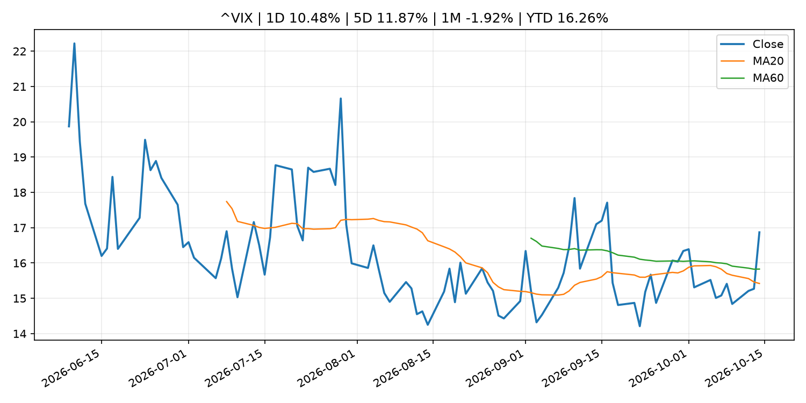
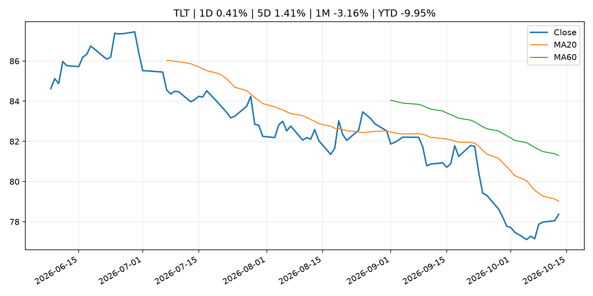
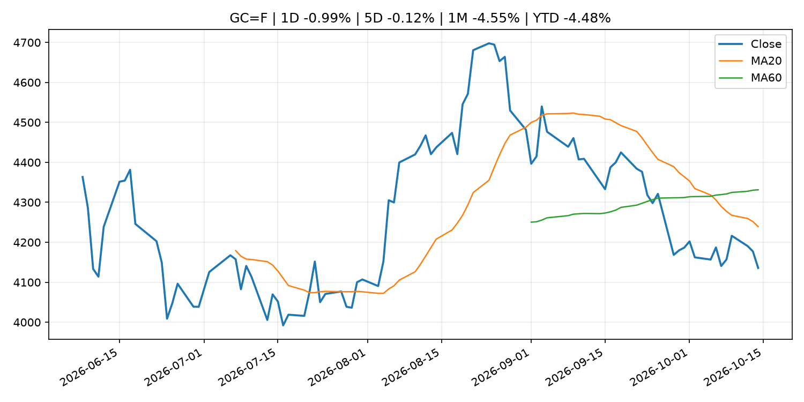
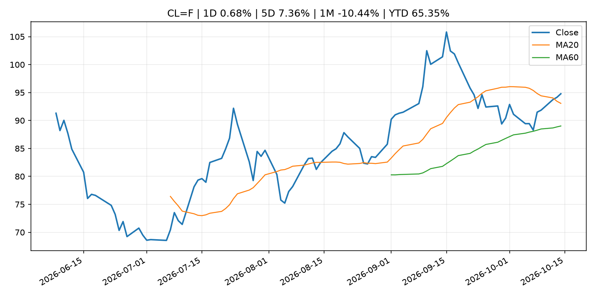
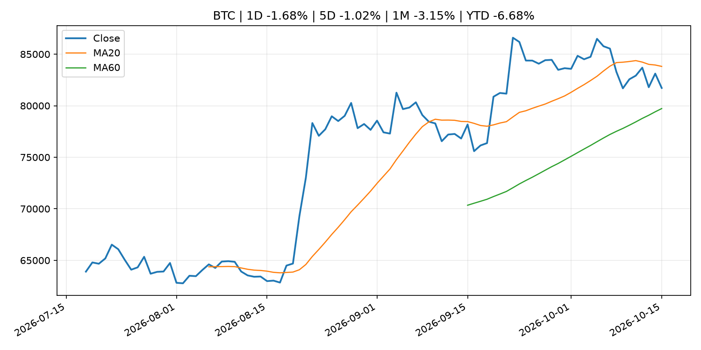
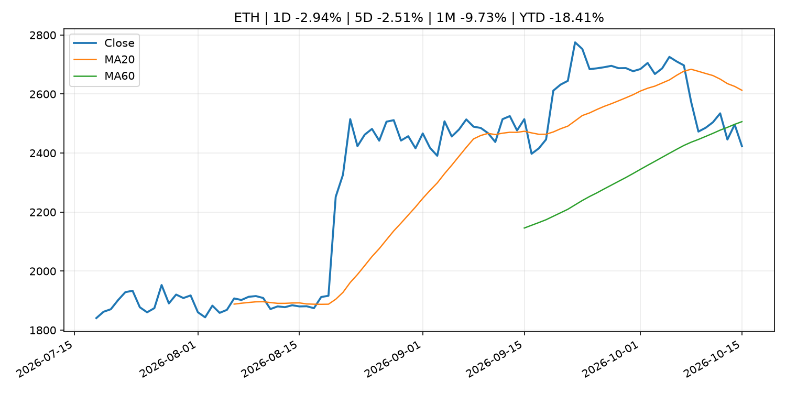
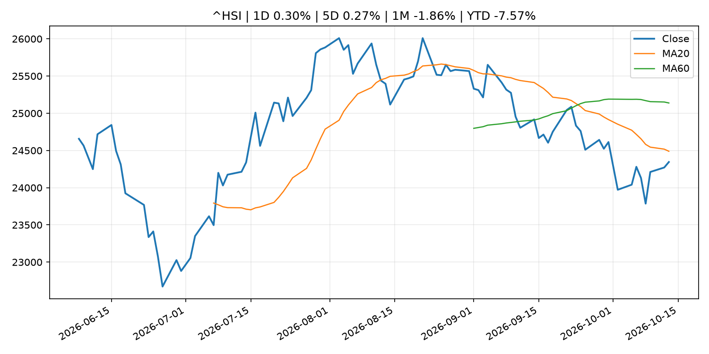

# Global Macro Morning Briefing - 2026-10-15

> Not financial advice / 非投资建议。

## 0. 今日总览
- 市场状态：unknown。市场信号不足，暂不判断明确状态。
- 今日三大主线：
  1. macro_data: U.S. September CPI comes in hot, sending bitcoin sharply lower
  2. central_bank_decision: Williams says Fed may not have to hike rates in 2027, at odds with traders
  3. fiscal_policy: Proposed 31.4% French tax on regulated stablecoins could drive crypto traders offshore
- 一句话结论：今日晨报重点关注：这类宏观数据会直接改变市场对通胀、增长和政策路径的预期。；央行决策会重定价利率、汇率、久期资产和风险资产。。跨资产方面，SPY 1D -0.01%；QQQ 1D -0.33%；^VIX 1D 10.48%；TLT 1D 0.41%；GC=F 1D -0.99%；CL=F 1D 0.68%；BTC 1D -1.68%；ETH 1D -2.94%；市场信号不足，暂不判断明确状态。政策、通胀、利率、美元、美债、能源和加密监管仍是主要观察线索。所有结论仅基于公开数据与短摘要整理，不构成投资建议。

## 1. 隔夜跨资产市场
- 美股：SPY 1D -0.01%，QQQ 1D -0.33%，整体趋势需结合 VIX 和利率确认。
- 美债/美元：TLT 1D 0.41%，美元指数 1D 0.09%，是判断折现率压力的核心线索。
- 黄金/原油：黄金 1D -0.99%，原油 1D 0.68%，用于观察避险、通胀和地缘风险。
- 加密：BTC 1D -1.68%，ETH 1D -2.94%，关注是否独立于纳指走出加密自身行情。
- 港股/A股：恒生 1D 0.30%，沪深300/上证 1D n/a，重点看中国政策预期与人民币线索。
- 风险观察：关注后续数据是否确认当前跨资产信号。

### US_EQUITY

| symbol | latest close | 1D | 5D | 1M | YTD | trend |
|---|---:|---:|---:|---:|---:|---|
| SPY | 778.01 | -0.01% | -0.14% | 2.25% | 13.88% | uptrend |
| QQQ | 743.57 | -0.33% | -2.12% | 4.85% | 21.28% | uptrend |
| DIA | 516.21 | -0.33% | 0.32% | -1.58% | 6.74% | range_bound |
| IWM | 276.70 | -0.43% | -1.65% | -3.89% | 11.22% | strong_downtrend |
| VTI | 381.32 | -0.07% | -0.32% | 1.77% | 13.38% | uptrend |

### US_MACRO_MARKET

| symbol | latest close | 1D | 5D | 1M | YTD | trend |
|---|---:|---:|---:|---:|---:|---|
| ^VIX | 16.87 | 10.48% | 11.87% | -1.92% | 16.26% | range_bound |
| DX-Y.NYB | 102.27 | 0.09% | 0.03% | 2.63% | 3.91% | uptrend |
| TLT | 78.37 | 0.41% | 1.41% | -3.16% | -9.95% | strong_downtrend |
| IEF | 89.54 | 0.12% | 0.46% | -1.53% | -6.81% | downtrend |

### COMMODITIES

| symbol | latest close | 1D | 5D | 1M | YTD | trend |
|---|---:|---:|---:|---:|---:|---|
| GC=F | 4,135.80 | -0.99% | -0.12% | -4.55% | -4.48% | strong_downtrend |
| SI=F | 55.88 | -5.55% | -6.72% | -11.64% | -20.81% | strong_downtrend |
| CL=F | 94.78 | 0.68% | 7.36% | -10.44% | 65.35% | uptrend |
| BZ=F | 105.61 | -0.08% | 5.40% | -2.89% | 73.84% | uptrend |
| NG=F | 3.29 | 0.09% | 2.59% | 12.57% | -9.18% | uptrend |
| HG=F | 6.62 | -0.87% | 0.36% | 3.95% | 17.38% | uptrend |

### HK_MARKET

| symbol | latest close | 1D | 5D | 1M | YTD | trend |
|---|---:|---:|---:|---:|---:|---|
| ^HSI | 24,345.22 | 0.30% | 0.27% | -1.86% | -7.57% | downtrend |
| 0700.HK | 423.40 | -0.42% | 0.67% | -1.67% | -32.04% | downtrend |
| 9988.HK | 110.50 | 3.08% | 4.84% | 4.34% | -25.84% | range_bound |
| 3690.HK | 77.10 | 6.64% | 9.91% | 2.73% | -26.29% | range_bound |
| 1810.HK | 26.38 | 5.35% | 10.19% | -2.87% | -34.51% | range_bound |
| 1211.HK | 72.85 | -0.55% | -2.28% | -9.16% | -26.23% | strong_downtrend |

### CRYPTO

| symbol | latest close | 1D | 5D | 1M | YTD | trend |
|---|---:|---:|---:|---:|---:|---|
| BTC | 81,721.26 | -1.68% | -1.02% | -3.15% | -6.68% | range_bound |
| ETH | 2,423.29 | -2.94% | -2.51% | -9.73% | -18.41% | range_bound |
| SOLANA | 104.33 | -2.27% | -4.35% | -9.27% | -16.22% | range_bound |
| BINANCECOIN | 729.88 | -1.53% | -1.60% | -4.87% | -15.39% | range_bound |
| RIPPLE | 1.33 | -2.41% | -4.48% | -11.25% | -27.62% | range_bound |

## 2. 今日最重要的 10 条新闻
### 1. U.S. September CPI comes in hot, sending bitcoin sharply lower
- 来源：CoinDesk
- 时间：2026-10-14T12:33:56+00:00
- 地区：global
- 事件类型：macro_data
- 重要性层级：Tier 1
- 一句话摘要：U.S. September CPI comes in hot, sending bitcoin sharply lower
- 为什么重要：这类宏观数据会直接改变市场对通胀、增长和政策路径的预期。
- 可能影响：主要影响 DXY，方向为 positive，强度 high；通胀压力可能推高政策利率预期并支撑美元。
  - 资产：DXY
    方向：positive
    强度：high
    原因：通胀压力可能推高政策利率预期并支撑美元。
  - 资产：TLT
    方向：negative
    强度：high
    原因：通胀上行通常推升收益率、压低长债价格。
  - 资产：QQQ
    方向：negative
    强度：high
    原因：更高利率对成长股估值折现率不利。
  - 资产：SPY
    方向：mixed
    强度：medium
    原因：名义增长可能支撑收入，但更高利率压制估值。
  - 资产：GC=F
    方向：mixed
    强度：medium
    原因：通胀对黄金是支撑，但实际利率上行会形成压力。
  - 资产：BTC
    方向：mixed
    强度：medium
    原因：抗通胀叙事和流动性收紧可能相互抵消。
- 原文链接：[https://www.coindesk.com/markets/2026/10/14/u-s-september-cpi-comes-in-hot-sending-bitcoin-sharply-lower](https://www.coindesk.com/markets/2026/10/14/u-s-september-cpi-comes-in-hot-sending-bitcoin-sharply-lower)

### 2. Williams says Fed may not have to hike rates in 2027, at odds with traders
- 来源：CNBC Economy
- 时间：2026-10-13T19:46:12+00:00
- 地区：US
- 事件类型：central_bank_decision
- 重要性层级：Tier 1
- 一句话摘要：New York Fed President John Williams sees one more rate hike in 2026 but no additional increase in 2027 as inflation pressures ease.
- 为什么重要：央行决策会重定价利率、汇率、久期资产和风险资产。
- 可能影响：主要影响 DXY，方向为 positive，强度 high；通胀压力可能推高政策利率预期并支撑美元。
  - 资产：DXY
    方向：positive
    强度：high
    原因：通胀压力可能推高政策利率预期并支撑美元。
  - 资产：TLT
    方向：negative
    强度：high
    原因：通胀上行通常推升收益率、压低长债价格。
  - 资产：QQQ
    方向：negative
    强度：high
    原因：更高利率对成长股估值折现率不利。
  - 资产：SPY
    方向：mixed
    强度：medium
    原因：名义增长可能支撑收入，但更高利率压制估值。
  - 资产：GC=F
    方向：mixed
    强度：medium
    原因：通胀对黄金是支撑，但实际利率上行会形成压力。
  - 资产：BTC
    方向：negative
    强度：high
    原因：流动性收紧通常压制高 beta 加密资产。
- 原文链接：[https://www.cnbc.com/2026/10/13/john-williams-fed-rate-hikes-2027.html](https://www.cnbc.com/2026/10/13/john-williams-fed-rate-hikes-2027.html)

### 3. Proposed 31.4% French tax on regulated stablecoins could drive crypto traders offshore
- 来源：CoinDesk
- 时间：2026-10-14T08:48:11+00:00
- 地区：global
- 事件类型：fiscal_policy
- 重要性层级：Tier 1
- 一句话摘要：Proposed 31.4% French tax on regulated stablecoins could drive crypto traders offshore
- 为什么重要：财政和贸易政策会影响增长、通胀、企业利润和跨境资本流。
- 可能影响：可能影响利率、汇率、风险资产或大宗商品预期，但当前公开信息不足以判断明确方向。
  - 资产：暂无明确资产映射
  - 方向：unknown
  - 强度：low
  - 原因：公开信息不足以判断方向。
- 原文链接：[https://www.coindesk.com/policy/2026/10/14/proposed-french-tax-on-regulated-stablecoins-could-drive-crypto-traders-offshore](https://www.coindesk.com/policy/2026/10/14/proposed-french-tax-on-regulated-stablecoins-could-drive-crypto-traders-offshore)

### 4. SEC Small Business Advisory Committee to Discuss IPO Modernization and Regulation Crowdfunding
- 来源：SEC Press Releases
- 时间：2026-10-14T10:30:47-04:00
- 地区：US
- 事件类型：regulation
- 重要性层级：Tier 2
- 一句话摘要：The Securities and Exchange Commission’s Small Business Capital Formation Advisory Committee announced that it will hold a meeting on Tuesday, October 27, 2026, at 10 a.m. to continue discussing IPO modernization and explore potential policy…
- 为什么重要：监管变化会改变行业盈利预期和资产风险溢价。
- 可能影响：主要影响 BTC，方向为 mixed，强度 high；加密监管或 ETF 进展会改变 BTC 的资金流和风险溢价。
  - 资产：BTC
    方向：mixed
    强度：high
    原因：加密监管或 ETF 进展会改变 BTC 的资金流和风险溢价。
  - 资产：ETH
    方向：mixed
    强度：high
    原因：监管框架会影响 ETH 产品化和机构参与度。
  - 资产：COIN
    方向：mixed
    强度：medium
    原因：监管清晰度和执法风险会影响交易平台估值。
  - 资产：crypto market
    方向：mixed
    强度：high
    原因：信息影响整个加密市场结构，但方向取决于细节。
- 原文链接：[https://www.sec.gov/newsroom/press-releases/2026-105-sec-small-business-advisory-committee-discuss-ipo-modernization-regulation-crowdfunding](https://www.sec.gov/newsroom/press-releases/2026-105-sec-small-business-advisory-committee-discuss-ipo-modernization-regulation-crowdfunding)

### 5. Higher rates could be needed to avoid 'inflationary mindset' taking hold, says Fed's Hammack
- 来源：CNBC Economy
- 时间：2026-10-13T02:58:11+00:00
- 地区：US
- 事件类型：central_bank_speech
- 重要性层级：Tier 2
- 一句话摘要：The Cleveland Fed president said that tighter monetary policy would be needed to bring down inflation.
- 为什么重要：央行官员表态可能影响市场对下一次会议的定价。
- 可能影响：主要影响 DXY，方向为 positive，强度 high；通胀压力可能推高政策利率预期并支撑美元。
  - 资产：DXY
    方向：positive
    强度：high
    原因：通胀压力可能推高政策利率预期并支撑美元。
  - 资产：TLT
    方向：negative
    强度：high
    原因：通胀上行通常推升收益率、压低长债价格。
  - 资产：QQQ
    方向：negative
    强度：high
    原因：更高利率对成长股估值折现率不利。
  - 资产：SPY
    方向：mixed
    强度：medium
    原因：名义增长可能支撑收入，但更高利率压制估值。
  - 资产：GC=F
    方向：mixed
    强度：medium
    原因：通胀对黄金是支撑，但实际利率上行会形成压力。
  - 资产：BTC
    方向：mixed
    强度：medium
    原因：抗通胀叙事和流动性收紧可能相互抵消。
- 原文链接：[https://www.cnbc.com/2026/10/12/beth-hammack-fed-inflation-policy.html](https://www.cnbc.com/2026/10/12/beth-hammack-fed-inflation-policy.html)

### 6. Former FTX Europe chief targets U.S. tokenized stock trading with new SEC exemption
- 来源：CoinDesk
- 时间：2026-10-14T14:08:43+00:00
- 地区：global
- 事件类型：regulation
- 重要性层级：Tier 2
- 一句话摘要：Former FTX Europe chief targets U.S. tokenized stock trading with new SEC exemption
- 为什么重要：监管变化会改变行业盈利预期和资产风险溢价。
- 可能影响：主要影响 BTC，方向为 mixed，强度 high；加密监管或 ETF 进展会改变 BTC 的资金流和风险溢价。
  - 资产：BTC
    方向：mixed
    强度：high
    原因：加密监管或 ETF 进展会改变 BTC 的资金流和风险溢价。
  - 资产：ETH
    方向：mixed
    强度：high
    原因：监管框架会影响 ETH 产品化和机构参与度。
  - 资产：COIN
    方向：mixed
    强度：medium
    原因：监管清晰度和执法风险会影响交易平台估值。
  - 资产：crypto market
    方向：mixed
    强度：high
    原因：信息影响整个加密市场结构，但方向取决于细节。
- 原文链接：[https://www.coindesk.com/business/2026/10/14/former-ftx-europe-chief-targets-u-s-stock-tokenization-with-new-sec-exemption](https://www.coindesk.com/business/2026/10/14/former-ftx-europe-chief-targets-u-s-stock-tokenization-with-new-sec-exemption)

### 7. Bank of America adds a profit miss to the misery of a $1.2 billion government fine
- 来源：MarketWatch Top Stories
- 时间：2026-10-14T21:40:00+00:00
- 地区：US
- 事件类型：earnings
- 重要性层级：Tier 2
- 一句话摘要：Bank of America’s stock falls as investor disappointment over the $1.2 billion government fine added to the bank’s downbeat earnings report.
- 为什么重要：大型科技股盈利和资本开支会影响纳指、半导体和 AI 交易主线。
- 可能影响：可能影响利率、汇率、风险资产或大宗商品预期，但当前公开信息不足以判断明确方向。
  - 资产：暂无明确资产映射
  - 方向：unknown
  - 强度：low
  - 原因：公开信息不足以判断方向。
- 原文链接：[https://www.marketwatch.com/story/bank-of-america-adds-a-profit-miss-to-the-misery-of-a-1-2-billion-government-fine-d4420bfa?mod=mw_rss_topstories](https://www.marketwatch.com/story/bank-of-america-adds-a-profit-miss-to-the-misery-of-a-1-2-billion-government-fine-d4420bfa?mod=mw_rss_topstories)

### 8. The AI trade is splintering as inflation fears rattle hyped-up tech stocks
- 来源：MarketWatch Top Stories
- 时间：2026-10-14T23:36:00+00:00
- 地区：US
- 事件类型：other
- 重要性层级：Tier 3
- 一句话摘要：Investors are wondering if steep inflation and increased borrowing costs could derail the AI buildout.
- 为什么重要：这条信息暂未匹配到重大宏观、政策或市场事件，更适合作为背景跟踪。
- 可能影响：主要影响 DXY，方向为 positive，强度 high；通胀压力可能推高政策利率预期并支撑美元。
  - 资产：DXY
    方向：positive
    强度：high
    原因：通胀压力可能推高政策利率预期并支撑美元。
  - 资产：TLT
    方向：negative
    强度：high
    原因：通胀上行通常推升收益率、压低长债价格。
  - 资产：QQQ
    方向：negative
    强度：high
    原因：更高利率对成长股估值折现率不利。
  - 资产：SPY
    方向：mixed
    强度：medium
    原因：名义增长可能支撑收入，但更高利率压制估值。
  - 资产：GC=F
    方向：mixed
    强度：medium
    原因：通胀对黄金是支撑，但实际利率上行会形成压力。
  - 资产：BTC
    方向：mixed
    强度：medium
    原因：抗通胀叙事和流动性收紧可能相互抵消。
- 原文链接：[https://www.marketwatch.com/story/the-ai-trade-is-splintering-as-inflation-fears-rattle-hyped-up-tech-stocks-dbf49369?mod=mw_rss_topstories](https://www.marketwatch.com/story/the-ai-trade-is-splintering-as-inflation-fears-rattle-hyped-up-tech-stocks-dbf49369?mod=mw_rss_topstories)

### 9. Your Social Security check will rise an average of $75 a month — will it be able to keep up with inflation?
- 来源：MarketWatch Top Stories
- 时间：2026-10-14T22:24:00+00:00
- 地区：US
- 事件类型：other
- 重要性层级：Tier 3
- 一句话摘要：The 3.6% COLA for 2027 is aimed at helping more than 68 million beneficiaries keep pace with the cost of living
- 为什么重要：这条信息暂未匹配到重大宏观、政策或市场事件，更适合作为背景跟踪。
- 可能影响：主要影响 DXY，方向为 positive，强度 high；通胀压力可能推高政策利率预期并支撑美元。
  - 资产：DXY
    方向：positive
    强度：high
    原因：通胀压力可能推高政策利率预期并支撑美元。
  - 资产：TLT
    方向：negative
    强度：high
    原因：通胀上行通常推升收益率、压低长债价格。
  - 资产：QQQ
    方向：negative
    强度：high
    原因：更高利率对成长股估值折现率不利。
  - 资产：SPY
    方向：mixed
    强度：medium
    原因：名义增长可能支撑收入，但更高利率压制估值。
  - 资产：GC=F
    方向：mixed
    强度：medium
    原因：通胀对黄金是支撑，但实际利率上行会形成压力。
  - 资产：BTC
    方向：mixed
    强度：medium
    原因：抗通胀叙事和流动性收紧可能相互抵消。
- 原文链接：[https://www.marketwatch.com/story/social-securitys-cola-will-be-3-6-in-2027-as-inflation-persists-f7c9dff2?mod=mw_rss_topstories](https://www.marketwatch.com/story/social-securitys-cola-will-be-3-6-in-2027-as-inflation-persists-f7c9dff2?mod=mw_rss_topstories)

## 3. 政策与央行观察
### 1. Williams says Fed may not have to hike rates in 2027, at odds with traders
- 来源：CNBC Economy
- 时间：2026-10-13T19:46:12+00:00
- 地区：US
- 事件类型：central_bank_decision
- 重要性层级：Tier 1
- 一句话摘要：New York Fed President John Williams sees one more rate hike in 2026 but no additional increase in 2027 as inflation pressures ease.
- 为什么重要：央行决策会重定价利率、汇率、久期资产和风险资产。
- 可能影响：主要影响 DXY，方向为 positive，强度 high；通胀压力可能推高政策利率预期并支撑美元。
  - 资产：DXY
    方向：positive
    强度：high
    原因：通胀压力可能推高政策利率预期并支撑美元。
  - 资产：TLT
    方向：negative
    强度：high
    原因：通胀上行通常推升收益率、压低长债价格。
  - 资产：QQQ
    方向：negative
    强度：high
    原因：更高利率对成长股估值折现率不利。
  - 资产：SPY
    方向：mixed
    强度：medium
    原因：名义增长可能支撑收入，但更高利率压制估值。
  - 资产：GC=F
    方向：mixed
    强度：medium
    原因：通胀对黄金是支撑，但实际利率上行会形成压力。
  - 资产：BTC
    方向：negative
    强度：high
    原因：流动性收紧通常压制高 beta 加密资产。
- 原文链接：[https://www.cnbc.com/2026/10/13/john-williams-fed-rate-hikes-2027.html](https://www.cnbc.com/2026/10/13/john-williams-fed-rate-hikes-2027.html)

### 2. Proposed 31.4% French tax on regulated stablecoins could drive crypto traders offshore
- 来源：CoinDesk
- 时间：2026-10-14T08:48:11+00:00
- 地区：global
- 事件类型：fiscal_policy
- 重要性层级：Tier 1
- 一句话摘要：Proposed 31.4% French tax on regulated stablecoins could drive crypto traders offshore
- 为什么重要：财政和贸易政策会影响增长、通胀、企业利润和跨境资本流。
- 可能影响：可能影响利率、汇率、风险资产或大宗商品预期，但当前公开信息不足以判断明确方向。
  - 资产：暂无明确资产映射
  - 方向：unknown
  - 强度：low
  - 原因：公开信息不足以判断方向。
- 原文链接：[https://www.coindesk.com/policy/2026/10/14/proposed-french-tax-on-regulated-stablecoins-could-drive-crypto-traders-offshore](https://www.coindesk.com/policy/2026/10/14/proposed-french-tax-on-regulated-stablecoins-could-drive-crypto-traders-offshore)

### 3. SEC Small Business Advisory Committee to Discuss IPO Modernization and Regulation Crowdfunding
- 来源：SEC Press Releases
- 时间：2026-10-14T10:30:47-04:00
- 地区：US
- 事件类型：regulation
- 重要性层级：Tier 2
- 一句话摘要：The Securities and Exchange Commission’s Small Business Capital Formation Advisory Committee announced that it will hold a meeting on Tuesday, October 27, 2026, at 10 a.m. to continue discussing IPO modernization and explore potential policy…
- 为什么重要：监管变化会改变行业盈利预期和资产风险溢价。
- 可能影响：主要影响 BTC，方向为 mixed，强度 high；加密监管或 ETF 进展会改变 BTC 的资金流和风险溢价。
  - 资产：BTC
    方向：mixed
    强度：high
    原因：加密监管或 ETF 进展会改变 BTC 的资金流和风险溢价。
  - 资产：ETH
    方向：mixed
    强度：high
    原因：监管框架会影响 ETH 产品化和机构参与度。
  - 资产：COIN
    方向：mixed
    强度：medium
    原因：监管清晰度和执法风险会影响交易平台估值。
  - 资产：crypto market
    方向：mixed
    强度：high
    原因：信息影响整个加密市场结构，但方向取决于细节。
- 原文链接：[https://www.sec.gov/newsroom/press-releases/2026-105-sec-small-business-advisory-committee-discuss-ipo-modernization-regulation-crowdfunding](https://www.sec.gov/newsroom/press-releases/2026-105-sec-small-business-advisory-committee-discuss-ipo-modernization-regulation-crowdfunding)

### 4. Higher rates could be needed to avoid 'inflationary mindset' taking hold, says Fed's Hammack
- 来源：CNBC Economy
- 时间：2026-10-13T02:58:11+00:00
- 地区：US
- 事件类型：central_bank_speech
- 重要性层级：Tier 2
- 一句话摘要：The Cleveland Fed president said that tighter monetary policy would be needed to bring down inflation.
- 为什么重要：央行官员表态可能影响市场对下一次会议的定价。
- 可能影响：主要影响 DXY，方向为 positive，强度 high；通胀压力可能推高政策利率预期并支撑美元。
  - 资产：DXY
    方向：positive
    强度：high
    原因：通胀压力可能推高政策利率预期并支撑美元。
  - 资产：TLT
    方向：negative
    强度：high
    原因：通胀上行通常推升收益率、压低长债价格。
  - 资产：QQQ
    方向：negative
    强度：high
    原因：更高利率对成长股估值折现率不利。
  - 资产：SPY
    方向：mixed
    强度：medium
    原因：名义增长可能支撑收入，但更高利率压制估值。
  - 资产：GC=F
    方向：mixed
    强度：medium
    原因：通胀对黄金是支撑，但实际利率上行会形成压力。
  - 资产：BTC
    方向：mixed
    强度：medium
    原因：抗通胀叙事和流动性收紧可能相互抵消。
- 原文链接：[https://www.cnbc.com/2026/10/12/beth-hammack-fed-inflation-policy.html](https://www.cnbc.com/2026/10/12/beth-hammack-fed-inflation-policy.html)

### 5. Former FTX Europe chief targets U.S. tokenized stock trading with new SEC exemption
- 来源：CoinDesk
- 时间：2026-10-14T14:08:43+00:00
- 地区：global
- 事件类型：regulation
- 重要性层级：Tier 2
- 一句话摘要：Former FTX Europe chief targets U.S. tokenized stock trading with new SEC exemption
- 为什么重要：监管变化会改变行业盈利预期和资产风险溢价。
- 可能影响：主要影响 BTC，方向为 mixed，强度 high；加密监管或 ETF 进展会改变 BTC 的资金流和风险溢价。
  - 资产：BTC
    方向：mixed
    强度：high
    原因：加密监管或 ETF 进展会改变 BTC 的资金流和风险溢价。
  - 资产：ETH
    方向：mixed
    强度：high
    原因：监管框架会影响 ETH 产品化和机构参与度。
  - 资产：COIN
    方向：mixed
    强度：medium
    原因：监管清晰度和执法风险会影响交易平台估值。
  - 资产：crypto market
    方向：mixed
    强度：high
    原因：信息影响整个加密市场结构，但方向取决于细节。
- 原文链接：[https://www.coindesk.com/business/2026/10/14/former-ftx-europe-chief-targets-u-s-stock-tokenization-with-new-sec-exemption](https://www.coindesk.com/business/2026/10/14/former-ftx-europe-chief-targets-u-s-stock-tokenization-with-new-sec-exemption)

## 4. 市场异动与图表
- VIX 上涨 10.48%
- TLT 上涨 0.41%
- Gold 下跌 -0.99%
- ETH 下跌 -2.94%

### SPY

### QQQ

### ^VIX

### TLT

### GC=F

### CL=F

### BTC

### ETH

### ^HSI

## 5. 华尔街与机构公开观点
- 暂无可靠公开观点。

## 6. 今日重点关注
- 经济数据：经济数据：暂无可靠公开日历数据；如配置经济日历源后可自动填充。
- 央行讲话：央行讲话：暂无可靠公开日历数据；重点跟踪 Fed、ECB、BoJ、PBOC 官网 RSS。
- 财报：财报：暂无可靠数据。
- 政策事件：政策事件：暂无可靠数据。
- 风险提醒：风险提醒：关注数据源失败项、突发地缘风险、利率和美元的二阶反应。

## 7. 英文金融表达与宏观概念
- **inflation expectations**：通胀预期，指家庭、企业或市场对未来通胀的预估。 例句：Inflation expectations can shape wage bargaining and bond yields.
- **real yield**：实际收益率，名义利率扣除通胀预期后的收益率。 例句：Gold often reacts more to real yields than nominal yields.
- **terminal rate**：终端利率，市场预期本轮加息周期的最高政策利率。 例句：A higher terminal rate can pressure growth stocks.
- **market structure**：市场结构，指交易、托管、清算、ETF、监管等制度安排。 例句：Crypto market structure rules can affect institutional participation.
- **soft landing**：软着陆，指通胀回落而经济避免明显衰退。 例句：Markets often rally when data support a soft landing.
- **risk-off**：避险模式，资金偏向美元、国债、黄金等防御资产。 例句：A geopolitical shock can push markets into risk-off mode.

## 8. 背景材料
- [The AI trade is splintering as inflation fears rattle hyped-up tech stocks](https://www.marketwatch.com/story/the-ai-trade-is-splintering-as-inflation-fears-rattle-hyped-up-tech-stocks-dbf49369?mod=mw_rss_topstories)（MarketWatch Top Stories，other）：Investors are wondering if steep inflation and increased borrowing costs could derail the AI buildout.
- [‘Some people did everything right’: I lost my home in the Great Recession. I rent in my 50s. Why is that judged as failure?](https://www.marketwatch.com/story/i-earn-110-000-a-year-i-lost-my-home-in-the-great-recession-im-renting-in-my-50s-why-is-that-judged-as-failure-d1371d67?mod=mw_rss_topstories)（MarketWatch Top Stories，other）：”I earn $110,000 a year.”
- [Your Social Security check will rise an average of $75 a month — will it be able to keep up with inflation?](https://www.marketwatch.com/story/social-securitys-cola-will-be-3-6-in-2027-as-inflation-persists-f7c9dff2?mod=mw_rss_topstories)（MarketWatch Top Stories，other）：The 3.6% COLA for 2027 is aimed at helping more than 68 million beneficiaries keep pace with the cost of living
- [Bank of America shares drop after third-quarter revenue miss and regulatory penalty](https://www.cnbc.com/2026/10/14/bank-of-america-bac-q3-2026-earnings.html)（CNBC Economy，other）：Bank of America shares fell Wednesday after the company posted weaker-than-expected trading revenue and the impact of a $1.2 billion Treasury fine.
- [Crypto Long & Short: Why gold and bitcoin belong in the same portfolio](https://www.coindesk.com/coindesk-indices/2026/10/14/crypto-long-and-short-why-gold-and-bitcoin-belong-in-the-same-portfolio)（CoinDesk，other）：Crypto Long & Short: Why gold and bitcoin belong in the same portfolio
- [BlackRock's crypto ETF assets surge 63% but remain far below 2025 peak](https://www.coindesk.com/markets/2026/10/14/blackrock-s-crypto-etf-assets-surge-63-but-remain-far-below-2025-peak)（CoinDesk，other）：BlackRock's crypto ETF assets surge 63% but remain far below 2025 peak
- [Here's how analysts see U.S. inflation influencing bitcoin](https://www.coindesk.com/daybook-us/2026/10/14/here-s-how-analysts-see-u-s-inflation-influencing-bitcoin)（CoinDesk，other）：Here's how analysts see U.S. inflation influencing bitcoin
- [The Fifteenth Tripartite Governors' Meeting among PBOC, BOJ, and BOK](http://www.boj.or.jp/en/intl_finance/cooperate/coop261014a.pdf)（Bank of Japan Announcements，other）：The Fifteenth Tripartite Governors' Meeting among PBOC, BOJ, and BOK
- [Bitcoin holds above $83,000 ahead of U.S. inflation data as altcoins lag](https://www.coindesk.com/markets/2026/10/14/bitcoin-holds-above-usd83-000-ahead-of-u-s-inflation-data-as-altcoins-lag)（CoinDesk，other）：Bitcoin holds above $83,000 ahead of U.S. inflation data as altcoins lag
- [Live updates: Bitcoin falls back to $82,000 after inflation rises more than forecast](https://www.coindesk.com/business/2026/10/14/live-updates-bitcoin-tumbles-from-near-usd84-000-ahead-of-u-s-inflation-data)（CoinDesk，other）：Live updates: Bitcoin falls back to $82,000 after inflation rises more than forecast
- [Standard Chartered unlocks direct bitcoin and ether trading for affluent UAE clients](https://www.coindesk.com/business/2026/10/14/standard-chartered-unlocks-direct-bitcoin-and-ether-trading-for-affluent-uae-clients)（CoinDesk，other）：Standard Chartered unlocks direct bitcoin and ether trading for affluent UAE clients
- [Japanese Government Bonds Held by the Bank of Japan](http://www.boj.or.jp/en/statistics/boj/other/mei/release/2026/mei261009.xlsx)（Bank of Japan Announcements，other）：Japanese Government Bonds Held by the Bank of Japan
- [Coinbase, which holds 5% of all bitcoin, wants the quantum fix started now](https://www.coindesk.com/tech/2026/10/14/coinbase-which-holds-5-of-all-bitcoin-wants-the-quantum-fix-started-now)（CoinDesk，other）：Coinbase, which holds 5% of all bitcoin, wants the quantum fix started now
- [Solana sets Oct. 21 for Alpenglow upgrade targeting 150-millisecond finality](https://www.coindesk.com/tech/2026/10/14/solana-sets-oct-21-for-alpenglow-upgrade-targeting-150-millisecond-finality)（CoinDesk，other）：Solana sets Oct. 21 for Alpenglow upgrade targeting 150-millisecond finality
- [Bitcoin climbs toward $84,000 after Fed’s Williams sees no rate hikes in 2027](https://www.coindesk.com/markets/2026/10/14/bitcoin-climbs-toward-usd84-000-after-fed-s-williams-sees-no-rate-hikes-in-2027)（CoinDesk，other）：Bitcoin climbs toward $84,000 after Fed’s Williams sees no rate hikes in 2027
- [Bank of Japan Accounts (October 10)](http://www.boj.or.jp/en/statistics/boj/other/acmai/release/2026/ac261010.htm)（Bank of Japan Announcements，routine_announcement）：Bank of Japan Accounts (October 10)
- [Frank Elderson: Ensuring resilience in the face of uncertainty](https://www.ecb.europa.eu//press/key/date/2026/html/ecb.sp261014~e4ca33588e.en.html)（ECB Press Releases，other）：Frank Elderson: Ensuring resilience in the face of uncertainty
- [Money Stock (Sept.)](http://www.boj.or.jp/en/statistics/money/ms/ms2609.pdf)（Bank of Japan Announcements，other）：Money Stock (Sept.)
- [Strive raising $500 million to buy additional bitcoin with new preferred share class](https://www.coindesk.com/markets/2026/10/13/strive-to-ipo-second-preferred-share-class-as-it-looks-to-further-build-bitcoin-treasury)（CoinDesk，other）：Strive raising $500 million to buy additional bitcoin with new preferred share class
- [Goldman says investors are looking for 'profitable' Chinese business growth overseas](https://www.cnbc.com/2026/10/14/goldman-says-investors-seek-profitable-chinese-business-growth-abroad.html)（CNBC Economy，other）：Sluggish consumer demand in China has pushed many companies, such as electric car brands, to accelerate plans for entering other countries.

## 9. 数据源、失败项与免责声明
- 采集时间：2026-10-15T00:18:52
- 数据源：公开 RSS、Yahoo Finance、CoinGecko、AKShare、FRED、SEC data.sec.gov，以及用户自有 inputs/reports 文件。
- 合规说明：不绕过 WSJ、Bloomberg、FT、Reuters 等付费墙；对付费媒体只使用公开 RSS 标题、摘要、链接和发布时间。
- 免责声明：Not financial advice / 非投资建议。本项目仅供个人学习、研究和信息整理，不构成投资建议、交易建议或任何收益承诺。
- 失败或跳过的数据源：
  - crypto data failed coin=dogecoin
  - China market data failed symbol=上证指数: empty dataframe
  - China market data failed symbol=深证成指: empty dataframe
  - China market data failed symbol=创业板指: empty dataframe
  - China market data failed symbol=沪深300: empty dataframe
  - China market data failed symbol=中证500: empty dataframe
  - China market data failed symbol=科创50: empty dataframe
  - FRED_API_KEY not set; skipping FRED macro series
  - SEC failed cik=0000320193
  - SEC failed cik=0000789019
  - SEC failed cik=0001045810
  - SEC failed cik=0001318605
  - SEC failed cik=0001577552
