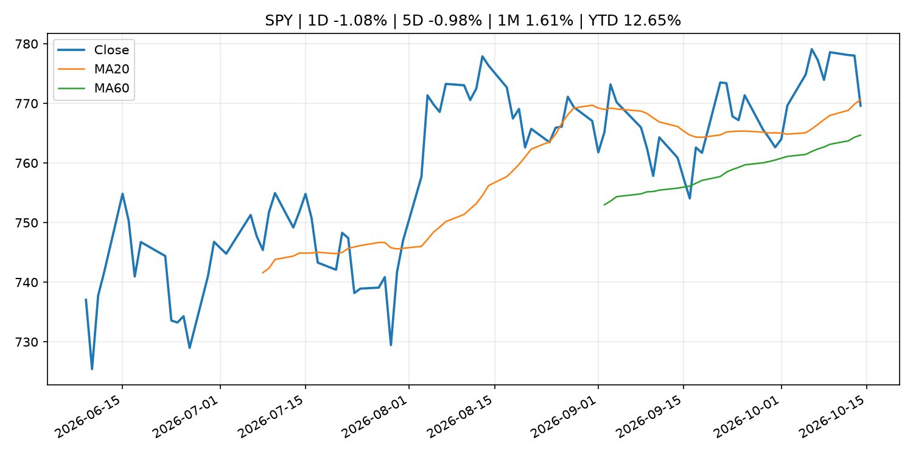
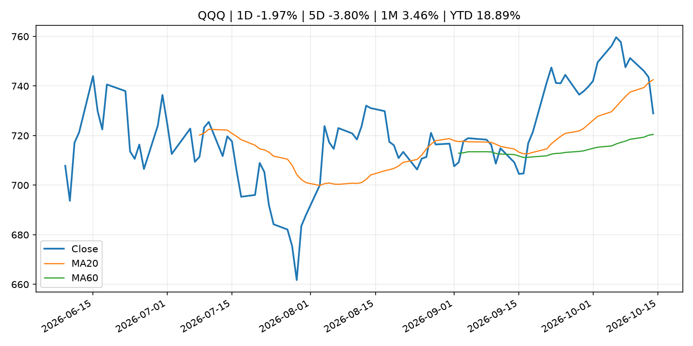
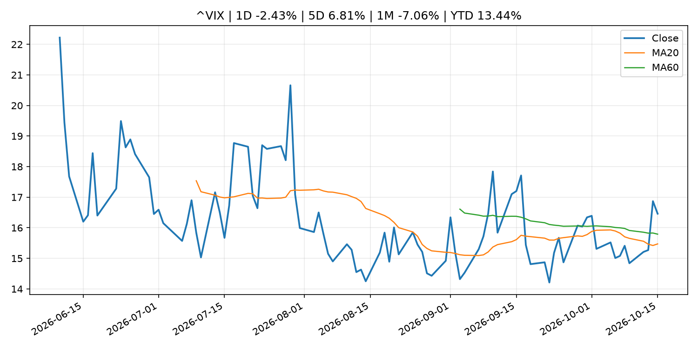
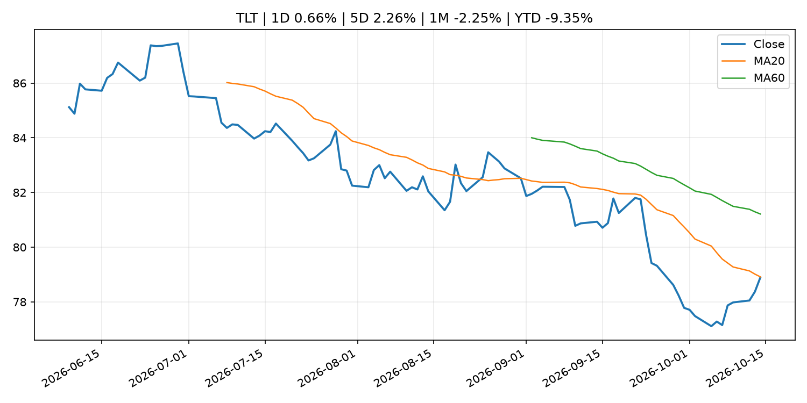
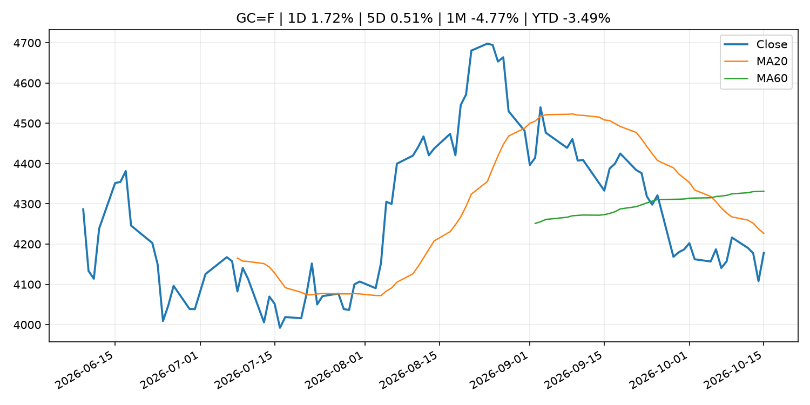
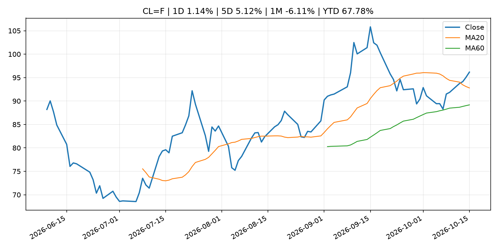
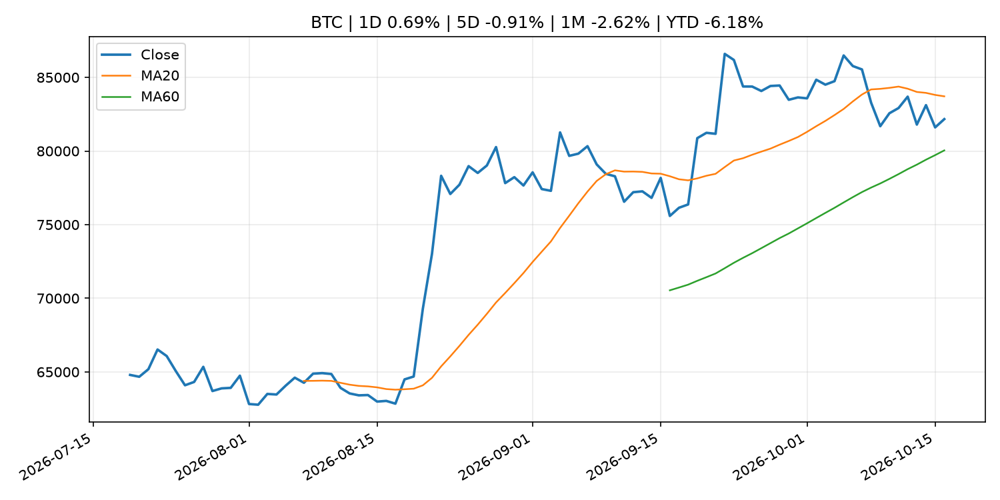
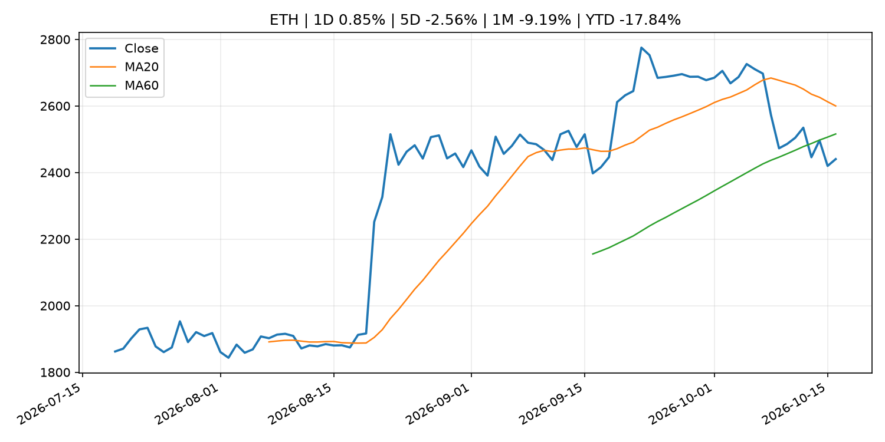
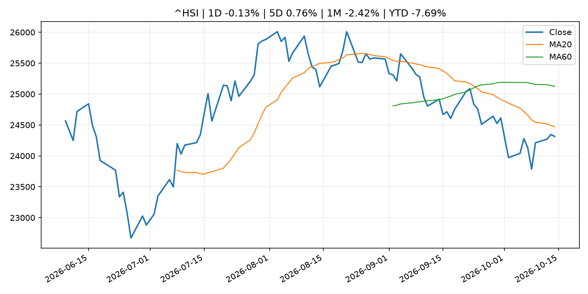

# Global Macro Morning Briefing - 2026-10-16

> Not financial advice / 非投资建议。

## 0. 今日总览
- 市场状态：inflation_shock。原油和黄金走强、股指承压，市场可能在交易通胀或地缘风险冲击。
- 今日三大主线：
  1. macro_data: U.S. September CPI comes in hot, sending bitcoin sharply lower
  2. regulation: SEC Small Business Advisory Committee to Discuss IPO Modernization and Regulation Crowdfunding
  3. regulation: Former FTX Europe chief targets U.S. tokenized stock trading with new SEC exemption
- 一句话结论：今日晨报重点关注：这类宏观数据会直接改变市场对通胀、增长和政策路径的预期。；监管变化会改变行业盈利预期和资产风险溢价。。跨资产方面，SPY 1D -1.08%；QQQ 1D -1.97%；^VIX 1D -2.43%；TLT 1D 0.66%；GC=F 1D 1.72%；CL=F 1D 1.14%；BTC 1D 0.69%；ETH 1D 0.85%；原油和黄金走强、股指承压，市场可能在交易通胀或地缘风险冲击。政策、通胀、利率、美元、美债、能源和加密监管仍是主要观察线索。所有结论仅基于公开数据与短摘要整理，不构成投资建议。

## 1. 隔夜跨资产市场
- 美股：SPY 1D -1.08%，QQQ 1D -1.97%，整体趋势需结合 VIX 和利率确认。
- 美债/美元：TLT 1D 0.66%，美元指数 1D -0.49%，是判断折现率压力的核心线索。
- 黄金/原油：黄金 1D 1.72%，原油 1D 1.14%，用于观察避险、通胀和地缘风险。
- 加密：BTC 1D 0.69%，ETH 1D 0.85%，关注是否独立于纳指走出加密自身行情。
- 港股/A股：恒生 1D -0.13%，沪深300/上证 1D n/a，重点看中国政策预期与人民币线索。
- 风险观察：关注能源价格是否传导到通胀预期和央行沟通。

### US_EQUITY

| symbol | latest close | 1D | 5D | 1M | YTD | trend |
|---|---:|---:|---:|---:|---:|---|
| SPY | 769.60 | -1.08% | -0.98% | 1.61% | 12.65% | range_bound |
| QQQ | 728.95 | -1.97% | -3.80% | 3.46% | 18.89% | range_bound |
| DIA | 515.63 | -0.11% | 0.90% | -1.07% | 6.62% | range_bound |
| IWM | 271.37 | -1.93% | -2.28% | -4.83% | 9.08% | strong_downtrend |
| VTI | 376.88 | -1.16% | -1.09% | 1.08% | 12.06% | range_bound |

### US_MACRO_MARKET

| symbol | latest close | 1D | 5D | 1M | YTD | trend |
|---|---:|---:|---:|---:|---:|---|
| ^VIX | 16.46 | -2.43% | 6.81% | -7.06% | 13.44% | range_bound |
| DX-Y.NYB | 102.05 | -0.49% | -0.09% | 1.74% | 3.69% | uptrend |
| TLT | 78.89 | 0.66% | 2.26% | -2.25% | -9.35% | downtrend |
| IEF | 89.71 | 0.19% | 0.67% | -1.22% | -6.63% | downtrend |

### COMMODITIES

| symbol | latest close | 1D | 5D | 1M | YTD | trend |
|---|---:|---:|---:|---:|---:|---|
| GC=F | 4,178.40 | 1.72% | 0.51% | -4.77% | -3.49% | strong_downtrend |
| SI=F | 57.26 | 3.08% | -3.05% | -10.93% | -18.84% | strong_downtrend |
| CL=F | 96.17 | 1.14% | 5.12% | -6.11% | 67.78% | uptrend |
| BZ=F | 105.71 | -0.33% | 1.37% | -0.11% | 74.01% | uptrend |
| NG=F | 3.22 | 0.59% | 1.55% | 11.28% | -11.08% | uptrend |
| HG=F | 6.55 | -0.88% | 0.53% | 1.90% | 16.20% | range_bound |

### HK_MARKET

| symbol | latest close | 1D | 5D | 1M | YTD | trend |
|---|---:|---:|---:|---:|---:|---|
| ^HSI | 24,314.17 | -0.13% | 0.76% | -2.42% | -7.69% | downtrend |
| 0700.HK | 417.80 | -1.32% | 1.56% | -4.79% | -32.94% | strong_downtrend |
| 9988.HK | 106.40 | -3.71% | 2.01% | -0.75% | -28.59% | downtrend |
| 3690.HK | 75.45 | -2.14% | 8.72% | 0.94% | -27.87% | range_bound |
| 1810.HK | 27.08 | 2.65% | 14.45% | 2.19% | -32.77% | range_bound |
| 1211.HK | 72.95 | 0.14% | 0.07% | -7.72% | -26.13% | strong_downtrend |

### CRYPTO

| symbol | latest close | 1D | 5D | 1M | YTD | trend |
|---|---:|---:|---:|---:|---:|---|
| BTC | 82,165.45 | 0.69% | -0.91% | -2.62% | -6.18% | range_bound |
| ETH | 2,440.28 | 0.85% | -2.56% | -9.19% | -17.84% | range_bound |
| SOLANA | 105.36 | 1.12% | -4.22% | -9.96% | -15.39% | range_bound |
| BINANCECOIN | 728.60 | -0.18% | -2.80% | -6.16% | -15.54% | range_bound |
| RIPPLE | 1.33 | 0.25% | -4.80% | -13.04% | -27.52% | range_bound |

## 2. 今日最重要的 10 条新闻
### 1. U.S. September CPI comes in hot, sending bitcoin sharply lower
- 来源：CoinDesk
- 时间：2026-10-14T12:33:56+00:00
- 地区：global
- 事件类型：macro_data
- 重要性层级：Tier 1
- 一句话摘要：U.S. September CPI comes in hot, sending bitcoin sharply lower
- 为什么重要：这类宏观数据会直接改变市场对通胀、增长和政策路径的预期。
- 可能影响：主要影响 DXY，方向为 positive，强度 high；通胀压力可能推高政策利率预期并支撑美元。
  - 资产：DXY
    方向：positive
    强度：high
    原因：通胀压力可能推高政策利率预期并支撑美元。
  - 资产：TLT
    方向：negative
    强度：high
    原因：通胀上行通常推升收益率、压低长债价格。
  - 资产：QQQ
    方向：negative
    强度：high
    原因：更高利率对成长股估值折现率不利。
  - 资产：SPY
    方向：mixed
    强度：medium
    原因：名义增长可能支撑收入，但更高利率压制估值。
  - 资产：GC=F
    方向：mixed
    强度：medium
    原因：通胀对黄金是支撑，但实际利率上行会形成压力。
  - 资产：BTC
    方向：mixed
    强度：medium
    原因：抗通胀叙事和流动性收紧可能相互抵消。
- 原文链接：[https://www.coindesk.com/markets/2026/10/14/u-s-september-cpi-comes-in-hot-sending-bitcoin-sharply-lower](https://www.coindesk.com/markets/2026/10/14/u-s-september-cpi-comes-in-hot-sending-bitcoin-sharply-lower)

### 2. SEC Small Business Advisory Committee to Discuss IPO Modernization and Regulation Crowdfunding
- 来源：SEC Press Releases
- 时间：2026-10-14T10:30:47-04:00
- 地区：US
- 事件类型：regulation
- 重要性层级：Tier 2
- 一句话摘要：The Securities and Exchange Commission’s Small Business Capital Formation Advisory Committee announced that it will hold a meeting on Tuesday, October 27, 2026, at 10 a.m. to continue discussing IPO modernization and explore potential policy…
- 为什么重要：监管变化会改变行业盈利预期和资产风险溢价。
- 可能影响：主要影响 BTC，方向为 mixed，强度 high；加密监管或 ETF 进展会改变 BTC 的资金流和风险溢价。
  - 资产：BTC
    方向：mixed
    强度：high
    原因：加密监管或 ETF 进展会改变 BTC 的资金流和风险溢价。
  - 资产：ETH
    方向：mixed
    强度：high
    原因：监管框架会影响 ETH 产品化和机构参与度。
  - 资产：COIN
    方向：mixed
    强度：medium
    原因：监管清晰度和执法风险会影响交易平台估值。
  - 资产：crypto market
    方向：mixed
    强度：high
    原因：信息影响整个加密市场结构，但方向取决于细节。
- 原文链接：[https://www.sec.gov/newsroom/press-releases/2026-105-sec-small-business-advisory-committee-discuss-ipo-modernization-regulation-crowdfunding](https://www.sec.gov/newsroom/press-releases/2026-105-sec-small-business-advisory-committee-discuss-ipo-modernization-regulation-crowdfunding)

### 3. Former FTX Europe chief targets U.S. tokenized stock trading with new SEC exemption
- 来源：CoinDesk
- 时间：2026-10-14T14:08:43+00:00
- 地区：global
- 事件类型：regulation
- 重要性层级：Tier 2
- 一句话摘要：Former FTX Europe chief targets U.S. tokenized stock trading with new SEC exemption
- 为什么重要：监管变化会改变行业盈利预期和资产风险溢价。
- 可能影响：主要影响 BTC，方向为 mixed，强度 high；加密监管或 ETF 进展会改变 BTC 的资金流和风险溢价。
  - 资产：BTC
    方向：mixed
    强度：high
    原因：加密监管或 ETF 进展会改变 BTC 的资金流和风险溢价。
  - 资产：ETH
    方向：mixed
    强度：high
    原因：监管框架会影响 ETH 产品化和机构参与度。
  - 资产：COIN
    方向：mixed
    强度：medium
    原因：监管清晰度和执法风险会影响交易平台估值。
  - 资产：crypto market
    方向：mixed
    强度：high
    原因：信息影响整个加密市场结构，但方向取决于细节。
- 原文链接：[https://www.coindesk.com/business/2026/10/14/former-ftx-europe-chief-targets-u-s-stock-tokenization-with-new-sec-exemption](https://www.coindesk.com/business/2026/10/14/former-ftx-europe-chief-targets-u-s-stock-tokenization-with-new-sec-exemption)

### 4. Speech by Board Member KOEDA in Kumamoto (Economic Activity, Prices, and Monetary Policy in Japan)
- 来源：Bank of Japan Announcements
- 时间：2026-10-15T10:30:00+09:00
- 地区：Japan
- 事件类型：central_bank_speech
- 重要性层级：Tier 2
- 一句话摘要：Speech by Board Member KOEDA in Kumamoto (Economic Activity, Prices, and Monetary Policy in Japan)
- 为什么重要：央行官员表态可能影响市场对下一次会议的定价。
- 可能影响：可能影响利率、汇率、风险资产或大宗商品预期，但当前公开信息不足以判断明确方向。
  - 资产：暂无明确资产映射
  - 方向：unknown
  - 强度：low
  - 原因：公开信息不足以判断方向。
- 原文链接：[http://www.boj.or.jp/en/about/press/koen_2026/ko261015a.htm](http://www.boj.or.jp/en/about/press/koen_2026/ko261015a.htm)

### 5. Here's how analysts see U.S. inflation influencing bitcoin
- 来源：CoinDesk
- 时间：2026-10-14T11:15:00+00:00
- 地区：global
- 事件类型：other
- 重要性层级：Tier 3
- 一句话摘要：Here's how analysts see U.S. inflation influencing bitcoin
- 为什么重要：这条信息暂未匹配到重大宏观、政策或市场事件，更适合作为背景跟踪。
- 可能影响：主要影响 DXY，方向为 positive，强度 high；通胀压力可能推高政策利率预期并支撑美元。
  - 资产：DXY
    方向：positive
    强度：high
    原因：通胀压力可能推高政策利率预期并支撑美元。
  - 资产：TLT
    方向：negative
    强度：high
    原因：通胀上行通常推升收益率、压低长债价格。
  - 资产：QQQ
    方向：negative
    强度：high
    原因：更高利率对成长股估值折现率不利。
  - 资产：SPY
    方向：mixed
    强度：medium
    原因：名义增长可能支撑收入，但更高利率压制估值。
  - 资产：GC=F
    方向：mixed
    强度：medium
    原因：通胀对黄金是支撑，但实际利率上行会形成压力。
  - 资产：BTC
    方向：mixed
    强度：medium
    原因：抗通胀叙事和流动性收紧可能相互抵消。
- 原文链接：[https://www.coindesk.com/daybook-us/2026/10/14/here-s-how-analysts-see-u-s-inflation-influencing-bitcoin](https://www.coindesk.com/daybook-us/2026/10/14/here-s-how-analysts-see-u-s-inflation-influencing-bitcoin)

### 6. The Fifteenth Tripartite Governors' Meeting among PBOC, BOJ, and BOK
- 来源：Bank of Japan Announcements
- 时间：2026-10-14T20:00:00+09:00
- 地区：Japan
- 事件类型：other
- 重要性层级：Tier 3
- 一句话摘要：The Fifteenth Tripartite Governors' Meeting among PBOC, BOJ, and BOK
- 为什么重要：这条信息暂未匹配到重大宏观、政策或市场事件，更适合作为背景跟踪。
- 可能影响：主要影响 ^HSI，方向为 positive，强度 high；中国政策宽松通常改善港股中国资产风险偏好。
  - 资产：^HSI
    方向：positive
    强度：high
    原因：中国政策宽松通常改善港股中国资产风险偏好。
  - 资产：沪深300
    方向：positive
    强度：high
    原因：稳增长政策通常利好 A 股核心指数。
  - 资产：commodities
    方向：positive
    强度：medium
    原因：中国需求预期改善通常支撑工业品。
  - 资产：CNH
    方向：mixed
    强度：medium
    原因：增长预期改善利好人民币，但宽松流动性可能形成抵消。
- 原文链接：[http://www.boj.or.jp/en/intl_finance/cooperate/coop261014a.pdf](http://www.boj.or.jp/en/intl_finance/cooperate/coop261014a.pdf)

## 3. 政策与央行观察
### 1. SEC Small Business Advisory Committee to Discuss IPO Modernization and Regulation Crowdfunding
- 来源：SEC Press Releases
- 时间：2026-10-14T10:30:47-04:00
- 地区：US
- 事件类型：regulation
- 重要性层级：Tier 2
- 一句话摘要：The Securities and Exchange Commission’s Small Business Capital Formation Advisory Committee announced that it will hold a meeting on Tuesday, October 27, 2026, at 10 a.m. to continue discussing IPO modernization and explore potential policy…
- 为什么重要：监管变化会改变行业盈利预期和资产风险溢价。
- 可能影响：主要影响 BTC，方向为 mixed，强度 high；加密监管或 ETF 进展会改变 BTC 的资金流和风险溢价。
  - 资产：BTC
    方向：mixed
    强度：high
    原因：加密监管或 ETF 进展会改变 BTC 的资金流和风险溢价。
  - 资产：ETH
    方向：mixed
    强度：high
    原因：监管框架会影响 ETH 产品化和机构参与度。
  - 资产：COIN
    方向：mixed
    强度：medium
    原因：监管清晰度和执法风险会影响交易平台估值。
  - 资产：crypto market
    方向：mixed
    强度：high
    原因：信息影响整个加密市场结构，但方向取决于细节。
- 原文链接：[https://www.sec.gov/newsroom/press-releases/2026-105-sec-small-business-advisory-committee-discuss-ipo-modernization-regulation-crowdfunding](https://www.sec.gov/newsroom/press-releases/2026-105-sec-small-business-advisory-committee-discuss-ipo-modernization-regulation-crowdfunding)

### 2. Former FTX Europe chief targets U.S. tokenized stock trading with new SEC exemption
- 来源：CoinDesk
- 时间：2026-10-14T14:08:43+00:00
- 地区：global
- 事件类型：regulation
- 重要性层级：Tier 2
- 一句话摘要：Former FTX Europe chief targets U.S. tokenized stock trading with new SEC exemption
- 为什么重要：监管变化会改变行业盈利预期和资产风险溢价。
- 可能影响：主要影响 BTC，方向为 mixed，强度 high；加密监管或 ETF 进展会改变 BTC 的资金流和风险溢价。
  - 资产：BTC
    方向：mixed
    强度：high
    原因：加密监管或 ETF 进展会改变 BTC 的资金流和风险溢价。
  - 资产：ETH
    方向：mixed
    强度：high
    原因：监管框架会影响 ETH 产品化和机构参与度。
  - 资产：COIN
    方向：mixed
    强度：medium
    原因：监管清晰度和执法风险会影响交易平台估值。
  - 资产：crypto market
    方向：mixed
    强度：high
    原因：信息影响整个加密市场结构，但方向取决于细节。
- 原文链接：[https://www.coindesk.com/business/2026/10/14/former-ftx-europe-chief-targets-u-s-stock-tokenization-with-new-sec-exemption](https://www.coindesk.com/business/2026/10/14/former-ftx-europe-chief-targets-u-s-stock-tokenization-with-new-sec-exemption)

### 3. Speech by Board Member KOEDA in Kumamoto (Economic Activity, Prices, and Monetary Policy in Japan)
- 来源：Bank of Japan Announcements
- 时间：2026-10-15T10:30:00+09:00
- 地区：Japan
- 事件类型：central_bank_speech
- 重要性层级：Tier 2
- 一句话摘要：Speech by Board Member KOEDA in Kumamoto (Economic Activity, Prices, and Monetary Policy in Japan)
- 为什么重要：央行官员表态可能影响市场对下一次会议的定价。
- 可能影响：可能影响利率、汇率、风险资产或大宗商品预期，但当前公开信息不足以判断明确方向。
  - 资产：暂无明确资产映射
  - 方向：unknown
  - 强度：low
  - 原因：公开信息不足以判断方向。
- 原文链接：[http://www.boj.or.jp/en/about/press/koen_2026/ko261015a.htm](http://www.boj.or.jp/en/about/press/koen_2026/ko261015a.htm)

## 4. 市场异动与图表
- SPY 下跌 -1.08%
- QQQ 下跌 -1.97%
- TLT 上涨 0.66%
- DXY 下跌 -0.49%
- Gold 上涨 1.72%
- Oil 上涨 1.14%

### SPY

### QQQ

### ^VIX

### TLT

### GC=F

### CL=F

### BTC

### ETH

### ^HSI

## 5. 华尔街与机构公开观点
- 暂无可靠公开观点。

## 6. 今日重点关注
- 经济数据：经济数据：暂无可靠公开日历数据；如配置经济日历源后可自动填充。
- 央行讲话：央行讲话：暂无可靠公开日历数据；重点跟踪 Fed、ECB、BoJ、PBOC 官网 RSS。
- 财报：财报：暂无可靠数据。
- 政策事件：政策事件：暂无可靠数据。
- 风险提醒：风险提醒：关注数据源失败项、突发地缘风险、利率和美元的二阶反应。

## 7. 英文金融表达与宏观概念
- **inflation expectations**：通胀预期，指家庭、企业或市场对未来通胀的预估。 例句：Inflation expectations can shape wage bargaining and bond yields.
- **real yield**：实际收益率，名义利率扣除通胀预期后的收益率。 例句：Gold often reacts more to real yields than nominal yields.
- **market structure**：市场结构，指交易、托管、清算、ETF、监管等制度安排。 例句：Crypto market structure rules can affect institutional participation.
- **terminal rate**：终端利率，市场预期本轮加息周期的最高政策利率。 例句：A higher terminal rate can pressure growth stocks.
- **soft landing**：软着陆，指通胀回落而经济避免明显衰退。 例句：Markets often rally when data support a soft landing.
- **risk-off**：避险模式，资金偏向美元、国债、黄金等防御资产。 例句：A geopolitical shock can push markets into risk-off mode.

## 8. 背景材料
- [‘Some people did everything right’: I lost my home in the Great Recession. I rent in my 50s. Why is that judged as failure?](https://www.marketwatch.com/story/i-earn-110-000-a-year-i-lost-my-home-in-the-great-recession-im-renting-in-my-50s-why-is-that-judged-as-failure-d1371d67?mod=mw_rss_topstories)（MarketWatch Top Stories，other）：”I earn $110,000 a year.”
- [Investors are dumping AI stocks as ‘tech wreck’ worsens. Here’s where they’re turning now.](https://www.marketwatch.com/story/traders-pile-into-bonds-and-defensive-stocks-as-the-tech-wreck-picks-up-steam-48c04374?mod=mw_rss_topstories)（MarketWatch Top Stories，other）：A continued selloff in the AI trade is forcing investors to move from tech names to the relative safety of government bonds and defensive stock sectors.
- [How Brooklyn prosecutors and the FBI took down a massive crypto fraud network targeting Russian speakers](https://www.coindesk.com/business/2026/10/15/how-brooklyn-prosecutors-and-the-fbi-took-down-a-massive-crypto-fraud-network-targeting-russian-speakers)（CoinDesk，other）：How Brooklyn prosecutors and the FBI took down a massive crypto fraud network targeting Russian speakers
- [Bitcoin, copper, stocks, yields all fall; gold rises](https://www.coindesk.com/daybook-us/2026/10/15/bitcoin-copper-stocks-yields-all-fall-gold-rises)（CoinDesk，other）：Bitcoin, copper, stocks, yields all fall; gold rises
- [Altcoins lead crypto declines as Asian stocks drop; bitcoin little changed since midnight](https://www.coindesk.com/markets/2026/10/15/bitcoin-holds-above-usd80-000-as-an-asian-stock-rout-drags-altcoins-lower)（CoinDesk，other）：Altcoins lead crypto declines as Asian stocks drop; bitcoin little changed since midnight
- [Live updates: Bitcoin bounces back to $82,000 after first fall below $80,000 in one month](https://www.coindesk.com/business/2026/10/15/live-updates-bitcoin-back-under-usd81-000-as-ai-selloff-worsens)（CoinDesk，other）：Live updates: Bitcoin bounces back to $82,000 after first fall below $80,000 in one month
- [BlackRock's Fink names a U.S. recession trigger, sounds alarm over $40 trillion national debt](https://www.coindesk.com/markets/2026/10/15/blackrock-s-larry-fink-names-a-u-s-recession-trigger-and-its-tied-to-ai)（CoinDesk，other）：BlackRock's Fink names a U.S. recession trigger, sounds alarm over $40 trillion national debt
- [Nearly $1 billion in crypto bets liquidated as bitcoin, ether and XRP slide](https://www.coindesk.com/markets/2026/10/15/nearly-usd1-billion-in-crypto-bets-liquidated-as-bitcoin-ether-and-xrp-slide)（CoinDesk，other）：Nearly $1 billion in crypto bets liquidated as bitcoin, ether and XRP slide
- [Bitcoin mining pool once handling 2.3% of network shuts after hashrate falls 65%](https://www.coindesk.com/markets/2026/10/15/bitcoin-mining-pool-once-handling-2-3-of-network-shuts-after-hashrate-falls-65)（CoinDesk，other）：Bitcoin mining pool once handling 2.3% of network shuts after hashrate falls 65%
- [Bitcoin wilts as Fed rate uncertainty weighs. Kospi plunges 8%](https://www.coindesk.com/markets/2026/10/15/bitcoin-is-back-below-usd81-000-as-fed-rate-uncertainty-weighs)（CoinDesk，other）：Bitcoin wilts as Fed rate uncertainty weighs. Kospi plunges 8%
- [Summary of the "Meeting on Market Operations" (October 2026)](http://www.boj.or.jp/en/paym/market/mkt261015a.pdf)（Bank of Japan Announcements，other）：Summary of the "Meeting on Market Operations" (October 2026)
- [Bank of America shares drop after third-quarter revenue miss and regulatory penalty](https://www.cnbc.com/2026/10/14/bank-of-america-bac-q3-2026-earnings.html)（CNBC Economy，other）：Bank of America shares fell Wednesday after the company posted weaker-than-expected trading revenue and the impact of a $1.2 billion Treasury fine.
- [Crypto Long & Short: Why gold and bitcoin belong in the same portfolio](https://www.coindesk.com/coindesk-indices/2026/10/14/crypto-long-and-short-why-gold-and-bitcoin-belong-in-the-same-portfolio)（CoinDesk，other）：Crypto Long & Short: Why gold and bitcoin belong in the same portfolio
- [BlackRock's crypto ETF assets surge 63% but remain far below 2025 peak](https://www.coindesk.com/markets/2026/10/14/blackrock-s-crypto-etf-assets-surge-63-but-remain-far-below-2025-peak)（CoinDesk，other）：BlackRock's crypto ETF assets surge 63% but remain far below 2025 peak
- [Here's how analysts see U.S. inflation influencing bitcoin](https://www.coindesk.com/daybook-us/2026/10/14/here-s-how-analysts-see-u-s-inflation-influencing-bitcoin)（CoinDesk，other）：Here's how analysts see U.S. inflation influencing bitcoin
- [The Fifteenth Tripartite Governors' Meeting among PBOC, BOJ, and BOK](http://www.boj.or.jp/en/intl_finance/cooperate/coop261014a.pdf)（Bank of Japan Announcements，other）：The Fifteenth Tripartite Governors' Meeting among PBOC, BOJ, and BOK
- [Japanese Government Bonds Held by the Bank of Japan](http://www.boj.or.jp/en/statistics/boj/other/mei/release/2026/mei261009.xlsx)（Bank of Japan Announcements，other）：Japanese Government Bonds Held by the Bank of Japan
- [Bank of Japan Accounts (October 10)](http://www.boj.or.jp/en/statistics/boj/other/acmai/release/2026/ac261010.htm)（Bank of Japan Announcements，routine_announcement）：Bank of Japan Accounts (October 10)

## 9. 数据源、失败项与免责声明
- 采集时间：2026-10-16T00:05:54
- 数据源：公开 RSS、Yahoo Finance、CoinGecko、AKShare、FRED、SEC data.sec.gov，以及用户自有 inputs/reports 文件。
- 合规说明：不绕过 WSJ、Bloomberg、FT、Reuters 等付费墙；对付费媒体只使用公开 RSS 标题、摘要、链接和发布时间。
- 免责声明：Not financial advice / 非投资建议。本项目仅供个人学习、研究和信息整理，不构成投资建议、交易建议或任何收益承诺。
- 失败或跳过的数据源：
  - crypto data failed coin=dogecoin
  - China market data failed symbol=上证指数: empty dataframe
  - China market data failed symbol=深证成指: empty dataframe
  - China market data failed symbol=创业板指: empty dataframe
  - China market data failed symbol=沪深300: empty dataframe
  - China market data failed symbol=中证500: empty dataframe
  - China market data failed symbol=科创50: empty dataframe
  - FRED_API_KEY not set; skipping FRED macro series
  - SEC failed cik=0000320193
  - SEC failed cik=0000789019
  - SEC failed cik=0001045810
  - SEC failed cik=0001318605
  - SEC failed cik=0001577552
