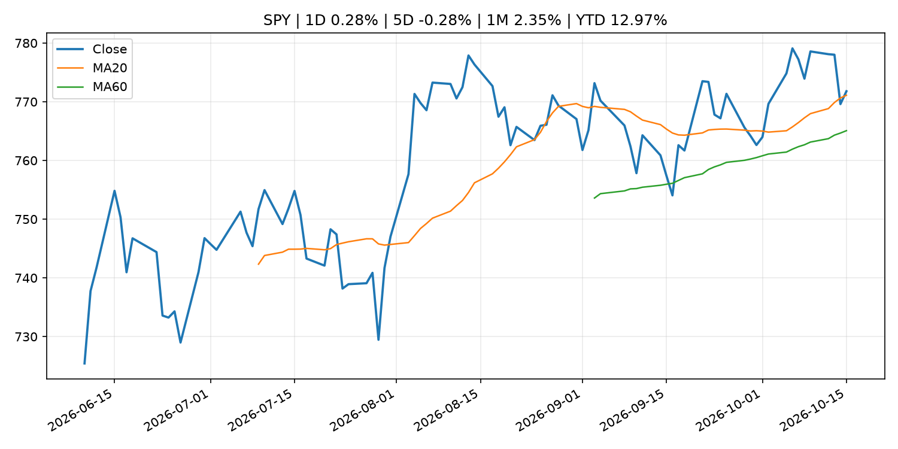
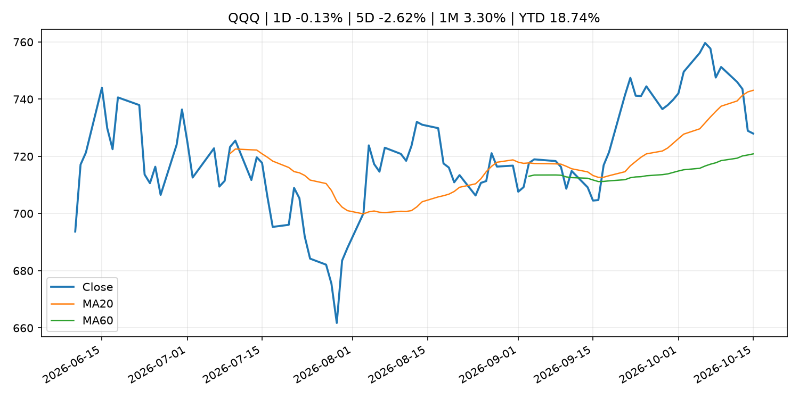
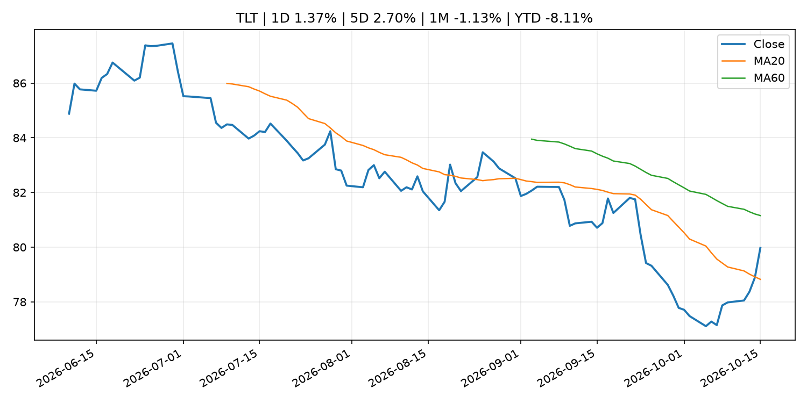
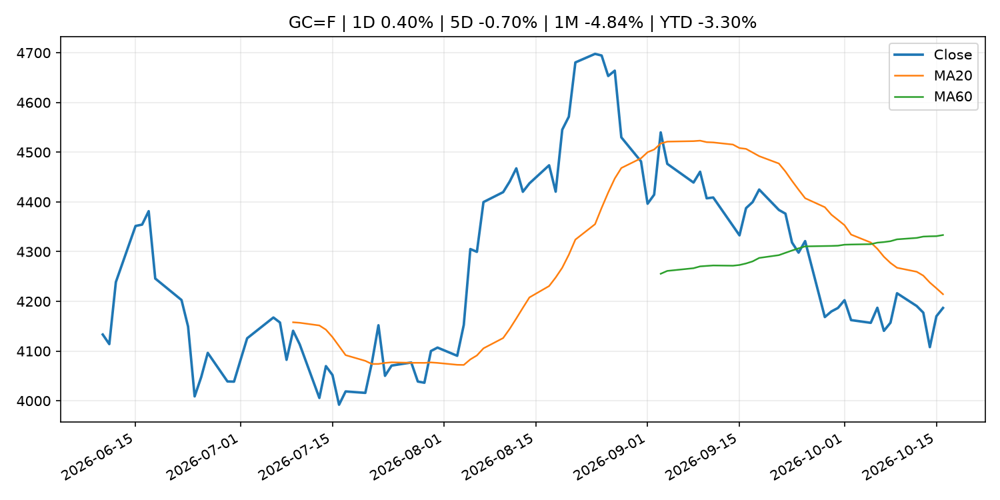
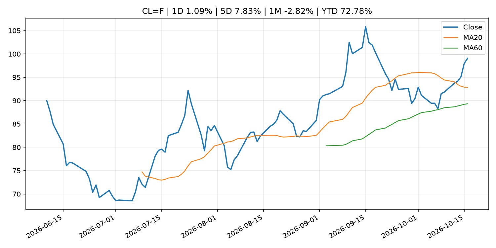
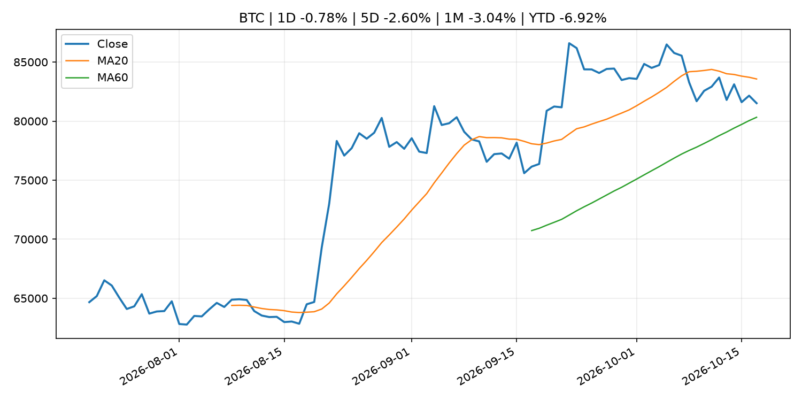
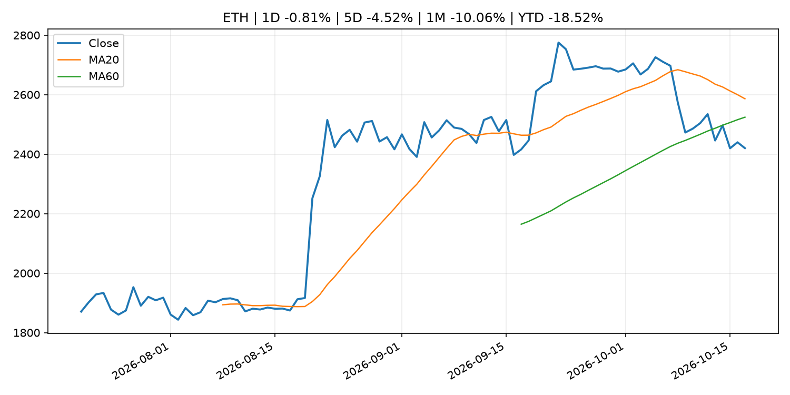
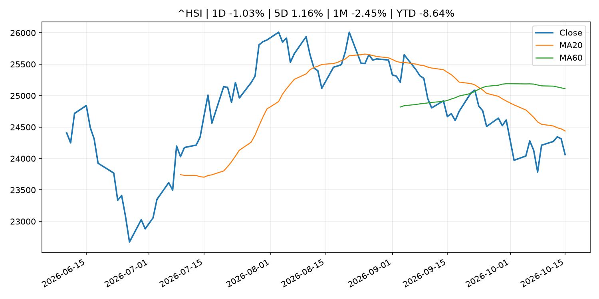

# Global Macro Morning Briefing - 2026-10-17

> Not financial advice / 非投资建议。

## 0. 今日总览
- 市场状态：unknown。市场信号不足，暂不判断明确状态。
- 今日三大主线：
  1. macro_data: The bond market shrugged off two inflation shocks. Why stock investors should pay attention.
  2. regulation: New SEC rules would fleece everyday investors to enrich Wall Street
  3. crypto_market_structure: Circle targets 40 new markets as stablecoin demand grows globally
- 一句话结论：今日晨报重点关注：这类宏观数据会直接改变市场对通胀、增长和政策路径的预期。；监管变化会改变行业盈利预期和资产风险溢价。。跨资产方面，SPY 1D 0.28%；QQQ 1D -0.13%；^VIX 1D 21.45%；TLT 1D 1.37%；GC=F 1D 0.40%；CL=F 1D 1.09%；BTC 1D -0.78%；ETH 1D -0.81%；市场信号不足，暂不判断明确状态。政策、通胀、利率、美元、美债、能源和加密监管仍是主要观察线索。所有结论仅基于公开数据与短摘要整理，不构成投资建议。

## 1. 隔夜跨资产市场
- 美股：SPY 1D 0.28%，QQQ 1D -0.13%，整体趋势需结合 VIX 和利率确认。
- 美债/美元：TLT 1D 1.37%，美元指数 1D -0.22%，是判断折现率压力的核心线索。
- 黄金/原油：黄金 1D 0.40%，原油 1D 1.09%，用于观察避险、通胀和地缘风险。
- 加密：BTC 1D -0.78%，ETH 1D -0.81%，关注是否独立于纳指走出加密自身行情。
- 港股/A股：恒生 1D -1.03%，沪深300/上证 1D n/a，重点看中国政策预期与人民币线索。
- 风险观察：关注后续数据是否确认当前跨资产信号。

### US_EQUITY

| symbol | latest close | 1D | 5D | 1M | YTD | trend |
|---|---:|---:|---:|---:|---:|---|
| SPY | 771.79 | 0.28% | -0.28% | 2.35% | 12.97% | uptrend |
| QQQ | 728.00 | -0.13% | -2.62% | 3.30% | 18.74% | range_bound |
| DIA | 521.18 | 1.08% | 1.86% | 1.16% | 7.76% | range_bound |
| IWM | 275.08 | 1.37% | -0.90% | -3.11% | 10.57% | strong_downtrend |
| VTI | 378.42 | 0.41% | -0.30% | 1.93% | 12.52% | range_bound |

### US_MACRO_MARKET

| symbol | latest close | 1D | 5D | 1M | YTD | trend |
|---|---:|---:|---:|---:|---:|---|
| ^VIX | 19.99 | 21.45% | 34.70% | 29.47% | 37.77% | range_bound |
| DX-Y.NYB | 101.78 | -0.22% | -0.42% | 1.56% | 3.41% | uptrend |
| TLT | 79.97 | 1.37% | 2.70% | -1.13% | -8.11% | range_bound |
| IEF | 90.35 | 0.71% | 1.01% | -0.42% | -5.96% | range_bound |

### COMMODITIES

| symbol | latest close | 1D | 5D | 1M | YTD | trend |
|---|---:|---:|---:|---:|---:|---|
| GC=F | 4,186.70 | 0.40% | -0.70% | -4.84% | -3.30% | downtrend |
| SI=F | 57.13 | 0.52% | -5.83% | -12.73% | -19.02% | strong_downtrend |
| CL=F | 99.04 | 1.09% | 7.83% | -2.82% | 72.78% | uptrend |
| BZ=F | 109.69 | 3.56% | 4.75% | 4.65% | 80.56% | strong_uptrend |
| NG=F | 3.12 | -3.68% | -3.20% | 7.45% | -13.85% | strong_uptrend |
| HG=F | 6.56 | 0.78% | -1.21% | -0.37% | 16.35% | range_bound |

### HK_MARKET

| symbol | latest close | 1D | 5D | 1M | YTD | trend |
|---|---:|---:|---:|---:|---:|---|
| ^HSI | 24,062.72 | -1.03% | 1.16% | -2.45% | -8.64% | downtrend |
| 0700.HK | 417.80 | 0.00% | -1.65% | -3.60% | -32.94% | strong_downtrend |
| 9988.HK | 108.80 | 2.26% | 1.68% | 2.45% | -26.98% | range_bound |
| 3690.HK | 75.70 | 0.33% | 5.87% | 1.68% | -27.63% | range_bound |
| 1810.HK | 26.66 | -1.55% | 2.70% | 1.83% | -33.81% | range_bound |
| 1211.HK | 73.75 | 1.10% | -2.45% | -6.88% | -25.32% | strong_downtrend |

### CRYPTO

| symbol | latest close | 1D | 5D | 1M | YTD | trend |
|---|---:|---:|---:|---:|---:|---|
| BTC | 81,517.74 | -0.78% | -2.60% | -3.04% | -6.92% | range_bound |
| ETH | 2,420.09 | -0.81% | -4.52% | -10.06% | -18.52% | range_bound |
| SOLANA | 104.33 | -0.96% | -6.22% | -14.54% | -16.21% | range_bound |
| BINANCECOIN | 720.12 | -1.20% | -4.43% | -7.32% | -16.53% | range_bound |
| RIPPLE | 1.31 | -1.83% | -7.09% | -16.51% | -28.87% | range_bound |

## 2. 今日最重要的 10 条新闻
### 1. The bond market shrugged off two inflation shocks. Why stock investors should pay attention.
- 来源：MarketWatch Top Stories
- 时间：2026-10-16T21:30:00+00:00
- 地区：US
- 事件类型：macro_data
- 重要性层级：Tier 1
- 一句话摘要：Hot CPI and PPI data should have pushed Treasury yields higher. Instead, bond buyers stepped in to suggest yields have risen high enough to become attractive for investors.
- 为什么重要：这类宏观数据会直接改变市场对通胀、增长和政策路径的预期。
- 可能影响：主要影响 DXY，方向为 positive，强度 high；通胀压力可能推高政策利率预期并支撑美元。
  - 资产：DXY
    方向：positive
    强度：high
    原因：通胀压力可能推高政策利率预期并支撑美元。
  - 资产：TLT
    方向：negative
    强度：high
    原因：通胀上行通常推升收益率、压低长债价格。
  - 资产：QQQ
    方向：negative
    强度：high
    原因：更高利率对成长股估值折现率不利。
  - 资产：SPY
    方向：mixed
    强度：medium
    原因：名义增长可能支撑收入，但更高利率压制估值。
  - 资产：GC=F
    方向：mixed
    强度：medium
    原因：通胀对黄金是支撑，但实际利率上行会形成压力。
  - 资产：BTC
    方向：mixed
    强度：medium
    原因：抗通胀叙事和流动性收紧可能相互抵消。
- 原文链接：[https://www.marketwatch.com/story/the-bond-market-shrugged-off-two-inflation-shocks-why-stock-investors-should-pay-attention-5da4f771?mod=mw_rss_topstories](https://www.marketwatch.com/story/the-bond-market-shrugged-off-two-inflation-shocks-why-stock-investors-should-pay-attention-5da4f771?mod=mw_rss_topstories)

### 2. New SEC rules would fleece everyday investors to enrich Wall Street
- 来源：MarketWatch Top Stories
- 时间：2026-10-16T21:21:00+00:00
- 地区：US
- 事件类型：regulation
- 重要性层级：Tier 2
- 一句话摘要：New proposals from the Securities and Exchange Commission will tilt the scales in favor of Wall Street and against a huge group of retail investors.
- 为什么重要：监管变化会改变行业盈利预期和资产风险溢价。
- 可能影响：主要影响 BTC，方向为 mixed，强度 high；加密监管或 ETF 进展会改变 BTC 的资金流和风险溢价。
  - 资产：BTC
    方向：mixed
    强度：high
    原因：加密监管或 ETF 进展会改变 BTC 的资金流和风险溢价。
  - 资产：ETH
    方向：mixed
    强度：high
    原因：监管框架会影响 ETH 产品化和机构参与度。
  - 资产：COIN
    方向：mixed
    强度：medium
    原因：监管清晰度和执法风险会影响交易平台估值。
  - 资产：crypto market
    方向：mixed
    强度：high
    原因：信息影响整个加密市场结构，但方向取决于细节。
- 原文链接：[https://www.marketwatch.com/story/new-sec-rules-would-fleece-everyday-investors-to-enrich-wall-street-0a00fe03?mod=mw_rss_topstories](https://www.marketwatch.com/story/new-sec-rules-would-fleece-everyday-investors-to-enrich-wall-street-0a00fe03?mod=mw_rss_topstories)

### 3. Circle targets 40 new markets as stablecoin demand grows globally
- 来源：CoinDesk
- 时间：2026-10-16T10:54:35+00:00
- 地区：global
- 事件类型：crypto_market_structure
- 重要性层级：Tier 2
- 一句话摘要：Circle targets 40 new markets as stablecoin demand grows globally
- 为什么重要：加密市场结构和监管变化会影响 BTC、ETH 及相关股票的风险溢价。
- 可能影响：主要影响 BTC，方向为 mixed，强度 high；加密监管或 ETF 进展会改变 BTC 的资金流和风险溢价。
  - 资产：BTC
    方向：mixed
    强度：high
    原因：加密监管或 ETF 进展会改变 BTC 的资金流和风险溢价。
  - 资产：ETH
    方向：mixed
    强度：high
    原因：监管框架会影响 ETH 产品化和机构参与度。
  - 资产：COIN
    方向：mixed
    强度：medium
    原因：监管清晰度和执法风险会影响交易平台估值。
  - 资产：crypto market
    方向：mixed
    强度：high
    原因：信息影响整个加密市场结构，但方向取决于细节。
- 原文链接：[https://www.coindesk.com/business/2026/10/16/circle-targets-40-new-markets-as-stablecoin-demand-grows-globally](https://www.coindesk.com/business/2026/10/16/circle-targets-40-new-markets-as-stablecoin-demand-grows-globally)

### 4. Federal Reserve Board announces termination of enforcement actions with Gardner Bancshares, Inc. and Small Business Bank
- 来源：Federal Reserve Press Releases
- 时间：2026-10-16T15:00:00+00:00
- 地区：US
- 事件类型：regulation
- 重要性层级：Tier 2
- 一句话摘要：Federal Reserve Board announces termination of enforcement actions with Gardner Bancshares, Inc. and Small Business Bank
- 为什么重要：监管变化会改变行业盈利预期和资产风险溢价。
- 可能影响：可能影响利率、汇率、风险资产或大宗商品预期，但当前公开信息不足以判断明确方向。
  - 资产：暂无明确资产映射
  - 方向：unknown
  - 强度：low
  - 原因：公开信息不足以判断方向。
- 原文链接：[https://www.federalreserve.gov/newsevents/pressreleases/enforcement20261016a.htm](https://www.federalreserve.gov/newsevents/pressreleases/enforcement20261016a.htm)

### 5. Speech by Board Member KOEDA in Kumamoto (Economic Activity, Prices, and Monetary Policy in Japan)
- 来源：Bank of Japan Announcements
- 时间：2026-10-15T10:30:00+09:00
- 地区：Japan
- 事件类型：central_bank_speech
- 重要性层级：Tier 2
- 一句话摘要：Speech by Board Member KOEDA in Kumamoto (Economic Activity, Prices, and Monetary Policy in Japan)
- 为什么重要：央行官员表态可能影响市场对下一次会议的定价。
- 可能影响：可能影响利率、汇率、风险资产或大宗商品预期，但当前公开信息不足以判断明确方向。
  - 资产：暂无明确资产映射
  - 方向：unknown
  - 强度：low
  - 原因：公开信息不足以判断方向。
- 原文链接：[http://www.boj.or.jp/en/about/press/koen_2026/ko261015a.htm](http://www.boj.or.jp/en/about/press/koen_2026/ko261015a.htm)

### 6. Your Social Security check will rise an average of $75 a month — will it be able to keep up with inflation?
- 来源：MarketWatch Top Stories
- 时间：2026-10-16T19:45:00+00:00
- 地区：US
- 事件类型：other
- 重要性层级：Tier 3
- 一句话摘要：The 3.6% COLA for 2027 is aimed at helping more than 68 million beneficiaries keep pace with the cost of living
- 为什么重要：这条信息暂未匹配到重大宏观、政策或市场事件，更适合作为背景跟踪。
- 可能影响：主要影响 DXY，方向为 positive，强度 high；通胀压力可能推高政策利率预期并支撑美元。
  - 资产：DXY
    方向：positive
    强度：high
    原因：通胀压力可能推高政策利率预期并支撑美元。
  - 资产：TLT
    方向：negative
    强度：high
    原因：通胀上行通常推升收益率、压低长债价格。
  - 资产：QQQ
    方向：negative
    强度：high
    原因：更高利率对成长股估值折现率不利。
  - 资产：SPY
    方向：mixed
    强度：medium
    原因：名义增长可能支撑收入，但更高利率压制估值。
  - 资产：GC=F
    方向：mixed
    强度：medium
    原因：通胀对黄金是支撑，但实际利率上行会形成压力。
  - 资产：BTC
    方向：mixed
    强度：medium
    原因：抗通胀叙事和流动性收紧可能相互抵消。
- 原文链接：[https://www.marketwatch.com/story/social-securitys-cola-will-be-3-6-in-2027-as-inflation-persists-f7c9dff2?mod=mw_rss_topstories](https://www.marketwatch.com/story/social-securitys-cola-will-be-3-6-in-2027-as-inflation-persists-f7c9dff2?mod=mw_rss_topstories)

### 7. Nowhere to hide: Tech selloff hits software and chip stocks alike
- 来源：MarketWatch Top Stories
- 时间：2026-10-16T21:59:00+00:00
- 地区：US
- 事件类型：other
- 重要性层级：Tier 3
- 一句话摘要：The software and semiconductor sectors haven’t been trading in tandem much this year, but they collectively fell Friday as AI and interest-rate fears hit the market.
- 为什么重要：这条信息暂未匹配到重大宏观、政策或市场事件，更适合作为背景跟踪。
- 可能影响：更偏背景信息，短期市场影响可能有限。
  - 资产：暂无明确资产映射
  - 方向：unknown
  - 强度：low
  - 原因：公开信息不足以判断方向。
- 原文链接：[https://www.marketwatch.com/story/nowhere-to-hide-tech-selloff-hits-software-and-chip-stocks-alike-6d96773c?mod=mw_rss_topstories](https://www.marketwatch.com/story/nowhere-to-hide-tech-selloff-hits-software-and-chip-stocks-alike-6d96773c?mod=mw_rss_topstories)

## 3. 政策与央行观察
### 1. New SEC rules would fleece everyday investors to enrich Wall Street
- 来源：MarketWatch Top Stories
- 时间：2026-10-16T21:21:00+00:00
- 地区：US
- 事件类型：regulation
- 重要性层级：Tier 2
- 一句话摘要：New proposals from the Securities and Exchange Commission will tilt the scales in favor of Wall Street and against a huge group of retail investors.
- 为什么重要：监管变化会改变行业盈利预期和资产风险溢价。
- 可能影响：主要影响 BTC，方向为 mixed，强度 high；加密监管或 ETF 进展会改变 BTC 的资金流和风险溢价。
  - 资产：BTC
    方向：mixed
    强度：high
    原因：加密监管或 ETF 进展会改变 BTC 的资金流和风险溢价。
  - 资产：ETH
    方向：mixed
    强度：high
    原因：监管框架会影响 ETH 产品化和机构参与度。
  - 资产：COIN
    方向：mixed
    强度：medium
    原因：监管清晰度和执法风险会影响交易平台估值。
  - 资产：crypto market
    方向：mixed
    强度：high
    原因：信息影响整个加密市场结构，但方向取决于细节。
- 原文链接：[https://www.marketwatch.com/story/new-sec-rules-would-fleece-everyday-investors-to-enrich-wall-street-0a00fe03?mod=mw_rss_topstories](https://www.marketwatch.com/story/new-sec-rules-would-fleece-everyday-investors-to-enrich-wall-street-0a00fe03?mod=mw_rss_topstories)

### 2. Circle targets 40 new markets as stablecoin demand grows globally
- 来源：CoinDesk
- 时间：2026-10-16T10:54:35+00:00
- 地区：global
- 事件类型：crypto_market_structure
- 重要性层级：Tier 2
- 一句话摘要：Circle targets 40 new markets as stablecoin demand grows globally
- 为什么重要：加密市场结构和监管变化会影响 BTC、ETH 及相关股票的风险溢价。
- 可能影响：主要影响 BTC，方向为 mixed，强度 high；加密监管或 ETF 进展会改变 BTC 的资金流和风险溢价。
  - 资产：BTC
    方向：mixed
    强度：high
    原因：加密监管或 ETF 进展会改变 BTC 的资金流和风险溢价。
  - 资产：ETH
    方向：mixed
    强度：high
    原因：监管框架会影响 ETH 产品化和机构参与度。
  - 资产：COIN
    方向：mixed
    强度：medium
    原因：监管清晰度和执法风险会影响交易平台估值。
  - 资产：crypto market
    方向：mixed
    强度：high
    原因：信息影响整个加密市场结构，但方向取决于细节。
- 原文链接：[https://www.coindesk.com/business/2026/10/16/circle-targets-40-new-markets-as-stablecoin-demand-grows-globally](https://www.coindesk.com/business/2026/10/16/circle-targets-40-new-markets-as-stablecoin-demand-grows-globally)

### 3. Federal Reserve Board announces termination of enforcement actions with Gardner Bancshares, Inc. and Small Business Bank
- 来源：Federal Reserve Press Releases
- 时间：2026-10-16T15:00:00+00:00
- 地区：US
- 事件类型：regulation
- 重要性层级：Tier 2
- 一句话摘要：Federal Reserve Board announces termination of enforcement actions with Gardner Bancshares, Inc. and Small Business Bank
- 为什么重要：监管变化会改变行业盈利预期和资产风险溢价。
- 可能影响：可能影响利率、汇率、风险资产或大宗商品预期，但当前公开信息不足以判断明确方向。
  - 资产：暂无明确资产映射
  - 方向：unknown
  - 强度：low
  - 原因：公开信息不足以判断方向。
- 原文链接：[https://www.federalreserve.gov/newsevents/pressreleases/enforcement20261016a.htm](https://www.federalreserve.gov/newsevents/pressreleases/enforcement20261016a.htm)

### 4. Speech by Board Member KOEDA in Kumamoto (Economic Activity, Prices, and Monetary Policy in Japan)
- 来源：Bank of Japan Announcements
- 时间：2026-10-15T10:30:00+09:00
- 地区：Japan
- 事件类型：central_bank_speech
- 重要性层级：Tier 2
- 一句话摘要：Speech by Board Member KOEDA in Kumamoto (Economic Activity, Prices, and Monetary Policy in Japan)
- 为什么重要：央行官员表态可能影响市场对下一次会议的定价。
- 可能影响：可能影响利率、汇率、风险资产或大宗商品预期，但当前公开信息不足以判断明确方向。
  - 资产：暂无明确资产映射
  - 方向：unknown
  - 强度：low
  - 原因：公开信息不足以判断方向。
- 原文链接：[http://www.boj.or.jp/en/about/press/koen_2026/ko261015a.htm](http://www.boj.or.jp/en/about/press/koen_2026/ko261015a.htm)

## 4. 市场异动与图表
- VIX 上涨 21.45%
- TLT 上涨 1.37%
- Oil 上涨 1.09%

### SPY

### QQQ

### ^VIX

### TLT

### GC=F

### CL=F

### BTC

### ETH

### ^HSI

## 5. 华尔街与机构公开观点
- 暂无可靠公开观点。

## 6. 今日重点关注
- 经济数据：经济数据：暂无可靠公开日历数据；如配置经济日历源后可自动填充。
- 央行讲话：央行讲话：暂无可靠公开日历数据；重点跟踪 Fed、ECB、BoJ、PBOC 官网 RSS。
- 财报：财报：暂无可靠数据。
- 政策事件：政策事件：暂无可靠数据。
- 风险提醒：风险提醒：关注数据源失败项、突发地缘风险、利率和美元的二阶反应。

## 7. 英文金融表达与宏观概念
- **inflation expectations**：通胀预期，指家庭、企业或市场对未来通胀的预估。 例句：Inflation expectations can shape wage bargaining and bond yields.
- **real yield**：实际收益率，名义利率扣除通胀预期后的收益率。 例句：Gold often reacts more to real yields than nominal yields.
- **risk-off**：避险模式，资金偏向美元、国债、黄金等防御资产。 例句：A geopolitical shock can push markets into risk-off mode.
- **market structure**：市场结构，指交易、托管、清算、ETF、监管等制度安排。 例句：Crypto market structure rules can affect institutional participation.
- **terminal rate**：终端利率，市场预期本轮加息周期的最高政策利率。 例句：A higher terminal rate can pressure growth stocks.
- **soft landing**：软着陆，指通胀回落而经济避免明显衰退。 例句：Markets often rally when data support a soft landing.

## 8. 背景材料
- [Nowhere to hide: Tech selloff hits software and chip stocks alike](https://www.marketwatch.com/story/nowhere-to-hide-tech-selloff-hits-software-and-chip-stocks-alike-6d96773c?mod=mw_rss_topstories)（MarketWatch Top Stories，other）：The software and semiconductor sectors haven’t been trading in tandem much this year, but they collectively fell Friday as AI and interest-rate fears hit the market.
- [I’m 63 and diagnosed with lymphoma. Should I take my Social Security next year?](https://www.marketwatch.com/story/its-a-wait-and-see-situation-im-63-and-diagnosed-with-lymphoma-should-i-take-my-social-security-next-year-ea88b419?mod=mw_rss_topstories)（MarketWatch Top Stories，other）：“My plan is to continue working as long as I’m able to do so and invest my Social Security benefits while I’m still earning a paycheck.”
- [Are we spending our retirement money in the right order? Our plan is: Social Security, annuities, cash — then IRA.](https://www.marketwatch.com/story/are-we-spending-our-retirement-money-in-the-right-order-our-plan-is-social-security-annuities-cash-then-ira-02cec336?mod=mw_rss_topstories)（MarketWatch Top Stories，other）：Spending all your cash first can make your income surge in later years.
- [Your Social Security check will rise an average of $75 a month — will it be able to keep up with inflation?](https://www.marketwatch.com/story/social-securitys-cola-will-be-3-6-in-2027-as-inflation-persists-f7c9dff2?mod=mw_rss_topstories)（MarketWatch Top Stories，other）：The 3.6% COLA for 2027 is aimed at helping more than 68 million beneficiaries keep pace with the cost of living
- [U.S. presses China on Mastercard, Citigroup market access in bilateral Bangkok talks, official says](https://www.cnbc.com/2026/10/16/us-china-mastercard-citigroup-market-access.html)（CNBC Economy，other）：The U.S. raised market access issues for Mastercard and Citigroup in China during bilateral meetings in Bangkok this week, a U.S. Treasury official says.
- [Quantum Alliance forms amid warnings 6.4 million bitcoin face future quantum threat](https://www.coindesk.com/tech/2026/10/16/experts-agree-quantum-computers-could-put-satoshi-s-bitcoin-at-risk-but-not-on-what-s-next)（CoinDesk，other）：Quantum Alliance forms amid warnings 6.4 million bitcoin face future quantum threat
- [Altcoins outpace bitcoin as celestia jumps 16%, Warsh silent on interest-rate plans](https://www.coindesk.com/markets/2026/10/16/altcoins-outpace-bitcoin-as-celestia-jumps-16-warsh-silent-on-interest-rate-plans)（CoinDesk，other）：Altcoins outpace bitcoin as celestia jumps 16%, Warsh silent on interest-rate plans
- [Scammer gets scammed in Ledger spy-chip exploit, loses almost $5 million in bitcoin](https://www.coindesk.com/business/2026/10/16/scammer-gets-scammed-in-ledger-spy-chip-exploit-loses-almost-usd5-million-in-bitcoin)（CoinDesk，other）：Scammer gets scammed in Ledger spy-chip exploit, loses almost $5 million in bitcoin
- [Live updates: Bitcoin dips to $81,000 as stocks slide, VIX soars ahead of Black Monday anniversary](https://www.coindesk.com/markets/2026/10/16/live-updates-bitcoin-back-above-usd82-000-zec-jumps-11-as-etf-outflows-continue)（CoinDesk，other）：Live updates: Bitcoin dips to $81,000 as stocks slide, VIX soars ahead of Black Monday anniversary
- [BOJ Current Account Balances by Sector (Sept.)](http://www.boj.or.jp/en/statistics/boj/other/cabs/cabs.xlsx)（Bank of Japan Announcements，other）：BOJ Current Account Balances by Sector (Sept.)
- [XRP has failed to make holders rich like bitcoin and ether. Here’s why](https://www.coindesk.com/markets/2026/10/16/xrp-has-failed-to-make-holders-rich-like-bitcoin-and-ether-here-s-why)（CoinDesk，other）：XRP has failed to make holders rich like bitcoin and ether. Here’s why
- [Bitcoin buyers snap up a brief drop below $80,000 as Asian stocks rebound](https://www.coindesk.com/markets/2026/10/16/bitcoin-buyers-snap-up-a-brief-drop-below-usd80-000-as-asian-stocks-rebound)（CoinDesk，other）：Bitcoin buyers snap up a brief drop below $80,000 as Asian stocks rebound
- [How Brooklyn prosecutors and the FBI took down a massive crypto fraud network targeting Russian speakers](https://www.coindesk.com/business/2026/10/15/how-brooklyn-prosecutors-and-the-fbi-took-down-a-massive-crypto-fraud-network-targeting-russian-speakers)（CoinDesk，other）：How Brooklyn prosecutors and the FBI took down a massive crypto fraud network targeting Russian speakers
- [Bitcoin, copper, stocks, yields all fall; gold rises](https://www.coindesk.com/daybook-us/2026/10/15/bitcoin-copper-stocks-yields-all-fall-gold-rises)（CoinDesk，other）：Bitcoin, copper, stocks, yields all fall; gold rises
- [Altcoins lead crypto declines as Asian stocks drop; bitcoin little changed since midnight](https://www.coindesk.com/markets/2026/10/15/bitcoin-holds-above-usd80-000-as-an-asian-stock-rout-drags-altcoins-lower)（CoinDesk，other）：Altcoins lead crypto declines as Asian stocks drop; bitcoin little changed since midnight
- [Live updates: Bitcoin bounces back to $82,000 after first fall below $80,000 in one month](https://www.coindesk.com/business/2026/10/15/live-updates-bitcoin-back-under-usd81-000-as-ai-selloff-worsens)（CoinDesk，other）：Live updates: Bitcoin bounces back to $82,000 after first fall below $80,000 in one month
- [BlackRock's Fink names a U.S. recession trigger, sounds alarm over $40 trillion national debt](https://www.coindesk.com/markets/2026/10/15/blackrock-s-larry-fink-names-a-u-s-recession-trigger-and-its-tied-to-ai)（CoinDesk，other）：BlackRock's Fink names a U.S. recession trigger, sounds alarm over $40 trillion national debt
- [Nearly $1 billion in crypto bets liquidated as bitcoin, ether and XRP slide](https://www.coindesk.com/markets/2026/10/15/nearly-usd1-billion-in-crypto-bets-liquidated-as-bitcoin-ether-and-xrp-slide)（CoinDesk，other）：Nearly $1 billion in crypto bets liquidated as bitcoin, ether and XRP slide
- [Summary of the "Meeting on Market Operations" (October 2026)](http://www.boj.or.jp/en/paym/market/mkt261015a.pdf)（Bank of Japan Announcements，other）：Summary of the "Meeting on Market Operations" (October 2026)

## 9. 数据源、失败项与免责声明
- 采集时间：2026-10-17T00:10:37
- 数据源：公开 RSS、Yahoo Finance、CoinGecko、AKShare、FRED、SEC data.sec.gov，以及用户自有 inputs/reports 文件。
- 合规说明：不绕过 WSJ、Bloomberg、FT、Reuters 等付费墙；对付费媒体只使用公开 RSS 标题、摘要、链接和发布时间。
- 免责声明：Not financial advice / 非投资建议。本项目仅供个人学习、研究和信息整理，不构成投资建议、交易建议或任何收益承诺。
- 失败或跳过的数据源：
  - crypto data failed coin=dogecoin
  - China market data failed symbol=上证指数: empty dataframe
  - China market data failed symbol=深证成指: empty dataframe
  - China market data failed symbol=创业板指: empty dataframe
  - China market data failed symbol=沪深300: empty dataframe
  - China market data failed symbol=中证500: empty dataframe
  - China market data failed symbol=科创50: empty dataframe
  - FRED_API_KEY not set; skipping FRED macro series
  - SEC failed cik=0000320193
  - SEC failed cik=0000789019
  - SEC failed cik=0001045810
  - SEC failed cik=0001318605
  - SEC failed cik=0001577552
