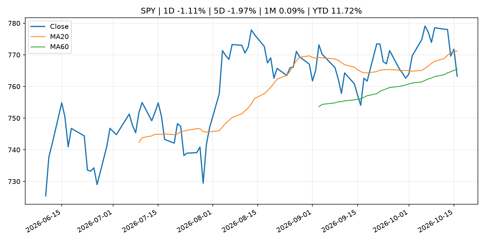
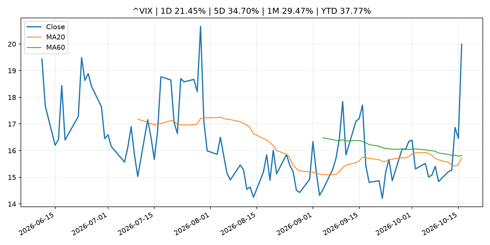
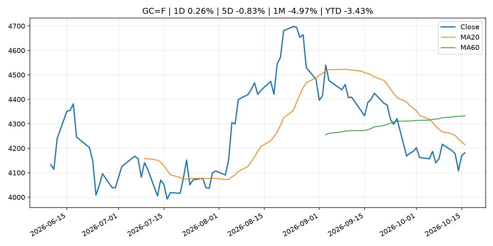
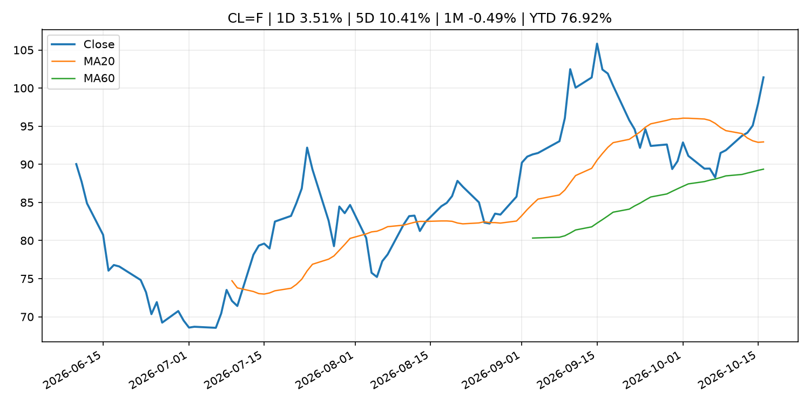
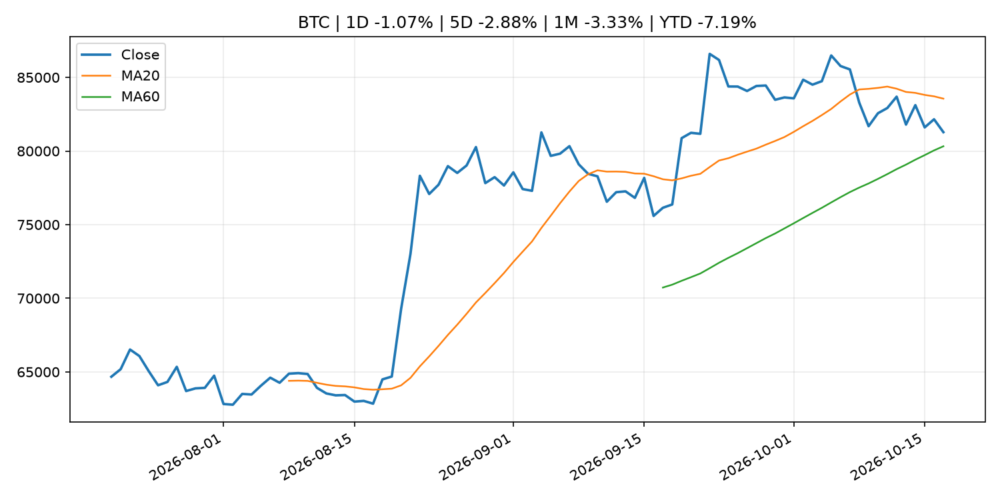
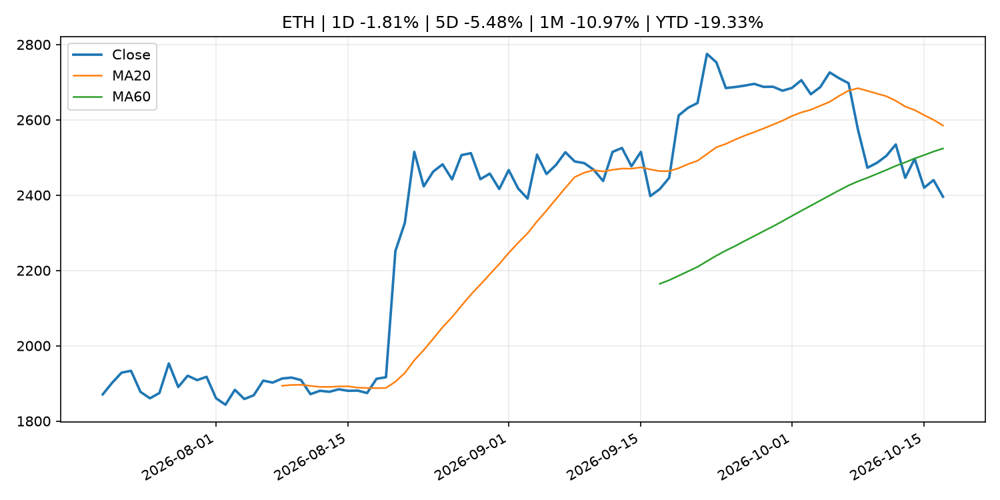

# Global Macro Morning Briefing - 2026-10-18

> Not financial advice / 非投资建议。

## 0. 今日总览
- 市场状态：unknown。市场信号不足，暂不判断明确状态。
- 今日三大主线：
  1. earnings: Microsoft, Shopify and 3 more AI stocks that are favorite Wall Street earnings plays
  2. earnings: Satoshi-era bitcoin faces a bigger quantum threat after Google’s new Willow breakthrough
  3. crypto_market_structure: Banks could slow stablecoin growth by paying savers more, BIS paper finds
- 一句话结论：今日晨报重点关注：大型科技股盈利和资本开支会影响纳指、半导体和 AI 交易主线。；大型科技股盈利和资本开支会影响纳指、半导体和 AI 交易主线。。跨资产方面，SPY 1D -1.11%；QQQ 1D -2.50%；^VIX 1D 21.45%；TLT 1D 0.10%；GC=F 1D 0.26%；CL=F 1D 3.51%；BTC 1D -1.07%；ETH 1D -1.81%；市场信号不足，暂不判断明确状态。政策、通胀、利率、美元、美债、能源和加密监管仍是主要观察线索。所有结论仅基于公开数据与短摘要整理，不构成投资建议。

## 1. 隔夜跨资产市场
- 美股：SPY 1D -1.11%，QQQ 1D -2.50%，整体趋势需结合 VIX 和利率确认。
- 美债/美元：TLT 1D 0.10%，美元指数 1D -0.16%，是判断折现率压力的核心线索。
- 黄金/原油：黄金 1D 0.26%，原油 1D 3.51%，用于观察避险、通胀和地缘风险。
- 加密：BTC 1D -1.07%，ETH 1D -1.81%，关注是否独立于纳指走出加密自身行情。
- 港股/A股：恒生 1D 0.52%，沪深300/上证 1D n/a，重点看中国政策预期与人民币线索。
- 风险观察：关注后续数据是否确认当前跨资产信号。

### US_EQUITY

| symbol | latest close | 1D | 5D | 1M | YTD | trend |
|---|---:|---:|---:|---:|---:|---|
| SPY | 763.25 | -1.11% | -1.97% | 0.09% | 11.72% | range_bound |
| QQQ | 709.80 | -2.50% | -5.52% | -0.99% | 15.77% | range_bound |
| DIA | 519.10 | -0.40% | 0.58% | 0.14% | 7.33% | range_bound |
| IWM | 270.44 | -1.69% | -3.05% | -5.25% | 8.71% | strong_downtrend |
| VTI | 374.07 | -1.15% | -2.06% | -0.34% | 11.23% | range_bound |

### US_MACRO_MARKET

| symbol | latest close | 1D | 5D | 1M | YTD | trend |
|---|---:|---:|---:|---:|---:|---|
| ^VIX | 19.99 | 21.45% | 34.70% | 29.47% | 37.77% | range_bound |
| DX-Y.NYB | 101.84 | -0.16% | -0.36% | 1.62% | 3.47% | uptrend |
| TLT | 80.05 | 0.10% | 2.65% | -2.12% | -8.02% | range_bound |
| IEF | 90.42 | 0.08% | 1.14% | -0.91% | -5.89% | range_bound |

### COMMODITIES

| symbol | latest close | 1D | 5D | 1M | YTD | trend |
|---|---:|---:|---:|---:|---:|---|
| GC=F | 4,181.10 | 0.26% | -0.83% | -4.97% | -3.43% | downtrend |
| SI=F | 56.99 | 0.28% | -6.06% | -12.94% | -19.22% | strong_downtrend |
| CL=F | 101.41 | 3.51% | 10.41% | -0.49% | 76.92% | uptrend |
| BZ=F | 109.86 | 3.72% | 4.91% | 4.81% | 80.84% | strong_uptrend |
| NG=F | 3.12 | -3.71% | -3.23% | 7.41% | -13.88% | strong_uptrend |
| HG=F | 6.53 | 0.30% | -1.68% | -0.84% | 15.80% | range_bound |

### HK_MARKET

| symbol | latest close | 1D | 5D | 1M | YTD | trend |
|---|---:|---:|---:|---:|---:|---|
| ^HSI | 24,186.83 | 0.52% | -0.10% | -2.13% | -8.17% | downtrend |
| 0700.HK | 417.80 | 0.00% | -1.65% | -3.60% | -32.94% | strong_downtrend |
| 9988.HK | 108.80 | 2.26% | 1.68% | 2.45% | -26.98% | range_bound |
| 3690.HK | 75.70 | 0.33% | 5.87% | 1.68% | -27.63% | range_bound |
| 1810.HK | 26.66 | -1.55% | 2.70% | 1.83% | -33.81% | range_bound |
| 1211.HK | 73.75 | 1.10% | -2.45% | -6.88% | -25.32% | strong_downtrend |

### CRYPTO

| symbol | latest close | 1D | 5D | 1M | YTD | trend |
|---|---:|---:|---:|---:|---:|---|
| BTC | 81,279.34 | -1.07% | -2.88% | -3.33% | -7.19% | range_bound |
| ETH | 2,395.81 | -1.81% | -5.48% | -10.97% | -19.33% | range_bound |
| SOLANA | 103.12 | -2.12% | -7.31% | -15.53% | -17.19% | range_bound |
| BINANCECOIN | 716.34 | -1.72% | -4.93% | -7.80% | -16.96% | range_bound |
| RIPPLE | 1.29 | -3.22% | -8.40% | -17.69% | -29.88% | range_bound |

## 2. 今日最重要的 10 条新闻
### 1. Microsoft, Shopify and 3 more AI stocks that are favorite Wall Street earnings plays
- 来源：MarketWatch Top Stories
- 时间：2026-10-17T12:01:00+00:00
- 地区：US
- 事件类型：earnings
- 重要性层级：Tier 2
- 一句话摘要：As earnings season kicks off, select tech companies have the opportunity to deliver big positive surprises for investors.
- 为什么重要：大型科技股盈利和资本开支会影响纳指、半导体和 AI 交易主线。
- 可能影响：主要影响 QQQ，方向为 mixed，强度 high；AI 资本开支会影响大型科技股盈利和估值预期。
  - 资产：QQQ
    方向：mixed
    强度：high
    原因：AI 资本开支会影响大型科技股盈利和估值预期。
  - 资产：SMH
    方向：mixed
    强度：high
    原因：AI 投资周期直接影响半导体需求。
  - 资产：NVDA
    方向：mixed
    强度：high
    原因：AI 训练和推理需求是英伟达收入预期核心变量。
  - 资产：MSFT
    方向：mixed
    强度：medium
    原因：云和 AI 资本开支影响利润率与增长叙事。
  - 资产：GOOGL
    方向：mixed
    强度：medium
    原因：AI 投资和搜索商业化影响估值。
  - 资产：META
    方向：mixed
    强度：medium
    原因：AI 基建支出与广告效率共同影响市场预期。
- 原文链接：[https://www.marketwatch.com/story/microsoft-shopify-and-3-more-ai-stocks-that-are-favorite-wall-street-earnings-plays-0bb61e81?mod=mw_rss_topstories](https://www.marketwatch.com/story/microsoft-shopify-and-3-more-ai-stocks-that-are-favorite-wall-street-earnings-plays-0bb61e81?mod=mw_rss_topstories)

### 2. Satoshi-era bitcoin faces a bigger quantum threat after Google’s new Willow breakthrough
- 来源：CoinDesk
- 时间：2026-10-17T02:30:00+00:00
- 地区：global
- 事件类型：earnings
- 重要性层级：Tier 2
- 一句话摘要：Satoshi-era bitcoin faces a bigger quantum threat after Google’s new Willow breakthrough
- 为什么重要：大型科技股盈利和资本开支会影响纳指、半导体和 AI 交易主线。
- 可能影响：主要影响 QQQ，方向为 mixed，强度 high；AI 资本开支会影响大型科技股盈利和估值预期。
  - 资产：QQQ
    方向：mixed
    强度：high
    原因：AI 资本开支会影响大型科技股盈利和估值预期。
  - 资产：SMH
    方向：mixed
    强度：high
    原因：AI 投资周期直接影响半导体需求。
  - 资产：NVDA
    方向：mixed
    强度：high
    原因：AI 训练和推理需求是英伟达收入预期核心变量。
  - 资产：MSFT
    方向：mixed
    强度：medium
    原因：云和 AI 资本开支影响利润率与增长叙事。
  - 资产：GOOGL
    方向：mixed
    强度：medium
    原因：AI 投资和搜索商业化影响估值。
  - 资产：META
    方向：mixed
    强度：medium
    原因：AI 基建支出与广告效率共同影响市场预期。
- 原文链接：[https://www.coindesk.com/tech/2026/10/16/satoshi-era-bitcoin-faces-a-bigger-quantum-threat-after-google-s-new-willow-breakthrough](https://www.coindesk.com/tech/2026/10/16/satoshi-era-bitcoin-faces-a-bigger-quantum-threat-after-google-s-new-willow-breakthrough)

### 3. Banks could slow stablecoin growth by paying savers more, BIS paper finds
- 来源：CoinDesk
- 时间：2026-10-17T12:00:00+00:00
- 地区：global
- 事件类型：crypto_market_structure
- 重要性层级：Tier 2
- 一句话摘要：Banks could slow stablecoin growth by paying savers more, BIS paper finds
- 为什么重要：加密市场结构和监管变化会影响 BTC、ETH 及相关股票的风险溢价。
- 可能影响：主要影响 BTC，方向为 mixed，强度 high；加密监管或 ETF 进展会改变 BTC 的资金流和风险溢价。
  - 资产：BTC
    方向：mixed
    强度：high
    原因：加密监管或 ETF 进展会改变 BTC 的资金流和风险溢价。
  - 资产：ETH
    方向：mixed
    强度：high
    原因：监管框架会影响 ETH 产品化和机构参与度。
  - 资产：COIN
    方向：mixed
    强度：medium
    原因：监管清晰度和执法风险会影响交易平台估值。
  - 资产：crypto market
    方向：mixed
    强度：high
    原因：信息影响整个加密市场结构，但方向取决于细节。
- 原文链接：[https://www.coindesk.com/business/2026/10/14/banks-could-slow-stablecoin-growth-by-paying-savers-more-bis-paper-finds](https://www.coindesk.com/business/2026/10/14/banks-could-slow-stablecoin-growth-by-paying-savers-more-bis-paper-finds)

### 4. Circle targets 40 new markets as stablecoin demand grows globally
- 来源：CoinDesk
- 时间：2026-10-16T10:54:35+00:00
- 地区：global
- 事件类型：crypto_market_structure
- 重要性层级：Tier 2
- 一句话摘要：Circle targets 40 new markets as stablecoin demand grows globally
- 为什么重要：加密市场结构和监管变化会影响 BTC、ETH 及相关股票的风险溢价。
- 可能影响：主要影响 BTC，方向为 mixed，强度 high；加密监管或 ETF 进展会改变 BTC 的资金流和风险溢价。
  - 资产：BTC
    方向：mixed
    强度：high
    原因：加密监管或 ETF 进展会改变 BTC 的资金流和风险溢价。
  - 资产：ETH
    方向：mixed
    强度：high
    原因：监管框架会影响 ETH 产品化和机构参与度。
  - 资产：COIN
    方向：mixed
    强度：medium
    原因：监管清晰度和执法风险会影响交易平台估值。
  - 资产：crypto market
    方向：mixed
    强度：high
    原因：信息影响整个加密市场结构，但方向取决于细节。
- 原文链接：[https://www.coindesk.com/business/2026/10/16/circle-targets-40-new-markets-as-stablecoin-demand-grows-globally](https://www.coindesk.com/business/2026/10/16/circle-targets-40-new-markets-as-stablecoin-demand-grows-globally)

### 5. Federal Reserve Board announces termination of enforcement actions with Gardner Bancshares, Inc. and Small Business Bank
- 来源：Federal Reserve Press Releases
- 时间：2026-10-16T15:00:00+00:00
- 地区：US
- 事件类型：regulation
- 重要性层级：Tier 2
- 一句话摘要：Federal Reserve Board announces termination of enforcement actions with Gardner Bancshares, Inc. and Small Business Bank
- 为什么重要：监管变化会改变行业盈利预期和资产风险溢价。
- 可能影响：可能影响利率、汇率、风险资产或大宗商品预期，但当前公开信息不足以判断明确方向。
  - 资产：暂无明确资产映射
  - 方向：unknown
  - 强度：low
  - 原因：公开信息不足以判断方向。
- 原文链接：[https://www.federalreserve.gov/newsevents/pressreleases/enforcement20261016a.htm](https://www.federalreserve.gov/newsevents/pressreleases/enforcement20261016a.htm)

### 6. Goldman, Wells Fargo, Morgan Stanley see tokenization as a growth play, not a threat
- 来源：CoinDesk
- 时间：2026-10-17T17:00:00+00:00
- 地区：global
- 事件类型：other
- 重要性层级：Tier 3
- 一句话摘要：Goldman, Wells Fargo, Morgan Stanley see tokenization as a growth play, not a threat
- 为什么重要：这条信息暂未匹配到重大宏观、政策或市场事件，更适合作为背景跟踪。
- 可能影响：更偏背景信息，短期市场影响可能有限。
  - 资产：暂无明确资产映射
  - 方向：unknown
  - 强度：low
  - 原因：公开信息不足以判断方向。
- 原文链接：[https://www.coindesk.com/business/2026/10/17/goldman-wells-fargo-morgan-stanley-see-tokenization-as-a-growth-play-not-a-threat](https://www.coindesk.com/business/2026/10/17/goldman-wells-fargo-morgan-stanley-see-tokenization-as-a-growth-play-not-a-threat)

### 7. ‘Some people did everything right’: I lost my home in the Great Recession. I rent in my 50s. Why is that judged as failure?
- 来源：MarketWatch Top Stories
- 时间：2026-10-17T16:47:00+00:00
- 地区：US
- 事件类型：other
- 重要性层级：Tier 3
- 一句话摘要：”I earn $110,000 a year.”
- 为什么重要：这条信息暂未匹配到重大宏观、政策或市场事件，更适合作为背景跟踪。
- 可能影响：更偏背景信息，短期市场影响可能有限。
  - 资产：暂无明确资产映射
  - 方向：unknown
  - 强度：low
  - 原因：公开信息不足以判断方向。
- 原文链接：[https://www.marketwatch.com/story/i-earn-110-000-a-year-i-lost-my-home-in-the-great-recession-im-renting-in-my-50s-why-is-that-judged-as-failure-d1371d67?mod=mw_rss_topstories](https://www.marketwatch.com/story/i-earn-110-000-a-year-i-lost-my-home-in-the-great-recession-im-renting-in-my-50s-why-is-that-judged-as-failure-d1371d67?mod=mw_rss_topstories)

## 3. 政策与央行观察
### 1. Banks could slow stablecoin growth by paying savers more, BIS paper finds
- 来源：CoinDesk
- 时间：2026-10-17T12:00:00+00:00
- 地区：global
- 事件类型：crypto_market_structure
- 重要性层级：Tier 2
- 一句话摘要：Banks could slow stablecoin growth by paying savers more, BIS paper finds
- 为什么重要：加密市场结构和监管变化会影响 BTC、ETH 及相关股票的风险溢价。
- 可能影响：主要影响 BTC，方向为 mixed，强度 high；加密监管或 ETF 进展会改变 BTC 的资金流和风险溢价。
  - 资产：BTC
    方向：mixed
    强度：high
    原因：加密监管或 ETF 进展会改变 BTC 的资金流和风险溢价。
  - 资产：ETH
    方向：mixed
    强度：high
    原因：监管框架会影响 ETH 产品化和机构参与度。
  - 资产：COIN
    方向：mixed
    强度：medium
    原因：监管清晰度和执法风险会影响交易平台估值。
  - 资产：crypto market
    方向：mixed
    强度：high
    原因：信息影响整个加密市场结构，但方向取决于细节。
- 原文链接：[https://www.coindesk.com/business/2026/10/14/banks-could-slow-stablecoin-growth-by-paying-savers-more-bis-paper-finds](https://www.coindesk.com/business/2026/10/14/banks-could-slow-stablecoin-growth-by-paying-savers-more-bis-paper-finds)

### 2. Circle targets 40 new markets as stablecoin demand grows globally
- 来源：CoinDesk
- 时间：2026-10-16T10:54:35+00:00
- 地区：global
- 事件类型：crypto_market_structure
- 重要性层级：Tier 2
- 一句话摘要：Circle targets 40 new markets as stablecoin demand grows globally
- 为什么重要：加密市场结构和监管变化会影响 BTC、ETH 及相关股票的风险溢价。
- 可能影响：主要影响 BTC，方向为 mixed，强度 high；加密监管或 ETF 进展会改变 BTC 的资金流和风险溢价。
  - 资产：BTC
    方向：mixed
    强度：high
    原因：加密监管或 ETF 进展会改变 BTC 的资金流和风险溢价。
  - 资产：ETH
    方向：mixed
    强度：high
    原因：监管框架会影响 ETH 产品化和机构参与度。
  - 资产：COIN
    方向：mixed
    强度：medium
    原因：监管清晰度和执法风险会影响交易平台估值。
  - 资产：crypto market
    方向：mixed
    强度：high
    原因：信息影响整个加密市场结构，但方向取决于细节。
- 原文链接：[https://www.coindesk.com/business/2026/10/16/circle-targets-40-new-markets-as-stablecoin-demand-grows-globally](https://www.coindesk.com/business/2026/10/16/circle-targets-40-new-markets-as-stablecoin-demand-grows-globally)

### 3. Federal Reserve Board announces termination of enforcement actions with Gardner Bancshares, Inc. and Small Business Bank
- 来源：Federal Reserve Press Releases
- 时间：2026-10-16T15:00:00+00:00
- 地区：US
- 事件类型：regulation
- 重要性层级：Tier 2
- 一句话摘要：Federal Reserve Board announces termination of enforcement actions with Gardner Bancshares, Inc. and Small Business Bank
- 为什么重要：监管变化会改变行业盈利预期和资产风险溢价。
- 可能影响：可能影响利率、汇率、风险资产或大宗商品预期，但当前公开信息不足以判断明确方向。
  - 资产：暂无明确资产映射
  - 方向：unknown
  - 强度：low
  - 原因：公开信息不足以判断方向。
- 原文链接：[https://www.federalreserve.gov/newsevents/pressreleases/enforcement20261016a.htm](https://www.federalreserve.gov/newsevents/pressreleases/enforcement20261016a.htm)

## 4. 市场异动与图表
- SPY 下跌 -1.11%
- QQQ 下跌 -2.50%
- VIX 上涨 21.45%
- Oil 上涨 3.51%

### SPY

### QQQ

### ^VIX

### TLT

### GC=F

### CL=F

### BTC

### ETH

### ^HSI

## 5. 华尔街与机构公开观点
- 暂无可靠公开观点。

## 6. 今日重点关注
- 经济数据：经济数据：暂无可靠公开日历数据；如配置经济日历源后可自动填充。
- 央行讲话：央行讲话：暂无可靠公开日历数据；重点跟踪 Fed、ECB、BoJ、PBOC 官网 RSS。
- 财报：财报：暂无可靠数据。
- 政策事件：政策事件：暂无可靠数据。
- 风险提醒：风险提醒：关注数据源失败项、突发地缘风险、利率和美元的二阶反应。

## 7. 英文金融表达与宏观概念
- **real yield**：实际收益率，名义利率扣除通胀预期后的收益率。 例句：Gold often reacts more to real yields than nominal yields.
- **market structure**：市场结构，指交易、托管、清算、ETF、监管等制度安排。 例句：Crypto market structure rules can affect institutional participation.
- **AI capex**：AI 资本开支，指云厂商和科技公司投入 AI 基建的支出。 例句：AI capex guidance can move semiconductor stocks.
- **inflation expectations**：通胀预期，指家庭、企业或市场对未来通胀的预估。 例句：Inflation expectations can shape wage bargaining and bond yields.
- **terminal rate**：终端利率，市场预期本轮加息周期的最高政策利率。 例句：A higher terminal rate can pressure growth stocks.
- **soft landing**：软着陆，指通胀回落而经济避免明显衰退。 例句：Markets often rally when data support a soft landing.

## 8. 背景材料
- [Goldman, Wells Fargo, Morgan Stanley see tokenization as a growth play, not a threat](https://www.coindesk.com/business/2026/10/17/goldman-wells-fargo-morgan-stanley-see-tokenization-as-a-growth-play-not-a-threat)（CoinDesk，other）：Goldman, Wells Fargo, Morgan Stanley see tokenization as a growth play, not a threat
- [‘Some people did everything right’: I lost my home in the Great Recession. I rent in my 50s. Why is that judged as failure?](https://www.marketwatch.com/story/i-earn-110-000-a-year-i-lost-my-home-in-the-great-recession-im-renting-in-my-50s-why-is-that-judged-as-failure-d1371d67?mod=mw_rss_topstories)（MarketWatch Top Stories，other）：”I earn $110,000 a year.”
- [Polygon sees Coinme acquisition as entry to payments sector dominated by Visa, Stripe](https://www.coindesk.com/business/2026/10/17/polygon-sees-coinme-acquisition-as-entry-to-payments-sector-dominated-by-visa-stripe)（CoinDesk，other）：Polygon sees Coinme acquisition as entry to payments sector dominated by Visa, Stripe
- [Meet the home buyers totally unfazed by 7% mortgage rates](https://www.marketwatch.com/story/meet-the-home-buyers-totally-unfazed-by-7-mortgage-rates-7a9b1cc7?mod=mw_rss_topstories)（MarketWatch Top Stories，other）：Individual investors and second-home buyers accounted for 1 in 5 home purchases in September — the highest share in a little over a year.
- [Christine Lagarde: IMFC Statement](https://www.ecb.europa.eu//press/key/date/2026/html/ecb.sp261017~7015ea3099.en.html)（ECB Press Releases，other）：Christine Lagarde: IMFC Statement
- [U.S. presses China on Mastercard, Citigroup market access in bilateral Bangkok talks, official says](https://www.cnbc.com/2026/10/16/us-china-mastercard-citigroup-market-access.html)（CNBC Economy，other）：The U.S. raised market access issues for Mastercard and Citigroup in China during bilateral meetings in Bangkok this week, a U.S. Treasury official says.
- [Quantum Alliance forms amid warnings 6.4 million bitcoin face future quantum threat](https://www.coindesk.com/tech/2026/10/16/experts-agree-quantum-computers-could-put-satoshi-s-bitcoin-at-risk-but-not-on-what-s-next)（CoinDesk，other）：Quantum Alliance forms amid warnings 6.4 million bitcoin face future quantum threat
- [Altcoins outpace bitcoin as celestia jumps 16%, Warsh silent on interest-rate plans](https://www.coindesk.com/markets/2026/10/16/altcoins-outpace-bitcoin-as-celestia-jumps-16-warsh-silent-on-interest-rate-plans)（CoinDesk，other）：Altcoins outpace bitcoin as celestia jumps 16%, Warsh silent on interest-rate plans
- [Scammer gets scammed in Ledger spy-chip exploit, loses almost $5 million in bitcoin](https://www.coindesk.com/business/2026/10/16/scammer-gets-scammed-in-ledger-spy-chip-exploit-loses-almost-usd5-million-in-bitcoin)（CoinDesk，other）：Scammer gets scammed in Ledger spy-chip exploit, loses almost $5 million in bitcoin
- [Live updates: Bitcoin dips to $81,000 as stocks slide, VIX soars ahead of Black Monday anniversary](https://www.coindesk.com/markets/2026/10/16/live-updates-bitcoin-back-above-usd82-000-zec-jumps-11-as-etf-outflows-continue)（CoinDesk，other）：Live updates: Bitcoin dips to $81,000 as stocks slide, VIX soars ahead of Black Monday anniversary
- [BOJ Current Account Balances by Sector (Sept.)](http://www.boj.or.jp/en/statistics/boj/other/cabs/cabs.xlsx)（Bank of Japan Announcements，other）：BOJ Current Account Balances by Sector (Sept.)
- [XRP has failed to make holders rich like bitcoin and ether. Here’s why](https://www.coindesk.com/markets/2026/10/16/xrp-has-failed-to-make-holders-rich-like-bitcoin-and-ether-here-s-why)（CoinDesk，other）：XRP has failed to make holders rich like bitcoin and ether. Here’s why
- [Bitcoin buyers snap up a brief drop below $80,000 as Asian stocks rebound](https://www.coindesk.com/markets/2026/10/16/bitcoin-buyers-snap-up-a-brief-drop-below-usd80-000-as-asian-stocks-rebound)（CoinDesk，other）：Bitcoin buyers snap up a brief drop below $80,000 as Asian stocks rebound

## 9. 数据源、失败项与免责声明
- 采集时间：2026-10-17T23:45:56
- 数据源：公开 RSS、Yahoo Finance、CoinGecko、AKShare、FRED、SEC data.sec.gov，以及用户自有 inputs/reports 文件。
- 合规说明：不绕过 WSJ、Bloomberg、FT、Reuters 等付费墙；对付费媒体只使用公开 RSS 标题、摘要、链接和发布时间。
- 免责声明：Not financial advice / 非投资建议。本项目仅供个人学习、研究和信息整理，不构成投资建议、交易建议或任何收益承诺。
- 失败或跳过的数据源：
  - crypto data failed coin=dogecoin
  - China market data failed symbol=上证指数: empty dataframe
  - China market data failed symbol=深证成指: empty dataframe
  - China market data failed symbol=创业板指: empty dataframe
  - China market data failed symbol=沪深300: empty dataframe
  - China market data failed symbol=中证500: empty dataframe
  - China market data failed symbol=科创50: empty dataframe
  - FRED_API_KEY not set; skipping FRED macro series
  - SEC failed cik=0000320193
  - SEC failed cik=0000789019
  - SEC failed cik=0001045810
  - SEC failed cik=0001318605
  - SEC failed cik=0001577552
