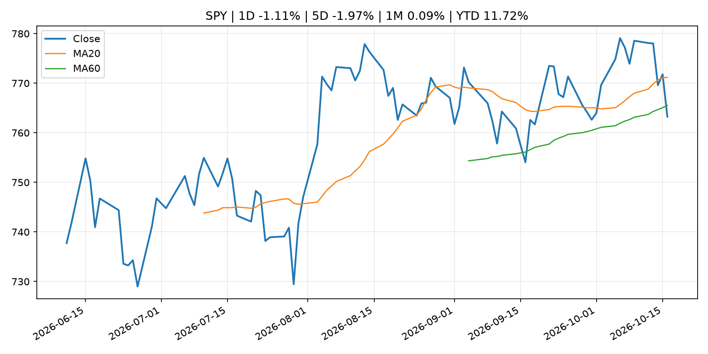
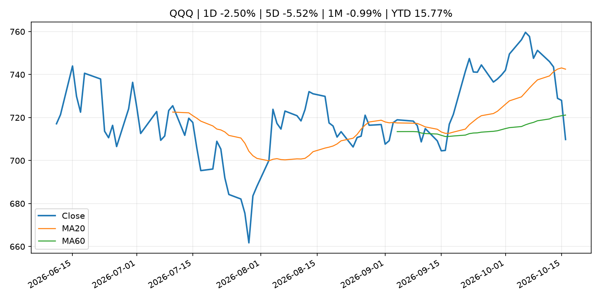
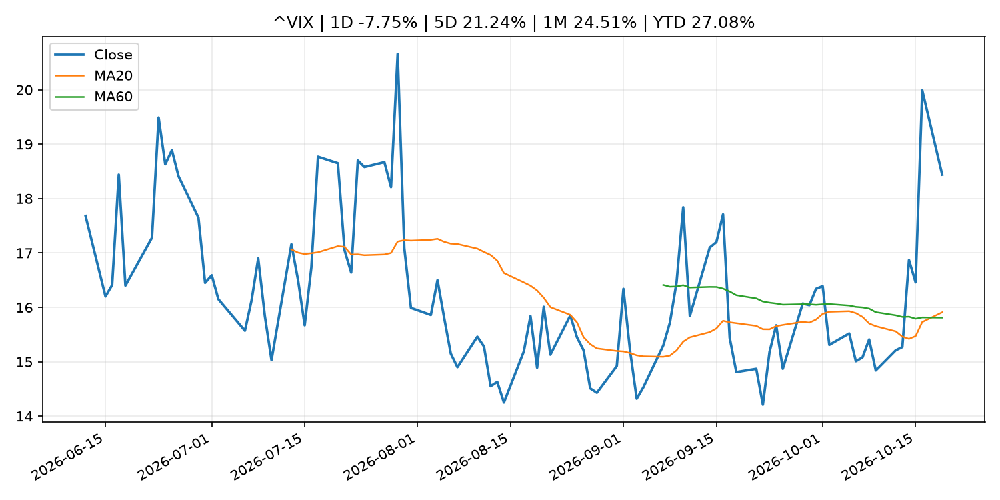
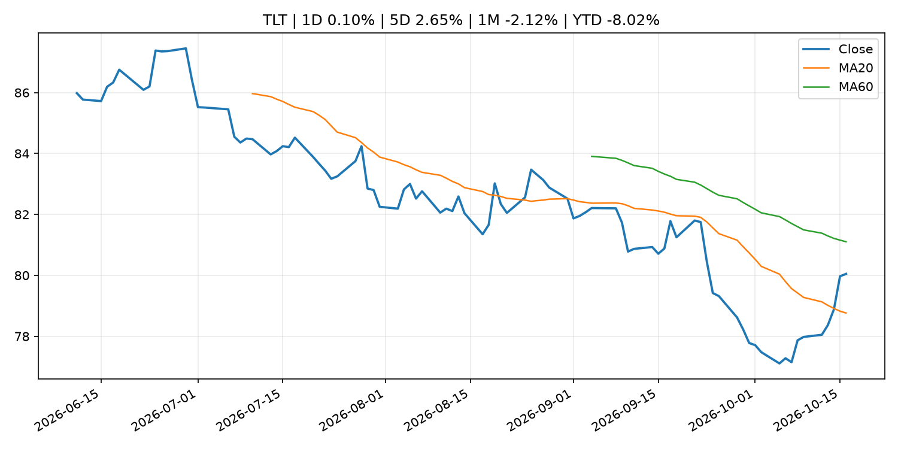
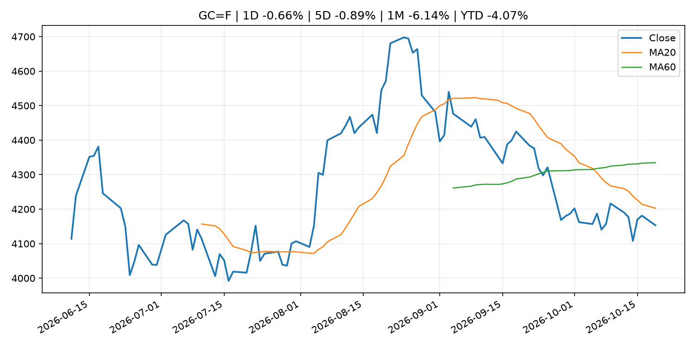
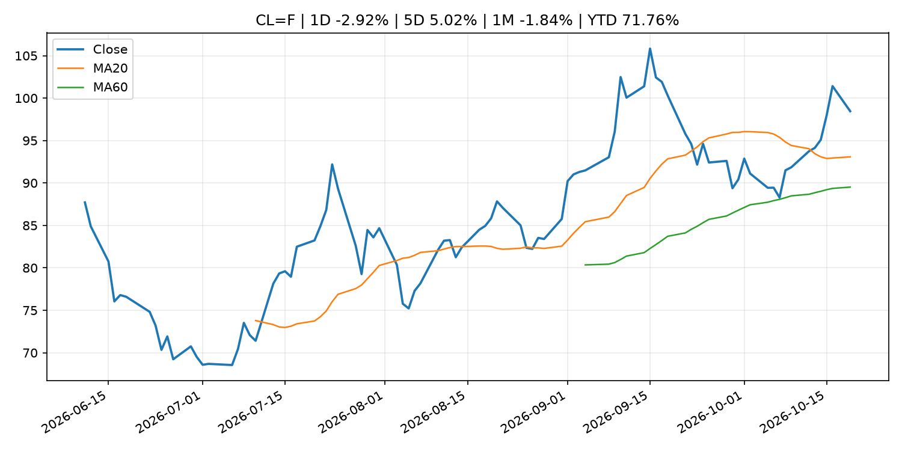
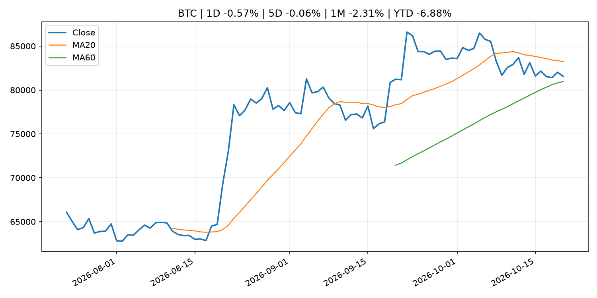
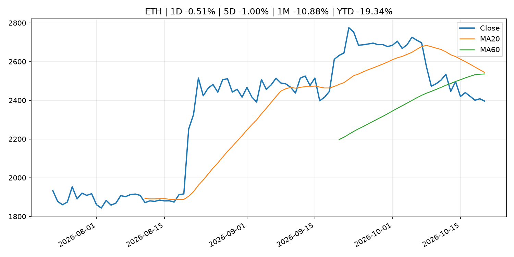

# Global Macro Morning Briefing - 2026-10-20

> Not financial advice / 非投资建议。

## 0. 今日总览
- 市场状态：unknown。市场信号不足，暂不判断明确状态。
- 今日三大主线：
  1. macro_data: Bitcoin, Korea’s Kospi and Nasdaq futures rally as China GDP beats estimates
  2. earnings: Micron and other chip stocks spring back to life after bruising selloff
  3. earnings: Bitcoin mining offshoot Nscale loses Microsoft AI deal as power delay stretches into 2030s
- 一句话结论：今日晨报重点关注：这类宏观数据会直接改变市场对通胀、增长和政策路径的预期。；大型科技股盈利和资本开支会影响纳指、半导体和 AI 交易主线。。跨资产方面，SPY 1D -1.11%；QQQ 1D -2.50%；^VIX 1D -7.75%；TLT 1D 0.10%；GC=F 1D -0.66%；CL=F 1D -2.92%；BTC 1D -0.57%；ETH 1D -0.51%；市场信号不足，暂不判断明确状态。政策、通胀、利率、美元、美债、能源和加密监管仍是主要观察线索。所有结论仅基于公开数据与短摘要整理，不构成投资建议。

## 1. 隔夜跨资产市场
- 美股：SPY 1D -1.11%，QQQ 1D -2.50%，整体趋势需结合 VIX 和利率确认。
- 美债/美元：TLT 1D 0.10%，美元指数 1D 0.08%，是判断折现率压力的核心线索。
- 黄金/原油：黄金 1D -0.66%，原油 1D -2.92%，用于观察避险、通胀和地缘风险。
- 加密：BTC 1D -0.57%，ETH 1D -0.51%，关注是否独立于纳指走出加密自身行情。
- 港股/A股：恒生 1D 0.52%，沪深300/上证 1D n/a，重点看中国政策预期与人民币线索。
- 风险观察：关注后续数据是否确认当前跨资产信号。

### US_EQUITY

| symbol | latest close | 1D | 5D | 1M | YTD | trend |
|---|---:|---:|---:|---:|---:|---|
| SPY | 763.25 | -1.11% | -1.97% | 0.09% | 11.72% | range_bound |
| QQQ | 709.80 | -2.50% | -5.52% | -0.99% | 15.77% | range_bound |
| DIA | 519.10 | -0.40% | 0.58% | 0.14% | 7.33% | range_bound |
| IWM | 270.44 | -1.69% | -3.05% | -5.25% | 8.71% | strong_downtrend |
| VTI | 374.07 | -1.15% | -2.06% | -0.34% | 11.23% | range_bound |

### US_MACRO_MARKET

| symbol | latest close | 1D | 5D | 1M | YTD | trend |
|---|---:|---:|---:|---:|---:|---|
| ^VIX | 18.44 | -7.75% | 21.24% | 24.51% | 27.08% | strong_uptrend |
| DX-Y.NYB | 101.92 | 0.08% | -0.64% | 1.70% | 3.56% | uptrend |
| TLT | 80.05 | 0.10% | 2.65% | -2.12% | -8.02% | range_bound |
| IEF | 90.42 | 0.08% | 1.14% | -0.91% | -5.89% | range_bound |

### COMMODITIES

| symbol | latest close | 1D | 5D | 1M | YTD | trend |
|---|---:|---:|---:|---:|---:|---|
| GC=F | 4,153.40 | -0.66% | -0.89% | -6.14% | -4.07% | downtrend |
| SI=F | 57.06 | 0.11% | -5.13% | -14.28% | -19.14% | strong_downtrend |
| CL=F | 98.45 | -2.92% | 5.02% | -1.84% | 71.76% | uptrend |
| BZ=F | 109.43 | -0.39% | 2.61% | 5.35% | 80.13% | strong_uptrend |
| NG=F | 3.02 | -3.05% | -4.61% | 3.74% | -16.50% | range_bound |
| HG=F | 6.57 | 0.52% | -1.99% | -0.76% | 16.40% | range_bound |

### HK_MARKET

| symbol | latest close | 1D | 5D | 1M | YTD | trend |
|---|---:|---:|---:|---:|---:|---|
| ^HSI | 24,186.83 | 0.52% | -0.10% | -2.13% | -8.17% | downtrend |
| 0700.HK | 417.80 | 0.00% | -1.65% | -3.60% | -32.94% | strong_downtrend |
| 9988.HK | 108.80 | 2.26% | 1.68% | 2.45% | -26.98% | range_bound |
| 3690.HK | 75.70 | 0.33% | 5.87% | 1.68% | -27.63% | range_bound |
| 1810.HK | 26.66 | -1.55% | 2.70% | 1.83% | -33.81% | range_bound |
| 1211.HK | 73.75 | 1.10% | -2.45% | -6.88% | -25.32% | strong_downtrend |

### CRYPTO

| symbol | latest close | 1D | 5D | 1M | YTD | trend |
|---|---:|---:|---:|---:|---:|---|
| BTC | 81,553.25 | -0.57% | -0.06% | -2.31% | -6.88% | range_bound |
| ETH | 2,395.60 | -0.51% | -1.00% | -10.88% | -19.34% | range_bound |
| SOLANA | 104.58 | 0.56% | 0.37% | -11.98% | -16.01% | range_bound |
| BINANCECOIN | 727.89 | 0.72% | -0.27% | -4.69% | -15.63% | range_bound |
| RIPPLE | 1.30 | -0.72% | -2.58% | -13.34% | -29.57% | strong_downtrend |

## 2. 今日最重要的 10 条新闻
### 1. Bitcoin, Korea’s Kospi and Nasdaq futures rally as China GDP beats estimates
- 来源：CoinDesk
- 时间：2026-10-19T03:36:58+00:00
- 地区：global
- 事件类型：macro_data
- 重要性层级：Tier 1
- 一句话摘要：Bitcoin, Korea’s Kospi and Nasdaq futures rally as China GDP beats estimates
- 为什么重要：这类宏观数据会直接改变市场对通胀、增长和政策路径的预期。
- 可能影响：可能影响利率、汇率、风险资产或大宗商品预期，但当前公开信息不足以判断明确方向。
  - 资产：暂无明确资产映射
  - 方向：unknown
  - 强度：low
  - 原因：公开信息不足以判断方向。
- 原文链接：[https://www.coindesk.com/markets/2026/10/19/bitcoin-korea-s-kospi-and-nasdaq-futures-rally-as-china-gdp-beats-estimates](https://www.coindesk.com/markets/2026/10/19/bitcoin-korea-s-kospi-and-nasdaq-futures-rally-as-china-gdp-beats-estimates)

### 2. Micron and other chip stocks spring back to life after bruising selloff
- 来源：MarketWatch Top Stories
- 时间：2026-10-19T21:06:00+00:00
- 地区：US
- 事件类型：earnings
- 重要性层级：Tier 2
- 一句话摘要：It’s a key week for tech stocks as Nvidia gears up for a European conference and Meta prepares to report earnings.
- 为什么重要：大型科技股盈利和资本开支会影响纳指、半导体和 AI 交易主线。
- 可能影响：主要影响 QQQ，方向为 mixed，强度 high；AI 资本开支会影响大型科技股盈利和估值预期。
  - 资产：QQQ
    方向：mixed
    强度：high
    原因：AI 资本开支会影响大型科技股盈利和估值预期。
  - 资产：SMH
    方向：mixed
    强度：high
    原因：AI 投资周期直接影响半导体需求。
  - 资产：NVDA
    方向：mixed
    强度：high
    原因：AI 训练和推理需求是英伟达收入预期核心变量。
  - 资产：MSFT
    方向：mixed
    强度：medium
    原因：云和 AI 资本开支影响利润率与增长叙事。
  - 资产：GOOGL
    方向：mixed
    强度：medium
    原因：AI 投资和搜索商业化影响估值。
  - 资产：META
    方向：mixed
    强度：medium
    原因：AI 基建支出与广告效率共同影响市场预期。
- 原文链接：[https://www.marketwatch.com/story/micron-and-other-chip-stocks-spring-back-to-life-after-bruising-selloff-16486541?mod=mw_rss_topstories](https://www.marketwatch.com/story/micron-and-other-chip-stocks-spring-back-to-life-after-bruising-selloff-16486541?mod=mw_rss_topstories)

### 3. Bitcoin mining offshoot Nscale loses Microsoft AI deal as power delay stretches into 2030s
- 来源：CoinDesk
- 时间：2026-10-19T09:15:00+00:00
- 地区：global
- 事件类型：earnings
- 重要性层级：Tier 2
- 一句话摘要：Bitcoin mining offshoot Nscale loses Microsoft AI deal as power delay stretches into 2030s
- 为什么重要：大型科技股盈利和资本开支会影响纳指、半导体和 AI 交易主线。
- 可能影响：主要影响 QQQ，方向为 mixed，强度 high；AI 资本开支会影响大型科技股盈利和估值预期。
  - 资产：QQQ
    方向：mixed
    强度：high
    原因：AI 资本开支会影响大型科技股盈利和估值预期。
  - 资产：SMH
    方向：mixed
    强度：high
    原因：AI 投资周期直接影响半导体需求。
  - 资产：NVDA
    方向：mixed
    强度：high
    原因：AI 训练和推理需求是英伟达收入预期核心变量。
  - 资产：MSFT
    方向：mixed
    强度：medium
    原因：云和 AI 资本开支影响利润率与增长叙事。
  - 资产：GOOGL
    方向：mixed
    强度：medium
    原因：AI 投资和搜索商业化影响估值。
  - 资产：META
    方向：mixed
    强度：medium
    原因：AI 基建支出与广告效率共同影响市场预期。
- 原文链接：[https://www.coindesk.com/tech/2026/10/19/bitcoin-mining-offshoot-nscale-loses-microsoft-ai-deal-as-power-delay-stretches-into-2030s](https://www.coindesk.com/tech/2026/10/19/bitcoin-mining-offshoot-nscale-loses-microsoft-ai-deal-as-power-delay-stretches-into-2030s)

### 4. SEC Announces Roundtable on Machine-Understandable Data in the Age of Super Intelligence
- 来源：SEC Press Releases
- 时间：2026-10-19T13:19:43-04:00
- 地区：US
- 事件类型：regulation
- 重要性层级：Tier 2
- 一句话摘要：The Securities and Exchange Commission announced today that it will host a roundtable on November 9, 2026, to discuss the use of machine-understandable data and Super Intelligence (SI) and related risks and costs.“In the age of SI, high-quality…
- 为什么重要：监管变化会改变行业盈利预期和资产风险溢价。
- 可能影响：主要影响 BTC，方向为 mixed，强度 high；加密监管或 ETF 进展会改变 BTC 的资金流和风险溢价。
  - 资产：BTC
    方向：mixed
    强度：high
    原因：加密监管或 ETF 进展会改变 BTC 的资金流和风险溢价。
  - 资产：ETH
    方向：mixed
    强度：high
    原因：监管框架会影响 ETH 产品化和机构参与度。
  - 资产：COIN
    方向：mixed
    强度：medium
    原因：监管清晰度和执法风险会影响交易平台估值。
  - 资产：crypto market
    方向：mixed
    强度：high
    原因：信息影响整个加密市场结构，但方向取决于细节。
- 原文链接：[https://www.sec.gov/newsroom/press-releases/2026-106-sec-announces-roundtable-machine-understandable-data-age-super-intelligence](https://www.sec.gov/newsroom/press-releases/2026-106-sec-announces-roundtable-machine-understandable-data-age-super-intelligence)

### 5. SEC tokenized stock framework faces issuer pushback as Broadcom, Verizon object to OKX-ICE listing
- 来源：CoinDesk
- 时间：2026-10-18T23:28:06+00:00
- 地区：global
- 事件类型：regulation
- 重要性层级：Tier 2
- 一句话摘要：SEC tokenized stock framework faces issuer pushback as Broadcom, Verizon object to OKX-ICE listing
- 为什么重要：监管变化会改变行业盈利预期和资产风险溢价。
- 可能影响：主要影响 BTC，方向为 mixed，强度 high；加密监管或 ETF 进展会改变 BTC 的资金流和风险溢价。
  - 资产：BTC
    方向：mixed
    强度：high
    原因：加密监管或 ETF 进展会改变 BTC 的资金流和风险溢价。
  - 资产：ETH
    方向：mixed
    强度：high
    原因：监管框架会影响 ETH 产品化和机构参与度。
  - 资产：COIN
    方向：mixed
    强度：medium
    原因：监管清晰度和执法风险会影响交易平台估值。
  - 资产：crypto market
    方向：mixed
    强度：high
    原因：信息影响整个加密市场结构，但方向取决于细节。
- 原文链接：[https://www.coindesk.com/business/2026/10/18/sec-tokenized-stock-framework-faces-issuer-pushback-as-broadcom-verizon-object-to-okx-ice-listing](https://www.coindesk.com/business/2026/10/18/sec-tokenized-stock-framework-faces-issuer-pushback-as-broadcom-verizon-object-to-okx-ice-listing)

### 6. Stablecoin supply stalls, but payments jump 45% as Visa, Mastercard and Stripe connect crypto to cash
- 来源：CoinDesk
- 时间：2026-10-18T14:00:00+00:00
- 地区：global
- 事件类型：crypto_market_structure
- 重要性层级：Tier 2
- 一句话摘要：Stablecoin supply stalls, but payments jump 45% as Visa, Mastercard and Stripe connect crypto to cash
- 为什么重要：加密市场结构和监管变化会影响 BTC、ETH 及相关股票的风险溢价。
- 可能影响：主要影响 BTC，方向为 mixed，强度 high；加密监管或 ETF 进展会改变 BTC 的资金流和风险溢价。
  - 资产：BTC
    方向：mixed
    强度：high
    原因：加密监管或 ETF 进展会改变 BTC 的资金流和风险溢价。
  - 资产：ETH
    方向：mixed
    强度：high
    原因：监管框架会影响 ETH 产品化和机构参与度。
  - 资产：COIN
    方向：mixed
    强度：medium
    原因：监管清晰度和执法风险会影响交易平台估值。
  - 资产：crypto market
    方向：mixed
    强度：high
    原因：信息影响整个加密市场结构，但方向取决于细节。
- 原文链接：[https://www.coindesk.com/business/2026/10/18/stablecoin-supply-stalls-but-payments-jump-45-as-visa-mastercard-and-stripe-connect-crypto-to-cash](https://www.coindesk.com/business/2026/10/18/stablecoin-supply-stalls-but-payments-jump-45-as-visa-mastercard-and-stripe-connect-crypto-to-cash)

### 7. SpaceX earnings will be all about AI — for better or for worse
- 来源：MarketWatch Top Stories
- 时间：2026-10-19T21:02:00+00:00
- 地区：US
- 事件类型：earnings
- 重要性层级：Tier 2
- 一句话摘要：SpaceX has been renting out access to computing power, which is a big source of revenue growth but also one that comes at a high cost.
- 为什么重要：大型科技股盈利和资本开支会影响纳指、半导体和 AI 交易主线。
- 可能影响：可能影响利率、汇率、风险资产或大宗商品预期，但当前公开信息不足以判断明确方向。
  - 资产：暂无明确资产映射
  - 方向：unknown
  - 强度：low
  - 原因：公开信息不足以判断方向。
- 原文链接：[https://www.marketwatch.com/story/spacex-earnings-will-be-all-about-ai-for-better-or-for-worse-89bbc772?mod=mw_rss_topstories](https://www.marketwatch.com/story/spacex-earnings-will-be-all-about-ai-for-better-or-for-worse-89bbc772?mod=mw_rss_topstories)

### 8. Bitcoin’s $100,000 year-end hope divides analysts as inflation clouds outlook
- 来源：CoinDesk
- 时间：2026-10-18T13:00:00+00:00
- 地区：global
- 事件类型：other
- 重要性层级：Tier 3
- 一句话摘要：Bitcoin’s $100,000 year-end hope divides analysts as inflation clouds outlook
- 为什么重要：这条信息暂未匹配到重大宏观、政策或市场事件，更适合作为背景跟踪。
- 可能影响：主要影响 DXY，方向为 positive，强度 high；通胀压力可能推高政策利率预期并支撑美元。
  - 资产：DXY
    方向：positive
    强度：high
    原因：通胀压力可能推高政策利率预期并支撑美元。
  - 资产：TLT
    方向：negative
    强度：high
    原因：通胀上行通常推升收益率、压低长债价格。
  - 资产：QQQ
    方向：negative
    强度：high
    原因：更高利率对成长股估值折现率不利。
  - 资产：SPY
    方向：mixed
    强度：medium
    原因：名义增长可能支撑收入，但更高利率压制估值。
  - 资产：GC=F
    方向：mixed
    强度：medium
    原因：通胀对黄金是支撑，但实际利率上行会形成压力。
  - 资产：BTC
    方向：mixed
    强度：medium
    原因：抗通胀叙事和流动性收紧可能相互抵消。
- 原文链接：[https://www.coindesk.com/markets/2026/10/18/bitcoin-s-usd100-000-year-end-hope-divides-analysts-as-inflation-clouds-outlook](https://www.coindesk.com/markets/2026/10/18/bitcoin-s-usd100-000-year-end-hope-divides-analysts-as-inflation-clouds-outlook)

### 9. Frank Elderson: From climate and nature risks to economic resilience and competitiveness
- 来源：ECB Press Releases
- 时间：2026-10-19T08:00:00+02:00
- 地区：EU
- 事件类型：other
- 重要性层级：Tier 3
- 一句话摘要：Frank Elderson: From climate and nature risks to economic resilience and competitiveness
- 为什么重要：这条信息暂未匹配到重大宏观、政策或市场事件，更适合作为背景跟踪。
- 可能影响：更偏背景信息，短期市场影响可能有限。
  - 资产：暂无明确资产映射
  - 方向：unknown
  - 强度：low
  - 原因：公开信息不足以判断方向。
- 原文链接：[https://www.ecb.europa.eu//press/key/date/2026/html/ecb.sp261019~f0a3e053de.en.html](https://www.ecb.europa.eu//press/key/date/2026/html/ecb.sp261019~f0a3e053de.en.html)

## 3. 政策与央行观察
### 1. SEC Announces Roundtable on Machine-Understandable Data in the Age of Super Intelligence
- 来源：SEC Press Releases
- 时间：2026-10-19T13:19:43-04:00
- 地区：US
- 事件类型：regulation
- 重要性层级：Tier 2
- 一句话摘要：The Securities and Exchange Commission announced today that it will host a roundtable on November 9, 2026, to discuss the use of machine-understandable data and Super Intelligence (SI) and related risks and costs.“In the age of SI, high-quality…
- 为什么重要：监管变化会改变行业盈利预期和资产风险溢价。
- 可能影响：主要影响 BTC，方向为 mixed，强度 high；加密监管或 ETF 进展会改变 BTC 的资金流和风险溢价。
  - 资产：BTC
    方向：mixed
    强度：high
    原因：加密监管或 ETF 进展会改变 BTC 的资金流和风险溢价。
  - 资产：ETH
    方向：mixed
    强度：high
    原因：监管框架会影响 ETH 产品化和机构参与度。
  - 资产：COIN
    方向：mixed
    强度：medium
    原因：监管清晰度和执法风险会影响交易平台估值。
  - 资产：crypto market
    方向：mixed
    强度：high
    原因：信息影响整个加密市场结构，但方向取决于细节。
- 原文链接：[https://www.sec.gov/newsroom/press-releases/2026-106-sec-announces-roundtable-machine-understandable-data-age-super-intelligence](https://www.sec.gov/newsroom/press-releases/2026-106-sec-announces-roundtable-machine-understandable-data-age-super-intelligence)

### 2. SEC tokenized stock framework faces issuer pushback as Broadcom, Verizon object to OKX-ICE listing
- 来源：CoinDesk
- 时间：2026-10-18T23:28:06+00:00
- 地区：global
- 事件类型：regulation
- 重要性层级：Tier 2
- 一句话摘要：SEC tokenized stock framework faces issuer pushback as Broadcom, Verizon object to OKX-ICE listing
- 为什么重要：监管变化会改变行业盈利预期和资产风险溢价。
- 可能影响：主要影响 BTC，方向为 mixed，强度 high；加密监管或 ETF 进展会改变 BTC 的资金流和风险溢价。
  - 资产：BTC
    方向：mixed
    强度：high
    原因：加密监管或 ETF 进展会改变 BTC 的资金流和风险溢价。
  - 资产：ETH
    方向：mixed
    强度：high
    原因：监管框架会影响 ETH 产品化和机构参与度。
  - 资产：COIN
    方向：mixed
    强度：medium
    原因：监管清晰度和执法风险会影响交易平台估值。
  - 资产：crypto market
    方向：mixed
    强度：high
    原因：信息影响整个加密市场结构，但方向取决于细节。
- 原文链接：[https://www.coindesk.com/business/2026/10/18/sec-tokenized-stock-framework-faces-issuer-pushback-as-broadcom-verizon-object-to-okx-ice-listing](https://www.coindesk.com/business/2026/10/18/sec-tokenized-stock-framework-faces-issuer-pushback-as-broadcom-verizon-object-to-okx-ice-listing)

### 3. Stablecoin supply stalls, but payments jump 45% as Visa, Mastercard and Stripe connect crypto to cash
- 来源：CoinDesk
- 时间：2026-10-18T14:00:00+00:00
- 地区：global
- 事件类型：crypto_market_structure
- 重要性层级：Tier 2
- 一句话摘要：Stablecoin supply stalls, but payments jump 45% as Visa, Mastercard and Stripe connect crypto to cash
- 为什么重要：加密市场结构和监管变化会影响 BTC、ETH 及相关股票的风险溢价。
- 可能影响：主要影响 BTC，方向为 mixed，强度 high；加密监管或 ETF 进展会改变 BTC 的资金流和风险溢价。
  - 资产：BTC
    方向：mixed
    强度：high
    原因：加密监管或 ETF 进展会改变 BTC 的资金流和风险溢价。
  - 资产：ETH
    方向：mixed
    强度：high
    原因：监管框架会影响 ETH 产品化和机构参与度。
  - 资产：COIN
    方向：mixed
    强度：medium
    原因：监管清晰度和执法风险会影响交易平台估值。
  - 资产：crypto market
    方向：mixed
    强度：high
    原因：信息影响整个加密市场结构，但方向取决于细节。
- 原文链接：[https://www.coindesk.com/business/2026/10/18/stablecoin-supply-stalls-but-payments-jump-45-as-visa-mastercard-and-stripe-connect-crypto-to-cash](https://www.coindesk.com/business/2026/10/18/stablecoin-supply-stalls-but-payments-jump-45-as-visa-mastercard-and-stripe-connect-crypto-to-cash)

## 4. 市场异动与图表
- SPY 下跌 -1.11%
- QQQ 下跌 -2.50%
- VIX 下跌 -7.75%
- Gold 下跌 -0.66%
- Oil 下跌 -2.92%

### SPY

### QQQ

### ^VIX

### TLT

### GC=F

### CL=F

### BTC

### ETH

### ^HSI

## 5. 华尔街与机构公开观点
- 暂无可靠公开观点。

## 6. 今日重点关注
- 经济数据：经济数据：暂无可靠公开日历数据；如配置经济日历源后可自动填充。
- 央行讲话：央行讲话：暂无可靠公开日历数据；重点跟踪 Fed、ECB、BoJ、PBOC 官网 RSS。
- 财报：财报：暂无可靠数据。
- 政策事件：政策事件：暂无可靠数据。
- 风险提醒：风险提醒：关注数据源失败项、突发地缘风险、利率和美元的二阶反应。

## 7. 英文金融表达与宏观概念
- **inflation expectations**：通胀预期，指家庭、企业或市场对未来通胀的预估。 例句：Inflation expectations can shape wage bargaining and bond yields.
- **real yield**：实际收益率，名义利率扣除通胀预期后的收益率。 例句：Gold often reacts more to real yields than nominal yields.
- **soft landing**：软着陆，指通胀回落而经济避免明显衰退。 例句：Markets often rally when data support a soft landing.
- **market structure**：市场结构，指交易、托管、清算、ETF、监管等制度安排。 例句：Crypto market structure rules can affect institutional participation.
- **AI capex**：AI 资本开支，指云厂商和科技公司投入 AI 基建的支出。 例句：AI capex guidance can move semiconductor stocks.
- **terminal rate**：终端利率，市场预期本轮加息周期的最高政策利率。 例句：A higher terminal rate can pressure growth stocks.

## 8. 背景材料
- [Retiring abroad? Don’t cut these financial ties to the U.S.](https://www.marketwatch.com/story/retiring-abroad-dont-cut-these-financial-ties-to-the-u-s-5e7e4fc2?mod=mw_rss_topstories)（MarketWatch Top Stories，routine_announcement）：Think carefully about your Social Security, Medicare, credit cards and bank accounts before picking your new home overseas.
- [Strategy's price chart is about to flash a major bullish signal weeks after bitcoin did](https://www.coindesk.com/daybook-us/2026/10/19/strategy-on-verge-of-golden-cross-just-weeks-after-bitcoin-flashed-same-bullish-signal)（CoinDesk，other）：Strategy's price chart is about to flash a major bullish signal weeks after bitcoin did
- [Live updates: Bitcoin holds near $82,000 as Nasdaq rebounds more than 1%](https://www.coindesk.com/markets/2026/10/19/live-updates-bitcoin-tags-usd83-000-and-slips-back-as-chip-stocks-lead-a-rebound)（CoinDesk，other）：Live updates: Bitcoin holds near $82,000 as Nasdaq rebounds more than 1%
- [Bitcoin extends bounce above $82,000 as stocks rebound, DeFi tokens lead altcoin gains](https://www.coindesk.com/markets/2026/10/19/bitcoin-extends-bounce-above-usd82-000-as-stocks-rebound-defi-tokens-lead-altcoin-gains)（CoinDesk，other）：Bitcoin extends bounce above $82,000 as stocks rebound, DeFi tokens lead altcoin gains
- [CME’s bitcoin cash, uniswap futures, global PMIs: Crypto Week Ahead](https://www.coindesk.com/markets/2026/10/19/cme-s-bitcoin-cash-uniswap-futures-global-pmis-crypto-week-ahead)（CoinDesk，other）：CME’s bitcoin cash, uniswap futures, global PMIs: Crypto Week Ahead
- [Bitcoin whale moves $34 million in BTC it got in 2013 when coins traded at $131](https://www.coindesk.com/markets/2026/10/19/bitcoin-whale-moves-usd34-million-in-btc-it-got-in-2013-when-coins-traded-at-usd131)（CoinDesk，other）：Bitcoin whale moves $34 million in BTC it got in 2013 when coins traded at $131
- [Frank Elderson: From climate and nature risks to economic resilience and competitiveness](https://www.ecb.europa.eu//press/key/date/2026/html/ecb.sp261019~f0a3e053de.en.html)（ECB Press Releases，other）：Frank Elderson: From climate and nature risks to economic resilience and competitiveness
- [Wall Street freaked out Friday, but VIX and bitcoin trades say the fear may fade Monday.](https://www.coindesk.com/markets/2026/10/18/wall-street-freaked-out-friday-vix-and-bitcoin-say-it-may-not-last)（CoinDesk，other）：Wall Street freaked out Friday, but VIX and bitcoin trades say the fear may fade Monday.
- [Bitcoin’s $100,000 year-end hope divides analysts as inflation clouds outlook](https://www.coindesk.com/markets/2026/10/18/bitcoin-s-usd100-000-year-end-hope-divides-analysts-as-inflation-clouds-outlook)（CoinDesk，other）：Bitcoin’s $100,000 year-end hope divides analysts as inflation clouds outlook
- [Crypto audits give investors false sense of security as Q3 hacks cost $1.18 billion, Hacken says](https://www.coindesk.com/tech/2026/10/18/crypto-audits-give-investors-false-sense-of-security-as-q3-hacks-cost-usd1-18-billion-hacken-says)（CoinDesk，other）：Crypto audits give investors false sense of security as Q3 hacks cost $1.18 billion, Hacken says

## 9. 数据源、失败项与免责声明
- 采集时间：2026-10-20T00:56:25
- 数据源：公开 RSS、Yahoo Finance、CoinGecko、AKShare、FRED、SEC data.sec.gov，以及用户自有 inputs/reports 文件。
- 合规说明：不绕过 WSJ、Bloomberg、FT、Reuters 等付费墙；对付费媒体只使用公开 RSS 标题、摘要、链接和发布时间。
- 免责声明：Not financial advice / 非投资建议。本项目仅供个人学习、研究和信息整理，不构成投资建议、交易建议或任何收益承诺。
- 失败或跳过的数据源：
  - crypto data failed coin=dogecoin
  - China market data failed symbol=上证指数: empty dataframe
  - China market data failed symbol=深证成指: empty dataframe
  - China market data failed symbol=创业板指: empty dataframe
  - China market data failed symbol=沪深300: empty dataframe
  - China market data failed symbol=中证500: empty dataframe
  - China market data failed symbol=科创50: empty dataframe
  - FRED_API_KEY not set; skipping FRED macro series
  - SEC failed cik=0000320193
  - SEC failed cik=0000789019
  - SEC failed cik=0001045810
  - SEC failed cik=0001318605
  - SEC failed cik=0001577552
