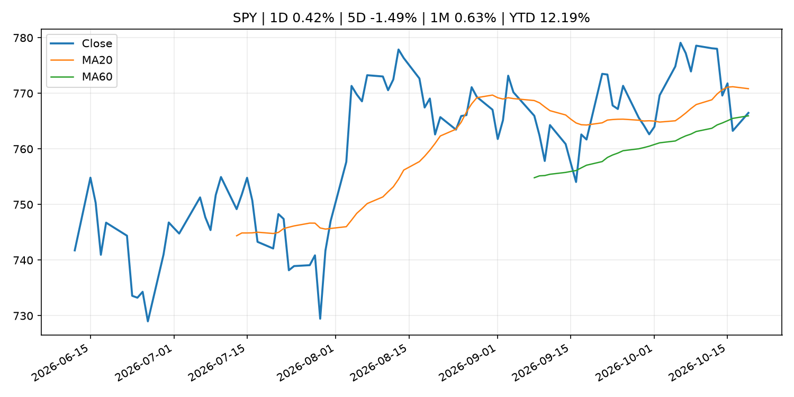
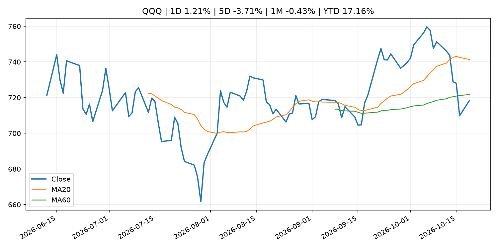
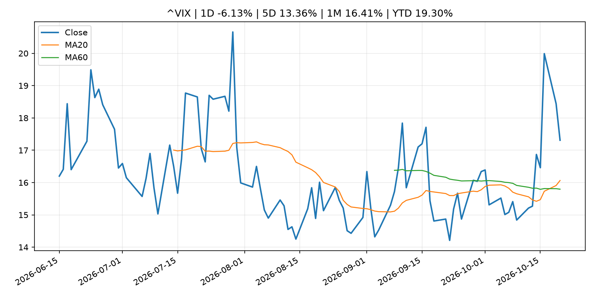
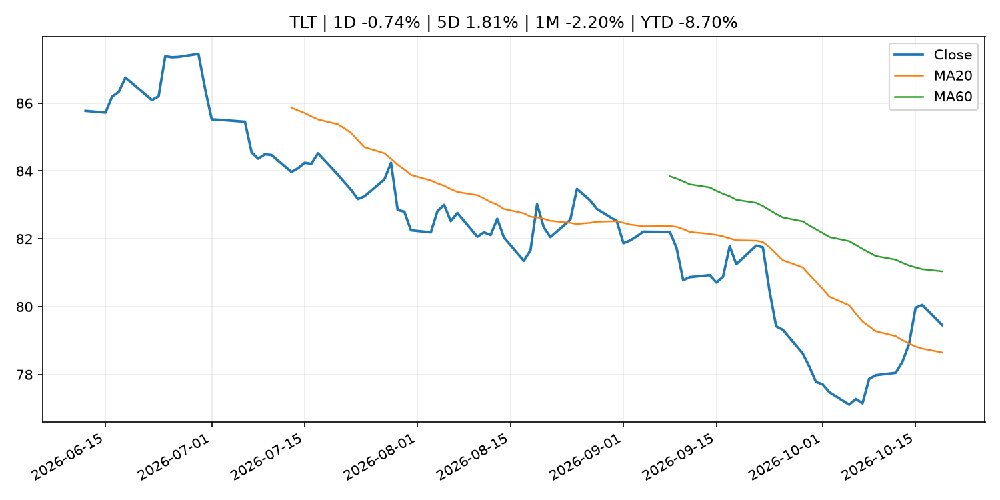
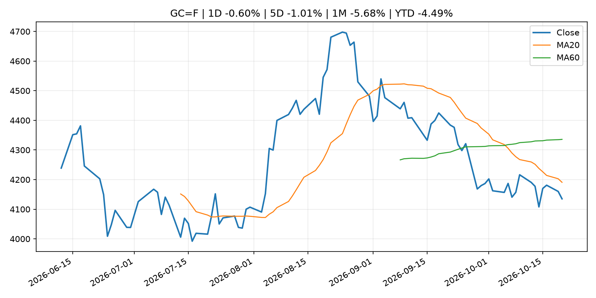
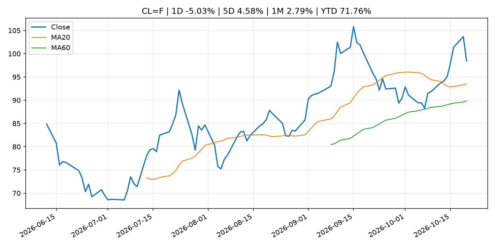
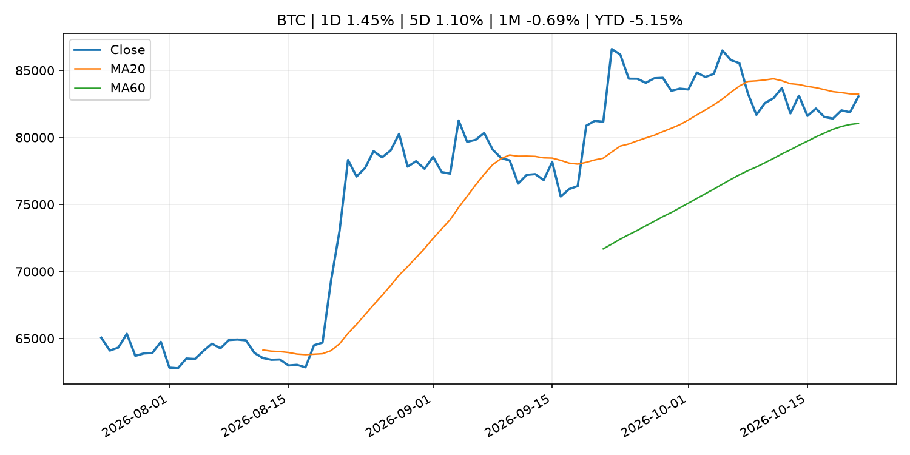
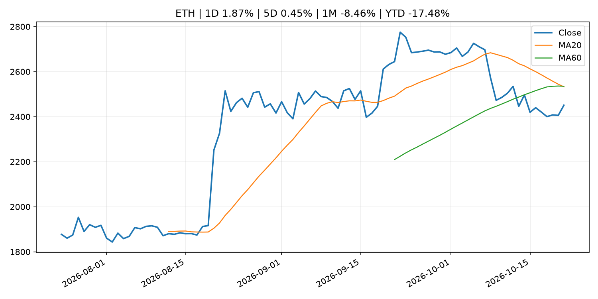
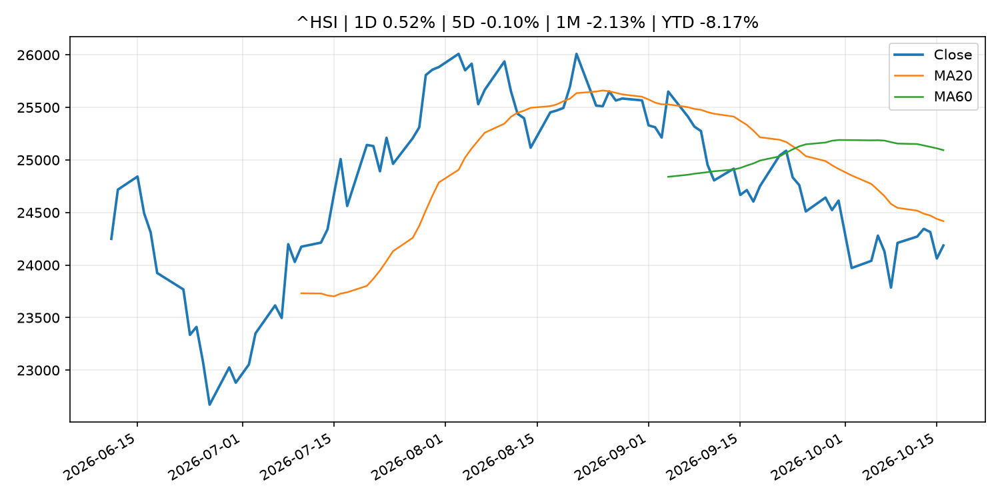

# Global Macro Morning Briefing - 2026-10-21

> Not financial advice / 非投资建议。

## 0. 今日总览
- 市场状态：risk_on。股指上涨、波动率或美元回落，市场更接近风险偏好改善。
- 今日三大主线：
  1. fiscal_policy: France's parliament approves vote to hit stablecoin trades with 31% capital gains tax
  2. earnings: Microsoft, Alphabet and Goldman Sachs join objections to OKX-ICE tokenized stock trading
  3. earnings: Bitcoin mining offshoot Nscale loses Microsoft AI deal as power delay stretches into 2030s
- 一句话结论：今日晨报重点关注：财政和贸易政策会影响增长、通胀、企业利润和跨境资本流。；大型科技股盈利和资本开支会影响纳指、半导体和 AI 交易主线。。跨资产方面，SPY 1D 0.42%；QQQ 1D 1.21%；^VIX 1D -6.13%；TLT 1D -0.74%；GC=F 1D -0.60%；CL=F 1D -5.03%；BTC 1D 1.45%；ETH 1D 1.87%；股指上涨、波动率或美元回落，市场更接近风险偏好改善。政策、通胀、利率、美元、美债、能源和加密监管仍是主要观察线索。所有结论仅基于公开数据与短摘要整理，不构成投资建议。

## 1. 隔夜跨资产市场
- 美股：SPY 1D 0.42%，QQQ 1D 1.21%，整体趋势需结合 VIX 和利率确认。
- 美债/美元：TLT 1D -0.74%，美元指数 1D -0.19%，是判断折现率压力的核心线索。
- 黄金/原油：黄金 1D -0.60%，原油 1D -5.03%，用于观察避险、通胀和地缘风险。
- 加密：BTC 1D 1.45%，ETH 1D 1.87%，关注是否独立于纳指走出加密自身行情。
- 港股/A股：恒生 1D 0.52%，沪深300/上证 1D n/a，重点看中国政策预期与人民币线索。
- 风险观察：确认风险偏好是否扩散到小盘股、信用利差和周期品。

### US_EQUITY

| symbol | latest close | 1D | 5D | 1M | YTD | trend |
|---|---:|---:|---:|---:|---:|---|
| SPY | 766.48 | 0.42% | -1.49% | 0.63% | 12.19% | range_bound |
| QQQ | 718.36 | 1.21% | -3.71% | -0.43% | 17.16% | range_bound |
| DIA | 518.92 | -0.03% | 0.20% | 0.59% | 7.30% | range_bound |
| IWM | 271.28 | 0.31% | -2.38% | -4.51% | 9.04% | strong_downtrend |
| VTI | 375.54 | 0.39% | -1.58% | 0.03% | 11.66% | range_bound |

### US_MACRO_MARKET

| symbol | latest close | 1D | 5D | 1M | YTD | trend |
|---|---:|---:|---:|---:|---:|---|
| ^VIX | 17.31 | -6.13% | 13.36% | 16.41% | 19.30% | uptrend |
| DX-Y.NYB | 101.79 | -0.19% | -0.38% | 1.35% | 3.42% | range_bound |
| TLT | 79.46 | -0.74% | 1.81% | -2.20% | -8.70% | range_bound |
| IEF | 90.08 | -0.38% | 0.73% | -0.79% | -6.24% | range_bound |

### COMMODITIES

| symbol | latest close | 1D | 5D | 1M | YTD | trend |
|---|---:|---:|---:|---:|---:|---|
| GC=F | 4,135.10 | -0.60% | -1.01% | -5.68% | -4.49% | strong_downtrend |
| SI=F | 58.04 | 1.87% | -1.89% | -11.83% | -17.74% | strong_downtrend |
| CL=F | 98.45 | -5.03% | 4.58% | 2.79% | 71.76% | uptrend |
| BZ=F | 109.48 | -0.06% | 3.59% | 9.11% | 80.21% | strong_uptrend |
| NG=F | 2.98 | -2.45% | -9.14% | 5.18% | -17.55% | range_bound |
| HG=F | 6.62 | 1.26% | -0.86% | -0.99% | 17.38% | uptrend |

### HK_MARKET

| symbol | latest close | 1D | 5D | 1M | YTD | trend |
|---|---:|---:|---:|---:|---:|---|
| ^HSI | 24,186.83 | 0.52% | -0.10% | -2.13% | -8.17% | downtrend |
| 0700.HK | 410.40 | -1.77% | -3.62% | -3.66% | -34.13% | strong_downtrend |
| 9988.HK | 104.90 | -3.58% | -3.05% | -0.19% | -29.60% | downtrend |
| 3690.HK | 76.10 | 0.53% | 5.99% | 4.39% | -27.25% | range_bound |
| 1810.HK | 27.06 | 1.50% | 10.36% | 3.52% | -32.82% | range_bound |
| 1211.HK | 73.65 | -0.14% | -0.94% | -9.24% | -25.42% | strong_downtrend |

### CRYPTO

| symbol | latest close | 1D | 5D | 1M | YTD | trend |
|---|---:|---:|---:|---:|---:|---|
| BTC | 83,062.83 | 1.45% | 1.10% | -0.69% | -5.15% | range_bound |
| ETH | 2,450.99 | 1.87% | 0.45% | -8.46% | -17.48% | strong_downtrend |
| SOLANA | 106.58 | 1.52% | 1.17% | -10.51% | -14.41% | range_bound |
| BINANCECOIN | 741.79 | 1.41% | 1.77% | -2.20% | -14.01% | range_bound |
| RIPPLE | 1.34 | 2.53% | 0.19% | -10.34% | -27.41% | strong_downtrend |

## 2. 今日最重要的 10 条新闻
### 1. France's parliament approves vote to hit stablecoin trades with 31% capital gains tax
- 来源：CoinDesk
- 时间：2026-10-20T11:25:00+00:00
- 地区：global
- 事件类型：fiscal_policy
- 重要性层级：Tier 1
- 一句话摘要：France's parliament approves vote to hit stablecoin trades with 31% capital gains tax
- 为什么重要：财政和贸易政策会影响增长、通胀、企业利润和跨境资本流。
- 可能影响：主要影响 BTC，方向为 mixed，强度 high；加密监管或 ETF 进展会改变 BTC 的资金流和风险溢价。
  - 资产：BTC
    方向：mixed
    强度：high
    原因：加密监管或 ETF 进展会改变 BTC 的资金流和风险溢价。
  - 资产：ETH
    方向：mixed
    强度：high
    原因：监管框架会影响 ETH 产品化和机构参与度。
  - 资产：COIN
    方向：mixed
    强度：medium
    原因：监管清晰度和执法风险会影响交易平台估值。
  - 资产：crypto market
    方向：mixed
    强度：high
    原因：信息影响整个加密市场结构，但方向取决于细节。
- 原文链接：[https://www.coindesk.com/policy/2026/10/20/france-s-parliament-approves-vote-to-hit-crypto-to-stablecoin-trades-with-31-levy](https://www.coindesk.com/policy/2026/10/20/france-s-parliament-approves-vote-to-hit-crypto-to-stablecoin-trades-with-31-levy)

### 2. Microsoft, Alphabet and Goldman Sachs join objections to OKX-ICE tokenized stock trading
- 来源：CoinDesk
- 时间：2026-10-20T12:40:17+00:00
- 地区：global
- 事件类型：earnings
- 重要性层级：Tier 2
- 一句话摘要：Microsoft, Alphabet and Goldman Sachs join objections to OKX-ICE tokenized stock trading
- 为什么重要：大型科技股盈利和资本开支会影响纳指、半导体和 AI 交易主线。
- 可能影响：主要影响 QQQ，方向为 mixed，强度 high；AI 资本开支会影响大型科技股盈利和估值预期。
  - 资产：QQQ
    方向：mixed
    强度：high
    原因：AI 资本开支会影响大型科技股盈利和估值预期。
  - 资产：SMH
    方向：mixed
    强度：high
    原因：AI 投资周期直接影响半导体需求。
  - 资产：NVDA
    方向：mixed
    强度：high
    原因：AI 训练和推理需求是英伟达收入预期核心变量。
  - 资产：MSFT
    方向：mixed
    强度：medium
    原因：云和 AI 资本开支影响利润率与增长叙事。
  - 资产：GOOGL
    方向：mixed
    强度：medium
    原因：AI 投资和搜索商业化影响估值。
  - 资产：META
    方向：mixed
    强度：medium
    原因：AI 基建支出与广告效率共同影响市场预期。
- 原文链接：[https://www.coindesk.com/business/2026/10/19/microsoft-alphabet-and-goldman-sachs-join-objections-to-okx-ice-tokenized-stock-trading](https://www.coindesk.com/business/2026/10/19/microsoft-alphabet-and-goldman-sachs-join-objections-to-okx-ice-tokenized-stock-trading)

### 3. Bitcoin mining offshoot Nscale loses Microsoft AI deal as power delay stretches into 2030s
- 来源：CoinDesk
- 时间：2026-10-19T09:15:00+00:00
- 地区：global
- 事件类型：earnings
- 重要性层级：Tier 2
- 一句话摘要：Bitcoin mining offshoot Nscale loses Microsoft AI deal as power delay stretches into 2030s
- 为什么重要：大型科技股盈利和资本开支会影响纳指、半导体和 AI 交易主线。
- 可能影响：主要影响 QQQ，方向为 mixed，强度 high；AI 资本开支会影响大型科技股盈利和估值预期。
  - 资产：QQQ
    方向：mixed
    强度：high
    原因：AI 资本开支会影响大型科技股盈利和估值预期。
  - 资产：SMH
    方向：mixed
    强度：high
    原因：AI 投资周期直接影响半导体需求。
  - 资产：NVDA
    方向：mixed
    强度：high
    原因：AI 训练和推理需求是英伟达收入预期核心变量。
  - 资产：MSFT
    方向：mixed
    强度：medium
    原因：云和 AI 资本开支影响利润率与增长叙事。
  - 资产：GOOGL
    方向：mixed
    强度：medium
    原因：AI 投资和搜索商业化影响估值。
  - 资产：META
    方向：mixed
    强度：medium
    原因：AI 基建支出与广告效率共同影响市场预期。
- 原文链接：[https://www.coindesk.com/tech/2026/10/19/bitcoin-mining-offshoot-nscale-loses-microsoft-ai-deal-as-power-delay-stretches-into-2030s](https://www.coindesk.com/tech/2026/10/19/bitcoin-mining-offshoot-nscale-loses-microsoft-ai-deal-as-power-delay-stretches-into-2030s)

### 4. SEC and AMF Announce Supervisory MOU To Enhance Cooperation for Investment Advisers and Investment Service Providers
- 来源：SEC Press Releases
- 时间：2026-10-20T09:25:16-04:00
- 地区：US
- 事件类型：regulation
- 重要性层级：Tier 2
- 一句话摘要：The U.S. Securities and Exchange Commission (SEC) and the French Autorité des Marchés Financiers (AMF) announced that they have entered into a Memorandum of Understanding (MOU) designed to facilitate consultation and information-sharing in the…
- 为什么重要：监管变化会改变行业盈利预期和资产风险溢价。
- 可能影响：主要影响 BTC，方向为 mixed，强度 high；加密监管或 ETF 进展会改变 BTC 的资金流和风险溢价。
  - 资产：BTC
    方向：mixed
    强度：high
    原因：加密监管或 ETF 进展会改变 BTC 的资金流和风险溢价。
  - 资产：ETH
    方向：mixed
    强度：high
    原因：监管框架会影响 ETH 产品化和机构参与度。
  - 资产：COIN
    方向：mixed
    强度：medium
    原因：监管清晰度和执法风险会影响交易平台估值。
  - 资产：crypto market
    方向：mixed
    强度：high
    原因：信息影响整个加密市场结构，但方向取决于细节。
- 原文链接：[https://www.sec.gov/newsroom/press-releases/2026-108-sec-amf-announce-supervisory-mou-enhance-cooperation-investment-advisers-investment-service](https://www.sec.gov/newsroom/press-releases/2026-108-sec-amf-announce-supervisory-mou-enhance-cooperation-investment-advisers-investment-service)

### 5. SEC, FSA Hold Autumn Financial Regulatory Dialogue
- 来源：SEC Press Releases
- 时间：2026-10-20T08:51:00-04:00
- 地区：US
- 事件类型：regulation
- 重要性层级：Tier 2
- 一句话摘要：The U.S. Securities and Exchange Commission (SEC) and the Financial Services Agency of Japan (FSA) convened the Autumn SEC-FSA Financial Regulatory Dialogue in Tokyo on Oct. 19, 2026.The SEC–FSA Dialogue builds upon longstanding efforts between the two…
- 为什么重要：监管变化会改变行业盈利预期和资产风险溢价。
- 可能影响：主要影响 BTC，方向为 mixed，强度 high；加密监管或 ETF 进展会改变 BTC 的资金流和风险溢价。
  - 资产：BTC
    方向：mixed
    强度：high
    原因：加密监管或 ETF 进展会改变 BTC 的资金流和风险溢价。
  - 资产：ETH
    方向：mixed
    强度：high
    原因：监管框架会影响 ETH 产品化和机构参与度。
  - 资产：COIN
    方向：mixed
    强度：medium
    原因：监管清晰度和执法风险会影响交易平台估值。
  - 资产：crypto market
    方向：mixed
    强度：high
    原因：信息影响整个加密市场结构，但方向取决于细节。
- 原文链接：[https://www.sec.gov/newsroom/press-releases/2026-107-sec-fsa-hold-autumn-financial-regulatory-dialogue](https://www.sec.gov/newsroom/press-releases/2026-107-sec-fsa-hold-autumn-financial-regulatory-dialogue)

### 6. SEC Announces Roundtable on Machine-Understandable Data in the Age of Super Intelligence
- 来源：SEC Press Releases
- 时间：2026-10-19T13:19:43-04:00
- 地区：US
- 事件类型：regulation
- 重要性层级：Tier 2
- 一句话摘要：The Securities and Exchange Commission announced today that it will host a roundtable on November 9, 2026, to discuss the use of machine-understandable data and Super Intelligence (SI) and related risks and costs.“In the age of SI, high-quality…
- 为什么重要：监管变化会改变行业盈利预期和资产风险溢价。
- 可能影响：主要影响 BTC，方向为 mixed，强度 high；加密监管或 ETF 进展会改变 BTC 的资金流和风险溢价。
  - 资产：BTC
    方向：mixed
    强度：high
    原因：加密监管或 ETF 进展会改变 BTC 的资金流和风险溢价。
  - 资产：ETH
    方向：mixed
    强度：high
    原因：监管框架会影响 ETH 产品化和机构参与度。
  - 资产：COIN
    方向：mixed
    强度：medium
    原因：监管清晰度和执法风险会影响交易平台估值。
  - 资产：crypto market
    方向：mixed
    强度：high
    原因：信息影响整个加密市场结构，但方向取决于细节。
- 原文链接：[https://www.sec.gov/newsroom/press-releases/2026-106-sec-announces-roundtable-machine-understandable-data-age-super-intelligence](https://www.sec.gov/newsroom/press-releases/2026-106-sec-announces-roundtable-machine-understandable-data-age-super-intelligence)

### 7. My wife says we can’t afford to retire. I vetoed her $8,000 trip to Italy. We’re in our 60s and have $4 million. Do I keep working?
- 来源：MarketWatch Top Stories
- 时间：2026-10-20T22:30:00+00:00
- 地区：US
- 事件类型：other
- 重要性层级：Tier 3
- 一句话摘要：“I worry about healthcare, long-term care, inflation, a long bear market and living to 95.”
- 为什么重要：这条信息暂未匹配到重大宏观、政策或市场事件，更适合作为背景跟踪。
- 可能影响：主要影响 DXY，方向为 positive，强度 high；通胀压力可能推高政策利率预期并支撑美元。
  - 资产：DXY
    方向：positive
    强度：high
    原因：通胀压力可能推高政策利率预期并支撑美元。
  - 资产：TLT
    方向：negative
    强度：high
    原因：通胀上行通常推升收益率、压低长债价格。
  - 资产：QQQ
    方向：negative
    强度：high
    原因：更高利率对成长股估值折现率不利。
  - 资产：SPY
    方向：mixed
    强度：medium
    原因：名义增长可能支撑收入，但更高利率压制估值。
  - 资产：GC=F
    方向：mixed
    强度：medium
    原因：通胀对黄金是支撑，但实际利率上行会形成压力。
  - 资产：BTC
    方向：mixed
    强度：medium
    原因：抗通胀叙事和流动性收紧可能相互抵消。
- 原文链接：[https://www.marketwatch.com/story/my-wife-says-we-cant-afford-to-retire-we-have-4-million-do-i-just-keep-working-f1b6b085?mod=mw_rss_topstories](https://www.marketwatch.com/story/my-wife-says-we-cant-afford-to-retire-we-have-4-million-do-i-just-keep-working-f1b6b085?mod=mw_rss_topstories)

### 8. Equity weakness could damp demand for bitcoin after biggest ETF inflows in a month
- 来源：CoinDesk
- 时间：2026-10-20T11:14:21+00:00
- 地区：global
- 事件类型：other
- 重要性层级：Tier 3
- 一句话摘要：Equity weakness could damp demand for bitcoin after biggest ETF inflows in a month
- 为什么重要：这条信息暂未匹配到重大宏观、政策或市场事件，更适合作为背景跟踪。
- 可能影响：主要影响 BTC，方向为 mixed，强度 high；加密监管或 ETF 进展会改变 BTC 的资金流和风险溢价。
  - 资产：BTC
    方向：mixed
    强度：high
    原因：加密监管或 ETF 进展会改变 BTC 的资金流和风险溢价。
  - 资产：ETH
    方向：mixed
    强度：high
    原因：监管框架会影响 ETH 产品化和机构参与度。
  - 资产：COIN
    方向：mixed
    强度：medium
    原因：监管清晰度和执法风险会影响交易平台估值。
  - 资产：crypto market
    方向：mixed
    强度：high
    原因：信息影响整个加密市场结构，但方向取决于细节。
- 原文链接：[https://www.coindesk.com/daybook-us/2026/10/20/equity-weakness-could-damp-demand-for-bitcoin-after-biggest-etf-inflows-in-a-month](https://www.coindesk.com/daybook-us/2026/10/20/equity-weakness-could-damp-demand-for-bitcoin-after-biggest-etf-inflows-in-a-month)

## 3. 政策与央行观察
### 1. France's parliament approves vote to hit stablecoin trades with 31% capital gains tax
- 来源：CoinDesk
- 时间：2026-10-20T11:25:00+00:00
- 地区：global
- 事件类型：fiscal_policy
- 重要性层级：Tier 1
- 一句话摘要：France's parliament approves vote to hit stablecoin trades with 31% capital gains tax
- 为什么重要：财政和贸易政策会影响增长、通胀、企业利润和跨境资本流。
- 可能影响：主要影响 BTC，方向为 mixed，强度 high；加密监管或 ETF 进展会改变 BTC 的资金流和风险溢价。
  - 资产：BTC
    方向：mixed
    强度：high
    原因：加密监管或 ETF 进展会改变 BTC 的资金流和风险溢价。
  - 资产：ETH
    方向：mixed
    强度：high
    原因：监管框架会影响 ETH 产品化和机构参与度。
  - 资产：COIN
    方向：mixed
    强度：medium
    原因：监管清晰度和执法风险会影响交易平台估值。
  - 资产：crypto market
    方向：mixed
    强度：high
    原因：信息影响整个加密市场结构，但方向取决于细节。
- 原文链接：[https://www.coindesk.com/policy/2026/10/20/france-s-parliament-approves-vote-to-hit-crypto-to-stablecoin-trades-with-31-levy](https://www.coindesk.com/policy/2026/10/20/france-s-parliament-approves-vote-to-hit-crypto-to-stablecoin-trades-with-31-levy)

### 2. SEC and AMF Announce Supervisory MOU To Enhance Cooperation for Investment Advisers and Investment Service Providers
- 来源：SEC Press Releases
- 时间：2026-10-20T09:25:16-04:00
- 地区：US
- 事件类型：regulation
- 重要性层级：Tier 2
- 一句话摘要：The U.S. Securities and Exchange Commission (SEC) and the French Autorité des Marchés Financiers (AMF) announced that they have entered into a Memorandum of Understanding (MOU) designed to facilitate consultation and information-sharing in the…
- 为什么重要：监管变化会改变行业盈利预期和资产风险溢价。
- 可能影响：主要影响 BTC，方向为 mixed，强度 high；加密监管或 ETF 进展会改变 BTC 的资金流和风险溢价。
  - 资产：BTC
    方向：mixed
    强度：high
    原因：加密监管或 ETF 进展会改变 BTC 的资金流和风险溢价。
  - 资产：ETH
    方向：mixed
    强度：high
    原因：监管框架会影响 ETH 产品化和机构参与度。
  - 资产：COIN
    方向：mixed
    强度：medium
    原因：监管清晰度和执法风险会影响交易平台估值。
  - 资产：crypto market
    方向：mixed
    强度：high
    原因：信息影响整个加密市场结构，但方向取决于细节。
- 原文链接：[https://www.sec.gov/newsroom/press-releases/2026-108-sec-amf-announce-supervisory-mou-enhance-cooperation-investment-advisers-investment-service](https://www.sec.gov/newsroom/press-releases/2026-108-sec-amf-announce-supervisory-mou-enhance-cooperation-investment-advisers-investment-service)

### 3. SEC, FSA Hold Autumn Financial Regulatory Dialogue
- 来源：SEC Press Releases
- 时间：2026-10-20T08:51:00-04:00
- 地区：US
- 事件类型：regulation
- 重要性层级：Tier 2
- 一句话摘要：The U.S. Securities and Exchange Commission (SEC) and the Financial Services Agency of Japan (FSA) convened the Autumn SEC-FSA Financial Regulatory Dialogue in Tokyo on Oct. 19, 2026.The SEC–FSA Dialogue builds upon longstanding efforts between the two…
- 为什么重要：监管变化会改变行业盈利预期和资产风险溢价。
- 可能影响：主要影响 BTC，方向为 mixed，强度 high；加密监管或 ETF 进展会改变 BTC 的资金流和风险溢价。
  - 资产：BTC
    方向：mixed
    强度：high
    原因：加密监管或 ETF 进展会改变 BTC 的资金流和风险溢价。
  - 资产：ETH
    方向：mixed
    强度：high
    原因：监管框架会影响 ETH 产品化和机构参与度。
  - 资产：COIN
    方向：mixed
    强度：medium
    原因：监管清晰度和执法风险会影响交易平台估值。
  - 资产：crypto market
    方向：mixed
    强度：high
    原因：信息影响整个加密市场结构，但方向取决于细节。
- 原文链接：[https://www.sec.gov/newsroom/press-releases/2026-107-sec-fsa-hold-autumn-financial-regulatory-dialogue](https://www.sec.gov/newsroom/press-releases/2026-107-sec-fsa-hold-autumn-financial-regulatory-dialogue)

### 4. SEC Announces Roundtable on Machine-Understandable Data in the Age of Super Intelligence
- 来源：SEC Press Releases
- 时间：2026-10-19T13:19:43-04:00
- 地区：US
- 事件类型：regulation
- 重要性层级：Tier 2
- 一句话摘要：The Securities and Exchange Commission announced today that it will host a roundtable on November 9, 2026, to discuss the use of machine-understandable data and Super Intelligence (SI) and related risks and costs.“In the age of SI, high-quality…
- 为什么重要：监管变化会改变行业盈利预期和资产风险溢价。
- 可能影响：主要影响 BTC，方向为 mixed，强度 high；加密监管或 ETF 进展会改变 BTC 的资金流和风险溢价。
  - 资产：BTC
    方向：mixed
    强度：high
    原因：加密监管或 ETF 进展会改变 BTC 的资金流和风险溢价。
  - 资产：ETH
    方向：mixed
    强度：high
    原因：监管框架会影响 ETH 产品化和机构参与度。
  - 资产：COIN
    方向：mixed
    强度：medium
    原因：监管清晰度和执法风险会影响交易平台估值。
  - 资产：crypto market
    方向：mixed
    强度：high
    原因：信息影响整个加密市场结构，但方向取决于细节。
- 原文链接：[https://www.sec.gov/newsroom/press-releases/2026-106-sec-announces-roundtable-machine-understandable-data-age-super-intelligence](https://www.sec.gov/newsroom/press-releases/2026-106-sec-announces-roundtable-machine-understandable-data-age-super-intelligence)

## 4. 市场异动与图表
- SPY 上涨 0.42%
- QQQ 上涨 1.21%
- VIX 下跌 -6.13%
- TLT 下跌 -0.74%
- Gold 下跌 -0.60%
- Oil 下跌 -5.03%

### SPY

### QQQ

### ^VIX

### TLT

### GC=F

### CL=F

### BTC

### ETH

### ^HSI

## 5. 华尔街与机构公开观点
- 暂无可靠公开观点。

## 6. 今日重点关注
- 经济数据：经济数据：暂无可靠公开日历数据；如配置经济日历源后可自动填充。
- 央行讲话：央行讲话：暂无可靠公开日历数据；重点跟踪 Fed、ECB、BoJ、PBOC 官网 RSS。
- 财报：财报：暂无可靠数据。
- 政策事件：政策事件：暂无可靠数据。
- 风险提醒：风险提醒：关注数据源失败项、突发地缘风险、利率和美元的二阶反应。

## 7. 英文金融表达与宏观概念
- **inflation expectations**：通胀预期，指家庭、企业或市场对未来通胀的预估。 例句：Inflation expectations can shape wage bargaining and bond yields.
- **real yield**：实际收益率，名义利率扣除通胀预期后的收益率。 例句：Gold often reacts more to real yields than nominal yields.
- **market structure**：市场结构，指交易、托管、清算、ETF、监管等制度安排。 例句：Crypto market structure rules can affect institutional participation.
- **AI capex**：AI 资本开支，指云厂商和科技公司投入 AI 基建的支出。 例句：AI capex guidance can move semiconductor stocks.
- **terminal rate**：终端利率，市场预期本轮加息周期的最高政策利率。 例句：A higher terminal rate can pressure growth stocks.
- **soft landing**：软着陆，指通胀回落而经济避免明显衰退。 例句：Markets often rally when data support a soft landing.

## 8. 背景材料
- [Netflix vows to revive viewership trends, but investors hit ‘sell’ on the stock](https://www.marketwatch.com/story/netflix-vows-to-revive-viewership-trends-but-investors-hit-sell-on-the-stock-3e24420a?mod=mw_rss_topstories)（MarketWatch Top Stories，other）：Streaming service cites “intense competition’ and acknowledges ‘some investor concern about our view hours growth.”
- [My wife says we can’t afford to retire. I vetoed her $8,000 trip to Italy. We’re in our 60s and have $4 million. Do I keep working?](https://www.marketwatch.com/story/my-wife-says-we-cant-afford-to-retire-we-have-4-million-do-i-just-keep-working-f1b6b085?mod=mw_rss_topstories)（MarketWatch Top Stories，other）：“I worry about healthcare, long-term care, inflation, a long bear market and living to 95.”
- [It’s no secret what the best financial advice for retirement is — but most people ignore it anyway](https://www.marketwatch.com/story/its-no-secret-what-the-best-financial-advice-for-retirement-is-but-most-people-ignore-it-anyway-7c9075c8?mod=mw_rss_topstories)（MarketWatch Top Stories，other）：Research can prove a lot of facts, but that doesn’t mean it changes how people act.
- [The Coinbase allegations expose Bitcoin's corporate governance gap](https://www.coindesk.com/opinion/2026/10/20/the-coinbase-allegations-expose-bitcoin-s-corporate-governance-gap)（CoinDesk，other）：The Coinbase allegations expose Bitcoin's corporate governance gap
- [BlackRock seeks to shield bitcoin investors from losses after rival fund weathers 50% crash](https://www.coindesk.com/markets/2026/10/20/blackrock-seeks-to-shield-bitcoin-investors-from-losses-after-rival-fund-weathers-50-crash)（CoinDesk，other）：BlackRock seeks to shield bitcoin investors from losses after rival fund weathers 50% crash
- [Equity weakness could damp demand for bitcoin after biggest ETF inflows in a month](https://www.coindesk.com/daybook-us/2026/10/20/equity-weakness-could-damp-demand-for-bitcoin-after-biggest-etf-inflows-in-a-month)（CoinDesk，other）：Equity weakness could damp demand for bitcoin after biggest ETF inflows in a month
- [JPMorgan sees 10% annual bitcoin returns, topping stocks, bonds and gold over next decade](https://www.coindesk.com/markets/2026/10/20/jpmorgan-sees-10-annual-bitcoin-returns-topping-stocks-bonds-and-gold-over-next-decade)（CoinDesk，other）：JPMorgan sees 10% annual bitcoin returns, topping stocks, bonds and gold over next decade
- [Bitcoin drops to $81,400 as Asian chip stocks tumble, options traders seek downside protection](https://www.coindesk.com/markets/2026/10/20/bitcoin-drops-to-usd81-400-as-asian-chip-stocks-tumble-options-traders-seek-downside-protection)（CoinDesk，other）：Bitcoin drops to $81,400 as Asian chip stocks tumble, options traders seek downside protection
- [Live updates: Bitcoin cuts losses as stocks edge higher](https://www.coindesk.com/markets/2026/10/20/live-updates-market-jitters-persist-as-the-ai-selloff-deepens)（CoinDesk，other）：Live updates: Bitcoin cuts losses as stocks edge higher
- [Bitcoin ETFs just saw their biggest day in a month thanks entirely to BlackRock](https://www.coindesk.com/business/2026/10/20/bitcoin-etfs-just-saw-their-biggest-day-in-a-month-thanks-entirely-to-blackrock)（CoinDesk，other）：Bitcoin ETFs just saw their biggest day in a month thanks entirely to BlackRock
- [Frank Elderson: Interview with Die Presse](https://www.ecb.europa.eu//press/inter/date/2026/html/ecb.in261020~97e2e4bc38.en.html)（ECB Press Releases，other）：Frank Elderson: Interview with Die Presse
- [Strategy's price chart is about to flash a major bullish signal weeks after bitcoin did](https://www.coindesk.com/daybook-us/2026/10/19/strategy-on-verge-of-golden-cross-just-weeks-after-bitcoin-flashed-same-bullish-signal)（CoinDesk，other）：Strategy's price chart is about to flash a major bullish signal weeks after bitcoin did
- [Live updates: Bitcoin holds near $82,000 as Nasdaq rebounds more than 1%](https://www.coindesk.com/markets/2026/10/19/live-updates-bitcoin-tags-usd83-000-and-slips-back-as-chip-stocks-lead-a-rebound)（CoinDesk，other）：Live updates: Bitcoin holds near $82,000 as Nasdaq rebounds more than 1%
- [Bitcoin extends bounce above $82,000 as stocks rebound, DeFi tokens lead altcoin gains](https://www.coindesk.com/markets/2026/10/19/bitcoin-extends-bounce-above-usd82-000-as-stocks-rebound-defi-tokens-lead-altcoin-gains)（CoinDesk，other）：Bitcoin extends bounce above $82,000 as stocks rebound, DeFi tokens lead altcoin gains
- [CME’s bitcoin cash, uniswap futures, global PMIs: Crypto Week Ahead](https://www.coindesk.com/markets/2026/10/19/cme-s-bitcoin-cash-uniswap-futures-global-pmis-crypto-week-ahead)（CoinDesk，other）：CME’s bitcoin cash, uniswap futures, global PMIs: Crypto Week Ahead
- [Bitcoin whale moves $34 million in BTC it got in 2013 when coins traded at $131](https://www.coindesk.com/markets/2026/10/19/bitcoin-whale-moves-usd34-million-in-btc-it-got-in-2013-when-coins-traded-at-usd131)（CoinDesk，other）：Bitcoin whale moves $34 million in BTC it got in 2013 when coins traded at $131
- [Frank Elderson: From climate and nature risks to economic resilience and competitiveness](https://www.ecb.europa.eu//press/key/date/2026/html/ecb.sp261019~f0a3e053de.en.html)（ECB Press Releases，other）：Frank Elderson: From climate and nature risks to economic resilience and competitiveness

## 9. 数据源、失败项与免责声明
- 采集时间：2026-10-21T00:24:45
- 数据源：公开 RSS、Yahoo Finance、CoinGecko、AKShare、FRED、SEC data.sec.gov，以及用户自有 inputs/reports 文件。
- 合规说明：不绕过 WSJ、Bloomberg、FT、Reuters 等付费墙；对付费媒体只使用公开 RSS 标题、摘要、链接和发布时间。
- 免责声明：Not financial advice / 非投资建议。本项目仅供个人学习、研究和信息整理，不构成投资建议、交易建议或任何收益承诺。
- 失败或跳过的数据源：
  - crypto data failed coin=dogecoin
  - China market data failed symbol=上证指数: empty dataframe
  - China market data failed symbol=深证成指: empty dataframe
  - China market data failed symbol=创业板指: empty dataframe
  - China market data failed symbol=沪深300: empty dataframe
  - China market data failed symbol=中证500: empty dataframe
  - China market data failed symbol=科创50: empty dataframe
  - FRED_API_KEY not set; skipping FRED macro series
  - SEC failed cik=0000320193
  - SEC failed cik=0000789019
  - SEC failed cik=0001045810
  - SEC failed cik=0001318605
  - SEC failed cik=0001577552
