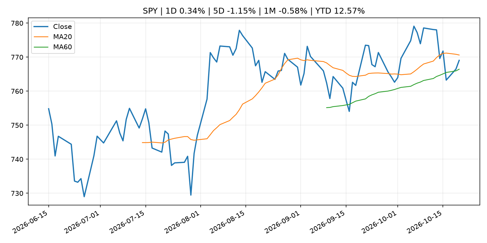
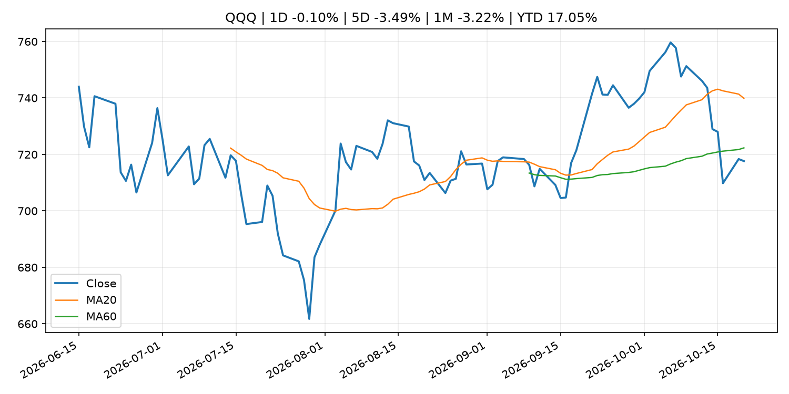
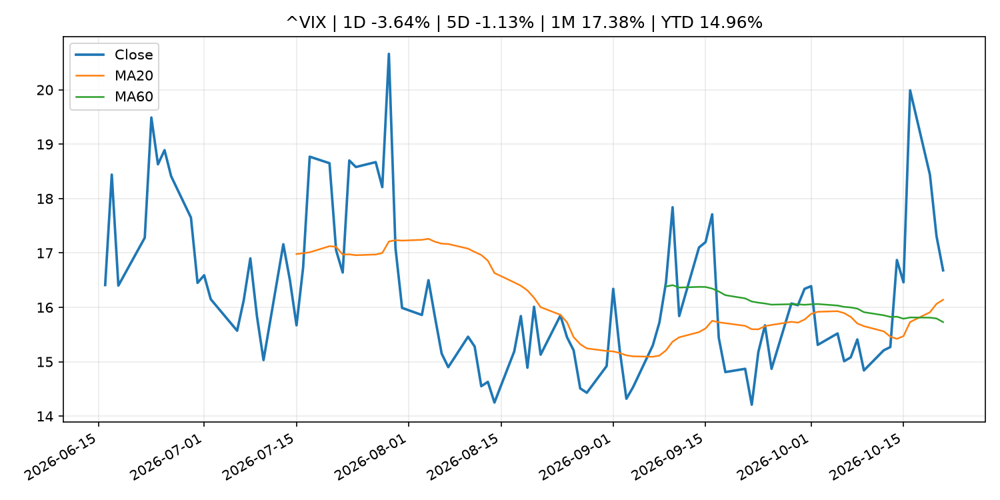
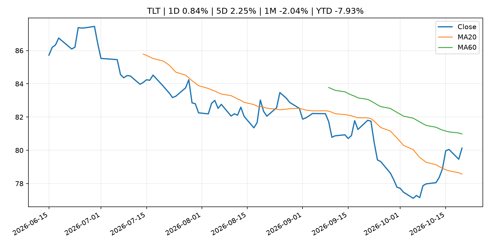
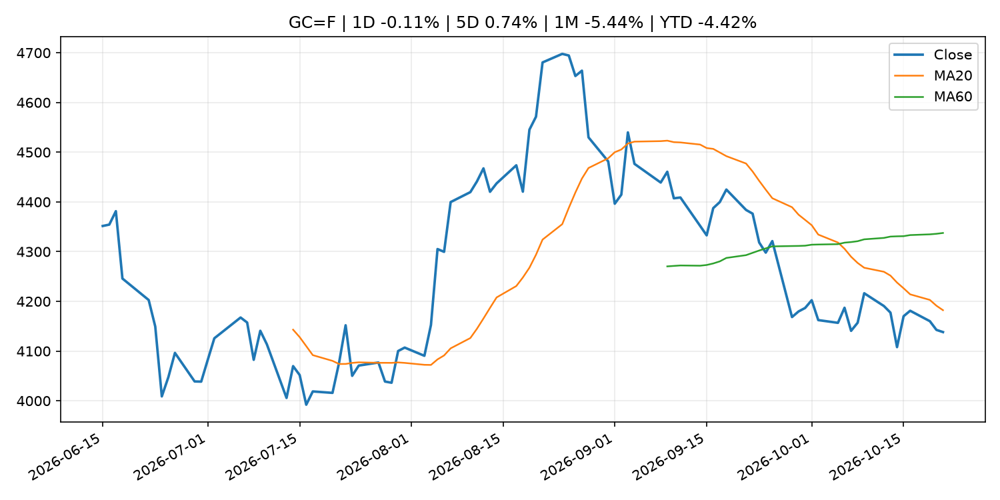
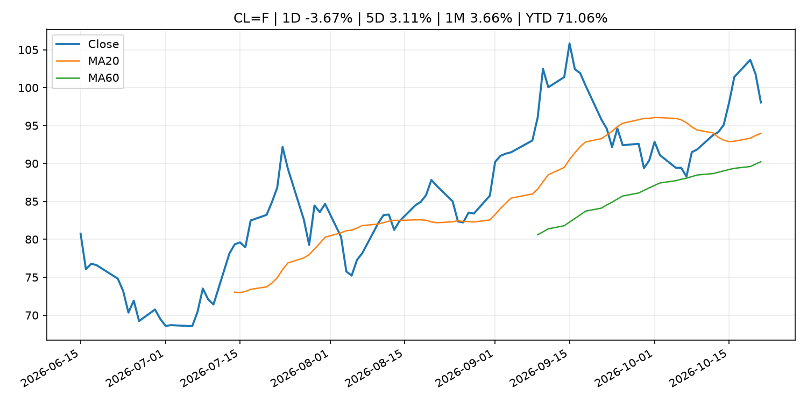
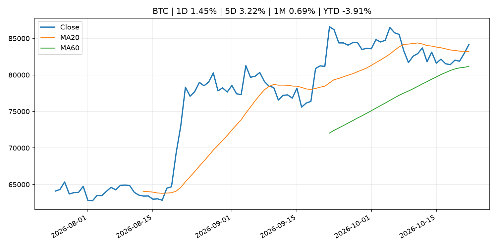
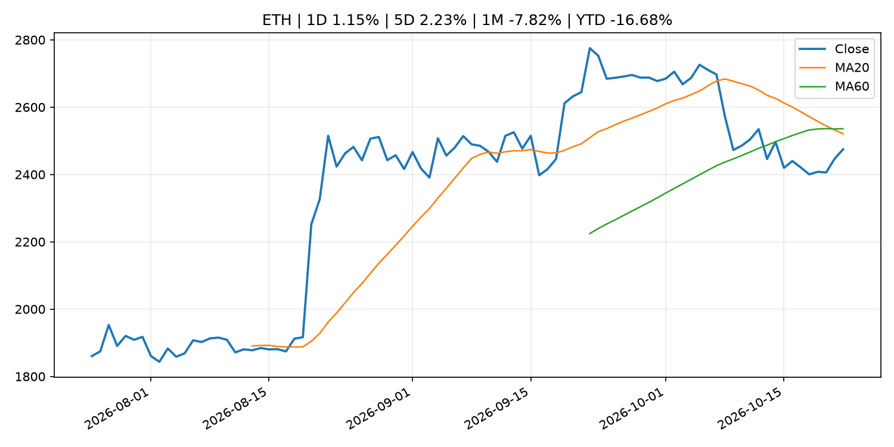
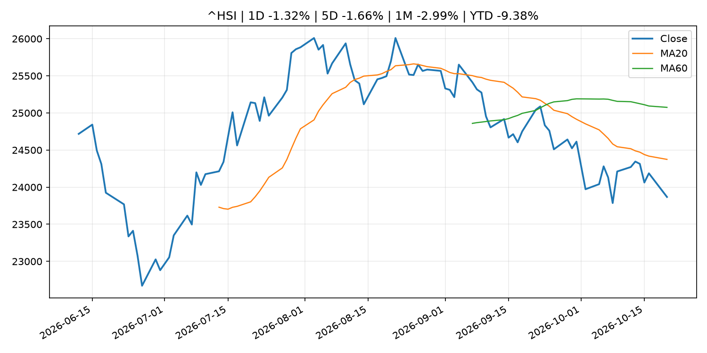

# Global Macro Morning Briefing - 2026-10-22

> Not financial advice / 非投资建议。

## 0. 今日总览
- 市场状态：unknown。市场信号不足，暂不判断明确状态。
- 今日三大主线：
  1. geopolitical_risk: Live updates: Bitcoin holds above $84,000 as Middle East worries resurface
  2. financial_stability: Philip R. Lane: Euro liquidity lines and the international monetary system
  3. earnings: Microsoft, Alphabet and Goldman Sachs join objections to OKX-ICE tokenized stock trading
- 一句话结论：今日晨报重点关注：地缘风险可能推升避险需求、能源价格和市场波动率。；金融稳定信号可能放大跨资产波动，并影响央行反应函数。。跨资产方面，SPY 1D 0.34%；QQQ 1D -0.10%；^VIX 1D -3.64%；TLT 1D 0.84%；GC=F 1D -0.11%；CL=F 1D -3.67%；BTC 1D 1.45%；ETH 1D 1.15%；市场信号不足，暂不判断明确状态。政策、通胀、利率、美元、美债、能源和加密监管仍是主要观察线索。所有结论仅基于公开数据与短摘要整理，不构成投资建议。

## 1. 隔夜跨资产市场
- 美股：SPY 1D 0.34%，QQQ 1D -0.10%，整体趋势需结合 VIX 和利率确认。
- 美债/美元：TLT 1D 0.84%，美元指数 1D -0.04%，是判断折现率压力的核心线索。
- 黄金/原油：黄金 1D -0.11%，原油 1D -3.67%，用于观察避险、通胀和地缘风险。
- 加密：BTC 1D 1.45%，ETH 1D 1.15%，关注是否独立于纳指走出加密自身行情。
- 港股/A股：恒生 1D -1.32%，沪深300/上证 1D n/a，重点看中国政策预期与人民币线索。
- 风险观察：关注后续数据是否确认当前跨资产信号。

### US_EQUITY

| symbol | latest close | 1D | 5D | 1M | YTD | trend |
|---|---:|---:|---:|---:|---:|---|
| SPY | 769.05 | 0.34% | -1.15% | -0.58% | 12.57% | range_bound |
| QQQ | 717.63 | -0.10% | -3.49% | -3.22% | 17.05% | range_bound |
| DIA | 524.36 | 1.05% | 1.58% | 0.88% | 8.42% | range_bound |
| IWM | 275.78 | 1.66% | -0.33% | -3.43% | 10.85% | downtrend |
| VTI | 377.09 | 0.41% | -1.11% | -1.05% | 12.13% | range_bound |

### US_MACRO_MARKET

| symbol | latest close | 1D | 5D | 1M | YTD | trend |
|---|---:|---:|---:|---:|---:|---|
| ^VIX | 16.68 | -3.64% | -1.13% | 17.38% | 14.96% | uptrend |
| DX-Y.NYB | 101.69 | -0.04% | -0.84% | 1.09% | 3.33% | range_bound |
| TLT | 80.13 | 0.84% | 2.25% | -2.04% | -7.93% | range_bound |
| IEF | 90.25 | 0.19% | 0.79% | -0.99% | -6.07% | range_bound |

### COMMODITIES

| symbol | latest close | 1D | 5D | 1M | YTD | trend |
|---|---:|---:|---:|---:|---:|---|
| GC=F | 4,138.20 | -0.11% | 0.74% | -5.44% | -4.42% | strong_downtrend |
| SI=F | 57.65 | -0.10% | 3.78% | -12.56% | -18.29% | strong_downtrend |
| CL=F | 98.05 | -3.67% | 3.11% | 3.66% | 71.06% | strong_uptrend |
| BZ=F | 110.03 | 1.14% | 3.74% | 10.86% | 81.12% | strong_uptrend |
| NG=F | 2.79 | -5.97% | -12.88% | -6.04% | -23.00% | range_bound |
| HG=F | 6.56 | -0.09% | -0.77% | -2.94% | 16.32% | range_bound |

### HK_MARKET

| symbol | latest close | 1D | 5D | 1M | YTD | trend |
|---|---:|---:|---:|---:|---:|---|
| ^HSI | 23,867.74 | -1.32% | -1.66% | -2.99% | -9.38% | downtrend |
| 0700.HK | 393.80 | -4.04% | -7.38% | -6.01% | -36.79% | strong_downtrend |
| 9988.HK | 103.70 | -1.14% | -3.26% | -5.12% | -30.40% | downtrend |
| 3690.HK | 74.70 | -1.84% | 3.32% | 2.05% | -28.59% | range_bound |
| 1810.HK | 26.80 | -0.96% | 7.03% | 1.52% | -33.47% | range_bound |
| 1211.HK | 71.15 | -3.39% | -2.87% | -12.70% | -27.95% | strong_downtrend |

### CRYPTO

| symbol | latest close | 1D | 5D | 1M | YTD | trend |
|---|---:|---:|---:|---:|---:|---|
| BTC | 84,148.74 | 1.45% | 3.22% | 0.69% | -3.91% | uptrend |
| ETH | 2,474.65 | 1.15% | 2.23% | -7.82% | -16.68% | strong_downtrend |
| SOLANA | 107.13 | 0.70% | 2.69% | -9.24% | -13.97% | range_bound |
| BINANCECOIN | 747.86 | 0.96% | 3.74% | -2.72% | -13.31% | range_bound |
| RIPPLE | 1.36 | 2.30% | 4.20% | -8.37% | -25.84% | strong_downtrend |

## 2. 今日最重要的 10 条新闻
### 1. Live updates: Bitcoin holds above $84,000 as Middle East worries resurface
- 来源：CoinDesk
- 时间：2026-10-21T10:30:40+00:00
- 地区：global
- 事件类型：geopolitical_risk
- 重要性层级：Tier 1
- 一句话摘要：Live updates: Bitcoin holds above $84,000 as Middle East worries resurface
- 为什么重要：地缘风险可能推升避险需求、能源价格和市场波动率。
- 可能影响：主要影响 CL=F，方向为 positive，强度 high；供给扰动或 OPEC 减产通常推升 WTI 原油。
  - 资产：CL=F
    方向：positive
    强度：high
    原因：供给扰动或 OPEC 减产通常推升 WTI 原油。
  - 资产：BZ=F
    方向：positive
    强度：high
    原因：全球供给风险通常直接影响 Brent 原油。
  - 资产：SPY
    方向：mixed
    强度：medium
    原因：能源股可能受益，但通胀和成本压力不利于宽基风险资产。
- 原文链接：[https://www.coindesk.com/markets/2026/10/21/live-updates-bitcoin-clings-to-usd82-500-as-spacex-results-lift-stock-futures](https://www.coindesk.com/markets/2026/10/21/live-updates-bitcoin-clings-to-usd82-500-as-spacex-results-lift-stock-futures)

### 2. Philip R. Lane: Euro liquidity lines and the international monetary system
- 来源：ECB Press Releases
- 时间：2026-10-21T06:15:00+02:00
- 地区：EU
- 事件类型：financial_stability
- 重要性层级：Tier 1
- 一句话摘要：Philip R. Lane: Euro liquidity lines and the international monetary system
- 为什么重要：金融稳定信号可能放大跨资产波动，并影响央行反应函数。
- 可能影响：可能影响利率、汇率、风险资产或大宗商品预期，但当前公开信息不足以判断明确方向。
  - 资产：暂无明确资产映射
  - 方向：unknown
  - 强度：low
  - 原因：公开信息不足以判断方向。
- 原文链接：[https://www.ecb.europa.eu//press/key/date/2026/html/ecb.sp261021~401d6c4b70.en.html](https://www.ecb.europa.eu//press/key/date/2026/html/ecb.sp261021~401d6c4b70.en.html)

### 3. Microsoft, Alphabet and Goldman Sachs join objections to OKX-ICE tokenized stock trading
- 来源：CoinDesk
- 时间：2026-10-20T12:40:17+00:00
- 地区：global
- 事件类型：earnings
- 重要性层级：Tier 2
- 一句话摘要：Microsoft, Alphabet and Goldman Sachs join objections to OKX-ICE tokenized stock trading
- 为什么重要：大型科技股盈利和资本开支会影响纳指、半导体和 AI 交易主线。
- 可能影响：主要影响 QQQ，方向为 mixed，强度 high；AI 资本开支会影响大型科技股盈利和估值预期。
  - 资产：QQQ
    方向：mixed
    强度：high
    原因：AI 资本开支会影响大型科技股盈利和估值预期。
  - 资产：SMH
    方向：mixed
    强度：high
    原因：AI 投资周期直接影响半导体需求。
  - 资产：NVDA
    方向：mixed
    强度：high
    原因：AI 训练和推理需求是英伟达收入预期核心变量。
  - 资产：MSFT
    方向：mixed
    强度：medium
    原因：云和 AI 资本开支影响利润率与增长叙事。
  - 资产：GOOGL
    方向：mixed
    强度：medium
    原因：AI 投资和搜索商业化影响估值。
  - 资产：META
    方向：mixed
    强度：medium
    原因：AI 基建支出与广告效率共同影响市场预期。
- 原文链接：[https://www.coindesk.com/business/2026/10/19/microsoft-alphabet-and-goldman-sachs-join-objections-to-okx-ice-tokenized-stock-trading](https://www.coindesk.com/business/2026/10/19/microsoft-alphabet-and-goldman-sachs-join-objections-to-okx-ice-tokenized-stock-trading)

### 4. Why centralized exchanges refuse to list legacy crypto tokens without explicit SEC immunity
- 来源：CoinDesk
- 时间：2026-10-21T12:12:36+00:00
- 地区：global
- 事件类型：regulation
- 重要性层级：Tier 2
- 一句话摘要：Why centralized exchanges refuse to list legacy crypto tokens without explicit SEC immunity
- 为什么重要：监管变化会改变行业盈利预期和资产风险溢价。
- 可能影响：主要影响 BTC，方向为 mixed，强度 high；加密监管或 ETF 进展会改变 BTC 的资金流和风险溢价。
  - 资产：BTC
    方向：mixed
    强度：high
    原因：加密监管或 ETF 进展会改变 BTC 的资金流和风险溢价。
  - 资产：ETH
    方向：mixed
    强度：high
    原因：监管框架会影响 ETH 产品化和机构参与度。
  - 资产：COIN
    方向：mixed
    强度：medium
    原因：监管清晰度和执法风险会影响交易平台估值。
  - 资产：crypto market
    方向：mixed
    强度：high
    原因：信息影响整个加密市场结构，但方向取决于细节。
- 原文链接：[https://www.coindesk.com/policy/2026/10/21/why-centralized-exchanges-refuse-to-list-legacy-crypto-tokens-without-explicit-sec-immunity](https://www.coindesk.com/policy/2026/10/21/why-centralized-exchanges-refuse-to-list-legacy-crypto-tokens-without-explicit-sec-immunity)

### 5. OCC's final rule to start fresh in weighing stablecoin rewards against GENIUS Act ban
- 来源：CoinDesk
- 时间：2026-10-21T11:00:00+00:00
- 地区：global
- 事件类型：crypto_market_structure
- 重要性层级：Tier 2
- 一句话摘要：OCC's final rule to start fresh in weighing stablecoin rewards against GENIUS Act ban
- 为什么重要：加密市场结构和监管变化会影响 BTC、ETH 及相关股票的风险溢价。
- 可能影响：主要影响 BTC，方向为 mixed，强度 high；加密监管或 ETF 进展会改变 BTC 的资金流和风险溢价。
  - 资产：BTC
    方向：mixed
    强度：high
    原因：加密监管或 ETF 进展会改变 BTC 的资金流和风险溢价。
  - 资产：ETH
    方向：mixed
    强度：high
    原因：监管框架会影响 ETH 产品化和机构参与度。
  - 资产：COIN
    方向：mixed
    强度：medium
    原因：监管清晰度和执法风险会影响交易平台估值。
  - 资产：crypto market
    方向：mixed
    强度：high
    原因：信息影响整个加密市场结构，但方向取决于细节。
- 原文链接：[https://www.coindesk.com/policy/2026/10/21/occ-s-final-rule-to-start-fresh-in-weighing-stablecoin-rewards-against-genius-act-ban](https://www.coindesk.com/policy/2026/10/21/occ-s-final-rule-to-start-fresh-in-weighing-stablecoin-rewards-against-genius-act-ban)

### 6. SEC and AMF Announce Supervisory MOU To Enhance Cooperation for Investment Advisers and Investment Service Providers
- 来源：SEC Press Releases
- 时间：2026-10-20T09:25:16-04:00
- 地区：US
- 事件类型：regulation
- 重要性层级：Tier 2
- 一句话摘要：The U.S. Securities and Exchange Commission (SEC) and the French Autorité des Marchés Financiers (AMF) announced that they have entered into a Memorandum of Understanding (MOU) designed to facilitate consultation and information-sharing in the…
- 为什么重要：监管变化会改变行业盈利预期和资产风险溢价。
- 可能影响：主要影响 BTC，方向为 mixed，强度 high；加密监管或 ETF 进展会改变 BTC 的资金流和风险溢价。
  - 资产：BTC
    方向：mixed
    强度：high
    原因：加密监管或 ETF 进展会改变 BTC 的资金流和风险溢价。
  - 资产：ETH
    方向：mixed
    强度：high
    原因：监管框架会影响 ETH 产品化和机构参与度。
  - 资产：COIN
    方向：mixed
    强度：medium
    原因：监管清晰度和执法风险会影响交易平台估值。
  - 资产：crypto market
    方向：mixed
    强度：high
    原因：信息影响整个加密市场结构，但方向取决于细节。
- 原文链接：[https://www.sec.gov/newsroom/press-releases/2026-108-sec-amf-announce-supervisory-mou-enhance-cooperation-investment-advisers-investment-service](https://www.sec.gov/newsroom/press-releases/2026-108-sec-amf-announce-supervisory-mou-enhance-cooperation-investment-advisers-investment-service)

### 7. SEC, FSA Hold Autumn Financial Regulatory Dialogue
- 来源：SEC Press Releases
- 时间：2026-10-20T08:51:00-04:00
- 地区：US
- 事件类型：regulation
- 重要性层级：Tier 2
- 一句话摘要：The U.S. Securities and Exchange Commission (SEC) and the Financial Services Agency of Japan (FSA) convened the Autumn SEC-FSA Financial Regulatory Dialogue in Tokyo on Oct. 19, 2026.The SEC–FSA Dialogue builds upon longstanding efforts between the two…
- 为什么重要：监管变化会改变行业盈利预期和资产风险溢价。
- 可能影响：主要影响 BTC，方向为 mixed，强度 high；加密监管或 ETF 进展会改变 BTC 的资金流和风险溢价。
  - 资产：BTC
    方向：mixed
    强度：high
    原因：加密监管或 ETF 进展会改变 BTC 的资金流和风险溢价。
  - 资产：ETH
    方向：mixed
    强度：high
    原因：监管框架会影响 ETH 产品化和机构参与度。
  - 资产：COIN
    方向：mixed
    强度：medium
    原因：监管清晰度和执法风险会影响交易平台估值。
  - 资产：crypto market
    方向：mixed
    强度：high
    原因：信息影响整个加密市场结构，但方向取决于细节。
- 原文链接：[https://www.sec.gov/newsroom/press-releases/2026-107-sec-fsa-hold-autumn-financial-regulatory-dialogue](https://www.sec.gov/newsroom/press-releases/2026-107-sec-fsa-hold-autumn-financial-regulatory-dialogue)

### 8. Bitcoin hovers around $83,000 as AI earnings revive tech, ZEC jumps 11%
- 来源：CoinDesk
- 时间：2026-10-21T04:07:07+00:00
- 地区：global
- 事件类型：earnings
- 重要性层级：Tier 2
- 一句话摘要：Bitcoin hovers around $83,000 as AI earnings revive tech, ZEC jumps 11%
- 为什么重要：大型科技股盈利和资本开支会影响纳指、半导体和 AI 交易主线。
- 可能影响：可能影响利率、汇率、风险资产或大宗商品预期，但当前公开信息不足以判断明确方向。
  - 资产：暂无明确资产映射
  - 方向：unknown
  - 强度：low
  - 原因：公开信息不足以判断方向。
- 原文链接：[https://www.coindesk.com/markets/2026/10/21/bitcoin-hovers-around-usd83-000-as-ai-earnings-revive-tech-zec-jumps-11](https://www.coindesk.com/markets/2026/10/21/bitcoin-hovers-around-usd83-000-as-ai-earnings-revive-tech-zec-jumps-11)

### 9. Senior Loan Officer Opinion Survey (Oct.)
- 来源：Bank of Japan Announcements
- 时间：2026-10-22T08:50:00+09:00
- 地区：Japan
- 事件类型：other
- 重要性层级：Tier 3
- 一句话摘要：Senior Loan Officer Opinion Survey (Oct.)
- 为什么重要：这条信息暂未匹配到重大宏观、政策或市场事件，更适合作为背景跟踪。
- 可能影响：更偏背景信息，短期市场影响可能有限。
  - 资产：暂无明确资产映射
  - 方向：unknown
  - 强度：low
  - 原因：公开信息不足以判断方向。
- 原文链接：[http://www.boj.or.jp/en/statistics/dl/loan/loos/release/loos2610.pdf](http://www.boj.or.jp/en/statistics/dl/loan/loos/release/loos2610.pdf)

### 10. Statistics on Securities Financing Transactions in Japan
- 来源：Bank of Japan Announcements
- 时间：2026-10-22T08:50:00+09:00
- 地区：Japan
- 事件类型：other
- 重要性层级：Tier 3
- 一句话摘要：Statistics on Securities Financing Transactions in Japan
- 为什么重要：这条信息暂未匹配到重大宏观、政策或市场事件，更适合作为背景跟踪。
- 可能影响：更偏背景信息，短期市场影响可能有限。
  - 资产：暂无明确资产映射
  - 方向：unknown
  - 强度：low
  - 原因：公开信息不足以判断方向。
- 原文链接：[http://www.boj.or.jp/en/statistics/bis/repo/index.htm](http://www.boj.or.jp/en/statistics/bis/repo/index.htm)

## 3. 政策与央行观察
### 1. Philip R. Lane: Euro liquidity lines and the international monetary system
- 来源：ECB Press Releases
- 时间：2026-10-21T06:15:00+02:00
- 地区：EU
- 事件类型：financial_stability
- 重要性层级：Tier 1
- 一句话摘要：Philip R. Lane: Euro liquidity lines and the international monetary system
- 为什么重要：金融稳定信号可能放大跨资产波动，并影响央行反应函数。
- 可能影响：可能影响利率、汇率、风险资产或大宗商品预期，但当前公开信息不足以判断明确方向。
  - 资产：暂无明确资产映射
  - 方向：unknown
  - 强度：low
  - 原因：公开信息不足以判断方向。
- 原文链接：[https://www.ecb.europa.eu//press/key/date/2026/html/ecb.sp261021~401d6c4b70.en.html](https://www.ecb.europa.eu//press/key/date/2026/html/ecb.sp261021~401d6c4b70.en.html)

### 2. Why centralized exchanges refuse to list legacy crypto tokens without explicit SEC immunity
- 来源：CoinDesk
- 时间：2026-10-21T12:12:36+00:00
- 地区：global
- 事件类型：regulation
- 重要性层级：Tier 2
- 一句话摘要：Why centralized exchanges refuse to list legacy crypto tokens without explicit SEC immunity
- 为什么重要：监管变化会改变行业盈利预期和资产风险溢价。
- 可能影响：主要影响 BTC，方向为 mixed，强度 high；加密监管或 ETF 进展会改变 BTC 的资金流和风险溢价。
  - 资产：BTC
    方向：mixed
    强度：high
    原因：加密监管或 ETF 进展会改变 BTC 的资金流和风险溢价。
  - 资产：ETH
    方向：mixed
    强度：high
    原因：监管框架会影响 ETH 产品化和机构参与度。
  - 资产：COIN
    方向：mixed
    强度：medium
    原因：监管清晰度和执法风险会影响交易平台估值。
  - 资产：crypto market
    方向：mixed
    强度：high
    原因：信息影响整个加密市场结构，但方向取决于细节。
- 原文链接：[https://www.coindesk.com/policy/2026/10/21/why-centralized-exchanges-refuse-to-list-legacy-crypto-tokens-without-explicit-sec-immunity](https://www.coindesk.com/policy/2026/10/21/why-centralized-exchanges-refuse-to-list-legacy-crypto-tokens-without-explicit-sec-immunity)

### 3. OCC's final rule to start fresh in weighing stablecoin rewards against GENIUS Act ban
- 来源：CoinDesk
- 时间：2026-10-21T11:00:00+00:00
- 地区：global
- 事件类型：crypto_market_structure
- 重要性层级：Tier 2
- 一句话摘要：OCC's final rule to start fresh in weighing stablecoin rewards against GENIUS Act ban
- 为什么重要：加密市场结构和监管变化会影响 BTC、ETH 及相关股票的风险溢价。
- 可能影响：主要影响 BTC，方向为 mixed，强度 high；加密监管或 ETF 进展会改变 BTC 的资金流和风险溢价。
  - 资产：BTC
    方向：mixed
    强度：high
    原因：加密监管或 ETF 进展会改变 BTC 的资金流和风险溢价。
  - 资产：ETH
    方向：mixed
    强度：high
    原因：监管框架会影响 ETH 产品化和机构参与度。
  - 资产：COIN
    方向：mixed
    强度：medium
    原因：监管清晰度和执法风险会影响交易平台估值。
  - 资产：crypto market
    方向：mixed
    强度：high
    原因：信息影响整个加密市场结构，但方向取决于细节。
- 原文链接：[https://www.coindesk.com/policy/2026/10/21/occ-s-final-rule-to-start-fresh-in-weighing-stablecoin-rewards-against-genius-act-ban](https://www.coindesk.com/policy/2026/10/21/occ-s-final-rule-to-start-fresh-in-weighing-stablecoin-rewards-against-genius-act-ban)

### 4. SEC and AMF Announce Supervisory MOU To Enhance Cooperation for Investment Advisers and Investment Service Providers
- 来源：SEC Press Releases
- 时间：2026-10-20T09:25:16-04:00
- 地区：US
- 事件类型：regulation
- 重要性层级：Tier 2
- 一句话摘要：The U.S. Securities and Exchange Commission (SEC) and the French Autorité des Marchés Financiers (AMF) announced that they have entered into a Memorandum of Understanding (MOU) designed to facilitate consultation and information-sharing in the…
- 为什么重要：监管变化会改变行业盈利预期和资产风险溢价。
- 可能影响：主要影响 BTC，方向为 mixed，强度 high；加密监管或 ETF 进展会改变 BTC 的资金流和风险溢价。
  - 资产：BTC
    方向：mixed
    强度：high
    原因：加密监管或 ETF 进展会改变 BTC 的资金流和风险溢价。
  - 资产：ETH
    方向：mixed
    强度：high
    原因：监管框架会影响 ETH 产品化和机构参与度。
  - 资产：COIN
    方向：mixed
    强度：medium
    原因：监管清晰度和执法风险会影响交易平台估值。
  - 资产：crypto market
    方向：mixed
    强度：high
    原因：信息影响整个加密市场结构，但方向取决于细节。
- 原文链接：[https://www.sec.gov/newsroom/press-releases/2026-108-sec-amf-announce-supervisory-mou-enhance-cooperation-investment-advisers-investment-service](https://www.sec.gov/newsroom/press-releases/2026-108-sec-amf-announce-supervisory-mou-enhance-cooperation-investment-advisers-investment-service)

### 5. SEC, FSA Hold Autumn Financial Regulatory Dialogue
- 来源：SEC Press Releases
- 时间：2026-10-20T08:51:00-04:00
- 地区：US
- 事件类型：regulation
- 重要性层级：Tier 2
- 一句话摘要：The U.S. Securities and Exchange Commission (SEC) and the Financial Services Agency of Japan (FSA) convened the Autumn SEC-FSA Financial Regulatory Dialogue in Tokyo on Oct. 19, 2026.The SEC–FSA Dialogue builds upon longstanding efforts between the two…
- 为什么重要：监管变化会改变行业盈利预期和资产风险溢价。
- 可能影响：主要影响 BTC，方向为 mixed，强度 high；加密监管或 ETF 进展会改变 BTC 的资金流和风险溢价。
  - 资产：BTC
    方向：mixed
    强度：high
    原因：加密监管或 ETF 进展会改变 BTC 的资金流和风险溢价。
  - 资产：ETH
    方向：mixed
    强度：high
    原因：监管框架会影响 ETH 产品化和机构参与度。
  - 资产：COIN
    方向：mixed
    强度：medium
    原因：监管清晰度和执法风险会影响交易平台估值。
  - 资产：crypto market
    方向：mixed
    强度：high
    原因：信息影响整个加密市场结构，但方向取决于细节。
- 原文链接：[https://www.sec.gov/newsroom/press-releases/2026-107-sec-fsa-hold-autumn-financial-regulatory-dialogue](https://www.sec.gov/newsroom/press-releases/2026-107-sec-fsa-hold-autumn-financial-regulatory-dialogue)

## 4. 市场异动与图表
- VIX 下跌 -3.64%
- TLT 上涨 0.84%
- Oil 下跌 -3.67%

### SPY

### QQQ

### ^VIX

### TLT

### GC=F

### CL=F

### BTC

### ETH

### ^HSI

## 5. 华尔街与机构公开观点
- 暂无可靠公开观点。

## 6. 今日重点关注
- 经济数据：经济数据：暂无可靠公开日历数据；如配置经济日历源后可自动填充。
- 央行讲话：央行讲话：暂无可靠公开日历数据；重点跟踪 Fed、ECB、BoJ、PBOC 官网 RSS。
- 财报：财报：暂无可靠数据。
- 政策事件：政策事件：暂无可靠数据。
- 风险提醒：风险提醒：关注数据源失败项、突发地缘风险、利率和美元的二阶反应。

## 7. 英文金融表达与宏观概念
- **real yield**：实际收益率，名义利率扣除通胀预期后的收益率。 例句：Gold often reacts more to real yields than nominal yields.
- **risk-off**：避险模式，资金偏向美元、国债、黄金等防御资产。 例句：A geopolitical shock can push markets into risk-off mode.
- **supply disruption**：供给扰动，通常指能源或商品供应受冲突、减产或天气影响。 例句：Supply disruption can lift oil prices and inflation expectations.
- **market structure**：市场结构，指交易、托管、清算、ETF、监管等制度安排。 例句：Crypto market structure rules can affect institutional participation.
- **AI capex**：AI 资本开支，指云厂商和科技公司投入 AI 基建的支出。 例句：AI capex guidance can move semiconductor stocks.
- **inflation expectations**：通胀预期，指家庭、企业或市场对未来通胀的预估。 例句：Inflation expectations can shape wage bargaining and bond yields.

## 8. 背景材料
- [Senior Loan Officer Opinion Survey (Oct.)](http://www.boj.or.jp/en/statistics/dl/loan/loos/release/loos2610.pdf)（Bank of Japan Announcements，other）：Senior Loan Officer Opinion Survey (Oct.)
- [Statistics on Securities Financing Transactions in Japan](http://www.boj.or.jp/en/statistics/bis/repo/index.htm)（Bank of Japan Announcements，other）：Statistics on Securities Financing Transactions in Japan
- [7 healthcare stocks that stand out as investors pay up for the sector](https://www.marketwatch.com/story/7-healthcare-stocks-that-stand-out-as-investors-pay-up-for-the-sector-d9b0c173?mod=mw_rss_topstories)（MarketWatch Top Stories，other）：Investors have pushed the healthcare sector to a record high, and some favored stocks have high projected revenue growth rates through 2028.
- [Goldman Sachs, JPMorgan and Morgan Stanley are dominating the AI stock boom. Here's their edge](https://www.cnbc.com/2026/10/21/goldman-sachs-jpmorgan-morgan-stanley-ai-trading.html)（CNBC Economy，other）：Wall Street’s Big Three have generated $52 billion in equity trading revenue this year, capturing about 80% of the market on rising margin lending to hedge funds.
- [Japanese visitors may be able to pay with yen stablecoins in South Korea under Shinhan-SBI pact](https://www.coindesk.com/business/2026/10/21/japanese-visitors-may-be-able-to-pay-with-yen-stablecoins-in-south-korea-under-shinhan-sbi-pact)（CoinDesk，other）：Japanese visitors may be able to pay with yen stablecoins in South Korea under Shinhan-SBI pact
- [Bitcoin risk management grows more popular as the 'just bet on price' era fades](https://www.coindesk.com/daybook-us/2026/10/21/bitcoin-risk-management-grows-more-popular-as-the-just-bet-on-price-era-fades)（CoinDesk，other）：Bitcoin risk management grows more popular as the 'just bet on price' era fades
- [SpaceX and Tesla explore merger that would unite more than 30,000 bitcoin](https://www.coindesk.com/markets/2026/10/21/spacex-and-tesla-explore-merger-that-would-unite-more-than-30-000-bitcoin)（CoinDesk，other）：SpaceX and Tesla explore merger that would unite more than 30,000 bitcoin
- [Piero Cipollone: Pontes and Appia: unlocking opportunities for banks](https://www.ecb.europa.eu//press/key/date/2026/html/ecb.sp261021_1~d190f2c349.en.pdf)（ECB Press Releases，other）：Piero Cipollone: Pontes and Appia: unlocking opportunities for banks
- [A company that vouches for websites had secret keys so weak that 8 of them were cracked](https://www.coindesk.com/tech/2026/10/21/a-company-that-vouches-for-websites-had-secret-keys-so-weak-that-8-of-them-were-cracked)（CoinDesk，other）：A company that vouches for websites had secret keys so weak that 8 of them were cracked
- [The Coinbase allegations expose Bitcoin's corporate governance gap](https://www.coindesk.com/opinion/2026/10/20/the-coinbase-allegations-expose-bitcoin-s-corporate-governance-gap)（CoinDesk，other）：The Coinbase allegations expose Bitcoin's corporate governance gap
- [BlackRock seeks to shield bitcoin investors from losses after rival fund weathers 50% crash](https://www.coindesk.com/markets/2026/10/20/blackrock-seeks-to-shield-bitcoin-investors-from-losses-after-rival-fund-weathers-50-crash)（CoinDesk，other）：BlackRock seeks to shield bitcoin investors from losses after rival fund weathers 50% crash
- [Frank Elderson: Interview with Die Presse](https://www.ecb.europa.eu//press/inter/date/2026/html/ecb.in261020~97e2e4bc38.en.html)（ECB Press Releases，other）：Frank Elderson: Interview with Die Presse

## 9. 数据源、失败项与免责声明
- 采集时间：2026-10-22T00:27:15
- 数据源：公开 RSS、Yahoo Finance、CoinGecko、AKShare、FRED、SEC data.sec.gov，以及用户自有 inputs/reports 文件。
- 合规说明：不绕过 WSJ、Bloomberg、FT、Reuters 等付费墙；对付费媒体只使用公开 RSS 标题、摘要、链接和发布时间。
- 免责声明：Not financial advice / 非投资建议。本项目仅供个人学习、研究和信息整理，不构成投资建议、交易建议或任何收益承诺。
- 失败或跳过的数据源：
  - crypto data failed coin=dogecoin
  - China market data failed symbol=上证指数: empty dataframe
  - China market data failed symbol=深证成指: empty dataframe
  - China market data failed symbol=创业板指: empty dataframe
  - China market data failed symbol=沪深300: empty dataframe
  - China market data failed symbol=中证500: empty dataframe
  - China market data failed symbol=科创50: empty dataframe
  - FRED_API_KEY not set; skipping FRED macro series
  - SEC failed cik=0000320193
  - SEC failed cik=0000789019
  - SEC failed cik=0001045810
  - SEC failed cik=0001318605
  - SEC failed cik=0001577552
