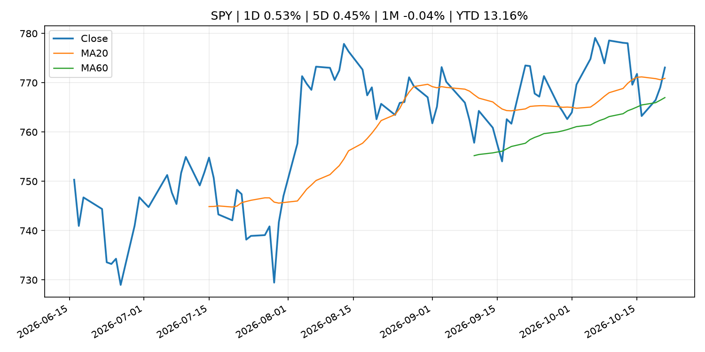
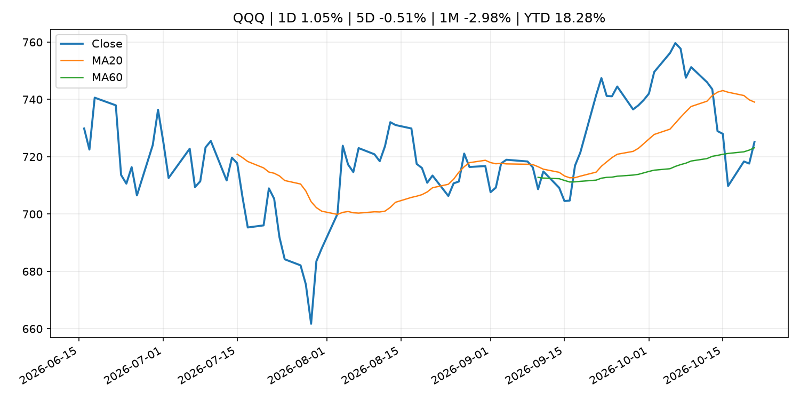
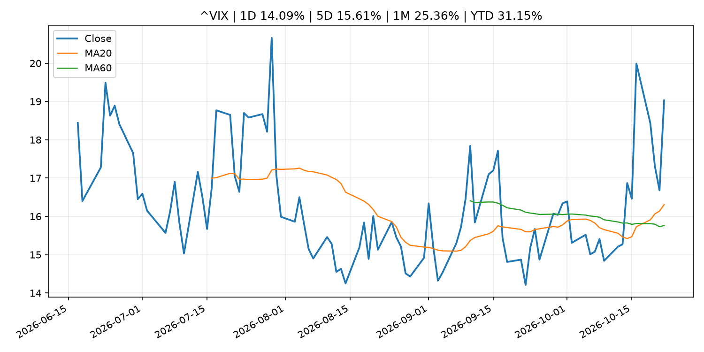
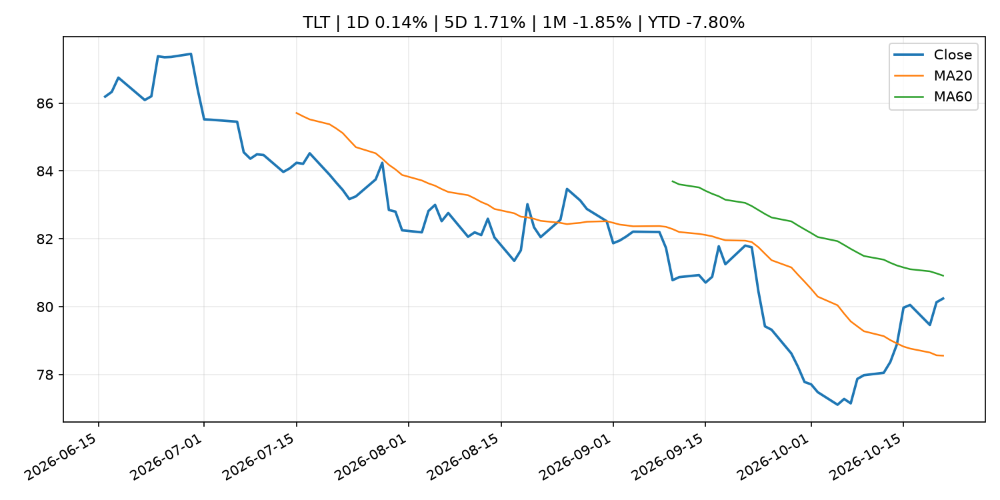
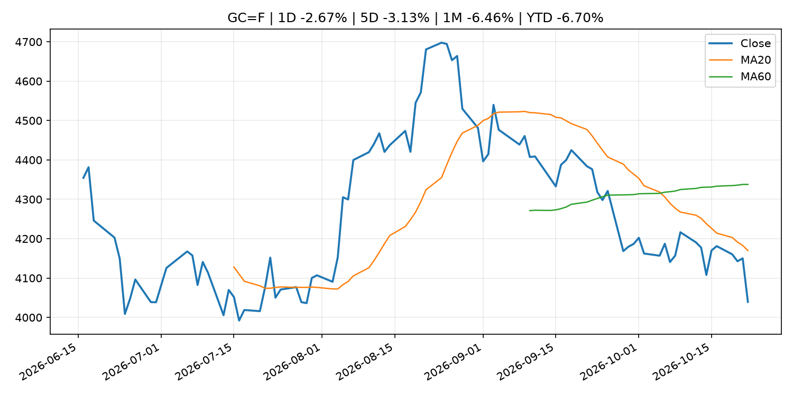
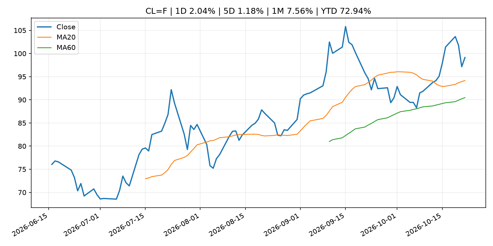
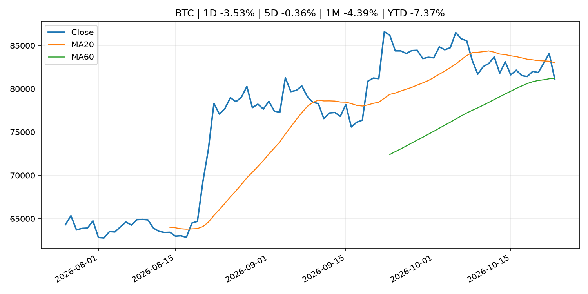
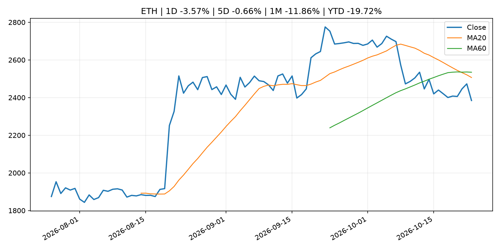
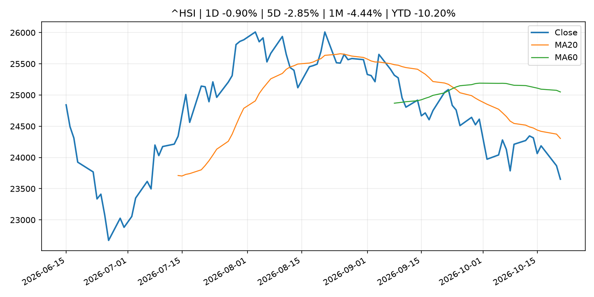

# Global Macro Morning Briefing - 2026-10-23

> Not financial advice / 非投资建议。

## 0. 今日总览
- 市场状态：mixed。市场信号不足，暂不判断明确状态。 但存在信号冲突，需要降低单一叙事置信度。
- 今日三大主线：
  1. geopolitical_risk: Oil prices approach Iran-war highs as soaring tanker rates trigger a second energy squeeze
  2. financial_stability: Philip R. Lane: Euro liquidity lines and the international monetary system
  3. earnings: Bitcoin gives back its run at $85,000 as Tesla and Meta fail to calm AI nerves
- 一句话结论：今日晨报重点关注：地缘风险可能推升避险需求、能源价格和市场波动率。；金融稳定信号可能放大跨资产波动，并影响央行反应函数。。跨资产方面，SPY 1D 0.53%；QQQ 1D 1.05%；^VIX 1D 14.09%；TLT 1D 0.14%；GC=F 1D -2.67%；CL=F 1D 2.04%；BTC 1D -3.53%；ETH 1D -3.57%；市场信号不足，暂不判断明确状态。 但存在信号冲突，需要降低单一叙事置信度。政策、通胀、利率、美元、美债、能源和加密监管仍是主要观察线索。所有结论仅基于公开数据与短摘要整理，不构成投资建议。

## 1. 隔夜跨资产市场
- 美股：SPY 1D 0.53%，QQQ 1D 1.05%，整体趋势需结合 VIX 和利率确认。
- 美债/美元：TLT 1D 0.14%，美元指数 1D -0.27%，是判断折现率压力的核心线索。
- 黄金/原油：黄金 1D -2.67%，原油 1D 2.04%，用于观察避险、通胀和地缘风险。
- 加密：BTC 1D -3.53%，ETH 1D -3.57%，关注是否独立于纳指走出加密自身行情。
- 港股/A股：恒生 1D -0.90%，沪深300/上证 1D n/a，重点看中国政策预期与人民币线索。
- 风险观察：关注后续数据是否确认当前跨资产信号。

### US_EQUITY

| symbol | latest close | 1D | 5D | 1M | YTD | trend |
|---|---:|---:|---:|---:|---:|---|
| SPY | 773.09 | 0.53% | 0.45% | -0.04% | 13.16% | uptrend |
| QQQ | 725.20 | 1.05% | -0.51% | -2.98% | 18.28% | range_bound |
| DIA | 527.70 | 0.64% | 2.34% | 1.87% | 9.11% | range_bound |
| IWM | 276.48 | 0.25% | 1.88% | -3.74% | 11.13% | downtrend |
| VTI | 379.15 | 0.55% | 0.60% | -0.56% | 12.74% | uptrend |

### US_MACRO_MARKET

| symbol | latest close | 1D | 5D | 1M | YTD | trend |
|---|---:|---:|---:|---:|---:|---|
| ^VIX | 19.03 | 14.09% | 15.61% | 25.36% | 31.15% | strong_uptrend |
| DX-Y.NYB | 101.51 | -0.27% | -0.48% | 0.41% | 3.14% | range_bound |
| TLT | 80.24 | 0.14% | 1.71% | -1.85% | -7.80% | range_bound |
| IEF | 90.23 | -0.02% | 0.58% | -1.02% | -6.09% | range_bound |

### COMMODITIES

| symbol | latest close | 1D | 5D | 1M | YTD | trend |
|---|---:|---:|---:|---:|---:|---|
| GC=F | 4,039.40 | -2.67% | -3.13% | -6.46% | -6.70% | strong_downtrend |
| SI=F | 54.52 | -5.05% | -4.08% | -15.32% | -22.73% | strong_downtrend |
| CL=F | 99.13 | 2.04% | 1.18% | 7.56% | 72.94% | strong_uptrend |
| BZ=F | 112.87 | 3.72% | 6.56% | 9.50% | 85.79% | strong_uptrend |
| NG=F | 2.76 | -1.18% | -14.80% | -8.80% | -23.80% | range_bound |
| HG=F | 6.40 | -2.19% | -1.71% | -4.16% | 13.48% | strong_downtrend |

### HK_MARKET

| symbol | latest close | 1D | 5D | 1M | YTD | trend |
|---|---:|---:|---:|---:|---:|---|
| ^HSI | 23,651.87 | -0.90% | -2.85% | -4.44% | -10.20% | strong_downtrend |
| 0700.HK | 382.40 | -2.89% | -9.68% | -11.07% | -38.62% | strong_downtrend |
| 9988.HK | 97.35 | -6.12% | -11.90% | -13.54% | -34.66% | strong_downtrend |
| 3690.HK | 71.30 | -4.55% | -7.52% | -3.65% | -31.84% | downtrend |
| 1810.HK | 25.80 | -3.73% | -2.20% | -6.45% | -35.95% | range_bound |
| 1211.HK | 67.40 | -5.27% | -7.48% | -17.00% | -31.75% | strong_downtrend |

### CRYPTO

| symbol | latest close | 1D | 5D | 1M | YTD | trend |
|---|---:|---:|---:|---:|---:|---|
| BTC | 81,117.82 | -3.53% | -0.36% | -4.39% | -7.37% | range_bound |
| ETH | 2,384.41 | -3.57% | -0.66% | -11.86% | -19.72% | strong_downtrend |
| SOLANA | 103.54 | -3.18% | 0.17% | -12.54% | -16.85% | range_bound |
| BINANCECOIN | 729.92 | -2.15% | 1.74% | -5.38% | -15.39% | range_bound |
| RIPPLE | 1.31 | -4.30% | 1.06% | -12.57% | -29.02% | strong_downtrend |

## 2. 今日最重要的 10 条新闻
### 1. Oil prices approach Iran-war highs as soaring tanker rates trigger a second energy squeeze
- 来源：MarketWatch Top Stories
- 时间：2026-10-22T20:46:00+00:00
- 地区：US
- 事件类型：geopolitical_risk
- 重要性层级：Tier 1
- 一句话摘要：Wall Street may be starting to price in the scenario everyone fears: a full-scale regional conflict that could further choke off global energy supplies and unleash a fresh wave of turmoil across financial markets.
- 为什么重要：地缘风险可能推升避险需求、能源价格和市场波动率。
- 可能影响：主要影响 CL=F，方向为 positive，强度 high；供给扰动或 OPEC 减产通常推升 WTI 原油。
  - 资产：CL=F
    方向：positive
    强度：high
    原因：供给扰动或 OPEC 减产通常推升 WTI 原油。
  - 资产：BZ=F
    方向：positive
    强度：high
    原因：全球供给风险通常直接影响 Brent 原油。
  - 资产：SPY
    方向：mixed
    强度：medium
    原因：能源股可能受益，但通胀和成本压力不利于宽基风险资产。
- 原文链接：[https://www.marketwatch.com/story/oil-prices-approach-iran-war-highs-as-soaring-tanker-rates-trigger-a-second-energy-squeeze-2d726982?mod=mw_rss_topstories](https://www.marketwatch.com/story/oil-prices-approach-iran-war-highs-as-soaring-tanker-rates-trigger-a-second-energy-squeeze-2d726982?mod=mw_rss_topstories)

### 2. Philip R. Lane: Euro liquidity lines and the international monetary system
- 来源：ECB Press Releases
- 时间：2026-10-21T06:15:00+02:00
- 地区：EU
- 事件类型：financial_stability
- 重要性层级：Tier 1
- 一句话摘要：Philip R. Lane: Euro liquidity lines and the international monetary system
- 为什么重要：金融稳定信号可能放大跨资产波动，并影响央行反应函数。
- 可能影响：可能影响利率、汇率、风险资产或大宗商品预期，但当前公开信息不足以判断明确方向。
  - 资产：暂无明确资产映射
  - 方向：unknown
  - 强度：low
  - 原因：公开信息不足以判断方向。
- 原文链接：[https://www.ecb.europa.eu//press/key/date/2026/html/ecb.sp261021~401d6c4b70.en.html](https://www.ecb.europa.eu//press/key/date/2026/html/ecb.sp261021~401d6c4b70.en.html)

### 3. Bitcoin gives back its run at $85,000 as Tesla and Meta fail to calm AI nerves
- 来源：CoinDesk
- 时间：2026-10-22T03:51:34+00:00
- 地区：global
- 事件类型：earnings
- 重要性层级：Tier 2
- 一句话摘要：Bitcoin gives back its run at $85,000 as Tesla and Meta fail to calm AI nerves
- 为什么重要：大型科技股盈利和资本开支会影响纳指、半导体和 AI 交易主线。
- 可能影响：主要影响 QQQ，方向为 mixed，强度 high；AI 资本开支会影响大型科技股盈利和估值预期。
  - 资产：QQQ
    方向：mixed
    强度：high
    原因：AI 资本开支会影响大型科技股盈利和估值预期。
  - 资产：SMH
    方向：mixed
    强度：high
    原因：AI 投资周期直接影响半导体需求。
  - 资产：NVDA
    方向：mixed
    强度：high
    原因：AI 训练和推理需求是英伟达收入预期核心变量。
  - 资产：MSFT
    方向：mixed
    强度：medium
    原因：云和 AI 资本开支影响利润率与增长叙事。
  - 资产：GOOGL
    方向：mixed
    强度：medium
    原因：AI 投资和搜索商业化影响估值。
  - 资产：META
    方向：mixed
    强度：medium
    原因：AI 基建支出与广告效率共同影响市场预期。
- 原文链接：[https://www.coindesk.com/markets/2026/10/22/bitcoin-gives-back-its-run-at-usd85-000-as-tesla-and-meta-fail-to-calm-ai-nerves](https://www.coindesk.com/markets/2026/10/22/bitcoin-gives-back-its-run-at-usd85-000-as-tesla-and-meta-fail-to-calm-ai-nerves)

### 4. Why centralized exchanges refuse to list legacy crypto tokens without explicit SEC immunity
- 来源：CoinDesk
- 时间：2026-10-21T12:12:36+00:00
- 地区：global
- 事件类型：regulation
- 重要性层级：Tier 2
- 一句话摘要：Why centralized exchanges refuse to list legacy crypto tokens without explicit SEC immunity
- 为什么重要：监管变化会改变行业盈利预期和资产风险溢价。
- 可能影响：主要影响 BTC，方向为 mixed，强度 high；加密监管或 ETF 进展会改变 BTC 的资金流和风险溢价。
  - 资产：BTC
    方向：mixed
    强度：high
    原因：加密监管或 ETF 进展会改变 BTC 的资金流和风险溢价。
  - 资产：ETH
    方向：mixed
    强度：high
    原因：监管框架会影响 ETH 产品化和机构参与度。
  - 资产：COIN
    方向：mixed
    强度：medium
    原因：监管清晰度和执法风险会影响交易平台估值。
  - 资产：crypto market
    方向：mixed
    强度：high
    原因：信息影响整个加密市场结构，但方向取决于细节。
- 原文链接：[https://www.coindesk.com/policy/2026/10/21/why-centralized-exchanges-refuse-to-list-legacy-crypto-tokens-without-explicit-sec-immunity](https://www.coindesk.com/policy/2026/10/21/why-centralized-exchanges-refuse-to-list-legacy-crypto-tokens-without-explicit-sec-immunity)

### 5. Crypto traders seek shelter in bitcoin as altcoins slide and ETF flows wobble
- 来源：CoinDesk
- 时间：2026-10-22T11:20:04+00:00
- 地区：global
- 事件类型：other
- 重要性层级：Tier 3
- 一句话摘要：Crypto traders seek shelter in bitcoin as altcoins slide and ETF flows wobble
- 为什么重要：这条信息暂未匹配到重大宏观、政策或市场事件，更适合作为背景跟踪。
- 可能影响：主要影响 BTC，方向为 mixed，强度 high；加密监管或 ETF 进展会改变 BTC 的资金流和风险溢价。
  - 资产：BTC
    方向：mixed
    强度：high
    原因：加密监管或 ETF 进展会改变 BTC 的资金流和风险溢价。
  - 资产：ETH
    方向：mixed
    强度：high
    原因：监管框架会影响 ETH 产品化和机构参与度。
  - 资产：COIN
    方向：mixed
    强度：medium
    原因：监管清晰度和执法风险会影响交易平台估值。
  - 资产：crypto market
    方向：mixed
    强度：high
    原因：信息影响整个加密市场结构，但方向取决于细节。
- 原文链接：[https://www.coindesk.com/daybook-us/2026/10/22/crypto-traders-seek-shelter-in-bitcoin-as-altcoins-slide-and-etf-flows-wobble](https://www.coindesk.com/daybook-us/2026/10/22/crypto-traders-seek-shelter-in-bitcoin-as-altcoins-slide-and-etf-flows-wobble)

### 6. The U.S. stock market is fracturing into two camps, and it’s leaving investors with a brutal case of whiplash
- 来源：MarketWatch Top Stories
- 时间：2026-10-22T22:17:00+00:00
- 地区：US
- 事件类型：other
- 重要性层级：Tier 3
- 一句话摘要：The artificial-intelligence trade is on the ropes. CNN’s “Fear & Greed” index is screaming fear, and the yield on the 10-year Treasury note just clinched its biggest daily drop since the collapse of Silicon Valley Bank.
- 为什么重要：这条信息暂未匹配到重大宏观、政策或市场事件，更适合作为背景跟踪。
- 可能影响：更偏背景信息，短期市场影响可能有限。
  - 资产：暂无明确资产映射
  - 方向：unknown
  - 强度：low
  - 原因：公开信息不足以判断方向。
- 原文链接：[https://www.marketwatch.com/story/the-u-s-stock-market-is-fracturing-into-two-camps-and-its-leaving-investors-with-a-brutal-case-of-whiplash-e8580a99?mod=mw_rss_topstories](https://www.marketwatch.com/story/the-u-s-stock-market-is-fracturing-into-two-camps-and-its-leaving-investors-with-a-brutal-case-of-whiplash-e8580a99?mod=mw_rss_topstories)

## 3. 政策与央行观察
### 1. Philip R. Lane: Euro liquidity lines and the international monetary system
- 来源：ECB Press Releases
- 时间：2026-10-21T06:15:00+02:00
- 地区：EU
- 事件类型：financial_stability
- 重要性层级：Tier 1
- 一句话摘要：Philip R. Lane: Euro liquidity lines and the international monetary system
- 为什么重要：金融稳定信号可能放大跨资产波动，并影响央行反应函数。
- 可能影响：可能影响利率、汇率、风险资产或大宗商品预期，但当前公开信息不足以判断明确方向。
  - 资产：暂无明确资产映射
  - 方向：unknown
  - 强度：low
  - 原因：公开信息不足以判断方向。
- 原文链接：[https://www.ecb.europa.eu//press/key/date/2026/html/ecb.sp261021~401d6c4b70.en.html](https://www.ecb.europa.eu//press/key/date/2026/html/ecb.sp261021~401d6c4b70.en.html)

### 2. Why centralized exchanges refuse to list legacy crypto tokens without explicit SEC immunity
- 来源：CoinDesk
- 时间：2026-10-21T12:12:36+00:00
- 地区：global
- 事件类型：regulation
- 重要性层级：Tier 2
- 一句话摘要：Why centralized exchanges refuse to list legacy crypto tokens without explicit SEC immunity
- 为什么重要：监管变化会改变行业盈利预期和资产风险溢价。
- 可能影响：主要影响 BTC，方向为 mixed，强度 high；加密监管或 ETF 进展会改变 BTC 的资金流和风险溢价。
  - 资产：BTC
    方向：mixed
    强度：high
    原因：加密监管或 ETF 进展会改变 BTC 的资金流和风险溢价。
  - 资产：ETH
    方向：mixed
    强度：high
    原因：监管框架会影响 ETH 产品化和机构参与度。
  - 资产：COIN
    方向：mixed
    强度：medium
    原因：监管清晰度和执法风险会影响交易平台估值。
  - 资产：crypto market
    方向：mixed
    强度：high
    原因：信息影响整个加密市场结构，但方向取决于细节。
- 原文链接：[https://www.coindesk.com/policy/2026/10/21/why-centralized-exchanges-refuse-to-list-legacy-crypto-tokens-without-explicit-sec-immunity](https://www.coindesk.com/policy/2026/10/21/why-centralized-exchanges-refuse-to-list-legacy-crypto-tokens-without-explicit-sec-immunity)

## 4. 市场异动与图表
- SPY 上涨 0.53%
- QQQ 上涨 1.05%
- VIX 上涨 14.09%
- Gold 下跌 -2.67%
- Oil 上涨 2.04%
- BTC 下跌 -3.53%
- ETH 下跌 -3.57%

### 信号矛盾
- 股指上涨但 VIX 同时走高，风险偏好信号不一致。

### SPY

### QQQ

### ^VIX

### TLT

### GC=F

### CL=F

### BTC

### ETH

### ^HSI

## 5. 华尔街与机构公开观点
- 暂无可靠公开观点。

## 6. 今日重点关注
- 经济数据：经济数据：暂无可靠公开日历数据；如配置经济日历源后可自动填充。
- 央行讲话：央行讲话：暂无可靠公开日历数据；重点跟踪 Fed、ECB、BoJ、PBOC 官网 RSS。
- 财报：财报：暂无可靠数据。
- 政策事件：政策事件：暂无可靠数据。
- 风险提醒：风险提醒：关注数据源失败项、突发地缘风险、利率和美元的二阶反应。

## 7. 英文金融表达与宏观概念
- **real yield**：实际收益率，名义利率扣除通胀预期后的收益率。 例句：Gold often reacts more to real yields than nominal yields.
- **risk-off**：避险模式，资金偏向美元、国债、黄金等防御资产。 例句：A geopolitical shock can push markets into risk-off mode.
- **supply disruption**：供给扰动，通常指能源或商品供应受冲突、减产或天气影响。 例句：Supply disruption can lift oil prices and inflation expectations.
- **market structure**：市场结构，指交易、托管、清算、ETF、监管等制度安排。 例句：Crypto market structure rules can affect institutional participation.
- **inflation expectations**：通胀预期，指家庭、企业或市场对未来通胀的预估。 例句：Inflation expectations can shape wage bargaining and bond yields.
- **terminal rate**：终端利率，市场预期本轮加息周期的最高政策利率。 例句：A higher terminal rate can pressure growth stocks.

## 8. 背景材料
- [The U.S. stock market is fracturing into two camps, and it’s leaving investors with a brutal case of whiplash](https://www.marketwatch.com/story/the-u-s-stock-market-is-fracturing-into-two-camps-and-its-leaving-investors-with-a-brutal-case-of-whiplash-e8580a99?mod=mw_rss_topstories)（MarketWatch Top Stories，other）：The artificial-intelligence trade is on the ropes. CNN’s “Fear & Greed” index is screaming fear, and the yield on the 10-year Treasury note just clinched its biggest daily drop since the collapse of Silicon Valley Bank.
- [Treasury yields log biggest drop since the 2023 banking crisis. Here’s what’s going on.](https://www.marketwatch.com/story/treasury-yields-see-extreme-plunge-why-investors-are-ducking-for-cover-60044c66?mod=mw_rss_topstories)（MarketWatch Top Stories，other）：‘It’s a take-back trade,’ says PGIM’s Tipp. ‘Not an all-out fear of recession type of situation.’
- [Crypto for Advisors: Stablecoins are ready for prime time](https://www.coindesk.com/coindesk-indices/2026/10/22/crypto-for-advisors-stablecoins-are-ready-for-prime-time)（CoinDesk，other）：Crypto for Advisors: Stablecoins are ready for prime time
- [Crypto traders seek shelter in bitcoin as altcoins slide and ETF flows wobble](https://www.coindesk.com/daybook-us/2026/10/22/crypto-traders-seek-shelter-in-bitcoin-as-altcoins-slide-and-etf-flows-wobble)（CoinDesk，other）：Crypto traders seek shelter in bitcoin as altcoins slide and ETF flows wobble
- [Bitcoin slides below $82,000 as AI doubts return, with DeFi tokens leading declines](https://www.coindesk.com/markets/2026/10/22/bitcoin-slides-below-usd82-000-as-ai-doubts-return-with-defi-tokens-leading-declines)（CoinDesk，other）：Bitcoin slides below $82,000 as AI doubts return, with DeFi tokens leading declines
- [Live updates: Bitcoin falls back to $81,000, with interest rates tumbling as stocks crack](https://www.coindesk.com/business/2026/10/22/live-updates-bitcoin-s-round-trip-to-usd85-000-burns-traders-on-both-sides)（CoinDesk，other）：Live updates: Bitcoin falls back to $81,000, with interest rates tumbling as stocks crack
- [Asian stocks tumble, bitcoin retreats as China enters bear market](https://www.coindesk.com/markets/2026/10/22/asian-stocks-tumble-bitcoin-retreats-as-china-enters-bear-market)（CoinDesk，other）：Asian stocks tumble, bitcoin retreats as China enters bear market
- [Japanese Government Bonds Held by the Bank of Japan](http://www.boj.or.jp/en/statistics/boj/other/mei/release/2026/mei261020.xlsx)（Bank of Japan Announcements，other）：Japanese Government Bonds Held by the Bank of Japan
- [Developments in Real Exports and Real Imports](http://www.boj.or.jp/en/research/research_data/reri/index.htm)（Bank of Japan Announcements，other）：Developments in Real Exports and Real Imports
- [Bitcoin ETFs attract $1.08 billion in 3 days but it may not be enough for a steep rally](https://www.coindesk.com/markets/2026/10/22/bitcoin-etfs-attract-usd1-08-billion-in-3-days-but-it-may-not-be-enough-for-a-steep-rally)（CoinDesk，other）：Bitcoin ETFs attract $1.08 billion in 3 days but it may not be enough for a steep rally
- [Bank of Japan Accounts (October 20)](http://www.boj.or.jp/en/statistics/boj/other/acmai/release/2026/ac261020.htm)（Bank of Japan Announcements，routine_announcement）：Bank of Japan Accounts (October 20)
- [Senior Loan Officer Opinion Survey (Oct.)](http://www.boj.or.jp/en/statistics/dl/loan/loos/release/loos2610.pdf)（Bank of Japan Announcements，other）：Senior Loan Officer Opinion Survey (Oct.)
- [Statistics on Securities Financing Transactions in Japan](http://www.boj.or.jp/en/statistics/bis/repo/index.htm)（Bank of Japan Announcements，other）：Statistics on Securities Financing Transactions in Japan
- [Goldman Sachs, JPMorgan and Morgan Stanley are dominating the AI stock boom. Here's their edge](https://www.cnbc.com/2026/10/21/goldman-sachs-jpmorgan-morgan-stanley-ai-trading.html)（CNBC Economy，other）：Wall Street’s Big Three have generated $52 billion in equity trading revenue this year, capturing about 80% of the market on rising margin lending to hedge funds.
- [Japanese visitors may be able to pay with yen stablecoins in South Korea under Shinhan-SBI pact](https://www.coindesk.com/business/2026/10/21/japanese-visitors-may-be-able-to-pay-with-yen-stablecoins-in-south-korea-under-shinhan-sbi-pact)（CoinDesk，other）：Japanese visitors may be able to pay with yen stablecoins in South Korea under Shinhan-SBI pact
- [Bitcoin risk management grows more popular as the 'just bet on price' era fades](https://www.coindesk.com/daybook-us/2026/10/21/bitcoin-risk-management-grows-more-popular-as-the-just-bet-on-price-era-fades)（CoinDesk，other）：Bitcoin risk management grows more popular as the 'just bet on price' era fades
- [Piero Cipollone: Pontes and Appia: unlocking opportunities for banks](https://www.ecb.europa.eu//press/key/date/2026/html/ecb.sp261021_1~d190f2c349.en.pdf)（ECB Press Releases，other）：Piero Cipollone: Pontes and Appia: unlocking opportunities for banks

## 9. 数据源、失败项与免责声明
- 采集时间：2026-10-23T00:25:23
- 数据源：公开 RSS、Yahoo Finance、CoinGecko、AKShare、FRED、SEC data.sec.gov，以及用户自有 inputs/reports 文件。
- 合规说明：不绕过 WSJ、Bloomberg、FT、Reuters 等付费墙；对付费媒体只使用公开 RSS 标题、摘要、链接和发布时间。
- 免责声明：Not financial advice / 非投资建议。本项目仅供个人学习、研究和信息整理，不构成投资建议、交易建议或任何收益承诺。
- 失败或跳过的数据源：
  - crypto data failed coin=dogecoin
  - China market data failed symbol=上证指数: empty dataframe
  - China market data failed symbol=深证成指: empty dataframe
  - China market data failed symbol=创业板指: empty dataframe
  - China market data failed symbol=沪深300: empty dataframe
  - China market data failed symbol=中证500: empty dataframe
  - China market data failed symbol=科创50: empty dataframe
  - FRED_API_KEY not set; skipping FRED macro series
  - SEC failed cik=0000320193
  - SEC failed cik=0000789019
  - SEC failed cik=0001045810
  - SEC failed cik=0001318605
  - SEC failed cik=0001577552
