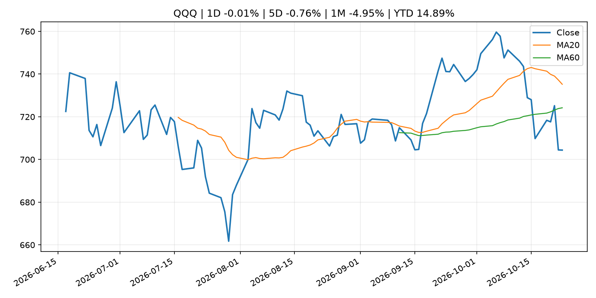
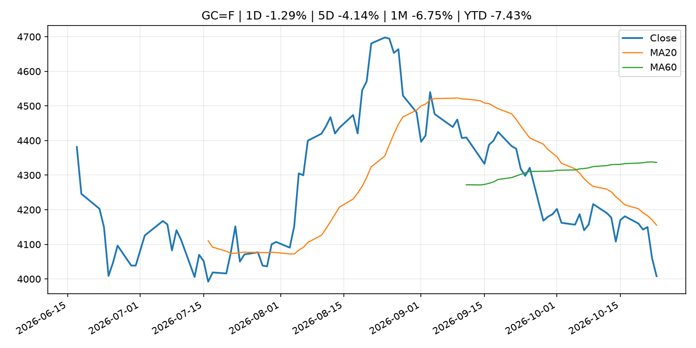
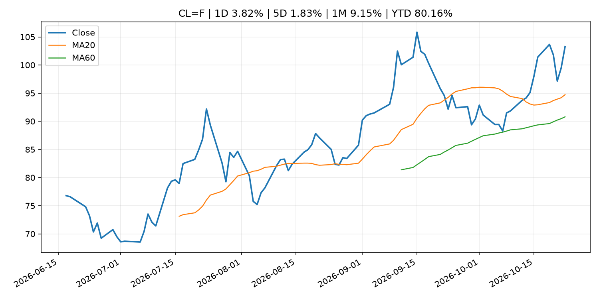
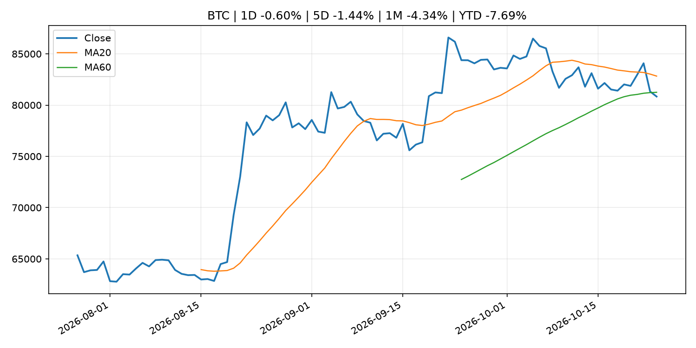
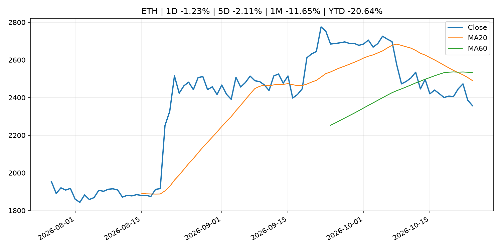

# Global Macro Morning Briefing - 2026-10-25

> Not financial advice / 非投资建议。

## 0. 今日总览
- 市场状态：unknown。市场信号不足，暂不判断明确状态。
- 今日三大主线：
  1. geopolitical_risk: Crypto under weekend pressure, bitcoin slides below $80,000 on U.S. Middle East evacuations
  2. fiscal_policy: SEC Announces Fiscal Year 2027 Examination Priorities
  3. earnings: Bitcoin's price is as jumpy as Nvidia's and eight times more turbulent than the euro
- 一句话结论：今日晨报重点关注：地缘风险可能推升避险需求、能源价格和市场波动率。；财政和贸易政策会影响增长、通胀、企业利润和跨境资本流。。跨资产方面，SPY 1D -0.52%；QQQ 1D -0.01%；^VIX 1D 2.21%；TLT 1D -0.49%；GC=F 1D -1.29%；CL=F 1D 3.82%；BTC 1D -0.60%；ETH 1D -1.23%；市场信号不足，暂不判断明确状态。政策、通胀、利率、美元、美债、能源和加密监管仍是主要观察线索。所有结论仅基于公开数据与短摘要整理，不构成投资建议。

## 1. 隔夜跨资产市场
- 美股：SPY 1D -0.52%，QQQ 1D -0.01%，整体趋势需结合 VIX 和利率确认。
- 美债/美元：TLT 1D -0.49%，美元指数 1D 0.20%，是判断折现率压力的核心线索。
- 黄金/原油：黄金 1D -1.29%，原油 1D 3.82%，用于观察避险、通胀和地缘风险。
- 加密：BTC 1D -0.60%，ETH 1D -1.23%，关注是否独立于纳指走出加密自身行情。
- 港股/A股：恒生 1D 0.69%，沪深300/上证 1D n/a，重点看中国政策预期与人民币线索。
- 风险观察：关注后续数据是否确认当前跨资产信号。

### US_EQUITY

| symbol | latest close | 1D | 5D | 1M | YTD | trend |
|---|---:|---:|---:|---:|---:|---|
| SPY | 759.97 | -0.52% | -0.43% | -0.94% | 11.24% | range_bound |
| QQQ | 704.40 | -0.01% | -0.76% | -4.95% | 14.89% | range_bound |
| DIA | 521.37 | -1.24% | 0.44% | 1.70% | 7.80% | range_bound |
| IWM | 275.75 | -0.33% | 1.96% | -2.10% | 10.84% | downtrend |
| VTI | 373.01 | -0.50% | -0.28% | -1.34% | 10.91% | downtrend |

### US_MACRO_MARKET

| symbol | latest close | 1D | 5D | 1M | YTD | trend |
|---|---:|---:|---:|---:|---:|---|
| ^VIX | 19.45 | 2.21% | -2.70% | 24.12% | 34.05% | strong_uptrend |
| DX-Y.NYB | 101.81 | 0.20% | -0.03% | 0.51% | 3.44% | range_bound |
| TLT | 81.34 | -0.49% | 1.61% | 2.42% | -6.54% | range_bound |
| IEF | 91.05 | -0.16% | 0.70% | 1.52% | -5.24% | range_bound |

### COMMODITIES

| symbol | latest close | 1D | 5D | 1M | YTD | trend |
|---|---:|---:|---:|---:|---:|---|
| GC=F | 4,007.90 | -1.29% | -4.14% | -6.75% | -7.43% | strong_downtrend |
| SI=F | 53.71 | -1.92% | -5.76% | -15.36% | -23.87% | strong_downtrend |
| CL=F | 103.27 | 3.82% | 1.83% | 9.15% | 80.16% | strong_uptrend |
| BZ=F | 116.72 | 3.14% | 6.24% | 9.49% | 92.13% | strong_uptrend |
| NG=F | 2.64 | -5.58% | -15.28% | -19.93% | -27.03% | range_bound |
| HG=F | 6.48 | 1.78% | -0.84% | -3.61% | 14.82% | strong_downtrend |

### HK_MARKET

| symbol | latest close | 1D | 5D | 1M | YTD | trend |
|---|---:|---:|---:|---:|---:|---|
| ^HSI | 23,093.37 | 0.69% | -4.03% | -7.95% | -12.32% | strong_downtrend |
| 0700.HK | 386.00 | 0.94% | -7.61% | -14.53% | -38.04% | strong_downtrend |
| 9988.HK | 97.80 | 0.46% | -8.08% | -14.81% | -34.36% | strong_downtrend |
| 3690.HK | 71.65 | 0.49% | -5.04% | -2.12% | -31.50% | downtrend |
| 1810.HK | 26.80 | 3.88% | -1.03% | -1.47% | -33.47% | range_bound |
| 1211.HK | 71.60 | 6.23% | -1.85% | -11.99% | -27.49% | strong_downtrend |

### CRYPTO

| symbol | latest close | 1D | 5D | 1M | YTD | trend |
|---|---:|---:|---:|---:|---:|---|
| BTC | 80,836.45 | -0.60% | -1.44% | -4.34% | -7.69% | range_bound |
| ETH | 2,357.11 | -1.23% | -2.11% | -11.65% | -20.64% | strong_downtrend |
| SOLANA | 102.30 | -1.20% | -1.64% | -13.74% | -17.85% | range_bound |
| BINANCECOIN | 738.97 | 1.17% | 2.25% | -3.79% | -14.34% | range_bound |
| RIPPLE | 1.30 | -0.72% | -0.55% | -12.53% | -29.45% | strong_downtrend |

## 2. 今日最重要的 10 条新闻
### 1. Crypto under weekend pressure, bitcoin slides below $80,000 on U.S. Middle East evacuations
- 来源：CoinDesk
- 时间：2026-10-24T15:11:24+00:00
- 地区：global
- 事件类型：geopolitical_risk
- 重要性层级：Tier 1
- 一句话摘要：Crypto under weekend pressure, bitcoin slides below $80,000 on U.S. Middle East evacuations
- 为什么重要：地缘风险可能推升避险需求、能源价格和市场波动率。
- 可能影响：主要影响 CL=F，方向为 positive，强度 high；供给扰动或 OPEC 减产通常推升 WTI 原油。
  - 资产：CL=F
    方向：positive
    强度：high
    原因：供给扰动或 OPEC 减产通常推升 WTI 原油。
  - 资产：BZ=F
    方向：positive
    强度：high
    原因：全球供给风险通常直接影响 Brent 原油。
  - 资产：SPY
    方向：mixed
    强度：medium
    原因：能源股可能受益，但通胀和成本压力不利于宽基风险资产。
- 原文链接：[https://www.coindesk.com/markets/2026/10/24/crypto-under-weekend-pressure-bitcoin-slides-below-usd80-000-on-u-s-middle-east-evacuations](https://www.coindesk.com/markets/2026/10/24/crypto-under-weekend-pressure-bitcoin-slides-below-usd80-000-on-u-s-middle-east-evacuations)

### 2. SEC Announces Fiscal Year 2027 Examination Priorities
- 来源：SEC Press Releases
- 时间：2026-10-23T10:10:00-04:00
- 地区：US
- 事件类型：fiscal_policy
- 重要性层级：Tier 1
- 一句话摘要：The Securities and Exchange Commission today announced the Division of Examinations’ Fiscal Year 2027 examination priorities. The annual report identifies key areas of focus as the Division carries out its mission to promote compliance, prevent fraud,…
- 为什么重要：财政和贸易政策会影响增长、通胀、企业利润和跨境资本流。
- 可能影响：主要影响 BTC，方向为 mixed，强度 high；加密监管或 ETF 进展会改变 BTC 的资金流和风险溢价。
  - 资产：BTC
    方向：mixed
    强度：high
    原因：加密监管或 ETF 进展会改变 BTC 的资金流和风险溢价。
  - 资产：ETH
    方向：mixed
    强度：high
    原因：监管框架会影响 ETH 产品化和机构参与度。
  - 资产：COIN
    方向：mixed
    强度：medium
    原因：监管清晰度和执法风险会影响交易平台估值。
  - 资产：crypto market
    方向：mixed
    强度：high
    原因：信息影响整个加密市场结构，但方向取决于细节。
- 原文链接：[https://www.sec.gov/newsroom/press-releases/2026-109-sec-announces-fiscal-year-2027-examination-priorities](https://www.sec.gov/newsroom/press-releases/2026-109-sec-announces-fiscal-year-2027-examination-priorities)

### 3. Bitcoin's price is as jumpy as Nvidia's and eight times more turbulent than the euro
- 来源：CoinDesk
- 时间：2026-10-23T11:22:33+00:00
- 地区：global
- 事件类型：earnings
- 重要性层级：Tier 2
- 一句话摘要：Bitcoin's price is as jumpy as Nvidia's and eight times more turbulent than the euro
- 为什么重要：大型科技股盈利和资本开支会影响纳指、半导体和 AI 交易主线。
- 可能影响：主要影响 QQQ，方向为 mixed，强度 high；AI 资本开支会影响大型科技股盈利和估值预期。
  - 资产：QQQ
    方向：mixed
    强度：high
    原因：AI 资本开支会影响大型科技股盈利和估值预期。
  - 资产：SMH
    方向：mixed
    强度：high
    原因：AI 投资周期直接影响半导体需求。
  - 资产：NVDA
    方向：mixed
    强度：high
    原因：AI 训练和推理需求是英伟达收入预期核心变量。
  - 资产：MSFT
    方向：mixed
    强度：medium
    原因：云和 AI 资本开支影响利润率与增长叙事。
  - 资产：GOOGL
    方向：mixed
    强度：medium
    原因：AI 投资和搜索商业化影响估值。
  - 资产：META
    方向：mixed
    强度：medium
    原因：AI 基建支出与广告效率共同影响市场预期。
- 原文链接：[https://www.coindesk.com/daybook-us/2026/10/23/bitcoin-s-volatility-is-well-above-euro-dollar-gyrations-though-it-has-calmed-to-rival-nvidia-s](https://www.coindesk.com/daybook-us/2026/10/23/bitcoin-s-volatility-is-well-above-euro-dollar-gyrations-though-it-has-calmed-to-rival-nvidia-s)

### 4. HSBC rolls out its first stablecoin to over 3 million everyday app users
- 来源：CoinDesk
- 时间：2026-10-23T10:22:56+00:00
- 地区：global
- 事件类型：crypto_market_structure
- 重要性层级：Tier 2
- 一句话摘要：HSBC rolls out its first stablecoin to over 3 million everyday app users
- 为什么重要：加密市场结构和监管变化会影响 BTC、ETH 及相关股票的风险溢价。
- 可能影响：主要影响 BTC，方向为 mixed，强度 high；加密监管或 ETF 进展会改变 BTC 的资金流和风险溢价。
  - 资产：BTC
    方向：mixed
    强度：high
    原因：加密监管或 ETF 进展会改变 BTC 的资金流和风险溢价。
  - 资产：ETH
    方向：mixed
    强度：high
    原因：监管框架会影响 ETH 产品化和机构参与度。
  - 资产：COIN
    方向：mixed
    强度：medium
    原因：监管清晰度和执法风险会影响交易平台估值。
  - 资产：crypto market
    方向：mixed
    强度：high
    原因：信息影响整个加密市场结构，但方向取决于细节。
- 原文链接：[https://www.coindesk.com/business/2026/10/23/hsbc-rolls-out-its-first-stablecoin-to-over-3-million-everyday-app-users](https://www.coindesk.com/business/2026/10/23/hsbc-rolls-out-its-first-stablecoin-to-over-3-million-everyday-app-users)

### 5. Live updates: Bitcoin holds above $81,000 as oil prices hit six-month high
- 来源：CoinDesk
- 时间：2026-10-23T11:13:01+00:00
- 地区：global
- 事件类型：other
- 重要性层级：Tier 3
- 一句话摘要：Live updates: Bitcoin holds above $81,000 as oil prices hit six-month high
- 为什么重要：这条信息暂未匹配到重大宏观、政策或市场事件，更适合作为背景跟踪。
- 可能影响：主要影响 CL=F，方向为 positive，强度 high；供给扰动或 OPEC 减产通常推升 WTI 原油。
  - 资产：CL=F
    方向：positive
    强度：high
    原因：供给扰动或 OPEC 减产通常推升 WTI 原油。
  - 资产：BZ=F
    方向：positive
    强度：high
    原因：全球供给风险通常直接影响 Brent 原油。
  - 资产：SPY
    方向：mixed
    强度：medium
    原因：能源股可能受益，但通胀和成本压力不利于宽基风险资产。
- 原文链接：[https://www.coindesk.com/markets/2026/10/23/live-updates-bitcoin-holds-above-usd81-000-as-the-ai-rout-fades-and-oil-climbs](https://www.coindesk.com/markets/2026/10/23/live-updates-bitcoin-holds-above-usd81-000-as-the-ai-rout-fades-and-oil-climbs)

### 6. Bitcoin, gold trim early losses as yen gives up gains. Oil stays near $100
- 来源：CoinDesk
- 时间：2026-10-23T03:13:01+00:00
- 地区：global
- 事件类型：other
- 重要性层级：Tier 3
- 一句话摘要：Bitcoin, gold trim early losses as yen gives up gains. Oil stays near $100
- 为什么重要：这条信息暂未匹配到重大宏观、政策或市场事件，更适合作为背景跟踪。
- 可能影响：主要影响 CL=F，方向为 positive，强度 high；供给扰动或 OPEC 减产通常推升 WTI 原油。
  - 资产：CL=F
    方向：positive
    强度：high
    原因：供给扰动或 OPEC 减产通常推升 WTI 原油。
  - 资产：BZ=F
    方向：positive
    强度：high
    原因：全球供给风险通常直接影响 Brent 原油。
  - 资产：SPY
    方向：mixed
    强度：medium
    原因：能源股可能受益，但通胀和成本压力不利于宽基风险资产。
- 原文链接：[https://www.coindesk.com/markets/2026/10/23/bitcoin-gold-trim-early-losses-as-yen-gives-up-gains-oil-stays-near-usd100](https://www.coindesk.com/markets/2026/10/23/bitcoin-gold-trim-early-losses-as-yen-gives-up-gains-oil-stays-near-usd100)

## 3. 政策与央行观察
### 1. SEC Announces Fiscal Year 2027 Examination Priorities
- 来源：SEC Press Releases
- 时间：2026-10-23T10:10:00-04:00
- 地区：US
- 事件类型：fiscal_policy
- 重要性层级：Tier 1
- 一句话摘要：The Securities and Exchange Commission today announced the Division of Examinations’ Fiscal Year 2027 examination priorities. The annual report identifies key areas of focus as the Division carries out its mission to promote compliance, prevent fraud,…
- 为什么重要：财政和贸易政策会影响增长、通胀、企业利润和跨境资本流。
- 可能影响：主要影响 BTC，方向为 mixed，强度 high；加密监管或 ETF 进展会改变 BTC 的资金流和风险溢价。
  - 资产：BTC
    方向：mixed
    强度：high
    原因：加密监管或 ETF 进展会改变 BTC 的资金流和风险溢价。
  - 资产：ETH
    方向：mixed
    强度：high
    原因：监管框架会影响 ETH 产品化和机构参与度。
  - 资产：COIN
    方向：mixed
    强度：medium
    原因：监管清晰度和执法风险会影响交易平台估值。
  - 资产：crypto market
    方向：mixed
    强度：high
    原因：信息影响整个加密市场结构，但方向取决于细节。
- 原文链接：[https://www.sec.gov/newsroom/press-releases/2026-109-sec-announces-fiscal-year-2027-examination-priorities](https://www.sec.gov/newsroom/press-releases/2026-109-sec-announces-fiscal-year-2027-examination-priorities)

### 2. HSBC rolls out its first stablecoin to over 3 million everyday app users
- 来源：CoinDesk
- 时间：2026-10-23T10:22:56+00:00
- 地区：global
- 事件类型：crypto_market_structure
- 重要性层级：Tier 2
- 一句话摘要：HSBC rolls out its first stablecoin to over 3 million everyday app users
- 为什么重要：加密市场结构和监管变化会影响 BTC、ETH 及相关股票的风险溢价。
- 可能影响：主要影响 BTC，方向为 mixed，强度 high；加密监管或 ETF 进展会改变 BTC 的资金流和风险溢价。
  - 资产：BTC
    方向：mixed
    强度：high
    原因：加密监管或 ETF 进展会改变 BTC 的资金流和风险溢价。
  - 资产：ETH
    方向：mixed
    强度：high
    原因：监管框架会影响 ETH 产品化和机构参与度。
  - 资产：COIN
    方向：mixed
    强度：medium
    原因：监管清晰度和执法风险会影响交易平台估值。
  - 资产：crypto market
    方向：mixed
    强度：high
    原因：信息影响整个加密市场结构，但方向取决于细节。
- 原文链接：[https://www.coindesk.com/business/2026/10/23/hsbc-rolls-out-its-first-stablecoin-to-over-3-million-everyday-app-users](https://www.coindesk.com/business/2026/10/23/hsbc-rolls-out-its-first-stablecoin-to-over-3-million-everyday-app-users)

## 4. 市场异动与图表
- SPY 下跌 -0.52%
- TLT 下跌 -0.49%
- Gold 下跌 -1.29%
- Oil 上涨 3.82%

### SPY

### QQQ

### ^VIX

### TLT

### GC=F

### CL=F

### BTC

### ETH

### ^HSI

## 5. 华尔街与机构公开观点
- 暂无可靠公开观点。

## 6. 今日重点关注
- 经济数据：经济数据：暂无可靠公开日历数据；如配置经济日历源后可自动填充。
- 央行讲话：央行讲话：暂无可靠公开日历数据；重点跟踪 Fed、ECB、BoJ、PBOC 官网 RSS。
- 财报：财报：暂无可靠数据。
- 政策事件：政策事件：暂无可靠数据。
- 风险提醒：风险提醒：关注数据源失败项、突发地缘风险、利率和美元的二阶反应。

## 7. 英文金融表达与宏观概念
- **real yield**：实际收益率，名义利率扣除通胀预期后的收益率。 例句：Gold often reacts more to real yields than nominal yields.
- **supply disruption**：供给扰动，通常指能源或商品供应受冲突、减产或天气影响。 例句：Supply disruption can lift oil prices and inflation expectations.
- **market structure**：市场结构，指交易、托管、清算、ETF、监管等制度安排。 例句：Crypto market structure rules can affect institutional participation.
- **AI capex**：AI 资本开支，指云厂商和科技公司投入 AI 基建的支出。 例句：AI capex guidance can move semiconductor stocks.
- **inflation expectations**：通胀预期，指家庭、企业或市场对未来通胀的预估。 例句：Inflation expectations can shape wage bargaining and bond yields.
- **terminal rate**：终端利率，市场预期本轮加息周期的最高政策利率。 例句：A higher terminal rate can pressure growth stocks.

## 8. 背景材料
- [The Social Security Administration wants more babies signed up for ‘Trump accounts.’ But there’s still a catch.](https://www.marketwatch.com/story/the-social-security-administration-wants-more-babies-signed-up-for-trump-accounts-but-theres-still-a-catch-4096f16e?mod=mw_rss_topstories)（MarketWatch Top Stories，routine_announcement）：Social Security is looking to reverse an initially slow uptake on Trump accounts
- [Strategy, Strive face balancing act between bitcoin buying and preferred stock dividends](https://www.coindesk.com/business/2026/10/24/strategy-strive-face-balancing-act-between-bitcoin-buying-and-preferred-stock-dividends)（CoinDesk，other）：Strategy, Strive face balancing act between bitcoin buying and preferred stock dividends
- [Bitcoin’s wealthy holders turning to loans and yield as investment habits mature: Xapo CEO](https://www.coindesk.com/business/2026/10/24/bitcoin-s-wealthy-holders-turning-to-loans-and-yield-as-investment-habits-mature-xapo-ceo)（CoinDesk，other）：Bitcoin’s wealthy holders turning to loans and yield as investment habits mature: Xapo CEO
- [Piero Cipollone: Interview with Milano Finanza](https://www.ecb.europa.eu//press/inter/date/2026/html/ecb.in261024~ee2ba73cf3.en.html)（ECB Press Releases，other）：Piero Cipollone: Interview with Milano Finanza
- [Robinhood sees surge in bitcoin, gold prediction markets as traders move beyond sports](https://www.coindesk.com/markets/2026/10/23/robinhood-sees-surge-in-bitcoin-gold-prediction-markets-as-traders-move-beyond-sports)（CoinDesk，other）：Robinhood sees surge in bitcoin, gold prediction markets as traders move beyond sports
- [Bitcoin Core changes security rules as AI makes finding code bugs dangerously easy](https://www.coindesk.com/tech/2026/10/23/bitcoin-will-now-stop-hiding-bugs-an-ai-can-find-in-one-prompt)（CoinDesk，other）：Bitcoin Core changes security rules as AI makes finding code bugs dangerously easy
- [Live updates: Bitcoin holds above $81,000 as oil prices hit six-month high](https://www.coindesk.com/markets/2026/10/23/live-updates-bitcoin-holds-above-usd81-000-as-the-ai-rout-fades-and-oil-climbs)（CoinDesk，other）：Live updates: Bitcoin holds above $81,000 as oil prices hit six-month high
- [Bitcoin steadies near $81,700 as altcoins rebound, pepe climbs 13%](https://www.coindesk.com/markets/2026/10/23/bitcoin-steadies-near-usd81-700-as-altcoins-rebound-pepe-climbs-13)（CoinDesk，other）：Bitcoin steadies near $81,700 as altcoins rebound, pepe climbs 13%
- [Bitcoin appears to have decoupled from midterm cycle bottom history](https://www.coindesk.com/markets/2026/10/23/bitcoin-approaches-midterms-as-july-low-challenges-historical-cycle-pattern)（CoinDesk，other）：Bitcoin appears to have decoupled from midterm cycle bottom history
- [Sweden’s central bank revives e-krona debate as stablecoins and digital euro loom](https://www.coindesk.com/business/2026/10/23/sweden-s-central-bank-revives-e-krona-debate-as-stablecoins-and-digital-euro-loom)（CoinDesk，other）：Sweden’s central bank revives e-krona debate as stablecoins and digital euro loom
- [ECB Consumer Expectations Survey results – September 2026](https://www.ecb.europa.eu//press/pr/date/2026/html/ecb.pr261023~a3d201c97c.en.html)（ECB Press Releases，other）：ECB Consumer Expectations Survey results – September 2026
- [Financial System Report (October 2026)](http://www.boj.or.jp/en/research/brp/fsr/fsr261023.htm)（Bank of Japan Announcements，other）：Financial System Report (October 2026)
- [Ethereum delays Glamsterdam test after security devs flag risk to existing contracts](https://www.coindesk.com/tech/2026/10/23/ethereum-delays-glamsterdam-test-after-security-devs-flag-risk-to-existing-contracts)（CoinDesk，other）：Ethereum delays Glamsterdam test after security devs flag risk to existing contracts
- [Bitcoin, gold trim early losses as yen gives up gains. Oil stays near $100](https://www.coindesk.com/markets/2026/10/23/bitcoin-gold-trim-early-losses-as-yen-gives-up-gains-oil-stays-near-usd100)（CoinDesk，other）：Bitcoin, gold trim early losses as yen gives up gains. Oil stays near $100

## 9. 数据源、失败项与免责声明
- 采集时间：2026-10-25T00:01:13
- 数据源：公开 RSS、Yahoo Finance、CoinGecko、AKShare、FRED、SEC data.sec.gov，以及用户自有 inputs/reports 文件。
- 合规说明：不绕过 WSJ、Bloomberg、FT、Reuters 等付费墙；对付费媒体只使用公开 RSS 标题、摘要、链接和发布时间。
- 免责声明：Not financial advice / 非投资建议。本项目仅供个人学习、研究和信息整理，不构成投资建议、交易建议或任何收益承诺。
- 失败或跳过的数据源：
  - crypto data failed coin=dogecoin
  - China market data failed symbol=上证指数: empty dataframe
  - China market data failed symbol=深证成指: empty dataframe
  - China market data failed symbol=创业板指: empty dataframe
  - China market data failed symbol=沪深300: empty dataframe
  - China market data failed symbol=中证500: empty dataframe
  - China market data failed symbol=科创50: empty dataframe
  - FRED_API_KEY not set; skipping FRED macro series
  - SEC failed cik=0000320193
  - SEC failed cik=0000789019
  - SEC failed cik=0001045810
  - SEC failed cik=0001318605
  - SEC failed cik=0001577552
