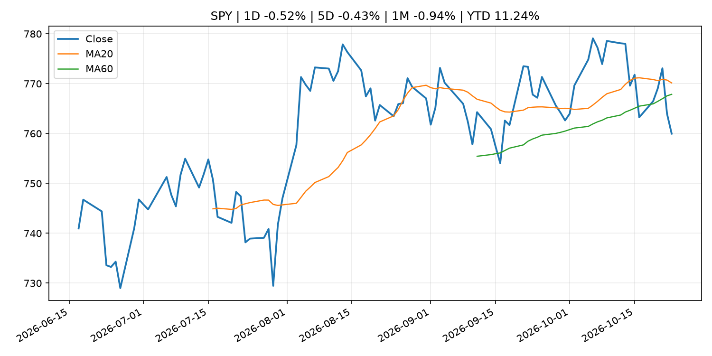
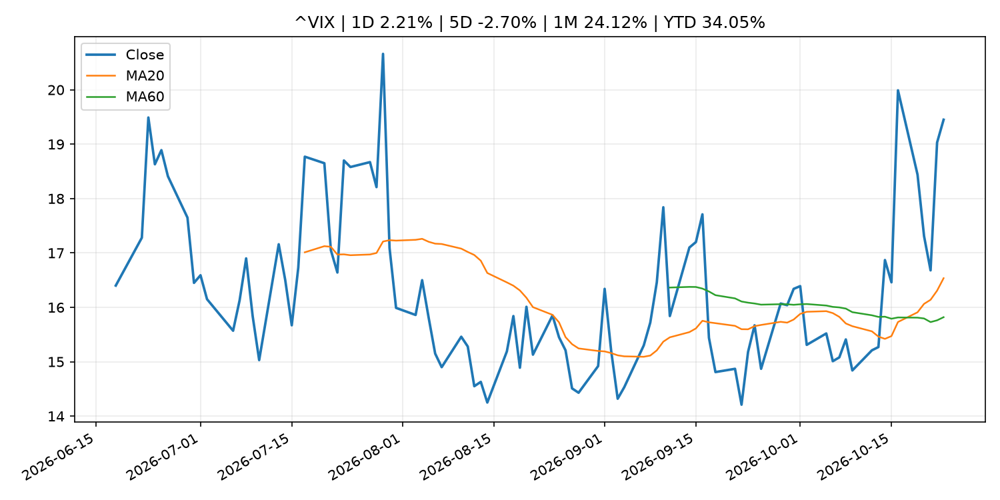
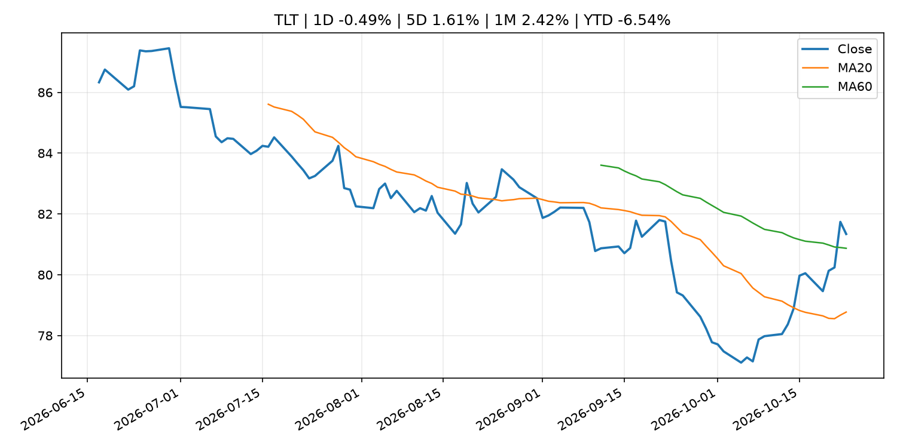
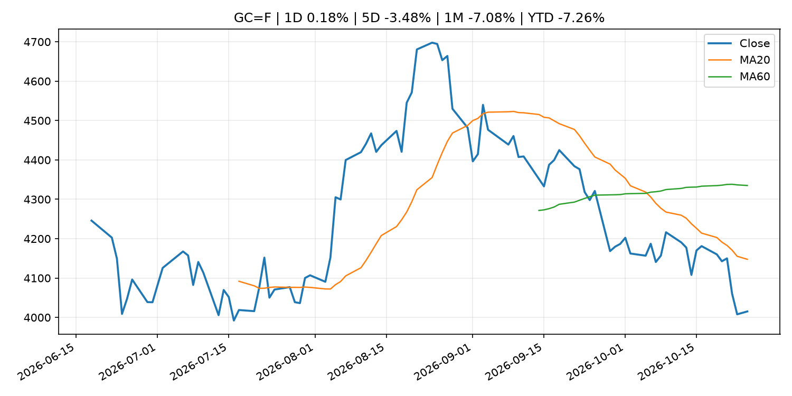
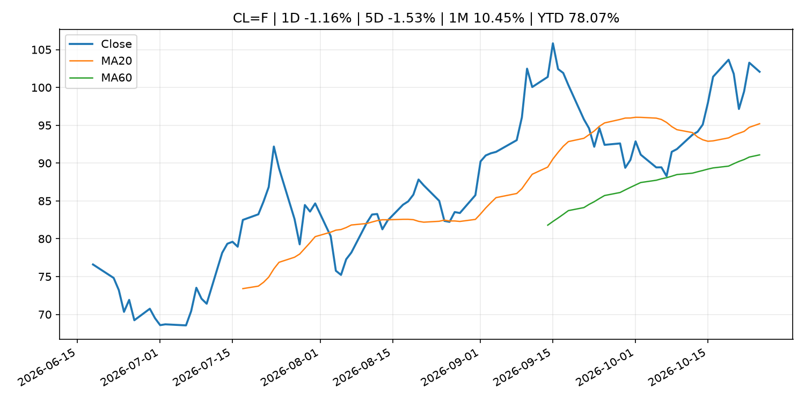
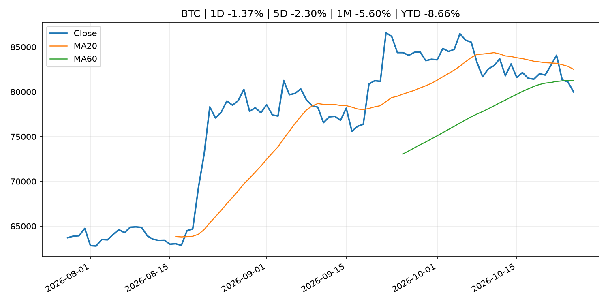
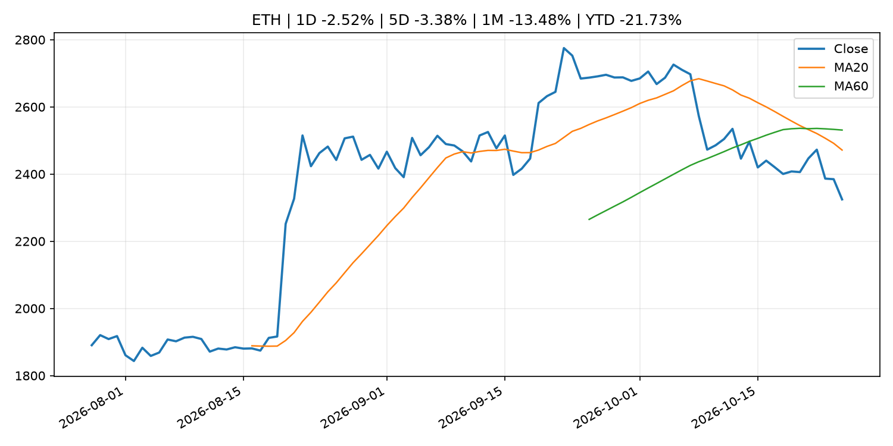
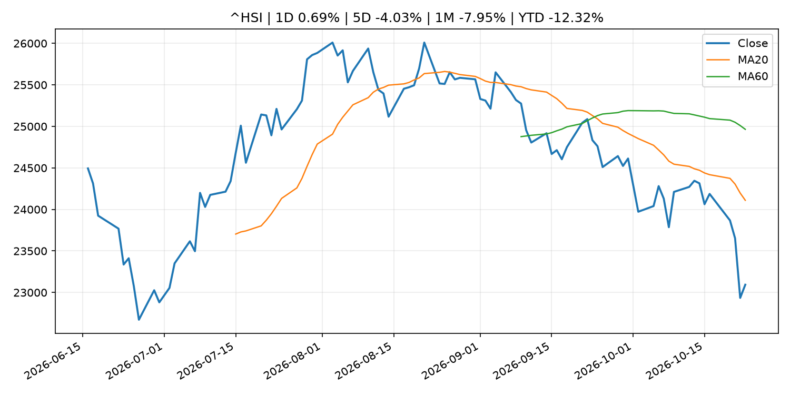

# Global Macro Morning Briefing - 2026-10-26

> Not financial advice / 非投资建议。

## 0. 今日总览
- 市场状态：unknown。市场信号不足，暂不判断明确状态。
- 今日三大主线：
  1. geopolitical_risk: Crypto under weekend pressure, bitcoin slides below $80,000 on U.S. Middle East evacuations
  2. earnings: More than a third of S&P 500 companies are about to report earnings as market confidence cracks
- 一句话结论：今日晨报重点关注：地缘风险可能推升避险需求、能源价格和市场波动率。；大型科技股盈利和资本开支会影响纳指、半导体和 AI 交易主线。。跨资产方面，SPY 1D -0.52%；QQQ 1D -0.01%；^VIX 1D 2.21%；TLT 1D -0.49%；GC=F 1D 0.18%；CL=F 1D -1.16%；BTC 1D -1.37%；ETH 1D -2.52%；市场信号不足，暂不判断明确状态。政策、通胀、利率、美元、美债、能源和加密监管仍是主要观察线索。所有结论仅基于公开数据与短摘要整理，不构成投资建议。

## 1. 隔夜跨资产市场
- 美股：SPY 1D -0.52%，QQQ 1D -0.01%，整体趋势需结合 VIX 和利率确认。
- 美债/美元：TLT 1D -0.49%，美元指数 1D -0.08%，是判断折现率压力的核心线索。
- 黄金/原油：黄金 1D 0.18%，原油 1D -1.16%，用于观察避险、通胀和地缘风险。
- 加密：BTC 1D -1.37%，ETH 1D -2.52%，关注是否独立于纳指走出加密自身行情。
- 港股/A股：恒生 1D 0.69%，沪深300/上证 1D n/a，重点看中国政策预期与人民币线索。
- 风险观察：关注后续数据是否确认当前跨资产信号。

### US_EQUITY

| symbol | latest close | 1D | 5D | 1M | YTD | trend |
|---|---:|---:|---:|---:|---:|---|
| SPY | 759.97 | -0.52% | -0.43% | -0.94% | 11.24% | range_bound |
| QQQ | 704.40 | -0.01% | -0.76% | -4.95% | 14.89% | range_bound |
| DIA | 521.37 | -1.24% | 0.44% | 1.70% | 7.80% | range_bound |
| IWM | 275.75 | -0.33% | 1.96% | -2.10% | 10.84% | downtrend |
| VTI | 373.01 | -0.50% | -0.28% | -1.34% | 10.91% | downtrend |

### US_MACRO_MARKET

| symbol | latest close | 1D | 5D | 1M | YTD | trend |
|---|---:|---:|---:|---:|---:|---|
| ^VIX | 19.45 | 2.21% | -2.70% | 24.12% | 34.05% | strong_uptrend |
| DX-Y.NYB | 101.72 | -0.08% | -0.25% | 0.75% | 3.36% | range_bound |
| TLT | 81.34 | -0.49% | 1.61% | 2.42% | -6.54% | range_bound |
| IEF | 91.05 | -0.16% | 0.70% | 1.52% | -5.24% | range_bound |

### COMMODITIES

| symbol | latest close | 1D | 5D | 1M | YTD | trend |
|---|---:|---:|---:|---:|---:|---|
| GC=F | 4,015.20 | 0.18% | -3.48% | -7.08% | -7.26% | strong_downtrend |
| SI=F | 54.03 | 0.60% | -5.16% | -15.89% | -23.42% | strong_downtrend |
| CL=F | 102.07 | -1.16% | -1.53% | 10.45% | 78.07% | strong_uptrend |
| BZ=F | 110.58 | -5.26% | 0.94% | 6.00% | 82.02% | strong_uptrend |
| NG=F | 2.99 | 13.22% | -2.26% | -6.48% | -17.39% | range_bound |
| HG=F | 6.49 | 0.27% | -0.68% | -3.02% | 15.13% | strong_downtrend |

### HK_MARKET

| symbol | latest close | 1D | 5D | 1M | YTD | trend |
|---|---:|---:|---:|---:|---:|---|
| ^HSI | 23,093.37 | 0.69% | -4.03% | -7.95% | -12.32% | strong_downtrend |
| 0700.HK | 386.00 | 0.94% | -7.61% | -14.53% | -38.04% | strong_downtrend |
| 9988.HK | 97.80 | 0.46% | -8.08% | -14.81% | -34.36% | strong_downtrend |
| 3690.HK | 71.65 | 0.49% | -5.04% | -2.12% | -31.50% | downtrend |
| 1810.HK | 26.80 | 3.88% | -1.03% | -1.47% | -33.47% | range_bound |
| 1211.HK | 71.60 | 6.23% | -1.85% | -11.99% | -27.49% | strong_downtrend |

### CRYPTO

| symbol | latest close | 1D | 5D | 1M | YTD | trend |
|---|---:|---:|---:|---:|---:|---|
| BTC | 79,994.54 | -1.37% | -2.30% | -5.60% | -8.66% | range_bound |
| ETH | 2,324.58 | -2.52% | -3.38% | -13.48% | -21.73% | strong_downtrend |
| SOLANA | 100.99 | -1.70% | -3.80% | -15.56% | -18.90% | strong_downtrend |
| BINANCECOIN | 737.45 | -0.18% | 0.82% | -6.27% | -14.52% | range_bound |
| RIPPLE | 1.29 | -0.12% | -0.83% | -13.04% | -29.79% | strong_downtrend |

## 2. 今日最重要的 10 条新闻
### 1. Crypto under weekend pressure, bitcoin slides below $80,000 on U.S. Middle East evacuations
- 来源：CoinDesk
- 时间：2026-10-24T15:11:24+00:00
- 地区：global
- 事件类型：geopolitical_risk
- 重要性层级：Tier 1
- 一句话摘要：Crypto under weekend pressure, bitcoin slides below $80,000 on U.S. Middle East evacuations
- 为什么重要：地缘风险可能推升避险需求、能源价格和市场波动率。
- 可能影响：主要影响 CL=F，方向为 positive，强度 high；供给扰动或 OPEC 减产通常推升 WTI 原油。
  - 资产：CL=F
    方向：positive
    强度：high
    原因：供给扰动或 OPEC 减产通常推升 WTI 原油。
  - 资产：BZ=F
    方向：positive
    强度：high
    原因：全球供给风险通常直接影响 Brent 原油。
  - 资产：SPY
    方向：mixed
    强度：medium
    原因：能源股可能受益，但通胀和成本压力不利于宽基风险资产。
- 原文链接：[https://www.coindesk.com/markets/2026/10/24/crypto-under-weekend-pressure-bitcoin-slides-below-usd80-000-on-u-s-middle-east-evacuations](https://www.coindesk.com/markets/2026/10/24/crypto-under-weekend-pressure-bitcoin-slides-below-usd80-000-on-u-s-middle-east-evacuations)

### 2. More than a third of S&P 500 companies are about to report earnings as market confidence cracks
- 来源：MarketWatch Top Stories
- 时间：2026-10-25T14:00:00+00:00
- 地区：US
- 事件类型：earnings
- 重要性层级：Tier 2
- 一句话摘要：“With cautious to negative market sentiment, it could be a tricky week,” one strategist says.
- 为什么重要：大型科技股盈利和资本开支会影响纳指、半导体和 AI 交易主线。
- 可能影响：可能影响利率、汇率、风险资产或大宗商品预期，但当前公开信息不足以判断明确方向。
  - 资产：暂无明确资产映射
  - 方向：unknown
  - 强度：low
  - 原因：公开信息不足以判断方向。
- 原文链接：[https://www.marketwatch.com/story/more-than-a-third-of-s-p-500-companies-are-about-to-report-earnings-as-market-confidence-cracks-03b7a8f1?mod=mw_rss_topstories](https://www.marketwatch.com/story/more-than-a-third-of-s-p-500-companies-are-about-to-report-earnings-as-market-confidence-cracks-03b7a8f1?mod=mw_rss_topstories)

### 3. Strategy, Strive face balancing act between bitcoin buying and preferred stock dividends
- 来源：CoinDesk
- 时间：2026-10-24T16:00:00+00:00
- 地区：global
- 事件类型：other
- 重要性层级：Tier 3
- 一句话摘要：Strategy, Strive face balancing act between bitcoin buying and preferred stock dividends
- 为什么重要：这条信息暂未匹配到重大宏观、政策或市场事件，更适合作为背景跟踪。
- 可能影响：更偏背景信息，短期市场影响可能有限。
  - 资产：暂无明确资产映射
  - 方向：unknown
  - 强度：low
  - 原因：公开信息不足以判断方向。
- 原文链接：[https://www.coindesk.com/business/2026/10/24/strategy-strive-face-balancing-act-between-bitcoin-buying-and-preferred-stock-dividends](https://www.coindesk.com/business/2026/10/24/strategy-strive-face-balancing-act-between-bitcoin-buying-and-preferred-stock-dividends)

### 4. Piero Cipollone: Interview with Milano Finanza
- 来源：ECB Press Releases
- 时间：2026-10-24T08:00:00+02:00
- 地区：EU
- 事件类型：other
- 重要性层级：Tier 3
- 一句话摘要：Piero Cipollone: Interview with Milano Finanza
- 为什么重要：这条信息暂未匹配到重大宏观、政策或市场事件，更适合作为背景跟踪。
- 可能影响：更偏背景信息，短期市场影响可能有限。
  - 资产：暂无明确资产映射
  - 方向：unknown
  - 强度：low
  - 原因：公开信息不足以判断方向。
- 原文链接：[https://www.ecb.europa.eu//press/inter/date/2026/html/ecb.in261024~ee2ba73cf3.en.html](https://www.ecb.europa.eu//press/inter/date/2026/html/ecb.in261024~ee2ba73cf3.en.html)

## 3. 政策与央行观察
暂无可靠数据。

- 为什么重要：没有可靠新闻时，不应为了填充版面编造市场解释。

## 4. 市场异动与图表
- SPY 下跌 -0.52%
- TLT 下跌 -0.49%
- Oil 下跌 -1.16%
- ETH 下跌 -2.52%

### SPY

### QQQ

### ^VIX

### TLT

### GC=F

### CL=F

### BTC

### ETH

### ^HSI

## 5. 华尔街与机构公开观点
- 暂无可靠公开观点。

## 6. 今日重点关注
- 经济数据：经济数据：暂无可靠公开日历数据；如配置经济日历源后可自动填充。
- 央行讲话：央行讲话：暂无可靠公开日历数据；重点跟踪 Fed、ECB、BoJ、PBOC 官网 RSS。
- 财报：财报：暂无可靠数据。
- 政策事件：政策事件：暂无可靠数据。
- 风险提醒：风险提醒：关注数据源失败项、突发地缘风险、利率和美元的二阶反应。

## 7. 英文金融表达与宏观概念
- **supply disruption**：供给扰动，通常指能源或商品供应受冲突、减产或天气影响。 例句：Supply disruption can lift oil prices and inflation expectations.
- **inflation expectations**：通胀预期，指家庭、企业或市场对未来通胀的预估。 例句：Inflation expectations can shape wage bargaining and bond yields.
- **real yield**：实际收益率，名义利率扣除通胀预期后的收益率。 例句：Gold often reacts more to real yields than nominal yields.
- **terminal rate**：终端利率，市场预期本轮加息周期的最高政策利率。 例句：A higher terminal rate can pressure growth stocks.
- **soft landing**：软着陆，指通胀回落而经济避免明显衰退。 例句：Markets often rally when data support a soft landing.
- **risk-off**：避险模式，资金偏向美元、国债、黄金等防御资产。 例句：A geopolitical shock can push markets into risk-off mode.

## 8. 背景材料
- [Strategy, Strive face balancing act between bitcoin buying and preferred stock dividends](https://www.coindesk.com/business/2026/10/24/strategy-strive-face-balancing-act-between-bitcoin-buying-and-preferred-stock-dividends)（CoinDesk，other）：Strategy, Strive face balancing act between bitcoin buying and preferred stock dividends
- [Bitcoin’s wealthy holders turning to loans and yield as investment habits mature: Xapo CEO](https://www.coindesk.com/business/2026/10/24/bitcoin-s-wealthy-holders-turning-to-loans-and-yield-as-investment-habits-mature-xapo-ceo)（CoinDesk，other）：Bitcoin’s wealthy holders turning to loans and yield as investment habits mature: Xapo CEO
- [Piero Cipollone: Interview with Milano Finanza](https://www.ecb.europa.eu//press/inter/date/2026/html/ecb.in261024~ee2ba73cf3.en.html)（ECB Press Releases，other）：Piero Cipollone: Interview with Milano Finanza

## 9. 数据源、失败项与免责声明
- 采集时间：2026-10-25T23:48:36
- 数据源：公开 RSS、Yahoo Finance、CoinGecko、AKShare、FRED、SEC data.sec.gov，以及用户自有 inputs/reports 文件。
- 合规说明：不绕过 WSJ、Bloomberg、FT、Reuters 等付费墙；对付费媒体只使用公开 RSS 标题、摘要、链接和发布时间。
- 免责声明：Not financial advice / 非投资建议。本项目仅供个人学习、研究和信息整理，不构成投资建议、交易建议或任何收益承诺。
- 失败或跳过的数据源：
  - crypto data failed coin=dogecoin
  - China market data failed symbol=上证指数: empty dataframe
  - China market data failed symbol=深证成指: empty dataframe
  - China market data failed symbol=创业板指: empty dataframe
  - China market data failed symbol=沪深300: empty dataframe
  - China market data failed symbol=中证500: empty dataframe
  - China market data failed symbol=科创50: empty dataframe
  - FRED_API_KEY not set; skipping FRED macro series
  - SEC failed cik=0000320193
  - SEC failed cik=0000789019
  - SEC failed cik=0001045810
  - SEC failed cik=0001318605
  - SEC failed cik=0001577552
