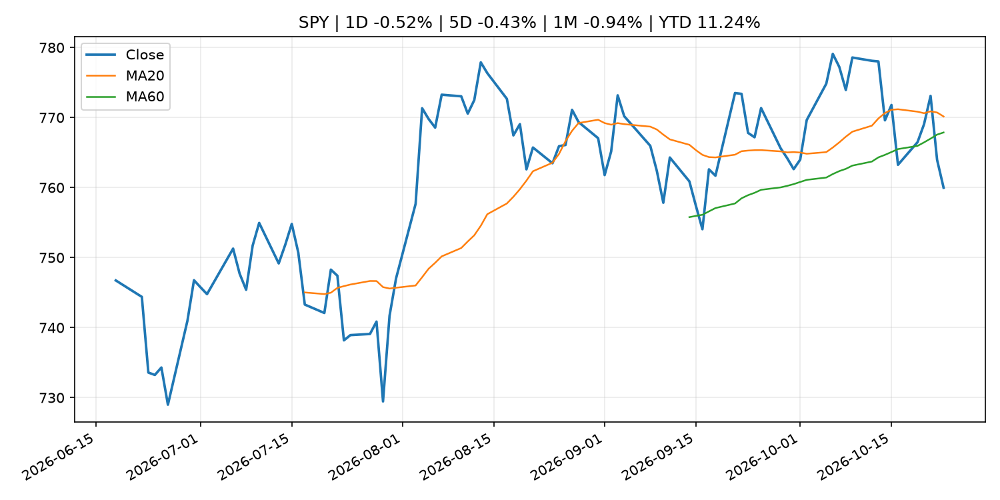
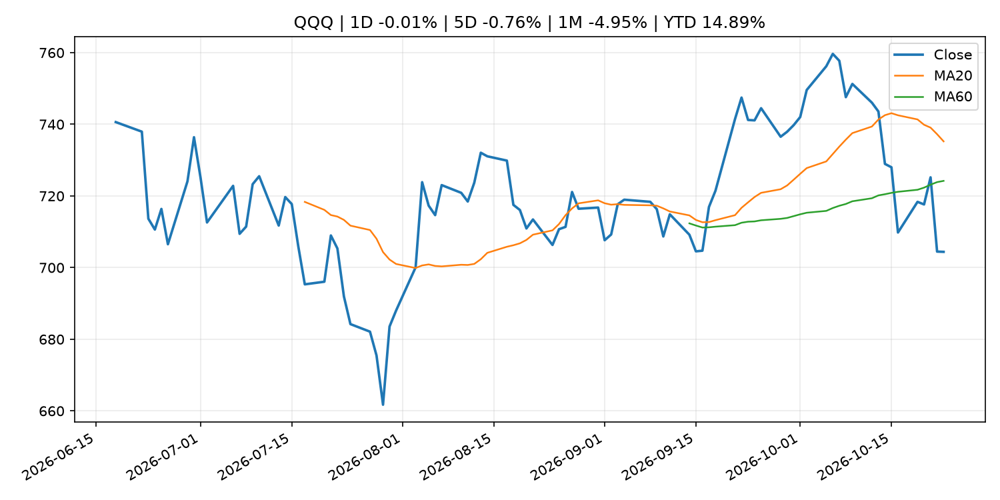
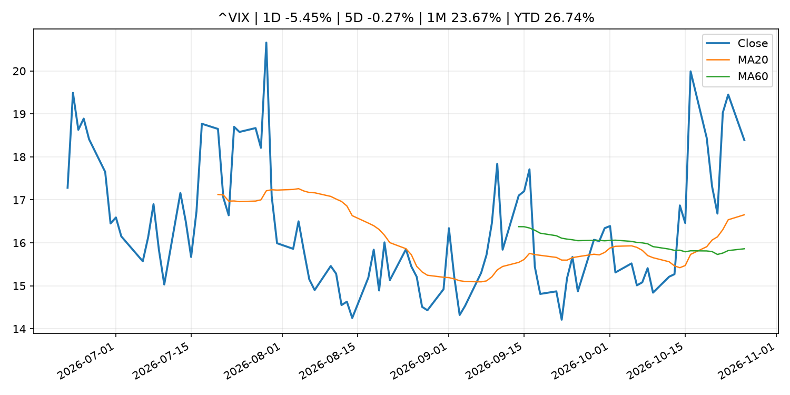
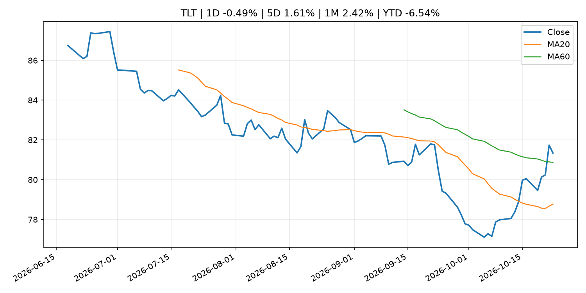
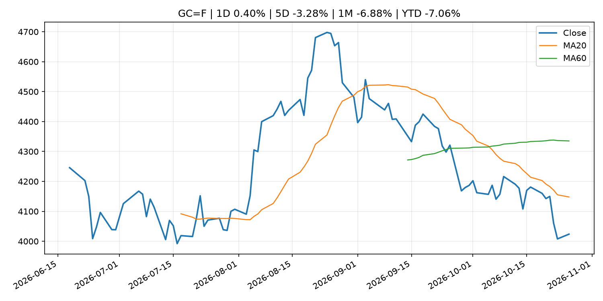
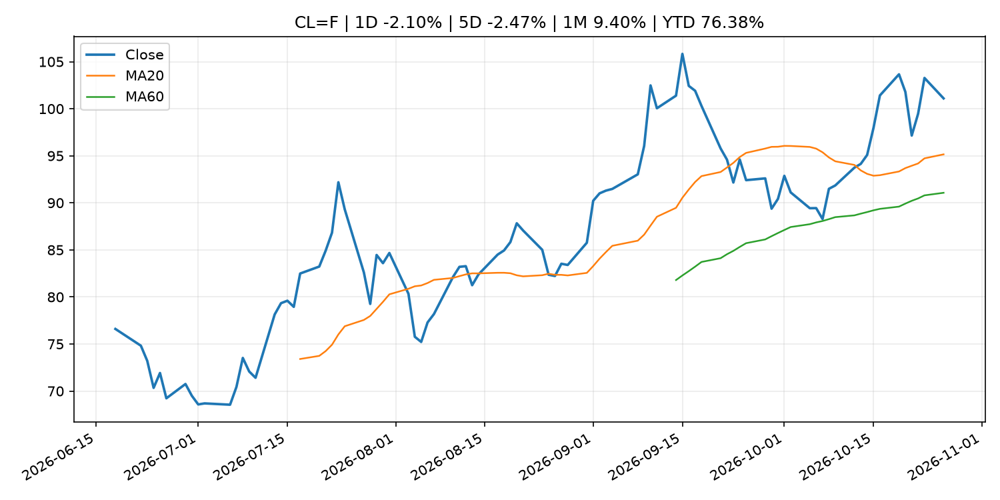
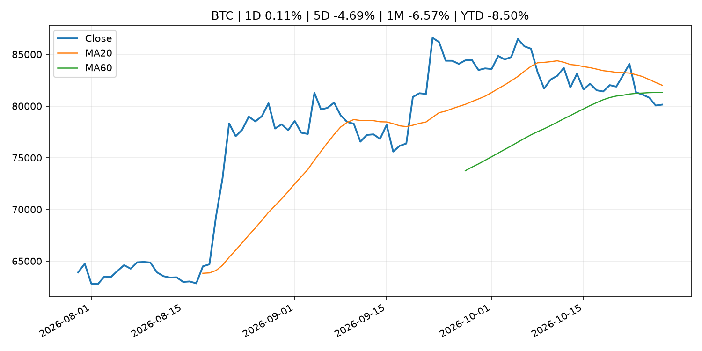
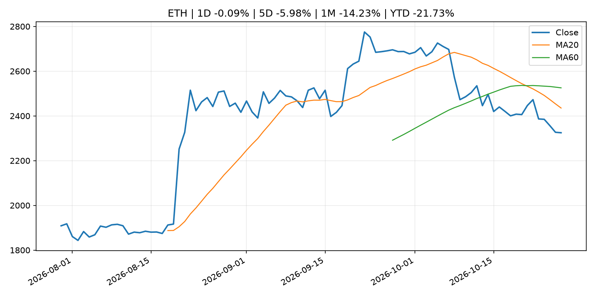
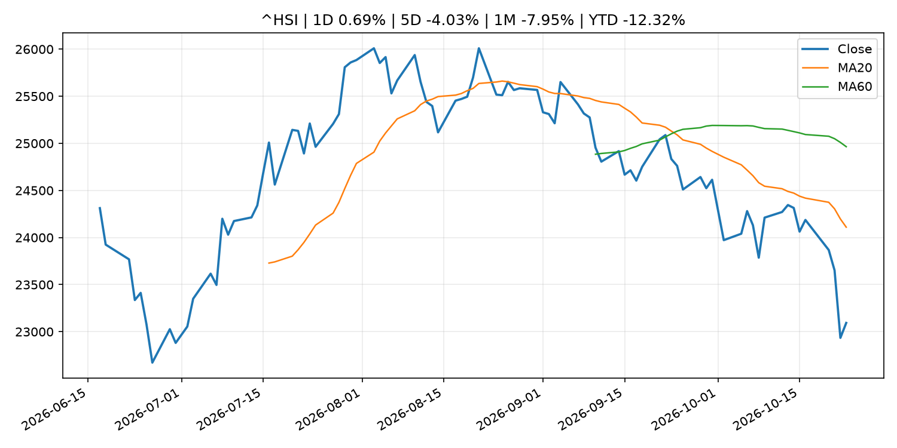

# Global Macro Morning Briefing - 2026-10-27

> Not financial advice / 非投资建议。

## 0. 今日总览
- 市场状态：unknown。市场信号不足，暂不判断明确状态。
- 今日三大主线：
  1. crypto_market_structure: OCC calls on community banks to enter the stablecoin payments market
  2. crypto_market_structure: Canada opens consultation on draft stablecoin rules, maintains ban on yields
  3. earnings: Fed, ECB and BOJ interest-rate decisions, Coinbase earnings: Crypto Week Ahead
- 一句话结论：今日晨报重点关注：加密市场结构和监管变化会影响 BTC、ETH 及相关股票的风险溢价。；加密市场结构和监管变化会影响 BTC、ETH 及相关股票的风险溢价。。跨资产方面，SPY 1D -0.52%；QQQ 1D -0.01%；^VIX 1D -5.45%；TLT 1D -0.49%；GC=F 1D 0.40%；CL=F 1D -2.10%；BTC 1D 0.11%；ETH 1D -0.09%；市场信号不足，暂不判断明确状态。政策、通胀、利率、美元、美债、能源和加密监管仍是主要观察线索。所有结论仅基于公开数据与短摘要整理，不构成投资建议。

## 1. 隔夜跨资产市场
- 美股：SPY 1D -0.52%，QQQ 1D -0.01%，整体趋势需结合 VIX 和利率确认。
- 美债/美元：TLT 1D -0.49%，美元指数 1D 0.22%，是判断折现率压力的核心线索。
- 黄金/原油：黄金 1D 0.40%，原油 1D -2.10%，用于观察避险、通胀和地缘风险。
- 加密：BTC 1D 0.11%，ETH 1D -0.09%，关注是否独立于纳指走出加密自身行情。
- 港股/A股：恒生 1D 0.69%，沪深300/上证 1D n/a，重点看中国政策预期与人民币线索。
- 风险观察：关注后续数据是否确认当前跨资产信号。

### US_EQUITY

| symbol | latest close | 1D | 5D | 1M | YTD | trend |
|---|---:|---:|---:|---:|---:|---|
| SPY | 759.97 | -0.52% | -0.43% | -0.94% | 11.24% | range_bound |
| QQQ | 704.40 | -0.01% | -0.76% | -4.95% | 14.89% | range_bound |
| DIA | 521.37 | -1.24% | 0.44% | 1.70% | 7.80% | range_bound |
| IWM | 275.75 | -0.33% | 1.96% | -2.10% | 10.84% | downtrend |
| VTI | 373.01 | -0.50% | -0.28% | -1.34% | 10.91% | downtrend |

### US_MACRO_MARKET

| symbol | latest close | 1D | 5D | 1M | YTD | trend |
|---|---:|---:|---:|---:|---:|---|
| ^VIX | 18.39 | -5.45% | -0.27% | 23.67% | 26.74% | strong_uptrend |
| DX-Y.NYB | 102.04 | 0.22% | 0.06% | 1.06% | 3.68% | uptrend |
| TLT | 81.34 | -0.49% | 1.61% | 2.42% | -6.54% | range_bound |
| IEF | 91.05 | -0.16% | 0.70% | 1.52% | -5.24% | range_bound |

### COMMODITIES

| symbol | latest close | 1D | 5D | 1M | YTD | trend |
|---|---:|---:|---:|---:|---:|---|
| GC=F | 4,023.80 | 0.40% | -3.28% | -6.88% | -7.06% | strong_downtrend |
| SI=F | 54.02 | 0.58% | -5.18% | -15.92% | -23.44% | strong_downtrend |
| CL=F | 101.10 | -2.10% | -2.47% | 9.40% | 76.38% | strong_uptrend |
| BZ=F | 109.96 | -5.79% | 0.37% | 5.41% | 81.00% | strong_uptrend |
| NG=F | 3.05 | 15.42% | -0.36% | -4.66% | -15.78% | range_bound |
| HG=F | 6.56 | 1.37% | 0.41% | -1.96% | 16.39% | range_bound |

### HK_MARKET

| symbol | latest close | 1D | 5D | 1M | YTD | trend |
|---|---:|---:|---:|---:|---:|---|
| ^HSI | 23,093.37 | 0.69% | -4.03% | -7.95% | -12.32% | strong_downtrend |
| 0700.HK | 386.40 | 0.10% | -7.52% | -12.38% | -37.98% | strong_downtrend |
| 9988.HK | 97.95 | 0.15% | -9.97% | -10.79% | -34.26% | strong_downtrend |
| 3690.HK | 74.05 | 3.35% | -2.18% | 1.65% | -29.21% | range_bound |
| 1810.HK | 26.90 | 0.37% | 0.90% | 2.75% | -33.22% | range_bound |
| 1211.HK | 70.80 | -1.12% | -4.00% | -11.89% | -28.30% | strong_downtrend |

### CRYPTO

| symbol | latest close | 1D | 5D | 1M | YTD | trend |
|---|---:|---:|---:|---:|---:|---|
| BTC | 80,135.20 | 0.11% | -4.69% | -6.57% | -8.50% | range_bound |
| ETH | 2,324.75 | -0.09% | -5.98% | -14.23% | -21.73% | strong_downtrend |
| SOLANA | 100.74 | -0.49% | -5.79% | -16.58% | -19.10% | strong_downtrend |
| BINANCECOIN | 743.74 | 0.82% | -0.30% | -5.42% | -13.79% | range_bound |
| RIPPLE | 1.31 | 0.98% | -4.25% | -13.31% | -28.98% | strong_downtrend |

## 2. 今日最重要的 10 条新闻
### 1. OCC calls on community banks to enter the stablecoin payments market
- 来源：CoinDesk
- 时间：2026-10-26T15:45:51+00:00
- 地区：global
- 事件类型：crypto_market_structure
- 重要性层级：Tier 2
- 一句话摘要：OCC calls on community banks to enter the stablecoin payments market
- 为什么重要：加密市场结构和监管变化会影响 BTC、ETH 及相关股票的风险溢价。
- 可能影响：主要影响 BTC，方向为 mixed，强度 high；加密监管或 ETF 进展会改变 BTC 的资金流和风险溢价。
  - 资产：BTC
    方向：mixed
    强度：high
    原因：加密监管或 ETF 进展会改变 BTC 的资金流和风险溢价。
  - 资产：ETH
    方向：mixed
    强度：high
    原因：监管框架会影响 ETH 产品化和机构参与度。
  - 资产：COIN
    方向：mixed
    强度：medium
    原因：监管清晰度和执法风险会影响交易平台估值。
  - 资产：crypto market
    方向：mixed
    强度：high
    原因：信息影响整个加密市场结构，但方向取决于细节。
- 原文链接：[https://www.coindesk.com/policy/2026/10/26/occ-calls-on-community-banks-to-enter-the-stablecoin-payments-market](https://www.coindesk.com/policy/2026/10/26/occ-calls-on-community-banks-to-enter-the-stablecoin-payments-market)

### 2. Canada opens consultation on draft stablecoin rules, maintains ban on yields
- 来源：CoinDesk
- 时间：2026-10-26T14:23:41+00:00
- 地区：global
- 事件类型：crypto_market_structure
- 重要性层级：Tier 2
- 一句话摘要：Canada opens consultation on draft stablecoin rules, maintains ban on yields
- 为什么重要：加密市场结构和监管变化会影响 BTC、ETH 及相关股票的风险溢价。
- 可能影响：主要影响 BTC，方向为 mixed，强度 high；加密监管或 ETF 进展会改变 BTC 的资金流和风险溢价。
  - 资产：BTC
    方向：mixed
    强度：high
    原因：加密监管或 ETF 进展会改变 BTC 的资金流和风险溢价。
  - 资产：ETH
    方向：mixed
    强度：high
    原因：监管框架会影响 ETH 产品化和机构参与度。
  - 资产：COIN
    方向：mixed
    强度：medium
    原因：监管清晰度和执法风险会影响交易平台估值。
  - 资产：crypto market
    方向：mixed
    强度：high
    原因：信息影响整个加密市场结构，但方向取决于细节。
- 原文链接：[https://www.coindesk.com/policy/2026/10/26/canada-opens-consultation-on-draft-stablecoin-rules-maintains-ban-on-yields](https://www.coindesk.com/policy/2026/10/26/canada-opens-consultation-on-draft-stablecoin-rules-maintains-ban-on-yields)

### 3. Fed, ECB and BOJ interest-rate decisions, Coinbase earnings: Crypto Week Ahead
- 来源：CoinDesk
- 时间：2026-10-26T09:14:47+00:00
- 地区：global
- 事件类型：earnings
- 重要性层级：Tier 2
- 一句话摘要：Fed, ECB and BOJ interest-rate decisions, Coinbase earnings: Crypto Week Ahead
- 为什么重要：大型科技股盈利和资本开支会影响纳指、半导体和 AI 交易主线。
- 可能影响：可能影响利率、汇率、风险资产或大宗商品预期，但当前公开信息不足以判断明确方向。
  - 资产：暂无明确资产映射
  - 方向：unknown
  - 强度：low
  - 原因：公开信息不足以判断方向。
- 原文链接：[https://www.coindesk.com/markets/2026/10/26/fed-ecb-and-boj-interest-rate-decisions-coinbase-earnings-crypto-week-ahead](https://www.coindesk.com/markets/2026/10/26/fed-ecb-and-boj-interest-rate-decisions-coinbase-earnings-crypto-week-ahead)

### 4. Bitcoin holds near $80,000 as oil retreats and the Fed decision looms
- 来源：CoinDesk
- 时间：2026-10-26T11:24:33+00:00
- 地区：global
- 事件类型：other
- 重要性层级：Tier 3
- 一句话摘要：Bitcoin holds near $80,000 as oil retreats and the Fed decision looms
- 为什么重要：这条信息暂未匹配到重大宏观、政策或市场事件，更适合作为背景跟踪。
- 可能影响：主要影响 CL=F，方向为 positive，强度 high；供给扰动或 OPEC 减产通常推升 WTI 原油。
  - 资产：CL=F
    方向：positive
    强度：high
    原因：供给扰动或 OPEC 减产通常推升 WTI 原油。
  - 资产：BZ=F
    方向：positive
    强度：high
    原因：全球供给风险通常直接影响 Brent 原油。
  - 资产：SPY
    方向：mixed
    强度：medium
    原因：能源股可能受益，但通胀和成本压力不利于宽基风险资产。
- 原文链接：[https://www.coindesk.com/markets/2026/10/26/bitcoin-holds-near-usd80-000-as-oil-retreats-and-the-fed-decision-looms](https://www.coindesk.com/markets/2026/10/26/bitcoin-holds-near-usd80-000-as-oil-retreats-and-the-fed-decision-looms)

### 5. Services Producer Price Index (Sept.)
- 来源：Bank of Japan Announcements
- 时间：2026-10-27T08:50:00+09:00
- 地区：Japan
- 事件类型：other
- 重要性层级：Tier 3
- 一句话摘要：Services Producer Price Index (Sept.)
- 为什么重要：这条信息暂未匹配到重大宏观、政策或市场事件，更适合作为背景跟踪。
- 可能影响：更偏背景信息，短期市场影响可能有限。
  - 资产：暂无明确资产映射
  - 方向：unknown
  - 强度：low
  - 原因：公开信息不足以判断方向。
- 原文链接：[http://www.boj.or.jp/en/statistics/pi/cspi_release/sppi2609.pdf](http://www.boj.or.jp/en/statistics/pi/cspi_release/sppi2609.pdf)

## 3. 政策与央行观察
### 1. OCC calls on community banks to enter the stablecoin payments market
- 来源：CoinDesk
- 时间：2026-10-26T15:45:51+00:00
- 地区：global
- 事件类型：crypto_market_structure
- 重要性层级：Tier 2
- 一句话摘要：OCC calls on community banks to enter the stablecoin payments market
- 为什么重要：加密市场结构和监管变化会影响 BTC、ETH 及相关股票的风险溢价。
- 可能影响：主要影响 BTC，方向为 mixed，强度 high；加密监管或 ETF 进展会改变 BTC 的资金流和风险溢价。
  - 资产：BTC
    方向：mixed
    强度：high
    原因：加密监管或 ETF 进展会改变 BTC 的资金流和风险溢价。
  - 资产：ETH
    方向：mixed
    强度：high
    原因：监管框架会影响 ETH 产品化和机构参与度。
  - 资产：COIN
    方向：mixed
    强度：medium
    原因：监管清晰度和执法风险会影响交易平台估值。
  - 资产：crypto market
    方向：mixed
    强度：high
    原因：信息影响整个加密市场结构，但方向取决于细节。
- 原文链接：[https://www.coindesk.com/policy/2026/10/26/occ-calls-on-community-banks-to-enter-the-stablecoin-payments-market](https://www.coindesk.com/policy/2026/10/26/occ-calls-on-community-banks-to-enter-the-stablecoin-payments-market)

### 2. Canada opens consultation on draft stablecoin rules, maintains ban on yields
- 来源：CoinDesk
- 时间：2026-10-26T14:23:41+00:00
- 地区：global
- 事件类型：crypto_market_structure
- 重要性层级：Tier 2
- 一句话摘要：Canada opens consultation on draft stablecoin rules, maintains ban on yields
- 为什么重要：加密市场结构和监管变化会影响 BTC、ETH 及相关股票的风险溢价。
- 可能影响：主要影响 BTC，方向为 mixed，强度 high；加密监管或 ETF 进展会改变 BTC 的资金流和风险溢价。
  - 资产：BTC
    方向：mixed
    强度：high
    原因：加密监管或 ETF 进展会改变 BTC 的资金流和风险溢价。
  - 资产：ETH
    方向：mixed
    强度：high
    原因：监管框架会影响 ETH 产品化和机构参与度。
  - 资产：COIN
    方向：mixed
    强度：medium
    原因：监管清晰度和执法风险会影响交易平台估值。
  - 资产：crypto market
    方向：mixed
    强度：high
    原因：信息影响整个加密市场结构，但方向取决于细节。
- 原文链接：[https://www.coindesk.com/policy/2026/10/26/canada-opens-consultation-on-draft-stablecoin-rules-maintains-ban-on-yields](https://www.coindesk.com/policy/2026/10/26/canada-opens-consultation-on-draft-stablecoin-rules-maintains-ban-on-yields)

## 4. 市场异动与图表
- SPY 下跌 -0.52%
- VIX 下跌 -5.45%
- TLT 下跌 -0.49%
- Oil 下跌 -2.10%

### SPY

### QQQ

### ^VIX

### TLT

### GC=F

### CL=F

### BTC

### ETH

### ^HSI

## 5. 华尔街与机构公开观点
- 暂无可靠公开观点。

## 6. 今日重点关注
- 经济数据：经济数据：暂无可靠公开日历数据；如配置经济日历源后可自动填充。
- 央行讲话：央行讲话：暂无可靠公开日历数据；重点跟踪 Fed、ECB、BoJ、PBOC 官网 RSS。
- 财报：财报：暂无可靠数据。
- 政策事件：政策事件：暂无可靠数据。
- 风险提醒：风险提醒：关注数据源失败项、突发地缘风险、利率和美元的二阶反应。

## 7. 英文金融表达与宏观概念
- **supply disruption**：供给扰动，通常指能源或商品供应受冲突、减产或天气影响。 例句：Supply disruption can lift oil prices and inflation expectations.
- **market structure**：市场结构，指交易、托管、清算、ETF、监管等制度安排。 例句：Crypto market structure rules can affect institutional participation.
- **inflation expectations**：通胀预期，指家庭、企业或市场对未来通胀的预估。 例句：Inflation expectations can shape wage bargaining and bond yields.
- **real yield**：实际收益率，名义利率扣除通胀预期后的收益率。 例句：Gold often reacts more to real yields than nominal yields.
- **terminal rate**：终端利率，市场预期本轮加息周期的最高政策利率。 例句：A higher terminal rate can pressure growth stocks.
- **soft landing**：软着陆，指通胀回落而经济避免明显衰退。 例句：Markets often rally when data support a soft landing.

## 8. 背景材料
- [Services Producer Price Index (Sept.)](http://www.boj.or.jp/en/statistics/pi/cspi_release/sppi2609.pdf)（Bank of Japan Announcements，other）：Services Producer Price Index (Sept.)
- [Dividend stocks are having an excellent October as tech sector struggles](https://www.marketwatch.com/story/dividend-stocks-are-having-an-excellent-october-as-tech-sector-struggles-5ae40b02?mod=mw_rss_topstories)（MarketWatch Top Stories，other）：ETFs focused on dividend stocks are seeing a powerful rally in October, adding to huge gains in 2026.
- [A $68 million bitcoin bet is targeting a post-midterm election breakout to $90,000](https://www.coindesk.com/daybook-us/2026/10/26/a-usd68-million-bitcoin-bet-is-targeting-a-post-midterm-election-breakout-to-usd90-000)（CoinDesk，other）：A $68 million bitcoin bet is targeting a post-midterm election breakout to $90,000
- [Bitcoin holds near $80,000 as oil retreats and the Fed decision looms](https://www.coindesk.com/markets/2026/10/26/bitcoin-holds-near-usd80-000-as-oil-retreats-and-the-fed-decision-looms)（CoinDesk，other）：Bitcoin holds near $80,000 as oil retreats and the Fed decision looms
- [Live news: Bitcoin dips below $80,000 as stocks rally following Anthropic IPO filing](https://www.coindesk.com/tech/2026/10/26/live-news-brent-crude-slides-below-usd110-as-iran-deal-hopes-grow-and-brazil-stocks-sink)（CoinDesk，other）：Live news: Bitcoin dips below $80,000 as stocks rally following Anthropic IPO filing
- [Survey on the Access to Finance of Enterprises: lending conditions tightened](https://www.ecb.europa.eu//press/pr/date/2026/html/ecb.pr261026~bde7b6d11a.en.html)（ECB Press Releases，other）：Survey on the Access to Finance of Enterprises: lending conditions tightened
- [Over 11 million bitcoin has no known owner. Here's what it means](https://www.coindesk.com/markets/2026/10/26/over-11-million-btc-can-t-be-linked-to-any-known-owner-even-after-wall-street-buying)（CoinDesk，other）：Over 11 million bitcoin has no known owner. Here's what it means
- [Bitcoin wallet bug let rogue servers steal funds when users tried to speed up payments](https://www.coindesk.com/tech/2026/10/26/bitcoin-wallet-bug-let-rogue-servers-steal-funds-when-users-tried-to-speed-up-payments)（CoinDesk，other）：Bitcoin wallet bug let rogue servers steal funds when users tried to speed up payments
- [Frank Elderson: Taking action for nature – investing in economic resilience and prosperity](https://www.ecb.europa.eu//press/key/date/2026/html/ecb.sp261026~d903d7ad85.en.html)（ECB Press Releases，other）：Frank Elderson: Taking action for nature – investing in economic resilience and prosperity
- [Bitcoin slips under $80,000 as traders de-risk ahead of Fed meeting](https://www.coindesk.com/markets/2026/10/26/bitcoin-slips-under-usd80-000-as-traders-de-risk-ahead-of-fed-meeting)（CoinDesk，other）：Bitcoin slips under $80,000 as traders de-risk ahead of Fed meeting

## 9. 数据源、失败项与免责声明
- 采集时间：2026-10-27T01:07:25
- 数据源：公开 RSS、Yahoo Finance、CoinGecko、AKShare、FRED、SEC data.sec.gov，以及用户自有 inputs/reports 文件。
- 合规说明：不绕过 WSJ、Bloomberg、FT、Reuters 等付费墙；对付费媒体只使用公开 RSS 标题、摘要、链接和发布时间。
- 免责声明：Not financial advice / 非投资建议。本项目仅供个人学习、研究和信息整理，不构成投资建议、交易建议或任何收益承诺。
- 失败或跳过的数据源：
  - crypto data failed coin=dogecoin
  - China market data failed symbol=上证指数: empty dataframe
  - China market data failed symbol=深证成指: empty dataframe
  - China market data failed symbol=创业板指: empty dataframe
  - China market data failed symbol=沪深300: empty dataframe
  - China market data failed symbol=中证500: empty dataframe
  - China market data failed symbol=科创50: empty dataframe
  - FRED_API_KEY not set; skipping FRED macro series
  - SEC failed cik=0000320193
  - SEC failed cik=0000789019
  - SEC failed cik=0001045810
  - SEC failed cik=0001318605
  - SEC failed cik=0001577552
