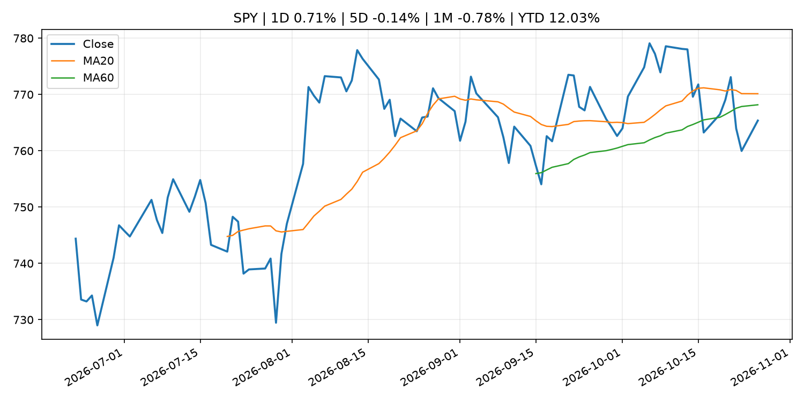
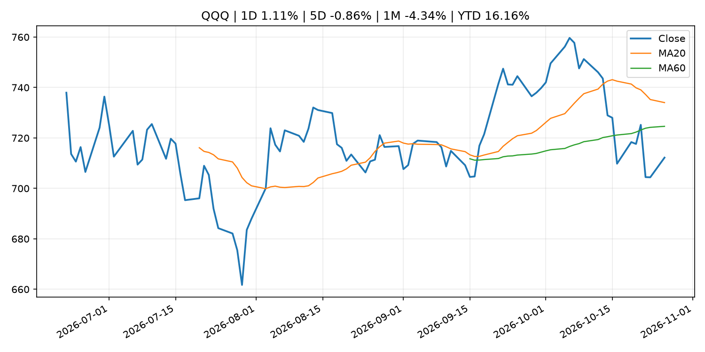
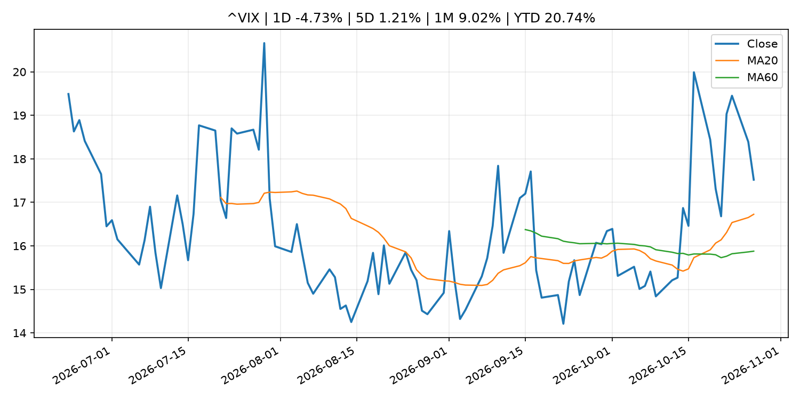
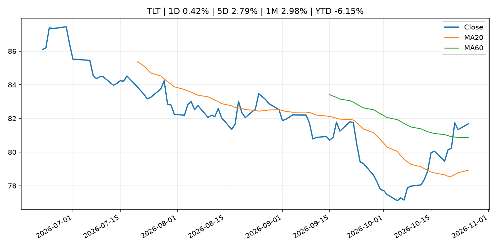
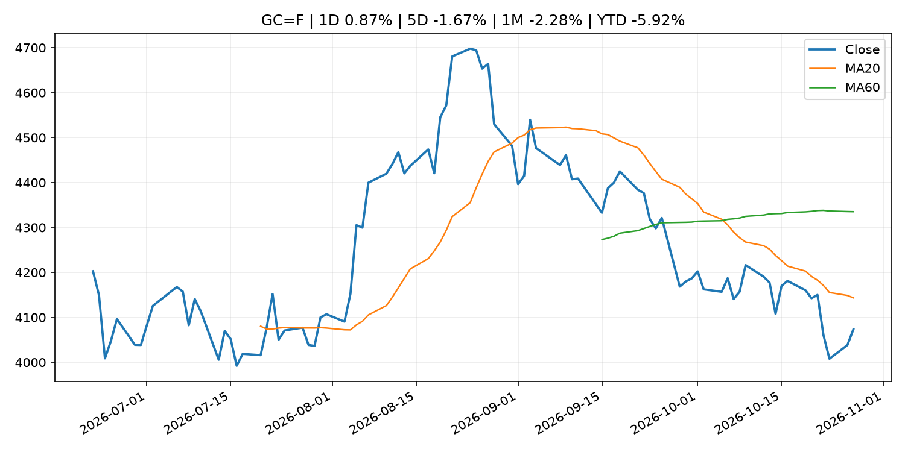
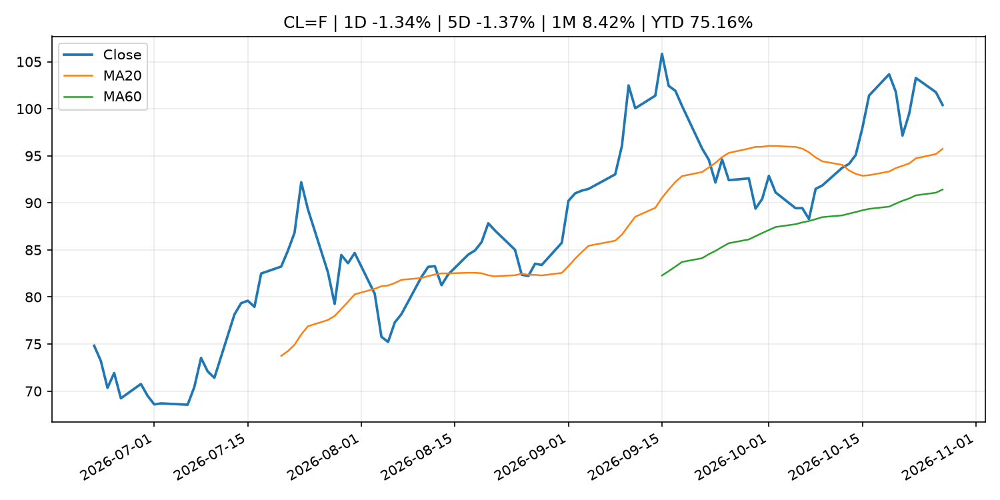
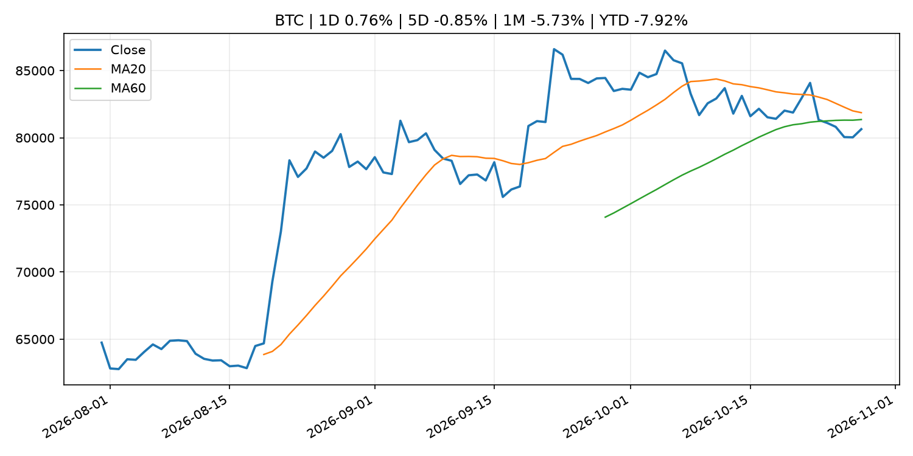
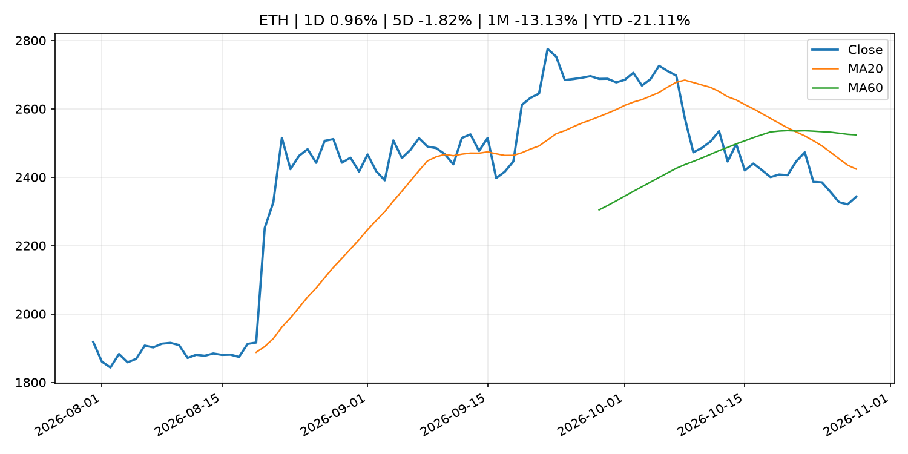
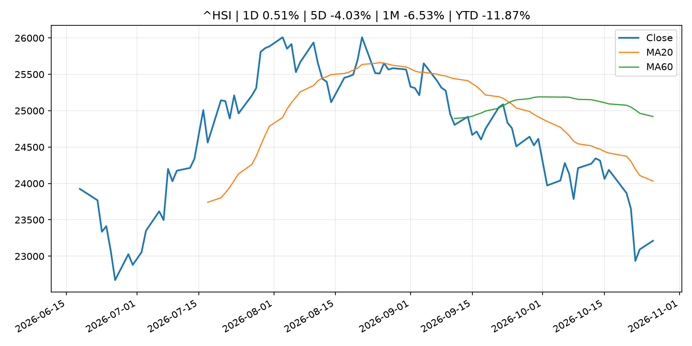

# Global Macro Morning Briefing - 2026-10-28

> Not financial advice / 非投资建议。

## 0. 今日总览
- 市场状态：mixed。股指上涨、波动率或美元回落，市场更接近风险偏好改善。 但存在信号冲突，需要降低单一叙事置信度。
- 今日三大主线：
  1. macro_data: Indicators for Core CPI
  2. crypto_market_structure: Robinhood taps Ripple’s $2.5 billion RLUSD stablecoin despite backing rival USDG
  3. crypto_market_structure: Japan's top yen stablecoin falls short of its target in a disappointing first year
- 一句话结论：今日晨报重点关注：这类宏观数据会直接改变市场对通胀、增长和政策路径的预期。；加密市场结构和监管变化会影响 BTC、ETH 及相关股票的风险溢价。。跨资产方面，SPY 1D 0.71%；QQQ 1D 1.11%；^VIX 1D -4.73%；TLT 1D 0.42%；GC=F 1D 0.87%；CL=F 1D -1.34%；BTC 1D 0.76%；ETH 1D 0.96%；股指上涨、波动率或美元回落，市场更接近风险偏好改善。 但存在信号冲突，需要降低单一叙事置信度。政策、通胀、利率、美元、美债、能源和加密监管仍是主要观察线索。所有结论仅基于公开数据与短摘要整理，不构成投资建议。

## 1. 隔夜跨资产市场
- 美股：SPY 1D 0.71%，QQQ 1D 1.11%，整体趋势需结合 VIX 和利率确认。
- 美债/美元：TLT 1D 0.42%，美元指数 1D 0.40%，是判断折现率压力的核心线索。
- 黄金/原油：黄金 1D 0.87%，原油 1D -1.34%，用于观察避险、通胀和地缘风险。
- 加密：BTC 1D 0.76%，ETH 1D 0.96%，关注是否独立于纳指走出加密自身行情。
- 港股/A股：恒生 1D 0.51%，沪深300/上证 1D n/a，重点看中国政策预期与人民币线索。
- 风险观察：确认风险偏好是否扩散到小盘股、信用利差和周期品。

### US_EQUITY

| symbol | latest close | 1D | 5D | 1M | YTD | trend |
|---|---:|---:|---:|---:|---:|---|
| SPY | 765.37 | 0.71% | -0.14% | -0.78% | 12.03% | range_bound |
| QQQ | 712.20 | 1.11% | -0.86% | -4.34% | 16.16% | range_bound |
| DIA | 522.97 | 0.31% | 0.78% | 1.06% | 8.13% | range_bound |
| IWM | 276.99 | 0.45% | 2.10% | -1.77% | 11.34% | downtrend |
| VTI | 375.59 | 0.69% | 0.01% | -1.10% | 11.68% | downtrend |

### US_MACRO_MARKET

| symbol | latest close | 1D | 5D | 1M | YTD | trend |
|---|---:|---:|---:|---:|---:|---|
| ^VIX | 17.52 | -4.73% | 1.21% | 9.02% | 20.74% | strong_uptrend |
| DX-Y.NYB | 102.37 | 0.40% | 0.63% | 1.15% | 4.01% | uptrend |
| TLT | 81.68 | 0.42% | 2.79% | 2.98% | -6.15% | range_bound |
| IEF | 91.12 | 0.08% | 1.15% | 1.24% | -5.16% | range_bound |

### COMMODITIES

| symbol | latest close | 1D | 5D | 1M | YTD | trend |
|---|---:|---:|---:|---:|---:|---|
| GC=F | 4,073.40 | 0.87% | -1.67% | -2.28% | -5.92% | downtrend |
| SI=F | 54.44 | 0.61% | -5.66% | -11.07% | -22.84% | strong_downtrend |
| CL=F | 100.40 | -1.34% | -1.37% | 8.42% | 75.16% | strong_uptrend |
| BZ=F | 109.84 | -5.15% | 0.97% | 4.33% | 80.81% | strong_uptrend |
| NG=F | 3.07 | 17.91% | 3.54% | 2.27% | -15.20% | uptrend |
| HG=F | 6.66 | 2.39% | 1.48% | 1.48% | 18.15% | range_bound |

### HK_MARKET

| symbol | latest close | 1D | 5D | 1M | YTD | trend |
|---|---:|---:|---:|---:|---:|---|
| ^HSI | 23,211.81 | 0.51% | -4.03% | -6.53% | -11.87% | strong_downtrend |
| 0700.HK | 385.20 | -0.31% | -6.14% | -12.14% | -38.17% | strong_downtrend |
| 9988.HK | 97.00 | -0.97% | -7.53% | -11.82% | -34.90% | strong_downtrend |
| 3690.HK | 71.85 | -2.97% | -5.58% | -0.55% | -31.31% | downtrend |
| 1810.HK | 25.66 | -4.61% | -5.17% | -3.46% | -36.30% | range_bound |
| 1211.HK | 70.05 | -1.06% | -4.89% | -11.89% | -29.06% | strong_downtrend |

### CRYPTO

| symbol | latest close | 1D | 5D | 1M | YTD | trend |
|---|---:|---:|---:|---:|---:|---|
| BTC | 80,638.97 | 0.76% | -0.85% | -5.73% | -7.92% | range_bound |
| ETH | 2,343.00 | 0.96% | -1.82% | -13.13% | -21.11% | strong_downtrend |
| SOLANA | 101.16 | 0.41% | -2.29% | -16.17% | -18.76% | strong_downtrend |
| BINANCECOIN | 742.42 | 0.09% | 1.64% | -4.72% | -13.94% | range_bound |
| RIPPLE | 1.33 | 1.53% | 1.44% | -11.36% | -27.91% | strong_downtrend |

## 2. 今日最重要的 10 条新闻
### 1. Indicators for Core CPI
- 来源：Bank of Japan Announcements
- 时间：2026-10-27T14:00:00+09:00
- 地区：Japan
- 事件类型：macro_data
- 重要性层级：Tier 1
- 一句话摘要：Indicators for Core CPI
- 为什么重要：这类宏观数据会直接改变市场对通胀、增长和政策路径的预期。
- 可能影响：主要影响 DXY，方向为 positive，强度 high；通胀压力可能推高政策利率预期并支撑美元。
  - 资产：DXY
    方向：positive
    强度：high
    原因：通胀压力可能推高政策利率预期并支撑美元。
  - 资产：TLT
    方向：negative
    强度：high
    原因：通胀上行通常推升收益率、压低长债价格。
  - 资产：QQQ
    方向：negative
    强度：high
    原因：更高利率对成长股估值折现率不利。
  - 资产：SPY
    方向：mixed
    强度：medium
    原因：名义增长可能支撑收入，但更高利率压制估值。
  - 资产：GC=F
    方向：mixed
    强度：medium
    原因：通胀对黄金是支撑，但实际利率上行会形成压力。
  - 资产：BTC
    方向：mixed
    强度：medium
    原因：抗通胀叙事和流动性收紧可能相互抵消。
- 原文链接：[http://www.boj.or.jp/en/research/research_data/cpi/index.htm](http://www.boj.or.jp/en/research/research_data/cpi/index.htm)

### 2. Robinhood taps Ripple’s $2.5 billion RLUSD stablecoin despite backing rival USDG
- 来源：CoinDesk
- 时间：2026-10-27T16:35:29+00:00
- 地区：global
- 事件类型：crypto_market_structure
- 重要性层级：Tier 2
- 一句话摘要：Robinhood taps Ripple’s $2.5 billion RLUSD stablecoin despite backing rival USDG
- 为什么重要：加密市场结构和监管变化会影响 BTC、ETH 及相关股票的风险溢价。
- 可能影响：主要影响 BTC，方向为 mixed，强度 high；加密监管或 ETF 进展会改变 BTC 的资金流和风险溢价。
  - 资产：BTC
    方向：mixed
    强度：high
    原因：加密监管或 ETF 进展会改变 BTC 的资金流和风险溢价。
  - 资产：ETH
    方向：mixed
    强度：high
    原因：监管框架会影响 ETH 产品化和机构参与度。
  - 资产：COIN
    方向：mixed
    强度：medium
    原因：监管清晰度和执法风险会影响交易平台估值。
  - 资产：crypto market
    方向：mixed
    强度：high
    原因：信息影响整个加密市场结构，但方向取决于细节。
- 原文链接：[https://www.coindesk.com/business/2026/10/27/ripple-s-rlusd-stablecoin-is-coming-to-robinhood-s-28-6-million-customer-platform](https://www.coindesk.com/business/2026/10/27/ripple-s-rlusd-stablecoin-is-coming-to-robinhood-s-28-6-million-customer-platform)

### 3. Japan's top yen stablecoin falls short of its target in a disappointing first year
- 来源：CoinDesk
- 时间：2026-10-27T11:37:52+00:00
- 地区：global
- 事件类型：crypto_market_structure
- 重要性层级：Tier 2
- 一句话摘要：Japan's top yen stablecoin falls short of its target in a disappointing first year
- 为什么重要：加密市场结构和监管变化会影响 BTC、ETH 及相关股票的风险溢价。
- 可能影响：主要影响 BTC，方向为 mixed，强度 high；加密监管或 ETF 进展会改变 BTC 的资金流和风险溢价。
  - 资产：BTC
    方向：mixed
    强度：high
    原因：加密监管或 ETF 进展会改变 BTC 的资金流和风险溢价。
  - 资产：ETH
    方向：mixed
    强度：high
    原因：监管框架会影响 ETH 产品化和机构参与度。
  - 资产：COIN
    方向：mixed
    强度：medium
    原因：监管清晰度和执法风险会影响交易平台估值。
  - 资产：crypto market
    方向：mixed
    强度：high
    原因：信息影响整个加密市场结构，但方向取决于细节。
- 原文链接：[https://www.coindesk.com/business/2026/10/27/japan-s-top-yen-stablecoin-falls-short-of-its-target-in-a-disappointing-first-year](https://www.coindesk.com/business/2026/10/27/japan-s-top-yen-stablecoin-falls-short-of-its-target-in-a-disappointing-first-year)

### 4. OCC calls on community banks to enter the stablecoin payments market
- 来源：CoinDesk
- 时间：2026-10-26T15:45:51+00:00
- 地区：global
- 事件类型：crypto_market_structure
- 重要性层级：Tier 2
- 一句话摘要：OCC calls on community banks to enter the stablecoin payments market
- 为什么重要：加密市场结构和监管变化会影响 BTC、ETH 及相关股票的风险溢价。
- 可能影响：主要影响 BTC，方向为 mixed，强度 high；加密监管或 ETF 进展会改变 BTC 的资金流和风险溢价。
  - 资产：BTC
    方向：mixed
    强度：high
    原因：加密监管或 ETF 进展会改变 BTC 的资金流和风险溢价。
  - 资产：ETH
    方向：mixed
    强度：high
    原因：监管框架会影响 ETH 产品化和机构参与度。
  - 资产：COIN
    方向：mixed
    强度：medium
    原因：监管清晰度和执法风险会影响交易平台估值。
  - 资产：crypto market
    方向：mixed
    强度：high
    原因：信息影响整个加密市场结构，但方向取决于细节。
- 原文链接：[https://www.coindesk.com/policy/2026/10/26/occ-calls-on-community-banks-to-enter-the-stablecoin-payments-market](https://www.coindesk.com/policy/2026/10/26/occ-calls-on-community-banks-to-enter-the-stablecoin-payments-market)

### 5. The big reason Boeing’s stock is falling so hard after earnings
- 来源：MarketWatch Top Stories
- 时间：2026-10-27T20:43:00+00:00
- 地区：US
- 事件类型：earnings
- 重要性层级：Tier 2
- 一句话摘要：Boeing will come up short on 737 Max deliveries, casting doubt on its turnaround plans.
- 为什么重要：大型科技股盈利和资本开支会影响纳指、半导体和 AI 交易主线。
- 可能影响：可能影响利率、汇率、风险资产或大宗商品预期，但当前公开信息不足以判断明确方向。
  - 资产：暂无明确资产映射
  - 方向：unknown
  - 强度：low
  - 原因：公开信息不足以判断方向。
- 原文链接：[https://www.marketwatch.com/story/the-big-reason-boeings-stock-is-falling-so-hard-after-earnings-d31b400d?mod=mw_rss_topstories](https://www.marketwatch.com/story/the-big-reason-boeings-stock-is-falling-so-hard-after-earnings-d31b400d?mod=mw_rss_topstories)

### 6. Treasury's Bessent sees crypto as America's next tool for keeping the U.S. dollar on top
- 来源：CoinDesk
- 时间：2026-10-27T20:41:33+00:00
- 地区：global
- 事件类型：other
- 重要性层级：Tier 3
- 一句话摘要：Treasury's Bessent sees crypto as America's next tool for keeping the U.S. dollar on top
- 为什么重要：这条信息暂未匹配到重大宏观、政策或市场事件，更适合作为背景跟踪。
- 可能影响：更偏背景信息，短期市场影响可能有限。
  - 资产：暂无明确资产映射
  - 方向：unknown
  - 强度：low
  - 原因：公开信息不足以判断方向。
- 原文链接：[https://www.coindesk.com/policy/2026/10/27/treasury-s-bessent-sees-crypto-as-america-s-next-tool-for-keeping-the-u-s-dollar-on-top](https://www.coindesk.com/policy/2026/10/27/treasury-s-bessent-sees-crypto-as-america-s-next-tool-for-keeping-the-u-s-dollar-on-top)

### 7. Brazilian companies turned to stablecoins on election day to dodge a currency crash
- 来源：CoinDesk
- 时间：2026-10-27T16:59:07+00:00
- 地区：global
- 事件类型：other
- 重要性层级：Tier 3
- 一句话摘要：Brazilian companies turned to stablecoins on election day to dodge a currency crash
- 为什么重要：这条信息暂未匹配到重大宏观、政策或市场事件，更适合作为背景跟踪。
- 可能影响：更偏背景信息，短期市场影响可能有限。
  - 资产：暂无明确资产映射
  - 方向：unknown
  - 强度：low
  - 原因：公开信息不足以判断方向。
- 原文链接：[https://www.coindesk.com/business/2026/10/27/brazilian-companies-turned-to-stablecoins-on-election-day-to-dodge-a-currency-crash](https://www.coindesk.com/business/2026/10/27/brazilian-companies-turned-to-stablecoins-on-election-day-to-dodge-a-currency-crash)

## 3. 政策与央行观察
### 1. Robinhood taps Ripple’s $2.5 billion RLUSD stablecoin despite backing rival USDG
- 来源：CoinDesk
- 时间：2026-10-27T16:35:29+00:00
- 地区：global
- 事件类型：crypto_market_structure
- 重要性层级：Tier 2
- 一句话摘要：Robinhood taps Ripple’s $2.5 billion RLUSD stablecoin despite backing rival USDG
- 为什么重要：加密市场结构和监管变化会影响 BTC、ETH 及相关股票的风险溢价。
- 可能影响：主要影响 BTC，方向为 mixed，强度 high；加密监管或 ETF 进展会改变 BTC 的资金流和风险溢价。
  - 资产：BTC
    方向：mixed
    强度：high
    原因：加密监管或 ETF 进展会改变 BTC 的资金流和风险溢价。
  - 资产：ETH
    方向：mixed
    强度：high
    原因：监管框架会影响 ETH 产品化和机构参与度。
  - 资产：COIN
    方向：mixed
    强度：medium
    原因：监管清晰度和执法风险会影响交易平台估值。
  - 资产：crypto market
    方向：mixed
    强度：high
    原因：信息影响整个加密市场结构，但方向取决于细节。
- 原文链接：[https://www.coindesk.com/business/2026/10/27/ripple-s-rlusd-stablecoin-is-coming-to-robinhood-s-28-6-million-customer-platform](https://www.coindesk.com/business/2026/10/27/ripple-s-rlusd-stablecoin-is-coming-to-robinhood-s-28-6-million-customer-platform)

### 2. Japan's top yen stablecoin falls short of its target in a disappointing first year
- 来源：CoinDesk
- 时间：2026-10-27T11:37:52+00:00
- 地区：global
- 事件类型：crypto_market_structure
- 重要性层级：Tier 2
- 一句话摘要：Japan's top yen stablecoin falls short of its target in a disappointing first year
- 为什么重要：加密市场结构和监管变化会影响 BTC、ETH 及相关股票的风险溢价。
- 可能影响：主要影响 BTC，方向为 mixed，强度 high；加密监管或 ETF 进展会改变 BTC 的资金流和风险溢价。
  - 资产：BTC
    方向：mixed
    强度：high
    原因：加密监管或 ETF 进展会改变 BTC 的资金流和风险溢价。
  - 资产：ETH
    方向：mixed
    强度：high
    原因：监管框架会影响 ETH 产品化和机构参与度。
  - 资产：COIN
    方向：mixed
    强度：medium
    原因：监管清晰度和执法风险会影响交易平台估值。
  - 资产：crypto market
    方向：mixed
    强度：high
    原因：信息影响整个加密市场结构，但方向取决于细节。
- 原文链接：[https://www.coindesk.com/business/2026/10/27/japan-s-top-yen-stablecoin-falls-short-of-its-target-in-a-disappointing-first-year](https://www.coindesk.com/business/2026/10/27/japan-s-top-yen-stablecoin-falls-short-of-its-target-in-a-disappointing-first-year)

### 3. OCC calls on community banks to enter the stablecoin payments market
- 来源：CoinDesk
- 时间：2026-10-26T15:45:51+00:00
- 地区：global
- 事件类型：crypto_market_structure
- 重要性层级：Tier 2
- 一句话摘要：OCC calls on community banks to enter the stablecoin payments market
- 为什么重要：加密市场结构和监管变化会影响 BTC、ETH 及相关股票的风险溢价。
- 可能影响：主要影响 BTC，方向为 mixed，强度 high；加密监管或 ETF 进展会改变 BTC 的资金流和风险溢价。
  - 资产：BTC
    方向：mixed
    强度：high
    原因：加密监管或 ETF 进展会改变 BTC 的资金流和风险溢价。
  - 资产：ETH
    方向：mixed
    强度：high
    原因：监管框架会影响 ETH 产品化和机构参与度。
  - 资产：COIN
    方向：mixed
    强度：medium
    原因：监管清晰度和执法风险会影响交易平台估值。
  - 资产：crypto market
    方向：mixed
    强度：high
    原因：信息影响整个加密市场结构，但方向取决于细节。
- 原文链接：[https://www.coindesk.com/policy/2026/10/26/occ-calls-on-community-banks-to-enter-the-stablecoin-payments-market](https://www.coindesk.com/policy/2026/10/26/occ-calls-on-community-banks-to-enter-the-stablecoin-payments-market)

## 4. 市场异动与图表
- SPY 上涨 0.71%
- QQQ 上涨 1.11%
- VIX 下跌 -4.73%
- TLT 上涨 0.42%
- DXY 上涨 0.40%
- Gold 上涨 0.87%
- Oil 下跌 -1.34%

### 信号矛盾
- 黄金和美元同时上涨，可能反映避险或地缘风险。

### SPY

### QQQ

### ^VIX

### TLT

### GC=F

### CL=F

### BTC

### ETH

### ^HSI

## 5. 华尔街与机构公开观点
- 暂无可靠公开观点。

## 6. 今日重点关注
- 经济数据：经济数据：暂无可靠公开日历数据；如配置经济日历源后可自动填充。
- 央行讲话：央行讲话：暂无可靠公开日历数据；重点跟踪 Fed、ECB、BoJ、PBOC 官网 RSS。
- 财报：财报：暂无可靠数据。
- 政策事件：政策事件：暂无可靠数据。
- 风险提醒：风险提醒：关注数据源失败项、突发地缘风险、利率和美元的二阶反应。

## 7. 英文金融表达与宏观概念
- **inflation expectations**：通胀预期，指家庭、企业或市场对未来通胀的预估。 例句：Inflation expectations can shape wage bargaining and bond yields.
- **real yield**：实际收益率，名义利率扣除通胀预期后的收益率。 例句：Gold often reacts more to real yields than nominal yields.
- **market structure**：市场结构，指交易、托管、清算、ETF、监管等制度安排。 例句：Crypto market structure rules can affect institutional participation.
- **terminal rate**：终端利率，市场预期本轮加息周期的最高政策利率。 例句：A higher terminal rate can pressure growth stocks.
- **soft landing**：软着陆，指通胀回落而经济避免明显衰退。 例句：Markets often rally when data support a soft landing.
- **risk-off**：避险模式，资金偏向美元、国债、黄金等防御资产。 例句：A geopolitical shock can push markets into risk-off mode.

## 8. 背景材料
- [Treasury's Bessent sees crypto as America's next tool for keeping the U.S. dollar on top](https://www.coindesk.com/policy/2026/10/27/treasury-s-bessent-sees-crypto-as-america-s-next-tool-for-keeping-the-u-s-dollar-on-top)（CoinDesk，other）：Treasury's Bessent sees crypto as America's next tool for keeping the U.S. dollar on top
- [Brazilian companies turned to stablecoins on election day to dodge a currency crash](https://www.coindesk.com/business/2026/10/27/brazilian-companies-turned-to-stablecoins-on-election-day-to-dodge-a-currency-crash)（CoinDesk，other）：Brazilian companies turned to stablecoins on election day to dodge a currency crash
- [Bitcoin miners' move into AI is creating a new market for trading computing power](https://www.coindesk.com/business/2026/10/27/bitcoin-miners-move-into-ai-is-creating-a-new-market-for-trading-computing-power)（CoinDesk，other）：Bitcoin miners' move into AI is creating a new market for trading computing power
- [Bitcoin shows signs of weakness while Ripple's bank win fails to bolster XRP](https://www.coindesk.com/daybook-us/2026/10/27/bitcoin-shows-signs-of-weakness-while-ripple-s-bank-win-fails-to-bolster-xrp)（CoinDesk，other）：Bitcoin shows signs of weakness while Ripple's bank win fails to bolster XRP
- [Live updates: Bitcoin edges higher as Nasdaq surges 1.2%](https://www.coindesk.com/tech/2026/10/27/live-updates-bitcoin-holds-below-usd80-000-as-ai-buildout-draws-more-capital)（CoinDesk，other）：Live updates: Bitcoin edges higher as Nasdaq surges 1.2%
- [Bitcoin drops below $80,000 as crypto ignores Asian tech rally, Fed meeting begins](https://www.coindesk.com/markets/2026/10/27/bitcoin-drops-below-usd80-000-as-crypto-ignores-asian-tech-rally-fed-meeting-begins)（CoinDesk，other）：Bitcoin drops below $80,000 as crypto ignores Asian tech rally, Fed meeting begins
- [Crypto wallet maker Keystone to destroy almost 19,000 devices after security breach](https://www.coindesk.com/business/2026/10/27/crypto-wallet-maker-keystone-to-destroy-almost-19-000-devices-after-security-breach)（CoinDesk，other）：Crypto wallet maker Keystone to destroy almost 19,000 devices after security breach
- [Investor who called for AI pivot in 2023 says bitcoin is going to $57,000](https://www.coindesk.com/markets/2026/10/27/investor-who-called-for-ai-pivot-in-2023-says-bitcoin-is-going-to-usd57-000)（CoinDesk，other）：Investor who called for AI pivot in 2023 says bitcoin is going to $57,000
- [Now is the time to accumulate bitcoin, Galaxy says](https://www.coindesk.com/markets/2026/10/27/now-is-the-time-to-accumulate-bitcoin-galaxy-says)（CoinDesk，other）：Now is the time to accumulate bitcoin, Galaxy says
- [Solana bug reports now cost 1 SOL as AI floods security teams with spam](https://www.coindesk.com/tech/2026/10/27/solana-bug-reports-now-cost-1-sol-as-ai-floods-security-teams-with-spam)（CoinDesk，other）：Solana bug reports now cost 1 SOL as AI floods security teams with spam
- [Zcash co-founder proposes ending grants funding, citing $125 million treasury](https://www.coindesk.com/markets/2026/10/27/zcash-co-founder-proposes-ending-grants-funding-citing-usd125-million-treasury)（CoinDesk，other）：Zcash co-founder proposes ending grants funding, citing $125 million treasury
- [October 2026 euro area bank lending survey](https://www.ecb.europa.eu//press/pr/date/2026/html/ecb.pr261027~506ef03145.en.html)（ECB Press Releases，other）：October 2026 euro area bank lending survey
- [Services Producer Price Index (Sept.)](http://www.boj.or.jp/en/statistics/pi/cspi_release/sppi2609.pdf)（Bank of Japan Announcements，other）：Services Producer Price Index (Sept.)
- [Survey on the Access to Finance of Enterprises: lending conditions tightened](https://www.ecb.europa.eu//press/pr/date/2026/html/ecb.pr261026~bde7b6d11a.en.html)（ECB Press Releases，other）：Survey on the Access to Finance of Enterprises: lending conditions tightened
- [Frank Elderson: Taking action for nature – investing in economic resilience and prosperity](https://www.ecb.europa.eu//press/key/date/2026/html/ecb.sp261026~d903d7ad85.en.html)（ECB Press Releases，other）：Frank Elderson: Taking action for nature – investing in economic resilience and prosperity

## 9. 数据源、失败项与免责声明
- 采集时间：2026-10-28T00:59:56
- 数据源：公开 RSS、Yahoo Finance、CoinGecko、AKShare、FRED、SEC data.sec.gov，以及用户自有 inputs/reports 文件。
- 合规说明：不绕过 WSJ、Bloomberg、FT、Reuters 等付费墙；对付费媒体只使用公开 RSS 标题、摘要、链接和发布时间。
- 免责声明：Not financial advice / 非投资建议。本项目仅供个人学习、研究和信息整理，不构成投资建议、交易建议或任何收益承诺。
- 失败或跳过的数据源：
  - crypto data failed coin=dogecoin
  - China market data failed symbol=上证指数: empty dataframe
  - China market data failed symbol=深证成指: empty dataframe
  - China market data failed symbol=创业板指: empty dataframe
  - China market data failed symbol=沪深300: empty dataframe
  - China market data failed symbol=中证500: empty dataframe
  - China market data failed symbol=科创50: empty dataframe
  - FRED_API_KEY not set; skipping FRED macro series
  - SEC failed cik=0000320193
  - SEC failed cik=0000789019
  - SEC failed cik=0001045810
  - SEC failed cik=0001318605
  - SEC failed cik=0001577552
