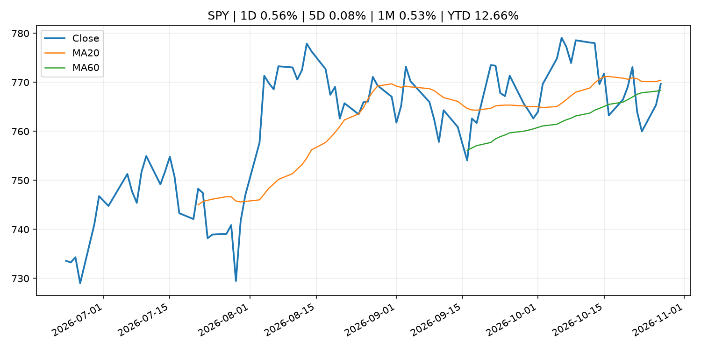
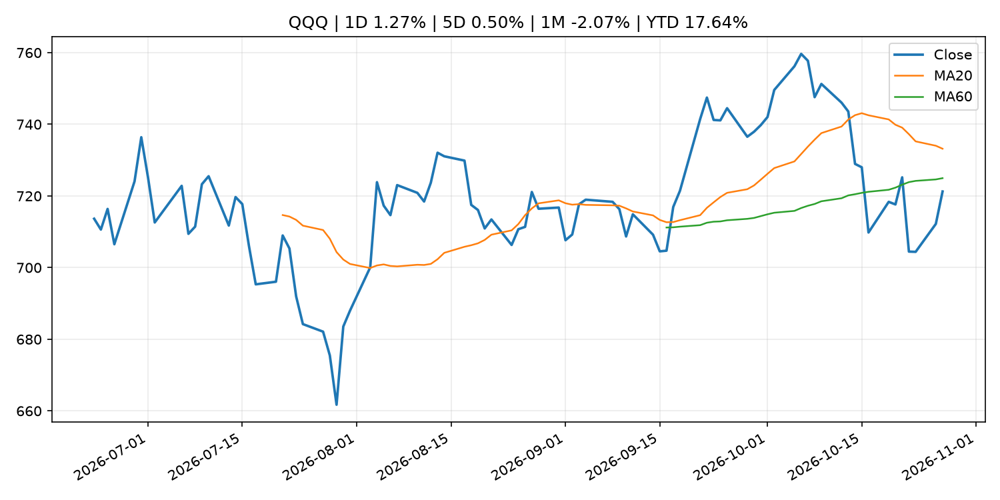
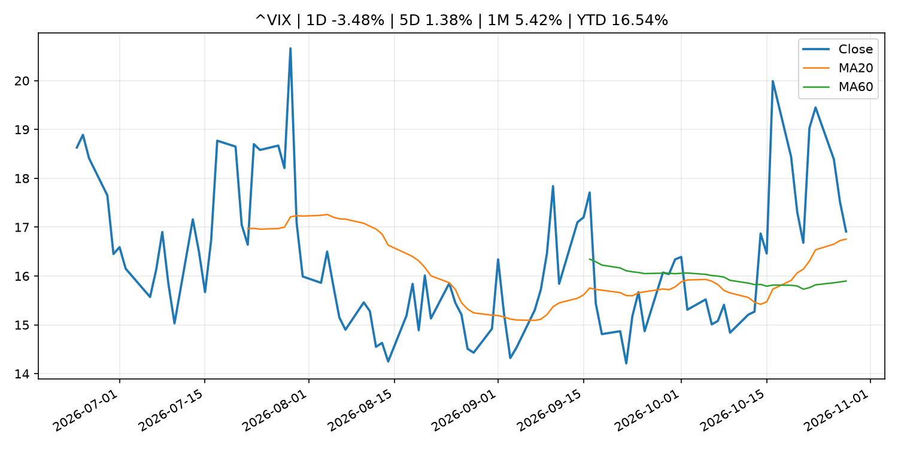
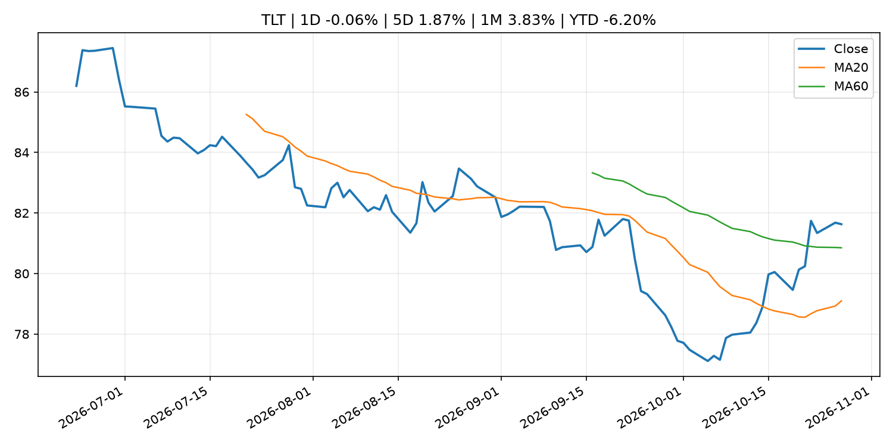
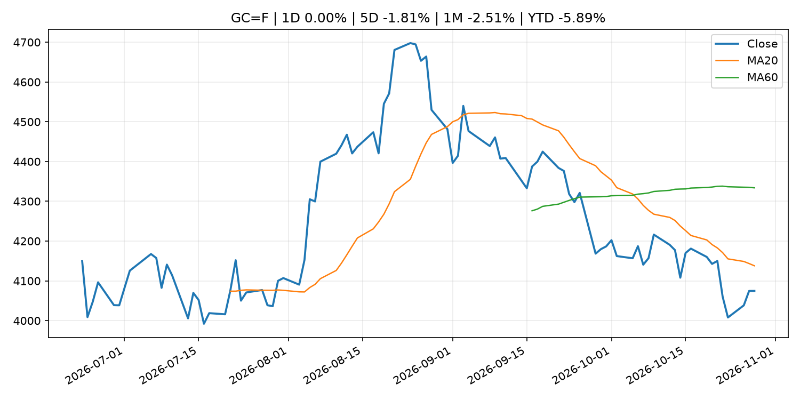
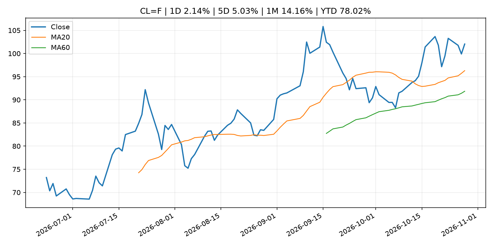
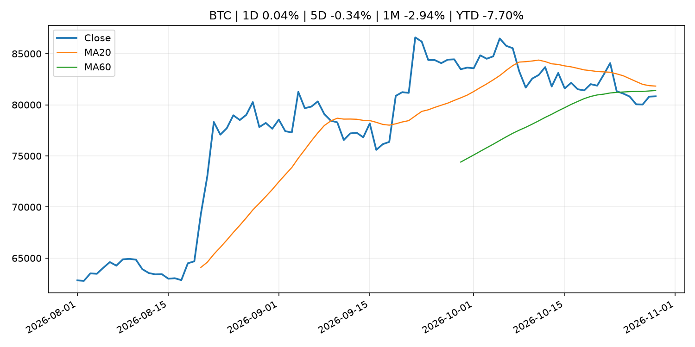
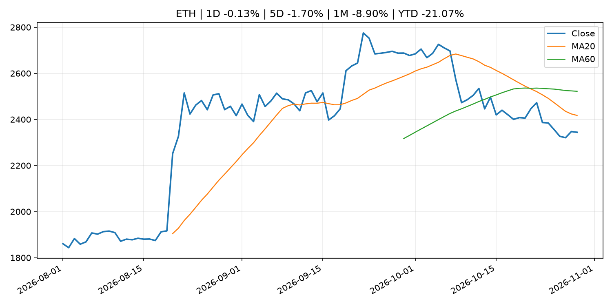
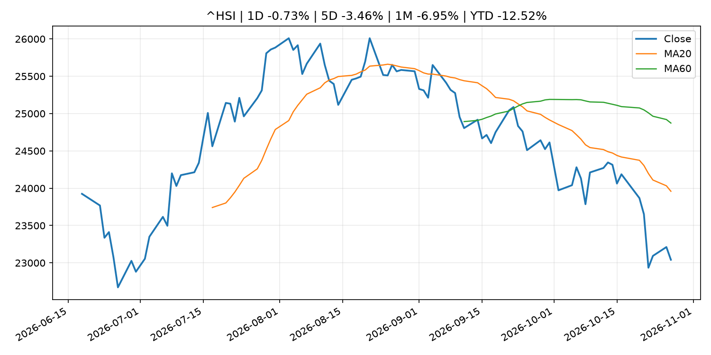

# Global Macro Morning Briefing - 2026-10-29

> Not financial advice / 非投资建议。

## 0. 今日总览
- 市场状态：risk_on。股指上涨、波动率或美元回落，市场更接近风险偏好改善。
- 今日三大主线：
  1. macro_data: Indicators for Core CPI
  2. central_bank_decision: Federal Reserve issues FOMC statement
  3. earnings: The major reason Microsoft’s stock is heading higher after earnings
- 一句话结论：今日晨报重点关注：这类宏观数据会直接改变市场对通胀、增长和政策路径的预期。；央行决策会重定价利率、汇率、久期资产和风险资产。。跨资产方面，SPY 1D 0.56%；QQQ 1D 1.27%；^VIX 1D -3.48%；TLT 1D -0.06%；GC=F 1D 0.00%；CL=F 1D 2.14%；BTC 1D 0.04%；ETH 1D -0.13%；股指上涨、波动率或美元回落，市场更接近风险偏好改善。政策、通胀、利率、美元、美债、能源和加密监管仍是主要观察线索。所有结论仅基于公开数据与短摘要整理，不构成投资建议。

## 1. 隔夜跨资产市场
- 美股：SPY 1D 0.56%，QQQ 1D 1.27%，整体趋势需结合 VIX 和利率确认。
- 美债/美元：TLT 1D -0.06%，美元指数 1D -0.16%，是判断折现率压力的核心线索。
- 黄金/原油：黄金 1D 0.00%，原油 1D 2.14%，用于观察避险、通胀和地缘风险。
- 加密：BTC 1D 0.04%，ETH 1D -0.13%，关注是否独立于纳指走出加密自身行情。
- 港股/A股：恒生 1D -0.73%，沪深300/上证 1D n/a，重点看中国政策预期与人民币线索。
- 风险观察：确认风险偏好是否扩散到小盘股、信用利差和周期品。

### US_EQUITY

| symbol | latest close | 1D | 5D | 1M | YTD | trend |
|---|---:|---:|---:|---:|---:|---|
| SPY | 769.66 | 0.56% | 0.08% | 0.53% | 12.66% | range_bound |
| QQQ | 721.25 | 1.27% | 0.50% | -2.07% | 17.64% | range_bound |
| DIA | 523.28 | 0.06% | -0.21% | 1.80% | 8.20% | range_bound |
| IWM | 280.18 | 1.15% | 1.60% | 0.06% | 12.62% | range_bound |
| VTI | 377.92 | 0.62% | 0.22% | 0.55% | 12.37% | downtrend |

### US_MACRO_MARKET

| symbol | latest close | 1D | 5D | 1M | YTD | trend |
|---|---:|---:|---:|---:|---:|---|
| ^VIX | 16.91 | -3.48% | 1.38% | 5.42% | 16.54% | uptrend |
| DX-Y.NYB | 102.16 | -0.16% | 0.37% | 0.78% | 3.80% | uptrend |
| TLT | 81.63 | -0.06% | 1.87% | 3.83% | -6.20% | range_bound |
| IEF | 91.10 | -0.02% | 0.94% | 1.75% | -5.18% | range_bound |

### COMMODITIES

| symbol | latest close | 1D | 5D | 1M | YTD | trend |
|---|---:|---:|---:|---:|---:|---|
| GC=F | 4,074.70 | 0.00% | -1.81% | -2.51% | -5.89% | downtrend |
| SI=F | 54.19 | -0.20% | -5.64% | -10.69% | -23.20% | strong_downtrend |
| CL=F | 102.04 | 2.14% | 5.03% | 14.16% | 78.02% | strong_uptrend |
| BZ=F | 110.79 | -2.71% | 1.81% | 7.99% | 82.37% | strong_uptrend |
| NG=F | 3.02 | 12.05% | 8.32% | 0.37% | -16.47% | uptrend |
| HG=F | 6.67 | 0.79% | 2.00% | 1.99% | 18.33% | range_bound |

### HK_MARKET

| symbol | latest close | 1D | 5D | 1M | YTD | trend |
|---|---:|---:|---:|---:|---:|---|
| ^HSI | 23,041.32 | -0.73% | -3.46% | -6.95% | -12.52% | strong_downtrend |
| 0700.HK | 387.60 | 0.62% | -1.57% | -11.22% | -37.78% | strong_downtrend |
| 9988.HK | 98.90 | 1.96% | -4.63% | -8.76% | -33.62% | strong_downtrend |
| 3690.HK | 71.20 | -0.90% | -4.69% | -0.63% | -31.93% | downtrend |
| 1810.HK | 25.62 | -0.16% | -4.40% | -1.08% | -36.40% | range_bound |
| 1211.HK | 70.45 | 0.57% | -0.98% | -9.80% | -28.66% | strong_downtrend |

### CRYPTO

| symbol | latest close | 1D | 5D | 1M | YTD | trend |
|---|---:|---:|---:|---:|---:|---|
| BTC | 80,829.47 | 0.04% | -0.34% | -2.94% | -7.70% | range_bound |
| ETH | 2,344.27 | -0.13% | -1.70% | -8.90% | -21.07% | strong_downtrend |
| SOLANA | 101.38 | 0.18% | -1.32% | -12.77% | -18.58% | strong_downtrend |
| BINANCECOIN | 754.43 | 1.40% | 2.12% | -2.28% | -12.55% | range_bound |
| RIPPLE | 1.32 | -1.00% | 1.73% | -7.36% | -28.49% | downtrend |
| DOGECOIN | 0.08 | 0.38% | 0.92% | -10.92% | -32.52% | strong_downtrend |

## 2. 今日最重要的 10 条新闻
### 1. Indicators for Core CPI
- 来源：Bank of Japan Announcements
- 时间：2026-10-27T14:00:00+09:00
- 地区：Japan
- 事件类型：macro_data
- 重要性层级：Tier 1
- 一句话摘要：Indicators for Core CPI
- 为什么重要：这类宏观数据会直接改变市场对通胀、增长和政策路径的预期。
- 可能影响：主要影响 DXY，方向为 positive，强度 high；通胀压力可能推高政策利率预期并支撑美元。
  - 资产：DXY
    方向：positive
    强度：high
    原因：通胀压力可能推高政策利率预期并支撑美元。
  - 资产：TLT
    方向：negative
    强度：high
    原因：通胀上行通常推升收益率、压低长债价格。
  - 资产：QQQ
    方向：negative
    强度：high
    原因：更高利率对成长股估值折现率不利。
  - 资产：SPY
    方向：mixed
    强度：medium
    原因：名义增长可能支撑收入，但更高利率压制估值。
  - 资产：GC=F
    方向：mixed
    强度：medium
    原因：通胀对黄金是支撑，但实际利率上行会形成压力。
  - 资产：BTC
    方向：mixed
    强度：medium
    原因：抗通胀叙事和流动性收紧可能相互抵消。
- 原文链接：[http://www.boj.or.jp/en/research/research_data/cpi/index.htm](http://www.boj.or.jp/en/research/research_data/cpi/index.htm)

### 2. Federal Reserve issues FOMC statement
- 来源：Federal Reserve Press Releases
- 时间：2026-10-28T18:00:00+00:00
- 地区：US
- 事件类型：central_bank_decision
- 重要性层级：Tier 1
- 一句话摘要：Federal Reserve issues FOMC statement
- 为什么重要：央行决策会重定价利率、汇率、久期资产和风险资产。
- 可能影响：可能影响利率、汇率、风险资产或大宗商品预期，但当前公开信息不足以判断明确方向。
  - 资产：暂无明确资产映射
  - 方向：unknown
  - 强度：low
  - 原因：公开信息不足以判断方向。
- 原文链接：[https://www.federalreserve.gov/newsevents/pressreleases/monetary20261028a.htm](https://www.federalreserve.gov/newsevents/pressreleases/monetary20261028a.htm)

### 3. The major reason Microsoft’s stock is heading higher after earnings
- 来源：MarketWatch Top Stories
- 时间：2026-10-29T00:10:00+00:00
- 地区：US
- 事件类型：earnings
- 重要性层级：Tier 2
- 一句话摘要：Microsoft showed investors that it’s able to grow rapidly while keeping spending in check.
- 为什么重要：大型科技股盈利和资本开支会影响纳指、半导体和 AI 交易主线。
- 可能影响：主要影响 QQQ，方向为 mixed，强度 high；AI 资本开支会影响大型科技股盈利和估值预期。
  - 资产：QQQ
    方向：mixed
    强度：high
    原因：AI 资本开支会影响大型科技股盈利和估值预期。
  - 资产：SMH
    方向：mixed
    强度：high
    原因：AI 投资周期直接影响半导体需求。
  - 资产：NVDA
    方向：mixed
    强度：high
    原因：AI 训练和推理需求是英伟达收入预期核心变量。
  - 资产：MSFT
    方向：mixed
    强度：medium
    原因：云和 AI 资本开支影响利润率与增长叙事。
  - 资产：GOOGL
    方向：mixed
    强度：medium
    原因：AI 投资和搜索商业化影响估值。
  - 资产：META
    方向：mixed
    强度：medium
    原因：AI 基建支出与广告效率共同影响市场预期。
- 原文链接：[https://www.marketwatch.com/story/the-major-reason-microsofts-stock-is-heading-higher-after-earnings-c019a036?mod=mw_rss_topstories](https://www.marketwatch.com/story/the-major-reason-microsofts-stock-is-heading-higher-after-earnings-c019a036?mod=mw_rss_topstories)

### 4. Google to preview crypto custody security system as AI threats grow
- 来源：CoinDesk
- 时间：2026-10-28T11:00:00+00:00
- 地区：global
- 事件类型：crypto_market_structure
- 重要性层级：Tier 2
- 一句话摘要：Google to preview crypto custody security system as AI threats grow
- 为什么重要：加密市场结构和监管变化会影响 BTC、ETH 及相关股票的风险溢价。
- 可能影响：主要影响 BTC，方向为 mixed，强度 high；加密监管或 ETF 进展会改变 BTC 的资金流和风险溢价。
  - 资产：BTC
    方向：mixed
    强度：high
    原因：加密监管或 ETF 进展会改变 BTC 的资金流和风险溢价。
  - 资产：ETH
    方向：mixed
    强度：high
    原因：监管框架会影响 ETH 产品化和机构参与度。
  - 资产：COIN
    方向：mixed
    强度：medium
    原因：监管清晰度和执法风险会影响交易平台估值。
  - 资产：crypto market
    方向：mixed
    强度：high
    原因：信息影响整个加密市场结构，但方向取决于细节。
  - 资产：QQQ
    方向：mixed
    强度：high
    原因：AI 资本开支会影响大型科技股盈利和估值预期。
  - 资产：SMH
    方向：mixed
    强度：high
    原因：AI 投资周期直接影响半导体需求。
- 原文链接：[https://www.coindesk.com/tech/2026/10/28/google-to-preview-crypto-custody-security-system-as-ai-threats-grow](https://www.coindesk.com/tech/2026/10/28/google-to-preview-crypto-custody-security-system-as-ai-threats-grow)

### 5. XRP Ledger developers propose creating wallets with zero XRP for stablecoin payments
- 来源：CoinDesk
- 时间：2026-10-28T11:52:14+00:00
- 地区：global
- 事件类型：crypto_market_structure
- 重要性层级：Tier 2
- 一句话摘要：XRP Ledger developers propose creating wallets with zero XRP for stablecoin payments
- 为什么重要：加密市场结构和监管变化会影响 BTC、ETH 及相关股票的风险溢价。
- 可能影响：主要影响 BTC，方向为 mixed，强度 high；加密监管或 ETF 进展会改变 BTC 的资金流和风险溢价。
  - 资产：BTC
    方向：mixed
    强度：high
    原因：加密监管或 ETF 进展会改变 BTC 的资金流和风险溢价。
  - 资产：ETH
    方向：mixed
    强度：high
    原因：监管框架会影响 ETH 产品化和机构参与度。
  - 资产：COIN
    方向：mixed
    强度：medium
    原因：监管清晰度和执法风险会影响交易平台估值。
  - 资产：crypto market
    方向：mixed
    强度：high
    原因：信息影响整个加密市场结构，但方向取决于细节。
- 原文链接：[https://www.coindesk.com/tech/2026/10/28/xrp-ledger-developers-propose-creating-wallets-with-zero-xrp-for-stablecoin-payments](https://www.coindesk.com/tech/2026/10/28/xrp-ledger-developers-propose-creating-wallets-with-zero-xrp-for-stablecoin-payments)

### 6. Fortinet’s stock is taking a dive after earnings. Here’s why.
- 来源：MarketWatch Top Stories
- 时间：2026-10-28T23:18:00+00:00
- 地区：US
- 事件类型：earnings
- 重要性层级：Tier 2
- 一句话摘要：Cybersecurity stocks are broadly falling as growth slows significantly in one of Fortinet’s business segments.
- 为什么重要：大型科技股盈利和资本开支会影响纳指、半导体和 AI 交易主线。
- 可能影响：可能影响利率、汇率、风险资产或大宗商品预期，但当前公开信息不足以判断明确方向。
  - 资产：暂无明确资产映射
  - 方向：unknown
  - 强度：low
  - 原因：公开信息不足以判断方向。
- 原文链接：[https://www.marketwatch.com/story/fortinets-stock-is-taking-a-dive-after-earnings-heres-why-d407896e?mod=mw_rss_topstories](https://www.marketwatch.com/story/fortinets-stock-is-taking-a-dive-after-earnings-heres-why-d407896e?mod=mw_rss_topstories)

### 7. ServiceNow’s stock slides as earnings miss overshadows a raised AI outlook
- 来源：MarketWatch Top Stories
- 时间：2026-10-28T23:02:00+00:00
- 地区：US
- 事件类型：earnings
- 重要性层级：Tier 2
- 一句话摘要：Even with an uptick in multimillion-dollar AI deals, ServiceNow’s earnings results weren’t enough to win over software skeptics.
- 为什么重要：大型科技股盈利和资本开支会影响纳指、半导体和 AI 交易主线。
- 可能影响：可能影响利率、汇率、风险资产或大宗商品预期，但当前公开信息不足以判断明确方向。
  - 资产：暂无明确资产映射
  - 方向：unknown
  - 强度：low
  - 原因：公开信息不足以判断方向。
- 原文链接：[https://www.marketwatch.com/story/servicenows-stock-slides-as-earnings-miss-clouds-a-raised-ai-outlook-96e48385?mod=mw_rss_topstories](https://www.marketwatch.com/story/servicenows-stock-slides-as-earnings-miss-clouds-a-raised-ai-outlook-96e48385?mod=mw_rss_topstories)

### 8. Coinbase earnings: Wall Street divided on trading rebound after Robinhood crypto revenue sinks 55%
- 来源：CoinDesk
- 时间：2026-10-28T17:02:57+00:00
- 地区：global
- 事件类型：earnings
- 重要性层级：Tier 2
- 一句话摘要：Coinbase earnings: Wall Street divided on trading rebound after Robinhood crypto revenue sinks 55%
- 为什么重要：大型科技股盈利和资本开支会影响纳指、半导体和 AI 交易主线。
- 可能影响：可能影响利率、汇率、风险资产或大宗商品预期，但当前公开信息不足以判断明确方向。
  - 资产：暂无明确资产映射
  - 方向：unknown
  - 强度：low
  - 原因：公开信息不足以判断方向。
- 原文链接：[https://www.coindesk.com/markets/2026/10/28/coinbase-earnings-wall-street-divided-on-trading-rebound-as-robinhood-crypto-revenue-sinks-55](https://www.coindesk.com/markets/2026/10/28/coinbase-earnings-wall-street-divided-on-trading-rebound-as-robinhood-crypto-revenue-sinks-55)

### 9. Kospi surges 7% as SK Hynix earnings fuel AI stock rebound
- 来源：CoinDesk
- 时间：2026-10-28T09:59:25+00:00
- 地区：global
- 事件类型：earnings
- 重要性层级：Tier 2
- 一句话摘要：Kospi surges 7% as SK Hynix earnings fuel AI stock rebound
- 为什么重要：大型科技股盈利和资本开支会影响纳指、半导体和 AI 交易主线。
- 可能影响：可能影响利率、汇率、风险资产或大宗商品预期，但当前公开信息不足以判断明确方向。
  - 资产：暂无明确资产映射
  - 方向：unknown
  - 强度：low
  - 原因：公开信息不足以判断方向。
- 原文链接：[https://www.coindesk.com/markets/2026/10/28/kospi-surges-7-as-sk-hynix-earnings-fuel-ai-stock-rebound](https://www.coindesk.com/markets/2026/10/28/kospi-surges-7-as-sk-hynix-earnings-fuel-ai-stock-rebound)

### 10. Is it curtains for COLA? Saving Social Security could mean changing the cost-of-living adjustment.
- 来源：MarketWatch Top Stories
- 时间：2026-10-28T22:41:00+00:00
- 地区：US
- 事件类型：other
- 重要性层级：Tier 3
- 一句话摘要：Several proposals consider changing the way retirees receive inflation protection. Here’s what it could cost you.
- 为什么重要：这条信息暂未匹配到重大宏观、政策或市场事件，更适合作为背景跟踪。
- 可能影响：主要影响 DXY，方向为 positive，强度 high；通胀压力可能推高政策利率预期并支撑美元。
  - 资产：DXY
    方向：positive
    强度：high
    原因：通胀压力可能推高政策利率预期并支撑美元。
  - 资产：TLT
    方向：negative
    强度：high
    原因：通胀上行通常推升收益率、压低长债价格。
  - 资产：QQQ
    方向：negative
    强度：high
    原因：更高利率对成长股估值折现率不利。
  - 资产：SPY
    方向：mixed
    强度：medium
    原因：名义增长可能支撑收入，但更高利率压制估值。
  - 资产：GC=F
    方向：mixed
    强度：medium
    原因：通胀对黄金是支撑，但实际利率上行会形成压力。
  - 资产：BTC
    方向：mixed
    强度：medium
    原因：抗通胀叙事和流动性收紧可能相互抵消。
- 原文链接：[https://www.marketwatch.com/story/is-it-curtains-for-cola-saving-social-security-could-mean-changing-the-cost-of-living-adjustment-867c6bd8?mod=mw_rss_topstories](https://www.marketwatch.com/story/is-it-curtains-for-cola-saving-social-security-could-mean-changing-the-cost-of-living-adjustment-867c6bd8?mod=mw_rss_topstories)

## 3. 政策与央行观察
### 1. Federal Reserve issues FOMC statement
- 来源：Federal Reserve Press Releases
- 时间：2026-10-28T18:00:00+00:00
- 地区：US
- 事件类型：central_bank_decision
- 重要性层级：Tier 1
- 一句话摘要：Federal Reserve issues FOMC statement
- 为什么重要：央行决策会重定价利率、汇率、久期资产和风险资产。
- 可能影响：可能影响利率、汇率、风险资产或大宗商品预期，但当前公开信息不足以判断明确方向。
  - 资产：暂无明确资产映射
  - 方向：unknown
  - 强度：low
  - 原因：公开信息不足以判断方向。
- 原文链接：[https://www.federalreserve.gov/newsevents/pressreleases/monetary20261028a.htm](https://www.federalreserve.gov/newsevents/pressreleases/monetary20261028a.htm)

### 2. Google to preview crypto custody security system as AI threats grow
- 来源：CoinDesk
- 时间：2026-10-28T11:00:00+00:00
- 地区：global
- 事件类型：crypto_market_structure
- 重要性层级：Tier 2
- 一句话摘要：Google to preview crypto custody security system as AI threats grow
- 为什么重要：加密市场结构和监管变化会影响 BTC、ETH 及相关股票的风险溢价。
- 可能影响：主要影响 BTC，方向为 mixed，强度 high；加密监管或 ETF 进展会改变 BTC 的资金流和风险溢价。
  - 资产：BTC
    方向：mixed
    强度：high
    原因：加密监管或 ETF 进展会改变 BTC 的资金流和风险溢价。
  - 资产：ETH
    方向：mixed
    强度：high
    原因：监管框架会影响 ETH 产品化和机构参与度。
  - 资产：COIN
    方向：mixed
    强度：medium
    原因：监管清晰度和执法风险会影响交易平台估值。
  - 资产：crypto market
    方向：mixed
    强度：high
    原因：信息影响整个加密市场结构，但方向取决于细节。
  - 资产：QQQ
    方向：mixed
    强度：high
    原因：AI 资本开支会影响大型科技股盈利和估值预期。
  - 资产：SMH
    方向：mixed
    强度：high
    原因：AI 投资周期直接影响半导体需求。
- 原文链接：[https://www.coindesk.com/tech/2026/10/28/google-to-preview-crypto-custody-security-system-as-ai-threats-grow](https://www.coindesk.com/tech/2026/10/28/google-to-preview-crypto-custody-security-system-as-ai-threats-grow)

### 3. XRP Ledger developers propose creating wallets with zero XRP for stablecoin payments
- 来源：CoinDesk
- 时间：2026-10-28T11:52:14+00:00
- 地区：global
- 事件类型：crypto_market_structure
- 重要性层级：Tier 2
- 一句话摘要：XRP Ledger developers propose creating wallets with zero XRP for stablecoin payments
- 为什么重要：加密市场结构和监管变化会影响 BTC、ETH 及相关股票的风险溢价。
- 可能影响：主要影响 BTC，方向为 mixed，强度 high；加密监管或 ETF 进展会改变 BTC 的资金流和风险溢价。
  - 资产：BTC
    方向：mixed
    强度：high
    原因：加密监管或 ETF 进展会改变 BTC 的资金流和风险溢价。
  - 资产：ETH
    方向：mixed
    强度：high
    原因：监管框架会影响 ETH 产品化和机构参与度。
  - 资产：COIN
    方向：mixed
    强度：medium
    原因：监管清晰度和执法风险会影响交易平台估值。
  - 资产：crypto market
    方向：mixed
    强度：high
    原因：信息影响整个加密市场结构，但方向取决于细节。
- 原文链接：[https://www.coindesk.com/tech/2026/10/28/xrp-ledger-developers-propose-creating-wallets-with-zero-xrp-for-stablecoin-payments](https://www.coindesk.com/tech/2026/10/28/xrp-ledger-developers-propose-creating-wallets-with-zero-xrp-for-stablecoin-payments)

## 4. 市场异动与图表
- SPY 上涨 0.56%
- QQQ 上涨 1.27%
- VIX 下跌 -3.48%
- Oil 上涨 2.14%

### SPY

### QQQ

### ^VIX

### TLT

### GC=F

### CL=F

### BTC

### ETH

### ^HSI

## 5. 华尔街与机构公开观点
- 暂无可靠公开观点。

## 6. 今日重点关注
- 经济数据：经济数据：暂无可靠公开日历数据；如配置经济日历源后可自动填充。
- 央行讲话：央行讲话：暂无可靠公开日历数据；重点跟踪 Fed、ECB、BoJ、PBOC 官网 RSS。
- 财报：财报：暂无可靠数据。
- 政策事件：政策事件：暂无可靠数据。
- 风险提醒：风险提醒：关注数据源失败项、突发地缘风险、利率和美元的二阶反应。

## 7. 英文金融表达与宏观概念
- **inflation expectations**：通胀预期，指家庭、企业或市场对未来通胀的预估。 例句：Inflation expectations can shape wage bargaining and bond yields.
- **real yield**：实际收益率，名义利率扣除通胀预期后的收益率。 例句：Gold often reacts more to real yields than nominal yields.
- **terminal rate**：终端利率，市场预期本轮加息周期的最高政策利率。 例句：A higher terminal rate can pressure growth stocks.
- **risk-off**：避险模式，资金偏向美元、国债、黄金等防御资产。 例句：A geopolitical shock can push markets into risk-off mode.
- **market structure**：市场结构，指交易、托管、清算、ETF、监管等制度安排。 例句：Crypto market structure rules can affect institutional participation.
- **AI capex**：AI 资本开支，指云厂商和科技公司投入 AI 基建的支出。 例句：AI capex guidance can move semiconductor stocks.

## 8. 背景材料
- [Is it curtains for COLA? Saving Social Security could mean changing the cost-of-living adjustment.](https://www.marketwatch.com/story/is-it-curtains-for-cola-saving-social-security-could-mean-changing-the-cost-of-living-adjustment-867c6bd8?mod=mw_rss_topstories)（MarketWatch Top Stories，other）：Several proposals consider changing the way retirees receive inflation protection. Here’s what it could cost you.
- [Bitcoin-backed mortgages are coming to Canada, but borrowers are still unaware of the cost](https://www.coindesk.com/markets/2026/10/28/bitcoin-backed-mortgages-are-coming-to-canada-but-borrowers-are-still-unaware-of-the-cost)（CoinDesk，other）：Bitcoin-backed mortgages are coming to Canada, but borrowers are still unaware of the cost
- [Wall Street backbone DTCC brings $30 trillion securities closer to blockchain with major banks](https://www.coindesk.com/business/2026/10/28/wall-street-backbone-dtcc-brings-usd30-trillion-securities-closer-to-blockchain-with-major-banks)（CoinDesk，other）：Wall Street backbone DTCC brings $30 trillion securities closer to blockchain with major banks
- [Bitcoin rebounds above $81,000 as Asian chip rally spills into crypto, pepe jumps 9%](https://www.coindesk.com/markets/2026/10/28/bitcoin-rebounds-above-usd81-000-as-asian-chip-rally-spills-into-crypto-pepe-jumps-9)（CoinDesk，other）：Bitcoin rebounds above $81,000 as Asian chip rally spills into crypto, pepe jumps 9%
- [Live updates: Bitcoin trading just above $81,000 as Fed delivers hold on rates](https://www.coindesk.com/business/2026/10/28/live-updates-bitcoin-climbs-above-usd81-000-as-majors-rally-ahead-of-fed-decision)（CoinDesk，other）：Live updates: Bitcoin trading just above $81,000 as Fed delivers hold on rates
- [Here's how much bitcoin and the S&P 500 could rally after midterms](https://www.coindesk.com/markets/2026/10/28/bitcoin-averages-over-50-in-the-12-months-after-midterms-s-and-p-500-gains-15)（CoinDesk，other）：Here's how much bitcoin and the S&P 500 could rally after midterms
- [Securitize adds Stellar blockchain as institutional tokenization gathers steam](https://www.coindesk.com/business/2026/10/28/securitize-adds-stellar-blockchain-as-institutional-tokenization-gathers-steam)（CoinDesk，other）：Securitize adds Stellar blockchain as institutional tokenization gathers steam
- [Bitcoin treasury Datavault AI plunges 50% after firm says it can’t access its BTC](https://www.coindesk.com/markets/2026/10/28/bitcoin-treasury-datavault-ai-plunges-50-after-firm-says-it-can-t-access-its-btc)（CoinDesk，other）：Bitcoin treasury Datavault AI plunges 50% after firm says it can’t access its BTC
- [Bitcoin nears $81,000 ahead of Fed decision as ZEC jumps 8%](https://www.coindesk.com/markets/2026/10/28/bitcoin-nears-usd81-000-ahead-of-fed-decision-as-zec-jumps-8)（CoinDesk，other）：Bitcoin nears $81,000 ahead of Fed decision as ZEC jumps 8%
- [Treasury's Bessent sees crypto as America's next tool for keeping the U.S. dollar on top](https://www.coindesk.com/policy/2026/10/27/treasury-s-bessent-sees-crypto-as-america-s-next-tool-for-keeping-the-u-s-dollar-on-top)（CoinDesk，other）：Treasury's Bessent sees crypto as America's next tool for keeping the U.S. dollar on top

## 9. 数据源、失败项与免责声明
- 采集时间：2026-10-29T01:32:29
- 数据源：公开 RSS、Yahoo Finance、CoinGecko、AKShare、FRED、SEC data.sec.gov，以及用户自有 inputs/reports 文件。
- 合规说明：不绕过 WSJ、Bloomberg、FT、Reuters 等付费墙；对付费媒体只使用公开 RSS 标题、摘要、链接和发布时间。
- 免责声明：Not financial advice / 非投资建议。本项目仅供个人学习、研究和信息整理，不构成投资建议、交易建议或任何收益承诺。
- 失败或跳过的数据源：
  - China market data failed symbol=上证指数: empty dataframe
  - China market data failed symbol=深证成指: empty dataframe
  - China market data failed symbol=创业板指: empty dataframe
  - China market data failed symbol=沪深300: empty dataframe
  - China market data failed symbol=中证500: empty dataframe
  - China market data failed symbol=科创50: empty dataframe
  - FRED_API_KEY not set; skipping FRED macro series
  - SEC failed cik=0000320193
  - SEC failed cik=0000789019
  - SEC failed cik=0001045810
  - SEC failed cik=0001318605
  - SEC failed cik=0001577552
