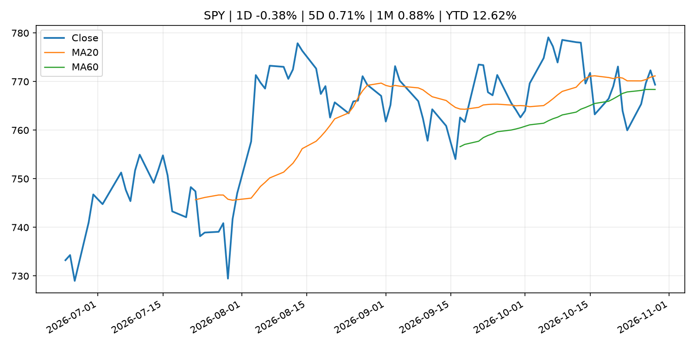
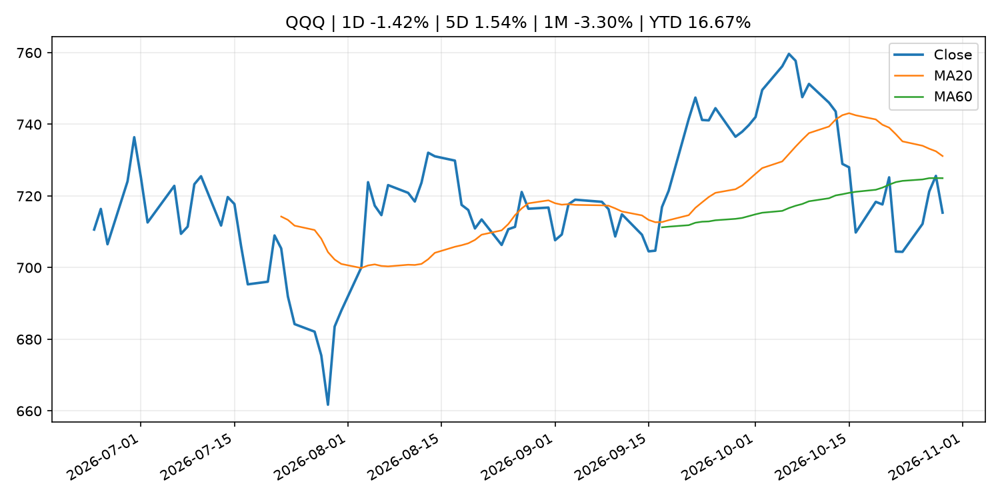
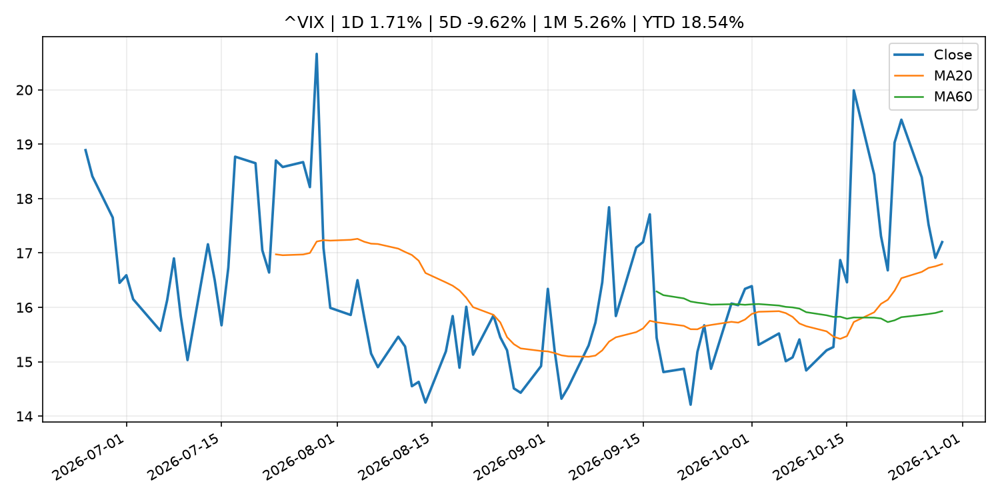
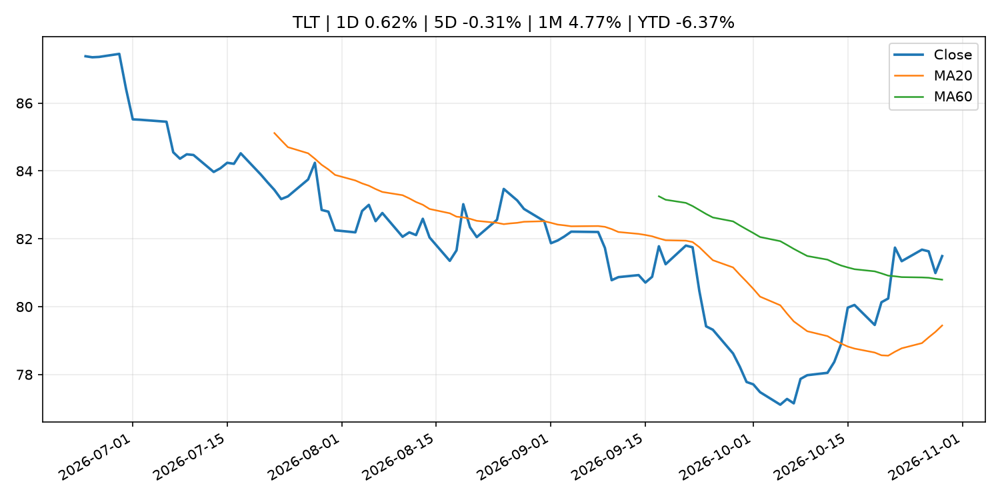
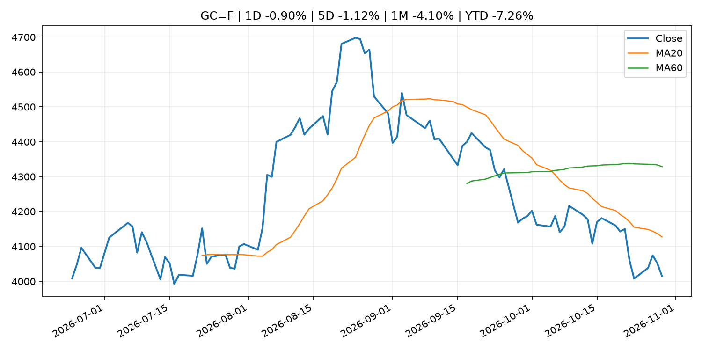
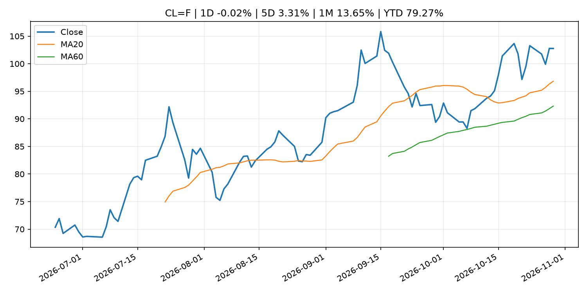
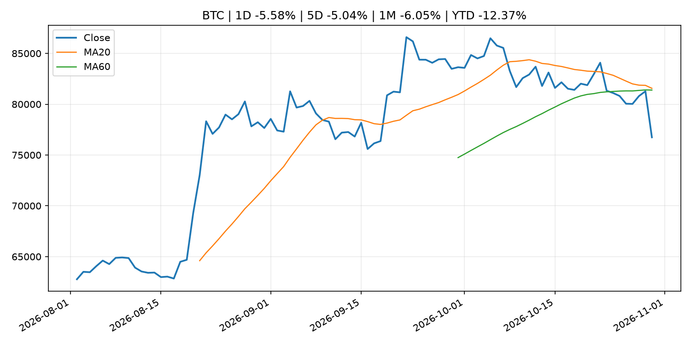
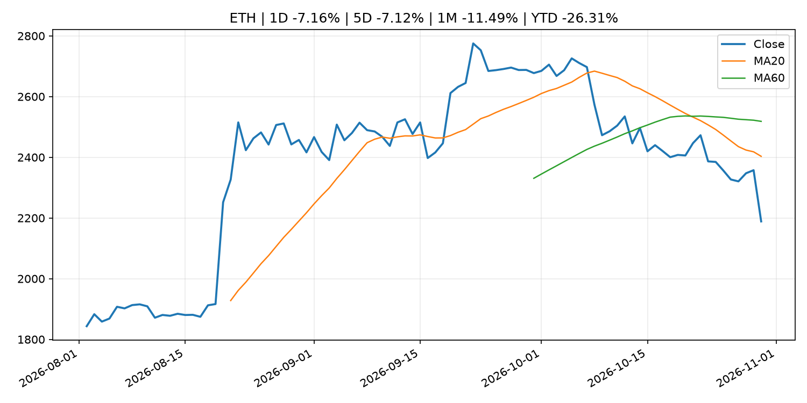
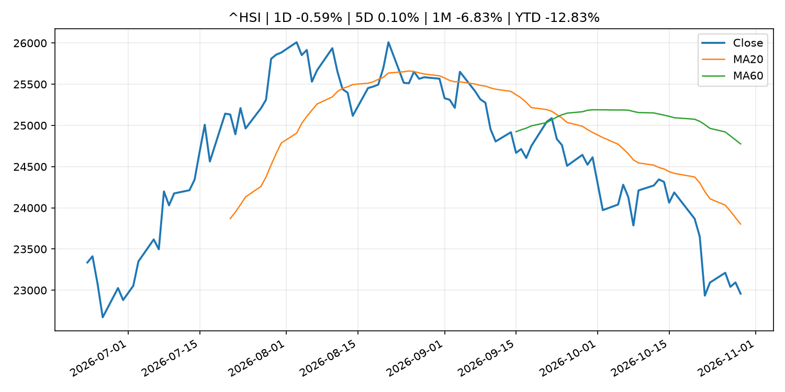

# Global Macro Morning Briefing - 2026-10-30

> Not financial advice / 非投资建议。

## 0. 今日总览
- 市场状态：unknown。市场信号不足，暂不判断明确状态。
- 今日三大主线：
  1. fiscal_policy: U.S. sanctions Russian nationals for laundering millions in crypto for North Korean IT workers
  2. earnings: Amazon’s stock drops — even in the face of a bold new cloud forecast
  3. regulation: Two Entities Charged in $130 Million Fraud Scheme That Used False SEC Filings to Boost Investor Confidence
- 一句话结论：今日晨报重点关注：财政和贸易政策会影响增长、通胀、企业利润和跨境资本流。；大型科技股盈利和资本开支会影响纳指、半导体和 AI 交易主线。。跨资产方面，SPY 1D -0.38%；QQQ 1D -1.42%；^VIX 1D 1.71%；TLT 1D 0.62%；GC=F 1D -0.90%；CL=F 1D -0.02%；BTC 1D -5.58%；ETH 1D -7.16%；市场信号不足，暂不判断明确状态。政策、通胀、利率、美元、美债、能源和加密监管仍是主要观察线索。所有结论仅基于公开数据与短摘要整理，不构成投资建议。

## 1. 隔夜跨资产市场
- 美股：SPY 1D -0.38%，QQQ 1D -1.42%，整体趋势需结合 VIX 和利率确认。
- 美债/美元：TLT 1D 0.62%，美元指数 1D -0.55%，是判断折现率压力的核心线索。
- 黄金/原油：黄金 1D -0.90%，原油 1D -0.02%，用于观察避险、通胀和地缘风险。
- 加密：BTC 1D -5.58%，ETH 1D -7.16%，关注是否独立于纳指走出加密自身行情。
- 港股/A股：恒生 1D -0.59%，沪深300/上证 1D n/a，重点看中国政策预期与人民币线索。
- 风险观察：关注后续数据是否确认当前跨资产信号。

### US_EQUITY

| symbol | latest close | 1D | 5D | 1M | YTD | trend |
|---|---:|---:|---:|---:|---:|---|
| SPY | 769.36 | -0.38% | 0.71% | 0.88% | 12.62% | range_bound |
| QQQ | 715.34 | -1.42% | 1.54% | -3.30% | 16.67% | range_bound |
| DIA | 522.73 | -0.37% | -0.98% | 2.79% | 8.08% | range_bound |
| IWM | 284.01 | 0.97% | 2.65% | 2.20% | 14.16% | range_bound |
| VTI | 378.24 | -0.25% | 0.89% | 1.07% | 12.47% | range_bound |

### US_MACRO_MARKET

| symbol | latest close | 1D | 5D | 1M | YTD | trend |
|---|---:|---:|---:|---:|---:|---|
| ^VIX | 17.20 | 1.71% | -9.62% | 5.26% | 18.54% | strong_uptrend |
| DX-Y.NYB | 101.63 | -0.55% | 0.02% | 0.17% | 3.26% | range_bound |
| TLT | 81.49 | 0.62% | -0.31% | 4.77% | -6.37% | range_bound |
| IEF | 91.25 | 0.44% | 0.05% | 2.17% | -5.03% | range_bound |

### COMMODITIES

| symbol | latest close | 1D | 5D | 1M | YTD | trend |
|---|---:|---:|---:|---:|---:|---|
| GC=F | 4,015.10 | -0.90% | -1.12% | -4.10% | -7.26% | strong_downtrend |
| SI=F | 51.45 | -3.75% | -6.05% | -14.39% | -27.08% | strong_downtrend |
| CL=F | 102.76 | -0.02% | 3.31% | 13.65% | 79.27% | strong_uptrend |
| BZ=F | 111.57 | -3.25% | -1.41% | 7.77% | 83.65% | strong_uptrend |
| NG=F | 2.90 | 2.88% | 3.65% | -4.23% | -19.90% | range_bound |
| HG=F | 6.55 | -1.34% | 2.99% | -0.10% | 16.18% | downtrend |

### HK_MARKET

| symbol | latest close | 1D | 5D | 1M | YTD | trend |
|---|---:|---:|---:|---:|---:|---|
| ^HSI | 22,958.65 | -0.59% | 0.10% | -6.83% | -12.83% | strong_downtrend |
| 0700.HK | 377.60 | -2.58% | -1.26% | -14.14% | -39.39% | strong_downtrend |
| 9988.HK | 96.10 | -2.83% | -1.28% | -10.77% | -35.50% | strong_downtrend |
| 3690.HK | 69.20 | -2.81% | -2.95% | -3.76% | -33.84% | downtrend |
| 1810.HK | 25.68 | 0.23% | -0.47% | -0.70% | -36.25% | range_bound |
| 1211.HK | 68.65 | -2.55% | 1.85% | -11.65% | -30.48% | strong_downtrend |

### CRYPTO

| symbol | latest close | 1D | 5D | 1M | YTD | trend |
|---|---:|---:|---:|---:|---:|---|
| BTC | 76,740.65 | -5.58% | -5.04% | -6.05% | -12.37% | range_bound |
| ETH | 2,188.71 | -7.16% | -7.12% | -11.49% | -26.31% | strong_downtrend |
| SOLANA | 93.43 | -8.68% | -8.64% | -14.68% | -24.97% | strong_downtrend |
| BINANCECOIN | 693.19 | -8.68% | -6.20% | -5.74% | -19.65% | strong_downtrend |
| RIPPLE | 1.20 | -9.20% | -7.36% | -12.79% | -34.65% | strong_downtrend |

## 2. 今日最重要的 10 条新闻
### 1. U.S. sanctions Russian nationals for laundering millions in crypto for North Korean IT workers
- 来源：CoinDesk
- 时间：2026-10-29T12:18:20+00:00
- 地区：global
- 事件类型：fiscal_policy
- 重要性层级：Tier 1
- 一句话摘要：U.S. sanctions Russian nationals for laundering millions in crypto for North Korean IT workers
- 为什么重要：财政和贸易政策会影响增长、通胀、企业利润和跨境资本流。
- 可能影响：可能影响利率、汇率、风险资产或大宗商品预期，但当前公开信息不足以判断明确方向。
  - 资产：暂无明确资产映射
  - 方向：unknown
  - 强度：low
  - 原因：公开信息不足以判断方向。
- 原文链接：[https://www.coindesk.com/business/2026/10/29/u-s-sanctions-russian-crypto-middlemen-tied-to-north-korean-it-worker-fraud](https://www.coindesk.com/business/2026/10/29/u-s-sanctions-russian-crypto-middlemen-tied-to-north-korean-it-worker-fraud)

### 2. Amazon’s stock drops — even in the face of a bold new cloud forecast
- 来源：MarketWatch Top Stories
- 时间：2026-10-30T00:15:00+00:00
- 地区：US
- 事件类型：earnings
- 重要性层级：Tier 2
- 一句话摘要：Modest AWS results and weak advertising growth left Wall Street disappointed in Amazon’s third-quarter earnings
- 为什么重要：大型科技股盈利和资本开支会影响纳指、半导体和 AI 交易主线。
- 可能影响：主要影响 QQQ，方向为 mixed，强度 high；AI 资本开支会影响大型科技股盈利和估值预期。
  - 资产：QQQ
    方向：mixed
    强度：high
    原因：AI 资本开支会影响大型科技股盈利和估值预期。
  - 资产：SMH
    方向：mixed
    强度：high
    原因：AI 投资周期直接影响半导体需求。
  - 资产：NVDA
    方向：mixed
    强度：high
    原因：AI 训练和推理需求是英伟达收入预期核心变量。
  - 资产：MSFT
    方向：mixed
    强度：medium
    原因：云和 AI 资本开支影响利润率与增长叙事。
  - 资产：GOOGL
    方向：mixed
    强度：medium
    原因：AI 投资和搜索商业化影响估值。
  - 资产：META
    方向：mixed
    强度：medium
    原因：AI 基建支出与广告效率共同影响市场预期。
- 原文链接：[https://www.marketwatch.com/story/amazons-bold-cloud-forecast-isnt-enough-to-stave-off-a-stock-drop-ee23c1bb?mod=mw_rss_topstories](https://www.marketwatch.com/story/amazons-bold-cloud-forecast-isnt-enough-to-stave-off-a-stock-drop-ee23c1bb?mod=mw_rss_topstories)

### 3. Two Entities Charged in $130 Million Fraud Scheme That Used False SEC Filings to Boost Investor Confidence
- 来源：SEC Press Releases
- 时间：2026-10-29T12:42:37-04:00
- 地区：US
- 事件类型：regulation
- 重要性层级：Tier 2
- 一句话摘要：The Securities and Exchange Commission today charged two foreign-operated, Colorado-incorporated entities, BG Wealth Sharing Ltd and DSJ Exchange Pty Ltd, for orchestrating a fraud scheme that used false SEC filings to boost confidence in their…
- 为什么重要：监管变化会改变行业盈利预期和资产风险溢价。
- 可能影响：主要影响 BTC，方向为 mixed，强度 high；加密监管或 ETF 进展会改变 BTC 的资金流和风险溢价。
  - 资产：BTC
    方向：mixed
    强度：high
    原因：加密监管或 ETF 进展会改变 BTC 的资金流和风险溢价。
  - 资产：ETH
    方向：mixed
    强度：high
    原因：监管框架会影响 ETH 产品化和机构参与度。
  - 资产：COIN
    方向：mixed
    强度：medium
    原因：监管清晰度和执法风险会影响交易平台估值。
  - 资产：crypto market
    方向：mixed
    强度：high
    原因：信息影响整个加密市场结构，但方向取决于细节。
- 原文链接：[https://www.sec.gov/newsroom/press-releases/2026-110-two-entities-charged-130-million-fraud-scheme-used-false-sec-filings-boost-investor-confidence](https://www.sec.gov/newsroom/press-releases/2026-110-two-entities-charged-130-million-fraud-scheme-used-false-sec-filings-boost-investor-confidence)

### 4. From rivals to partners: Polygon and Solana team to bring stablecoin payments to banks
- 来源：CoinDesk
- 时间：2026-10-29T16:35:43+00:00
- 地区：global
- 事件类型：crypto_market_structure
- 重要性层级：Tier 2
- 一句话摘要：From rivals to partners: Polygon and Solana team to bring stablecoin payments to banks
- 为什么重要：加密市场结构和监管变化会影响 BTC、ETH 及相关股票的风险溢价。
- 可能影响：主要影响 BTC，方向为 mixed，强度 high；加密监管或 ETF 进展会改变 BTC 的资金流和风险溢价。
  - 资产：BTC
    方向：mixed
    强度：high
    原因：加密监管或 ETF 进展会改变 BTC 的资金流和风险溢价。
  - 资产：ETH
    方向：mixed
    强度：high
    原因：监管框架会影响 ETH 产品化和机构参与度。
  - 资产：COIN
    方向：mixed
    强度：medium
    原因：监管清晰度和执法风险会影响交易平台估值。
  - 资产：crypto market
    方向：mixed
    强度：high
    原因：信息影响整个加密市场结构，但方向取决于细节。
- 原文链接：[https://www.coindesk.com/business/2026/10/29/from-rivals-to-partners-polygon-and-solana-team-to-bring-stablecoin-payments-to-banks](https://www.coindesk.com/business/2026/10/29/from-rivals-to-partners-polygon-and-solana-team-to-bring-stablecoin-payments-to-banks)

### 5. Tokenized stock venue on Canton could beat OKX–ICE to first trade under SEC framework
- 来源：CoinDesk
- 时间：2026-10-29T12:51:48+00:00
- 地区：global
- 事件类型：regulation
- 重要性层级：Tier 2
- 一句话摘要：Tokenized stock venue on Canton could beat OKX–ICE to first trade under SEC framework
- 为什么重要：监管变化会改变行业盈利预期和资产风险溢价。
- 可能影响：主要影响 BTC，方向为 mixed，强度 high；加密监管或 ETF 进展会改变 BTC 的资金流和风险溢价。
  - 资产：BTC
    方向：mixed
    强度：high
    原因：加密监管或 ETF 进展会改变 BTC 的资金流和风险溢价。
  - 资产：ETH
    方向：mixed
    强度：high
    原因：监管框架会影响 ETH 产品化和机构参与度。
  - 资产：COIN
    方向：mixed
    强度：medium
    原因：监管清晰度和执法风险会影响交易平台估值。
  - 资产：crypto market
    方向：mixed
    强度：high
    原因：信息影响整个加密市场结构，但方向取决于细节。
- 原文链接：[https://www.coindesk.com/business/2026/10/29/tokenized-stock-venue-on-canton-could-beat-okx-ice-to-first-trade-under-sec-framework](https://www.coindesk.com/business/2026/10/29/tokenized-stock-venue-on-canton-could-beat-okx-ice-to-first-trade-under-sec-framework)

### 6. Former Swift CEO joins stablecoin firm OpenTrade as chairman
- 来源：CoinDesk
- 时间：2026-10-29T09:00:00+00:00
- 地区：global
- 事件类型：crypto_market_structure
- 重要性层级：Tier 2
- 一句话摘要：Former Swift CEO joins stablecoin firm OpenTrade as chairman
- 为什么重要：加密市场结构和监管变化会影响 BTC、ETH 及相关股票的风险溢价。
- 可能影响：主要影响 BTC，方向为 mixed，强度 high；加密监管或 ETF 进展会改变 BTC 的资金流和风险溢价。
  - 资产：BTC
    方向：mixed
    强度：high
    原因：加密监管或 ETF 进展会改变 BTC 的资金流和风险溢价。
  - 资产：ETH
    方向：mixed
    强度：high
    原因：监管框架会影响 ETH 产品化和机构参与度。
  - 资产：COIN
    方向：mixed
    强度：medium
    原因：监管清晰度和执法风险会影响交易平台估值。
  - 资产：crypto market
    方向：mixed
    强度：high
    原因：信息影响整个加密市场结构，但方向取决于细节。
- 原文链接：[https://www.coindesk.com/business/2026/10/29/former-swift-ceo-joins-stablecoin-firm-opentrade-as-chairman-after-a-usd17-million-raise](https://www.coindesk.com/business/2026/10/29/former-swift-ceo-joins-stablecoin-firm-opentrade-as-chairman-after-a-usd17-million-raise)

### 7. ECB President Lagarde to step down on 7 February 2027
- 来源：ECB Press Releases
- 时间：2026-10-29T11:00:00+01:00
- 地区：EU
- 事件类型：central_bank_speech
- 重要性层级：Tier 2
- 一句话摘要：ECB President Lagarde to step down on 7 February 2027
- 为什么重要：央行官员表态可能影响市场对下一次会议的定价。
- 可能影响：可能影响利率、汇率、风险资产或大宗商品预期，但当前公开信息不足以判断明确方向。
  - 资产：暂无明确资产映射
  - 方向：unknown
  - 强度：low
  - 原因：公开信息不足以判断方向。
- 原文链接：[https://www.ecb.europa.eu//press/pr/date/2026/html/ecb.pr261029~abbb6dc64b.en.html](https://www.ecb.europa.eu//press/pr/date/2026/html/ecb.pr261029~abbb6dc64b.en.html)

### 8. Bitcoin drops to $80,000 on Fed dissent, Samsung, Alphabet earnings; AI tokens slump
- 来源：CoinDesk
- 时间：2026-10-29T11:11:48+00:00
- 地区：global
- 事件类型：earnings
- 重要性层级：Tier 2
- 一句话摘要：Bitcoin drops to $80,000 on Fed dissent, Samsung, Alphabet earnings; AI tokens slump
- 为什么重要：大型科技股盈利和资本开支会影响纳指、半导体和 AI 交易主线。
- 可能影响：可能影响利率、汇率、风险资产或大宗商品预期，但当前公开信息不足以判断明确方向。
  - 资产：暂无明确资产映射
  - 方向：unknown
  - 强度：low
  - 原因：公开信息不足以判断方向。
- 原文链接：[https://www.coindesk.com/markets/2026/10/29/bitcoin-drops-to-usd80-000-on-fed-dissent-samsung-alphabet-earnings-ai-tokens-slump](https://www.coindesk.com/markets/2026/10/29/bitcoin-drops-to-usd80-000-on-fed-dissent-samsung-alphabet-earnings-ai-tokens-slump)

### 9. Our church has a $1.5 million bequest earning 3.75% in a bank account. Is inflation eroding it?
- 来源：MarketWatch Top Stories
- 时间：2026-10-30T00:05:00+00:00
- 地区：US
- 事件类型：other
- 重要性层级：Tier 3
- 一句话摘要：“Given the size and long-term nature of this gift, we want to make sure the funds are managed prudently.”
- 为什么重要：这条信息暂未匹配到重大宏观、政策或市场事件，更适合作为背景跟踪。
- 可能影响：主要影响 DXY，方向为 positive，强度 high；通胀压力可能推高政策利率预期并支撑美元。
  - 资产：DXY
    方向：positive
    强度：high
    原因：通胀压力可能推高政策利率预期并支撑美元。
  - 资产：TLT
    方向：negative
    强度：high
    原因：通胀上行通常推升收益率、压低长债价格。
  - 资产：QQQ
    方向：negative
    强度：high
    原因：更高利率对成长股估值折现率不利。
  - 资产：SPY
    方向：mixed
    强度：medium
    原因：名义增长可能支撑收入，但更高利率压制估值。
  - 资产：GC=F
    方向：mixed
    强度：medium
    原因：通胀对黄金是支撑，但实际利率上行会形成压力。
  - 资产：BTC
    方向：mixed
    强度：medium
    原因：抗通胀叙事和流动性收紧可能相互抵消。
- 原文链接：[https://www.marketwatch.com/story/there-may-be-better-investment-options-my-church-received-1-5-million-from-a-parishioner-is-3-75-interest-enough-5164d790?mod=mw_rss_topstories](https://www.marketwatch.com/story/there-may-be-better-investment-options-my-church-received-1-5-million-from-a-parishioner-is-3-75-interest-enough-5164d790?mod=mw_rss_topstories)

### 10. Is it curtains for COLA? Saving Social Security could mean changing the cost-of-living adjustment.
- 来源：MarketWatch Top Stories
- 时间：2026-10-29T21:52:00+00:00
- 地区：US
- 事件类型：other
- 重要性层级：Tier 3
- 一句话摘要：Several proposals consider changing the way retirees receive inflation protection. Here’s what it could cost you.
- 为什么重要：这条信息暂未匹配到重大宏观、政策或市场事件，更适合作为背景跟踪。
- 可能影响：主要影响 DXY，方向为 positive，强度 high；通胀压力可能推高政策利率预期并支撑美元。
  - 资产：DXY
    方向：positive
    强度：high
    原因：通胀压力可能推高政策利率预期并支撑美元。
  - 资产：TLT
    方向：negative
    强度：high
    原因：通胀上行通常推升收益率、压低长债价格。
  - 资产：QQQ
    方向：negative
    强度：high
    原因：更高利率对成长股估值折现率不利。
  - 资产：SPY
    方向：mixed
    强度：medium
    原因：名义增长可能支撑收入，但更高利率压制估值。
  - 资产：GC=F
    方向：mixed
    强度：medium
    原因：通胀对黄金是支撑，但实际利率上行会形成压力。
  - 资产：BTC
    方向：mixed
    强度：medium
    原因：抗通胀叙事和流动性收紧可能相互抵消。
- 原文链接：[https://www.marketwatch.com/story/is-it-curtains-for-cola-saving-social-security-could-mean-changing-the-cost-of-living-adjustment-867c6bd8?mod=mw_rss_topstories](https://www.marketwatch.com/story/is-it-curtains-for-cola-saving-social-security-could-mean-changing-the-cost-of-living-adjustment-867c6bd8?mod=mw_rss_topstories)

## 3. 政策与央行观察
### 1. U.S. sanctions Russian nationals for laundering millions in crypto for North Korean IT workers
- 来源：CoinDesk
- 时间：2026-10-29T12:18:20+00:00
- 地区：global
- 事件类型：fiscal_policy
- 重要性层级：Tier 1
- 一句话摘要：U.S. sanctions Russian nationals for laundering millions in crypto for North Korean IT workers
- 为什么重要：财政和贸易政策会影响增长、通胀、企业利润和跨境资本流。
- 可能影响：可能影响利率、汇率、风险资产或大宗商品预期，但当前公开信息不足以判断明确方向。
  - 资产：暂无明确资产映射
  - 方向：unknown
  - 强度：low
  - 原因：公开信息不足以判断方向。
- 原文链接：[https://www.coindesk.com/business/2026/10/29/u-s-sanctions-russian-crypto-middlemen-tied-to-north-korean-it-worker-fraud](https://www.coindesk.com/business/2026/10/29/u-s-sanctions-russian-crypto-middlemen-tied-to-north-korean-it-worker-fraud)

### 2. Two Entities Charged in $130 Million Fraud Scheme That Used False SEC Filings to Boost Investor Confidence
- 来源：SEC Press Releases
- 时间：2026-10-29T12:42:37-04:00
- 地区：US
- 事件类型：regulation
- 重要性层级：Tier 2
- 一句话摘要：The Securities and Exchange Commission today charged two foreign-operated, Colorado-incorporated entities, BG Wealth Sharing Ltd and DSJ Exchange Pty Ltd, for orchestrating a fraud scheme that used false SEC filings to boost confidence in their…
- 为什么重要：监管变化会改变行业盈利预期和资产风险溢价。
- 可能影响：主要影响 BTC，方向为 mixed，强度 high；加密监管或 ETF 进展会改变 BTC 的资金流和风险溢价。
  - 资产：BTC
    方向：mixed
    强度：high
    原因：加密监管或 ETF 进展会改变 BTC 的资金流和风险溢价。
  - 资产：ETH
    方向：mixed
    强度：high
    原因：监管框架会影响 ETH 产品化和机构参与度。
  - 资产：COIN
    方向：mixed
    强度：medium
    原因：监管清晰度和执法风险会影响交易平台估值。
  - 资产：crypto market
    方向：mixed
    强度：high
    原因：信息影响整个加密市场结构，但方向取决于细节。
- 原文链接：[https://www.sec.gov/newsroom/press-releases/2026-110-two-entities-charged-130-million-fraud-scheme-used-false-sec-filings-boost-investor-confidence](https://www.sec.gov/newsroom/press-releases/2026-110-two-entities-charged-130-million-fraud-scheme-used-false-sec-filings-boost-investor-confidence)

### 3. From rivals to partners: Polygon and Solana team to bring stablecoin payments to banks
- 来源：CoinDesk
- 时间：2026-10-29T16:35:43+00:00
- 地区：global
- 事件类型：crypto_market_structure
- 重要性层级：Tier 2
- 一句话摘要：From rivals to partners: Polygon and Solana team to bring stablecoin payments to banks
- 为什么重要：加密市场结构和监管变化会影响 BTC、ETH 及相关股票的风险溢价。
- 可能影响：主要影响 BTC，方向为 mixed，强度 high；加密监管或 ETF 进展会改变 BTC 的资金流和风险溢价。
  - 资产：BTC
    方向：mixed
    强度：high
    原因：加密监管或 ETF 进展会改变 BTC 的资金流和风险溢价。
  - 资产：ETH
    方向：mixed
    强度：high
    原因：监管框架会影响 ETH 产品化和机构参与度。
  - 资产：COIN
    方向：mixed
    强度：medium
    原因：监管清晰度和执法风险会影响交易平台估值。
  - 资产：crypto market
    方向：mixed
    强度：high
    原因：信息影响整个加密市场结构，但方向取决于细节。
- 原文链接：[https://www.coindesk.com/business/2026/10/29/from-rivals-to-partners-polygon-and-solana-team-to-bring-stablecoin-payments-to-banks](https://www.coindesk.com/business/2026/10/29/from-rivals-to-partners-polygon-and-solana-team-to-bring-stablecoin-payments-to-banks)

### 4. Tokenized stock venue on Canton could beat OKX–ICE to first trade under SEC framework
- 来源：CoinDesk
- 时间：2026-10-29T12:51:48+00:00
- 地区：global
- 事件类型：regulation
- 重要性层级：Tier 2
- 一句话摘要：Tokenized stock venue on Canton could beat OKX–ICE to first trade under SEC framework
- 为什么重要：监管变化会改变行业盈利预期和资产风险溢价。
- 可能影响：主要影响 BTC，方向为 mixed，强度 high；加密监管或 ETF 进展会改变 BTC 的资金流和风险溢价。
  - 资产：BTC
    方向：mixed
    强度：high
    原因：加密监管或 ETF 进展会改变 BTC 的资金流和风险溢价。
  - 资产：ETH
    方向：mixed
    强度：high
    原因：监管框架会影响 ETH 产品化和机构参与度。
  - 资产：COIN
    方向：mixed
    强度：medium
    原因：监管清晰度和执法风险会影响交易平台估值。
  - 资产：crypto market
    方向：mixed
    强度：high
    原因：信息影响整个加密市场结构，但方向取决于细节。
- 原文链接：[https://www.coindesk.com/business/2026/10/29/tokenized-stock-venue-on-canton-could-beat-okx-ice-to-first-trade-under-sec-framework](https://www.coindesk.com/business/2026/10/29/tokenized-stock-venue-on-canton-could-beat-okx-ice-to-first-trade-under-sec-framework)

### 5. Former Swift CEO joins stablecoin firm OpenTrade as chairman
- 来源：CoinDesk
- 时间：2026-10-29T09:00:00+00:00
- 地区：global
- 事件类型：crypto_market_structure
- 重要性层级：Tier 2
- 一句话摘要：Former Swift CEO joins stablecoin firm OpenTrade as chairman
- 为什么重要：加密市场结构和监管变化会影响 BTC、ETH 及相关股票的风险溢价。
- 可能影响：主要影响 BTC，方向为 mixed，强度 high；加密监管或 ETF 进展会改变 BTC 的资金流和风险溢价。
  - 资产：BTC
    方向：mixed
    强度：high
    原因：加密监管或 ETF 进展会改变 BTC 的资金流和风险溢价。
  - 资产：ETH
    方向：mixed
    强度：high
    原因：监管框架会影响 ETH 产品化和机构参与度。
  - 资产：COIN
    方向：mixed
    强度：medium
    原因：监管清晰度和执法风险会影响交易平台估值。
  - 资产：crypto market
    方向：mixed
    强度：high
    原因：信息影响整个加密市场结构，但方向取决于细节。
- 原文链接：[https://www.coindesk.com/business/2026/10/29/former-swift-ceo-joins-stablecoin-firm-opentrade-as-chairman-after-a-usd17-million-raise](https://www.coindesk.com/business/2026/10/29/former-swift-ceo-joins-stablecoin-firm-opentrade-as-chairman-after-a-usd17-million-raise)

### 6. ECB President Lagarde to step down on 7 February 2027
- 来源：ECB Press Releases
- 时间：2026-10-29T11:00:00+01:00
- 地区：EU
- 事件类型：central_bank_speech
- 重要性层级：Tier 2
- 一句话摘要：ECB President Lagarde to step down on 7 February 2027
- 为什么重要：央行官员表态可能影响市场对下一次会议的定价。
- 可能影响：可能影响利率、汇率、风险资产或大宗商品预期，但当前公开信息不足以判断明确方向。
  - 资产：暂无明确资产映射
  - 方向：unknown
  - 强度：low
  - 原因：公开信息不足以判断方向。
- 原文链接：[https://www.ecb.europa.eu//press/pr/date/2026/html/ecb.pr261029~abbb6dc64b.en.html](https://www.ecb.europa.eu//press/pr/date/2026/html/ecb.pr261029~abbb6dc64b.en.html)

## 4. 市场异动与图表
- QQQ 下跌 -1.42%
- TLT 上涨 0.62%
- DXY 下跌 -0.55%
- Gold 下跌 -0.90%
- BTC 下跌 -5.58%
- ETH 下跌 -7.16%

### SPY

### QQQ

### ^VIX

### TLT

### GC=F

### CL=F

### BTC

### ETH

### ^HSI

## 5. 华尔街与机构公开观点
- 暂无可靠公开观点。

## 6. 今日重点关注
- 经济数据：经济数据：暂无可靠公开日历数据；如配置经济日历源后可自动填充。
- 央行讲话：央行讲话：暂无可靠公开日历数据；重点跟踪 Fed、ECB、BoJ、PBOC 官网 RSS。
- 财报：财报：暂无可靠数据。
- 政策事件：政策事件：暂无可靠数据。
- 风险提醒：风险提醒：关注数据源失败项、突发地缘风险、利率和美元的二阶反应。

## 7. 英文金融表达与宏观概念
- **inflation expectations**：通胀预期，指家庭、企业或市场对未来通胀的预估。 例句：Inflation expectations can shape wage bargaining and bond yields.
- **real yield**：实际收益率，名义利率扣除通胀预期后的收益率。 例句：Gold often reacts more to real yields than nominal yields.
- **risk-off**：避险模式，资金偏向美元、国债、黄金等防御资产。 例句：A geopolitical shock can push markets into risk-off mode.
- **market structure**：市场结构，指交易、托管、清算、ETF、监管等制度安排。 例句：Crypto market structure rules can affect institutional participation.
- **terminal rate**：终端利率，市场预期本轮加息周期的最高政策利率。 例句：A higher terminal rate can pressure growth stocks.
- **soft landing**：软着陆，指通胀回落而经济避免明显衰退。 例句：Markets often rally when data support a soft landing.

## 8. 背景材料
- [Our church has a $1.5 million bequest earning 3.75% in a bank account. Is inflation eroding it?](https://www.marketwatch.com/story/there-may-be-better-investment-options-my-church-received-1-5-million-from-a-parishioner-is-3-75-interest-enough-5164d790?mod=mw_rss_topstories)（MarketWatch Top Stories，other）：“Given the size and long-term nature of this gift, we want to make sure the funds are managed prudently.”
- [The midterms are crucial to the future of Social Security — no matter how old you are](https://www.marketwatch.com/story/the-midterms-are-crucial-to-the-future-of-social-security-no-matter-how-old-you-are-0f080a9c?mod=mw_rss_topstories)（MarketWatch Top Stories，other）：The program is expected to run out of money in the next six years, which is the same amount of time as a senator’s term.
- [Is it curtains for COLA? Saving Social Security could mean changing the cost-of-living adjustment.](https://www.marketwatch.com/story/is-it-curtains-for-cola-saving-social-security-could-mean-changing-the-cost-of-living-adjustment-867c6bd8?mod=mw_rss_topstories)（MarketWatch Top Stories，other）：Several proposals consider changing the way retirees receive inflation protection. Here’s what it could cost you.
- [Piero Cipollone: Next-day securities settlement, tokenisation and the transformation of Europe’s financial infrastructure](https://www.ecb.europa.eu//press/key/date/2026/html/ecb.sp261029~e9b57c3495.en.html)（ECB Press Releases，other）：Piero Cipollone: Next-day securities settlement, tokenisation and the transformation of Europe’s financial infrastructure
- [Crypto for Advisors: Only 1 in 5 Americans say the financial system is secure](https://www.coindesk.com/coindesk-indices/2026/10/29/crypto-for-advisors-only-1-in-5-americans-say-the-financial-system-is-secure)（CoinDesk，other）：Crypto for Advisors: Only 1 in 5 Americans say the financial system is secure
- [Why Switzerland’s first genuine spot bitcoin ETF could soon attract overseas banks and brokers](https://www.coindesk.com/business/2026/10/29/switzerland-s-first-bitcoin-etf-gets-rare-exemption-will-open-to-overseas-brokers)（CoinDesk，other）：Why Switzerland’s first genuine spot bitcoin ETF could soon attract overseas banks and brokers
- [Christine Lagarde, Boris Vujčić: Monetary policy statement (with Q&A)](https://www.ecb.europa.eu//press/press_conference/monetary-policy-statement/2026/html/ecb.is261029~5c5ffe99e5.en.html)（ECB Press Releases，other）：Christine Lagarde, Boris Vujčić: Monetary policy statement (with Q&A)
- [New quantum model slashes hardware needed to break bitcoin keys by 17 times](https://www.coindesk.com/tech/2026/10/29/new-quantum-model-slashes-hardware-needed-to-break-bitcoin-keys-by-17-times)（CoinDesk，other）：New quantum model slashes hardware needed to break bitcoin keys by 17 times
- [Monetary policy decisions](https://www.ecb.europa.eu//press/pr/date/2026/html/ecb.mp261029~9a493adf17.en.html)（ECB Press Releases，other）：Monetary policy decisions
- [As $10 billion in bitcoin options near expiry, the tell is in the pricing](https://www.coindesk.com/daybook-us/2026/10/29/as-usd10-billion-in-bitcoin-options-near-expiry-the-tell-is-in-the-pricing)（CoinDesk，other）：As $10 billion in bitcoin options near expiry, the tell is in the pricing
- [Live updates: Binance confirms security breach, says 'will cover all hacking losses'](https://www.coindesk.com/business/2026/10/29/live-updates-bitcoin-clings-to-usd80-000-as-strategy-s-cushion-thins-before-earnings)（CoinDesk，other）：Live updates: Binance confirms security breach, says 'will cover all hacking losses'
- [Thai Supreme Court rules bitcoin is property after thief challenges conviction](https://www.coindesk.com/policy/2026/10/29/thai-supreme-court-rules-bitcoin-is-property-after-thief-challenges-conviction)（CoinDesk，other）：Thai Supreme Court rules bitcoin is property after thief challenges conviction

## 9. 数据源、失败项与免责声明
- 采集时间：2026-10-30T01:34:13
- 数据源：公开 RSS、Yahoo Finance、CoinGecko、AKShare、FRED、SEC data.sec.gov，以及用户自有 inputs/reports 文件。
- 合规说明：不绕过 WSJ、Bloomberg、FT、Reuters 等付费墙；对付费媒体只使用公开 RSS 标题、摘要、链接和发布时间。
- 免责声明：Not financial advice / 非投资建议。本项目仅供个人学习、研究和信息整理，不构成投资建议、交易建议或任何收益承诺。
- 失败或跳过的数据源：
  - crypto data failed coin=dogecoin
  - China market data failed symbol=上证指数: empty dataframe
  - China market data failed symbol=深证成指: empty dataframe
  - China market data failed symbol=创业板指: empty dataframe
  - China market data failed symbol=沪深300: empty dataframe
  - China market data failed symbol=中证500: empty dataframe
  - China market data failed symbol=科创50: empty dataframe
  - FRED_API_KEY not set; skipping FRED macro series
  - SEC failed cik=0000320193
  - SEC failed cik=0000789019
  - SEC failed cik=0001045810
  - SEC failed cik=0001318605
  - SEC failed cik=0001577552
