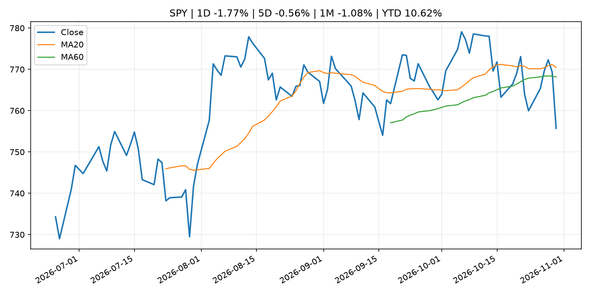
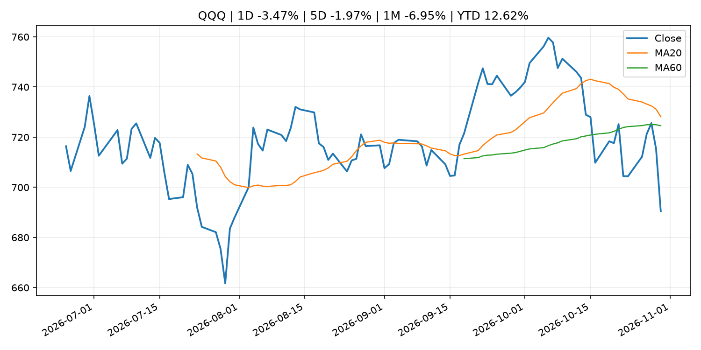
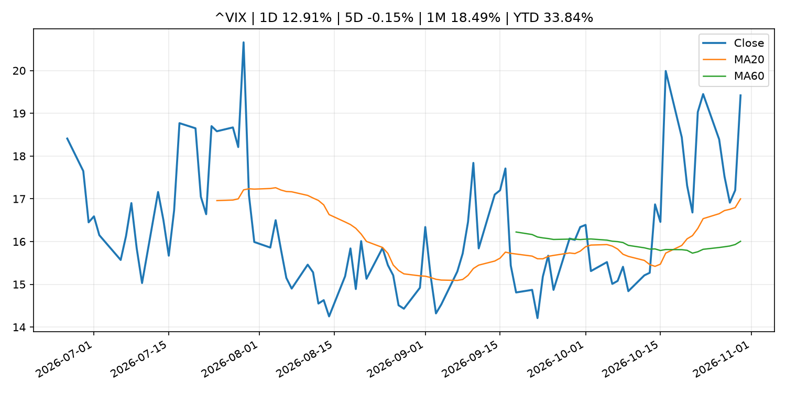
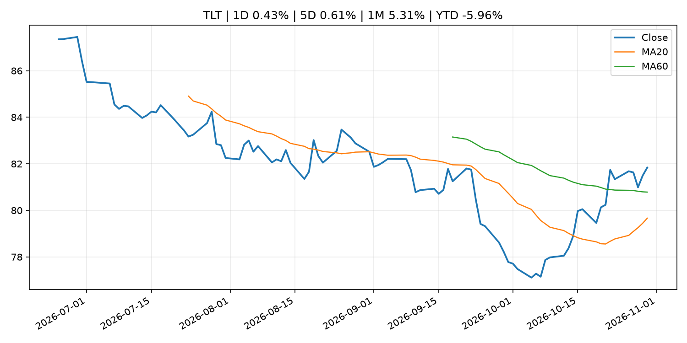
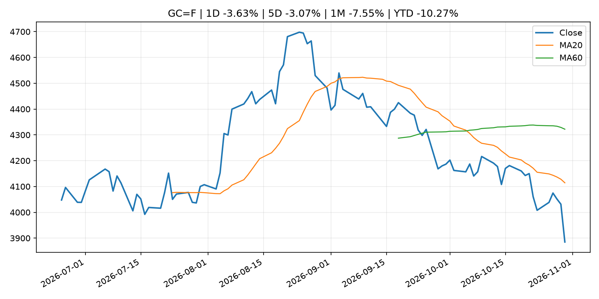
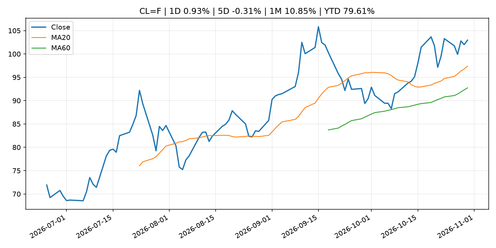
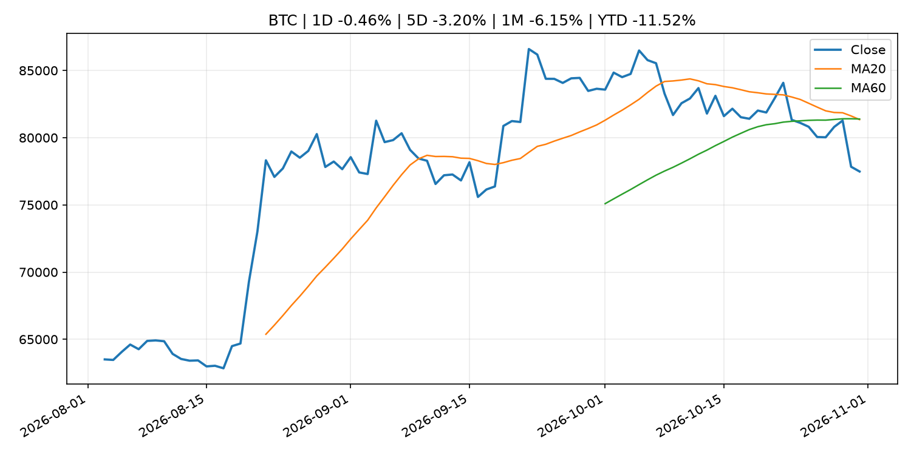
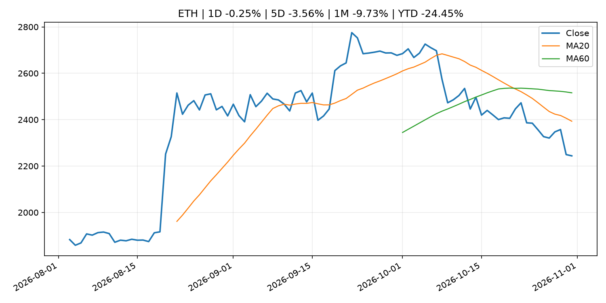
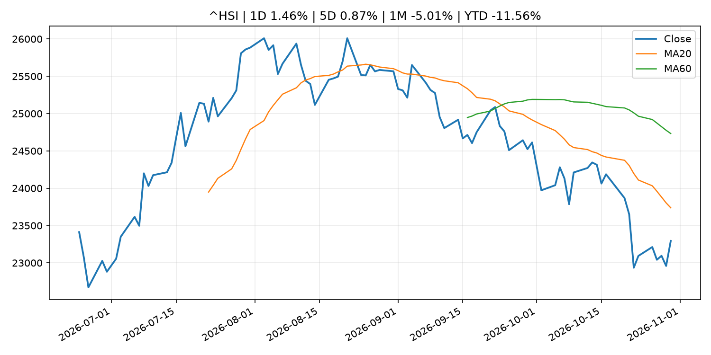

# Global Macro Morning Briefing - 2026-10-31

> Not financial advice / 非投资建议。

## 0. 今日总览
- 市场状态：risk_off。股指回落、VIX 抬升且避险资产走强，市场偏风险规避。
- 今日三大主线：
  1. geopolitical_risk: Why gold plunged to its lowest price in a year despite renewed Iran jitters
  2. earnings: Microsoft is winning the cloud wars and becoming Wall Street’s new golden child
  3. regulation: SEC Issues Exemptive Relief from Treasury Clearing Requirements for Certain Inter-Affiliate and Non-U.S. Repo Transactions
- 一句话结论：今日晨报重点关注：地缘风险可能推升避险需求、能源价格和市场波动率。；大型科技股盈利和资本开支会影响纳指、半导体和 AI 交易主线。。跨资产方面，SPY 1D -1.77%；QQQ 1D -3.47%；^VIX 1D 12.91%；TLT 1D 0.43%；GC=F 1D -3.63%；CL=F 1D 0.93%；BTC 1D -0.46%；ETH 1D -0.25%；股指回落、VIX 抬升且避险资产走强，市场偏风险规避。政策、通胀、利率、美元、美债、能源和加密监管仍是主要观察线索。所有结论仅基于公开数据与短摘要整理，不构成投资建议。

## 1. 隔夜跨资产市场
- 美股：SPY 1D -1.77%，QQQ 1D -3.47%，整体趋势需结合 VIX 和利率确认。
- 美债/美元：TLT 1D 0.43%，美元指数 1D -0.07%，是判断折现率压力的核心线索。
- 黄金/原油：黄金 1D -3.63%，原油 1D 0.93%，用于观察避险、通胀和地缘风险。
- 加密：BTC 1D -0.46%，ETH 1D -0.25%，关注是否独立于纳指走出加密自身行情。
- 港股/A股：恒生 1D 1.46%，沪深300/上证 1D n/a，重点看中国政策预期与人民币线索。
- 风险观察：关注避险是否演变为信用或流动性压力。

### US_EQUITY

| symbol | latest close | 1D | 5D | 1M | YTD | trend |
|---|---:|---:|---:|---:|---:|---|
| SPY | 755.72 | -1.77% | -0.56% | -1.08% | 10.62% | range_bound |
| QQQ | 690.49 | -3.47% | -1.97% | -6.95% | 12.62% | range_bound |
| DIA | 517.13 | -1.07% | -0.81% | 1.67% | 6.93% | downtrend |
| IWM | 279.33 | -1.65% | 1.30% | 0.11% | 12.28% | range_bound |
| VTI | 371.57 | -1.76% | -0.39% | -0.96% | 10.48% | downtrend |

### US_MACRO_MARKET

| symbol | latest close | 1D | 5D | 1M | YTD | trend |
|---|---:|---:|---:|---:|---:|---|
| ^VIX | 19.42 | 12.91% | -0.15% | 18.49% | 33.84% | strong_uptrend |
| DX-Y.NYB | 101.96 | -0.07% | 0.15% | -0.13% | 3.60% | range_bound |
| TLT | 81.84 | 0.43% | 0.61% | 5.31% | -5.96% | range_bound |
| IEF | 91.76 | 0.56% | 0.78% | 2.75% | -4.50% | range_bound |

### COMMODITIES

| symbol | latest close | 1D | 5D | 1M | YTD | trend |
|---|---:|---:|---:|---:|---:|---|
| GC=F | 3,884.90 | -3.63% | -3.07% | -7.55% | -10.27% | strong_downtrend |
| SI=F | 49.13 | -5.86% | -8.52% | -19.09% | -30.36% | strong_downtrend |
| CL=F | 102.95 | 0.93% | -0.31% | 10.85% | 79.61% | strong_uptrend |
| BZ=F | 112.33 | -2.22% | -3.76% | 9.79% | 84.91% | strong_uptrend |
| NG=F | 2.88 | -2.34% | 9.20% | -2.83% | -20.32% | range_bound |
| HG=F | 6.51 | -1.09% | 0.52% | 0.42% | 15.42% | downtrend |

### HK_MARKET

| symbol | latest close | 1D | 5D | 1M | YTD | trend |
|---|---:|---:|---:|---:|---:|---|
| ^HSI | 23,294.42 | 1.46% | 0.87% | -5.01% | -11.56% | strong_downtrend |
| 0700.HK | 383.60 | 1.59% | -0.62% | -11.20% | -38.43% | strong_downtrend |
| 9988.HK | 97.05 | 0.99% | -0.77% | -8.62% | -34.87% | strong_downtrend |
| 3690.HK | 71.60 | 3.47% | -0.07% | 1.63% | -31.55% | downtrend |
| 1810.HK | 26.48 | 3.12% | -1.19% | 5.08% | -34.26% | range_bound |
| 1211.HK | 68.25 | -0.58% | -4.68% | -9.90% | -30.89% | strong_downtrend |

### CRYPTO

| symbol | latest close | 1D | 5D | 1M | YTD | trend |
|---|---:|---:|---:|---:|---:|---|
| BTC | 77,483.61 | -0.46% | -3.20% | -6.15% | -11.52% | strong_downtrend |
| ETH | 2,243.95 | -0.25% | -3.56% | -9.73% | -24.45% | strong_downtrend |
| SOLANA | 96.62 | 1.20% | -4.56% | -11.41% | -22.40% | strong_downtrend |
| BINANCECOIN | 706.84 | 1.40% | -4.18% | -4.71% | -18.07% | downtrend |
| RIPPLE | 1.26 | 1.67% | -2.94% | -9.92% | -31.74% | strong_downtrend |

## 2. 今日最重要的 10 条新闻
### 1. Why gold plunged to its lowest price in a year despite renewed Iran jitters
- 来源：MarketWatch Top Stories
- 时间：2026-10-30T21:30:00+00:00
- 地区：US
- 事件类型：geopolitical_risk
- 重要性层级：Tier 1
- 一句话摘要：Safe-haven gold fell to its lowest price in a year, despite jitters around the potential for fresh Middle East attacks following the U.S. midterm elections on Tuesday
- 为什么重要：地缘风险可能推升避险需求、能源价格和市场波动率。
- 可能影响：主要影响 CL=F，方向为 positive，强度 high；供给扰动或 OPEC 减产通常推升 WTI 原油。
  - 资产：CL=F
    方向：positive
    强度：high
    原因：供给扰动或 OPEC 减产通常推升 WTI 原油。
  - 资产：BZ=F
    方向：positive
    强度：high
    原因：全球供给风险通常直接影响 Brent 原油。
  - 资产：SPY
    方向：mixed
    强度：medium
    原因：能源股可能受益，但通胀和成本压力不利于宽基风险资产。
- 原文链接：[https://www.marketwatch.com/story/why-gold-plunged-to-its-lowest-price-in-a-year-despite-renewed-iran-jitters-365be0e2?mod=mw_rss_topstories](https://www.marketwatch.com/story/why-gold-plunged-to-its-lowest-price-in-a-year-despite-renewed-iran-jitters-365be0e2?mod=mw_rss_topstories)

### 2. Microsoft is winning the cloud wars and becoming Wall Street’s new golden child
- 来源：MarketWatch Top Stories
- 时间：2026-10-30T20:29:00+00:00
- 地区：US
- 事件类型：earnings
- 重要性层级：Tier 2
- 一句话摘要：Various factors indicate that Microsoft is in a better financial position than its cloud rivals, analysts say.
- 为什么重要：大型科技股盈利和资本开支会影响纳指、半导体和 AI 交易主线。
- 可能影响：主要影响 QQQ，方向为 mixed，强度 high；AI 资本开支会影响大型科技股盈利和估值预期。
  - 资产：QQQ
    方向：mixed
    强度：high
    原因：AI 资本开支会影响大型科技股盈利和估值预期。
  - 资产：SMH
    方向：mixed
    强度：high
    原因：AI 投资周期直接影响半导体需求。
  - 资产：NVDA
    方向：mixed
    强度：high
    原因：AI 训练和推理需求是英伟达收入预期核心变量。
  - 资产：MSFT
    方向：mixed
    强度：medium
    原因：云和 AI 资本开支影响利润率与增长叙事。
  - 资产：GOOGL
    方向：mixed
    强度：medium
    原因：AI 投资和搜索商业化影响估值。
  - 资产：META
    方向：mixed
    强度：medium
    原因：AI 基建支出与广告效率共同影响市场预期。
- 原文链接：[https://www.marketwatch.com/story/microsoft-is-winning-the-cloud-wars-and-becoming-wall-streets-new-golden-child-62eecbbd?mod=mw_rss_topstories](https://www.marketwatch.com/story/microsoft-is-winning-the-cloud-wars-and-becoming-wall-streets-new-golden-child-62eecbbd?mod=mw_rss_topstories)

### 3. SEC Issues Exemptive Relief from Treasury Clearing Requirements for Certain Inter-Affiliate and Non-U.S. Repo Transactions
- 来源：SEC Press Releases
- 时间：2026-10-30T15:30:00-04:00
- 地区：US
- 事件类型：regulation
- 重要性层级：Tier 2
- 一句话摘要：The Securities and Exchange Commission took another step forward today to assist broker-dealers and other market participants on the path to central clearing of U.S. Treasury securities by issuing exemptive relief related to inter-affiliate repo…
- 为什么重要：监管变化会改变行业盈利预期和资产风险溢价。
- 可能影响：主要影响 BTC，方向为 mixed，强度 high；加密监管或 ETF 进展会改变 BTC 的资金流和风险溢价。
  - 资产：BTC
    方向：mixed
    强度：high
    原因：加密监管或 ETF 进展会改变 BTC 的资金流和风险溢价。
  - 资产：ETH
    方向：mixed
    强度：high
    原因：监管框架会影响 ETH 产品化和机构参与度。
  - 资产：COIN
    方向：mixed
    强度：medium
    原因：监管清晰度和执法风险会影响交易平台估值。
  - 资产：crypto market
    方向：mixed
    强度：high
    原因：信息影响整个加密市场结构，但方向取决于细节。
- 原文链接：[https://www.sec.gov/newsroom/press-releases/2026-111-sec-issues-exemptive-relief-treasury-clearing-requirements-certain-inter-affiliate-non-us-repo](https://www.sec.gov/newsroom/press-releases/2026-111-sec-issues-exemptive-relief-treasury-clearing-requirements-certain-inter-affiliate-non-us-repo)

### 4. Two Entities Charged in $130 Million Fraud Scheme That Used False SEC Filings to Boost Investor Confidence
- 来源：SEC Press Releases
- 时间：2026-10-29T12:42:37-04:00
- 地区：US
- 事件类型：regulation
- 重要性层级：Tier 2
- 一句话摘要：The Securities and Exchange Commission today charged two foreign-operated, Colorado-incorporated entities, BG Wealth Sharing Ltd and DSJ Exchange Pty Ltd, for orchestrating a fraud scheme that used false SEC filings to boost confidence in their…
- 为什么重要：监管变化会改变行业盈利预期和资产风险溢价。
- 可能影响：主要影响 BTC，方向为 mixed，强度 high；加密监管或 ETF 进展会改变 BTC 的资金流和风险溢价。
  - 资产：BTC
    方向：mixed
    强度：high
    原因：加密监管或 ETF 进展会改变 BTC 的资金流和风险溢价。
  - 资产：ETH
    方向：mixed
    强度：high
    原因：监管框架会影响 ETH 产品化和机构参与度。
  - 资产：COIN
    方向：mixed
    强度：medium
    原因：监管清晰度和执法风险会影响交易平台估值。
  - 资产：crypto market
    方向：mixed
    强度：high
    原因：信息影响整个加密市场结构，但方向取决于细节。
- 原文链接：[https://www.sec.gov/newsroom/press-releases/2026-110-two-entities-charged-130-million-fraud-scheme-used-false-sec-filings-boost-investor-confidence](https://www.sec.gov/newsroom/press-releases/2026-110-two-entities-charged-130-million-fraud-scheme-used-false-sec-filings-boost-investor-confidence)

### 5. From rivals to partners: Polygon and Solana team to bring stablecoin payments to banks
- 来源：CoinDesk
- 时间：2026-10-29T16:35:43+00:00
- 地区：global
- 事件类型：crypto_market_structure
- 重要性层级：Tier 2
- 一句话摘要：From rivals to partners: Polygon and Solana team to bring stablecoin payments to banks
- 为什么重要：加密市场结构和监管变化会影响 BTC、ETH 及相关股票的风险溢价。
- 可能影响：主要影响 BTC，方向为 mixed，强度 high；加密监管或 ETF 进展会改变 BTC 的资金流和风险溢价。
  - 资产：BTC
    方向：mixed
    强度：high
    原因：加密监管或 ETF 进展会改变 BTC 的资金流和风险溢价。
  - 资产：ETH
    方向：mixed
    强度：high
    原因：监管框架会影响 ETH 产品化和机构参与度。
  - 资产：COIN
    方向：mixed
    强度：medium
    原因：监管清晰度和执法风险会影响交易平台估值。
  - 资产：crypto market
    方向：mixed
    强度：high
    原因：信息影响整个加密市场结构，但方向取决于细节。
- 原文链接：[https://www.coindesk.com/business/2026/10/29/from-rivals-to-partners-polygon-and-solana-team-to-bring-stablecoin-payments-to-banks](https://www.coindesk.com/business/2026/10/29/from-rivals-to-partners-polygon-and-solana-team-to-bring-stablecoin-payments-to-banks)

### 6. AMD’s stock slides after Intel earnings reveal two big issues
- 来源：MarketWatch Top Stories
- 时间：2026-10-30T20:28:00+00:00
- 地区：US
- 事件类型：earnings
- 重要性层级：Tier 2
- 一句话摘要：Intel is struggling to make enough AI server chips and dealing with a weak PC market. Investors will soon find out the degree to which AMD may be suffering from the same problems.
- 为什么重要：大型科技股盈利和资本开支会影响纳指、半导体和 AI 交易主线。
- 可能影响：可能影响利率、汇率、风险资产或大宗商品预期，但当前公开信息不足以判断明确方向。
  - 资产：暂无明确资产映射
  - 方向：unknown
  - 强度：low
  - 原因：公开信息不足以判断方向。
- 原文链接：[https://www.marketwatch.com/story/amds-stock-slides-after-intel-earnings-reveal-two-big-issues-d3afed91?mod=mw_rss_topstories](https://www.marketwatch.com/story/amds-stock-slides-after-intel-earnings-reveal-two-big-issues-d3afed91?mod=mw_rss_topstories)

### 7. ECB President Lagarde to step down on 7 February 2027
- 来源：ECB Press Releases
- 时间：2026-10-29T11:00:00+01:00
- 地区：EU
- 事件类型：central_bank_speech
- 重要性层级：Tier 2
- 一句话摘要：ECB President Lagarde to step down on 7 February 2027
- 为什么重要：央行官员表态可能影响市场对下一次会议的定价。
- 可能影响：可能影响利率、汇率、风险资产或大宗商品预期，但当前公开信息不足以判断明确方向。
  - 资产：暂无明确资产映射
  - 方向：unknown
  - 强度：low
  - 原因：公开信息不足以判断方向。
- 原文链接：[https://www.ecb.europa.eu//press/pr/date/2026/html/ecb.pr261029~abbb6dc64b.en.html](https://www.ecb.europa.eu//press/pr/date/2026/html/ecb.pr261029~abbb6dc64b.en.html)

### 8. Warsh wants the Fed to say less. Two officials are pushing for more transparency.
- 来源：MarketWatch Top Stories
- 时间：2026-10-30T21:23:00+00:00
- 地区：US
- 事件类型：other
- 重要性层级：Tier 3
- 一句话摘要：More interest-rate hikes are needed to fight inflation, Fed officials say.
- 为什么重要：这条信息暂未匹配到重大宏观、政策或市场事件，更适合作为背景跟踪。
- 可能影响：主要影响 DXY，方向为 positive，强度 high；通胀压力可能推高政策利率预期并支撑美元。
  - 资产：DXY
    方向：positive
    强度：high
    原因：通胀压力可能推高政策利率预期并支撑美元。
  - 资产：TLT
    方向：negative
    强度：high
    原因：通胀上行通常推升收益率、压低长债价格。
  - 资产：QQQ
    方向：negative
    强度：high
    原因：更高利率对成长股估值折现率不利。
  - 资产：SPY
    方向：mixed
    强度：medium
    原因：名义增长可能支撑收入，但更高利率压制估值。
  - 资产：GC=F
    方向：mixed
    强度：medium
    原因：通胀对黄金是支撑，但实际利率上行会形成压力。
  - 资产：BTC
    方向：mixed
    强度：medium
    原因：抗通胀叙事和流动性收紧可能相互抵消。
- 原文链接：[https://www.marketwatch.com/story/the-fed-held-interest-rates-steady-but-these-officials-see-more-hikes-coming-soon-2098bbd8?mod=mw_rss_topstories](https://www.marketwatch.com/story/the-fed-held-interest-rates-steady-but-these-officials-see-more-hikes-coming-soon-2098bbd8?mod=mw_rss_topstories)

### 9. (Reference) Outlook Report and Indicators Related to Underlying Inflation
- 来源：Bank of Japan Announcements
- 时间：2026-10-30T12:02:00+09:00
- 地区：Japan
- 事件类型：other
- 重要性层级：Tier 3
- 一句话摘要：(Reference) Outlook Report and Indicators Related to Underlying Inflation
- 为什么重要：这条信息暂未匹配到重大宏观、政策或市场事件，更适合作为背景跟踪。
- 可能影响：主要影响 DXY，方向为 positive，强度 high；通胀压力可能推高政策利率预期并支撑美元。
  - 资产：DXY
    方向：positive
    强度：high
    原因：通胀压力可能推高政策利率预期并支撑美元。
  - 资产：TLT
    方向：negative
    强度：high
    原因：通胀上行通常推升收益率、压低长债价格。
  - 资产：QQQ
    方向：negative
    强度：high
    原因：更高利率对成长股估值折现率不利。
  - 资产：SPY
    方向：mixed
    强度：medium
    原因：名义增长可能支撑收入，但更高利率压制估值。
  - 资产：GC=F
    方向：mixed
    强度：medium
    原因：通胀对黄金是支撑，但实际利率上行会形成压力。
  - 资产：BTC
    方向：mixed
    强度：medium
    原因：抗通胀叙事和流动性收紧可能相互抵消。
- 原文链接：[http://www.boj.or.jp/en/mopo/mpmdeci/mpr_2026/k261030b.pdf](http://www.boj.or.jp/en/mopo/mpmdeci/mpr_2026/k261030b.pdf)

## 3. 政策与央行观察
### 1. SEC Issues Exemptive Relief from Treasury Clearing Requirements for Certain Inter-Affiliate and Non-U.S. Repo Transactions
- 来源：SEC Press Releases
- 时间：2026-10-30T15:30:00-04:00
- 地区：US
- 事件类型：regulation
- 重要性层级：Tier 2
- 一句话摘要：The Securities and Exchange Commission took another step forward today to assist broker-dealers and other market participants on the path to central clearing of U.S. Treasury securities by issuing exemptive relief related to inter-affiliate repo…
- 为什么重要：监管变化会改变行业盈利预期和资产风险溢价。
- 可能影响：主要影响 BTC，方向为 mixed，强度 high；加密监管或 ETF 进展会改变 BTC 的资金流和风险溢价。
  - 资产：BTC
    方向：mixed
    强度：high
    原因：加密监管或 ETF 进展会改变 BTC 的资金流和风险溢价。
  - 资产：ETH
    方向：mixed
    强度：high
    原因：监管框架会影响 ETH 产品化和机构参与度。
  - 资产：COIN
    方向：mixed
    强度：medium
    原因：监管清晰度和执法风险会影响交易平台估值。
  - 资产：crypto market
    方向：mixed
    强度：high
    原因：信息影响整个加密市场结构，但方向取决于细节。
- 原文链接：[https://www.sec.gov/newsroom/press-releases/2026-111-sec-issues-exemptive-relief-treasury-clearing-requirements-certain-inter-affiliate-non-us-repo](https://www.sec.gov/newsroom/press-releases/2026-111-sec-issues-exemptive-relief-treasury-clearing-requirements-certain-inter-affiliate-non-us-repo)

### 2. Two Entities Charged in $130 Million Fraud Scheme That Used False SEC Filings to Boost Investor Confidence
- 来源：SEC Press Releases
- 时间：2026-10-29T12:42:37-04:00
- 地区：US
- 事件类型：regulation
- 重要性层级：Tier 2
- 一句话摘要：The Securities and Exchange Commission today charged two foreign-operated, Colorado-incorporated entities, BG Wealth Sharing Ltd and DSJ Exchange Pty Ltd, for orchestrating a fraud scheme that used false SEC filings to boost confidence in their…
- 为什么重要：监管变化会改变行业盈利预期和资产风险溢价。
- 可能影响：主要影响 BTC，方向为 mixed，强度 high；加密监管或 ETF 进展会改变 BTC 的资金流和风险溢价。
  - 资产：BTC
    方向：mixed
    强度：high
    原因：加密监管或 ETF 进展会改变 BTC 的资金流和风险溢价。
  - 资产：ETH
    方向：mixed
    强度：high
    原因：监管框架会影响 ETH 产品化和机构参与度。
  - 资产：COIN
    方向：mixed
    强度：medium
    原因：监管清晰度和执法风险会影响交易平台估值。
  - 资产：crypto market
    方向：mixed
    强度：high
    原因：信息影响整个加密市场结构，但方向取决于细节。
- 原文链接：[https://www.sec.gov/newsroom/press-releases/2026-110-two-entities-charged-130-million-fraud-scheme-used-false-sec-filings-boost-investor-confidence](https://www.sec.gov/newsroom/press-releases/2026-110-two-entities-charged-130-million-fraud-scheme-used-false-sec-filings-boost-investor-confidence)

### 3. From rivals to partners: Polygon and Solana team to bring stablecoin payments to banks
- 来源：CoinDesk
- 时间：2026-10-29T16:35:43+00:00
- 地区：global
- 事件类型：crypto_market_structure
- 重要性层级：Tier 2
- 一句话摘要：From rivals to partners: Polygon and Solana team to bring stablecoin payments to banks
- 为什么重要：加密市场结构和监管变化会影响 BTC、ETH 及相关股票的风险溢价。
- 可能影响：主要影响 BTC，方向为 mixed，强度 high；加密监管或 ETF 进展会改变 BTC 的资金流和风险溢价。
  - 资产：BTC
    方向：mixed
    强度：high
    原因：加密监管或 ETF 进展会改变 BTC 的资金流和风险溢价。
  - 资产：ETH
    方向：mixed
    强度：high
    原因：监管框架会影响 ETH 产品化和机构参与度。
  - 资产：COIN
    方向：mixed
    强度：medium
    原因：监管清晰度和执法风险会影响交易平台估值。
  - 资产：crypto market
    方向：mixed
    强度：high
    原因：信息影响整个加密市场结构，但方向取决于细节。
- 原文链接：[https://www.coindesk.com/business/2026/10/29/from-rivals-to-partners-polygon-and-solana-team-to-bring-stablecoin-payments-to-banks](https://www.coindesk.com/business/2026/10/29/from-rivals-to-partners-polygon-and-solana-team-to-bring-stablecoin-payments-to-banks)

### 4. ECB President Lagarde to step down on 7 February 2027
- 来源：ECB Press Releases
- 时间：2026-10-29T11:00:00+01:00
- 地区：EU
- 事件类型：central_bank_speech
- 重要性层级：Tier 2
- 一句话摘要：ECB President Lagarde to step down on 7 February 2027
- 为什么重要：央行官员表态可能影响市场对下一次会议的定价。
- 可能影响：可能影响利率、汇率、风险资产或大宗商品预期，但当前公开信息不足以判断明确方向。
  - 资产：暂无明确资产映射
  - 方向：unknown
  - 强度：low
  - 原因：公开信息不足以判断方向。
- 原文链接：[https://www.ecb.europa.eu//press/pr/date/2026/html/ecb.pr261029~abbb6dc64b.en.html](https://www.ecb.europa.eu//press/pr/date/2026/html/ecb.pr261029~abbb6dc64b.en.html)

## 4. 市场异动与图表
- SPY 下跌 -1.77%
- QQQ 下跌 -3.47%
- VIX 上涨 12.91%
- TLT 上涨 0.43%
- Gold 下跌 -3.63%

### SPY

### QQQ

### ^VIX

### TLT

### GC=F

### CL=F

### BTC

### ETH

### ^HSI

## 5. 华尔街与机构公开观点
- 暂无可靠公开观点。

## 6. 今日重点关注
- 经济数据：经济数据：暂无可靠公开日历数据；如配置经济日历源后可自动填充。
- 央行讲话：央行讲话：暂无可靠公开日历数据；重点跟踪 Fed、ECB、BoJ、PBOC 官网 RSS。
- 财报：财报：暂无可靠数据。
- 政策事件：政策事件：暂无可靠数据。
- 风险提醒：风险提醒：关注数据源失败项、突发地缘风险、利率和美元的二阶反应。

## 7. 英文金融表达与宏观概念
- **inflation expectations**：通胀预期，指家庭、企业或市场对未来通胀的预估。 例句：Inflation expectations can shape wage bargaining and bond yields.
- **real yield**：实际收益率，名义利率扣除通胀预期后的收益率。 例句：Gold often reacts more to real yields than nominal yields.
- **terminal rate**：终端利率，市场预期本轮加息周期的最高政策利率。 例句：A higher terminal rate can pressure growth stocks.
- **risk-off**：避险模式，资金偏向美元、国债、黄金等防御资产。 例句：A geopolitical shock can push markets into risk-off mode.
- **supply disruption**：供给扰动，通常指能源或商品供应受冲突、减产或天气影响。 例句：Supply disruption can lift oil prices and inflation expectations.
- **market structure**：市场结构，指交易、托管、清算、ETF、监管等制度安排。 例句：Crypto market structure rules can affect institutional participation.

## 8. 背景材料
- [This cybersecurity stock will be the next to join the S&P 500](https://www.marketwatch.com/story/this-cybersecurity-stock-will-be-the-next-to-join-the-s-p-500-dc976803?mod=mw_rss_topstories)（MarketWatch Top Stories，other）：Okta is slated to join the index on Wednesday, replacing Kenvue.
- [Warsh wants the Fed to say less. Two officials are pushing for more transparency.](https://www.marketwatch.com/story/the-fed-held-interest-rates-steady-but-these-officials-see-more-hikes-coming-soon-2098bbd8?mod=mw_rss_topstories)（MarketWatch Top Stories，other）：More interest-rate hikes are needed to fight inflation, Fed officials say.
- [Philip R. Lane: AI adoption in Europe](https://www.ecb.europa.eu//press/key/date/2026/html/ecb.sp261030~08d9d540f0.en.html)（ECB Press Releases，other）：Philip R. Lane: AI adoption in Europe
- [Decisions taken by the Governing Council of the ECB (in addition to decisions setting interest rates)](https://www.ecb.europa.eu//press/govcdec/otherdec/2026/html/ecb.gc261030~e40f864093.en.html)（ECB Press Releases，other）：Decisions taken by the Governing Council of the ECB (in addition to decisions setting interest rates)
- [Here's how big bitcoin traders responded after the Binance hack hit](https://www.coindesk.com/daybook-us/2026/10/30/here-s-how-big-bitcoin-traders-responded-after-the-binance-hack-hit)（CoinDesk，other）：Here's how big bitcoin traders responded after the Binance hack hit
- [Crypto liquidations jump to $1.57 billion as Binance hack sends bitcoin, ether lower](https://www.coindesk.com/markets/2026/10/30/crypto-liquidations-jump-to-usd1-57-billion-as-binance-hack-sends-bitcoin-ether-lower)（CoinDesk，other）：Crypto liquidations jump to $1.57 billion as Binance hack sends bitcoin, ether lower
- [Results of the ECB Survey of Professional Forecasters for the fourth quarter of 2026](https://www.ecb.europa.eu//press/pr/date/2026/html/ecb.pr261030~e92c3c838c.en.html)（ECB Press Releases，other）：Results of the ECB Survey of Professional Forecasters for the fourth quarter of 2026
- [Live updates: Bitcoin falls below $77,000 as Binance exploit combines with tech woes](https://www.coindesk.com/markets/2026/10/30/live-news-binance-hack-rattles-crypto-as-intel-plunges-and-ai-spending-fears-hit-tech)（CoinDesk，other）：Live updates: Bitcoin falls below $77,000 as Binance exploit combines with tech woes
- [Quarterly Schedule of Outright Purchases of Japanese Government Bonds (Competitive Auction Method) (October-December 2026) (Schedule Updates)](http://www.boj.or.jp/en/mopo/mpmdeci/mpr_2026/mpr261030c.pdf)（Bank of Japan Announcements，other）：Quarterly Schedule of Outright Purchases of Japanese Government Bonds (Competitive Auction Method) (October-December 2026) (Schedule Updates)
- [Timetable and Schedule of U.S. Dollar Funds-Supplying Operations  (November 2026-March 2027)](http://www.boj.or.jp/en/mopo/mpmdeci/mpr_2026/mpr261030b.pdf)（Bank of Japan Announcements，other）：Timetable and Schedule of U.S. Dollar Funds-Supplying Operations  (November 2026-March 2027)
- [Bitcoin, ether and XRP selloff wipes out $1.5 billion in leveraged crypto bets](https://www.coindesk.com/markets/2026/10/30/bitcoin-ether-and-xrp-selloff-wipes-out-usd1-5-billion-in-leveraged-crypto-bets)（CoinDesk，other）：Bitcoin, ether and XRP selloff wipes out $1.5 billion in leveraged crypto bets
- [Amendment to "Basic Principles for Disposal of ETFs and J-REITs"](http://www.boj.or.jp/en/mopo/mpmdeci/mpr_2026/mpr261030a.pdf)（Bank of Japan Announcements，other）：Amendment to "Basic Principles for Disposal of ETFs and J-REITs"
- [Binance hacker splits $1.4 billion of bitcoin into 19 wallets that no one can freeze](https://www.coindesk.com/markets/2026/10/30/binance-hacker-splits-usd1-4-billion-of-bitcoin-into-19-wallets-that-no-one-can-freeze)（CoinDesk，other）：Binance hacker splits $1.4 billion of bitcoin into 19 wallets that no one can freeze
- [Standard Chartered sees more pain after $6 billion Binance hack sends bitcoin lower](https://www.coindesk.com/markets/2026/10/30/usd6-billion-binance-hack-sends-bitcoin-ether-tumbling-standard-chartered-sees-more-losses-ahead)（CoinDesk，other）：Standard Chartered sees more pain after $6 billion Binance hack sends bitcoin lower
- [Outlook for Economic Activity and Prices (October 2026, The Bank's View)](http://www.boj.or.jp/en/mopo/outlook/gor2610a.pdf)（Bank of Japan Announcements，other）：Outlook for Economic Activity and Prices (October 2026, The Bank's View)
- [Statement on Monetary Policy](http://www.boj.or.jp/en/mopo/mpmdeci/mpr_2026/k261030a.pdf)（Bank of Japan Announcements，other）：Statement on Monetary Policy
- [(Reference) Outlook Report and Indicators Related to Underlying Inflation](http://www.boj.or.jp/en/mopo/mpmdeci/mpr_2026/k261030b.pdf)（Bank of Japan Announcements，other）：(Reference) Outlook Report and Indicators Related to Underlying Inflation
- [(Reference) Decisions regarding a Change in the Pace of Sales of ETFs (October 2026)](http://www.boj.or.jp/en/mopo/mpmdeci/mpr_2026/k261030c.pdf)（Bank of Japan Announcements，other）：(Reference) Decisions regarding a Change in the Pace of Sales of ETFs (October 2026)
- [Payment and Settlement Statistics (Sept.)](http://www.boj.or.jp/en/statistics/set/kess/release/2026/kess2609.pdf)（Bank of Japan Announcements，other）：Payment and Settlement Statistics (Sept.)
- [Federal Reserve Board announces approval of application by The Bank of Nova Scotia](https://www.federalreserve.gov/newsevents/pressreleases/orders20261029a.htm)（Federal Reserve Press Releases，other）：Federal Reserve Board announces approval of application by The Bank of Nova Scotia

## 9. 数据源、失败项与免责声明
- 采集时间：2026-10-31T01:27:29
- 数据源：公开 RSS、Yahoo Finance、CoinGecko、AKShare、FRED、SEC data.sec.gov，以及用户自有 inputs/reports 文件。
- 合规说明：不绕过 WSJ、Bloomberg、FT、Reuters 等付费墙；对付费媒体只使用公开 RSS 标题、摘要、链接和发布时间。
- 免责声明：Not financial advice / 非投资建议。本项目仅供个人学习、研究和信息整理，不构成投资建议、交易建议或任何收益承诺。
- 失败或跳过的数据源：
  - crypto data failed coin=dogecoin
  - China market data failed symbol=上证指数: empty dataframe
  - China market data failed symbol=深证成指: empty dataframe
  - China market data failed symbol=创业板指: empty dataframe
  - China market data failed symbol=沪深300: empty dataframe
  - China market data failed symbol=中证500: empty dataframe
  - China market data failed symbol=科创50: empty dataframe
  - FRED_API_KEY not set; skipping FRED macro series
  - SEC failed cik=0000320193
  - SEC failed cik=0000789019
  - SEC failed cik=0001045810
  - SEC failed cik=0001318605
  - SEC failed cik=0001577552
