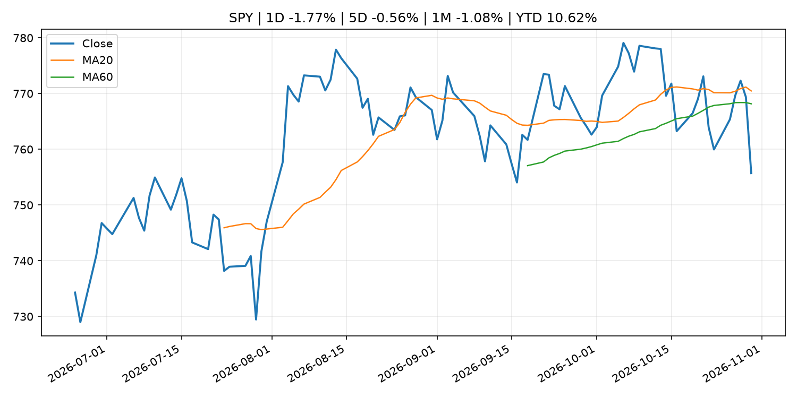
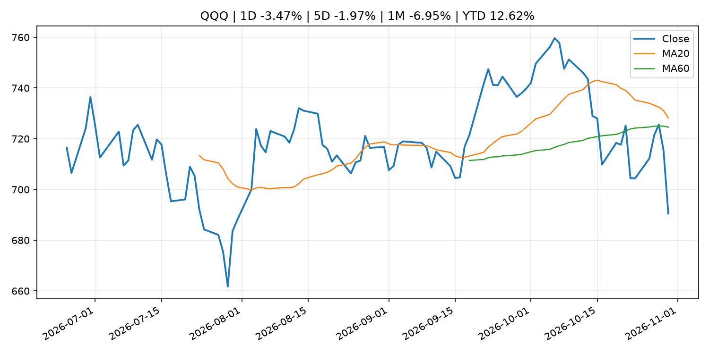
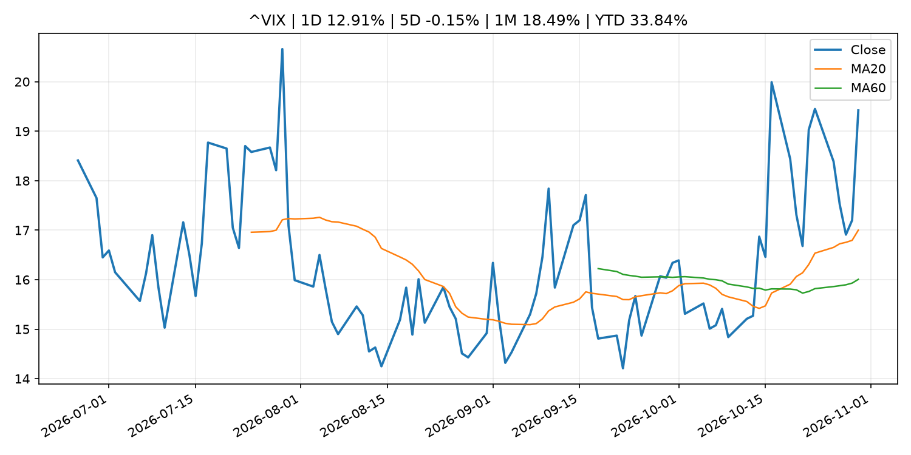
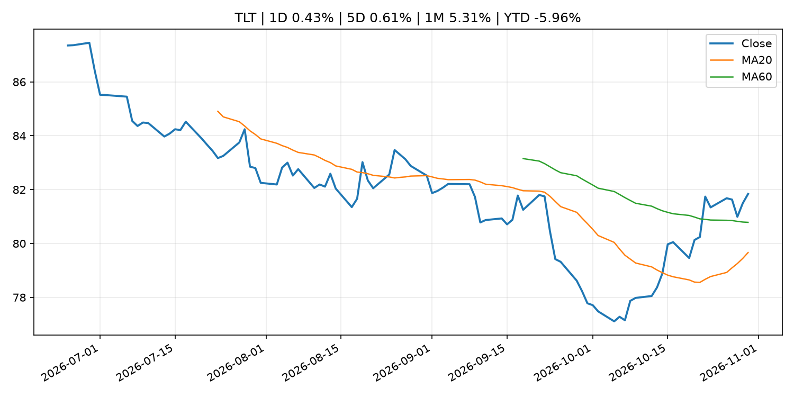
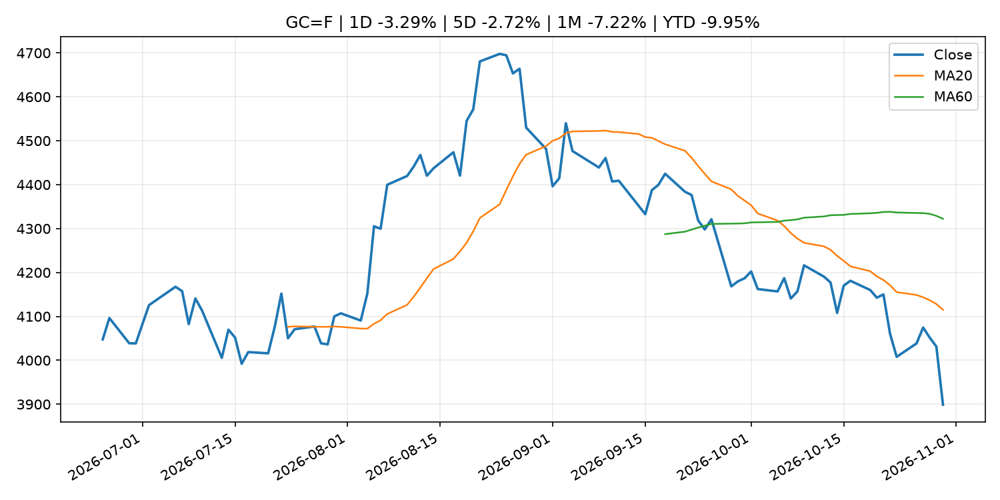
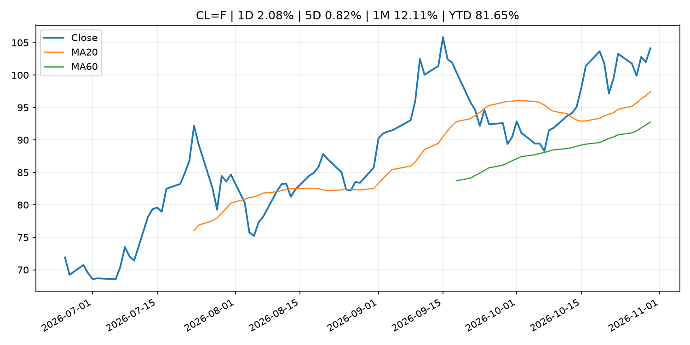
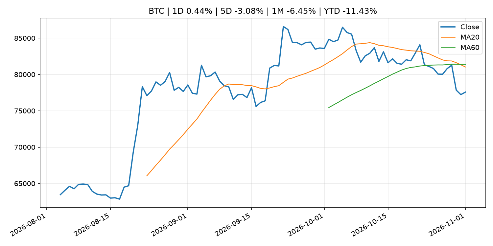
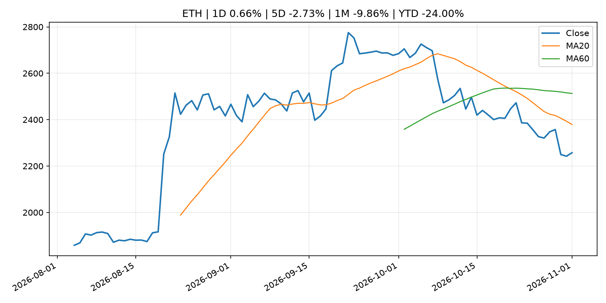
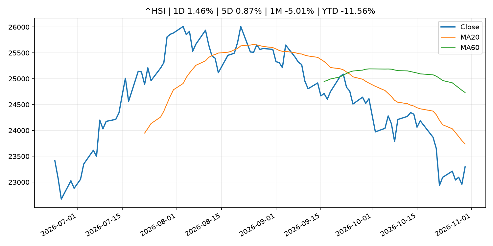

# Global Macro Morning Briefing - 2026-11-01

> Not financial advice / 非投资建议。

## 0. 今日总览
- 市场状态：risk_off。股指回落、VIX 抬升且避险资产走强，市场偏风险规避。
- 今日三大主线：
  1. regulation: SEC Issues Exemptive Relief from Treasury Clearing Requirements for Certain Inter-Affiliate and Non-U.S. Repo Transactions
- 一句话结论：今日晨报重点关注：监管变化会改变行业盈利预期和资产风险溢价。；这条信息暂未匹配到重大宏观、政策或市场事件，更适合作为背景跟踪。。跨资产方面，SPY 1D -1.77%；QQQ 1D -3.47%；^VIX 1D 12.91%；TLT 1D 0.43%；GC=F 1D -3.29%；CL=F 1D 2.08%；BTC 1D 0.44%；ETH 1D 0.66%；股指回落、VIX 抬升且避险资产走强，市场偏风险规避。政策、通胀、利率、美元、美债、能源和加密监管仍是主要观察线索。所有结论仅基于公开数据与短摘要整理，不构成投资建议。

## 1. 隔夜跨资产市场
- 美股：SPY 1D -1.77%，QQQ 1D -3.47%，整体趋势需结合 VIX 和利率确认。
- 美债/美元：TLT 1D 0.43%，美元指数 1D -0.16%，是判断折现率压力的核心线索。
- 黄金/原油：黄金 1D -3.29%，原油 1D 2.08%，用于观察避险、通胀和地缘风险。
- 加密：BTC 1D 0.44%，ETH 1D 0.66%，关注是否独立于纳指走出加密自身行情。
- 港股/A股：恒生 1D 1.46%，沪深300/上证 1D n/a，重点看中国政策预期与人民币线索。
- 风险观察：关注避险是否演变为信用或流动性压力。

### US_EQUITY

| symbol | latest close | 1D | 5D | 1M | YTD | trend |
|---|---:|---:|---:|---:|---:|---|
| SPY | 755.72 | -1.77% | -0.56% | -1.08% | 10.62% | range_bound |
| QQQ | 690.49 | -3.47% | -1.97% | -6.95% | 12.62% | range_bound |
| DIA | 517.13 | -1.07% | -0.81% | 1.67% | 6.93% | downtrend |
| IWM | 279.33 | -1.65% | 1.30% | 0.11% | 12.28% | range_bound |
| VTI | 371.57 | -1.76% | -0.39% | -0.96% | 10.48% | downtrend |

### US_MACRO_MARKET

| symbol | latest close | 1D | 5D | 1M | YTD | trend |
|---|---:|---:|---:|---:|---:|---|
| ^VIX | 19.42 | 12.91% | -0.15% | 18.49% | 33.84% | strong_uptrend |
| DX-Y.NYB | 101.88 | -0.16% | 0.07% | -0.22% | 3.52% | range_bound |
| TLT | 81.84 | 0.43% | 0.61% | 5.31% | -5.96% | range_bound |
| IEF | 91.76 | 0.56% | 0.78% | 2.75% | -4.50% | range_bound |

### COMMODITIES

| symbol | latest close | 1D | 5D | 1M | YTD | trend |
|---|---:|---:|---:|---:|---:|---|
| GC=F | 3,898.90 | -3.29% | -2.72% | -7.22% | -9.95% | strong_downtrend |
| SI=F | 49.10 | -5.93% | -8.59% | -19.15% | -30.41% | strong_downtrend |
| CL=F | 104.12 | 2.08% | 0.82% | 12.11% | 81.65% | strong_uptrend |
| BZ=F | 117.64 | 2.40% | 0.79% | 14.98% | 93.65% | strong_uptrend |
| NG=F | 2.90 | -1.83% | 9.77% | -2.33% | -19.90% | range_bound |
| HG=F | 6.46 | -1.86% | -0.27% | -0.36% | 14.51% | downtrend |

### HK_MARKET

| symbol | latest close | 1D | 5D | 1M | YTD | trend |
|---|---:|---:|---:|---:|---:|---|
| ^HSI | 23,294.42 | 1.46% | 0.87% | -5.01% | -11.56% | strong_downtrend |
| 0700.HK | 383.60 | 1.59% | -0.62% | -11.20% | -38.43% | strong_downtrend |
| 9988.HK | 97.05 | 0.99% | -0.77% | -8.62% | -34.87% | strong_downtrend |
| 3690.HK | 71.60 | 3.47% | -0.07% | 1.63% | -31.55% | downtrend |
| 1810.HK | 26.48 | 3.12% | -1.19% | 5.08% | -34.26% | range_bound |
| 1211.HK | 68.25 | -0.58% | -4.68% | -9.90% | -30.89% | strong_downtrend |

### CRYPTO

| symbol | latest close | 1D | 5D | 1M | YTD | trend |
|---|---:|---:|---:|---:|---:|---|
| BTC | 77,566.34 | 0.44% | -3.08% | -6.45% | -11.43% | strong_downtrend |
| ETH | 2,257.34 | 0.66% | -2.73% | -9.86% | -24.00% | strong_downtrend |
| SOLANA | 95.66 | -0.62% | -5.06% | -13.04% | -23.18% | strong_downtrend |
| BINANCECOIN | 704.41 | 0.12% | -5.03% | -6.03% | -18.35% | downtrend |
| RIPPLE | 1.26 | 0.07% | -3.91% | -10.38% | -31.77% | strong_downtrend |

## 2. 今日最重要的 10 条新闻
### 1. SEC Issues Exemptive Relief from Treasury Clearing Requirements for Certain Inter-Affiliate and Non-U.S. Repo Transactions
- 来源：SEC Press Releases
- 时间：2026-10-30T15:30:00-04:00
- 地区：US
- 事件类型：regulation
- 重要性层级：Tier 2
- 一句话摘要：The Securities and Exchange Commission took another step forward today to assist broker-dealers and other market participants on the path to central clearing of U.S. Treasury securities by issuing exemptive relief related to inter-affiliate repo…
- 为什么重要：监管变化会改变行业盈利预期和资产风险溢价。
- 可能影响：主要影响 BTC，方向为 mixed，强度 high；加密监管或 ETF 进展会改变 BTC 的资金流和风险溢价。
  - 资产：BTC
    方向：mixed
    强度：high
    原因：加密监管或 ETF 进展会改变 BTC 的资金流和风险溢价。
  - 资产：ETH
    方向：mixed
    强度：high
    原因：监管框架会影响 ETH 产品化和机构参与度。
  - 资产：COIN
    方向：mixed
    强度：medium
    原因：监管清晰度和执法风险会影响交易平台估值。
  - 资产：crypto market
    方向：mixed
    强度：high
    原因：信息影响整个加密市场结构，但方向取决于细节。
- 原文链接：[https://www.sec.gov/newsroom/press-releases/2026-111-sec-issues-exemptive-relief-treasury-clearing-requirements-certain-inter-affiliate-non-us-repo](https://www.sec.gov/newsroom/press-releases/2026-111-sec-issues-exemptive-relief-treasury-clearing-requirements-certain-inter-affiliate-non-us-repo)

### 2. Is it curtains for COLA? Saving Social Security could mean changing the cost-of-living adjustment.
- 来源：MarketWatch Top Stories
- 时间：2026-10-31T18:33:00+00:00
- 地区：US
- 事件类型：other
- 重要性层级：Tier 3
- 一句话摘要：Several proposals consider changing the way retirees receive inflation protection. Here’s what it could cost you.
- 为什么重要：这条信息暂未匹配到重大宏观、政策或市场事件，更适合作为背景跟踪。
- 可能影响：主要影响 DXY，方向为 positive，强度 high；通胀压力可能推高政策利率预期并支撑美元。
  - 资产：DXY
    方向：positive
    强度：high
    原因：通胀压力可能推高政策利率预期并支撑美元。
  - 资产：TLT
    方向：negative
    强度：high
    原因：通胀上行通常推升收益率、压低长债价格。
  - 资产：QQQ
    方向：negative
    强度：high
    原因：更高利率对成长股估值折现率不利。
  - 资产：SPY
    方向：mixed
    强度：medium
    原因：名义增长可能支撑收入，但更高利率压制估值。
  - 资产：GC=F
    方向：mixed
    强度：medium
    原因：通胀对黄金是支撑，但实际利率上行会形成压力。
  - 资产：BTC
    方向：mixed
    强度：medium
    原因：抗通胀叙事和流动性收紧可能相互抵消。
- 原文链接：[https://www.marketwatch.com/story/is-it-curtains-for-cola-saving-social-security-could-mean-changing-the-cost-of-living-adjustment-867c6bd8?mod=mw_rss_topstories](https://www.marketwatch.com/story/is-it-curtains-for-cola-saving-social-security-could-mean-changing-the-cost-of-living-adjustment-867c6bd8?mod=mw_rss_topstories)

### 3. (Reference) Outlook Report and Indicators Related to Underlying Inflation
- 来源：Bank of Japan Announcements
- 时间：2026-10-30T12:02:00+09:00
- 地区：Japan
- 事件类型：other
- 重要性层级：Tier 3
- 一句话摘要：(Reference) Outlook Report and Indicators Related to Underlying Inflation
- 为什么重要：这条信息暂未匹配到重大宏观、政策或市场事件，更适合作为背景跟踪。
- 可能影响：主要影响 DXY，方向为 positive，强度 high；通胀压力可能推高政策利率预期并支撑美元。
  - 资产：DXY
    方向：positive
    强度：high
    原因：通胀压力可能推高政策利率预期并支撑美元。
  - 资产：TLT
    方向：negative
    强度：high
    原因：通胀上行通常推升收益率、压低长债价格。
  - 资产：QQQ
    方向：negative
    强度：high
    原因：更高利率对成长股估值折现率不利。
  - 资产：SPY
    方向：mixed
    强度：medium
    原因：名义增长可能支撑收入，但更高利率压制估值。
  - 资产：GC=F
    方向：mixed
    强度：medium
    原因：通胀对黄金是支撑，但实际利率上行会形成压力。
  - 资产：BTC
    方向：mixed
    强度：medium
    原因：抗通胀叙事和流动性收紧可能相互抵消。
- 原文链接：[http://www.boj.or.jp/en/mopo/mpmdeci/mpr_2026/k261030b.pdf](http://www.boj.or.jp/en/mopo/mpmdeci/mpr_2026/k261030b.pdf)

## 3. 政策与央行观察
### 1. SEC Issues Exemptive Relief from Treasury Clearing Requirements for Certain Inter-Affiliate and Non-U.S. Repo Transactions
- 来源：SEC Press Releases
- 时间：2026-10-30T15:30:00-04:00
- 地区：US
- 事件类型：regulation
- 重要性层级：Tier 2
- 一句话摘要：The Securities and Exchange Commission took another step forward today to assist broker-dealers and other market participants on the path to central clearing of U.S. Treasury securities by issuing exemptive relief related to inter-affiliate repo…
- 为什么重要：监管变化会改变行业盈利预期和资产风险溢价。
- 可能影响：主要影响 BTC，方向为 mixed，强度 high；加密监管或 ETF 进展会改变 BTC 的资金流和风险溢价。
  - 资产：BTC
    方向：mixed
    强度：high
    原因：加密监管或 ETF 进展会改变 BTC 的资金流和风险溢价。
  - 资产：ETH
    方向：mixed
    强度：high
    原因：监管框架会影响 ETH 产品化和机构参与度。
  - 资产：COIN
    方向：mixed
    强度：medium
    原因：监管清晰度和执法风险会影响交易平台估值。
  - 资产：crypto market
    方向：mixed
    强度：high
    原因：信息影响整个加密市场结构，但方向取决于细节。
- 原文链接：[https://www.sec.gov/newsroom/press-releases/2026-111-sec-issues-exemptive-relief-treasury-clearing-requirements-certain-inter-affiliate-non-us-repo](https://www.sec.gov/newsroom/press-releases/2026-111-sec-issues-exemptive-relief-treasury-clearing-requirements-certain-inter-affiliate-non-us-repo)

## 4. 市场异动与图表
- SPY 下跌 -1.77%
- QQQ 下跌 -3.47%
- VIX 上涨 12.91%
- TLT 上涨 0.43%
- Gold 下跌 -3.29%
- Oil 上涨 2.08%

### SPY

### QQQ

### ^VIX

### TLT

### GC=F

### CL=F

### BTC

### ETH

### ^HSI

## 5. 华尔街与机构公开观点
- 暂无可靠公开观点。

## 6. 今日重点关注
- 经济数据：经济数据：暂无可靠公开日历数据；如配置经济日历源后可自动填充。
- 央行讲话：央行讲话：暂无可靠公开日历数据；重点跟踪 Fed、ECB、BoJ、PBOC 官网 RSS。
- 财报：财报：暂无可靠数据。
- 政策事件：政策事件：暂无可靠数据。
- 风险提醒：风险提醒：关注数据源失败项、突发地缘风险、利率和美元的二阶反应。

## 7. 英文金融表达与宏观概念
- **inflation expectations**：通胀预期，指家庭、企业或市场对未来通胀的预估。 例句：Inflation expectations can shape wage bargaining and bond yields.
- **real yield**：实际收益率，名义利率扣除通胀预期后的收益率。 例句：Gold often reacts more to real yields than nominal yields.
- **risk-off**：避险模式，资金偏向美元、国债、黄金等防御资产。 例句：A geopolitical shock can push markets into risk-off mode.
- **market structure**：市场结构，指交易、托管、清算、ETF、监管等制度安排。 例句：Crypto market structure rules can affect institutional participation.
- **terminal rate**：终端利率，市场预期本轮加息周期的最高政策利率。 例句：A higher terminal rate can pressure growth stocks.
- **soft landing**：软着陆，指通胀回落而经济避免明显衰退。 例句：Markets often rally when data support a soft landing.

## 8. 背景材料
- [Is it curtains for COLA? Saving Social Security could mean changing the cost-of-living adjustment.](https://www.marketwatch.com/story/is-it-curtains-for-cola-saving-social-security-could-mean-changing-the-cost-of-living-adjustment-867c6bd8?mod=mw_rss_topstories)（MarketWatch Top Stories，other）：Several proposals consider changing the way retirees receive inflation protection. Here’s what it could cost you.
- [Bitcoin's white paper turns 18, and small businesses are still paying for the bailouts it answered](https://www.coindesk.com/opinion/2026/10/31/bitcoin-s-white-paper-turns-18-and-small-businesses-are-still-paying-for-the-bailouts-it-answered)（CoinDesk，other）：Bitcoin's white paper turns 18, and small businesses are still paying for the bailouts it answered
- [As big bitcoin miners chase AI profits, individuals get another shot at the rewards](https://www.coindesk.com/tech/2026/10/31/as-big-bitcoin-miners-chase-ai-profits-individuals-get-another-shot-at-the-rewards)（CoinDesk，other）：As big bitcoin miners chase AI profits, individuals get another shot at the rewards
- [18 years in, what has Bitcoin truly done?](https://www.coindesk.com/opinion/2026/10/31/18-years-in-what-has-bitcoin-truly-done)（CoinDesk，other）：18 years in, what has Bitcoin truly done?
- [A Nasdaq-listed company may sell $450 million bitcoin, citing Binance hack and quantum fears](https://www.coindesk.com/markets/2026/10/31/a-nasdaq-listed-company-may-sell-usd450-million-bitcoin-citing-binance-hack-and-quantum-fears)（CoinDesk，other）：A Nasdaq-listed company may sell $450 million bitcoin, citing Binance hack and quantum fears
- [Bitcoin stolen from Binance tops Tesla’s holdings and is over twice El Salvador’s reserve](https://www.coindesk.com/markets/2026/10/31/bitcoin-stolen-from-binance-tops-tesla-s-holdings-and-is-over-twice-el-salvador-s-reserve)（CoinDesk，other）：Bitcoin stolen from Binance tops Tesla’s holdings and is over twice El Salvador’s reserve
- [Philip R. Lane: AI adoption in Europe](https://www.ecb.europa.eu//press/key/date/2026/html/ecb.sp261030~08d9d540f0.en.html)（ECB Press Releases，other）：Philip R. Lane: AI adoption in Europe
- [Decisions taken by the Governing Council of the ECB (in addition to decisions setting interest rates)](https://www.ecb.europa.eu//press/govcdec/otherdec/2026/html/ecb.gc261030~e40f864093.en.html)（ECB Press Releases，other）：Decisions taken by the Governing Council of the ECB (in addition to decisions setting interest rates)
- [Here's how big bitcoin traders responded after the Binance hack hit](https://www.coindesk.com/daybook-us/2026/10/30/here-s-how-big-bitcoin-traders-responded-after-the-binance-hack-hit)（CoinDesk，other）：Here's how big bitcoin traders responded after the Binance hack hit
- [Crypto liquidations jump to $1.57 billion as Binance hack sends bitcoin, ether lower](https://www.coindesk.com/markets/2026/10/30/crypto-liquidations-jump-to-usd1-57-billion-as-binance-hack-sends-bitcoin-ether-lower)（CoinDesk，other）：Crypto liquidations jump to $1.57 billion as Binance hack sends bitcoin, ether lower
- [Results of the ECB Survey of Professional Forecasters for the fourth quarter of 2026](https://www.ecb.europa.eu//press/pr/date/2026/html/ecb.pr261030~e92c3c838c.en.html)（ECB Press Releases，other）：Results of the ECB Survey of Professional Forecasters for the fourth quarter of 2026
- [Live updates: Bitcoin falls below $77,000 as Binance exploit combines with tech woes](https://www.coindesk.com/markets/2026/10/30/live-news-binance-hack-rattles-crypto-as-intel-plunges-and-ai-spending-fears-hit-tech)（CoinDesk，other）：Live updates: Bitcoin falls below $77,000 as Binance exploit combines with tech woes
- [Quarterly Schedule of Outright Purchases of Japanese Government Bonds (Competitive Auction Method) (October-December 2026) (Schedule Updates)](http://www.boj.or.jp/en/mopo/mpmdeci/mpr_2026/mpr261030c.pdf)（Bank of Japan Announcements，other）：Quarterly Schedule of Outright Purchases of Japanese Government Bonds (Competitive Auction Method) (October-December 2026) (Schedule Updates)
- [Timetable and Schedule of U.S. Dollar Funds-Supplying Operations  (November 2026-March 2027)](http://www.boj.or.jp/en/mopo/mpmdeci/mpr_2026/mpr261030b.pdf)（Bank of Japan Announcements，other）：Timetable and Schedule of U.S. Dollar Funds-Supplying Operations  (November 2026-March 2027)
- [Bitcoin, ether and XRP selloff wipes out $1.5 billion in leveraged crypto bets](https://www.coindesk.com/markets/2026/10/30/bitcoin-ether-and-xrp-selloff-wipes-out-usd1-5-billion-in-leveraged-crypto-bets)（CoinDesk，other）：Bitcoin, ether and XRP selloff wipes out $1.5 billion in leveraged crypto bets
- [Amendment to "Basic Principles for Disposal of ETFs and J-REITs"](http://www.boj.or.jp/en/mopo/mpmdeci/mpr_2026/mpr261030a.pdf)（Bank of Japan Announcements，other）：Amendment to "Basic Principles for Disposal of ETFs and J-REITs"
- [Outlook for Economic Activity and Prices (October 2026, The Bank's View)](http://www.boj.or.jp/en/mopo/outlook/gor2610a.pdf)（Bank of Japan Announcements，other）：Outlook for Economic Activity and Prices (October 2026, The Bank's View)
- [Statement on Monetary Policy](http://www.boj.or.jp/en/mopo/mpmdeci/mpr_2026/k261030a.pdf)（Bank of Japan Announcements，other）：Statement on Monetary Policy
- [(Reference) Outlook Report and Indicators Related to Underlying Inflation](http://www.boj.or.jp/en/mopo/mpmdeci/mpr_2026/k261030b.pdf)（Bank of Japan Announcements，other）：(Reference) Outlook Report and Indicators Related to Underlying Inflation
- [(Reference) Decisions regarding a Change in the Pace of Sales of ETFs (October 2026)](http://www.boj.or.jp/en/mopo/mpmdeci/mpr_2026/k261030c.pdf)（Bank of Japan Announcements，other）：(Reference) Decisions regarding a Change in the Pace of Sales of ETFs (October 2026)

## 9. 数据源、失败项与免责声明
- 采集时间：2026-11-01T00:42:27
- 数据源：公开 RSS、Yahoo Finance、CoinGecko、AKShare、FRED、SEC data.sec.gov，以及用户自有 inputs/reports 文件。
- 合规说明：不绕过 WSJ、Bloomberg、FT、Reuters 等付费墙；对付费媒体只使用公开 RSS 标题、摘要、链接和发布时间。
- 免责声明：Not financial advice / 非投资建议。本项目仅供个人学习、研究和信息整理，不构成投资建议、交易建议或任何收益承诺。
- 失败或跳过的数据源：
  - crypto data failed coin=dogecoin
  - China market data failed symbol=上证指数: empty dataframe
  - China market data failed symbol=深证成指: empty dataframe
  - China market data failed symbol=创业板指: empty dataframe
  - China market data failed symbol=沪深300: empty dataframe
  - China market data failed symbol=中证500: empty dataframe
  - China market data failed symbol=科创50: empty dataframe
  - FRED_API_KEY not set; skipping FRED macro series
  - SEC failed cik=0000320193
  - SEC failed cik=0000789019
  - SEC failed cik=0001045810
  - SEC failed cik=0001318605
  - SEC failed cik=0001577552
