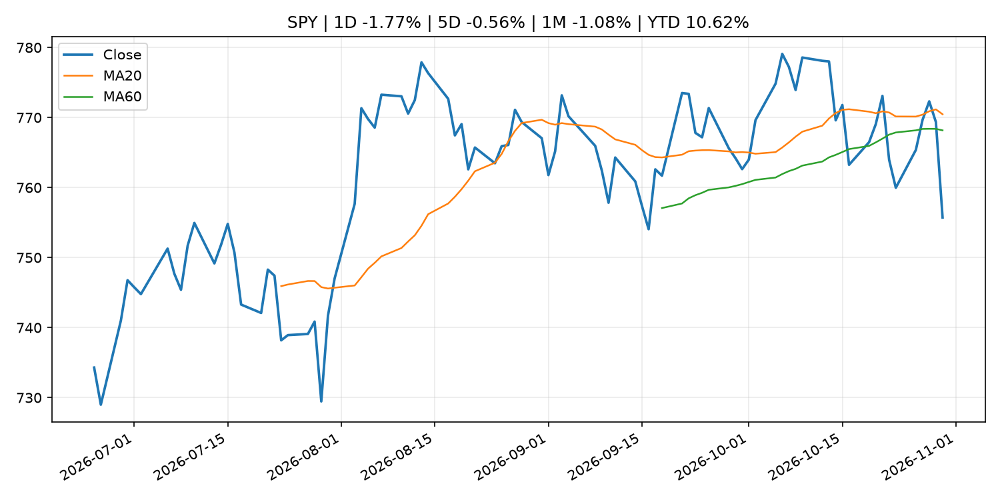
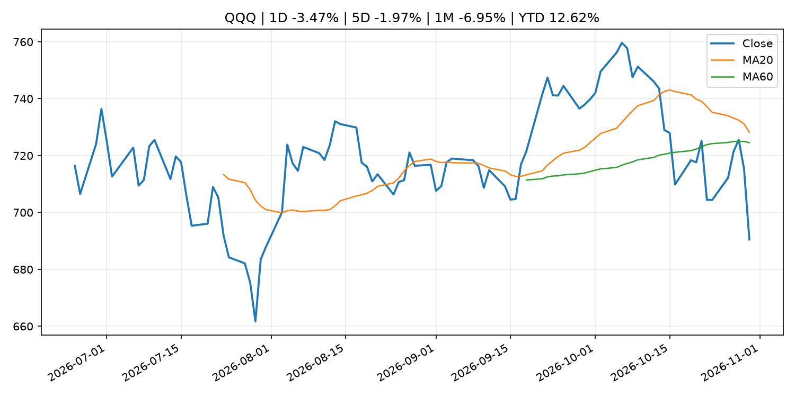
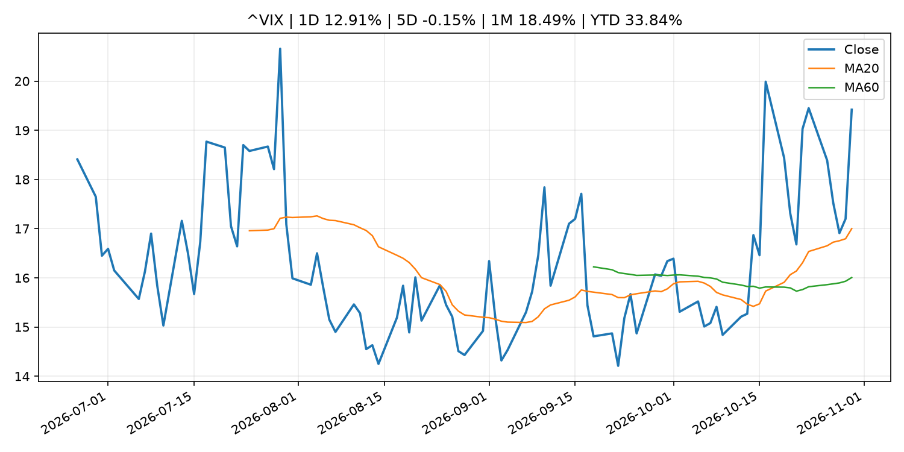
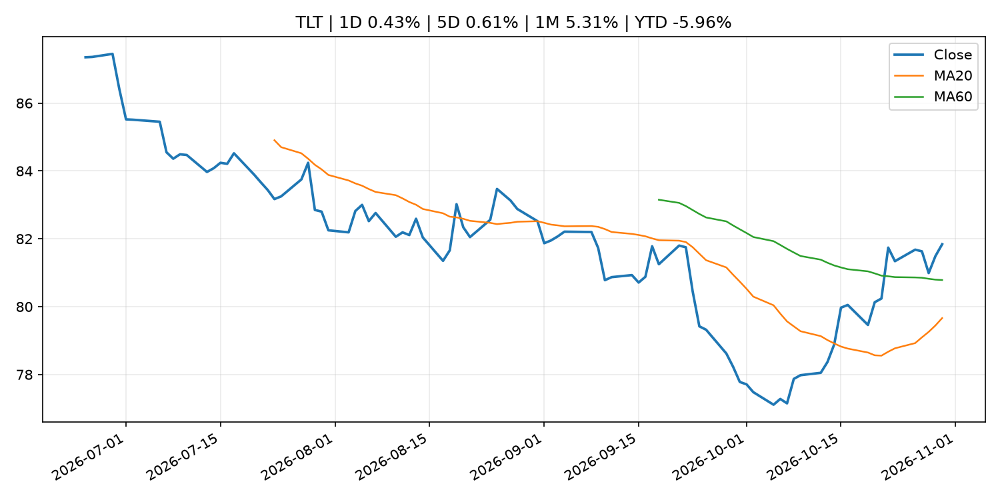
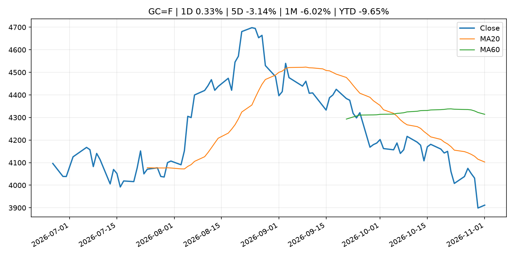
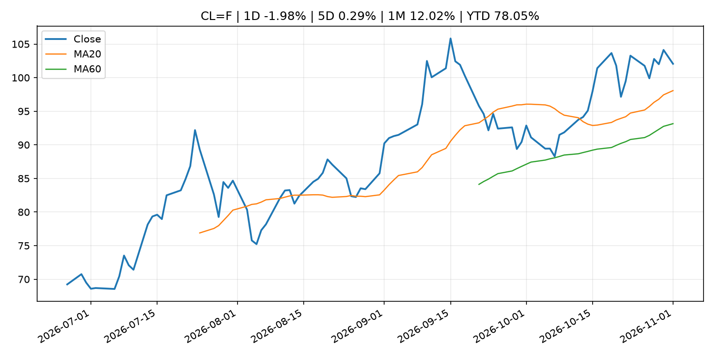
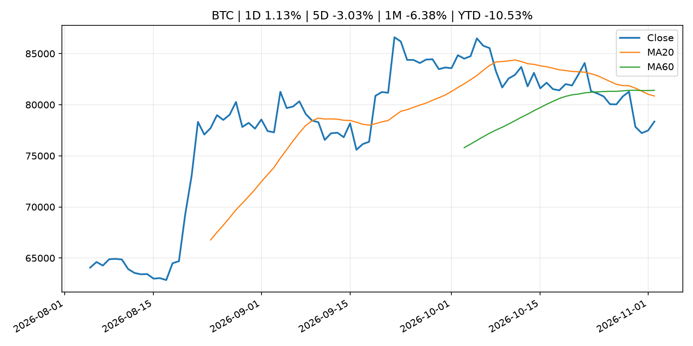
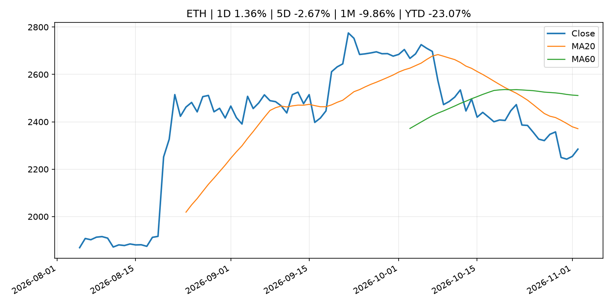
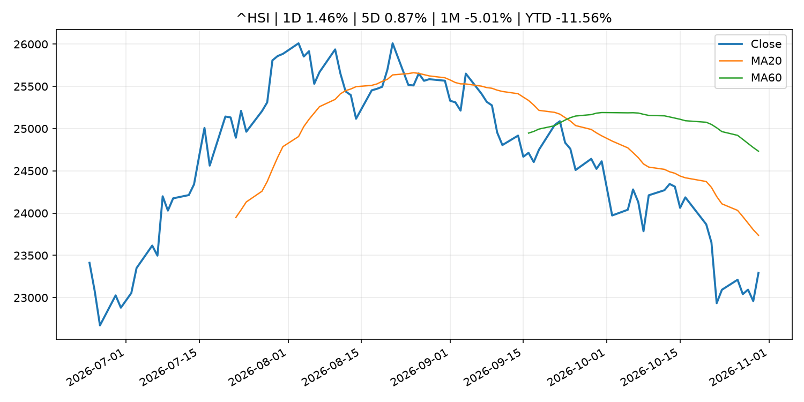

# Global Macro Morning Briefing - 2026-11-02

> Not financial advice / 非投资建议。

## 0. 今日总览
- 市场状态：risk_off。股指回落、VIX 抬升且避险资产走强，市场偏风险规避。
- 今日三大主线：
  1. earnings: This is the biggest threat to the AI-powered bull market
  2. earnings: Apple’s new earnings era begins at a critical time for Big Tech
- 一句话结论：今日晨报重点关注：大型科技股盈利和资本开支会影响纳指、半导体和 AI 交易主线。；大型科技股盈利和资本开支会影响纳指、半导体和 AI 交易主线。。跨资产方面，SPY 1D -1.77%；QQQ 1D -3.47%；^VIX 1D 12.91%；TLT 1D 0.43%；GC=F 1D 0.33%；CL=F 1D -1.98%；BTC 1D 1.13%；ETH 1D 1.36%；股指回落、VIX 抬升且避险资产走强，市场偏风险规避。政策、通胀、利率、美元、美债、能源和加密监管仍是主要观察线索。所有结论仅基于公开数据与短摘要整理，不构成投资建议。

## 1. 隔夜跨资产市场
- 美股：SPY 1D -1.77%，QQQ 1D -3.47%，整体趋势需结合 VIX 和利率确认。
- 美债/美元：TLT 1D 0.43%，美元指数 1D 0.05%，是判断折现率压力的核心线索。
- 黄金/原油：黄金 1D 0.33%，原油 1D -1.98%，用于观察避险、通胀和地缘风险。
- 加密：BTC 1D 1.13%，ETH 1D 1.36%，关注是否独立于纳指走出加密自身行情。
- 港股/A股：恒生 1D 1.46%，沪深300/上证 1D n/a，重点看中国政策预期与人民币线索。
- 风险观察：关注避险是否演变为信用或流动性压力。

### US_EQUITY

| symbol | latest close | 1D | 5D | 1M | YTD | trend |
|---|---:|---:|---:|---:|---:|---|
| SPY | 755.72 | -1.77% | -0.56% | -1.08% | 10.62% | range_bound |
| QQQ | 690.49 | -3.47% | -1.97% | -6.95% | 12.62% | range_bound |
| DIA | 517.13 | -1.07% | -0.81% | 1.67% | 6.93% | downtrend |
| IWM | 279.33 | -1.65% | 1.30% | 0.11% | 12.28% | range_bound |
| VTI | 371.57 | -1.76% | -0.39% | -0.96% | 10.48% | downtrend |

### US_MACRO_MARKET

| symbol | latest close | 1D | 5D | 1M | YTD | trend |
|---|---:|---:|---:|---:|---:|---|
| ^VIX | 19.42 | 12.91% | -0.15% | 18.49% | 33.84% | strong_uptrend |
| DX-Y.NYB | 101.93 | 0.05% | -0.03% | 0.00% | 3.57% | range_bound |
| TLT | 81.84 | 0.43% | 0.61% | 5.31% | -5.96% | range_bound |
| IEF | 91.76 | 0.56% | 0.78% | 2.75% | -4.50% | range_bound |

### COMMODITIES

| symbol | latest close | 1D | 5D | 1M | YTD | trend |
|---|---:|---:|---:|---:|---:|---|
| GC=F | 3,911.60 | 0.33% | -3.14% | -6.02% | -9.65% | strong_downtrend |
| SI=F | 50.01 | 1.87% | -7.56% | -16.61% | -29.11% | strong_downtrend |
| CL=F | 102.06 | -1.98% | 0.29% | 12.02% | 78.05% | strong_uptrend |
| BZ=F | 111.29 | -5.40% | -3.90% | 8.84% | 83.19% | strong_uptrend |
| NG=F | 2.92 | 0.86% | 12.34% | -3.69% | -19.21% | range_bound |
| HG=F | 6.52 | 0.97% | 0.20% | 0.45% | 15.62% | downtrend |

### HK_MARKET

| symbol | latest close | 1D | 5D | 1M | YTD | trend |
|---|---:|---:|---:|---:|---:|---|
| ^HSI | 23,294.42 | 1.46% | 0.87% | -5.01% | -11.56% | strong_downtrend |
| 0700.HK | 383.60 | 1.59% | -0.62% | -11.20% | -38.43% | strong_downtrend |
| 9988.HK | 97.05 | 0.99% | -0.77% | -8.62% | -34.87% | strong_downtrend |
| 3690.HK | 71.60 | 3.47% | -0.07% | 1.63% | -31.55% | downtrend |
| 1810.HK | 26.48 | 3.12% | -1.19% | 5.08% | -34.26% | range_bound |
| 1211.HK | 68.25 | -0.58% | -4.68% | -9.90% | -30.89% | strong_downtrend |

### CRYPTO

| symbol | latest close | 1D | 5D | 1M | YTD | trend |
|---|---:|---:|---:|---:|---:|---|
| BTC | 78,352.99 | 1.13% | -3.03% | -6.38% | -10.53% | strong_downtrend |
| ETH | 2,284.74 | 1.36% | -2.67% | -9.86% | -23.07% | strong_downtrend |
| SOLANA | 95.00 | -0.43% | -6.12% | -14.61% | -23.71% | strong_downtrend |
| BINANCECOIN | 713.60 | 1.49% | -4.09% | -5.29% | -17.28% | downtrend |
| RIPPLE | 1.26 | 0.42% | -5.54% | -10.87% | -31.77% | strong_downtrend |

## 2. 今日最重要的 10 条新闻
### 1. This is the biggest threat to the AI-powered bull market
- 来源：MarketWatch Top Stories
- 时间：2026-11-02T00:22:00+00:00
- 地区：US
- 事件类型：earnings
- 重要性层级：Tier 2
- 一句话摘要：Blockbuster earnings growth has helped to power the stock market higher in 2026. In 2027, that engine might stall.
- 为什么重要：大型科技股盈利和资本开支会影响纳指、半导体和 AI 交易主线。
- 可能影响：可能影响利率、汇率、风险资产或大宗商品预期，但当前公开信息不足以判断明确方向。
  - 资产：暂无明确资产映射
  - 方向：unknown
  - 强度：low
  - 原因：公开信息不足以判断方向。
- 原文链接：[https://www.marketwatch.com/story/this-is-the-biggest-threat-to-the-ai-powered-bull-market-e757ca37?mod=mw_rss_topstories](https://www.marketwatch.com/story/this-is-the-biggest-threat-to-the-ai-powered-bull-market-e757ca37?mod=mw_rss_topstories)

### 2. Apple’s new earnings era begins at a critical time for Big Tech
- 来源：MarketWatch Top Stories
- 时间：2026-11-02T00:21:00+00:00
- 地区：US
- 事件类型：earnings
- 重要性层级：Tier 2
- 一句话摘要：A rare Monday earnings report for Apple will give investors a glimpse into how new CEO John Ternus is managing inflated memory prices and a tougher backdrop for consumer spending.
- 为什么重要：大型科技股盈利和资本开支会影响纳指、半导体和 AI 交易主线。
- 可能影响：可能影响利率、汇率、风险资产或大宗商品预期，但当前公开信息不足以判断明确方向。
  - 资产：暂无明确资产映射
  - 方向：unknown
  - 强度：low
  - 原因：公开信息不足以判断方向。
- 原文链接：[https://www.marketwatch.com/story/apples-new-earnings-era-begins-at-a-critical-time-for-big-tech-2236a44e?mod=mw_rss_topstories](https://www.marketwatch.com/story/apples-new-earnings-era-begins-at-a-critical-time-for-big-tech-2236a44e?mod=mw_rss_topstories)

### 3. Binance opens crypto withdrawals in phases starting with bitcoin following $6.3 billion hack
- 来源：CoinDesk
- 时间：2026-11-01T10:35:42+00:00
- 地区：global
- 事件类型：other
- 重要性层级：Tier 3
- 一句话摘要：Binance opens crypto withdrawals in phases starting with bitcoin following $6.3 billion hack
- 为什么重要：这条信息暂未匹配到重大宏观、政策或市场事件，更适合作为背景跟踪。
- 可能影响：更偏背景信息，短期市场影响可能有限。
  - 资产：暂无明确资产映射
  - 方向：unknown
  - 强度：low
  - 原因：公开信息不足以判断方向。
- 原文链接：[https://www.coindesk.com/markets/2026/11/01/binance-opens-crypto-withdrawals-in-phases-starting-with-bitcoin-following-usd6-3-billion-hack](https://www.coindesk.com/markets/2026/11/01/binance-opens-crypto-withdrawals-in-phases-starting-with-bitcoin-following-usd6-3-billion-hack)

### 4. Bitcoin's white paper turns 18, and small businesses are still paying for the bailouts it answered
- 来源：CoinDesk
- 时间：2026-10-31T18:00:00+00:00
- 地区：global
- 事件类型：other
- 重要性层级：Tier 3
- 一句话摘要：Bitcoin's white paper turns 18, and small businesses are still paying for the bailouts it answered
- 为什么重要：这条信息暂未匹配到重大宏观、政策或市场事件，更适合作为背景跟踪。
- 可能影响：更偏背景信息，短期市场影响可能有限。
  - 资产：暂无明确资产映射
  - 方向：unknown
  - 强度：low
  - 原因：公开信息不足以判断方向。
- 原文链接：[https://www.coindesk.com/opinion/2026/10/31/bitcoin-s-white-paper-turns-18-and-small-businesses-are-still-paying-for-the-bailouts-it-answered](https://www.coindesk.com/opinion/2026/10/31/bitcoin-s-white-paper-turns-18-and-small-businesses-are-still-paying-for-the-bailouts-it-answered)

## 3. 政策与央行观察
暂无可靠数据。

- 为什么重要：没有可靠新闻时，不应为了填充版面编造市场解释。

## 4. 市场异动与图表
- SPY 下跌 -1.77%
- QQQ 下跌 -3.47%
- VIX 上涨 12.91%
- TLT 上涨 0.43%
- Oil 下跌 -1.98%

### SPY

### QQQ

### ^VIX

### TLT

### GC=F

### CL=F

### BTC

### ETH

### ^HSI

## 5. 华尔街与机构公开观点
- 暂无可靠公开观点。

## 6. 今日重点关注
- 经济数据：经济数据：暂无可靠公开日历数据；如配置经济日历源后可自动填充。
- 央行讲话：央行讲话：暂无可靠公开日历数据；重点跟踪 Fed、ECB、BoJ、PBOC 官网 RSS。
- 财报：财报：暂无可靠数据。
- 政策事件：政策事件：暂无可靠数据。
- 风险提醒：风险提醒：关注数据源失败项、突发地缘风险、利率和美元的二阶反应。

## 7. 英文金融表达与宏观概念
- **inflation expectations**：通胀预期，指家庭、企业或市场对未来通胀的预估。 例句：Inflation expectations can shape wage bargaining and bond yields.
- **real yield**：实际收益率，名义利率扣除通胀预期后的收益率。 例句：Gold often reacts more to real yields than nominal yields.
- **terminal rate**：终端利率，市场预期本轮加息周期的最高政策利率。 例句：A higher terminal rate can pressure growth stocks.
- **soft landing**：软着陆，指通胀回落而经济避免明显衰退。 例句：Markets often rally when data support a soft landing.
- **risk-off**：避险模式，资金偏向美元、国债、黄金等防御资产。 例句：A geopolitical shock can push markets into risk-off mode.
- **supply disruption**：供给扰动，通常指能源或商品供应受冲突、减产或天气影响。 例句：Supply disruption can lift oil prices and inflation expectations.

## 8. 背景材料
- [Binance opens crypto withdrawals in phases starting with bitcoin following $6.3 billion hack](https://www.coindesk.com/markets/2026/11/01/binance-opens-crypto-withdrawals-in-phases-starting-with-bitcoin-following-usd6-3-billion-hack)（CoinDesk，other）：Binance opens crypto withdrawals in phases starting with bitcoin following $6.3 billion hack
- [Bitcoin's white paper turns 18, and small businesses are still paying for the bailouts it answered](https://www.coindesk.com/opinion/2026/10/31/bitcoin-s-white-paper-turns-18-and-small-businesses-are-still-paying-for-the-bailouts-it-answered)（CoinDesk，other）：Bitcoin's white paper turns 18, and small businesses are still paying for the bailouts it answered
- [As big bitcoin miners chase AI profits, individuals get another shot at the rewards](https://www.coindesk.com/tech/2026/10/31/as-big-bitcoin-miners-chase-ai-profits-individuals-get-another-shot-at-the-rewards)（CoinDesk，other）：As big bitcoin miners chase AI profits, individuals get another shot at the rewards
- [18 years in, what has Bitcoin truly done?](https://www.coindesk.com/opinion/2026/10/31/18-years-in-what-has-bitcoin-truly-done)（CoinDesk，other）：18 years in, what has Bitcoin truly done?
- [A Nasdaq-listed company may sell $450 million bitcoin, citing Binance hack and quantum fears](https://www.coindesk.com/markets/2026/10/31/a-nasdaq-listed-company-may-sell-usd450-million-bitcoin-citing-binance-hack-and-quantum-fears)（CoinDesk，other）：A Nasdaq-listed company may sell $450 million bitcoin, citing Binance hack and quantum fears
- [Bitcoin stolen from Binance tops Tesla’s holdings and is over twice El Salvador’s reserve](https://www.coindesk.com/markets/2026/10/31/bitcoin-stolen-from-binance-tops-tesla-s-holdings-and-is-over-twice-el-salvador-s-reserve)（CoinDesk，other）：Bitcoin stolen from Binance tops Tesla’s holdings and is over twice El Salvador’s reserve

## 9. 数据源、失败项与免责声明
- 采集时间：2026-11-02T01:16:13
- 数据源：公开 RSS、Yahoo Finance、CoinGecko、AKShare、FRED、SEC data.sec.gov，以及用户自有 inputs/reports 文件。
- 合规说明：不绕过 WSJ、Bloomberg、FT、Reuters 等付费墙；对付费媒体只使用公开 RSS 标题、摘要、链接和发布时间。
- 免责声明：Not financial advice / 非投资建议。本项目仅供个人学习、研究和信息整理，不构成投资建议、交易建议或任何收益承诺。
- 失败或跳过的数据源：
  - crypto data failed coin=dogecoin
  - China market data failed symbol=上证指数: empty dataframe
  - China market data failed symbol=深证成指: empty dataframe
  - China market data failed symbol=创业板指: empty dataframe
  - China market data failed symbol=沪深300: empty dataframe
  - China market data failed symbol=中证500: empty dataframe
  - China market data failed symbol=科创50: empty dataframe
  - FRED_API_KEY not set; skipping FRED macro series
  - SEC failed cik=0000320193
  - SEC failed cik=0000789019
  - SEC failed cik=0001045810
  - SEC failed cik=0001318605
  - SEC failed cik=0001577552
