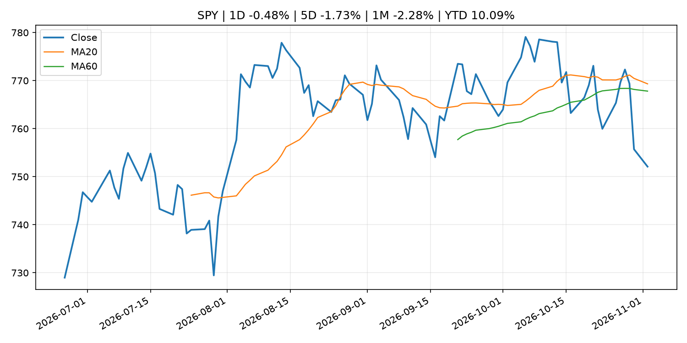
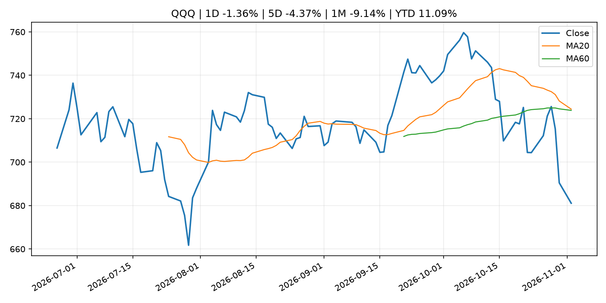
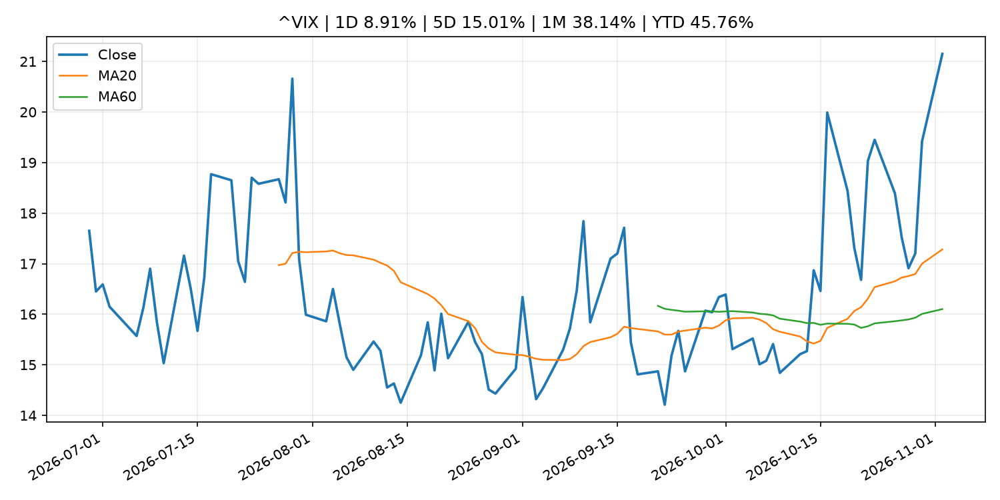
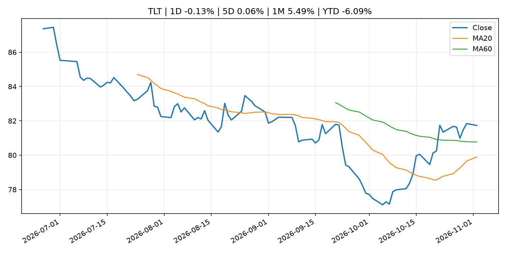
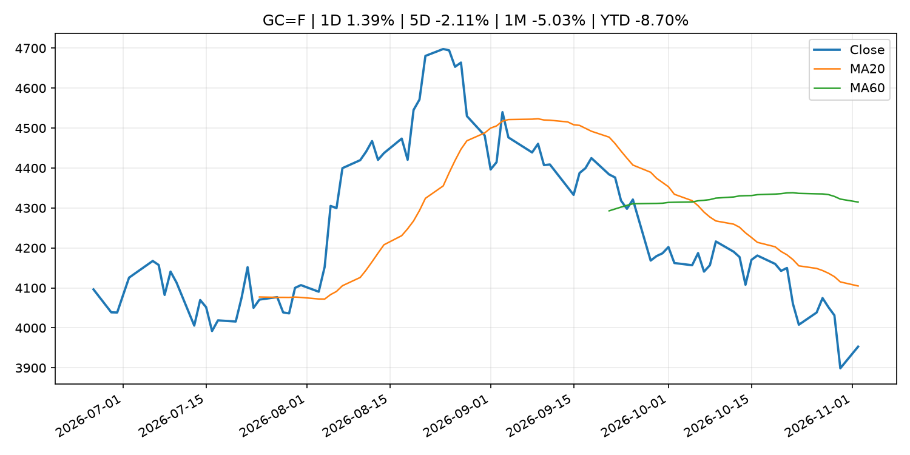
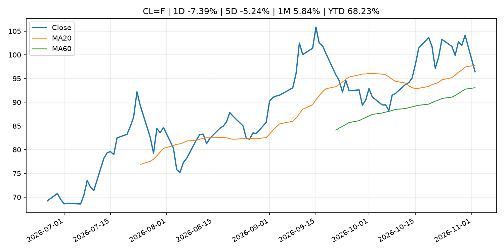
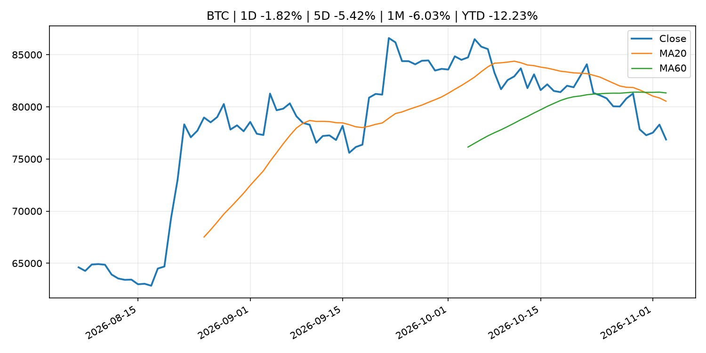
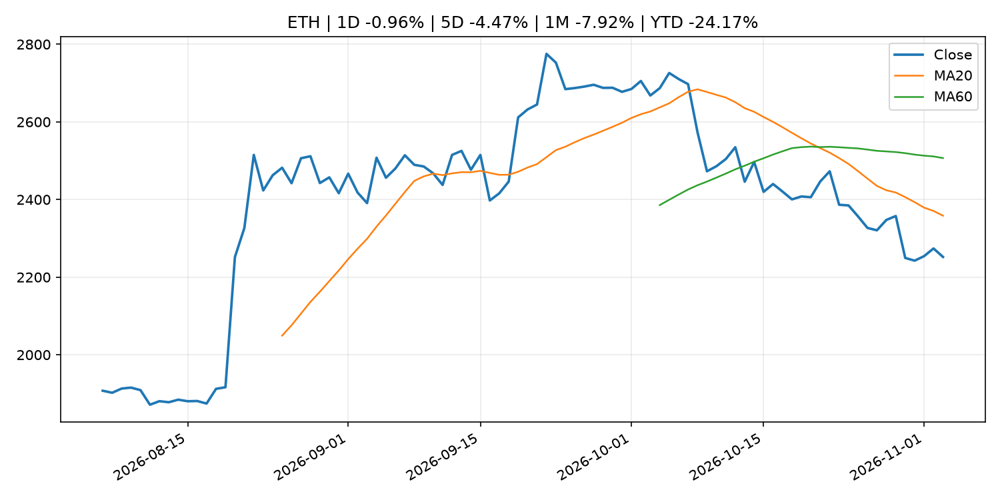
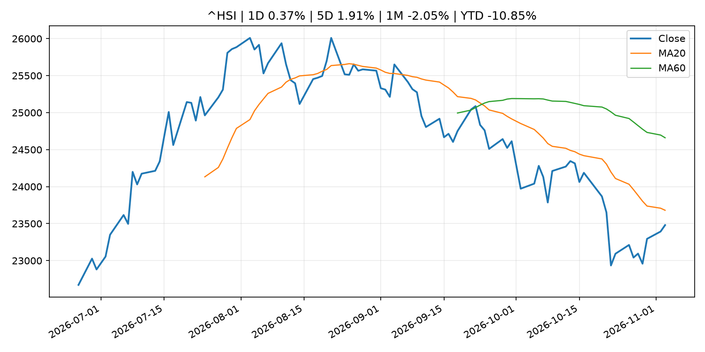

# Global Macro Morning Briefing - 2026-11-03

> Not financial advice / 非投资建议。

## 0. 今日总览
- 市场状态：risk_off。股指回落、VIX 抬升且避险资产走强，市场偏风险规避。
- 今日三大主线：
  1. crypto_market_structure: XRP Ledger set to fix flaw that could have let stablecoin partners print new tokens
  2. earnings: Here’s why Palantir’s stock is down despite a ‘bombastic’ quarter
  3. earnings: The stock market has gone nowhere for the past 5 months. It’s now looking like a bargain.
- 一句话结论：今日晨报重点关注：加密市场结构和监管变化会影响 BTC、ETH 及相关股票的风险溢价。；大型科技股盈利和资本开支会影响纳指、半导体和 AI 交易主线。。跨资产方面，SPY 1D -0.48%；QQQ 1D -1.36%；^VIX 1D 8.91%；TLT 1D -0.13%；GC=F 1D 1.39%；CL=F 1D -7.39%；BTC 1D -1.82%；ETH 1D -0.96%；股指回落、VIX 抬升且避险资产走强，市场偏风险规避。政策、通胀、利率、美元、美债、能源和加密监管仍是主要观察线索。所有结论仅基于公开数据与短摘要整理，不构成投资建议。

## 1. 隔夜跨资产市场
- 美股：SPY 1D -0.48%，QQQ 1D -1.36%，整体趋势需结合 VIX 和利率确认。
- 美债/美元：TLT 1D -0.13%，美元指数 1D -0.06%，是判断折现率压力的核心线索。
- 黄金/原油：黄金 1D 1.39%，原油 1D -7.39%，用于观察避险、通胀和地缘风险。
- 加密：BTC 1D -1.82%，ETH 1D -0.96%，关注是否独立于纳指走出加密自身行情。
- 港股/A股：恒生 1D 0.37%，沪深300/上证 1D n/a，重点看中国政策预期与人民币线索。
- 风险观察：关注避险是否演变为信用或流动性压力。

### US_EQUITY

| symbol | latest close | 1D | 5D | 1M | YTD | trend |
|---|---:|---:|---:|---:|---:|---|
| SPY | 752.10 | -0.48% | -1.73% | -2.28% | 10.09% | range_bound |
| QQQ | 681.09 | -1.36% | -4.37% | -9.14% | 11.09% | range_bound |
| DIA | 519.34 | 0.43% | -0.69% | 1.61% | 7.38% | downtrend |
| IWM | 279.14 | -0.07% | 0.78% | -0.85% | 12.20% | range_bound |
| VTI | 370.00 | -0.42% | -1.49% | -2.11% | 10.02% | downtrend |

### US_MACRO_MARKET

| symbol | latest close | 1D | 5D | 1M | YTD | trend |
|---|---:|---:|---:|---:|---:|---|
| ^VIX | 21.15 | 8.91% | 15.01% | 38.14% | 45.76% | strong_uptrend |
| DX-Y.NYB | 101.82 | -0.06% | -0.14% | -0.11% | 3.45% | range_bound |
| TLT | 81.73 | -0.13% | 0.06% | 5.49% | -6.09% | range_bound |
| IEF | 91.50 | -0.28% | 0.42% | 2.75% | -4.77% | range_bound |

### COMMODITIES

| symbol | latest close | 1D | 5D | 1M | YTD | trend |
|---|---:|---:|---:|---:|---:|---|
| GC=F | 3,953.10 | 1.39% | -2.11% | -5.03% | -8.70% | strong_downtrend |
| SI=F | 50.05 | 1.94% | -7.50% | -16.55% | -29.06% | strong_downtrend |
| CL=F | 96.43 | -7.39% | -5.24% | 5.84% | 68.23% | range_bound |
| BZ=F | 104.54 | -11.14% | -9.73% | 2.24% | 72.08% | range_bound |
| NG=F | 2.88 | -0.52% | 10.80% | -5.01% | -20.32% | range_bound |
| HG=F | 6.46 | 0.08% | -0.68% | -0.44% | 14.60% | downtrend |

### HK_MARKET

| symbol | latest close | 1D | 5D | 1M | YTD | trend |
|---|---:|---:|---:|---:|---:|---|
| ^HSI | 23,480.31 | 0.37% | 1.91% | -2.05% | -10.85% | downtrend |
| 0700.HK | 397.80 | 1.43% | 3.27% | -5.56% | -36.15% | strong_downtrend |
| 9988.HK | 100.30 | 0.85% | 3.40% | -3.93% | -32.68% | strong_downtrend |
| 3690.HK | 73.95 | 1.23% | 2.92% | 5.34% | -29.30% | range_bound |
| 1810.HK | 28.56 | 1.64% | 11.30% | 17.82% | -29.10% | range_bound |
| 1211.HK | 72.50 | 2.91% | 3.50% | -1.89% | -26.58% | range_bound |

### CRYPTO

| symbol | latest close | 1D | 5D | 1M | YTD | trend |
|---|---:|---:|---:|---:|---:|---|
| BTC | 76,865.57 | -1.82% | -5.42% | -6.03% | -12.23% | strong_downtrend |
| ETH | 2,252.06 | -0.96% | -4.47% | -7.92% | -24.17% | strong_downtrend |
| SOLANA | 92.08 | -2.53% | -10.00% | -12.83% | -26.05% | strong_downtrend |
| BINANCECOIN | 696.29 | -2.19% | -8.27% | -4.92% | -19.29% | strong_downtrend |
| RIPPLE | 1.25 | -0.07% | -5.72% | -6.87% | -32.15% | strong_downtrend |

## 2. 今日最重要的 10 条新闻
### 1. XRP Ledger set to fix flaw that could have let stablecoin partners print new tokens
- 来源：CoinDesk
- 时间：2026-11-02T12:37:24+00:00
- 地区：global
- 事件类型：crypto_market_structure
- 重要性层级：Tier 2
- 一句话摘要：XRP Ledger set to fix flaw that could have let stablecoin partners print new tokens
- 为什么重要：加密市场结构和监管变化会影响 BTC、ETH 及相关股票的风险溢价。
- 可能影响：主要影响 BTC，方向为 mixed，强度 high；加密监管或 ETF 进展会改变 BTC 的资金流和风险溢价。
  - 资产：BTC
    方向：mixed
    强度：high
    原因：加密监管或 ETF 进展会改变 BTC 的资金流和风险溢价。
  - 资产：ETH
    方向：mixed
    强度：high
    原因：监管框架会影响 ETH 产品化和机构参与度。
  - 资产：COIN
    方向：mixed
    强度：medium
    原因：监管清晰度和执法风险会影响交易平台估值。
  - 资产：crypto market
    方向：mixed
    强度：high
    原因：信息影响整个加密市场结构，但方向取决于细节。
- 原文链接：[https://www.coindesk.com/tech/2026/11/02/xrp-ledger-set-to-fix-flaw-that-could-let-stablecoin-partners-print-new-tokens](https://www.coindesk.com/tech/2026/11/02/xrp-ledger-set-to-fix-flaw-that-could-let-stablecoin-partners-print-new-tokens)

### 2. Here’s why Palantir’s stock is down despite a ‘bombastic’ quarter
- 来源：MarketWatch Top Stories
- 时间：2026-11-03T00:59:00+00:00
- 地区：US
- 事件类型：earnings
- 重要性层级：Tier 2
- 一句话摘要：A deceleration in U.S. commercial contract growth gave some Wall Street analysts pause despite Palantir’s earnings beat.
- 为什么重要：大型科技股盈利和资本开支会影响纳指、半导体和 AI 交易主线。
- 可能影响：可能影响利率、汇率、风险资产或大宗商品预期，但当前公开信息不足以判断明确方向。
  - 资产：暂无明确资产映射
  - 方向：unknown
  - 强度：low
  - 原因：公开信息不足以判断方向。
- 原文链接：[https://www.marketwatch.com/story/heres-why-palantirs-stock-is-down-despite-a-bombastic-quarter-42c9fdb8?mod=mw_rss_topstories](https://www.marketwatch.com/story/heres-why-palantirs-stock-is-down-despite-a-bombastic-quarter-42c9fdb8?mod=mw_rss_topstories)

### 3. The stock market has gone nowhere for the past 5 months. It’s now looking like a bargain.
- 来源：MarketWatch Top Stories
- 时间：2026-11-02T21:29:00+00:00
- 地区：US
- 事件类型：earnings
- 重要性层级：Tier 2
- 一句话摘要：The S&P 500’s forward price-to-earnings ratio is below its five-year and 10-year averages.
- 为什么重要：大型科技股盈利和资本开支会影响纳指、半导体和 AI 交易主线。
- 可能影响：可能影响利率、汇率、风险资产或大宗商品预期，但当前公开信息不足以判断明确方向。
  - 资产：暂无明确资产映射
  - 方向：unknown
  - 强度：low
  - 原因：公开信息不足以判断方向。
- 原文链接：[https://www.marketwatch.com/story/the-stock-market-has-gone-nowhere-for-the-past-5-months-its-now-looking-like-a-bargain-150914c2?mod=mw_rss_topstories](https://www.marketwatch.com/story/the-stock-market-has-gone-nowhere-for-the-past-5-months-its-now-looking-like-a-bargain-150914c2?mod=mw_rss_topstories)

### 4. Palantir earnings reveal a major AI turning point
- 来源：MarketWatch Top Stories
- 时间：2026-11-02T21:09:00+00:00
- 地区：US
- 事件类型：earnings
- 重要性层级：Tier 2
- 一句话摘要：The U.S. commercial business brought in more money than the U.S. government segment in the third quarter.
- 为什么重要：大型科技股盈利和资本开支会影响纳指、半导体和 AI 交易主线。
- 可能影响：可能影响利率、汇率、风险资产或大宗商品预期，但当前公开信息不足以判断明确方向。
  - 资产：暂无明确资产映射
  - 方向：unknown
  - 强度：low
  - 原因：公开信息不足以判断方向。
- 原文链接：[https://www.marketwatch.com/story/palantir-earnings-reveal-a-major-ai-turning-point-db766110?mod=mw_rss_topstories](https://www.marketwatch.com/story/palantir-earnings-reveal-a-major-ai-turning-point-db766110?mod=mw_rss_topstories)

### 5. Coinbase downgraded at Morgan Stanley; price target slashed 53% on weak earnings outlook
- 来源：CoinDesk
- 时间：2026-11-02T14:29:33+00:00
- 地区：global
- 事件类型：earnings
- 重要性层级：Tier 2
- 一句话摘要：Coinbase downgraded at Morgan Stanley; price target slashed 53% on weak earnings outlook
- 为什么重要：大型科技股盈利和资本开支会影响纳指、半导体和 AI 交易主线。
- 可能影响：可能影响利率、汇率、风险资产或大宗商品预期，但当前公开信息不足以判断明确方向。
  - 资产：暂无明确资产映射
  - 方向：unknown
  - 强度：low
  - 原因：公开信息不足以判断方向。
- 原文链接：[https://www.coindesk.com/markets/2026/11/02/morgan-stanley-downgrades-coinbase-slashes-price-target-53-on-weak-earnings-outlook](https://www.coindesk.com/markets/2026/11/02/morgan-stanley-downgrades-coinbase-slashes-price-target-53-on-weak-earnings-outlook)

### 6. Traders rushing into a leveraged ETF to make a bullish bet on the Nasdaq-100 just got burned
- 来源：MarketWatch Top Stories
- 时间：2026-11-02T22:03:00+00:00
- 地区：US
- 事件类型：other
- 重要性层级：Tier 3
- 一句话摘要：Some investors appeared a little too eager to buy the dip in technology stocks last month.
- 为什么重要：这条信息暂未匹配到重大宏观、政策或市场事件，更适合作为背景跟踪。
- 可能影响：主要影响 BTC，方向为 mixed，强度 high；加密监管或 ETF 进展会改变 BTC 的资金流和风险溢价。
  - 资产：BTC
    方向：mixed
    强度：high
    原因：加密监管或 ETF 进展会改变 BTC 的资金流和风险溢价。
  - 资产：ETH
    方向：mixed
    强度：high
    原因：监管框架会影响 ETH 产品化和机构参与度。
  - 资产：COIN
    方向：mixed
    强度：medium
    原因：监管清晰度和执法风险会影响交易平台估值。
  - 资产：crypto market
    方向：mixed
    强度：high
    原因：信息影响整个加密市场结构，但方向取决于细节。
- 原文链接：[https://www.marketwatch.com/story/traders-rushing-into-a-leveraged-etf-to-make-a-bullish-bet-on-the-nasdaq-100-just-got-burned-d6775191?mod=mw_rss_topstories](https://www.marketwatch.com/story/traders-rushing-into-a-leveraged-etf-to-make-a-bullish-bet-on-the-nasdaq-100-just-got-burned-d6775191?mod=mw_rss_topstories)

### 7. Bitcoin traders eye post-election rally as exchange outflows point to supply squeeze
- 来源：CoinDesk
- 时间：2026-11-02T18:13:57+00:00
- 地区：global
- 事件类型：other
- 重要性层级：Tier 3
- 一句话摘要：Bitcoin traders eye post-election rally as exchange outflows point to supply squeeze
- 为什么重要：这条信息暂未匹配到重大宏观、政策或市场事件，更适合作为背景跟踪。
- 可能影响：更偏背景信息，短期市场影响可能有限。
  - 资产：暂无明确资产映射
  - 方向：unknown
  - 强度：low
  - 原因：公开信息不足以判断方向。
- 原文链接：[https://www.coindesk.com/markets/2026/11/02/bitcoin-traders-eye-post-election-rally-as-exchange-outflows-point-to-supply-squeeze](https://www.coindesk.com/markets/2026/11/02/bitcoin-traders-eye-post-election-rally-as-exchange-outflows-point-to-supply-squeeze)

## 3. 政策与央行观察
### 1. XRP Ledger set to fix flaw that could have let stablecoin partners print new tokens
- 来源：CoinDesk
- 时间：2026-11-02T12:37:24+00:00
- 地区：global
- 事件类型：crypto_market_structure
- 重要性层级：Tier 2
- 一句话摘要：XRP Ledger set to fix flaw that could have let stablecoin partners print new tokens
- 为什么重要：加密市场结构和监管变化会影响 BTC、ETH 及相关股票的风险溢价。
- 可能影响：主要影响 BTC，方向为 mixed，强度 high；加密监管或 ETF 进展会改变 BTC 的资金流和风险溢价。
  - 资产：BTC
    方向：mixed
    强度：high
    原因：加密监管或 ETF 进展会改变 BTC 的资金流和风险溢价。
  - 资产：ETH
    方向：mixed
    强度：high
    原因：监管框架会影响 ETH 产品化和机构参与度。
  - 资产：COIN
    方向：mixed
    强度：medium
    原因：监管清晰度和执法风险会影响交易平台估值。
  - 资产：crypto market
    方向：mixed
    强度：high
    原因：信息影响整个加密市场结构，但方向取决于细节。
- 原文链接：[https://www.coindesk.com/tech/2026/11/02/xrp-ledger-set-to-fix-flaw-that-could-let-stablecoin-partners-print-new-tokens](https://www.coindesk.com/tech/2026/11/02/xrp-ledger-set-to-fix-flaw-that-could-let-stablecoin-partners-print-new-tokens)

## 4. 市场异动与图表
- SPY 下跌 -0.48%
- QQQ 下跌 -1.36%
- VIX 上涨 8.91%
- Gold 上涨 1.39%
- Oil 下跌 -7.39%

### SPY

### QQQ

### ^VIX

### TLT

### GC=F

### CL=F

### BTC

### ETH

### ^HSI

## 5. 华尔街与机构公开观点
- 暂无可靠公开观点。

## 6. 今日重点关注
- 经济数据：经济数据：暂无可靠公开日历数据；如配置经济日历源后可自动填充。
- 央行讲话：央行讲话：暂无可靠公开日历数据；重点跟踪 Fed、ECB、BoJ、PBOC 官网 RSS。
- 财报：财报：暂无可靠数据。
- 政策事件：政策事件：暂无可靠数据。
- 风险提醒：风险提醒：关注数据源失败项、突发地缘风险、利率和美元的二阶反应。

## 7. 英文金融表达与宏观概念
- **risk-off**：避险模式，资金偏向美元、国债、黄金等防御资产。 例句：A geopolitical shock can push markets into risk-off mode.
- **market structure**：市场结构，指交易、托管、清算、ETF、监管等制度安排。 例句：Crypto market structure rules can affect institutional participation.
- **inflation expectations**：通胀预期，指家庭、企业或市场对未来通胀的预估。 例句：Inflation expectations can shape wage bargaining and bond yields.
- **real yield**：实际收益率，名义利率扣除通胀预期后的收益率。 例句：Gold often reacts more to real yields than nominal yields.
- **terminal rate**：终端利率，市场预期本轮加息周期的最高政策利率。 例句：A higher terminal rate can pressure growth stocks.
- **soft landing**：软着陆，指通胀回落而经济避免明显衰退。 例句：Markets often rally when data support a soft landing.

## 8. 背景材料
- [Traders rushing into a leveraged ETF to make a bullish bet on the Nasdaq-100 just got burned](https://www.marketwatch.com/story/traders-rushing-into-a-leveraged-etf-to-make-a-bullish-bet-on-the-nasdaq-100-just-got-burned-d6775191?mod=mw_rss_topstories)（MarketWatch Top Stories，other）：Some investors appeared a little too eager to buy the dip in technology stocks last month.
- [Bitcoin traders eye post-election rally as exchange outflows point to supply squeeze](https://www.coindesk.com/markets/2026/11/02/bitcoin-traders-eye-post-election-rally-as-exchange-outflows-point-to-supply-squeeze)（CoinDesk，other）：Bitcoin traders eye post-election rally as exchange outflows point to supply squeeze
- [Brazil’s Mercado Bitcoin halts withdrawals after $40 million drained across 10 chains](https://www.coindesk.com/business/2026/11/02/brazil-s-mercado-bitcoin-halts-withdrawals-after-usd40-million-drained-across-10-chains)（CoinDesk，other）：Brazil’s Mercado Bitcoin halts withdrawals after $40 million drained across 10 chains
- [Standard Chartered debuts tokenized deposits in Hong Kong for corporate clients](https://www.coindesk.com/business/2026/11/02/standard-chartered-debuts-tokenized-deposits-in-hong-kong-for-corporate-clients)（CoinDesk，other）：Standard Chartered debuts tokenized deposits in Hong Kong for corporate clients
- [Bitcoin's 'volatility curve' has a midterm bump](https://www.coindesk.com/daybook-us/2026/11/02/bitcoin-s-volatility-curve-has-a-midterm-bump)（CoinDesk，other）：Bitcoin's 'volatility curve' has a midterm bump
- [Bitcoin eases to $77,900 as Binance customers pull $3.6 billion after withdrawals reopen](https://www.coindesk.com/markets/2026/11/02/bitcoin-eases-to-usd77-900-as-binance-customers-pull-usd3-6-billion-after-withdrawals-reopen)（CoinDesk，other）：Bitcoin eases to $77,900 as Binance customers pull $3.6 billion after withdrawals reopen
- [Boris Vujčić: Integrated, open and resilient: Europe’s strengths in a fragmenting world](https://www.ecb.europa.eu//press/key/date/2026/html/ecb.sp.261102~70003226e9.en.html)（ECB Press Releases，other）：Boris Vujčić: Integrated, open and resilient: Europe’s strengths in a fragmenting world
- [Live updates: Bitcoin bounce fades as Binance exploit, AI unwind continue to weigh](https://www.coindesk.com/markets/2026/11/02/live-updates-binance-records-usd6-billion-outflows-after-starting-withdrawals-less-then-4-of-total-holdings)（CoinDesk，other）：Live updates: Bitcoin bounce fades as Binance exploit, AI unwind continue to weigh
- [Bitcoin ETFs lost $643 million in outflows Friday, and 2026 is barely green now](https://www.coindesk.com/markets/2026/11/02/bitcoin-etfs-lost-usd643-million-in-outflows-friday-and-2026-is-barely-green-now)（CoinDesk，other）：Bitcoin ETFs lost $643 million in outflows Friday, and 2026 is barely green now
- [Strangers are begging the Binance hacker for bitcoin, one ‘help me bro’ at a time](https://www.coindesk.com/tech/2026/11/02/strangers-are-begging-the-binance-hacker-for-bitcoin-one-help-me-bro-at-a-time)（CoinDesk，other）：Strangers are begging the Binance hacker for bitcoin, one ‘help me bro’ at a time
- [Outlook for Economic Activity and Prices (October 2026, full text)](http://www.boj.or.jp/en/mopo/outlook/gor2610b.pdf)（Bank of Japan Announcements，other）：Outlook for Economic Activity and Prices (October 2026, full text)
- [Bitcoin claws back toward $79,000 as markets shake off crypto's biggest hack](https://www.coindesk.com/markets/2026/11/02/bitcoin-claws-back-toward-usd79-000-as-markets-shake-off-crypto-s-biggest-hack)（CoinDesk，other）：Bitcoin claws back toward $79,000 as markets shake off crypto's biggest hack
- [BTCPay, a bitcoin payment tool, tells users to switch off their servers after reports of drained wallets](https://www.coindesk.com/tech/2026/11/02/btcpay-a-bitcoin-payment-tool-tells-users-to-switch-off-their-servers-after-reports-of-drained-wallets)（CoinDesk，other）：BTCPay, a bitcoin payment tool, tells users to switch off their servers after reports of drained wallets
- [Sources of Changes in Current Account Balances and Market Operations (Oct.)](http://www.boj.or.jp/en/statistics/boj/fm/juqf/juqf10.xlsx)（Bank of Japan Announcements，other）：Sources of Changes in Current Account Balances and Market Operations (Oct.)

## 9. 数据源、失败项与免责声明
- 采集时间：2026-11-03T03:19:31
- 数据源：公开 RSS、Yahoo Finance、CoinGecko、AKShare、FRED、SEC data.sec.gov，以及用户自有 inputs/reports 文件。
- 合规说明：不绕过 WSJ、Bloomberg、FT、Reuters 等付费墙；对付费媒体只使用公开 RSS 标题、摘要、链接和发布时间。
- 免责声明：Not financial advice / 非投资建议。本项目仅供个人学习、研究和信息整理，不构成投资建议、交易建议或任何收益承诺。
- 失败或跳过的数据源：
  - crypto data failed coin=dogecoin
  - China market data failed symbol=上证指数: empty dataframe
  - China market data failed symbol=深证成指: empty dataframe
  - China market data failed symbol=创业板指: empty dataframe
  - China market data failed symbol=沪深300: empty dataframe
  - China market data failed symbol=中证500: empty dataframe
  - China market data failed symbol=科创50: empty dataframe
  - FRED_API_KEY not set; skipping FRED macro series
  - SEC failed cik=0000320193
  - SEC failed cik=0000789019
  - SEC failed cik=0001045810
  - SEC failed cik=0001318605
  - SEC failed cik=0001577552
