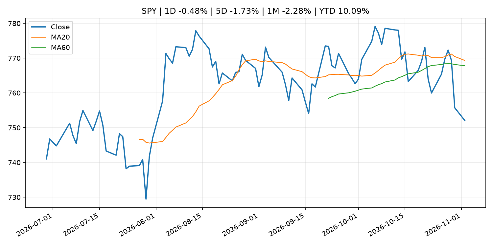
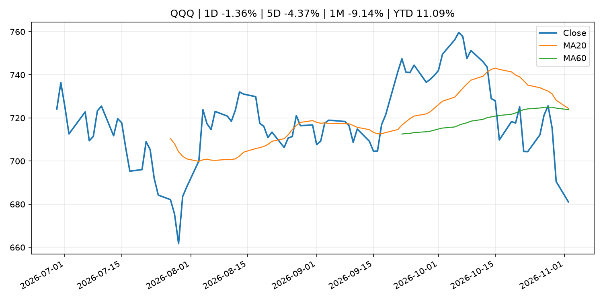
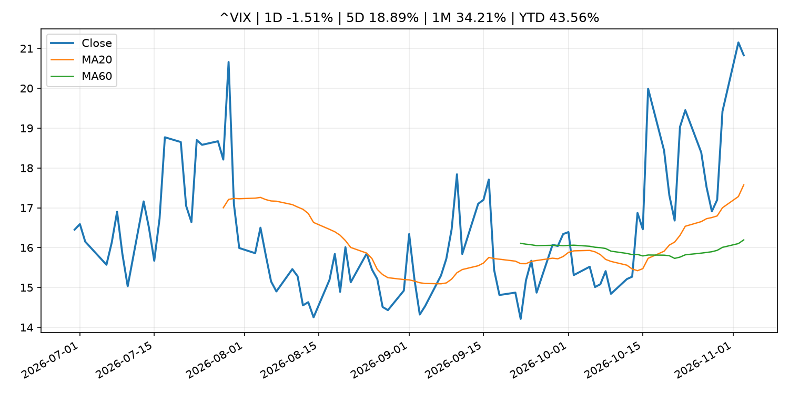
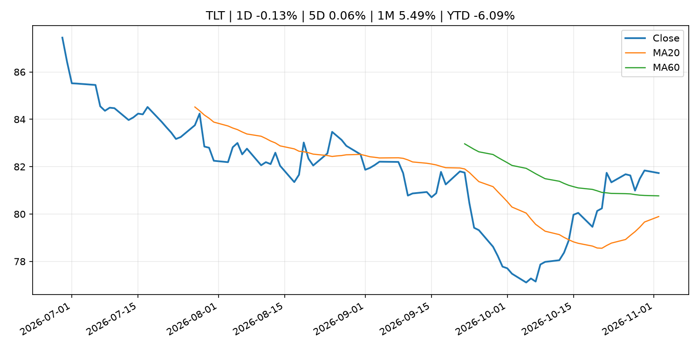
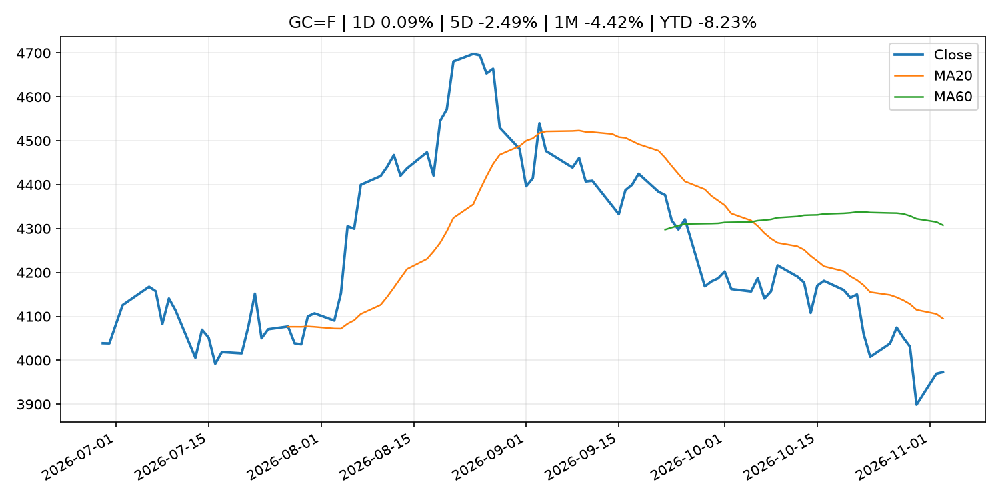
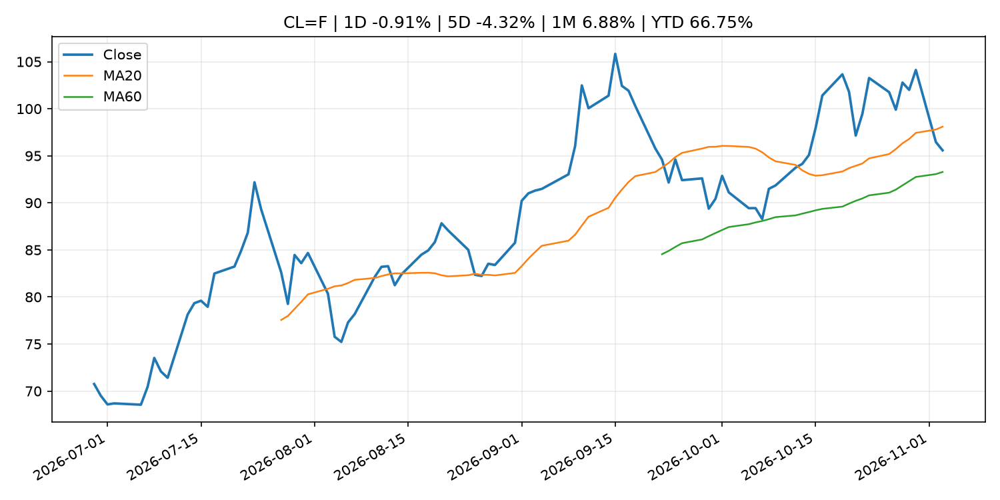
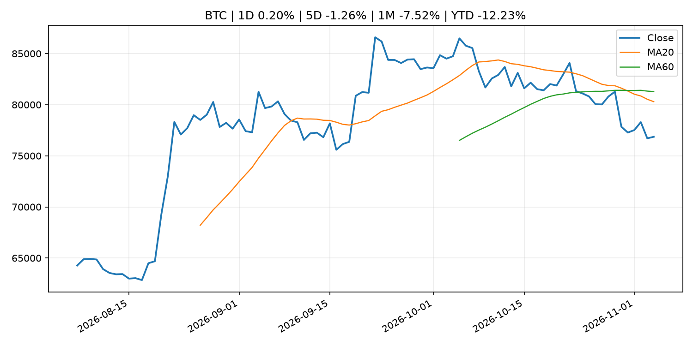
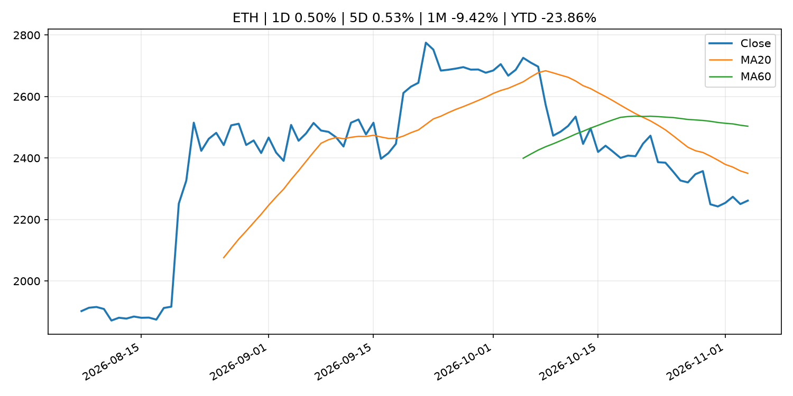
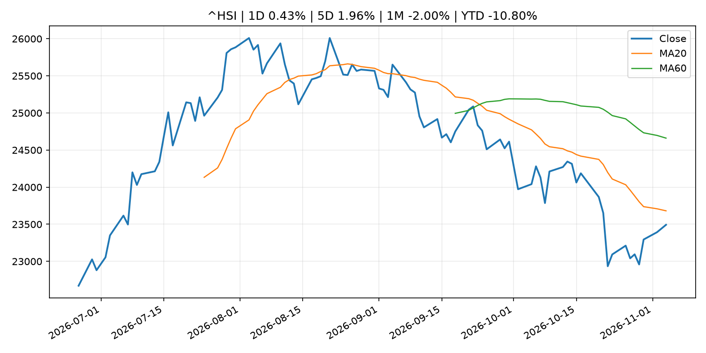

# Global Macro Morning Briefing - 2026-11-04

> Not financial advice / 非投资建议。

## 0. 今日总览
- 市场状态：unknown。市场信号不足，暂不判断明确状态。
- 今日三大主线：
  1. fiscal_policy: Justin Sun seeks sanctions against Trump-linked World Liberty Financial over UAE ties
  2. crypto_market_structure: Stablecoin governance group behind OUSD sets out management fee, offers equity earning pool
  3. earnings: Super Micro’s stock pops as earnings show booming demand for AI servers
- 一句话结论：今日晨报重点关注：财政和贸易政策会影响增长、通胀、企业利润和跨境资本流。；加密市场结构和监管变化会影响 BTC、ETH 及相关股票的风险溢价。。跨资产方面，SPY 1D -0.48%；QQQ 1D -1.36%；^VIX 1D -1.51%；TLT 1D -0.13%；GC=F 1D 0.09%；CL=F 1D -0.91%；BTC 1D 0.20%；ETH 1D 0.50%；市场信号不足，暂不判断明确状态。政策、通胀、利率、美元、美债、能源和加密监管仍是主要观察线索。所有结论仅基于公开数据与短摘要整理，不构成投资建议。

## 1. 隔夜跨资产市场
- 美股：SPY 1D -0.48%，QQQ 1D -1.36%，整体趋势需结合 VIX 和利率确认。
- 美债/美元：TLT 1D -0.13%，美元指数 1D -0.46%，是判断折现率压力的核心线索。
- 黄金/原油：黄金 1D 0.09%，原油 1D -0.91%，用于观察避险、通胀和地缘风险。
- 加密：BTC 1D 0.20%，ETH 1D 0.50%，关注是否独立于纳指走出加密自身行情。
- 港股/A股：恒生 1D 0.43%，沪深300/上证 1D n/a，重点看中国政策预期与人民币线索。
- 风险观察：关注后续数据是否确认当前跨资产信号。

### US_EQUITY

| symbol | latest close | 1D | 5D | 1M | YTD | trend |
|---|---:|---:|---:|---:|---:|---|
| SPY | 752.10 | -0.48% | -1.73% | -2.28% | 10.09% | range_bound |
| QQQ | 681.09 | -1.36% | -4.37% | -9.14% | 11.09% | range_bound |
| DIA | 519.34 | 0.43% | -0.69% | 1.61% | 7.38% | downtrend |
| IWM | 279.14 | -0.07% | 0.78% | -0.85% | 12.20% | range_bound |
| VTI | 370.00 | -0.42% | -1.49% | -2.11% | 10.02% | downtrend |

### US_MACRO_MARKET

| symbol | latest close | 1D | 5D | 1M | YTD | trend |
|---|---:|---:|---:|---:|---:|---|
| ^VIX | 20.83 | -1.51% | 18.89% | 34.21% | 43.56% | strong_uptrend |
| DX-Y.NYB | 101.28 | -0.46% | -1.02% | -0.87% | 2.90% | range_bound |
| TLT | 81.73 | -0.13% | 0.06% | 5.49% | -6.09% | range_bound |
| IEF | 91.50 | -0.28% | 0.42% | 2.75% | -4.77% | range_bound |

### COMMODITIES

| symbol | latest close | 1D | 5D | 1M | YTD | trend |
|---|---:|---:|---:|---:|---:|---|
| GC=F | 3,973.10 | 0.09% | -2.49% | -4.42% | -8.23% | strong_downtrend |
| SI=F | 50.04 | -1.33% | -7.82% | -17.78% | -29.07% | strong_downtrend |
| CL=F | 95.58 | -0.91% | -4.32% | 6.88% | 66.75% | range_bound |
| BZ=F | 103.27 | -1.43% | -9.32% | 2.94% | 69.99% | range_bound |
| NG=F | 2.88 | 0.84% | 6.79% | -6.07% | -20.40% | range_bound |
| HG=F | 6.37 | -2.61% | -3.76% | -3.23% | 13.00% | strong_downtrend |

### HK_MARKET

| symbol | latest close | 1D | 5D | 1M | YTD | trend |
|---|---:|---:|---:|---:|---:|---|
| ^HSI | 23,492.93 | 0.43% | 1.96% | -2.00% | -10.80% | downtrend |
| 0700.HK | 396.20 | -0.25% | 2.22% | -6.34% | -36.40% | strong_downtrend |
| 9988.HK | 98.30 | -1.26% | -0.61% | -6.74% | -34.03% | strong_downtrend |
| 3690.HK | 73.65 | -0.94% | 3.44% | 4.25% | -29.59% | range_bound |
| 1810.HK | 28.00 | -2.10% | 9.29% | 17.25% | -30.49% | range_bound |
| 1211.HK | 70.90 | -2.00% | 0.64% | -4.32% | -28.20% | downtrend |

### CRYPTO

| symbol | latest close | 1D | 5D | 1M | YTD | trend |
|---|---:|---:|---:|---:|---:|---|
| BTC | 76,861.61 | 0.20% | -1.26% | -7.52% | -12.23% | strong_downtrend |
| ETH | 2,261.40 | 0.50% | 0.53% | -9.42% | -23.86% | strong_downtrend |
| SOLANA | 91.77 | -0.08% | -3.88% | -14.03% | -26.30% | strong_downtrend |
| BINANCECOIN | 691.88 | -0.90% | -0.75% | -6.66% | -19.80% | strong_downtrend |
| RIPPLE | 1.25 | 0.20% | 1.26% | -8.34% | -32.02% | strong_downtrend |

## 2. 今日最重要的 10 条新闻
### 1. Justin Sun seeks sanctions against Trump-linked World Liberty Financial over UAE ties
- 来源：CoinDesk
- 时间：2026-11-03T16:55:10+00:00
- 地区：global
- 事件类型：fiscal_policy
- 重要性层级：Tier 1
- 一句话摘要：Justin Sun seeks sanctions against Trump-linked World Liberty Financial over UAE ties
- 为什么重要：财政和贸易政策会影响增长、通胀、企业利润和跨境资本流。
- 可能影响：可能影响利率、汇率、风险资产或大宗商品预期，但当前公开信息不足以判断明确方向。
  - 资产：暂无明确资产映射
  - 方向：unknown
  - 强度：low
  - 原因：公开信息不足以判断方向。
- 原文链接：[https://www.coindesk.com/policy/2026/11/03/justin-sun-seeks-sanctions-against-trump-linked-world-liberty-financial-over-uae-ties](https://www.coindesk.com/policy/2026/11/03/justin-sun-seeks-sanctions-against-trump-linked-world-liberty-financial-over-uae-ties)

### 2. Stablecoin governance group behind OUSD sets out management fee, offers equity earning pool
- 来源：CoinDesk
- 时间：2026-11-03T16:12:35+00:00
- 地区：global
- 事件类型：crypto_market_structure
- 重要性层级：Tier 2
- 一句话摘要：Stablecoin governance group behind OUSD sets out management fee, offers equity earning pool
- 为什么重要：加密市场结构和监管变化会影响 BTC、ETH 及相关股票的风险溢价。
- 可能影响：主要影响 BTC，方向为 mixed，强度 high；加密监管或 ETF 进展会改变 BTC 的资金流和风险溢价。
  - 资产：BTC
    方向：mixed
    强度：high
    原因：加密监管或 ETF 进展会改变 BTC 的资金流和风险溢价。
  - 资产：ETH
    方向：mixed
    强度：high
    原因：监管框架会影响 ETH 产品化和机构参与度。
  - 资产：COIN
    方向：mixed
    强度：medium
    原因：监管清晰度和执法风险会影响交易平台估值。
  - 资产：crypto market
    方向：mixed
    强度：high
    原因：信息影响整个加密市场结构，但方向取决于细节。
- 原文链接：[https://www.coindesk.com/business/2026/11/03/stablecoin-governance-group-behind-ousd-sets-out-management-fee-offers-equity-earning-pool](https://www.coindesk.com/business/2026/11/03/stablecoin-governance-group-behind-ousd-sets-out-management-fee-offers-equity-earning-pool)

### 3. Super Micro’s stock pops as earnings show booming demand for AI servers
- 来源：MarketWatch Top Stories
- 时间：2026-11-04T01:12:00+00:00
- 地区：US
- 事件类型：earnings
- 重要性层级：Tier 2
- 一句话摘要：Super Micro is building out a “high-quality customer base” that’s fueling revenue growth, CFO Mark Long told MarketWatch.
- 为什么重要：大型科技股盈利和资本开支会影响纳指、半导体和 AI 交易主线。
- 可能影响：可能影响利率、汇率、风险资产或大宗商品预期，但当前公开信息不足以判断明确方向。
  - 资产：暂无明确资产映射
  - 方向：unknown
  - 强度：low
  - 原因：公开信息不足以判断方向。
- 原文链接：[https://www.marketwatch.com/story/super-micros-stock-pops-as-earnings-show-booming-demand-for-ai-servers-2d179658?mod=mw_rss_topstories](https://www.marketwatch.com/story/super-micros-stock-pops-as-earnings-show-booming-demand-for-ai-servers-2d179658?mod=mw_rss_topstories)

### 4. What analysts are telling us while Apple’s stock falls after earnings report
- 来源：MarketWatch Top Stories
- 时间：2026-11-03T22:48:00+00:00
- 地区：US
- 事件类型：earnings
- 重要性层级：Tier 2
- 一句话摘要：Shares in Apple declined nearly 2% on Tuesday after investors were left feeling disappointed about the company’s gross margin outlook and slowing services revenue  growth.
- 为什么重要：大型科技股盈利和资本开支会影响纳指、半导体和 AI 交易主线。
- 可能影响：可能影响利率、汇率、风险资产或大宗商品预期，但当前公开信息不足以判断明确方向。
  - 资产：暂无明确资产映射
  - 方向：unknown
  - 强度：low
  - 原因：公开信息不足以判断方向。
- 原文链接：[https://www.marketwatch.com/story/what-analysts-are-saying-as-apples-stock-falls-after-earnings-report-f0afa357?mod=mw_rss_topstories](https://www.marketwatch.com/story/what-analysts-are-saying-as-apples-stock-falls-after-earnings-report-f0afa357?mod=mw_rss_topstories)

### 5. Shopify’s stock slides after earnings. This is what’s worrying Wall Street.
- 来源：MarketWatch Top Stories
- 时间：2026-11-03T22:45:00+00:00
- 地区：US
- 事件类型：earnings
- 重要性层级：Tier 2
- 一句话摘要：The company missed revenue expectations, a tough outcome in today’s less-forgiving tech market.
- 为什么重要：大型科技股盈利和资本开支会影响纳指、半导体和 AI 交易主线。
- 可能影响：可能影响利率、汇率、风险资产或大宗商品预期，但当前公开信息不足以判断明确方向。
  - 资产：暂无明确资产映射
  - 方向：unknown
  - 强度：low
  - 原因：公开信息不足以判断方向。
- 原文链接：[https://www.marketwatch.com/story/shopifys-stock-slides-after-earnings-this-is-whats-worrying-wall-street-e2e8d52b?mod=mw_rss_topstories](https://www.marketwatch.com/story/shopifys-stock-slides-after-earnings-this-is-whats-worrying-wall-street-e2e8d52b?mod=mw_rss_topstories)

### 6. South Korea's president says country needs a ‘cybersecurity czar’ following $6.3 billion Binance hack
- 来源：CoinDesk
- 时间：2026-11-03T16:49:56+00:00
- 地区：global
- 事件类型：central_bank_speech
- 重要性层级：Tier 2
- 一句话摘要：South Korea's president says country needs a ‘cybersecurity czar’ following $6.3 billion Binance hack
- 为什么重要：央行官员表态可能影响市场对下一次会议的定价。
- 可能影响：可能影响利率、汇率、风险资产或大宗商品预期，但当前公开信息不足以判断明确方向。
  - 资产：暂无明确资产映射
  - 方向：unknown
  - 强度：low
  - 原因：公开信息不足以判断方向。
- 原文链接：[https://www.coindesk.com/tech/2026/11/03/south-korea-s-president-says-country-needs-a-cybersecurity-czar-following-usd6-3-billion-binance-hack](https://www.coindesk.com/tech/2026/11/03/south-korea-s-president-says-country-needs-a-cybersecurity-czar-following-usd6-3-billion-binance-hack)

### 7. Bitcoin steadies after dip to $76,300 as ETF outflows and midterm elections weigh on crypto
- 来源：CoinDesk
- 时间：2026-11-03T11:28:00+00:00
- 地区：global
- 事件类型：other
- 重要性层级：Tier 3
- 一句话摘要：Bitcoin steadies after dip to $76,300 as ETF outflows and midterm elections weigh on crypto
- 为什么重要：这条信息暂未匹配到重大宏观、政策或市场事件，更适合作为背景跟踪。
- 可能影响：主要影响 BTC，方向为 mixed，强度 high；加密监管或 ETF 进展会改变 BTC 的资金流和风险溢价。
  - 资产：BTC
    方向：mixed
    强度：high
    原因：加密监管或 ETF 进展会改变 BTC 的资金流和风险溢价。
  - 资产：ETH
    方向：mixed
    强度：high
    原因：监管框架会影响 ETH 产品化和机构参与度。
  - 资产：COIN
    方向：mixed
    强度：medium
    原因：监管清晰度和执法风险会影响交易平台估值。
  - 资产：crypto market
    方向：mixed
    强度：high
    原因：信息影响整个加密市场结构，但方向取决于细节。
- 原文链接：[https://www.coindesk.com/markets/2026/11/03/bitcoin-steadies-after-dip-to-usd76-300-as-etf-outflows-and-midterm-elections-weigh-on-crypto](https://www.coindesk.com/markets/2026/11/03/bitcoin-steadies-after-dip-to-usd76-300-as-etf-outflows-and-midterm-elections-weigh-on-crypto)

### 8. Monetary Base (Oct.)
- 来源：Bank of Japan Announcements
- 时间：2026-11-04T08:50:00+09:00
- 地区：Japan
- 事件类型：other
- 重要性层级：Tier 3
- 一句话摘要：Monetary Base (Oct.)
- 为什么重要：这条信息暂未匹配到重大宏观、政策或市场事件，更适合作为背景跟踪。
- 可能影响：更偏背景信息，短期市场影响可能有限。
  - 资产：暂无明确资产映射
  - 方向：unknown
  - 强度：low
  - 原因：公开信息不足以判断方向。
- 原文链接：[http://www.boj.or.jp/en/statistics/boj/other/mb/mb.htm](http://www.boj.or.jp/en/statistics/boj/other/mb/mb.htm)

## 3. 政策与央行观察
### 1. Justin Sun seeks sanctions against Trump-linked World Liberty Financial over UAE ties
- 来源：CoinDesk
- 时间：2026-11-03T16:55:10+00:00
- 地区：global
- 事件类型：fiscal_policy
- 重要性层级：Tier 1
- 一句话摘要：Justin Sun seeks sanctions against Trump-linked World Liberty Financial over UAE ties
- 为什么重要：财政和贸易政策会影响增长、通胀、企业利润和跨境资本流。
- 可能影响：可能影响利率、汇率、风险资产或大宗商品预期，但当前公开信息不足以判断明确方向。
  - 资产：暂无明确资产映射
  - 方向：unknown
  - 强度：low
  - 原因：公开信息不足以判断方向。
- 原文链接：[https://www.coindesk.com/policy/2026/11/03/justin-sun-seeks-sanctions-against-trump-linked-world-liberty-financial-over-uae-ties](https://www.coindesk.com/policy/2026/11/03/justin-sun-seeks-sanctions-against-trump-linked-world-liberty-financial-over-uae-ties)

### 2. Stablecoin governance group behind OUSD sets out management fee, offers equity earning pool
- 来源：CoinDesk
- 时间：2026-11-03T16:12:35+00:00
- 地区：global
- 事件类型：crypto_market_structure
- 重要性层级：Tier 2
- 一句话摘要：Stablecoin governance group behind OUSD sets out management fee, offers equity earning pool
- 为什么重要：加密市场结构和监管变化会影响 BTC、ETH 及相关股票的风险溢价。
- 可能影响：主要影响 BTC，方向为 mixed，强度 high；加密监管或 ETF 进展会改变 BTC 的资金流和风险溢价。
  - 资产：BTC
    方向：mixed
    强度：high
    原因：加密监管或 ETF 进展会改变 BTC 的资金流和风险溢价。
  - 资产：ETH
    方向：mixed
    强度：high
    原因：监管框架会影响 ETH 产品化和机构参与度。
  - 资产：COIN
    方向：mixed
    强度：medium
    原因：监管清晰度和执法风险会影响交易平台估值。
  - 资产：crypto market
    方向：mixed
    强度：high
    原因：信息影响整个加密市场结构，但方向取决于细节。
- 原文链接：[https://www.coindesk.com/business/2026/11/03/stablecoin-governance-group-behind-ousd-sets-out-management-fee-offers-equity-earning-pool](https://www.coindesk.com/business/2026/11/03/stablecoin-governance-group-behind-ousd-sets-out-management-fee-offers-equity-earning-pool)

### 3. South Korea's president says country needs a ‘cybersecurity czar’ following $6.3 billion Binance hack
- 来源：CoinDesk
- 时间：2026-11-03T16:49:56+00:00
- 地区：global
- 事件类型：central_bank_speech
- 重要性层级：Tier 2
- 一句话摘要：South Korea's president says country needs a ‘cybersecurity czar’ following $6.3 billion Binance hack
- 为什么重要：央行官员表态可能影响市场对下一次会议的定价。
- 可能影响：可能影响利率、汇率、风险资产或大宗商品预期，但当前公开信息不足以判断明确方向。
  - 资产：暂无明确资产映射
  - 方向：unknown
  - 强度：low
  - 原因：公开信息不足以判断方向。
- 原文链接：[https://www.coindesk.com/tech/2026/11/03/south-korea-s-president-says-country-needs-a-cybersecurity-czar-following-usd6-3-billion-binance-hack](https://www.coindesk.com/tech/2026/11/03/south-korea-s-president-says-country-needs-a-cybersecurity-czar-following-usd6-3-billion-binance-hack)

## 4. 市场异动与图表
- SPY 下跌 -0.48%
- QQQ 下跌 -1.36%
- DXY 下跌 -0.46%

### SPY

### QQQ

### ^VIX

### TLT

### GC=F

### CL=F

### BTC

### ETH

### ^HSI

## 5. 华尔街与机构公开观点
- 暂无可靠公开观点。

## 6. 今日重点关注
- 经济数据：经济数据：暂无可靠公开日历数据；如配置经济日历源后可自动填充。
- 央行讲话：央行讲话：暂无可靠公开日历数据；重点跟踪 Fed、ECB、BoJ、PBOC 官网 RSS。
- 财报：财报：暂无可靠数据。
- 政策事件：政策事件：暂无可靠数据。
- 风险提醒：风险提醒：关注数据源失败项、突发地缘风险、利率和美元的二阶反应。

## 7. 英文金融表达与宏观概念
- **risk-off**：避险模式，资金偏向美元、国债、黄金等防御资产。 例句：A geopolitical shock can push markets into risk-off mode.
- **market structure**：市场结构，指交易、托管、清算、ETF、监管等制度安排。 例句：Crypto market structure rules can affect institutional participation.
- **inflation expectations**：通胀预期，指家庭、企业或市场对未来通胀的预估。 例句：Inflation expectations can shape wage bargaining and bond yields.
- **real yield**：实际收益率，名义利率扣除通胀预期后的收益率。 例句：Gold often reacts more to real yields than nominal yields.
- **terminal rate**：终端利率，市场预期本轮加息周期的最高政策利率。 例句：A higher terminal rate can pressure growth stocks.
- **soft landing**：软着陆，指通胀回落而经济避免明显衰退。 例句：Markets often rally when data support a soft landing.

## 8. 背景材料
- [Bank of Japan Accounts (October 31)](http://www.boj.or.jp/en/statistics/boj/other/acmai/release/2026/ac261031.htm)（Bank of Japan Announcements，routine_announcement）：Bank of Japan Accounts (October 31)
- [Monetary Base (Oct.)](http://www.boj.or.jp/en/statistics/boj/other/mb/mb.htm)（Bank of Japan Announcements，other）：Monetary Base (Oct.)
- [Bitcoin is breaking a midterm election pattern going back to 2014](https://www.coindesk.com/daybook-us/2026/11/03/bitcoin-is-breaking-a-midterm-election-pattern-going-back-to-2014)（CoinDesk，other）：Bitcoin is breaking a midterm election pattern going back to 2014
- [Bitcoin steadies after dip to $76,300 as ETF outflows and midterm elections weigh on crypto](https://www.coindesk.com/markets/2026/11/03/bitcoin-steadies-after-dip-to-usd76-300-as-etf-outflows-and-midterm-elections-weigh-on-crypto)（CoinDesk，other）：Bitcoin steadies after dip to $76,300 as ETF outflows and midterm elections weigh on crypto
- [Liquid’s bitcoin IOUs are fully backed again after a $320 million exploit](https://www.coindesk.com/markets/2026/11/03/liquid-s-bitcoin-ious-are-fully-backed-again-after-a-usd320-million-exploit)（CoinDesk，other）：Liquid’s bitcoin IOUs are fully backed again after a $320 million exploit
- [Tether holds 150,000 bitcoin worth $11.5 billion, CEO Paolo Ardoino says](https://www.coindesk.com/business/2026/11/03/tether-holds-150-000-bitcoin-worth-usd11-5-billion-ceo-paolo-ardoino-says)（CoinDesk，other）：Tether holds 150,000 bitcoin worth $11.5 billion, CEO Paolo Ardoino says
- [Live updates: Bitcoin and tech stocks edge higher as U.S. voters head to the polls](https://www.coindesk.com/markets/2026/11/03/live-news-bitcoin-faces-fifth-weekly-loss-as-midterm-uncertainty-and-apple-warning-weigh-on-markets)（CoinDesk，other）：Live updates: Bitcoin and tech stocks edge higher as U.S. voters head to the polls
- [Mercado Bitcoin pledges to cover all user losses after near $40 million hack](https://www.coindesk.com/business/2026/11/03/mercado-bitcoin-pledges-to-cover-all-user-losses-after-near-usd40-million-hack)（CoinDesk，other）：Mercado Bitcoin pledges to cover all user losses after near $40 million hack
- [Bitcoin’s latest chart signal looks a lot like the ones before its big crashes](https://www.coindesk.com/markets/2026/11/03/bitcoin-s-price-chart-is-flashing-a-red-signal)（CoinDesk，other）：Bitcoin’s latest chart signal looks a lot like the ones before its big crashes
- [Binance has spent half its SAFU bitcoin, about $580 million worth, data shows](https://www.coindesk.com/markets/2026/11/03/binance-has-spent-half-its-safu-bitcoin-about-usd580-million-worth-data-shows)（CoinDesk，other）：Binance has spent half its SAFU bitcoin, about $580 million worth, data shows
- [Bitcoin miner Cipher posts $31 million profit as AI pivot begins](https://www.coindesk.com/markets/2026/11/03/bitcoin-miner-cipher-posts-usd31-million-profit-as-ai-pivot-begins)（CoinDesk，other）：Bitcoin miner Cipher posts $31 million profit as AI pivot begins
- [Boris Vujčić: Integrated, open and resilient: Europe’s strengths in a fragmenting world](https://www.ecb.europa.eu//press/key/date/2026/html/ecb.sp.261102~70003226e9.en.html)（ECB Press Releases，other）：Boris Vujčić: Integrated, open and resilient: Europe’s strengths in a fragmenting world
- [Outlook for Economic Activity and Prices (October 2026, full text)](http://www.boj.or.jp/en/mopo/outlook/gor2610b.pdf)（Bank of Japan Announcements，other）：Outlook for Economic Activity and Prices (October 2026, full text)
- [Sources of Changes in Current Account Balances and Market Operations (Oct.)](http://www.boj.or.jp/en/statistics/boj/fm/juqf/juqf10.xlsx)（Bank of Japan Announcements，other）：Sources of Changes in Current Account Balances and Market Operations (Oct.)

## 9. 数据源、失败项与免责声明
- 采集时间：2026-11-04T01:55:08
- 数据源：公开 RSS、Yahoo Finance、CoinGecko、AKShare、FRED、SEC data.sec.gov，以及用户自有 inputs/reports 文件。
- 合规说明：不绕过 WSJ、Bloomberg、FT、Reuters 等付费墙；对付费媒体只使用公开 RSS 标题、摘要、链接和发布时间。
- 免责声明：Not financial advice / 非投资建议。本项目仅供个人学习、研究和信息整理，不构成投资建议、交易建议或任何收益承诺。
- 失败或跳过的数据源：
  - crypto data failed coin=dogecoin
  - China market data failed symbol=上证指数: empty dataframe
  - China market data failed symbol=深证成指: empty dataframe
  - China market data failed symbol=创业板指: empty dataframe
  - China market data failed symbol=沪深300: empty dataframe
  - China market data failed symbol=中证500: empty dataframe
  - China market data failed symbol=科创50: empty dataframe
  - FRED_API_KEY not set; skipping FRED macro series
  - SEC failed cik=0000320193
  - SEC failed cik=0000789019
  - SEC failed cik=0001045810
  - SEC failed cik=0001318605
  - SEC failed cik=0001577552
