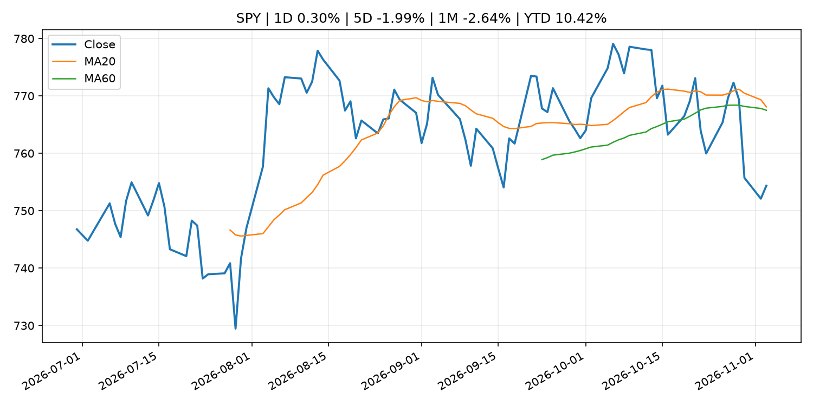
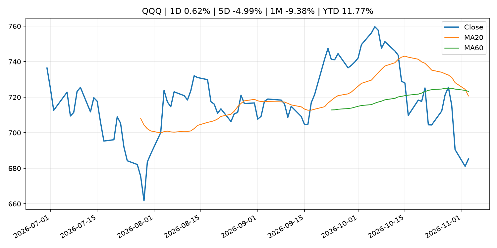
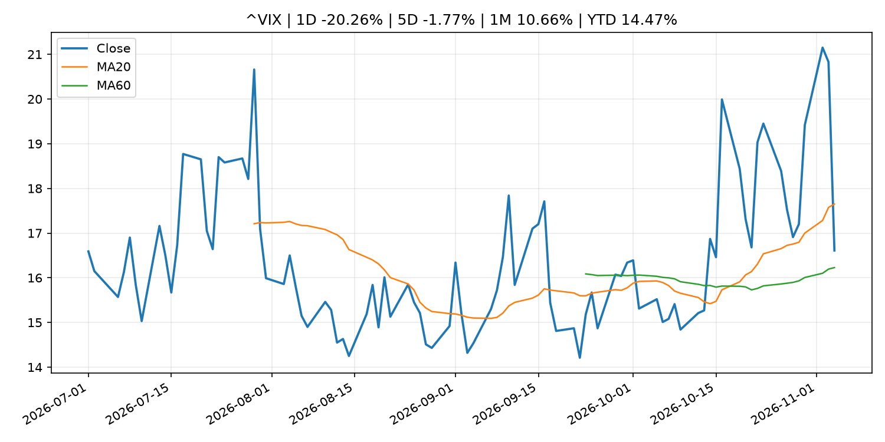
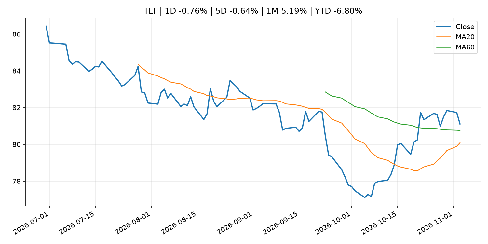
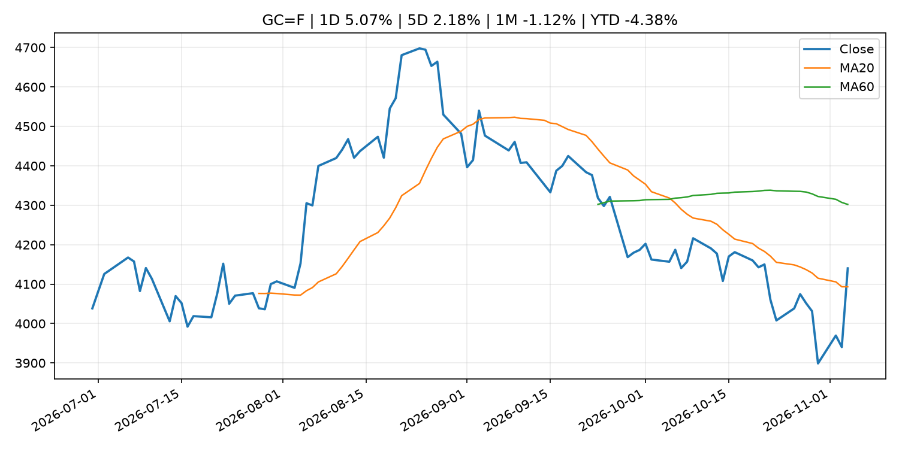
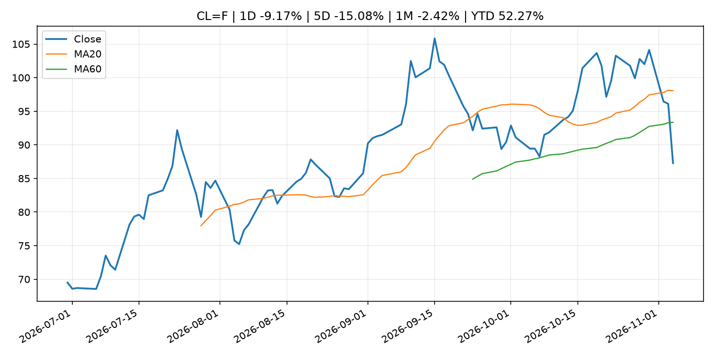
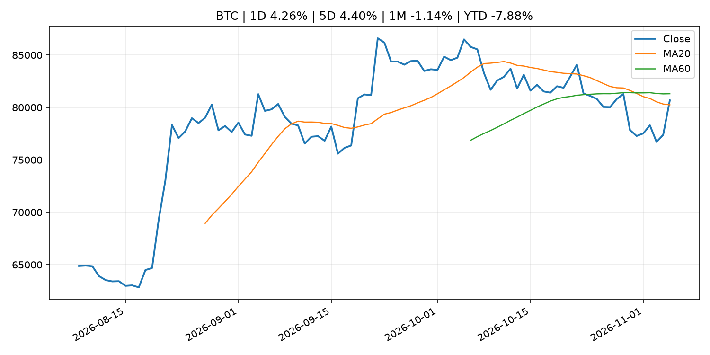
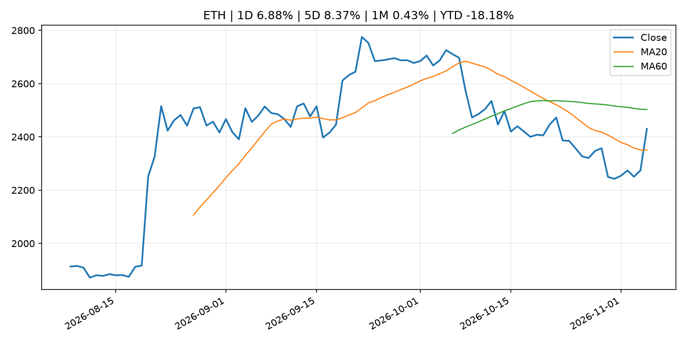
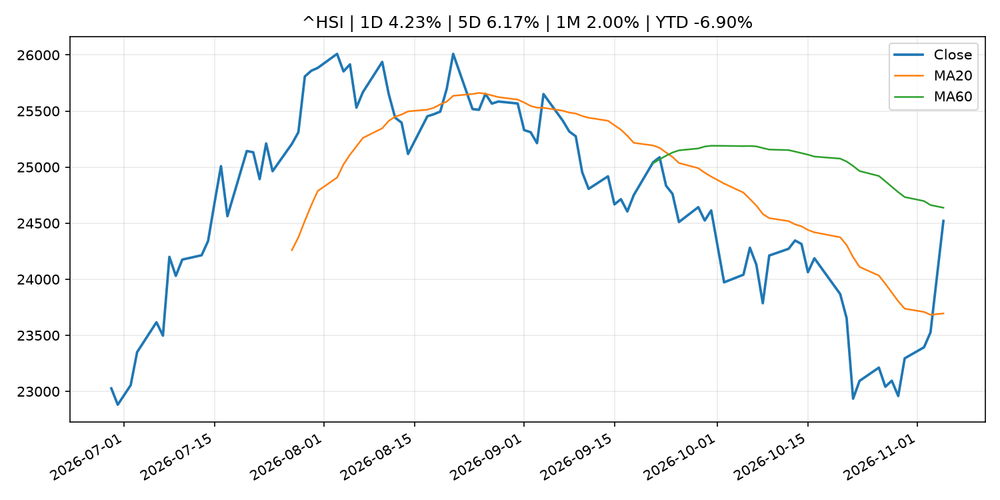

# Global Macro Morning Briefing - 2026-11-05

> Not financial advice / 非投资建议。

## 0. 今日总览
- 市场状态：unknown。市场信号不足，暂不判断明确状态。
- 今日三大主线：
  1. regulation: SEC Adopts Amendments to Update Definitions of Small Entity for Investment Companies and Investment Advisers
  2. earnings: This year’s worst-performing S&P 500 stock is finally seeing some major relief
  3. earnings: Circle beats earnings expectations on strong revenue, but cuts 5% of its workforce
- 一句话结论：今日晨报重点关注：监管变化会改变行业盈利预期和资产风险溢价。；大型科技股盈利和资本开支会影响纳指、半导体和 AI 交易主线。。跨资产方面，SPY 1D 0.30%；QQQ 1D 0.62%；^VIX 1D -20.26%；TLT 1D -0.76%；GC=F 1D 5.07%；CL=F 1D -9.17%；BTC 1D 4.26%；ETH 1D 6.88%；市场信号不足，暂不判断明确状态。政策、通胀、利率、美元、美债、能源和加密监管仍是主要观察线索。所有结论仅基于公开数据与短摘要整理，不构成投资建议。

## 1. 隔夜跨资产市场
- 美股：SPY 1D 0.30%，QQQ 1D 0.62%，整体趋势需结合 VIX 和利率确认。
- 美债/美元：TLT 1D -0.76%，美元指数 1D -0.57%，是判断折现率压力的核心线索。
- 黄金/原油：黄金 1D 5.07%，原油 1D -9.17%，用于观察避险、通胀和地缘风险。
- 加密：BTC 1D 4.26%，ETH 1D 6.88%，关注是否独立于纳指走出加密自身行情。
- 港股/A股：恒生 1D 4.23%，沪深300/上证 1D n/a，重点看中国政策预期与人民币线索。
- 风险观察：关注后续数据是否确认当前跨资产信号。

### US_EQUITY

| symbol | latest close | 1D | 5D | 1M | YTD | trend |
|---|---:|---:|---:|---:|---:|---|
| SPY | 754.35 | 0.30% | -1.99% | -2.64% | 10.42% | range_bound |
| QQQ | 685.28 | 0.62% | -4.99% | -9.38% | 11.77% | strong_downtrend |
| DIA | 517.06 | -0.44% | -1.19% | 0.97% | 6.91% | downtrend |
| IWM | 279.79 | 0.23% | -0.14% | -1.27% | 12.46% | range_bound |
| VTI | 371.21 | 0.33% | -1.78% | -2.47% | 10.38% | downtrend |

### US_MACRO_MARKET

| symbol | latest close | 1D | 5D | 1M | YTD | trend |
|---|---:|---:|---:|---:|---:|---|
| ^VIX | 16.61 | -20.26% | -1.77% | 10.66% | 14.47% | range_bound |
| DX-Y.NYB | 101.29 | -0.57% | -0.88% | -0.53% | 2.92% | range_bound |
| TLT | 81.11 | -0.76% | -0.64% | 5.19% | -6.80% | range_bound |
| IEF | 91.16 | -0.37% | 0.07% | 2.52% | -5.12% | range_bound |

### COMMODITIES

| symbol | latest close | 1D | 5D | 1M | YTD | trend |
|---|---:|---:|---:|---:|---:|---|
| GC=F | 4,140.10 | 5.07% | 2.18% | -1.12% | -4.38% | range_bound |
| SI=F | 53.24 | 7.36% | -0.42% | -12.97% | -24.55% | strong_downtrend |
| CL=F | 87.28 | -9.17% | -15.08% | -2.42% | 52.27% | range_bound |
| BZ=F | 93.77 | -9.49% | -18.69% | -6.77% | 54.35% | range_bound |
| NG=F | 2.94 | 1.45% | 4.26% | -5.68% | -18.82% | range_bound |
| HG=F | 6.42 | 0.59% | -3.40% | -2.71% | 13.76% | downtrend |

### HK_MARKET

| symbol | latest close | 1D | 5D | 1M | YTD | trend |
|---|---:|---:|---:|---:|---:|---|
| ^HSI | 24,520.10 | 4.23% | 6.17% | 2.00% | -6.90% | range_bound |
| 0700.HK | 420.20 | 4.63% | 11.28% | -1.87% | -32.55% | range_bound |
| 9988.HK | 106.20 | 5.57% | 10.51% | -1.85% | -28.72% | range_bound |
| 3690.HK | 80.20 | 6.65% | 15.90% | 13.28% | -23.33% | range_bound |
| 1810.HK | 30.32 | 5.42% | 18.07% | 24.98% | -24.73% | range_bound |
| 1211.HK | 74.65 | 3.25% | 8.74% | -0.47% | -24.41% | range_bound |

### CRYPTO

| symbol | latest close | 1D | 5D | 1M | YTD | trend |
|---|---:|---:|---:|---:|---:|---|
| BTC | 80,677.45 | 4.26% | 4.40% | -1.14% | -7.88% | range_bound |
| ETH | 2,430.14 | 6.88% | 8.37% | 0.43% | -18.18% | range_bound |
| SOLANA | 96.08 | 3.56% | -0.18% | -7.78% | -22.84% | strong_downtrend |
| BINANCECOIN | 718.30 | 2.99% | 2.10% | -1.59% | -16.74% | downtrend |
| RIPPLE | 1.31 | 2.54% | 4.28% | -1.65% | -28.90% | range_bound |
| DOGECOIN | 0.08 | 2.55% | 1.59% | -5.76% | -34.38% | strong_downtrend |

## 2. 今日最重要的 10 条新闻
### 1. SEC Adopts Amendments to Update Definitions of Small Entity for Investment Companies and Investment Advisers
- 来源：SEC Press Releases
- 时间：2026-11-04T11:28:00-05:00
- 地区：US
- 事件类型：regulation
- 重要性层级：Tier 2
- 一句话摘要：The Securities and Exchange Commission today adopted amendments to the rules that define which registered investment companies, investment advisers, and business development companies qualify as small entities for purposes of the Regulatory Flexibility…
- 为什么重要：监管变化会改变行业盈利预期和资产风险溢价。
- 可能影响：主要影响 BTC，方向为 mixed，强度 high；加密监管或 ETF 进展会改变 BTC 的资金流和风险溢价。
  - 资产：BTC
    方向：mixed
    强度：high
    原因：加密监管或 ETF 进展会改变 BTC 的资金流和风险溢价。
  - 资产：ETH
    方向：mixed
    强度：high
    原因：监管框架会影响 ETH 产品化和机构参与度。
  - 资产：COIN
    方向：mixed
    强度：medium
    原因：监管清晰度和执法风险会影响交易平台估值。
  - 资产：crypto market
    方向：mixed
    强度：high
    原因：信息影响整个加密市场结构，但方向取决于细节。
- 原文链接：[https://www.sec.gov/newsroom/press-releases/2026-112-sec-adopts-amendments-update-definitions-small-entity-investment-companies-investment-advisers](https://www.sec.gov/newsroom/press-releases/2026-112-sec-adopts-amendments-update-definitions-small-entity-investment-companies-investment-advisers)

### 2. This year’s worst-performing S&P 500 stock is finally seeing some major relief
- 来源：MarketWatch Top Stories
- 时间：2026-11-05T01:05:00+00:00
- 地区：US
- 事件类型：earnings
- 重要性层级：Tier 2
- 一句话摘要：AppLovin’s stock is popping after “clearly positive” earnings results.
- 为什么重要：大型科技股盈利和资本开支会影响纳指、半导体和 AI 交易主线。
- 可能影响：可能影响利率、汇率、风险资产或大宗商品预期，但当前公开信息不足以判断明确方向。
  - 资产：暂无明确资产映射
  - 方向：unknown
  - 强度：low
  - 原因：公开信息不足以判断方向。
- 原文链接：[https://www.marketwatch.com/story/this-years-worst-performing-s-p-500-stock-is-finally-seeing-some-major-relief-fff3fa85?mod=mw_rss_topstories](https://www.marketwatch.com/story/this-years-worst-performing-s-p-500-stock-is-finally-seeing-some-major-relief-fff3fa85?mod=mw_rss_topstories)

### 3. Circle beats earnings expectations on strong revenue, but cuts 5% of its workforce
- 来源：CoinDesk
- 时间：2026-11-04T12:33:54+00:00
- 地区：global
- 事件类型：earnings
- 重要性层级：Tier 2
- 一句话摘要：Circle beats earnings expectations on strong revenue, but cuts 5% of its workforce
- 为什么重要：大型科技股盈利和资本开支会影响纳指、半导体和 AI 交易主线。
- 可能影响：可能影响利率、汇率、风险资产或大宗商品预期，但当前公开信息不足以判断明确方向。
  - 资产：暂无明确资产映射
  - 方向：unknown
  - 强度：low
  - 原因：公开信息不足以判断方向。
- 原文链接：[https://www.coindesk.com/business/2026/11/04/circle-beats-earnings-and-revenue-estimates-on-soaring-usdc-transaction-volume](https://www.coindesk.com/business/2026/11/04/circle-beats-earnings-and-revenue-estimates-on-soaring-usdc-transaction-volume)

### 4. 10-year Treasury yield slides as traders mull over Democrats' midterm victories, oil prices drop
- 来源：CNBC Economy
- 时间：2026-11-04T21:18:44+00:00
- 地区：US
- 事件类型：other
- 重要性层级：Tier 3
- 一句话摘要：Treasury yields were last little changed Wednesday as investors weighed big wins from Democrats in the U.S. midterm elections.
- 为什么重要：这条信息暂未匹配到重大宏观、政策或市场事件，更适合作为背景跟踪。
- 可能影响：主要影响 CL=F，方向为 positive，强度 high；供给扰动或 OPEC 减产通常推升 WTI 原油。
  - 资产：CL=F
    方向：positive
    强度：high
    原因：供给扰动或 OPEC 减产通常推升 WTI 原油。
  - 资产：BZ=F
    方向：positive
    强度：high
    原因：全球供给风险通常直接影响 Brent 原油。
  - 资产：SPY
    方向：mixed
    强度：medium
    原因：能源股可能受益，但通胀和成本压力不利于宽基风险资产。
- 原文链接：[https://www.cnbc.com/2026/11/03/treasury-yields-fall-as-democrats-win-big-in-us-midterm-elections.html](https://www.cnbc.com/2026/11/03/treasury-yields-fall-as-democrats-win-big-in-us-midterm-elections.html)

### 5. Sources of Changes in Current Account Balances (Projections for Nov.)
- 来源：Bank of Japan Announcements
- 时间：2026-11-05T08:50:00+09:00
- 地区：Japan
- 事件类型：other
- 重要性层级：Tier 3
- 一句话摘要：Sources of Changes in Current Account Balances (Projections for Nov.)
- 为什么重要：这条信息暂未匹配到重大宏观、政策或市场事件，更适合作为背景跟踪。
- 可能影响：更偏背景信息，短期市场影响可能有限。
  - 资产：暂无明确资产映射
  - 方向：unknown
  - 强度：low
  - 原因：公开信息不足以判断方向。
- 原文链接：[http://www.boj.or.jp/en/statistics/boj/fm/juqp/juqp2611.xlsx](http://www.boj.or.jp/en/statistics/boj/fm/juqp/juqp2611.xlsx)

## 3. 政策与央行观察
### 1. SEC Adopts Amendments to Update Definitions of Small Entity for Investment Companies and Investment Advisers
- 来源：SEC Press Releases
- 时间：2026-11-04T11:28:00-05:00
- 地区：US
- 事件类型：regulation
- 重要性层级：Tier 2
- 一句话摘要：The Securities and Exchange Commission today adopted amendments to the rules that define which registered investment companies, investment advisers, and business development companies qualify as small entities for purposes of the Regulatory Flexibility…
- 为什么重要：监管变化会改变行业盈利预期和资产风险溢价。
- 可能影响：主要影响 BTC，方向为 mixed，强度 high；加密监管或 ETF 进展会改变 BTC 的资金流和风险溢价。
  - 资产：BTC
    方向：mixed
    强度：high
    原因：加密监管或 ETF 进展会改变 BTC 的资金流和风险溢价。
  - 资产：ETH
    方向：mixed
    强度：high
    原因：监管框架会影响 ETH 产品化和机构参与度。
  - 资产：COIN
    方向：mixed
    强度：medium
    原因：监管清晰度和执法风险会影响交易平台估值。
  - 资产：crypto market
    方向：mixed
    强度：high
    原因：信息影响整个加密市场结构，但方向取决于细节。
- 原文链接：[https://www.sec.gov/newsroom/press-releases/2026-112-sec-adopts-amendments-update-definitions-small-entity-investment-companies-investment-advisers](https://www.sec.gov/newsroom/press-releases/2026-112-sec-adopts-amendments-update-definitions-small-entity-investment-companies-investment-advisers)

## 4. 市场异动与图表
- QQQ 上涨 0.62%
- VIX 下跌 -20.26%
- TLT 下跌 -0.76%
- DXY 下跌 -0.57%
- Gold 上涨 5.07%
- Oil 下跌 -9.17%
- BTC 上涨 4.26%
- ETH 上涨 6.88%

### SPY

### QQQ

### ^VIX

### TLT

### GC=F

### CL=F

### BTC

### ETH

### ^HSI

## 5. 华尔街与机构公开观点
- 暂无可靠公开观点。

## 6. 今日重点关注
- 经济数据：经济数据：暂无可靠公开日历数据；如配置经济日历源后可自动填充。
- 央行讲话：央行讲话：暂无可靠公开日历数据；重点跟踪 Fed、ECB、BoJ、PBOC 官网 RSS。
- 财报：财报：暂无可靠数据。
- 政策事件：政策事件：暂无可靠数据。
- 风险提醒：风险提醒：关注数据源失败项、突发地缘风险、利率和美元的二阶反应。

## 7. 英文金融表达与宏观概念
- **real yield**：实际收益率，名义利率扣除通胀预期后的收益率。 例句：Gold often reacts more to real yields than nominal yields.
- **supply disruption**：供给扰动，通常指能源或商品供应受冲突、减产或天气影响。 例句：Supply disruption can lift oil prices and inflation expectations.
- **market structure**：市场结构，指交易、托管、清算、ETF、监管等制度安排。 例句：Crypto market structure rules can affect institutional participation.
- **inflation expectations**：通胀预期，指家庭、企业或市场对未来通胀的预估。 例句：Inflation expectations can shape wage bargaining and bond yields.
- **terminal rate**：终端利率，市场预期本轮加息周期的最高政策利率。 例句：A higher terminal rate can pressure growth stocks.
- **soft landing**：软着陆，指通胀回落而经济避免明显衰退。 例句：Markets often rally when data support a soft landing.

## 8. 背景材料
- [Sources of Changes in Current Account Balances (Projections for Nov.)](http://www.boj.or.jp/en/statistics/boj/fm/juqp/juqp2611.xlsx)（Bank of Japan Announcements，other）：Sources of Changes in Current Account Balances (Projections for Nov.)
- [Minutes of the Monetary Policy Meeting on September 17 and 18, 2026](http://www.boj.or.jp/en/mopo/mpmsche_minu/minu_2026/g260918.pdf)（Bank of Japan Announcements，other）：Minutes of the Monetary Policy Meeting on September 17 and 18, 2026
- [Tokenization and stablecoins may weather Democrats' sweep as broader crypto rules face uncertainty](https://www.coindesk.com/policy/2026/11/04/tokenization-and-stablecoins-may-weather-democrats-sweep-as-broader-crypto-rules-face-uncertainty)（CoinDesk，other）：Tokenization and stablecoins may weather Democrats' sweep as broader crypto rules face uncertainty
- [‘It seems bizarre’: We’re in our 80s with $950,000 in traditional IRAs. Why is our adviser pushing Roth conversions?](https://www.marketwatch.com/story/it-seems-bizarre-were-in-our-80s-with-950-000-in-traditional-iras-why-is-our-adviser-pushing-us-to-do-roth-conversions-a665f990?mod=mw_rss_topstories)（MarketWatch Top Stories，other）：“Our basic living expenses are covered by $110,000 in annual pensions and Social Security.”
- [10-year Treasury yield slides as traders mull over Democrats' midterm victories, oil prices drop](https://www.cnbc.com/2026/11/03/treasury-yields-fall-as-democrats-win-big-in-us-midterm-elections.html)（CNBC Economy，other）：Treasury yields were last little changed Wednesday as investors weighed big wins from Democrats in the U.S. midterm elections.
- [Live updates: Bitcoin rises above $80,000 as stocks gain following Blue Wave](https://www.coindesk.com/tech/2026/11/04/live-updates-bitcoin-and-stocks-reverse-overnight-plunge-following-blue-wave-landslide)（CoinDesk，other）：Live updates: Bitcoin rises above $80,000 as stocks gain following Blue Wave
- [Bitcoin rebounds from midterm dip as DeFi leads gains](https://www.coindesk.com/markets/2026/11/04/bitcoin-rebounds-from-midterm-dip-as-defi-leads-gains)（CoinDesk，other）：Bitcoin rebounds from midterm dip as DeFi leads gains
- [Japanese Government Bonds Held by the Bank of Japan](http://www.boj.or.jp/en/statistics/boj/other/mei/release/2026/mei261030.xlsx)（Bank of Japan Announcements，other）：Japanese Government Bonds Held by the Bank of Japan
- [Collateral Accepted by the Bank of Japan (End of  Oct.)](http://www.boj.or.jp/en/statistics/boj/other/col/col2610.xlsx)（Bank of Japan Announcements，other）：Collateral Accepted by the Bank of Japan (End of  Oct.)
- [Bitcoin rises to $78,300 in V-shaped comeback as midterm election uncertainty fades](https://www.coindesk.com/markets/2026/11/04/bitcoin-knocks-on-usd78-000-in-v-shaped-comeback-as-midterm-uncertainty-fades)（CoinDesk，other）：Bitcoin rises to $78,300 in V-shaped comeback as midterm election uncertainty fades
- [Jack Dorsey's Block faces $764 million DOJ settlement as bitcoin profit plunges 50%](https://www.coindesk.com/markets/2026/11/04/jack-dorsey-s-block-faces-usd764-million-doj-settlement-as-bitcoin-profit-plunges-50)（CoinDesk，other）：Jack Dorsey's Block faces $764 million DOJ settlement as bitcoin profit plunges 50%
- [U.S.-sanctioned Moscow Exchange to list bitcoin and Tether’s USDT in December](https://www.coindesk.com/markets/2026/11/04/u-s-sanctioned-moscow-exchange-to-list-bitcoin-and-tether-s-usdt-in-december)（CoinDesk，other）：U.S.-sanctioned Moscow Exchange to list bitcoin and Tether’s USDT in December
- [Bitcoin briefly sinks to $75,700 as bets on a Democratic sweep rattle markets](https://www.coindesk.com/markets/2026/11/04/bitcoin-briefly-sinks-to-usd75-700-as-bets-on-a-democratic-sweep-rattle-markets)（CoinDesk，other）：Bitcoin briefly sinks to $75,700 as bets on a Democratic sweep rattle markets
- [Bank of Japan Accounts (October 31)](http://www.boj.or.jp/en/statistics/boj/other/acmai/release/2026/ac261031.htm)（Bank of Japan Announcements，routine_announcement）：Bank of Japan Accounts (October 31)
- [ECB wage tracker suggests slightly higher wage growth in first three quarters of 2027 compared with the full year of 2026](https://www.ecb.europa.eu//press/pr/date/2026/html/ecb.pr261104~caf181d7ac.en.html)（ECB Press Releases，other）：ECB wage tracker suggests slightly higher wage growth in first three quarters of 2027 compared with the full year of 2026
- [Live updates: Bitcoin and stocks reverse overnight plunge following Blue Wave landslide](https://www.coindesk.com/tech/2026/11/03/election-2026-coindesk-live-blog)（CoinDesk，other）：Live updates: Bitcoin and stocks reverse overnight plunge following Blue Wave landslide
- [Monetary Base (Oct.)](http://www.boj.or.jp/en/statistics/boj/other/mb/mb.htm)（Bank of Japan Announcements，other）：Monetary Base (Oct.)

## 9. 数据源、失败项与免责声明
- 采集时间：2026-11-05T02:01:34
- 数据源：公开 RSS、Yahoo Finance、CoinGecko、AKShare、FRED、SEC data.sec.gov，以及用户自有 inputs/reports 文件。
- 合规说明：不绕过 WSJ、Bloomberg、FT、Reuters 等付费墙；对付费媒体只使用公开 RSS 标题、摘要、链接和发布时间。
- 免责声明：Not financial advice / 非投资建议。本项目仅供个人学习、研究和信息整理，不构成投资建议、交易建议或任何收益承诺。
- 失败或跳过的数据源：
  - China market data failed symbol=上证指数: empty dataframe
  - China market data failed symbol=深证成指: empty dataframe
  - China market data failed symbol=创业板指: empty dataframe
  - China market data failed symbol=沪深300: empty dataframe
  - China market data failed symbol=中证500: empty dataframe
  - China market data failed symbol=科创50: empty dataframe
  - FRED_API_KEY not set; skipping FRED macro series
  - SEC failed cik=0000320193
  - SEC failed cik=0000789019
  - SEC failed cik=0001045810
  - SEC failed cik=0001318605
  - SEC failed cik=0001577552
