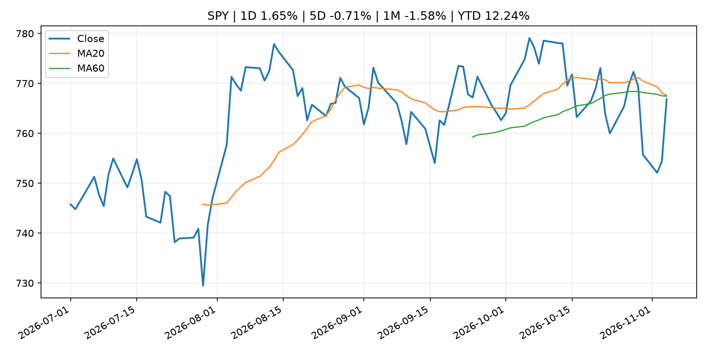
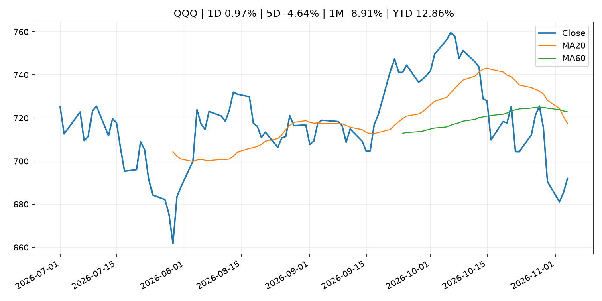
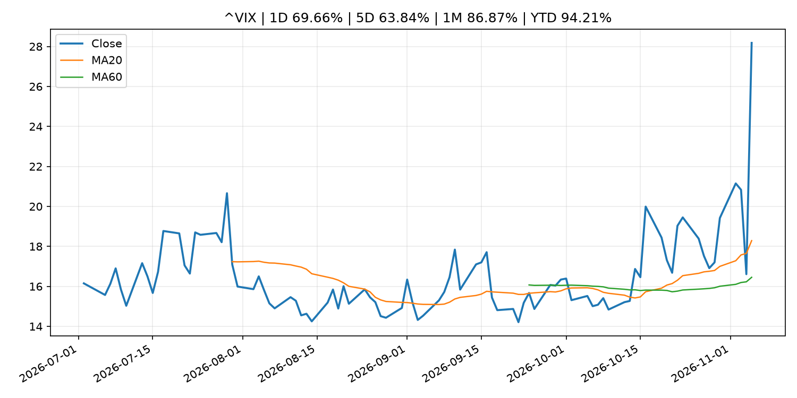
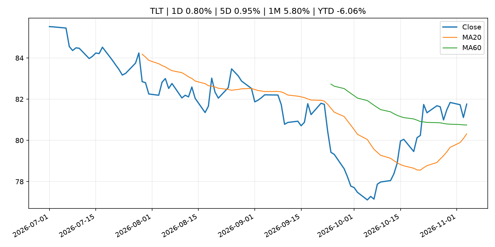
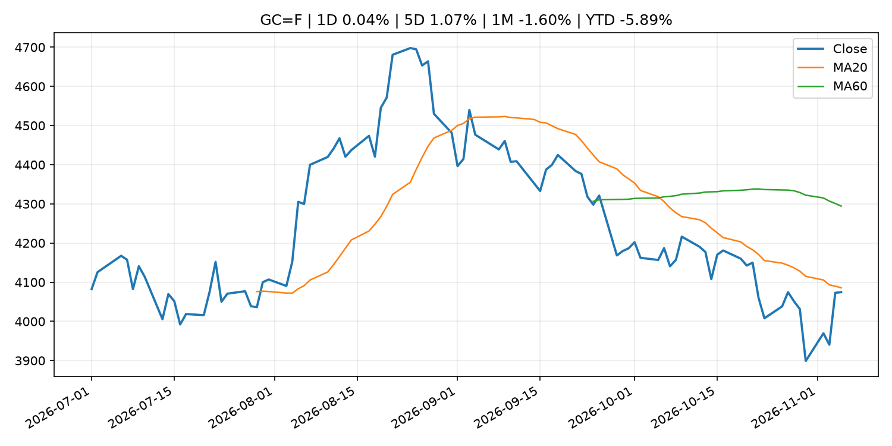
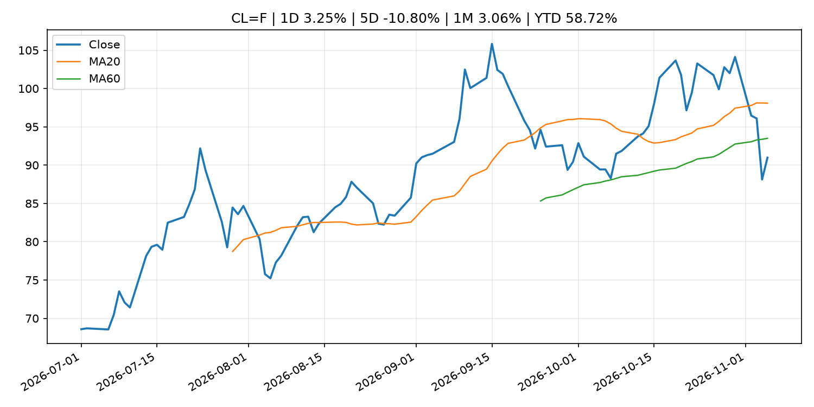
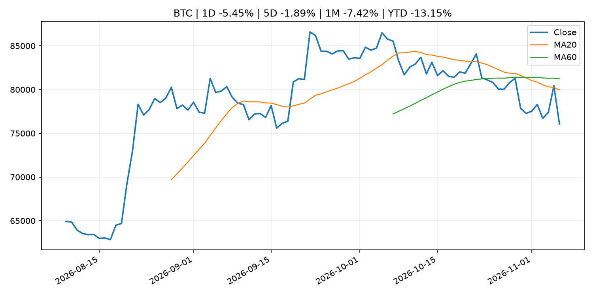
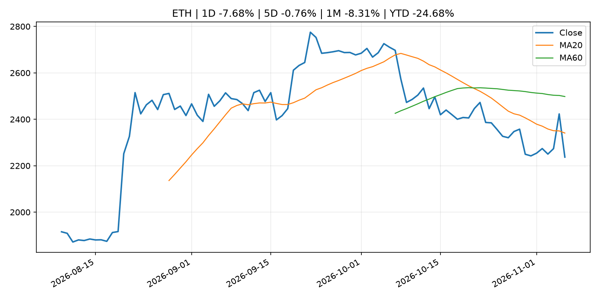
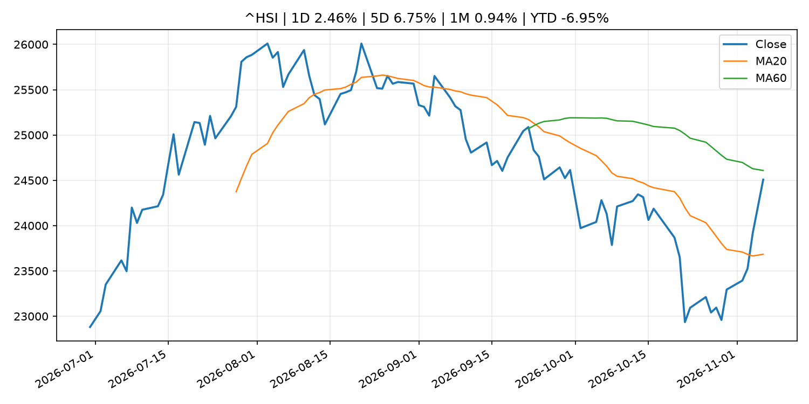

# Global Macro Morning Briefing - 2026-11-06

> Not financial advice / 非投资建议。

## 0. 今日总览
- 市场状态：mixed。股指上涨、波动率或美元回落，市场更接近风险偏好改善。 但存在信号冲突，需要降低单一叙事置信度。
- 今日三大主线：
  1. fiscal_policy: The 2027 tax brackets are out. See what the standard deduction and SALT tax breaks will be.
  2. geopolitical_risk: Mercado Bitcoin hack continued hours after exchange said attack was contained, report finds
  3. fiscal_policy: Hong Kong passes law requiring crypto exchanges to report customer transactions to tax authorities
- 一句话结论：今日晨报重点关注：财政和贸易政策会影响增长、通胀、企业利润和跨境资本流。；地缘风险可能推升避险需求、能源价格和市场波动率。。跨资产方面，SPY 1D 1.65%；QQQ 1D 0.97%；^VIX 1D 69.66%；TLT 1D 0.80%；GC=F 1D 0.04%；CL=F 1D 3.25%；BTC 1D -5.45%；ETH 1D -7.68%；股指上涨、波动率或美元回落，市场更接近风险偏好改善。 但存在信号冲突，需要降低单一叙事置信度。政策、通胀、利率、美元、美债、能源和加密监管仍是主要观察线索。所有结论仅基于公开数据与短摘要整理，不构成投资建议。

## 1. 隔夜跨资产市场
- 美股：SPY 1D 1.65%，QQQ 1D 0.97%，整体趋势需结合 VIX 和利率确认。
- 美债/美元：TLT 1D 0.80%，美元指数 1D 0.12%，是判断折现率压力的核心线索。
- 黄金/原油：黄金 1D 0.04%，原油 1D 3.25%，用于观察避险、通胀和地缘风险。
- 加密：BTC 1D -5.45%，ETH 1D -7.68%，关注是否独立于纳指走出加密自身行情。
- 港股/A股：恒生 1D 2.46%，沪深300/上证 1D n/a，重点看中国政策预期与人民币线索。
- 风险观察：确认风险偏好是否扩散到小盘股、信用利差和周期品。

### US_EQUITY

| symbol | latest close | 1D | 5D | 1M | YTD | trend |
|---|---:|---:|---:|---:|---:|---|
| SPY | 766.81 | 1.65% | -0.71% | -1.58% | 12.24% | range_bound |
| QQQ | 691.95 | 0.97% | -4.64% | -8.91% | 12.86% | strong_downtrend |
| DIA | 533.11 | 3.10% | 1.61% | 3.61% | 10.23% | range_bound |
| IWM | 284.02 | 1.51% | 0.97% | 0.95% | 14.17% | range_bound |
| VTI | 376.92 | 1.54% | -0.59% | -1.47% | 12.08% | range_bound |

### US_MACRO_MARKET

| symbol | latest close | 1D | 5D | 1M | YTD | trend |
|---|---:|---:|---:|---:|---:|---|
| ^VIX | 28.18 | 69.66% | 63.84% | 86.87% | 94.21% | strong_uptrend |
| DX-Y.NYB | 101.63 | 0.12% | -0.40% | -0.60% | 3.26% | range_bound |
| TLT | 81.76 | 0.80% | 0.95% | 5.80% | -6.06% | range_bound |
| IEF | 91.66 | 0.55% | 0.89% | 2.84% | -4.60% | range_bound |

### COMMODITIES

| symbol | latest close | 1D | 5D | 1M | YTD | trend |
|---|---:|---:|---:|---:|---:|---|
| GC=F | 4,074.60 | 0.04% | 1.07% | -1.60% | -5.89% | downtrend |
| SI=F | 51.78 | -0.65% | -0.79% | -13.55% | -26.61% | strong_downtrend |
| CL=F | 90.98 | 3.25% | -10.80% | 3.06% | 58.72% | range_bound |
| BZ=F | 99.10 | 4.73% | -13.74% | -1.10% | 63.13% | range_bound |
| NG=F | 2.96 | -0.10% | 0.14% | -7.71% | -18.30% | uptrend |
| HG=F | 6.27 | -2.15% | -4.79% | -5.02% | 11.09% | strong_downtrend |

### HK_MARKET

| symbol | latest close | 1D | 5D | 1M | YTD | trend |
|---|---:|---:|---:|---:|---:|---|
| ^HSI | 24,507.75 | 2.46% | 6.75% | 0.94% | -6.95% | range_bound |
| 0700.HK | 422.60 | -1.81% | 10.17% | 0.48% | -32.17% | range_bound |
| 9988.HK | 105.30 | -3.48% | 8.50% | -0.09% | -29.33% | range_bound |
| 3690.HK | 79.70 | -0.75% | 11.31% | 13.61% | -23.80% | range_bound |
| 1810.HK | 31.00 | -0.96% | 17.07% | 29.49% | -23.04% | strong_uptrend |
| 1211.HK | 74.10 | -2.11% | 8.57% | -0.60% | -24.96% | range_bound |

### CRYPTO

| symbol | latest close | 1D | 5D | 1M | YTD | trend |
|---|---:|---:|---:|---:|---:|---|
| BTC | 76,057.91 | -5.45% | -1.89% | -7.42% | -13.15% | strong_downtrend |
| ETH | 2,237.10 | -7.68% | -0.76% | -8.31% | -24.68% | strong_downtrend |
| SOLANA | 90.09 | -5.67% | -5.58% | -14.48% | -27.65% | strong_downtrend |
| BINANCECOIN | 693.12 | -3.65% | -1.42% | -4.91% | -19.66% | strong_downtrend |
| RIPPLE | 1.22 | -6.81% | -2.80% | -8.86% | -33.96% | strong_downtrend |

## 2. 今日最重要的 10 条新闻
### 1. The 2027 tax brackets are out. See what the standard deduction and SALT tax breaks will be.
- 来源：MarketWatch Top Stories
- 时间：2026-11-05T22:40:00+00:00
- 地区：US
- 事件类型：fiscal_policy
- 重要性层级：Tier 1
- 一句话摘要：The tax brackets at the heart of Americans’ income-tax bills will be adjusting at a steeper level in 2027 compared to this year, underscoring inflation’s rekindled presence.
- 为什么重要：财政和贸易政策会影响增长、通胀、企业利润和跨境资本流。
- 可能影响：主要影响 DXY，方向为 positive，强度 high；通胀压力可能推高政策利率预期并支撑美元。
  - 资产：DXY
    方向：positive
    强度：high
    原因：通胀压力可能推高政策利率预期并支撑美元。
  - 资产：TLT
    方向：negative
    强度：high
    原因：通胀上行通常推升收益率、压低长债价格。
  - 资产：QQQ
    方向：negative
    强度：high
    原因：更高利率对成长股估值折现率不利。
  - 资产：SPY
    方向：mixed
    强度：medium
    原因：名义增长可能支撑收入，但更高利率压制估值。
  - 资产：GC=F
    方向：mixed
    强度：medium
    原因：通胀对黄金是支撑，但实际利率上行会形成压力。
  - 资产：BTC
    方向：mixed
    强度：medium
    原因：抗通胀叙事和流动性收紧可能相互抵消。
- 原文链接：[https://www.marketwatch.com/story/the-2027-tax-brackets-are-out-see-what-the-standard-deduction-and-salt-tax-breaks-will-be-5dd1d293?mod=mw_rss_topstories](https://www.marketwatch.com/story/the-2027-tax-brackets-are-out-see-what-the-standard-deduction-and-salt-tax-breaks-will-be-5dd1d293?mod=mw_rss_topstories)

### 2. Mercado Bitcoin hack continued hours after exchange said attack was contained, report finds
- 来源：CoinDesk
- 时间：2026-11-05T10:44:54+00:00
- 地区：global
- 事件类型：geopolitical_risk
- 重要性层级：Tier 1
- 一句话摘要：Mercado Bitcoin hack continued hours after exchange said attack was contained, report finds
- 为什么重要：地缘风险可能推升避险需求、能源价格和市场波动率。
- 可能影响：可能影响利率、汇率、风险资产或大宗商品预期，但当前公开信息不足以判断明确方向。
  - 资产：暂无明确资产映射
  - 方向：unknown
  - 强度：low
  - 原因：公开信息不足以判断方向。
- 原文链接：[https://www.coindesk.com/business/2026/11/05/mercado-bitcoin-hack-continued-hours-after-exchange-said-attack-was-contained-report-finds](https://www.coindesk.com/business/2026/11/05/mercado-bitcoin-hack-continued-hours-after-exchange-said-attack-was-contained-report-finds)

### 3. Hong Kong passes law requiring crypto exchanges to report customer transactions to tax authorities
- 来源：CoinDesk
- 时间：2026-11-05T08:35:37+00:00
- 地区：global
- 事件类型：fiscal_policy
- 重要性层级：Tier 1
- 一句话摘要：Hong Kong passes law requiring crypto exchanges to report customer transactions to tax authorities
- 为什么重要：财政和贸易政策会影响增长、通胀、企业利润和跨境资本流。
- 可能影响：可能影响利率、汇率、风险资产或大宗商品预期，但当前公开信息不足以判断明确方向。
  - 资产：暂无明确资产映射
  - 方向：unknown
  - 强度：low
  - 原因：公开信息不足以判断方向。
- 原文链接：[https://www.coindesk.com/policy/2026/11/04/hong-kong-passes-law-requiring-crypto-exchanges-to-report-customer-transactions-to-tax-authorities](https://www.coindesk.com/policy/2026/11/04/hong-kong-passes-law-requiring-crypto-exchanges-to-report-customer-transactions-to-tax-authorities)

### 4. Google could take stake in bitcoin miner TeraWulf’s $19 billion AI project if Anthropic defaults
- 来源：CoinDesk
- 时间：2026-11-05T13:29:40+00:00
- 地区：global
- 事件类型：earnings
- 重要性层级：Tier 2
- 一句话摘要：Google could take stake in bitcoin miner TeraWulf’s $19 billion AI project if Anthropic defaults
- 为什么重要：大型科技股盈利和资本开支会影响纳指、半导体和 AI 交易主线。
- 可能影响：主要影响 QQQ，方向为 mixed，强度 high；AI 资本开支会影响大型科技股盈利和估值预期。
  - 资产：QQQ
    方向：mixed
    强度：high
    原因：AI 资本开支会影响大型科技股盈利和估值预期。
  - 资产：SMH
    方向：mixed
    强度：high
    原因：AI 投资周期直接影响半导体需求。
  - 资产：NVDA
    方向：mixed
    强度：high
    原因：AI 训练和推理需求是英伟达收入预期核心变量。
  - 资产：MSFT
    方向：mixed
    强度：medium
    原因：云和 AI 资本开支影响利润率与增长叙事。
  - 资产：GOOGL
    方向：mixed
    强度：medium
    原因：AI 投资和搜索商业化影响估值。
  - 资产：META
    方向：mixed
    强度：medium
    原因：AI 基建支出与广告效率共同影响市场预期。
- 原文链接：[https://www.coindesk.com/tech/2026/11/05/google-could-take-ownership-stake-in-bitcoin-miner-terawulf-s-ai-project-if-anthropic-defaults](https://www.coindesk.com/tech/2026/11/05/google-could-take-ownership-stake-in-bitcoin-miner-terawulf-s-ai-project-if-anthropic-defaults)

### 5. SEC Adopts Amendments to Update Definitions of Small Entity for Investment Companies and Investment Advisers
- 来源：SEC Press Releases
- 时间：2026-11-04T11:28:00-05:00
- 地区：US
- 事件类型：regulation
- 重要性层级：Tier 2
- 一句话摘要：The Securities and Exchange Commission today adopted amendments to the rules that define which registered investment companies, investment advisers, and business development companies qualify as small entities for purposes of the Regulatory Flexibility…
- 为什么重要：监管变化会改变行业盈利预期和资产风险溢价。
- 可能影响：主要影响 BTC，方向为 mixed，强度 high；加密监管或 ETF 进展会改变 BTC 的资金流和风险溢价。
  - 资产：BTC
    方向：mixed
    强度：high
    原因：加密监管或 ETF 进展会改变 BTC 的资金流和风险溢价。
  - 资产：ETH
    方向：mixed
    强度：high
    原因：监管框架会影响 ETH 产品化和机构参与度。
  - 资产：COIN
    方向：mixed
    强度：medium
    原因：监管清晰度和执法风险会影响交易平台估值。
  - 资产：crypto market
    方向：mixed
    强度：high
    原因：信息影响整个加密市场结构，但方向取决于细节。
- 原文链接：[https://www.sec.gov/newsroom/press-releases/2026-112-sec-adopts-amendments-update-definitions-small-entity-investment-companies-investment-advisers](https://www.sec.gov/newsroom/press-releases/2026-112-sec-adopts-amendments-update-definitions-small-entity-investment-companies-investment-advisers)

### 6. Cloudflare’s stock mounts a big comeback after fastest sales surge in nearly 4 years
- 来源：MarketWatch Top Stories
- 时间：2026-11-06T01:06:00+00:00
- 地区：US
- 事件类型：earnings
- 重要性层级：Tier 2
- 一句话摘要：Demand for automated AI protection is on the rise — and manifesting in Cloudflare’s earnings results.
- 为什么重要：大型科技股盈利和资本开支会影响纳指、半导体和 AI 交易主线。
- 可能影响：可能影响利率、汇率、风险资产或大宗商品预期，但当前公开信息不足以判断明确方向。
  - 资产：暂无明确资产映射
  - 方向：unknown
  - 强度：low
  - 原因：公开信息不足以判断方向。
- 原文链接：[https://www.marketwatch.com/story/cloudflares-stock-mounts-a-big-comeback-after-fastest-sales-surge-in-nearly-4-years-d80d994d?mod=mw_rss_topstories](https://www.marketwatch.com/story/cloudflares-stock-mounts-a-big-comeback-after-fastest-sales-surge-in-nearly-4-years-d80d994d?mod=mw_rss_topstories)

### 7. Federal Reserve Board announces termination of enforcement action with Allegiant United Holdings, LLC, Nano Financial Holdings, Inc., and Nano Banc
- 来源：Federal Reserve Press Releases
- 时间：2026-11-05T16:00:00+00:00
- 地区：US
- 事件类型：regulation
- 重要性层级：Tier 2
- 一句话摘要：Federal Reserve Board announces termination of enforcement action with Allegiant United Holdings, LLC, Nano Financial Holdings, Inc., and Nano Banc
- 为什么重要：监管变化会改变行业盈利预期和资产风险溢价。
- 可能影响：可能影响利率、汇率、风险资产或大宗商品预期，但当前公开信息不足以判断明确方向。
  - 资产：暂无明确资产映射
  - 方向：unknown
  - 强度：low
  - 原因：公开信息不足以判断方向。
- 原文链接：[https://www.federalreserve.gov/newsevents/pressreleases/enforcement20261105a.htm](https://www.federalreserve.gov/newsevents/pressreleases/enforcement20261105a.htm)

### 8. Binance cuts SignalPlus access after security warning, urges users to check accounts
- 来源：CoinDesk
- 时间：2026-11-05T12:55:03+00:00
- 地区：global
- 事件类型：routine_announcement
- 重要性层级：Tier 2
- 一句话摘要：Binance cuts SignalPlus access after security warning, urges users to check accounts
- 为什么重要：普通统计表、账户或例行公告通常不构成市场主线。 但标题或摘要同时涉及重大市场主题，因此提升为重要跟踪项。
- 可能影响：可能影响利率、汇率、风险资产或大宗商品预期，但当前公开信息不足以判断明确方向。
  - 资产：暂无明确资产映射
  - 方向：unknown
  - 强度：low
  - 原因：公开信息不足以判断方向。
- 原文链接：[https://www.coindesk.com/tech/2026/11/05/binance-cuts-signalplus-access-after-security-warning-urges-users-to-check-accounts](https://www.coindesk.com/tech/2026/11/05/binance-cuts-signalplus-access-after-security-warning-urges-users-to-check-accounts)

### 9. Barkin sees interest rate hikes ahead, but at a gradual pace
- 来源：CNBC Economy
- 时间：2026-11-05T16:34:33+00:00
- 地区：US
- 事件类型：other
- 重要性层级：Tier 3
- 一句话摘要：In a CNBC interview, the policymaker expressed concern over inflation and said monetary policy will need to adjust.
- 为什么重要：这条信息暂未匹配到重大宏观、政策或市场事件，更适合作为背景跟踪。
- 可能影响：主要影响 DXY，方向为 positive，强度 high；通胀压力可能推高政策利率预期并支撑美元。
  - 资产：DXY
    方向：positive
    强度：high
    原因：通胀压力可能推高政策利率预期并支撑美元。
  - 资产：TLT
    方向：negative
    强度：high
    原因：通胀上行通常推升收益率、压低长债价格。
  - 资产：QQQ
    方向：negative
    强度：high
    原因：更高利率对成长股估值折现率不利。
  - 资产：SPY
    方向：mixed
    强度：medium
    原因：名义增长可能支撑收入，但更高利率压制估值。
  - 资产：GC=F
    方向：mixed
    强度：medium
    原因：通胀对黄金是支撑，但实际利率上行会形成压力。
  - 资产：BTC
    方向：mixed
    强度：medium
    原因：抗通胀叙事和流动性收紧可能相互抵消。
- 原文链接：[https://www.cnbc.com/2026/11/05/barkin-sees-interest-rate-hikes-ahead-but-at-a-gradual-pace.html](https://www.cnbc.com/2026/11/05/barkin-sees-interest-rate-hikes-ahead-but-at-a-gradual-pace.html)

### 10. Bitcoin holds above $80,000 after Wednesday’s jump as injective rallies on staked ETF listing
- 来源：CoinDesk
- 时间：2026-11-05T11:30:00+00:00
- 地区：global
- 事件类型：other
- 重要性层级：Tier 3
- 一句话摘要：Bitcoin holds above $80,000 after Wednesday’s jump as injective rallies on staked ETF listing
- 为什么重要：这条信息暂未匹配到重大宏观、政策或市场事件，更适合作为背景跟踪。
- 可能影响：主要影响 BTC，方向为 mixed，强度 high；加密监管或 ETF 进展会改变 BTC 的资金流和风险溢价。
  - 资产：BTC
    方向：mixed
    强度：high
    原因：加密监管或 ETF 进展会改变 BTC 的资金流和风险溢价。
  - 资产：ETH
    方向：mixed
    强度：high
    原因：监管框架会影响 ETH 产品化和机构参与度。
  - 资产：COIN
    方向：mixed
    强度：medium
    原因：监管清晰度和执法风险会影响交易平台估值。
  - 资产：crypto market
    方向：mixed
    强度：high
    原因：信息影响整个加密市场结构，但方向取决于细节。
- 原文链接：[https://www.coindesk.com/markets/2026/11/05/bitcoin-holds-above-usd80-000-after-wednesday-s-jump-as-injective-rallies-on-staked-etf-listing](https://www.coindesk.com/markets/2026/11/05/bitcoin-holds-above-usd80-000-after-wednesday-s-jump-as-injective-rallies-on-staked-etf-listing)

## 3. 政策与央行观察
### 1. The 2027 tax brackets are out. See what the standard deduction and SALT tax breaks will be.
- 来源：MarketWatch Top Stories
- 时间：2026-11-05T22:40:00+00:00
- 地区：US
- 事件类型：fiscal_policy
- 重要性层级：Tier 1
- 一句话摘要：The tax brackets at the heart of Americans’ income-tax bills will be adjusting at a steeper level in 2027 compared to this year, underscoring inflation’s rekindled presence.
- 为什么重要：财政和贸易政策会影响增长、通胀、企业利润和跨境资本流。
- 可能影响：主要影响 DXY，方向为 positive，强度 high；通胀压力可能推高政策利率预期并支撑美元。
  - 资产：DXY
    方向：positive
    强度：high
    原因：通胀压力可能推高政策利率预期并支撑美元。
  - 资产：TLT
    方向：negative
    强度：high
    原因：通胀上行通常推升收益率、压低长债价格。
  - 资产：QQQ
    方向：negative
    强度：high
    原因：更高利率对成长股估值折现率不利。
  - 资产：SPY
    方向：mixed
    强度：medium
    原因：名义增长可能支撑收入，但更高利率压制估值。
  - 资产：GC=F
    方向：mixed
    强度：medium
    原因：通胀对黄金是支撑，但实际利率上行会形成压力。
  - 资产：BTC
    方向：mixed
    强度：medium
    原因：抗通胀叙事和流动性收紧可能相互抵消。
- 原文链接：[https://www.marketwatch.com/story/the-2027-tax-brackets-are-out-see-what-the-standard-deduction-and-salt-tax-breaks-will-be-5dd1d293?mod=mw_rss_topstories](https://www.marketwatch.com/story/the-2027-tax-brackets-are-out-see-what-the-standard-deduction-and-salt-tax-breaks-will-be-5dd1d293?mod=mw_rss_topstories)

### 2. Hong Kong passes law requiring crypto exchanges to report customer transactions to tax authorities
- 来源：CoinDesk
- 时间：2026-11-05T08:35:37+00:00
- 地区：global
- 事件类型：fiscal_policy
- 重要性层级：Tier 1
- 一句话摘要：Hong Kong passes law requiring crypto exchanges to report customer transactions to tax authorities
- 为什么重要：财政和贸易政策会影响增长、通胀、企业利润和跨境资本流。
- 可能影响：可能影响利率、汇率、风险资产或大宗商品预期，但当前公开信息不足以判断明确方向。
  - 资产：暂无明确资产映射
  - 方向：unknown
  - 强度：low
  - 原因：公开信息不足以判断方向。
- 原文链接：[https://www.coindesk.com/policy/2026/11/04/hong-kong-passes-law-requiring-crypto-exchanges-to-report-customer-transactions-to-tax-authorities](https://www.coindesk.com/policy/2026/11/04/hong-kong-passes-law-requiring-crypto-exchanges-to-report-customer-transactions-to-tax-authorities)

### 3. SEC Adopts Amendments to Update Definitions of Small Entity for Investment Companies and Investment Advisers
- 来源：SEC Press Releases
- 时间：2026-11-04T11:28:00-05:00
- 地区：US
- 事件类型：regulation
- 重要性层级：Tier 2
- 一句话摘要：The Securities and Exchange Commission today adopted amendments to the rules that define which registered investment companies, investment advisers, and business development companies qualify as small entities for purposes of the Regulatory Flexibility…
- 为什么重要：监管变化会改变行业盈利预期和资产风险溢价。
- 可能影响：主要影响 BTC，方向为 mixed，强度 high；加密监管或 ETF 进展会改变 BTC 的资金流和风险溢价。
  - 资产：BTC
    方向：mixed
    强度：high
    原因：加密监管或 ETF 进展会改变 BTC 的资金流和风险溢价。
  - 资产：ETH
    方向：mixed
    强度：high
    原因：监管框架会影响 ETH 产品化和机构参与度。
  - 资产：COIN
    方向：mixed
    强度：medium
    原因：监管清晰度和执法风险会影响交易平台估值。
  - 资产：crypto market
    方向：mixed
    强度：high
    原因：信息影响整个加密市场结构，但方向取决于细节。
- 原文链接：[https://www.sec.gov/newsroom/press-releases/2026-112-sec-adopts-amendments-update-definitions-small-entity-investment-companies-investment-advisers](https://www.sec.gov/newsroom/press-releases/2026-112-sec-adopts-amendments-update-definitions-small-entity-investment-companies-investment-advisers)

### 4. Federal Reserve Board announces termination of enforcement action with Allegiant United Holdings, LLC, Nano Financial Holdings, Inc., and Nano Banc
- 来源：Federal Reserve Press Releases
- 时间：2026-11-05T16:00:00+00:00
- 地区：US
- 事件类型：regulation
- 重要性层级：Tier 2
- 一句话摘要：Federal Reserve Board announces termination of enforcement action with Allegiant United Holdings, LLC, Nano Financial Holdings, Inc., and Nano Banc
- 为什么重要：监管变化会改变行业盈利预期和资产风险溢价。
- 可能影响：可能影响利率、汇率、风险资产或大宗商品预期，但当前公开信息不足以判断明确方向。
  - 资产：暂无明确资产映射
  - 方向：unknown
  - 强度：low
  - 原因：公开信息不足以判断方向。
- 原文链接：[https://www.federalreserve.gov/newsevents/pressreleases/enforcement20261105a.htm](https://www.federalreserve.gov/newsevents/pressreleases/enforcement20261105a.htm)

## 4. 市场异动与图表
- SPY 上涨 1.65%
- QQQ 上涨 0.97%
- VIX 上涨 69.66%
- TLT 上涨 0.80%
- Oil 上涨 3.25%
- BTC 下跌 -5.45%
- ETH 下跌 -7.68%

### 信号矛盾
- 股指上涨但 VIX 同时走高，风险偏好信号不一致。

### SPY

### QQQ

### ^VIX

### TLT

### GC=F

### CL=F

### BTC

### ETH

### ^HSI

## 5. 华尔街与机构公开观点
- 暂无可靠公开观点。

## 6. 今日重点关注
- 经济数据：经济数据：暂无可靠公开日历数据；如配置经济日历源后可自动填充。
- 央行讲话：央行讲话：暂无可靠公开日历数据；重点跟踪 Fed、ECB、BoJ、PBOC 官网 RSS。
- 财报：财报：暂无可靠数据。
- 政策事件：政策事件：暂无可靠数据。
- 风险提醒：风险提醒：关注数据源失败项、突发地缘风险、利率和美元的二阶反应。

## 7. 英文金融表达与宏观概念
- **inflation expectations**：通胀预期，指家庭、企业或市场对未来通胀的预估。 例句：Inflation expectations can shape wage bargaining and bond yields.
- **real yield**：实际收益率，名义利率扣除通胀预期后的收益率。 例句：Gold often reacts more to real yields than nominal yields.
- **terminal rate**：终端利率，市场预期本轮加息周期的最高政策利率。 例句：A higher terminal rate can pressure growth stocks.
- **risk-off**：避险模式，资金偏向美元、国债、黄金等防御资产。 例句：A geopolitical shock can push markets into risk-off mode.
- **market structure**：市场结构，指交易、托管、清算、ETF、监管等制度安排。 例句：Crypto market structure rules can affect institutional participation.
- **soft landing**：软着陆，指通胀回落而经济避免明显衰退。 例句：Markets often rally when data support a soft landing.

## 8. 背景材料
- [Bitcoin developer proposes ‘landmines’ to make quantum thieves lose their own BTC](https://www.coindesk.com/tech/2026/11/05/bitcoin-developer-proposes-landmines-to-make-quantum-thieves-lose-their-own-btc)（CoinDesk，other）：Bitcoin developer proposes ‘landmines’ to make quantum thieves lose their own BTC
- [Barkin sees interest rate hikes ahead, but at a gradual pace](https://www.cnbc.com/2026/11/05/barkin-sees-interest-rate-hikes-ahead-but-at-a-gradual-pace.html)（CNBC Economy，other）：In a CNBC interview, the policymaker expressed concern over inflation and said monetary policy will need to adjust.
- [Binance cuts SignalPlus access after security warning, urges users to check accounts](https://www.coindesk.com/tech/2026/11/05/binance-cuts-signalplus-access-after-security-warning-urges-users-to-check-accounts)（CoinDesk，routine_announcement）：Binance cuts SignalPlus access after security warning, urges users to check accounts
- [Bitcoin is resilient, but leverage is missing and demand still tepid](https://www.coindesk.com/daybook-us/2026/11/05/bitcoin-is-resilient-but-leverage-is-missing-and-demand-still-tepid)（CoinDesk，other）：Bitcoin is resilient, but leverage is missing and demand still tepid
- [Bitcoin miners are oversold following 35% October rout, VanEck says](https://www.coindesk.com/markets/2026/11/05/bitcoin-miners-are-oversold-following-35-october-rout-says-vaneck)（CoinDesk，other）：Bitcoin miners are oversold following 35% October rout, VanEck says
- [Trump-linked American Bitcoin swings to $126 million profit but misses revenue estimates](https://www.coindesk.com/business/2026/11/05/trump-linked-american-bitcoin-swings-to-usd126-million-profit-in-q3-2026)（CoinDesk，other）：Trump-linked American Bitcoin swings to $126 million profit but misses revenue estimates
- [Bitcoin holds above $80,000 after Wednesday’s jump as injective rallies on staked ETF listing](https://www.coindesk.com/markets/2026/11/05/bitcoin-holds-above-usd80-000-after-wednesday-s-jump-as-injective-rallies-on-staked-etf-listing)（CoinDesk，other）：Bitcoin holds above $80,000 after Wednesday’s jump as injective rallies on staked ETF listing
- [Live updates: Bitcoin drops more than 5% as stocks close out worst day since April 2025](https://www.coindesk.com/business/2026/11/05/live-updates-bitcoin-steady-around-usd80-000-as-markets-rally-after-democratic-sweep)（CoinDesk，other）：Live updates: Bitcoin drops more than 5% as stocks close out worst day since April 2025
- [Bitcoin miner Riot could pay Anthropic 12% interest under $28 billion AI deal](https://www.coindesk.com/tech/2026/11/05/bitcoin-miner-riot-could-pay-anthropic-12-interest-under-usd28-billion-ai-deal)（CoinDesk，other）：Bitcoin miner Riot could pay Anthropic 12% interest under $28 billion AI deal
- [Isabel Schnabel: Navigating stormy waters: reflections on monetary policy](https://www.ecb.europa.eu//press/key/date/2026/html/ecb.sp261105_1~5e97d9d5a0.en.html)（ECB Press Releases，other）：Isabel Schnabel: Navigating stormy waters: reflections on monetary policy
- [Piero Cipollone: Shaping the future of money](https://www.ecb.europa.eu//press/key/date/2026/html/ecb.sp261105~6495a0df6f.en.html)（ECB Press Releases，other）：Piero Cipollone: Shaping the future of money
- [Holding the Twenty-fifth Round of the "Bond Market Group" Meetings](http://www.boj.or.jp/en/paym/bond/mbond_list/mbond261105.pdf)（Bank of Japan Announcements，other）：Holding the Twenty-fifth Round of the "Bond Market Group" Meetings
- [Bitcoin holds above $80,000 as Zcash jumps 12% in post-election crypto rebound](https://www.coindesk.com/markets/2026/11/05/bitcoin-holds-above-usd80-000-as-zcash-jumps-12-in-post-election-crypto-rebound)（CoinDesk，other）：Bitcoin holds above $80,000 as Zcash jumps 12% in post-election crypto rebound
- [Trump Media moves $342 million in bitcoin to Crypto.com, blockchain data show](https://www.coindesk.com/markets/2026/11/05/trump-media-moves-usd434-million-in-bitcoin-to-crypto-com-blockchain-data-show)（CoinDesk，other）：Trump Media moves $342 million in bitcoin to Crypto.com, blockchain data show
- [Sources of Changes in Current Account Balances (Projections for Nov.)](http://www.boj.or.jp/en/statistics/boj/fm/juqp/juqp2611.xlsx)（Bank of Japan Announcements，other）：Sources of Changes in Current Account Balances (Projections for Nov.)
- [Minutes of the Monetary Policy Meeting on September 17 and 18, 2026](http://www.boj.or.jp/en/mopo/mpmsche_minu/minu_2026/g260918.pdf)（Bank of Japan Announcements，other）：Minutes of the Monetary Policy Meeting on September 17 and 18, 2026
- [10-year Treasury yield slides as traders mull over Democrats' midterm victories, oil prices drop](https://www.cnbc.com/2026/11/03/treasury-yields-fall-as-democrats-win-big-in-us-midterm-elections.html)（CNBC Economy，other）：Treasury yields were last little changed Wednesday as investors weighed big wins from Democrats in the U.S. midterm elections.
- [Japanese Government Bonds Held by the Bank of Japan](http://www.boj.or.jp/en/statistics/boj/other/mei/release/2026/mei261030.xlsx)（Bank of Japan Announcements，other）：Japanese Government Bonds Held by the Bank of Japan
- [Collateral Accepted by the Bank of Japan (End of  Oct.)](http://www.boj.or.jp/en/statistics/boj/other/col/col2610.xlsx)（Bank of Japan Announcements，other）：Collateral Accepted by the Bank of Japan (End of  Oct.)

## 9. 数据源、失败项与免责声明
- 采集时间：2026-11-06T02:01:00
- 数据源：公开 RSS、Yahoo Finance、CoinGecko、AKShare、FRED、SEC data.sec.gov，以及用户自有 inputs/reports 文件。
- 合规说明：不绕过 WSJ、Bloomberg、FT、Reuters 等付费墙；对付费媒体只使用公开 RSS 标题、摘要、链接和发布时间。
- 免责声明：Not financial advice / 非投资建议。本项目仅供个人学习、研究和信息整理，不构成投资建议、交易建议或任何收益承诺。
- 失败或跳过的数据源：
  - crypto data failed coin=dogecoin
  - China market data failed symbol=上证指数: empty dataframe
  - China market data failed symbol=深证成指: empty dataframe
  - China market data failed symbol=创业板指: empty dataframe
  - China market data failed symbol=沪深300: empty dataframe
  - China market data failed symbol=中证500: empty dataframe
  - China market data failed symbol=科创50: empty dataframe
  - FRED_API_KEY not set; skipping FRED macro series
  - SEC failed cik=0000320193
  - SEC failed cik=0000789019
  - SEC failed cik=0001045810
  - SEC failed cik=0001318605
  - SEC failed cik=0001577552
