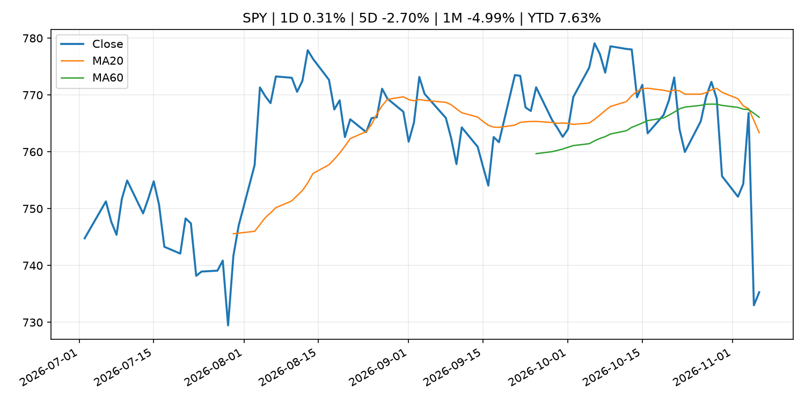
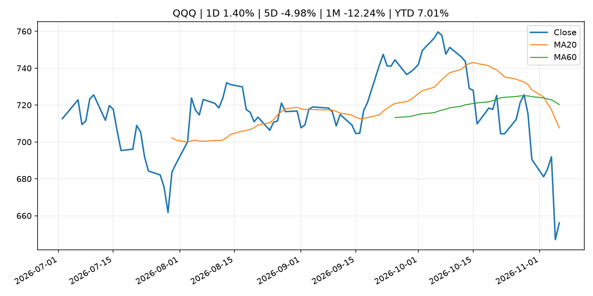
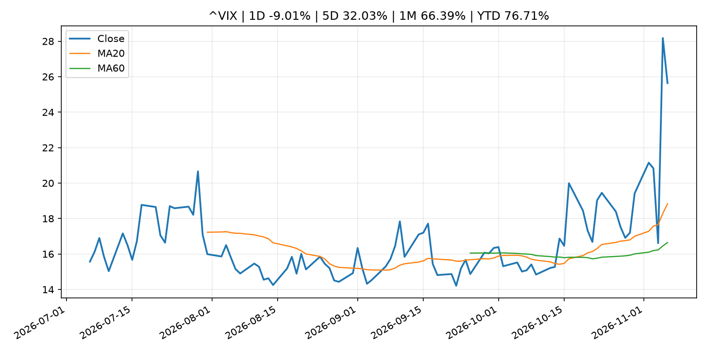
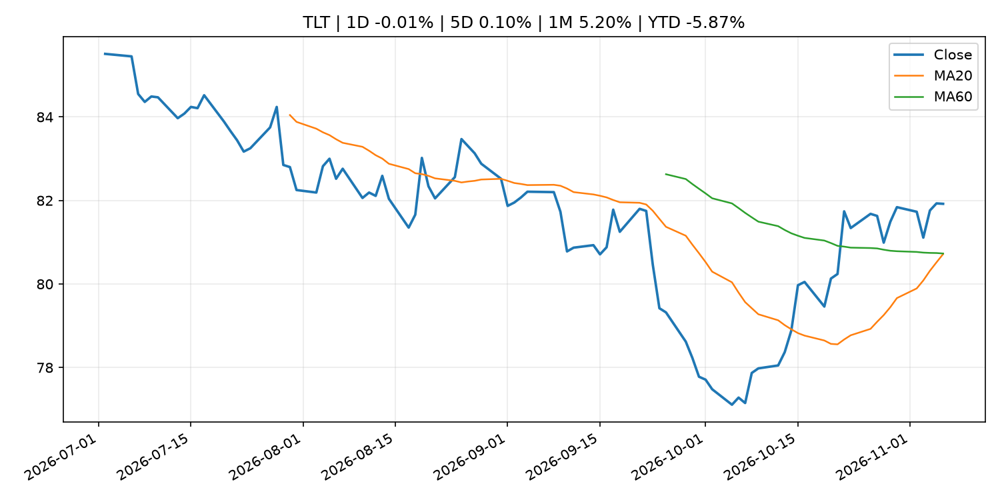
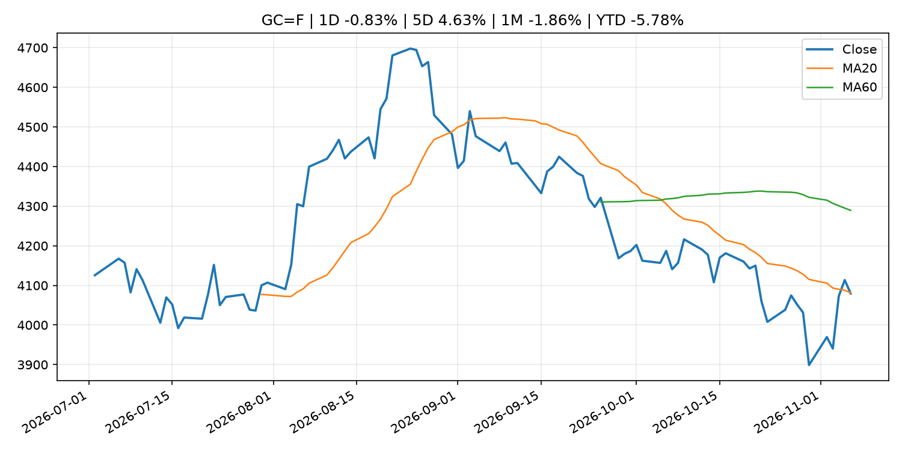
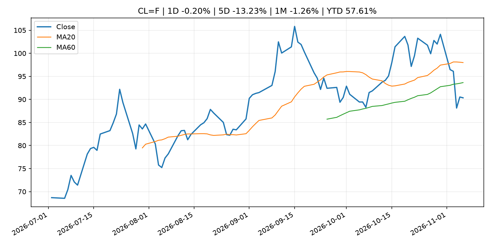
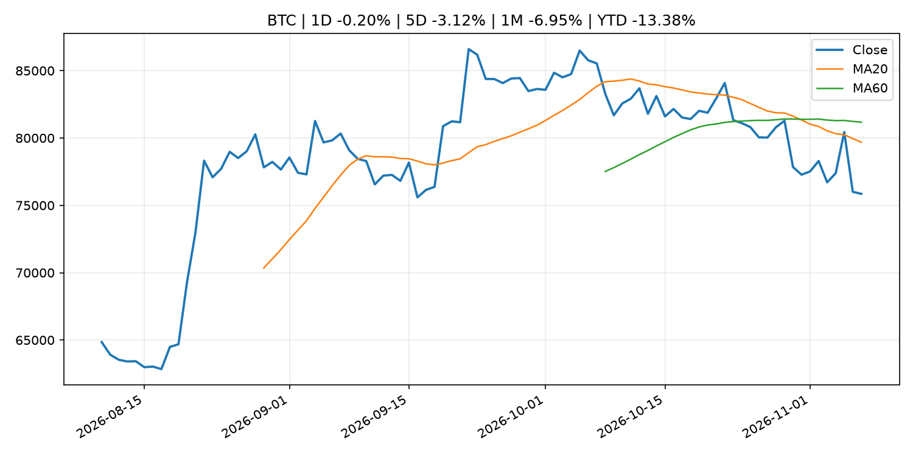
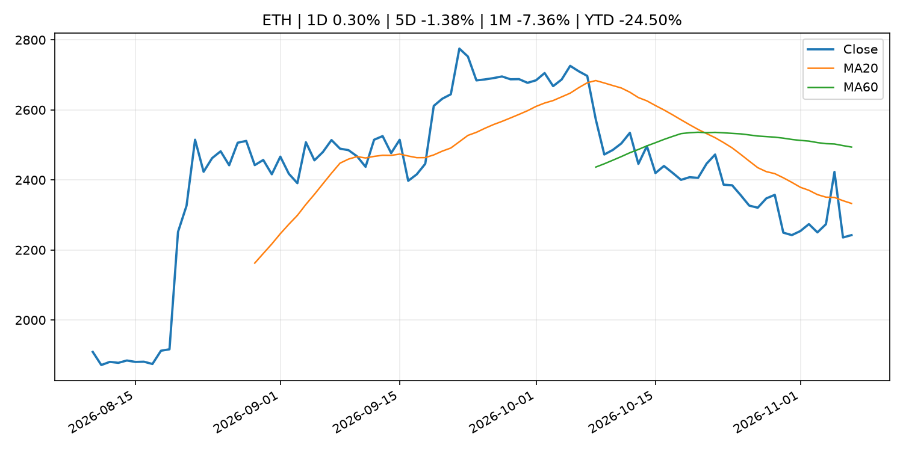
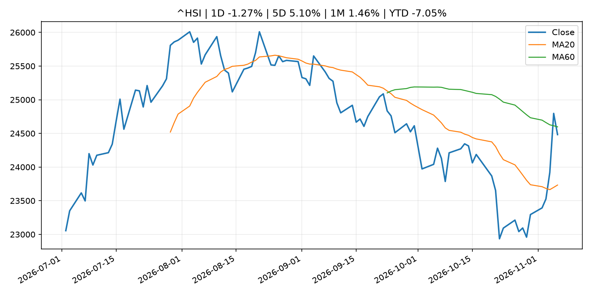

# Global Macro Morning Briefing - 2026-11-07

> Not financial advice / 非投资建议。

## 0. 今日总览
- 市场状态：risk_on。股指上涨、波动率或美元回落，市场更接近风险偏好改善。
- 今日三大主线：
  1. central_bank_speech: Americans are on a 'treadmill of high inflation' and more rate hikes are likely, Fed's Daly says
  2. earnings: Google could take stake in bitcoin miner TeraWulf’s $19 billion AI project if Anthropic defaults
  3. central_bank_speech: Speech by Governor UEDA at the 2026 Michel Camdessus Central Banking Lecture, International Monetary Fund
- 一句话结论：今日晨报重点关注：央行官员表态可能影响市场对下一次会议的定价。；大型科技股盈利和资本开支会影响纳指、半导体和 AI 交易主线。。跨资产方面，SPY 1D 0.31%；QQQ 1D 1.40%；^VIX 1D -9.01%；TLT 1D -0.01%；GC=F 1D -0.83%；CL=F 1D -0.20%；BTC 1D -0.20%；ETH 1D 0.30%；股指上涨、波动率或美元回落，市场更接近风险偏好改善。政策、通胀、利率、美元、美债、能源和加密监管仍是主要观察线索。所有结论仅基于公开数据与短摘要整理，不构成投资建议。

## 1. 隔夜跨资产市场
- 美股：SPY 1D 0.31%，QQQ 1D 1.40%，整体趋势需结合 VIX 和利率确认。
- 美债/美元：TLT 1D -0.01%，美元指数 1D 0.72%，是判断折现率压力的核心线索。
- 黄金/原油：黄金 1D -0.83%，原油 1D -0.20%，用于观察避险、通胀和地缘风险。
- 加密：BTC 1D -0.20%，ETH 1D 0.30%，关注是否独立于纳指走出加密自身行情。
- 港股/A股：恒生 1D -1.27%，沪深300/上证 1D n/a，重点看中国政策预期与人民币线索。
- 风险观察：确认风险偏好是否扩散到小盘股、信用利差和周期品。

### US_EQUITY

| symbol | latest close | 1D | 5D | 1M | YTD | trend |
|---|---:|---:|---:|---:|---:|---|
| SPY | 735.29 | 0.31% | -2.70% | -4.99% | 7.63% | strong_downtrend |
| QQQ | 656.10 | 1.40% | -4.98% | -12.24% | 7.01% | strong_downtrend |
| DIA | 512.22 | -0.40% | -0.95% | 0.11% | 5.91% | downtrend |
| IWM | 273.67 | 0.99% | -2.03% | -1.41% | 10.00% | downtrend |
| VTI | 361.93 | 0.39% | -2.59% | -4.64% | 7.62% | strong_downtrend |

### US_MACRO_MARKET

| symbol | latest close | 1D | 5D | 1M | YTD | trend |
|---|---:|---:|---:|---:|---:|---|
| ^VIX | 25.64 | -9.01% | 32.03% | 66.39% | 76.71% | strong_uptrend |
| DX-Y.NYB | 102.28 | 0.72% | 0.39% | 0.14% | 3.92% | uptrend |
| TLT | 81.92 | -0.01% | 0.10% | 5.20% | -5.87% | range_bound |
| IEF | 91.86 | -0.12% | 0.11% | 2.69% | -4.39% | range_bound |

### COMMODITIES

| symbol | latest close | 1D | 5D | 1M | YTD | trend |
|---|---:|---:|---:|---:|---:|---|
| GC=F | 4,079.50 | -0.83% | 4.63% | -1.86% | -5.78% | downtrend |
| SI=F | 51.97 | -0.51% | 5.84% | -12.02% | -26.35% | strong_downtrend |
| CL=F | 90.34 | -0.20% | -13.23% | -1.26% | 57.61% | range_bound |
| BZ=F | 97.76 | -0.54% | -16.90% | -6.25% | 60.92% | range_bound |
| NG=F | 3.00 | 1.90% | 3.62% | -5.21% | -17.00% | uptrend |
| HG=F | 6.26 | 0.18% | -3.07% | -3.97% | 10.99% | strong_downtrend |

### HK_MARKET

| symbol | latest close | 1D | 5D | 1M | YTD | trend |
|---|---:|---:|---:|---:|---:|---|
| ^HSI | 24,481.86 | -1.27% | 5.10% | 1.46% | -7.05% | range_bound |
| 0700.HK | 419.80 | -2.46% | 9.44% | -0.19% | -32.62% | range_bound |
| 9988.HK | 104.90 | -3.85% | 8.09% | -0.47% | -29.60% | range_bound |
| 3690.HK | 80.40 | 0.12% | 12.29% | 14.61% | -23.14% | range_bound |
| 1810.HK | 30.38 | -2.94% | 14.73% | 26.90% | -24.58% | strong_uptrend |
| 1211.HK | 74.15 | -2.05% | 8.64% | -0.54% | -24.91% | range_bound |

### CRYPTO

| symbol | latest close | 1D | 5D | 1M | YTD | trend |
|---|---:|---:|---:|---:|---:|---|
| BTC | 75,854.45 | -0.20% | -3.12% | -6.95% | -13.38% | strong_downtrend |
| ETH | 2,242.47 | 0.30% | -1.38% | -7.36% | -24.50% | strong_downtrend |
| SOLANA | 90.32 | 1.22% | -4.41% | -13.42% | -27.47% | strong_downtrend |
| BINANCECOIN | 694.52 | 0.82% | -2.44% | -3.66% | -19.49% | strong_downtrend |
| RIPPLE | 1.18 | -2.22% | -5.59% | -9.94% | -35.90% | strong_downtrend |

## 2. 今日最重要的 10 条新闻
### 1. Americans are on a 'treadmill of high inflation' and more rate hikes are likely, Fed's Daly says
- 来源：CNBC Economy
- 时间：2026-11-06T19:05:00+00:00
- 地区：US
- 事件类型：central_bank_speech
- 重要性层级：Tier 2
- 一句话摘要：San Francisco Fed President Mary Daly called Friday's jobs report "good news for American workers," but noted the pressure inflation is exerting on household finances
- 为什么重要：央行官员表态可能影响市场对下一次会议的定价。
- 可能影响：主要影响 DXY，方向为 positive，强度 high；通胀压力可能推高政策利率预期并支撑美元。
  - 资产：DXY
    方向：positive
    强度：high
    原因：通胀压力可能推高政策利率预期并支撑美元。
  - 资产：TLT
    方向：negative
    强度：high
    原因：通胀上行通常推升收益率、压低长债价格。
  - 资产：QQQ
    方向：negative
    强度：high
    原因：更高利率对成长股估值折现率不利。
  - 资产：SPY
    方向：mixed
    强度：medium
    原因：名义增长可能支撑收入，但更高利率压制估值。
  - 资产：GC=F
    方向：mixed
    强度：medium
    原因：通胀对黄金是支撑，但实际利率上行会形成压力。
  - 资产：BTC
    方向：mixed
    强度：medium
    原因：抗通胀叙事和流动性收紧可能相互抵消。
- 原文链接：[https://www.cnbc.com/2026/11/06/fed-daly-interest-rates-inflation.html](https://www.cnbc.com/2026/11/06/fed-daly-interest-rates-inflation.html)

### 2. Google could take stake in bitcoin miner TeraWulf’s $19 billion AI project if Anthropic defaults
- 来源：CoinDesk
- 时间：2026-11-05T13:29:40+00:00
- 地区：global
- 事件类型：earnings
- 重要性层级：Tier 2
- 一句话摘要：Google could take stake in bitcoin miner TeraWulf’s $19 billion AI project if Anthropic defaults
- 为什么重要：大型科技股盈利和资本开支会影响纳指、半导体和 AI 交易主线。
- 可能影响：主要影响 QQQ，方向为 mixed，强度 high；AI 资本开支会影响大型科技股盈利和估值预期。
  - 资产：QQQ
    方向：mixed
    强度：high
    原因：AI 资本开支会影响大型科技股盈利和估值预期。
  - 资产：SMH
    方向：mixed
    强度：high
    原因：AI 投资周期直接影响半导体需求。
  - 资产：NVDA
    方向：mixed
    强度：high
    原因：AI 训练和推理需求是英伟达收入预期核心变量。
  - 资产：MSFT
    方向：mixed
    强度：medium
    原因：云和 AI 资本开支影响利润率与增长叙事。
  - 资产：GOOGL
    方向：mixed
    强度：medium
    原因：AI 投资和搜索商业化影响估值。
  - 资产：META
    方向：mixed
    强度：medium
    原因：AI 基建支出与广告效率共同影响市场预期。
- 原文链接：[https://www.coindesk.com/tech/2026/11/05/google-could-take-ownership-stake-in-bitcoin-miner-terawulf-s-ai-project-if-anthropic-defaults](https://www.coindesk.com/tech/2026/11/05/google-could-take-ownership-stake-in-bitcoin-miner-terawulf-s-ai-project-if-anthropic-defaults)

### 3. Speech by Governor UEDA at the 2026 Michel Camdessus Central Banking Lecture, International Monetary Fund
- 来源：Bank of Japan Announcements
- 时间：2026-11-07T01:00:00+09:00
- 地区：Japan
- 事件类型：central_bank_speech
- 重要性层级：Tier 2
- 一句话摘要：Speech by Governor UEDA at the 2026 Michel Camdessus Central Banking Lecture, International Monetary Fund
- 为什么重要：央行官员表态可能影响市场对下一次会议的定价。
- 可能影响：可能影响利率、汇率、风险资产或大宗商品预期，但当前公开信息不足以判断明确方向。
  - 资产：暂无明确资产映射
  - 方向：unknown
  - 强度：low
  - 原因：公开信息不足以判断方向。
- 原文链接：[http://www.boj.or.jp/en/about/press/koen_2026/ko261107a.htm](http://www.boj.or.jp/en/about/press/koen_2026/ko261107a.htm)

### 4. Micron’s stock is dirt cheap — and that’s igniting a fierce online debate
- 来源：MarketWatch Top Stories
- 时间：2026-11-06T20:58:00+00:00
- 地区：US
- 事件类型：earnings
- 重要性层级：Tier 2
- 一句话摘要：Valuation purists see a ridiculously inexpensive stock, but some semiconductor investors say Micron’s earnings power won’t hold up.
- 为什么重要：大型科技股盈利和资本开支会影响纳指、半导体和 AI 交易主线。
- 可能影响：可能影响利率、汇率、风险资产或大宗商品预期，但当前公开信息不足以判断明确方向。
  - 资产：暂无明确资产映射
  - 方向：unknown
  - 强度：low
  - 原因：公开信息不足以判断方向。
- 原文链接：[https://www.marketwatch.com/story/microns-stock-is-dirt-cheap-and-thats-igniting-a-fierce-online-debate-0626791d?mod=mw_rss_topstories](https://www.marketwatch.com/story/microns-stock-is-dirt-cheap-and-thats-igniting-a-fierce-online-debate-0626791d?mod=mw_rss_topstories)

### 5. Federal Reserve Board announces termination of enforcement action with Allegiant United Holdings, LLC, Nano Financial Holdings, Inc., and Nano Banc
- 来源：Federal Reserve Press Releases
- 时间：2026-11-05T16:00:00+00:00
- 地区：US
- 事件类型：regulation
- 重要性层级：Tier 2
- 一句话摘要：Federal Reserve Board announces termination of enforcement action with Allegiant United Holdings, LLC, Nano Financial Holdings, Inc., and Nano Banc
- 为什么重要：监管变化会改变行业盈利预期和资产风险溢价。
- 可能影响：可能影响利率、汇率、风险资产或大宗商品预期，但当前公开信息不足以判断明确方向。
  - 资产：暂无明确资产映射
  - 方向：unknown
  - 强度：low
  - 原因：公开信息不足以判断方向。
- 原文链接：[https://www.federalreserve.gov/newsevents/pressreleases/enforcement20261105a.htm](https://www.federalreserve.gov/newsevents/pressreleases/enforcement20261105a.htm)

### 6. Binance cuts SignalPlus access after security warning, urges users to check accounts
- 来源：CoinDesk
- 时间：2026-11-05T12:55:03+00:00
- 地区：global
- 事件类型：routine_announcement
- 重要性层级：Tier 2
- 一句话摘要：Binance cuts SignalPlus access after security warning, urges users to check accounts
- 为什么重要：普通统计表、账户或例行公告通常不构成市场主线。 但标题或摘要同时涉及重大市场主题，因此提升为重要跟踪项。
- 可能影响：可能影响利率、汇率、风险资产或大宗商品预期，但当前公开信息不足以判断明确方向。
  - 资产：暂无明确资产映射
  - 方向：unknown
  - 强度：low
  - 原因：公开信息不足以判断方向。
- 原文链接：[https://www.coindesk.com/tech/2026/11/05/binance-cuts-signalplus-access-after-security-warning-urges-users-to-check-accounts](https://www.coindesk.com/tech/2026/11/05/binance-cuts-signalplus-access-after-security-warning-urges-users-to-check-accounts)

### 7. Barkin sees interest rate hikes ahead, but at a gradual pace
- 来源：CNBC Economy
- 时间：2026-11-05T16:34:33+00:00
- 地区：US
- 事件类型：other
- 重要性层级：Tier 3
- 一句话摘要：In a CNBC interview, the policymaker expressed concern over inflation and said monetary policy will need to adjust.
- 为什么重要：这条信息暂未匹配到重大宏观、政策或市场事件，更适合作为背景跟踪。
- 可能影响：主要影响 DXY，方向为 positive，强度 high；通胀压力可能推高政策利率预期并支撑美元。
  - 资产：DXY
    方向：positive
    强度：high
    原因：通胀压力可能推高政策利率预期并支撑美元。
  - 资产：TLT
    方向：negative
    强度：high
    原因：通胀上行通常推升收益率、压低长债价格。
  - 资产：QQQ
    方向：negative
    强度：high
    原因：更高利率对成长股估值折现率不利。
  - 资产：SPY
    方向：mixed
    强度：medium
    原因：名义增长可能支撑收入，但更高利率压制估值。
  - 资产：GC=F
    方向：mixed
    强度：medium
    原因：通胀对黄金是支撑，但实际利率上行会形成压力。
  - 资产：BTC
    方向：mixed
    强度：medium
    原因：抗通胀叙事和流动性收紧可能相互抵消。
- 原文链接：[https://www.cnbc.com/2026/11/05/barkin-sees-interest-rate-hikes-ahead-but-at-a-gradual-pace.html](https://www.cnbc.com/2026/11/05/barkin-sees-interest-rate-hikes-ahead-but-at-a-gradual-pace.html)

### 8. Over $1 billion in bullish bets liquidated while ETF flows suggest no help in spot market
- 来源：CoinDesk
- 时间：2026-11-06T12:30:00+00:00
- 地区：global
- 事件类型：other
- 重要性层级：Tier 3
- 一句话摘要：Over $1 billion in bullish bets liquidated while ETF flows suggest no help in spot market
- 为什么重要：这条信息暂未匹配到重大宏观、政策或市场事件，更适合作为背景跟踪。
- 可能影响：主要影响 BTC，方向为 mixed，强度 high；加密监管或 ETF 进展会改变 BTC 的资金流和风险溢价。
  - 资产：BTC
    方向：mixed
    强度：high
    原因：加密监管或 ETF 进展会改变 BTC 的资金流和风险溢价。
  - 资产：ETH
    方向：mixed
    强度：high
    原因：监管框架会影响 ETH 产品化和机构参与度。
  - 资产：COIN
    方向：mixed
    强度：medium
    原因：监管清晰度和执法风险会影响交易平台估值。
  - 资产：crypto market
    方向：mixed
    强度：high
    原因：信息影响整个加密市场结构，但方向取决于细节。
- 原文链接：[https://www.coindesk.com/daybook-us/2026/11/06/over-usd1-billion-in-bullish-bets-liquidated-while-etf-flows-suggest-no-help-in-spot-market](https://www.coindesk.com/daybook-us/2026/11/06/over-usd1-billion-in-bullish-bets-liquidated-while-etf-flows-suggest-no-help-in-spot-market)

## 3. 政策与央行观察
### 1. Americans are on a 'treadmill of high inflation' and more rate hikes are likely, Fed's Daly says
- 来源：CNBC Economy
- 时间：2026-11-06T19:05:00+00:00
- 地区：US
- 事件类型：central_bank_speech
- 重要性层级：Tier 2
- 一句话摘要：San Francisco Fed President Mary Daly called Friday's jobs report "good news for American workers," but noted the pressure inflation is exerting on household finances
- 为什么重要：央行官员表态可能影响市场对下一次会议的定价。
- 可能影响：主要影响 DXY，方向为 positive，强度 high；通胀压力可能推高政策利率预期并支撑美元。
  - 资产：DXY
    方向：positive
    强度：high
    原因：通胀压力可能推高政策利率预期并支撑美元。
  - 资产：TLT
    方向：negative
    强度：high
    原因：通胀上行通常推升收益率、压低长债价格。
  - 资产：QQQ
    方向：negative
    强度：high
    原因：更高利率对成长股估值折现率不利。
  - 资产：SPY
    方向：mixed
    强度：medium
    原因：名义增长可能支撑收入，但更高利率压制估值。
  - 资产：GC=F
    方向：mixed
    强度：medium
    原因：通胀对黄金是支撑，但实际利率上行会形成压力。
  - 资产：BTC
    方向：mixed
    强度：medium
    原因：抗通胀叙事和流动性收紧可能相互抵消。
- 原文链接：[https://www.cnbc.com/2026/11/06/fed-daly-interest-rates-inflation.html](https://www.cnbc.com/2026/11/06/fed-daly-interest-rates-inflation.html)

### 2. Speech by Governor UEDA at the 2026 Michel Camdessus Central Banking Lecture, International Monetary Fund
- 来源：Bank of Japan Announcements
- 时间：2026-11-07T01:00:00+09:00
- 地区：Japan
- 事件类型：central_bank_speech
- 重要性层级：Tier 2
- 一句话摘要：Speech by Governor UEDA at the 2026 Michel Camdessus Central Banking Lecture, International Monetary Fund
- 为什么重要：央行官员表态可能影响市场对下一次会议的定价。
- 可能影响：可能影响利率、汇率、风险资产或大宗商品预期，但当前公开信息不足以判断明确方向。
  - 资产：暂无明确资产映射
  - 方向：unknown
  - 强度：low
  - 原因：公开信息不足以判断方向。
- 原文链接：[http://www.boj.or.jp/en/about/press/koen_2026/ko261107a.htm](http://www.boj.or.jp/en/about/press/koen_2026/ko261107a.htm)

### 3. Federal Reserve Board announces termination of enforcement action with Allegiant United Holdings, LLC, Nano Financial Holdings, Inc., and Nano Banc
- 来源：Federal Reserve Press Releases
- 时间：2026-11-05T16:00:00+00:00
- 地区：US
- 事件类型：regulation
- 重要性层级：Tier 2
- 一句话摘要：Federal Reserve Board announces termination of enforcement action with Allegiant United Holdings, LLC, Nano Financial Holdings, Inc., and Nano Banc
- 为什么重要：监管变化会改变行业盈利预期和资产风险溢价。
- 可能影响：可能影响利率、汇率、风险资产或大宗商品预期，但当前公开信息不足以判断明确方向。
  - 资产：暂无明确资产映射
  - 方向：unknown
  - 强度：low
  - 原因：公开信息不足以判断方向。
- 原文链接：[https://www.federalreserve.gov/newsevents/pressreleases/enforcement20261105a.htm](https://www.federalreserve.gov/newsevents/pressreleases/enforcement20261105a.htm)

## 4. 市场异动与图表
- QQQ 上涨 1.40%
- VIX 下跌 -9.01%
- DXY 上涨 0.72%
- Gold 下跌 -0.83%

### SPY

### QQQ

### ^VIX

### TLT

### GC=F

### CL=F

### BTC

### ETH

### ^HSI

## 5. 华尔街与机构公开观点
- 暂无可靠公开观点。

## 6. 今日重点关注
- 经济数据：经济数据：暂无可靠公开日历数据；如配置经济日历源后可自动填充。
- 央行讲话：央行讲话：暂无可靠公开日历数据；重点跟踪 Fed、ECB、BoJ、PBOC 官网 RSS。
- 财报：财报：暂无可靠数据。
- 政策事件：政策事件：暂无可靠数据。
- 风险提醒：风险提醒：关注数据源失败项、突发地缘风险、利率和美元的二阶反应。

## 7. 英文金融表达与宏观概念
- **inflation expectations**：通胀预期，指家庭、企业或市场对未来通胀的预估。 例句：Inflation expectations can shape wage bargaining and bond yields.
- **real yield**：实际收益率，名义利率扣除通胀预期后的收益率。 例句：Gold often reacts more to real yields than nominal yields.
- **terminal rate**：终端利率，市场预期本轮加息周期的最高政策利率。 例句：A higher terminal rate can pressure growth stocks.
- **risk-off**：避险模式，资金偏向美元、国债、黄金等防御资产。 例句：A geopolitical shock can push markets into risk-off mode.
- **market structure**：市场结构，指交易、托管、清算、ETF、监管等制度安排。 例句：Crypto market structure rules can affect institutional participation.
- **soft landing**：软着陆，指通胀回落而经济避免明显衰退。 例句：Markets often rally when data support a soft landing.

## 8. 背景材料
- [‘I have no financial safety net’: I’m 66, rely on Social Security and have just $500 in savings. What hope do I have?](https://www.marketwatch.com/story/i-have-no-financial-safety-net-im-66-rely-on-social-security-and-have-500-in-savings-what-politician-speaks-for-me-be2126cb?mod=mw_rss_topstories)（MarketWatch Top Stories，other）：“Sometimes I wonder whether wealthier Americans should trade places with people like me.”
- [‘It seems bizarre’: We’re in our 80s with $950,000 in traditional IRAs. Why is our adviser pushing Roth conversions?](https://www.marketwatch.com/story/it-seems-bizarre-were-in-our-80s-with-950-000-in-traditional-iras-why-is-our-adviser-pushing-us-to-do-roth-conversions-a665f990?mod=mw_rss_topstories)（MarketWatch Top Stories，other）：“Our basic living expenses are covered by $110,000 in annual pensions and Social Security.”
- [Over $1 billion in bullish bets liquidated while ETF flows suggest no help in spot market](https://www.coindesk.com/daybook-us/2026/11/06/over-usd1-billion-in-bullish-bets-liquidated-while-etf-flows-suggest-no-help-in-spot-market)（CoinDesk，other）：Over $1 billion in bullish bets liquidated while ETF flows suggest no help in spot market
- [Live updates: Bitcoin flatlines under $76,000 as stock bounce loses steam into the close](https://www.coindesk.com/tech/2026/11/06/live-updates-nasdaq-100-futures-rally-points-to-stock-market-respite)（CoinDesk，other）：Live updates: Bitcoin flatlines under $76,000 as stock bounce loses steam into the close
- [Bitcoin steadies after AI-led selloff as eyes turn to latest U.S. jobs figures](https://www.coindesk.com/markets/2026/11/06/bitcoin-steadies-near-usd76-000-after-ai-led-selloff)（CoinDesk，other）：Bitcoin steadies after AI-led selloff as eyes turn to latest U.S. jobs figures
- [Bitcoin recovers $76,000 level as ETFs shed $430 million after tech rout](https://www.coindesk.com/markets/2026/11/06/bitcoin-recovers-usd76-000-level-as-etfs-shed-usd430-million-after-tech-rout)（CoinDesk，other）：Bitcoin recovers $76,000 level as ETFs shed $430 million after tech rout
- [ECB publishes consolidated banking data for end-June 2026](https://www.ecb.europa.eu//press/pr/date/2026/html/ecb.pr261106~356f2fc73a.en.html)（ECB Press Releases，other）：ECB publishes consolidated banking data for end-June 2026
- [(IMES Newsletter) 2026 BoC - Philadelphia Fed - BOJ Joint Workshop](http://www.boj.or.jp/en/about/release_2026/rel261106b.htm)（Bank of Japan Announcements，other）：(IMES Newsletter) 2026 BoC - Philadelphia Fed - BOJ Joint Workshop
- [Hyperliquid treasury firm seeking U.S. regulatory nod as a domestic futures platform](https://www.coindesk.com/policy/2026/11/05/hyperliquid-treasury-firm-seeking-u-s-regulatory-nod-as-a-domestic-futures-platform)（CoinDesk，other）：Hyperliquid treasury firm seeking U.S. regulatory nod as a domestic futures platform
- [IMES Discussion Paper Series (2026)](http://www.boj.or.jp/en/research/imes/dps/dps26.htm)（Bank of Japan Announcements，research_publication）：IMES Discussion Paper Series (2026)
- [Bitcoin developer proposes ‘landmines’ to make quantum thieves lose their own BTC](https://www.coindesk.com/tech/2026/11/05/bitcoin-developer-proposes-landmines-to-make-quantum-thieves-lose-their-own-btc)（CoinDesk，other）：Bitcoin developer proposes ‘landmines’ to make quantum thieves lose their own BTC
- [Bitcoin tumbles to $76,000 as collapsing AI trade drags stocks sharply lower](https://www.coindesk.com/markets/2026/11/05/bitcoin-crypto-stocks-caught-in-ai-trade-meltdown-but-wintermute-trader-sees-glass-half-full)（CoinDesk，other）：Bitcoin tumbles to $76,000 as collapsing AI trade drags stocks sharply lower
- [Barkin sees interest rate hikes ahead, but at a gradual pace](https://www.cnbc.com/2026/11/05/barkin-sees-interest-rate-hikes-ahead-but-at-a-gradual-pace.html)（CNBC Economy，other）：In a CNBC interview, the policymaker expressed concern over inflation and said monetary policy will need to adjust.
- [Binance cuts SignalPlus access after security warning, urges users to check accounts](https://www.coindesk.com/tech/2026/11/05/binance-cuts-signalplus-access-after-security-warning-urges-users-to-check-accounts)（CoinDesk，routine_announcement）：Binance cuts SignalPlus access after security warning, urges users to check accounts
- [Bitcoin is resilient, but leverage is missing and demand still tepid](https://www.coindesk.com/daybook-us/2026/11/05/bitcoin-is-resilient-but-leverage-is-missing-and-demand-still-tepid)（CoinDesk，other）：Bitcoin is resilient, but leverage is missing and demand still tepid
- [Isabel Schnabel: Navigating stormy waters: reflections on monetary policy](https://www.ecb.europa.eu//press/key/date/2026/html/ecb.sp261105_1~5e97d9d5a0.en.html)（ECB Press Releases，other）：Isabel Schnabel: Navigating stormy waters: reflections on monetary policy
- [Piero Cipollone: Shaping the future of money](https://www.ecb.europa.eu//press/key/date/2026/html/ecb.sp261105~6495a0df6f.en.html)（ECB Press Releases，other）：Piero Cipollone: Shaping the future of money
- [Holding the Twenty-fifth Round of the "Bond Market Group" Meetings](http://www.boj.or.jp/en/paym/bond/mbond_list/mbond261105.pdf)（Bank of Japan Announcements，other）：Holding the Twenty-fifth Round of the "Bond Market Group" Meetings

## 9. 数据源、失败项与免责声明
- 采集时间：2026-11-07T01:37:12
- 数据源：公开 RSS、Yahoo Finance、CoinGecko、AKShare、FRED、SEC data.sec.gov，以及用户自有 inputs/reports 文件。
- 合规说明：不绕过 WSJ、Bloomberg、FT、Reuters 等付费墙；对付费媒体只使用公开 RSS 标题、摘要、链接和发布时间。
- 免责声明：Not financial advice / 非投资建议。本项目仅供个人学习、研究和信息整理，不构成投资建议、交易建议或任何收益承诺。
- 失败或跳过的数据源：
  - crypto data failed coin=dogecoin
  - China market data failed symbol=上证指数: empty dataframe
  - China market data failed symbol=深证成指: empty dataframe
  - China market data failed symbol=创业板指: empty dataframe
  - China market data failed symbol=沪深300: empty dataframe
  - China market data failed symbol=中证500: empty dataframe
  - China market data failed symbol=科创50: empty dataframe
  - FRED_API_KEY not set; skipping FRED macro series
  - SEC failed cik=0000320193
  - SEC failed cik=0000789019
  - SEC failed cik=0001045810
  - SEC failed cik=0001318605
  - SEC failed cik=0001577552
