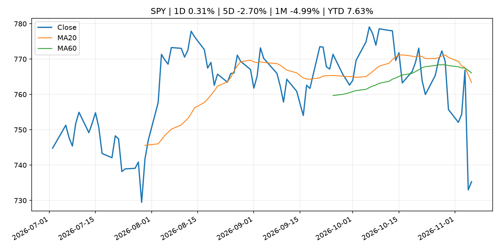
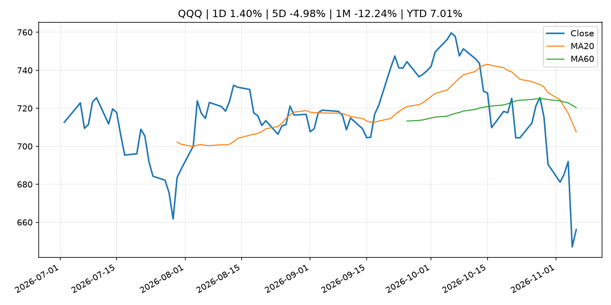
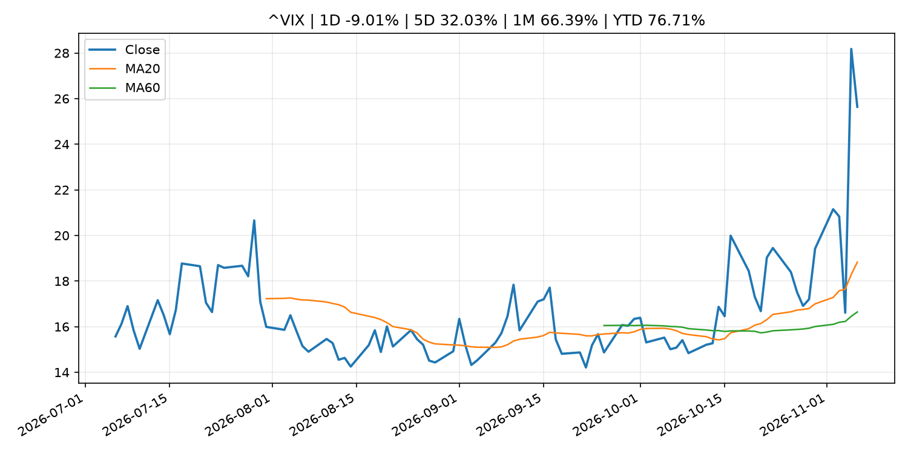
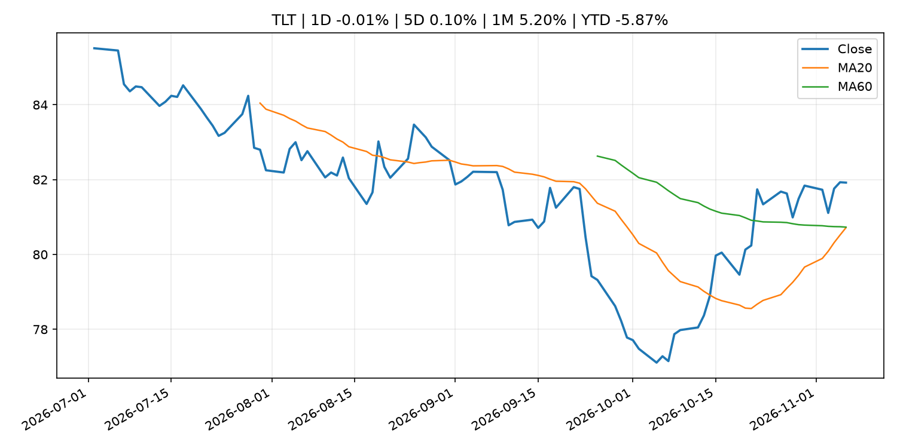
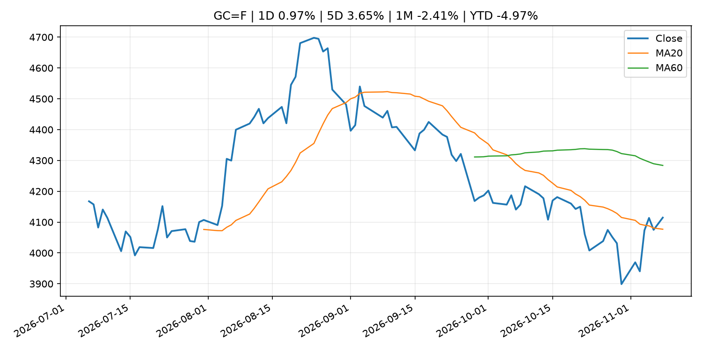
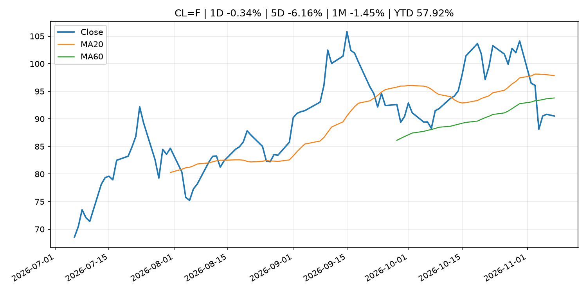
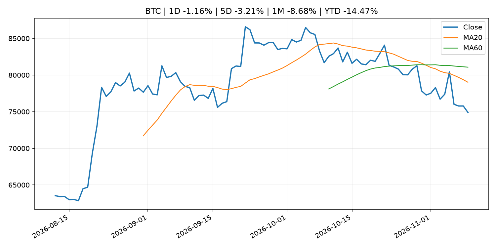
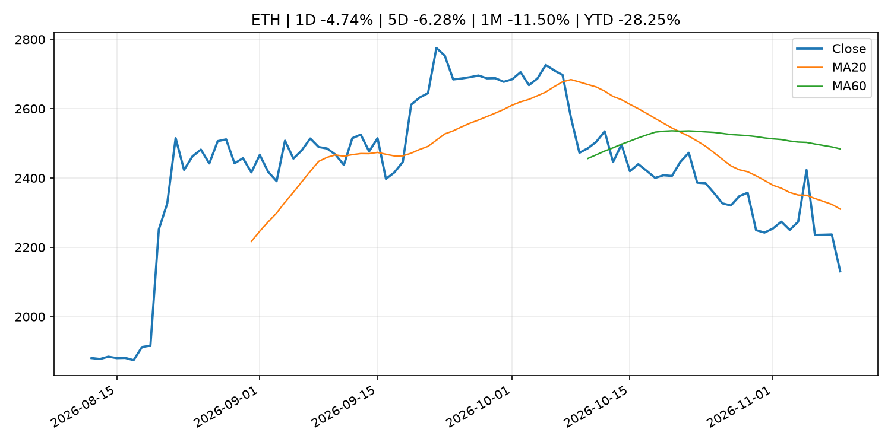
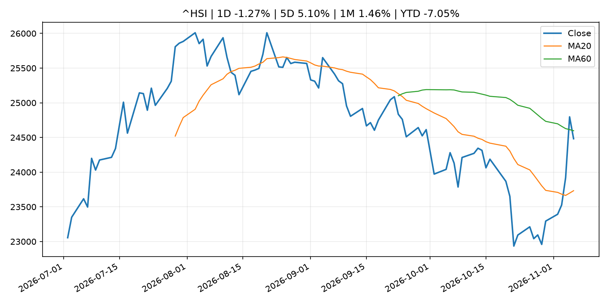

# Global Macro Morning Briefing - 2026-11-09

> Not financial advice / 非投资建议。

## 0. 今日总览
- 市场状态：risk_on。股指上涨、波动率或美元回落，市场更接近风险偏好改善。
- 今日三大主线：
  1. crypto_market_structure: Stablecoin growth has stalled. The payments boom hasn't
  2. earnings: Berkshire Hathaway more than doubles buybacks in third quarter as earnings decline
- 一句话结论：今日晨报重点关注：加密市场结构和监管变化会影响 BTC、ETH 及相关股票的风险溢价。；大型科技股盈利和资本开支会影响纳指、半导体和 AI 交易主线。。跨资产方面，SPY 1D 0.31%；QQQ 1D 1.40%；^VIX 1D -9.01%；TLT 1D -0.01%；GC=F 1D 0.97%；CL=F 1D -0.34%；BTC 1D -1.16%；ETH 1D -4.74%；股指上涨、波动率或美元回落，市场更接近风险偏好改善。政策、通胀、利率、美元、美债、能源和加密监管仍是主要观察线索。所有结论仅基于公开数据与短摘要整理，不构成投资建议。

## 1. 隔夜跨资产市场
- 美股：SPY 1D 0.31%，QQQ 1D 1.40%，整体趋势需结合 VIX 和利率确认。
- 美债/美元：TLT 1D -0.01%，美元指数 1D -0.13%，是判断折现率压力的核心线索。
- 黄金/原油：黄金 1D 0.97%，原油 1D -0.34%，用于观察避险、通胀和地缘风险。
- 加密：BTC 1D -1.16%，ETH 1D -4.74%，关注是否独立于纳指走出加密自身行情。
- 港股/A股：恒生 1D -1.27%，沪深300/上证 1D n/a，重点看中国政策预期与人民币线索。
- 风险观察：确认风险偏好是否扩散到小盘股、信用利差和周期品。

### US_EQUITY

| symbol | latest close | 1D | 5D | 1M | YTD | trend |
|---|---:|---:|---:|---:|---:|---|
| SPY | 735.29 | 0.31% | -2.70% | -4.99% | 7.63% | strong_downtrend |
| QQQ | 656.10 | 1.40% | -4.98% | -12.24% | 7.01% | strong_downtrend |
| DIA | 512.22 | -0.40% | -0.95% | 0.11% | 5.91% | downtrend |
| IWM | 273.67 | 0.99% | -2.03% | -1.41% | 10.00% | downtrend |
| VTI | 361.93 | 0.39% | -2.59% | -4.64% | 7.62% | strong_downtrend |

### US_MACRO_MARKET

| symbol | latest close | 1D | 5D | 1M | YTD | trend |
|---|---:|---:|---:|---:|---:|---|
| ^VIX | 25.64 | -9.01% | 32.03% | 66.39% | 76.71% | strong_uptrend |
| DX-Y.NYB | 102.16 | -0.13% | 0.41% | -0.05% | 3.80% | uptrend |
| TLT | 81.92 | -0.01% | 0.10% | 5.20% | -5.87% | range_bound |
| IEF | 91.86 | -0.12% | 0.11% | 2.69% | -4.39% | range_bound |

### COMMODITIES

| symbol | latest close | 1D | 5D | 1M | YTD | trend |
|---|---:|---:|---:|---:|---:|---|
| GC=F | 4,114.60 | 0.97% | 3.65% | -2.41% | -4.97% | range_bound |
| SI=F | 53.03 | 2.38% | 4.56% | -12.58% | -24.83% | strong_downtrend |
| CL=F | 90.52 | -0.34% | -6.16% | -1.45% | 57.92% | range_bound |
| BZ=F | 97.48 | -0.85% | -6.96% | -6.91% | 60.46% | range_bound |
| NG=F | 2.99 | -0.20% | 4.76% | -7.08% | -17.30% | range_bound |
| HG=F | 6.31 | 1.46% | -3.58% | -5.02% | 11.86% | strong_downtrend |

### HK_MARKET

| symbol | latest close | 1D | 5D | 1M | YTD | trend |
|---|---:|---:|---:|---:|---:|---|
| ^HSI | 24,481.86 | -1.27% | 5.10% | 1.46% | -7.05% | range_bound |
| 0700.HK | 438.00 | 4.34% | 11.68% | 6.47% | -29.70% | range_bound |
| 9988.HK | 107.90 | 2.86% | 8.50% | 3.45% | -27.58% | range_bound |
| 3690.HK | 83.00 | 3.23% | 13.62% | 19.60% | -20.65% | range_bound |
| 1810.HK | 31.00 | 2.04% | 10.32% | 31.02% | -23.04% | strong_uptrend |
| 1211.HK | 74.50 | 0.47% | 5.75% | 2.19% | -24.56% | range_bound |

### CRYPTO

| symbol | latest close | 1D | 5D | 1M | YTD | trend |
|---|---:|---:|---:|---:|---:|---|
| BTC | 74,899.57 | -1.16% | -3.21% | -8.68% | -14.47% | strong_downtrend |
| ETH | 2,130.93 | -4.74% | -6.28% | -11.50% | -28.25% | strong_downtrend |
| SOLANA | 87.21 | -2.77% | -6.00% | -16.14% | -29.96% | strong_downtrend |
| BINANCECOIN | 686.28 | -1.30% | -1.60% | -5.04% | -20.45% | strong_downtrend |
| RIPPLE | 1.11 | -4.25% | -12.74% | -14.72% | -39.50% | strong_downtrend |

## 2. 今日最重要的 10 条新闻
### 1. Stablecoin growth has stalled. The payments boom hasn't
- 来源：CoinDesk
- 时间：2026-11-08T19:16:42+00:00
- 地区：global
- 事件类型：crypto_market_structure
- 重要性层级：Tier 2
- 一句话摘要：Stablecoin growth has stalled. The payments boom hasn't
- 为什么重要：加密市场结构和监管变化会影响 BTC、ETH 及相关股票的风险溢价。
- 可能影响：主要影响 BTC，方向为 mixed，强度 high；加密监管或 ETF 进展会改变 BTC 的资金流和风险溢价。
  - 资产：BTC
    方向：mixed
    强度：high
    原因：加密监管或 ETF 进展会改变 BTC 的资金流和风险溢价。
  - 资产：ETH
    方向：mixed
    强度：high
    原因：监管框架会影响 ETH 产品化和机构参与度。
  - 资产：COIN
    方向：mixed
    强度：medium
    原因：监管清晰度和执法风险会影响交易平台估值。
  - 资产：crypto market
    方向：mixed
    强度：high
    原因：信息影响整个加密市场结构，但方向取决于细节。
- 原文链接：[https://www.coindesk.com/business/2026/11/08/stablecoin-growth-has-stalled-the-payments-boom-hasn-t](https://www.coindesk.com/business/2026/11/08/stablecoin-growth-has-stalled-the-payments-boom-hasn-t)

### 2. Berkshire Hathaway more than doubles buybacks in third quarter as earnings decline
- 来源：CNBC Economy
- 时间：2026-11-07T15:23:46+00:00
- 地区：US
- 事件类型：earnings
- 重要性层级：Tier 2
- 一句话摘要：Berkshire Hathaway said Saturday it accelerated its share repurchases during the third quarter, as operating and overall profits took a hit.
- 为什么重要：大型科技股盈利和资本开支会影响纳指、半导体和 AI 交易主线。
- 可能影响：可能影响利率、汇率、风险资产或大宗商品预期，但当前公开信息不足以判断明确方向。
  - 资产：暂无明确资产映射
  - 方向：unknown
  - 强度：low
  - 原因：公开信息不足以判断方向。
- 原文链接：[https://www.cnbc.com/2026/11/07/berkshire-hathaway-q3-2026-earnings-buybacks.html](https://www.cnbc.com/2026/11/07/berkshire-hathaway-q3-2026-earnings-buybacks.html)

### 3. Market Operations by the Bank of Japan (Oct.)
- 来源：Bank of Japan Announcements
- 时间：2026-11-09T08:50:00+09:00
- 地区：Japan
- 事件类型：other
- 重要性层级：Tier 3
- 一句话摘要：Market Operations by the Bank of Japan (Oct.)
- 为什么重要：这条信息暂未匹配到重大宏观、政策或市场事件，更适合作为背景跟踪。
- 可能影响：更偏背景信息，短期市场影响可能有限。
  - 资产：暂无明确资产映射
  - 方向：unknown
  - 强度：low
  - 原因：公开信息不足以判断方向。
- 原文链接：[http://www.boj.or.jp/en/statistics/boj/fm/ope/m_release/2026/ope2610.xlsx](http://www.boj.or.jp/en/statistics/boj/fm/ope/m_release/2026/ope2610.xlsx)

### 4. Monetary Base and the Bank of Japan's Transactions (Oct.)
- 来源：Bank of Japan Announcements
- 时间：2026-11-09T08:50:00+09:00
- 地区：Japan
- 事件类型：other
- 重要性层级：Tier 3
- 一句话摘要：Monetary Base and the Bank of Japan's Transactions (Oct.)
- 为什么重要：这条信息暂未匹配到重大宏观、政策或市场事件，更适合作为背景跟踪。
- 可能影响：更偏背景信息，短期市场影响可能有限。
  - 资产：暂无明确资产映射
  - 方向：unknown
  - 强度：low
  - 原因：公开信息不足以判断方向。
- 原文链接：[http://www.boj.or.jp/en/statistics/boj/other/mbt/mbt2610.pdf](http://www.boj.or.jp/en/statistics/boj/other/mbt/mbt2610.pdf)

## 3. 政策与央行观察
### 1. Stablecoin growth has stalled. The payments boom hasn't
- 来源：CoinDesk
- 时间：2026-11-08T19:16:42+00:00
- 地区：global
- 事件类型：crypto_market_structure
- 重要性层级：Tier 2
- 一句话摘要：Stablecoin growth has stalled. The payments boom hasn't
- 为什么重要：加密市场结构和监管变化会影响 BTC、ETH 及相关股票的风险溢价。
- 可能影响：主要影响 BTC，方向为 mixed，强度 high；加密监管或 ETF 进展会改变 BTC 的资金流和风险溢价。
  - 资产：BTC
    方向：mixed
    强度：high
    原因：加密监管或 ETF 进展会改变 BTC 的资金流和风险溢价。
  - 资产：ETH
    方向：mixed
    强度：high
    原因：监管框架会影响 ETH 产品化和机构参与度。
  - 资产：COIN
    方向：mixed
    强度：medium
    原因：监管清晰度和执法风险会影响交易平台估值。
  - 资产：crypto market
    方向：mixed
    强度：high
    原因：信息影响整个加密市场结构，但方向取决于细节。
- 原文链接：[https://www.coindesk.com/business/2026/11/08/stablecoin-growth-has-stalled-the-payments-boom-hasn-t](https://www.coindesk.com/business/2026/11/08/stablecoin-growth-has-stalled-the-payments-boom-hasn-t)

## 4. 市场异动与图表
- QQQ 上涨 1.40%
- VIX 下跌 -9.01%
- Gold 上涨 0.97%
- ETH 下跌 -4.74%

### SPY

### QQQ

### ^VIX

### TLT

### GC=F

### CL=F

### BTC

### ETH

### ^HSI

## 5. 华尔街与机构公开观点
- 暂无可靠公开观点。

## 6. 今日重点关注
- 经济数据：经济数据：暂无可靠公开日历数据；如配置经济日历源后可自动填充。
- 央行讲话：央行讲话：暂无可靠公开日历数据；重点跟踪 Fed、ECB、BoJ、PBOC 官网 RSS。
- 财报：财报：暂无可靠数据。
- 政策事件：政策事件：暂无可靠数据。
- 风险提醒：风险提醒：关注数据源失败项、突发地缘风险、利率和美元的二阶反应。

## 7. 英文金融表达与宏观概念
- **market structure**：市场结构，指交易、托管、清算、ETF、监管等制度安排。 例句：Crypto market structure rules can affect institutional participation.
- **inflation expectations**：通胀预期，指家庭、企业或市场对未来通胀的预估。 例句：Inflation expectations can shape wage bargaining and bond yields.
- **real yield**：实际收益率，名义利率扣除通胀预期后的收益率。 例句：Gold often reacts more to real yields than nominal yields.
- **terminal rate**：终端利率，市场预期本轮加息周期的最高政策利率。 例句：A higher terminal rate can pressure growth stocks.
- **soft landing**：软着陆，指通胀回落而经济避免明显衰退。 例句：Markets often rally when data support a soft landing.
- **risk-off**：避险模式，资金偏向美元、国债、黄金等防御资产。 例句：A geopolitical shock can push markets into risk-off mode.

## 8. 背景材料
- [I’m second-guessing my adviser: Is an annuity the right move in this market?](https://www.marketwatch.com/story/my-adviser-recommended-an-annuity-is-it-the-right-move-in-this-market-environment-00edbbf6?mod=mw_rss_topstories)（MarketWatch Top Stories，other）：“I haven’t committed to the strategy yet and would appreciate some independent perspectives.”
- [Market Operations by the Bank of Japan (Oct.)](http://www.boj.or.jp/en/statistics/boj/fm/ope/m_release/2026/ope2610.xlsx)（Bank of Japan Announcements，other）：Market Operations by the Bank of Japan (Oct.)
- [Monetary Base and the Bank of Japan's Transactions (Oct.)](http://www.boj.or.jp/en/statistics/boj/other/mbt/mbt2610.pdf)（Bank of Japan Announcements，other）：Monetary Base and the Bank of Japan's Transactions (Oct.)
- [Bank of Japan's Transactions with the Government (Oct.)](http://www.boj.or.jp/en/statistics/boj/other/tseifu/release/2026/seifu2610.pdf)（Bank of Japan Announcements，other）：Bank of Japan's Transactions with the Government (Oct.)
- [These Finland homes get free heat from bitcoin miners (as long as BTC stays above $70,000)](https://www.coindesk.com/markets/2026/11/08/these-finland-homes-get-free-heat-from-bitcoin-miners-as-long-as-btc-stays-above-usd70-000)（CoinDesk，other）：These Finland homes get free heat from bitcoin miners (as long as BTC stays above $70,000)
- [U.S. Treasury moves to cut off crypto exchange MEXC over $16 billion in alleged illicit flows](https://www.coindesk.com/business/2026/11/07/u-s-treasury-moves-to-cut-off-crypto-exchange-mexc-over-usd16-billion-in-alleged-illicit-flows)（CoinDesk，other）：U.S. Treasury moves to cut off crypto exchange MEXC over $16 billion in alleged illicit flows
- [Christine Lagarde: Interview with Yomiuri Shimbun](https://www.ecb.europa.eu//press/inter/date/2026/html/ecb.in261107~e7b86fc4ce.en.html)（ECB Press Releases，other）：Christine Lagarde: Interview with Yomiuri Shimbun

## 9. 数据源、失败项与免责声明
- 采集时间：2026-11-09T01:27:15
- 数据源：公开 RSS、Yahoo Finance、CoinGecko、AKShare、FRED、SEC data.sec.gov，以及用户自有 inputs/reports 文件。
- 合规说明：不绕过 WSJ、Bloomberg、FT、Reuters 等付费墙；对付费媒体只使用公开 RSS 标题、摘要、链接和发布时间。
- 免责声明：Not financial advice / 非投资建议。本项目仅供个人学习、研究和信息整理，不构成投资建议、交易建议或任何收益承诺。
- 失败或跳过的数据源：
  - crypto data failed coin=dogecoin
  - China market data failed symbol=上证指数: empty dataframe
  - China market data failed symbol=深证成指: empty dataframe
  - China market data failed symbol=创业板指: empty dataframe
  - China market data failed symbol=沪深300: empty dataframe
  - China market data failed symbol=中证500: empty dataframe
  - China market data failed symbol=科创50: empty dataframe
  - FRED_API_KEY not set; skipping FRED macro series
  - SEC failed cik=0000320193
  - SEC failed cik=0000789019
  - SEC failed cik=0001045810
  - SEC failed cik=0001318605
  - SEC failed cik=0001577552
