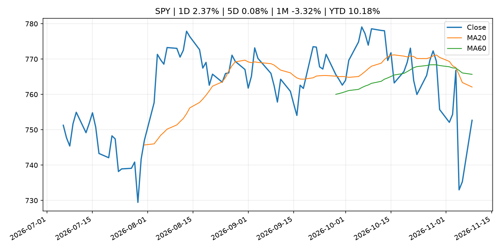
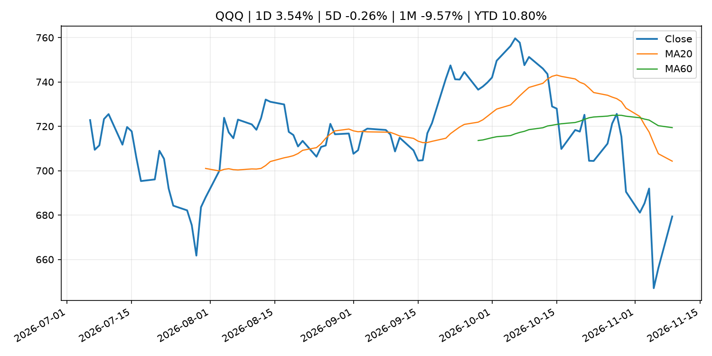
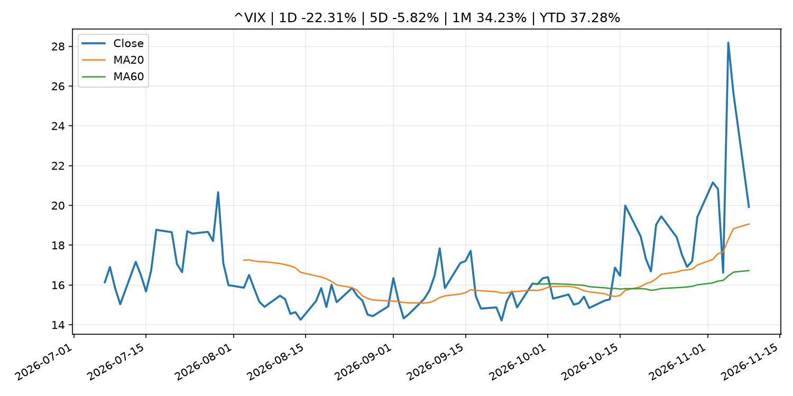
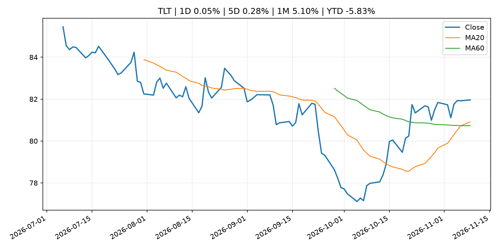
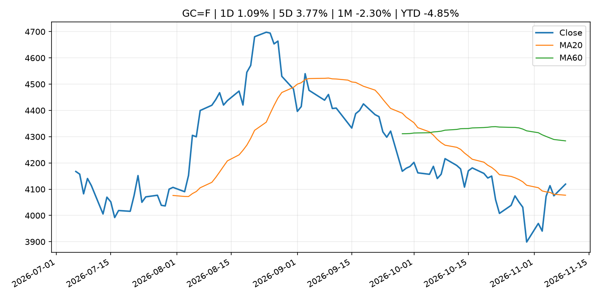
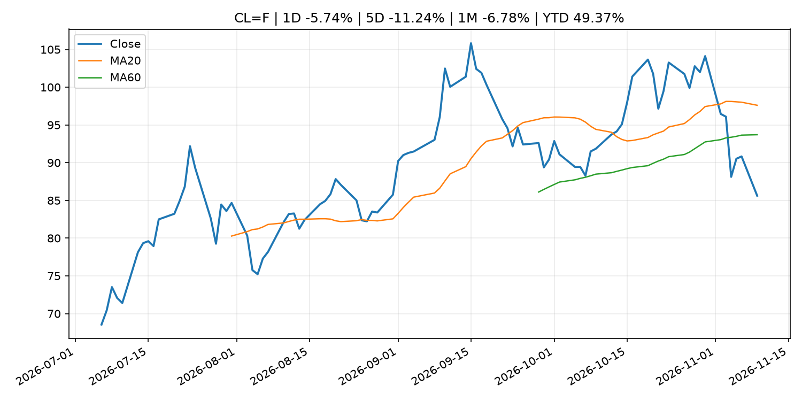
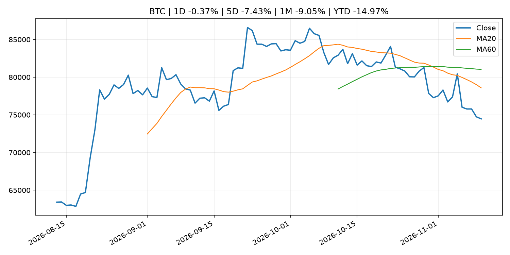
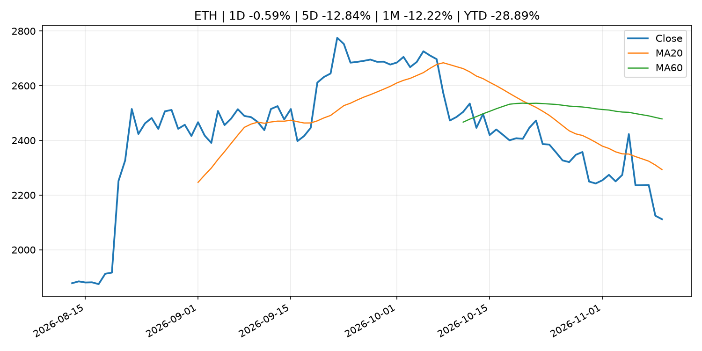
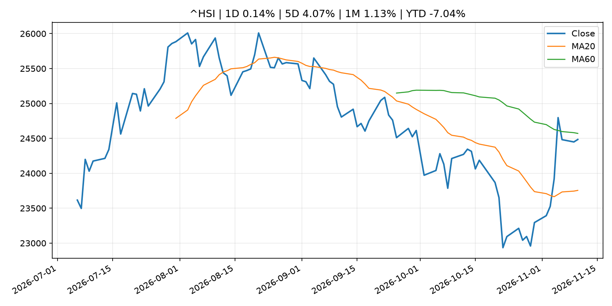

# Global Macro Morning Briefing - 2026-11-10

> Not financial advice / 非投资建议。

## 0. 今日总览
- 市场状态：risk_on。股指上涨、波动率或美元回落，市场更接近风险偏好改善。
- 今日三大主线：
  1. macro_data: Bitcoin faces U.S. CPI test as analysts warn inflation relief may not be enough
  2. macro_data: The stock-market rally keeps spreading beyond Big Tech. October inflation data could put it to the test.
  3. earnings: U.S. inflation, corporate earnings: Crypto Week Ahead
- 一句话结论：今日晨报重点关注：这类宏观数据会直接改变市场对通胀、增长和政策路径的预期。；这类宏观数据会直接改变市场对通胀、增长和政策路径的预期。。跨资产方面，SPY 1D 2.37%；QQQ 1D 3.54%；^VIX 1D -22.31%；TLT 1D 0.05%；GC=F 1D 1.09%；CL=F 1D -5.74%；BTC 1D -0.37%；ETH 1D -0.59%；股指上涨、波动率或美元回落，市场更接近风险偏好改善。政策、通胀、利率、美元、美债、能源和加密监管仍是主要观察线索。所有结论仅基于公开数据与短摘要整理，不构成投资建议。

## 1. 隔夜跨资产市场
- 美股：SPY 1D 2.37%，QQQ 1D 3.54%，整体趋势需结合 VIX 和利率确认。
- 美债/美元：TLT 1D 0.05%，美元指数 1D -0.62%，是判断折现率压力的核心线索。
- 黄金/原油：黄金 1D 1.09%，原油 1D -5.74%，用于观察避险、通胀和地缘风险。
- 加密：BTC 1D -0.37%，ETH 1D -0.59%，关注是否独立于纳指走出加密自身行情。
- 港股/A股：恒生 1D 0.14%，沪深300/上证 1D n/a，重点看中国政策预期与人民币线索。
- 风险观察：确认风险偏好是否扩散到小盘股、信用利差和周期品。

### US_EQUITY

| symbol | latest close | 1D | 5D | 1M | YTD | trend |
|---|---:|---:|---:|---:|---:|---|
| SPY | 752.69 | 2.37% | 0.08% | -3.32% | 10.18% | strong_downtrend |
| QQQ | 679.35 | 3.54% | -0.26% | -9.57% | 10.80% | strong_downtrend |
| DIA | 523.33 | 2.17% | 0.77% | 1.40% | 8.21% | range_bound |
| IWM | 282.51 | 3.23% | 1.21% | 1.28% | 13.56% | range_bound |
| VTI | 370.90 | 2.48% | 0.24% | -2.89% | 10.29% | downtrend |

### US_MACRO_MARKET

| symbol | latest close | 1D | 5D | 1M | YTD | trend |
|---|---:|---:|---:|---:|---:|---|
| ^VIX | 19.92 | -22.31% | -5.82% | 34.23% | 37.28% | uptrend |
| DX-Y.NYB | 101.67 | -0.62% | -0.08% | -0.53% | 3.30% | range_bound |
| TLT | 81.96 | 0.05% | 0.28% | 5.10% | -5.83% | strong_uptrend |
| IEF | 91.80 | -0.07% | 0.33% | 2.68% | -4.45% | range_bound |

### COMMODITIES

| symbol | latest close | 1D | 5D | 1M | YTD | trend |
|---|---:|---:|---:|---:|---:|---|
| GC=F | 4,119.40 | 1.09% | 3.77% | -2.30% | -4.85% | range_bound |
| SI=F | 52.91 | 2.14% | 4.32% | -12.79% | -25.01% | strong_downtrend |
| CL=F | 85.62 | -5.74% | -11.24% | -6.78% | 49.37% | range_bound |
| BZ=F | 91.42 | -7.02% | -12.74% | -12.70% | 50.49% | range_bound |
| NG=F | 3.20 | 6.77% | 12.08% | -0.59% | -11.53% | range_bound |
| HG=F | 6.34 | 1.91% | -3.16% | -4.61% | 12.35% | strong_downtrend |

### HK_MARKET

| symbol | latest close | 1D | 5D | 1M | YTD | trend |
|---|---:|---:|---:|---:|---:|---|
| ^HSI | 24,484.29 | 0.14% | 4.07% | 1.13% | -7.04% | range_bound |
| 0700.HK | 416.60 | -0.43% | 4.88% | -1.93% | -33.13% | range_bound |
| 9988.HK | 100.70 | -3.73% | 1.16% | -5.89% | -32.42% | downtrend |
| 3690.HK | 75.45 | 0.40% | 1.48% | 5.52% | -27.87% | range_bound |
| 1810.HK | 30.32 | 0.73% | 6.01% | 16.80% | -24.73% | strong_uptrend |
| 1211.HK | 72.00 | -0.62% | -0.48% | -4.76% | -27.09% | range_bound |

### CRYPTO

| symbol | latest close | 1D | 5D | 1M | YTD | trend |
|---|---:|---:|---:|---:|---:|---|
| BTC | 74,464.70 | -0.37% | -7.43% | -9.05% | -14.97% | strong_downtrend |
| ETH | 2,111.85 | -0.59% | -12.84% | -12.22% | -28.89% | strong_downtrend |
| SOLANA | 85.70 | -0.82% | -10.27% | -18.36% | -31.17% | strong_downtrend |
| BINANCECOIN | 688.30 | 0.64% | -4.32% | -5.90% | -20.21% | strong_downtrend |
| RIPPLE | 1.09 | -1.82% | -16.26% | -16.19% | -40.66% | strong_downtrend |

## 2. 今日最重要的 10 条新闻
### 1. Bitcoin faces U.S. CPI test as analysts warn inflation relief may not be enough
- 来源：CoinDesk
- 时间：2026-11-10T03:22:26+00:00
- 地区：global
- 事件类型：macro_data
- 重要性层级：Tier 1
- 一句话摘要：Bitcoin faces U.S. CPI test as analysts warn inflation relief may not be enough
- 为什么重要：这类宏观数据会直接改变市场对通胀、增长和政策路径的预期。
- 可能影响：主要影响 DXY，方向为 positive，强度 high；通胀压力可能推高政策利率预期并支撑美元。
  - 资产：DXY
    方向：positive
    强度：high
    原因：通胀压力可能推高政策利率预期并支撑美元。
  - 资产：TLT
    方向：negative
    强度：high
    原因：通胀上行通常推升收益率、压低长债价格。
  - 资产：QQQ
    方向：negative
    强度：high
    原因：更高利率对成长股估值折现率不利。
  - 资产：SPY
    方向：mixed
    强度：medium
    原因：名义增长可能支撑收入，但更高利率压制估值。
  - 资产：GC=F
    方向：mixed
    强度：medium
    原因：通胀对黄金是支撑，但实际利率上行会形成压力。
  - 资产：BTC
    方向：mixed
    强度：medium
    原因：抗通胀叙事和流动性收紧可能相互抵消。
- 原文链接：[https://www.coindesk.com/markets/2026/11/10/bitcoin-faces-u-s-cpi-test-as-analysts-warn-inflation-relief-may-not-be-enough](https://www.coindesk.com/markets/2026/11/10/bitcoin-faces-u-s-cpi-test-as-analysts-warn-inflation-relief-may-not-be-enough)

### 2. The stock-market rally keeps spreading beyond Big Tech. October inflation data could put it to the test.
- 来源：MarketWatch Top Stories
- 时间：2026-11-09T21:24:00+00:00
- 地区：US
- 事件类型：macro_data
- 重要性层级：Tier 1
- 一句话摘要：Tuesday’s CPI inflation report and a heavy lineup of Federal Reserve speakers could test the rotation trade’s resilience
- 为什么重要：这类宏观数据会直接改变市场对通胀、增长和政策路径的预期。
- 可能影响：主要影响 DXY，方向为 positive，强度 high；通胀压力可能推高政策利率预期并支撑美元。
  - 资产：DXY
    方向：positive
    强度：high
    原因：通胀压力可能推高政策利率预期并支撑美元。
  - 资产：TLT
    方向：negative
    强度：high
    原因：通胀上行通常推升收益率、压低长债价格。
  - 资产：QQQ
    方向：negative
    强度：high
    原因：更高利率对成长股估值折现率不利。
  - 资产：SPY
    方向：mixed
    强度：medium
    原因：名义增长可能支撑收入，但更高利率压制估值。
  - 资产：GC=F
    方向：mixed
    强度：medium
    原因：通胀对黄金是支撑，但实际利率上行会形成压力。
  - 资产：BTC
    方向：mixed
    强度：medium
    原因：抗通胀叙事和流动性收紧可能相互抵消。
- 原文链接：[https://www.marketwatch.com/story/the-stock-market-rally-keeps-spreading-beyond-big-tech-october-inflation-data-could-put-it-to-the-test-c1b87dcd?mod=mw_rss_topstories](https://www.marketwatch.com/story/the-stock-market-rally-keeps-spreading-beyond-big-tech-october-inflation-data-could-put-it-to-the-test-c1b87dcd?mod=mw_rss_topstories)

### 3. U.S. inflation, corporate earnings: Crypto Week Ahead
- 来源：CoinDesk
- 时间：2026-11-09T09:33:27+00:00
- 地区：global
- 事件类型：earnings
- 重要性层级：Tier 2
- 一句话摘要：U.S. inflation, corporate earnings: Crypto Week Ahead
- 为什么重要：大型科技股盈利和资本开支会影响纳指、半导体和 AI 交易主线。
- 可能影响：主要影响 DXY，方向为 positive，强度 high；通胀压力可能推高政策利率预期并支撑美元。
  - 资产：DXY
    方向：positive
    强度：high
    原因：通胀压力可能推高政策利率预期并支撑美元。
  - 资产：TLT
    方向：negative
    强度：high
    原因：通胀上行通常推升收益率、压低长债价格。
  - 资产：QQQ
    方向：negative
    强度：high
    原因：更高利率对成长股估值折现率不利。
  - 资产：SPY
    方向：mixed
    强度：medium
    原因：名义增长可能支撑收入，但更高利率压制估值。
  - 资产：GC=F
    方向：mixed
    强度：medium
    原因：通胀对黄金是支撑，但实际利率上行会形成压力。
  - 资产：BTC
    方向：mixed
    强度：medium
    原因：抗通胀叙事和流动性收紧可能相互抵消。
- 原文链接：[https://www.coindesk.com/markets/2026/11/09/u-s-inflation-corporate-earnings-crypto-week-ahead](https://www.coindesk.com/markets/2026/11/09/u-s-inflation-corporate-earnings-crypto-week-ahead)

### 4. Bitcoin drops as Nvidia cheating scandal and failed Iran talks trigger volatility
- 来源：CoinDesk
- 时间：2026-11-09T03:21:49+00:00
- 地区：global
- 事件类型：earnings
- 重要性层级：Tier 2
- 一句话摘要：Bitcoin drops as Nvidia cheating scandal and failed Iran talks trigger volatility
- 为什么重要：大型科技股盈利和资本开支会影响纳指、半导体和 AI 交易主线。
- 可能影响：主要影响 QQQ，方向为 mixed，强度 high；AI 资本开支会影响大型科技股盈利和估值预期。
  - 资产：QQQ
    方向：mixed
    强度：high
    原因：AI 资本开支会影响大型科技股盈利和估值预期。
  - 资产：SMH
    方向：mixed
    强度：high
    原因：AI 投资周期直接影响半导体需求。
  - 资产：NVDA
    方向：mixed
    强度：high
    原因：AI 训练和推理需求是英伟达收入预期核心变量。
  - 资产：MSFT
    方向：mixed
    强度：medium
    原因：云和 AI 资本开支影响利润率与增长叙事。
  - 资产：GOOGL
    方向：mixed
    强度：medium
    原因：AI 投资和搜索商业化影响估值。
  - 资产：META
    方向：mixed
    强度：medium
    原因：AI 基建支出与广告效率共同影响市场预期。
- 原文链接：[https://www.coindesk.com/markets/2026/11/09/bitcoin-drops-then-pops-as-nvidia-cheating-scandal-and-failed-iran-talks-trigger-volatility](https://www.coindesk.com/markets/2026/11/09/bitcoin-drops-then-pops-as-nvidia-cheating-scandal-and-failed-iran-talks-trigger-volatility)

### 5. Solana set for its first tokenized stock venue under SEC framework, listing Galaxy
- 来源：CoinDesk
- 时间：2026-11-09T12:41:35+00:00
- 地区：global
- 事件类型：regulation
- 重要性层级：Tier 2
- 一句话摘要：Solana set for its first tokenized stock venue under SEC framework, listing Galaxy
- 为什么重要：监管变化会改变行业盈利预期和资产风险溢价。
- 可能影响：主要影响 BTC，方向为 mixed，强度 high；加密监管或 ETF 进展会改变 BTC 的资金流和风险溢价。
  - 资产：BTC
    方向：mixed
    强度：high
    原因：加密监管或 ETF 进展会改变 BTC 的资金流和风险溢价。
  - 资产：ETH
    方向：mixed
    强度：high
    原因：监管框架会影响 ETH 产品化和机构参与度。
  - 资产：COIN
    方向：mixed
    强度：medium
    原因：监管清晰度和执法风险会影响交易平台估值。
  - 资产：crypto market
    方向：mixed
    强度：high
    原因：信息影响整个加密市场结构，但方向取决于细节。
- 原文链接：[https://www.coindesk.com/business/2026/11/06/solana-lset-for-its-first-tokenized-stock-venue-under-sec-framework-listing-galaxy](https://www.coindesk.com/business/2026/11/06/solana-lset-for-its-first-tokenized-stock-venue-under-sec-framework-listing-galaxy)

### 6. Stablecoin growth has stalled. The payments boom hasn't
- 来源：CoinDesk
- 时间：2026-11-08T19:16:42+00:00
- 地区：global
- 事件类型：crypto_market_structure
- 重要性层级：Tier 2
- 一句话摘要：Stablecoin growth has stalled. The payments boom hasn't
- 为什么重要：加密市场结构和监管变化会影响 BTC、ETH 及相关股票的风险溢价。
- 可能影响：主要影响 BTC，方向为 mixed，强度 high；加密监管或 ETF 进展会改变 BTC 的资金流和风险溢价。
  - 资产：BTC
    方向：mixed
    强度：high
    原因：加密监管或 ETF 进展会改变 BTC 的资金流和风险溢价。
  - 资产：ETH
    方向：mixed
    强度：high
    原因：监管框架会影响 ETH 产品化和机构参与度。
  - 资产：COIN
    方向：mixed
    强度：medium
    原因：监管清晰度和执法风险会影响交易平台估值。
  - 资产：crypto market
    方向：mixed
    强度：high
    原因：信息影响整个加密市场结构，但方向取决于细节。
- 原文链接：[https://www.coindesk.com/business/2026/11/08/stablecoin-growth-has-stalled-the-payments-boom-hasn-t](https://www.coindesk.com/business/2026/11/08/stablecoin-growth-has-stalled-the-payments-boom-hasn-t)

### 7. Bitcoin bulls can't rely on ETF flows
- 来源：CoinDesk
- 时间：2026-11-09T12:30:00+00:00
- 地区：global
- 事件类型：other
- 重要性层级：Tier 3
- 一句话摘要：Bitcoin bulls can't rely on ETF flows
- 为什么重要：这条信息暂未匹配到重大宏观、政策或市场事件，更适合作为背景跟踪。
- 可能影响：主要影响 BTC，方向为 mixed，强度 high；加密监管或 ETF 进展会改变 BTC 的资金流和风险溢价。
  - 资产：BTC
    方向：mixed
    强度：high
    原因：加密监管或 ETF 进展会改变 BTC 的资金流和风险溢价。
  - 资产：ETH
    方向：mixed
    强度：high
    原因：监管框架会影响 ETH 产品化和机构参与度。
  - 资产：COIN
    方向：mixed
    强度：medium
    原因：监管清晰度和执法风险会影响交易平台估值。
  - 资产：crypto market
    方向：mixed
    强度：high
    原因：信息影响整个加密市场结构，但方向取决于细节。
- 原文链接：[https://www.coindesk.com/daybook-us/2026/11/09/bitcoin-bulls-can-t-rely-on-etf-flows](https://www.coindesk.com/daybook-us/2026/11/09/bitcoin-bulls-can-t-rely-on-etf-flows)

### 8. Live news: Crypto prices give ground even as stocks and gold surge, oil plunges
- 来源：CoinDesk
- 时间：2026-11-09T10:51:48+00:00
- 地区：global
- 事件类型：other
- 重要性层级：Tier 3
- 一句话摘要：Live news: Crypto prices give ground even as stocks and gold surge, oil plunges
- 为什么重要：这条信息暂未匹配到重大宏观、政策或市场事件，更适合作为背景跟踪。
- 可能影响：主要影响 CL=F，方向为 positive，强度 high；供给扰动或 OPEC 减产通常推升 WTI 原油。
  - 资产：CL=F
    方向：positive
    强度：high
    原因：供给扰动或 OPEC 减产通常推升 WTI 原油。
  - 资产：BZ=F
    方向：positive
    强度：high
    原因：全球供给风险通常直接影响 Brent 原油。
  - 资产：SPY
    方向：mixed
    强度：medium
    原因：能源股可能受益，但通胀和成本压力不利于宽基风险资产。
- 原文链接：[https://www.coindesk.com/tech/2026/11/09/live-news-nvidia-slides-on-ceo-allegations-as-bitcoin-hovers-just-above-its-200-day-average](https://www.coindesk.com/tech/2026/11/09/live-news-nvidia-slides-on-ceo-allegations-as-bitcoin-hovers-just-above-its-200-day-average)

## 3. 政策与央行观察
### 1. Solana set for its first tokenized stock venue under SEC framework, listing Galaxy
- 来源：CoinDesk
- 时间：2026-11-09T12:41:35+00:00
- 地区：global
- 事件类型：regulation
- 重要性层级：Tier 2
- 一句话摘要：Solana set for its first tokenized stock venue under SEC framework, listing Galaxy
- 为什么重要：监管变化会改变行业盈利预期和资产风险溢价。
- 可能影响：主要影响 BTC，方向为 mixed，强度 high；加密监管或 ETF 进展会改变 BTC 的资金流和风险溢价。
  - 资产：BTC
    方向：mixed
    强度：high
    原因：加密监管或 ETF 进展会改变 BTC 的资金流和风险溢价。
  - 资产：ETH
    方向：mixed
    强度：high
    原因：监管框架会影响 ETH 产品化和机构参与度。
  - 资产：COIN
    方向：mixed
    强度：medium
    原因：监管清晰度和执法风险会影响交易平台估值。
  - 资产：crypto market
    方向：mixed
    强度：high
    原因：信息影响整个加密市场结构，但方向取决于细节。
- 原文链接：[https://www.coindesk.com/business/2026/11/06/solana-lset-for-its-first-tokenized-stock-venue-under-sec-framework-listing-galaxy](https://www.coindesk.com/business/2026/11/06/solana-lset-for-its-first-tokenized-stock-venue-under-sec-framework-listing-galaxy)

### 2. Stablecoin growth has stalled. The payments boom hasn't
- 来源：CoinDesk
- 时间：2026-11-08T19:16:42+00:00
- 地区：global
- 事件类型：crypto_market_structure
- 重要性层级：Tier 2
- 一句话摘要：Stablecoin growth has stalled. The payments boom hasn't
- 为什么重要：加密市场结构和监管变化会影响 BTC、ETH 及相关股票的风险溢价。
- 可能影响：主要影响 BTC，方向为 mixed，强度 high；加密监管或 ETF 进展会改变 BTC 的资金流和风险溢价。
  - 资产：BTC
    方向：mixed
    强度：high
    原因：加密监管或 ETF 进展会改变 BTC 的资金流和风险溢价。
  - 资产：ETH
    方向：mixed
    强度：high
    原因：监管框架会影响 ETH 产品化和机构参与度。
  - 资产：COIN
    方向：mixed
    强度：medium
    原因：监管清晰度和执法风险会影响交易平台估值。
  - 资产：crypto market
    方向：mixed
    强度：high
    原因：信息影响整个加密市场结构，但方向取决于细节。
- 原文链接：[https://www.coindesk.com/business/2026/11/08/stablecoin-growth-has-stalled-the-payments-boom-hasn-t](https://www.coindesk.com/business/2026/11/08/stablecoin-growth-has-stalled-the-payments-boom-hasn-t)

## 4. 市场异动与图表
- SPY 上涨 2.37%
- QQQ 上涨 3.54%
- VIX 下跌 -22.31%
- DXY 下跌 -0.62%
- Gold 上涨 1.09%
- Oil 下跌 -5.74%

### SPY

### QQQ

### ^VIX

### TLT

### GC=F

### CL=F

### BTC

### ETH

### ^HSI

## 5. 华尔街与机构公开观点
- 暂无可靠公开观点。

## 6. 今日重点关注
- 经济数据：经济数据：暂无可靠公开日历数据；如配置经济日历源后可自动填充。
- 央行讲话：央行讲话：暂无可靠公开日历数据；重点跟踪 Fed、ECB、BoJ、PBOC 官网 RSS。
- 财报：财报：暂无可靠数据。
- 政策事件：政策事件：暂无可靠数据。
- 风险提醒：风险提醒：关注数据源失败项、突发地缘风险、利率和美元的二阶反应。

## 7. 英文金融表达与宏观概念
- **inflation expectations**：通胀预期，指家庭、企业或市场对未来通胀的预估。 例句：Inflation expectations can shape wage bargaining and bond yields.
- **real yield**：实际收益率，名义利率扣除通胀预期后的收益率。 例句：Gold often reacts more to real yields than nominal yields.
- **risk-off**：避险模式，资金偏向美元、国债、黄金等防御资产。 例句：A geopolitical shock can push markets into risk-off mode.
- **supply disruption**：供给扰动，通常指能源或商品供应受冲突、减产或天气影响。 例句：Supply disruption can lift oil prices and inflation expectations.
- **market structure**：市场结构，指交易、托管、清算、ETF、监管等制度安排。 例句：Crypto market structure rules can affect institutional participation.
- **AI capex**：AI 资本开支，指云厂商和科技公司投入 AI 基建的支出。 例句：AI capex guidance can move semiconductor stocks.

## 8. 背景材料
- [Principal Figures of Financial Institutions (Oct.)](http://www.boj.or.jp/en/statistics/dl/depo/kashi/kasi2610.pdf)（Bank of Japan Announcements，other）：Principal Figures of Financial Institutions (Oct.)
- [Summary of Opinions at the Monetary Policy Meeting on October 29 and 30, 2026](http://www.boj.or.jp/en/mopo/mpmsche_minu/opinion_2026/opi261030.pdf)（Bank of Japan Announcements，other）：Summary of Opinions at the Monetary Policy Meeting on October 29 and 30, 2026
- [Securitize pushes into $6 trillion asset-backed finance market with River One acquisition](https://www.coindesk.com/business/2026/11/09/securitize-pushes-into-usd6-trillion-asset-backed-finance-market-with-river-one-acquisition)（CoinDesk，other）：Securitize pushes into $6 trillion asset-backed finance market with River One acquisition
- [Here’s how Bernie Sanders wants to keep Social Security solvent ‘for generations’](https://www.marketwatch.com/story/heres-how-bernie-sanders-wants-to-keep-social-security-solvent-for-generations-f5666a38?mod=mw_rss_topstories)（MarketWatch Top Stories，other）：The Vermont senator aims to eliminate the taxable maximum, making the wealthy pay more in taxes
- [Federal Reserve Board announces approval of two applications by Mutual Federal Bancorp, MHC, and MFB Bancorp, Inc.](https://www.federalreserve.gov/newsevents/pressreleases/orders20261109a.htm)（Federal Reserve Press Releases，other）：Federal Reserve Board announces approval of two applications by Mutual Federal Bancorp, MHC, and MFB Bancorp, Inc.
- [Goldman CEO Solomon says AI financing remains strong despite market jitters](https://www.cnbc.com/2026/11/09/goldman-ceo-ai-financing-market.html)（CNBC Economy，other）：Goldman CEO David Solomon says investor appetite for AI infrastructure remains strong despite a reset in AI stocks and political uncertainty around data centers.
- [A Bitcoin block just neared a 2015 transaction record, but paid only $180 in fees](https://www.coindesk.com/tech/2026/11/09/a-bitcoin-block-just-neared-a-2015-transaction-record-but-paid-only-usd180-in-fees)（CoinDesk，other）：A Bitcoin block just neared a 2015 transaction record, but paid only $180 in fees
- [Bitcoin bulls can't rely on ETF flows](https://www.coindesk.com/daybook-us/2026/11/09/bitcoin-bulls-can-t-rely-on-etf-flows)（CoinDesk，other）：Bitcoin bulls can't rely on ETF flows
- [Zcash developers want 20-second blocks just days after major speed upgrade](https://www.coindesk.com/tech/2026/11/09/zcash-developers-want-20-second-blocks-just-days-after-major-speed-upgrade)（CoinDesk，other）：Zcash developers want 20-second blocks just days after major speed upgrade
- [Live news: Crypto prices give ground even as stocks and gold surge, oil plunges](https://www.coindesk.com/tech/2026/11/09/live-news-nvidia-slides-on-ceo-allegations-as-bitcoin-hovers-just-above-its-200-day-average)（CoinDesk，other）：Live news: Crypto prices give ground even as stocks and gold surge, oil plunges
- [Amounts Outstanding in the Call Money Market (Oct.)](http://www.boj.or.jp/en/statistics/market/short/call/call.xlsx)（Bank of Japan Announcements，other）：Amounts Outstanding in the Call Money Market (Oct.)
- [Consumption Activity Index](http://www.boj.or.jp/en/research/research_data/cai/index.htm)（Bank of Japan Announcements，other）：Consumption Activity Index
- [Binance's bitcoin mining pool finds just one block in a week as shutdown nears](https://www.coindesk.com/tech/2026/11/09/binance-s-bitcoin-mining-pool-finds-just-one-block-in-a-week-as-shutdown-nears)（CoinDesk，other）：Binance's bitcoin mining pool finds just one block in a week as shutdown nears
- [Market Operations by the Bank of Japan (Oct.)](http://www.boj.or.jp/en/statistics/boj/fm/ope/m_release/2026/ope2610.xlsx)（Bank of Japan Announcements，other）：Market Operations by the Bank of Japan (Oct.)
- [Monetary Base and the Bank of Japan's Transactions (Oct.)](http://www.boj.or.jp/en/statistics/boj/other/mbt/mbt2610.pdf)（Bank of Japan Announcements，other）：Monetary Base and the Bank of Japan's Transactions (Oct.)
- [Bank of Japan's Transactions with the Government (Oct.)](http://www.boj.or.jp/en/statistics/boj/other/tseifu/release/2026/seifu2610.pdf)（Bank of Japan Announcements，other）：Bank of Japan's Transactions with the Government (Oct.)
- [These Finland homes get free heat from bitcoin miners (as long as BTC stays above $70,000)](https://www.coindesk.com/markets/2026/11/08/these-finland-homes-get-free-heat-from-bitcoin-miners-as-long-as-btc-stays-above-usd70-000)（CoinDesk，other）：These Finland homes get free heat from bitcoin miners (as long as BTC stays above $70,000)

## 9. 数据源、失败项与免责声明
- 采集时间：2026-11-10T03:59:53
- 数据源：公开 RSS、Yahoo Finance、CoinGecko、AKShare、FRED、SEC data.sec.gov，以及用户自有 inputs/reports 文件。
- 合规说明：不绕过 WSJ、Bloomberg、FT、Reuters 等付费墙；对付费媒体只使用公开 RSS 标题、摘要、链接和发布时间。
- 免责声明：Not financial advice / 非投资建议。本项目仅供个人学习、研究和信息整理，不构成投资建议、交易建议或任何收益承诺。
- 失败或跳过的数据源：
  - crypto data failed coin=dogecoin
  - China market data failed symbol=上证指数: empty dataframe
  - China market data failed symbol=深证成指: empty dataframe
  - China market data failed symbol=创业板指: empty dataframe
  - China market data failed symbol=沪深300: empty dataframe
  - China market data failed symbol=中证500: empty dataframe
  - China market data failed symbol=科创50: empty dataframe
  - FRED_API_KEY not set; skipping FRED macro series
  - SEC failed cik=0000320193
  - SEC failed cik=0000789019
  - SEC failed cik=0001045810
  - SEC failed cik=0001318605
  - SEC failed cik=0001577552
