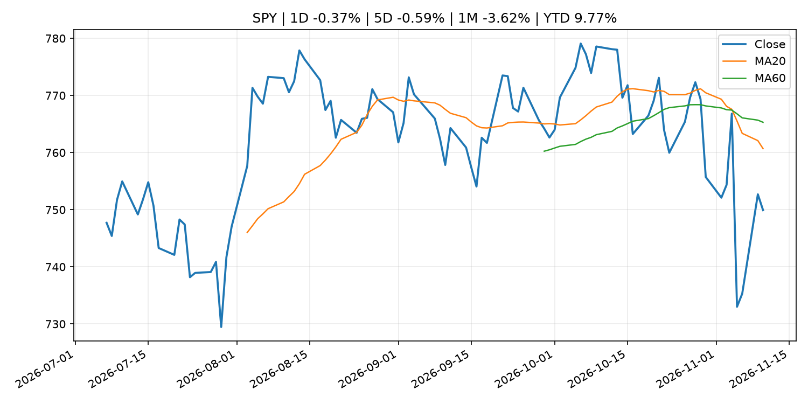
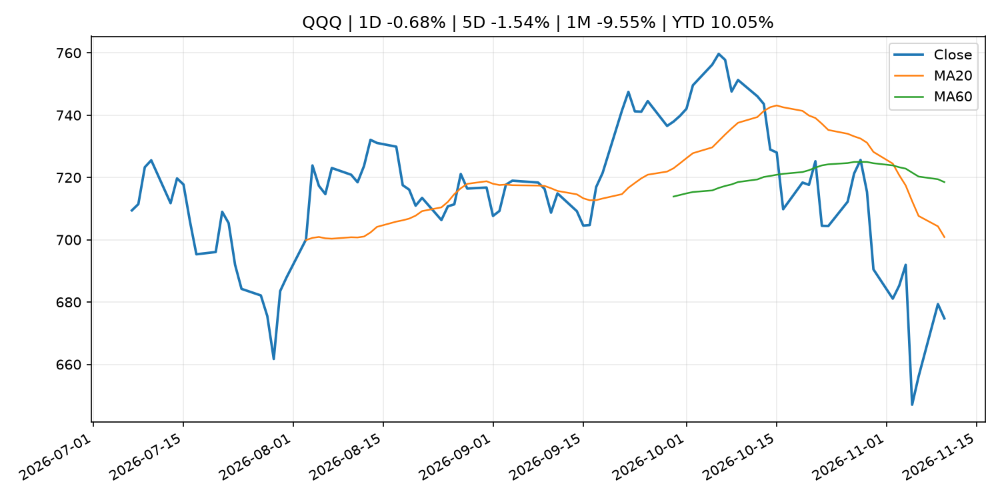
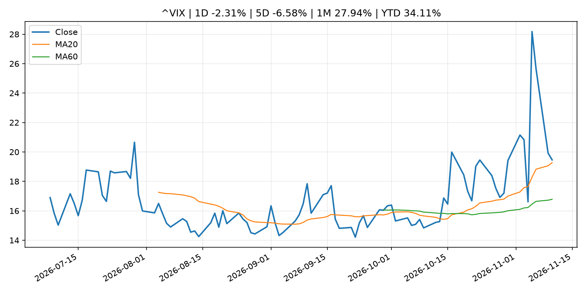
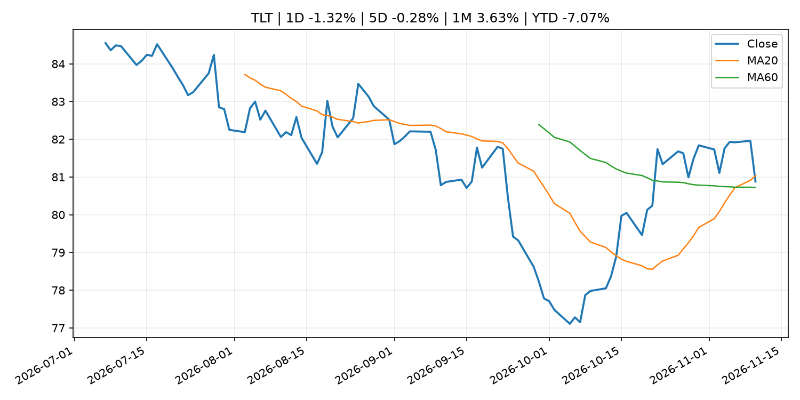
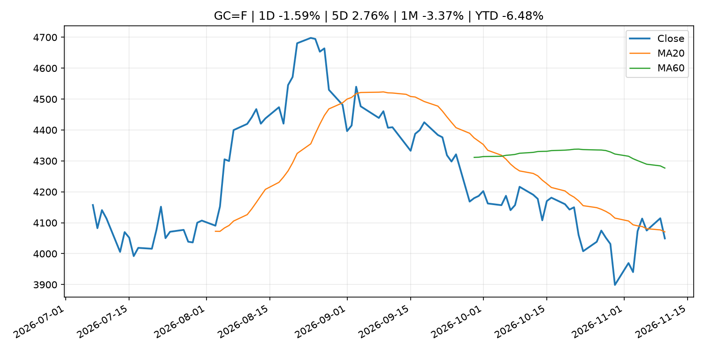
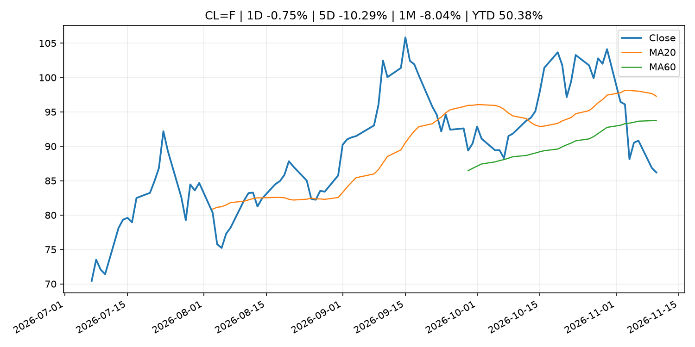
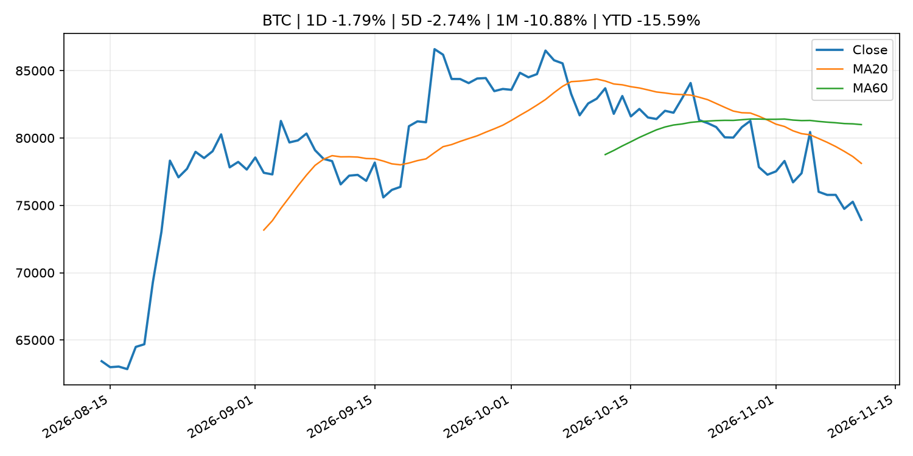
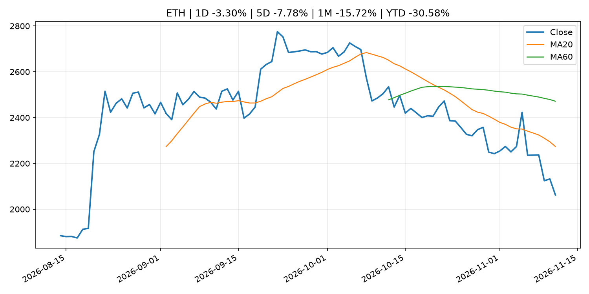
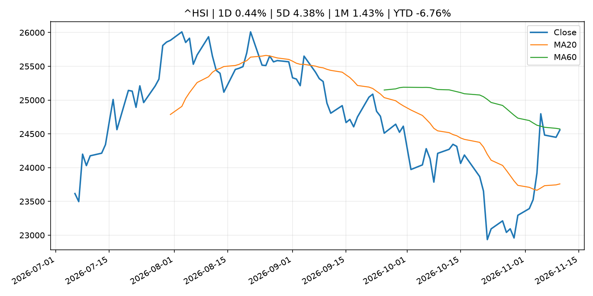

# Global Macro Morning Briefing - 2026-11-11

> Not financial advice / 非投资建议。

## 0. 今日总览
- 市场状态：mixed。长债下跌、美元走强且成长股承压，市场像是在交易利率冲击。 但存在信号冲突，需要降低单一叙事置信度。
- 今日三大主线：
  1. macro_data: U.S. CPI rose stronger than expected 0.4% in October; core rate rose 0.3%
  2. macro_data: Bitcoin faces U.S. CPI test as analysts warn inflation relief may not be enough
  3. fiscal_policy: SEC Announces Enforcement Annual Results for Fiscal Year 2026
- 一句话结论：今日晨报重点关注：这类宏观数据会直接改变市场对通胀、增长和政策路径的预期。；这类宏观数据会直接改变市场对通胀、增长和政策路径的预期。。跨资产方面，SPY 1D -0.37%；QQQ 1D -0.68%；^VIX 1D -2.31%；TLT 1D -1.32%；GC=F 1D -1.59%；CL=F 1D -0.75%；BTC 1D -1.79%；ETH 1D -3.30%；长债下跌、美元走强且成长股承压，市场像是在交易利率冲击。 但存在信号冲突，需要降低单一叙事置信度。政策、通胀、利率、美元、美债、能源和加密监管仍是主要观察线索。所有结论仅基于公开数据与短摘要整理，不构成投资建议。

## 1. 隔夜跨资产市场
- 美股：SPY 1D -0.37%，QQQ 1D -0.68%，整体趋势需结合 VIX 和利率确认。
- 美债/美元：TLT 1D -1.32%，美元指数 1D 0.60%，是判断折现率压力的核心线索。
- 黄金/原油：黄金 1D -1.59%，原油 1D -0.75%，用于观察避险、通胀和地缘风险。
- 加密：BTC 1D -1.79%，ETH 1D -3.30%，关注是否独立于纳指走出加密自身行情。
- 港股/A股：恒生 1D 0.44%，沪深300/上证 1D n/a，重点看中国政策预期与人民币线索。
- 风险观察：关注美债收益率、实际利率和成长股估值压力。

### US_EQUITY

| symbol | latest close | 1D | 5D | 1M | YTD | trend |
|---|---:|---:|---:|---:|---:|---|
| SPY | 749.92 | -0.37% | -0.59% | -3.62% | 9.77% | strong_downtrend |
| QQQ | 674.76 | -0.68% | -1.54% | -9.55% | 10.05% | strong_downtrend |
| DIA | 521.73 | -0.31% | 0.90% | 0.74% | 7.88% | range_bound |
| IWM | 280.58 | -0.68% | 0.28% | 0.96% | 12.78% | range_bound |
| VTI | 369.55 | -0.36% | -0.45% | -3.15% | 9.88% | strong_downtrend |

### US_MACRO_MARKET

| symbol | latest close | 1D | 5D | 1M | YTD | trend |
|---|---:|---:|---:|---:|---:|---|
| ^VIX | 19.46 | -2.31% | -6.58% | 27.94% | 34.11% | uptrend |
| DX-Y.NYB | 102.26 | 0.60% | 0.38% | -0.32% | 3.90% | uptrend |
| TLT | 80.88 | -1.32% | -0.28% | 3.63% | -7.07% | range_bound |
| IEF | 91.01 | -0.86% | -0.16% | 1.77% | -5.28% | downtrend |

### COMMODITIES

| symbol | latest close | 1D | 5D | 1M | YTD | trend |
|---|---:|---:|---:|---:|---:|---|
| GC=F | 4,049.20 | -1.59% | 2.76% | -3.37% | -6.48% | strong_downtrend |
| SI=F | 52.15 | -0.78% | 5.18% | -13.28% | -26.08% | strong_downtrend |
| CL=F | 86.20 | -0.75% | -10.29% | -8.04% | 50.38% | range_bound |
| BZ=F | 91.84 | -0.79% | -11.35% | -13.89% | 51.18% | range_bound |
| NG=F | 3.29 | 2.33% | 13.75% | 3.98% | -8.98% | range_bound |
| HG=F | 6.30 | -0.48% | -1.26% | -5.98% | 11.67% | strong_downtrend |

### HK_MARKET

| symbol | latest close | 1D | 5D | 1M | YTD | trend |
|---|---:|---:|---:|---:|---:|---|
| ^HSI | 24,557.04 | 0.44% | 4.38% | 1.43% | -6.76% | range_bound |
| 0700.HK | 417.80 | -0.14% | 5.19% | -1.65% | -32.94% | range_bound |
| 9988.HK | 101.60 | -2.87% | 2.06% | -5.05% | -31.81% | downtrend |
| 3690.HK | 75.50 | 0.47% | 1.55% | 5.59% | -27.82% | range_bound |
| 1810.HK | 30.60 | 1.66% | 6.99% | 17.87% | -24.03% | strong_uptrend |
| 1211.HK | 71.95 | -0.69% | -0.55% | -4.83% | -27.14% | range_bound |

### CRYPTO

| symbol | latest close | 1D | 5D | 1M | YTD | trend |
|---|---:|---:|---:|---:|---:|---|
| BTC | 73,922.08 | -1.79% | -2.74% | -10.88% | -15.59% | strong_downtrend |
| ETH | 2,061.84 | -3.30% | -7.78% | -15.72% | -30.58% | strong_downtrend |
| SOLANA | 83.80 | -3.24% | -6.09% | -21.23% | -32.70% | strong_downtrend |
| BINANCECOIN | 683.67 | -1.00% | -0.75% | -7.70% | -20.75% | strong_downtrend |
| RIPPLE | 1.06 | -3.35% | -12.10% | -20.52% | -42.38% | strong_downtrend |

## 2. 今日最重要的 10 条新闻
### 1. U.S. CPI rose stronger than expected 0.4% in October; core rate rose 0.3%
- 来源：CoinDesk
- 时间：2026-11-10T13:32:09+00:00
- 地区：global
- 事件类型：macro_data
- 重要性层级：Tier 1
- 一句话摘要：U.S. CPI rose stronger than expected 0.4% in October; core rate rose 0.3%
- 为什么重要：这类宏观数据会直接改变市场对通胀、增长和政策路径的预期。
- 可能影响：主要影响 DXY，方向为 positive，强度 high；通胀压力可能推高政策利率预期并支撑美元。
  - 资产：DXY
    方向：positive
    强度：high
    原因：通胀压力可能推高政策利率预期并支撑美元。
  - 资产：TLT
    方向：negative
    强度：high
    原因：通胀上行通常推升收益率、压低长债价格。
  - 资产：QQQ
    方向：negative
    强度：high
    原因：更高利率对成长股估值折现率不利。
  - 资产：SPY
    方向：mixed
    强度：medium
    原因：名义增长可能支撑收入，但更高利率压制估值。
  - 资产：GC=F
    方向：mixed
    强度：medium
    原因：通胀对黄金是支撑，但实际利率上行会形成压力。
  - 资产：BTC
    方向：mixed
    强度：medium
    原因：抗通胀叙事和流动性收紧可能相互抵消。
- 原文链接：[https://www.coindesk.com/markets/2026/11/10/u-s-cpi-rose-stronger-than-expected-0-4-in-october-core-rate-rose-0-3](https://www.coindesk.com/markets/2026/11/10/u-s-cpi-rose-stronger-than-expected-0-4-in-october-core-rate-rose-0-3)

### 2. Bitcoin faces U.S. CPI test as analysts warn inflation relief may not be enough
- 来源：CoinDesk
- 时间：2026-11-10T03:22:26+00:00
- 地区：global
- 事件类型：macro_data
- 重要性层级：Tier 1
- 一句话摘要：Bitcoin faces U.S. CPI test as analysts warn inflation relief may not be enough
- 为什么重要：这类宏观数据会直接改变市场对通胀、增长和政策路径的预期。
- 可能影响：主要影响 DXY，方向为 positive，强度 high；通胀压力可能推高政策利率预期并支撑美元。
  - 资产：DXY
    方向：positive
    强度：high
    原因：通胀压力可能推高政策利率预期并支撑美元。
  - 资产：TLT
    方向：negative
    强度：high
    原因：通胀上行通常推升收益率、压低长债价格。
  - 资产：QQQ
    方向：negative
    强度：high
    原因：更高利率对成长股估值折现率不利。
  - 资产：SPY
    方向：mixed
    强度：medium
    原因：名义增长可能支撑收入，但更高利率压制估值。
  - 资产：GC=F
    方向：mixed
    强度：medium
    原因：通胀对黄金是支撑，但实际利率上行会形成压力。
  - 资产：BTC
    方向：mixed
    强度：medium
    原因：抗通胀叙事和流动性收紧可能相互抵消。
- 原文链接：[https://www.coindesk.com/markets/2026/11/10/bitcoin-faces-u-s-cpi-test-as-analysts-warn-inflation-relief-may-not-be-enough](https://www.coindesk.com/markets/2026/11/10/bitcoin-faces-u-s-cpi-test-as-analysts-warn-inflation-relief-may-not-be-enough)

### 3. SEC Announces Enforcement Annual Results for Fiscal Year 2026
- 来源：SEC Press Releases
- 时间：2026-11-10T11:15:35-05:00
- 地区：US
- 事件类型：fiscal_policy
- 重要性层级：Tier 1
- 一句话摘要：The Securities and Exchange Commission today provided its enforcement results for the past fiscal year which ended September 30. Throughout the fiscal year, the SEC’s Division of Enforcement remained focused on its fundamental responsibility: protecting…
- 为什么重要：财政和贸易政策会影响增长、通胀、企业利润和跨境资本流。
- 可能影响：主要影响 BTC，方向为 mixed，强度 high；加密监管或 ETF 进展会改变 BTC 的资金流和风险溢价。
  - 资产：BTC
    方向：mixed
    强度：high
    原因：加密监管或 ETF 进展会改变 BTC 的资金流和风险溢价。
  - 资产：ETH
    方向：mixed
    强度：high
    原因：监管框架会影响 ETH 产品化和机构参与度。
  - 资产：COIN
    方向：mixed
    强度：medium
    原因：监管清晰度和执法风险会影响交易平台估值。
  - 资产：crypto market
    方向：mixed
    强度：high
    原因：信息影响整个加密市场结构，但方向取决于细节。
- 原文链接：[https://www.sec.gov/newsroom/press-releases/2026-113-sec-announces-enforcement-annual-results-fiscal-year-2026](https://www.sec.gov/newsroom/press-releases/2026-113-sec-announces-enforcement-annual-results-fiscal-year-2026)

### 4. Meet the former prosecutor Nvidia hired to investigate the Jensen Huang spy scandal
- 来源：MarketWatch Top Stories
- 时间：2026-11-10T22:05:00+00:00
- 地区：US
- 事件类型：earnings
- 重要性层级：Tier 2
- 一句话摘要：Joon Kim just joined the Wachtell Lipton law firm last month and now will lead an independent investigation into whether Nvidia’s CEO was the target of a China spy operation
- 为什么重要：大型科技股盈利和资本开支会影响纳指、半导体和 AI 交易主线。
- 可能影响：主要影响 QQQ，方向为 mixed，强度 high；AI 资本开支会影响大型科技股盈利和估值预期。
  - 资产：QQQ
    方向：mixed
    强度：high
    原因：AI 资本开支会影响大型科技股盈利和估值预期。
  - 资产：SMH
    方向：mixed
    强度：high
    原因：AI 投资周期直接影响半导体需求。
  - 资产：NVDA
    方向：mixed
    强度：high
    原因：AI 训练和推理需求是英伟达收入预期核心变量。
  - 资产：MSFT
    方向：mixed
    强度：medium
    原因：云和 AI 资本开支影响利润率与增长叙事。
  - 资产：GOOGL
    方向：mixed
    强度：medium
    原因：AI 投资和搜索商业化影响估值。
  - 资产：META
    方向：mixed
    强度：medium
    原因：AI 基建支出与广告效率共同影响市场预期。
- 原文链接：[https://www.marketwatch.com/story/meet-the-former-prosecutor-nvidia-hired-to-investigate-the-jensen-huang-spy-scandal-e8078f67?mod=mw_rss_topstories](https://www.marketwatch.com/story/meet-the-former-prosecutor-nvidia-hired-to-investigate-the-jensen-huang-spy-scandal-e8078f67?mod=mw_rss_topstories)

### 5. Fed Governor Waller sees December hike likely, opens door to possible half-point increase
- 来源：CNBC Economy
- 时间：2026-11-10T17:13:44+00:00
- 地区：US
- 事件类型：central_bank_speech
- 重要性层级：Tier 2
- 一句话摘要：The policymaker said he "is leaning toward" a rate increase in December and could support a half-point hike depending on inflation data.
- 为什么重要：央行官员表态可能影响市场对下一次会议的定价。
- 可能影响：主要影响 DXY，方向为 positive，强度 high；通胀压力可能推高政策利率预期并支撑美元。
  - 资产：DXY
    方向：positive
    强度：high
    原因：通胀压力可能推高政策利率预期并支撑美元。
  - 资产：TLT
    方向：negative
    强度：high
    原因：通胀上行通常推升收益率、压低长债价格。
  - 资产：QQQ
    方向：negative
    强度：high
    原因：更高利率对成长股估值折现率不利。
  - 资产：SPY
    方向：mixed
    强度：medium
    原因：名义增长可能支撑收入，但更高利率压制估值。
  - 资产：GC=F
    方向：mixed
    强度：medium
    原因：通胀对黄金是支撑，但实际利率上行会形成压力。
  - 资产：BTC
    方向：mixed
    强度：medium
    原因：抗通胀叙事和流动性收紧可能相互抵消。
- 原文链接：[https://www.cnbc.com/2026/11/10/fed-governor-waller-sees-december-hike-likely.html](https://www.cnbc.com/2026/11/10/fed-governor-waller-sees-december-hike-likely.html)

### 6. Goldman Sachs, Citi among banks said to commit $270 million to stablecoin venture
- 来源：CoinDesk
- 时间：2026-11-10T17:32:22+00:00
- 地区：global
- 事件类型：crypto_market_structure
- 重要性层级：Tier 2
- 一句话摘要：Goldman Sachs, Citi among banks said to commit $270 million to stablecoin venture
- 为什么重要：加密市场结构和监管变化会影响 BTC、ETH 及相关股票的风险溢价。
- 可能影响：主要影响 BTC，方向为 mixed，强度 high；加密监管或 ETF 进展会改变 BTC 的资金流和风险溢价。
  - 资产：BTC
    方向：mixed
    强度：high
    原因：加密监管或 ETF 进展会改变 BTC 的资金流和风险溢价。
  - 资产：ETH
    方向：mixed
    强度：high
    原因：监管框架会影响 ETH 产品化和机构参与度。
  - 资产：COIN
    方向：mixed
    强度：medium
    原因：监管清晰度和执法风险会影响交易平台估值。
  - 资产：crypto market
    方向：mixed
    强度：high
    原因：信息影响整个加密市场结构，但方向取决于细节。
- 原文链接：[https://www.coindesk.com/business/2026/11/10/goldman-sachs-citi-among-banks-said-to-commit-usd270-million-to-stablecoin-venture](https://www.coindesk.com/business/2026/11/10/goldman-sachs-citi-among-banks-said-to-commit-usd270-million-to-stablecoin-venture)

### 7. Solana set for its first tokenized stock venue under SEC framework, listing Galaxy
- 来源：CoinDesk
- 时间：2026-11-09T12:41:35+00:00
- 地区：global
- 事件类型：regulation
- 重要性层级：Tier 2
- 一句话摘要：Solana set for its first tokenized stock venue under SEC framework, listing Galaxy
- 为什么重要：监管变化会改变行业盈利预期和资产风险溢价。
- 可能影响：主要影响 BTC，方向为 mixed，强度 high；加密监管或 ETF 进展会改变 BTC 的资金流和风险溢价。
  - 资产：BTC
    方向：mixed
    强度：high
    原因：加密监管或 ETF 进展会改变 BTC 的资金流和风险溢价。
  - 资产：ETH
    方向：mixed
    强度：high
    原因：监管框架会影响 ETH 产品化和机构参与度。
  - 资产：COIN
    方向：mixed
    强度：medium
    原因：监管清晰度和执法风险会影响交易平台估值。
  - 资产：crypto market
    方向：mixed
    强度：high
    原因：信息影响整个加密市场结构，但方向取决于细节。
- 原文链接：[https://www.coindesk.com/business/2026/11/06/solana-lset-for-its-first-tokenized-stock-venue-under-sec-framework-listing-galaxy](https://www.coindesk.com/business/2026/11/06/solana-lset-for-its-first-tokenized-stock-venue-under-sec-framework-listing-galaxy)

### 8. Bitcoin lags stock rebound in advance of U.S. inflation report
- 来源：CoinDesk
- 时间：2026-11-10T11:24:10+00:00
- 地区：global
- 事件类型：other
- 重要性层级：Tier 3
- 一句话摘要：Bitcoin lags stock rebound in advance of U.S. inflation report
- 为什么重要：这条信息暂未匹配到重大宏观、政策或市场事件，更适合作为背景跟踪。
- 可能影响：主要影响 DXY，方向为 positive，强度 high；通胀压力可能推高政策利率预期并支撑美元。
  - 资产：DXY
    方向：positive
    强度：high
    原因：通胀压力可能推高政策利率预期并支撑美元。
  - 资产：TLT
    方向：negative
    强度：high
    原因：通胀上行通常推升收益率、压低长债价格。
  - 资产：QQQ
    方向：negative
    强度：high
    原因：更高利率对成长股估值折现率不利。
  - 资产：SPY
    方向：mixed
    强度：medium
    原因：名义增长可能支撑收入，但更高利率压制估值。
  - 资产：GC=F
    方向：mixed
    强度：medium
    原因：通胀对黄金是支撑，但实际利率上行会形成压力。
  - 资产：BTC
    方向：mixed
    强度：medium
    原因：抗通胀叙事和流动性收紧可能相互抵消。
- 原文链接：[https://www.coindesk.com/markets/2026/11/10/bitcoin-lags-stock-rebound-in-advance-of-u-s-inflation-report](https://www.coindesk.com/markets/2026/11/10/bitcoin-lags-stock-rebound-in-advance-of-u-s-inflation-report)

### 9. Bitcoin slips before U.S. inflation report as traders price in Fed rate increase
- 来源：CoinDesk
- 时间：2026-11-10T10:48:37+00:00
- 地区：global
- 事件类型：other
- 重要性层级：Tier 3
- 一句话摘要：Bitcoin slips before U.S. inflation report as traders price in Fed rate increase
- 为什么重要：这条信息暂未匹配到重大宏观、政策或市场事件，更适合作为背景跟踪。
- 可能影响：主要影响 DXY，方向为 positive，强度 high；通胀压力可能推高政策利率预期并支撑美元。
  - 资产：DXY
    方向：positive
    强度：high
    原因：通胀压力可能推高政策利率预期并支撑美元。
  - 资产：TLT
    方向：negative
    强度：high
    原因：通胀上行通常推升收益率、压低长债价格。
  - 资产：QQQ
    方向：negative
    强度：high
    原因：更高利率对成长股估值折现率不利。
  - 资产：SPY
    方向：mixed
    强度：medium
    原因：名义增长可能支撑收入，但更高利率压制估值。
  - 资产：GC=F
    方向：mixed
    强度：medium
    原因：通胀对黄金是支撑，但实际利率上行会形成压力。
  - 资产：BTC
    方向：mixed
    强度：medium
    原因：抗通胀叙事和流动性收紧可能相互抵消。
- 原文链接：[https://www.coindesk.com/markets/2026/11/10/bitcoin-slips-before-u-s-inflation-report-as-traders-price-in-fed-rate-increase](https://www.coindesk.com/markets/2026/11/10/bitcoin-slips-before-u-s-inflation-report-as-traders-price-in-fed-rate-increase)

## 3. 政策与央行观察
### 1. SEC Announces Enforcement Annual Results for Fiscal Year 2026
- 来源：SEC Press Releases
- 时间：2026-11-10T11:15:35-05:00
- 地区：US
- 事件类型：fiscal_policy
- 重要性层级：Tier 1
- 一句话摘要：The Securities and Exchange Commission today provided its enforcement results for the past fiscal year which ended September 30. Throughout the fiscal year, the SEC’s Division of Enforcement remained focused on its fundamental responsibility: protecting…
- 为什么重要：财政和贸易政策会影响增长、通胀、企业利润和跨境资本流。
- 可能影响：主要影响 BTC，方向为 mixed，强度 high；加密监管或 ETF 进展会改变 BTC 的资金流和风险溢价。
  - 资产：BTC
    方向：mixed
    强度：high
    原因：加密监管或 ETF 进展会改变 BTC 的资金流和风险溢价。
  - 资产：ETH
    方向：mixed
    强度：high
    原因：监管框架会影响 ETH 产品化和机构参与度。
  - 资产：COIN
    方向：mixed
    强度：medium
    原因：监管清晰度和执法风险会影响交易平台估值。
  - 资产：crypto market
    方向：mixed
    强度：high
    原因：信息影响整个加密市场结构，但方向取决于细节。
- 原文链接：[https://www.sec.gov/newsroom/press-releases/2026-113-sec-announces-enforcement-annual-results-fiscal-year-2026](https://www.sec.gov/newsroom/press-releases/2026-113-sec-announces-enforcement-annual-results-fiscal-year-2026)

### 2. Fed Governor Waller sees December hike likely, opens door to possible half-point increase
- 来源：CNBC Economy
- 时间：2026-11-10T17:13:44+00:00
- 地区：US
- 事件类型：central_bank_speech
- 重要性层级：Tier 2
- 一句话摘要：The policymaker said he "is leaning toward" a rate increase in December and could support a half-point hike depending on inflation data.
- 为什么重要：央行官员表态可能影响市场对下一次会议的定价。
- 可能影响：主要影响 DXY，方向为 positive，强度 high；通胀压力可能推高政策利率预期并支撑美元。
  - 资产：DXY
    方向：positive
    强度：high
    原因：通胀压力可能推高政策利率预期并支撑美元。
  - 资产：TLT
    方向：negative
    强度：high
    原因：通胀上行通常推升收益率、压低长债价格。
  - 资产：QQQ
    方向：negative
    强度：high
    原因：更高利率对成长股估值折现率不利。
  - 资产：SPY
    方向：mixed
    强度：medium
    原因：名义增长可能支撑收入，但更高利率压制估值。
  - 资产：GC=F
    方向：mixed
    强度：medium
    原因：通胀对黄金是支撑，但实际利率上行会形成压力。
  - 资产：BTC
    方向：mixed
    强度：medium
    原因：抗通胀叙事和流动性收紧可能相互抵消。
- 原文链接：[https://www.cnbc.com/2026/11/10/fed-governor-waller-sees-december-hike-likely.html](https://www.cnbc.com/2026/11/10/fed-governor-waller-sees-december-hike-likely.html)

### 3. Goldman Sachs, Citi among banks said to commit $270 million to stablecoin venture
- 来源：CoinDesk
- 时间：2026-11-10T17:32:22+00:00
- 地区：global
- 事件类型：crypto_market_structure
- 重要性层级：Tier 2
- 一句话摘要：Goldman Sachs, Citi among banks said to commit $270 million to stablecoin venture
- 为什么重要：加密市场结构和监管变化会影响 BTC、ETH 及相关股票的风险溢价。
- 可能影响：主要影响 BTC，方向为 mixed，强度 high；加密监管或 ETF 进展会改变 BTC 的资金流和风险溢价。
  - 资产：BTC
    方向：mixed
    强度：high
    原因：加密监管或 ETF 进展会改变 BTC 的资金流和风险溢价。
  - 资产：ETH
    方向：mixed
    强度：high
    原因：监管框架会影响 ETH 产品化和机构参与度。
  - 资产：COIN
    方向：mixed
    强度：medium
    原因：监管清晰度和执法风险会影响交易平台估值。
  - 资产：crypto market
    方向：mixed
    强度：high
    原因：信息影响整个加密市场结构，但方向取决于细节。
- 原文链接：[https://www.coindesk.com/business/2026/11/10/goldman-sachs-citi-among-banks-said-to-commit-usd270-million-to-stablecoin-venture](https://www.coindesk.com/business/2026/11/10/goldman-sachs-citi-among-banks-said-to-commit-usd270-million-to-stablecoin-venture)

### 4. Solana set for its first tokenized stock venue under SEC framework, listing Galaxy
- 来源：CoinDesk
- 时间：2026-11-09T12:41:35+00:00
- 地区：global
- 事件类型：regulation
- 重要性层级：Tier 2
- 一句话摘要：Solana set for its first tokenized stock venue under SEC framework, listing Galaxy
- 为什么重要：监管变化会改变行业盈利预期和资产风险溢价。
- 可能影响：主要影响 BTC，方向为 mixed，强度 high；加密监管或 ETF 进展会改变 BTC 的资金流和风险溢价。
  - 资产：BTC
    方向：mixed
    强度：high
    原因：加密监管或 ETF 进展会改变 BTC 的资金流和风险溢价。
  - 资产：ETH
    方向：mixed
    强度：high
    原因：监管框架会影响 ETH 产品化和机构参与度。
  - 资产：COIN
    方向：mixed
    强度：medium
    原因：监管清晰度和执法风险会影响交易平台估值。
  - 资产：crypto market
    方向：mixed
    强度：high
    原因：信息影响整个加密市场结构，但方向取决于细节。
- 原文链接：[https://www.coindesk.com/business/2026/11/06/solana-lset-for-its-first-tokenized-stock-venue-under-sec-framework-listing-galaxy](https://www.coindesk.com/business/2026/11/06/solana-lset-for-its-first-tokenized-stock-venue-under-sec-framework-listing-galaxy)

## 4. 市场异动与图表
- QQQ 下跌 -0.68%
- TLT 下跌 -1.32%
- DXY 上涨 0.60%
- Gold 下跌 -1.59%
- ETH 下跌 -3.30%

### 信号矛盾
- 股债同时承压，可能是利率或流动性冲击而非传统避险。

### SPY

### QQQ

### ^VIX

### TLT

### GC=F

### CL=F

### BTC

### ETH

### ^HSI

## 5. 华尔街与机构公开观点
- 暂无可靠公开观点。

## 6. 今日重点关注
- 经济数据：经济数据：暂无可靠公开日历数据；如配置经济日历源后可自动填充。
- 央行讲话：央行讲话：暂无可靠公开日历数据；重点跟踪 Fed、ECB、BoJ、PBOC 官网 RSS。
- 财报：财报：暂无可靠数据。
- 政策事件：政策事件：暂无可靠数据。
- 风险提醒：风险提醒：关注数据源失败项、突发地缘风险、利率和美元的二阶反应。

## 7. 英文金融表达与宏观概念
- **inflation expectations**：通胀预期，指家庭、企业或市场对未来通胀的预估。 例句：Inflation expectations can shape wage bargaining and bond yields.
- **real yield**：实际收益率，名义利率扣除通胀预期后的收益率。 例句：Gold often reacts more to real yields than nominal yields.
- **risk-off**：避险模式，资金偏向美元、国债、黄金等防御资产。 例句：A geopolitical shock can push markets into risk-off mode.
- **market structure**：市场结构，指交易、托管、清算、ETF、监管等制度安排。 例句：Crypto market structure rules can affect institutional participation.
- **AI capex**：AI 资本开支，指云厂商和科技公司投入 AI 基建的支出。 例句：AI capex guidance can move semiconductor stocks.
- **terminal rate**：终端利率，市场预期本轮加息周期的最高政策利率。 例句：A higher terminal rate can pressure growth stocks.

## 8. 背景材料
- [Money Stock (Oct.)](http://www.boj.or.jp/en/statistics/money/ms/ms2610.pdf)（Bank of Japan Announcements，other）：Money Stock (Oct.)
- [‘The thought of living to 100 terrifies me’: Is Social Security a giant Ponzi scheme?](https://www.marketwatch.com/story/the-thought-of-living-to-100-terrifies-me-is-social-security-a-giant-ponzi-scheme-84a64e7e?mod=mw_rss_topstories)（MarketWatch Top Stories，other）：There is already a demographic ‘run’ on Social Security.
- [Looking to buy the dip in chip stocks? Here’s how to avoid buying too soon.](https://www.marketwatch.com/story/ignore-the-wild-swings-in-chip-stocks-until-they-reach-these-lines-in-the-sand-feb6e00f?mod=mw_rss_topstories)（MarketWatch Top Stories，other）：Investors shouldn’t pay much attention to how the SOX chip-sector index trades until it reaches key “lines in the sand,” that define technical battleground areas above and below current levels.
- [Stocks fall as the 10-year Treasury yield nears 5% mark](https://www.marketwatch.com/story/why-stocks-are-falling-and-10-year-yields-are-climbing-back-near-5-after-tuesdays-inflation-report-389b8392?mod=mw_rss_topstories)（MarketWatch Top Stories，other）：“I don’t think they should be raising another 25 basis points,” one portfolio manager said about the Federal Reserve’s benchmark interest rate.
- [Philip R. Lane: The science and practice of monetary policy communication: the ECB experience](https://www.ecb.europa.eu//press/key/date/2026/html/ecb.sp261110_1~9725b7aa07.en.html)（ECB Press Releases，other）：Philip R. Lane: The science and practice of monetary policy communication: the ECB experience
- [Piero Cipollone: Cash and the digital euro: two sides of the same coin](https://www.ecb.europa.eu//press/key/date/2026/html/ecb.sp261110~9422461bad.en.html)（ECB Press Releases，other）：Piero Cipollone: Cash and the digital euro: two sides of the same coin
- [Will stablecoins survive once the banks catch up?](https://www.coindesk.com/opinion/2026/11/10/will-stablecoins-survive-once-the-banks-catch-up)（CoinDesk，other）：Will stablecoins survive once the banks catch up?
- [Bitcoin breaks with stocks, declines as ETF outflows mount, MARA reduces holdings](https://www.coindesk.com/daybook-us/2026/11/10/bitcoin-breaks-with-stocks-declines-as-etf-outflows-mount-mara-sells-holdings)（CoinDesk，other）：Bitcoin breaks with stocks, declines as ETF outflows mount, MARA reduces holdings
- [Bitcoin lags stock rebound in advance of U.S. inflation report](https://www.coindesk.com/markets/2026/11/10/bitcoin-lags-stock-rebound-in-advance-of-u-s-inflation-report)（CoinDesk，other）：Bitcoin lags stock rebound in advance of U.S. inflation report
- [Bitcoin slips before U.S. inflation report as traders price in Fed rate increase](https://www.coindesk.com/markets/2026/11/10/bitcoin-slips-before-u-s-inflation-report-as-traders-price-in-fed-rate-increase)（CoinDesk，other）：Bitcoin slips before U.S. inflation report as traders price in Fed rate increase
- [Live news: Bitcoin falls to nearly three-month low after disappointing inflation data](https://www.coindesk.com/markets/2026/11/10/live-news-traders-price-in-fed-rate-hike-for-december-as-bitcoin-and-gold-retreat)（CoinDesk，other）：Live news: Bitcoin falls to nearly three-month low after disappointing inflation data
- [Bitcoin miner MARA sold 13,597 BTC for $1.1 billion in six weeks, plans to sell more](https://www.coindesk.com/markets/2026/11/10/bitcoin-miner-mara-sold-13-597-btc-for-usd1-1-billion-in-six-weeks-plans-to-sell-more)（CoinDesk，other）：Bitcoin miner MARA sold 13,597 BTC for $1.1 billion in six weeks, plans to sell more
- [Principal Figures of Financial Institutions (Oct.)](http://www.boj.or.jp/en/statistics/dl/depo/kashi/kasi2610.pdf)（Bank of Japan Announcements，other）：Principal Figures of Financial Institutions (Oct.)
- [Summary of Opinions at the Monetary Policy Meeting on October 29 and 30, 2026](http://www.boj.or.jp/en/mopo/mpmsche_minu/opinion_2026/opi261030.pdf)（Bank of Japan Announcements，other）：Summary of Opinions at the Monetary Policy Meeting on October 29 and 30, 2026
- [Securitize pushes into $6 trillion asset-backed finance market with River One acquisition](https://www.coindesk.com/business/2026/11/09/securitize-pushes-into-usd6-trillion-asset-backed-finance-market-with-river-one-acquisition)（CoinDesk，other）：Securitize pushes into $6 trillion asset-backed finance market with River One acquisition
- [Federal Reserve Board announces approval of two applications by Mutual Federal Bancorp, MHC, and MFB Bancorp, Inc.](https://www.federalreserve.gov/newsevents/pressreleases/orders20261109a.htm)（Federal Reserve Press Releases，other）：Federal Reserve Board announces approval of two applications by Mutual Federal Bancorp, MHC, and MFB Bancorp, Inc.
- [Goldman CEO Solomon says AI financing remains strong despite market jitters](https://www.cnbc.com/2026/11/09/goldman-ceo-ai-financing-market.html)（CNBC Economy，other）：Goldman CEO David Solomon says investor appetite for AI infrastructure remains strong despite a reset in AI stocks and political uncertainty around data centers.
- [A Bitcoin block just neared a 2015 transaction record, but paid only $180 in fees](https://www.coindesk.com/tech/2026/11/09/a-bitcoin-block-just-neared-a-2015-transaction-record-but-paid-only-usd180-in-fees)（CoinDesk，other）：A Bitcoin block just neared a 2015 transaction record, but paid only $180 in fees
- [Amounts Outstanding in the Call Money Market (Oct.)](http://www.boj.or.jp/en/statistics/market/short/call/call.xlsx)（Bank of Japan Announcements，other）：Amounts Outstanding in the Call Money Market (Oct.)
- [Consumption Activity Index](http://www.boj.or.jp/en/research/research_data/cai/index.htm)（Bank of Japan Announcements，other）：Consumption Activity Index

## 9. 数据源、失败项与免责声明
- 采集时间：2026-11-11T01:44:10
- 数据源：公开 RSS、Yahoo Finance、CoinGecko、AKShare、FRED、SEC data.sec.gov，以及用户自有 inputs/reports 文件。
- 合规说明：不绕过 WSJ、Bloomberg、FT、Reuters 等付费墙；对付费媒体只使用公开 RSS 标题、摘要、链接和发布时间。
- 免责声明：Not financial advice / 非投资建议。本项目仅供个人学习、研究和信息整理，不构成投资建议、交易建议或任何收益承诺。
- 失败或跳过的数据源：
  - crypto data failed coin=dogecoin
  - China market data failed symbol=上证指数: empty dataframe
  - China market data failed symbol=深证成指: empty dataframe
  - China market data failed symbol=创业板指: empty dataframe
  - China market data failed symbol=沪深300: empty dataframe
  - China market data failed symbol=中证500: empty dataframe
  - China market data failed symbol=科创50: empty dataframe
  - FRED_API_KEY not set; skipping FRED macro series
  - SEC failed cik=0000320193
  - SEC failed cik=0000789019
  - SEC failed cik=0001045810
  - SEC failed cik=0001318605
  - SEC failed cik=0001577552
