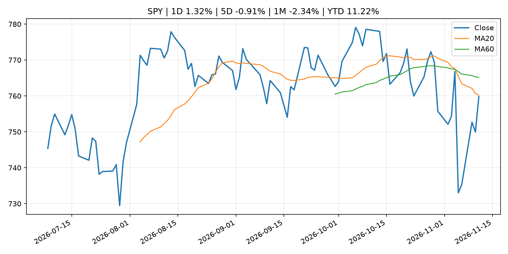
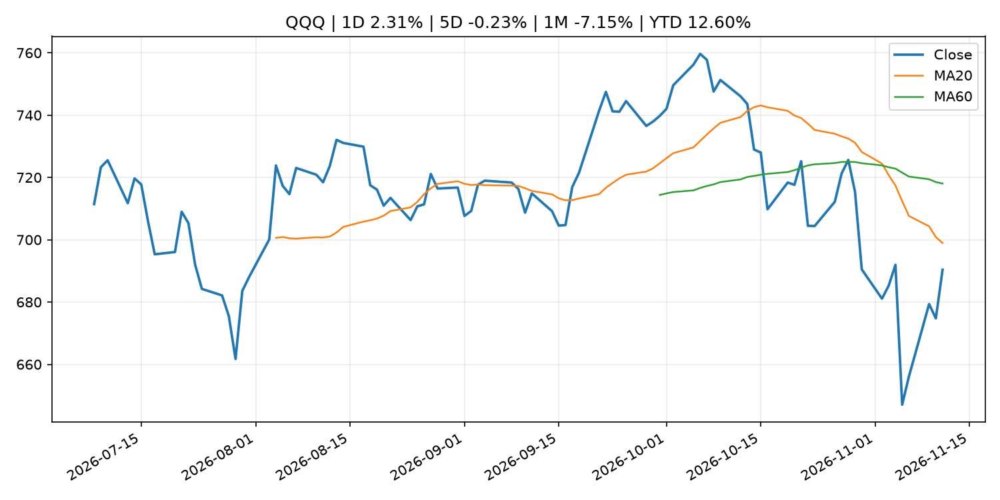
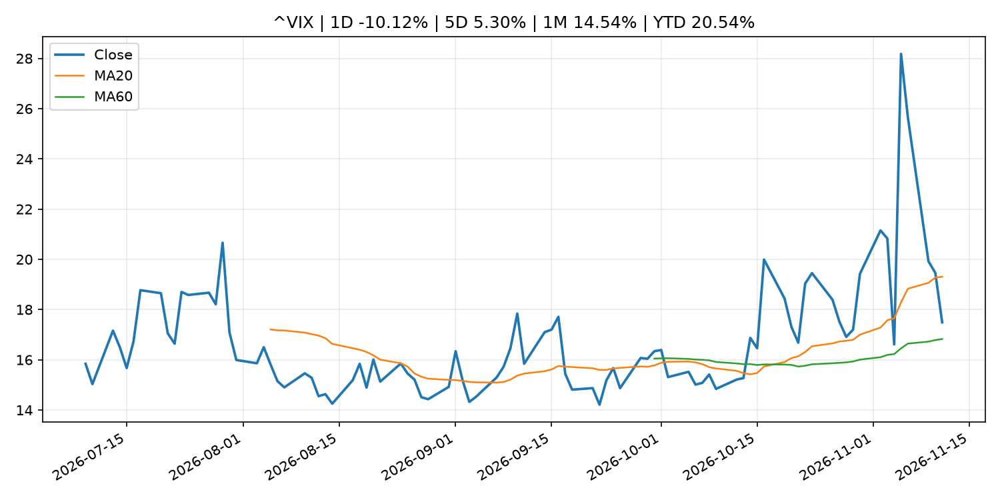
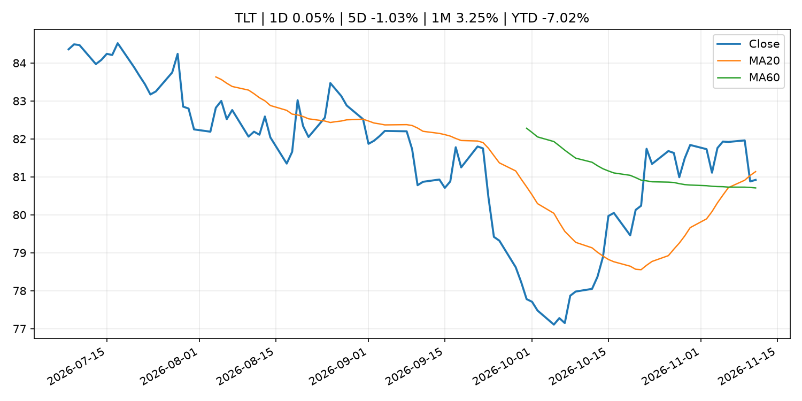
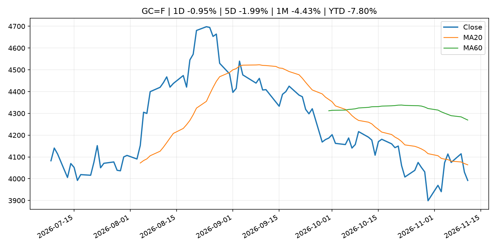
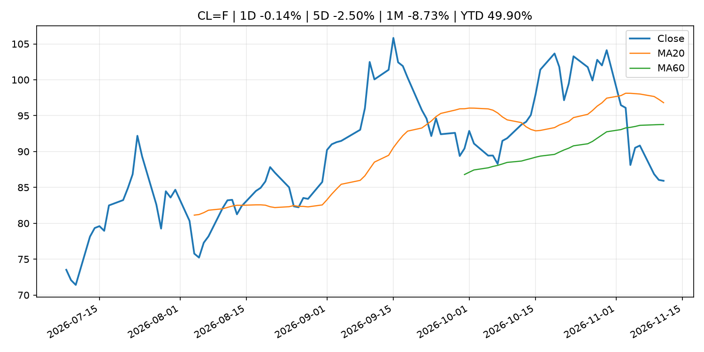
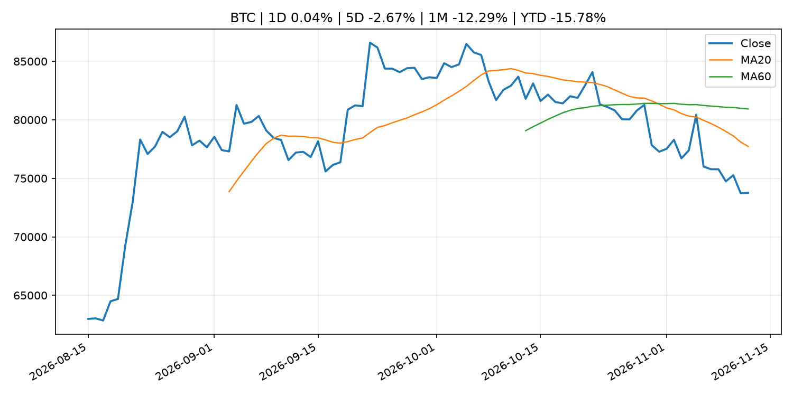
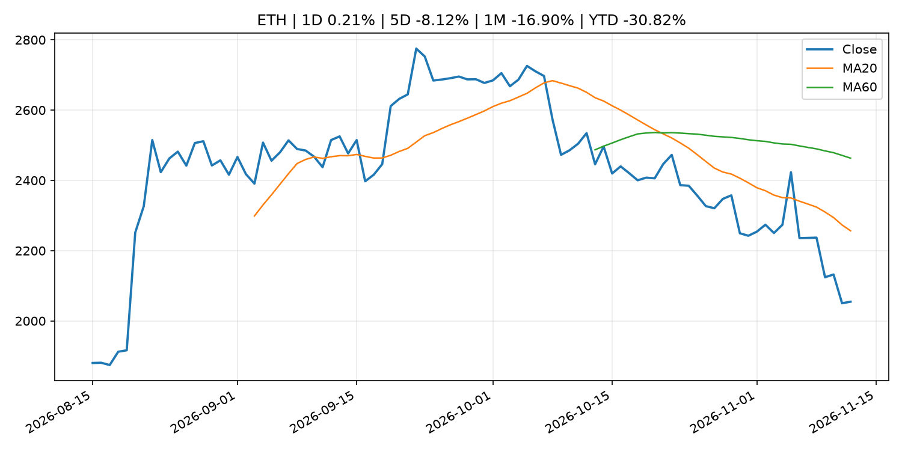
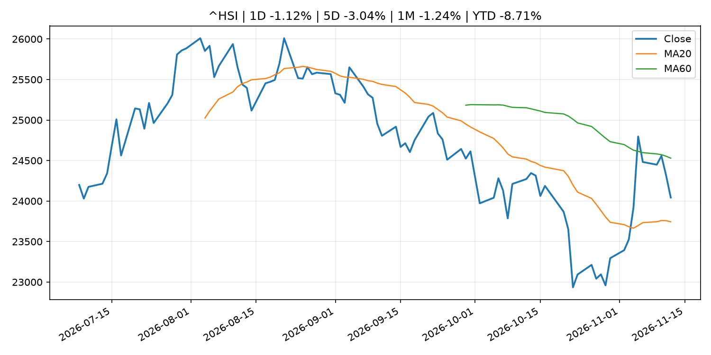

# Global Macro Morning Briefing - 2026-11-12

> Not financial advice / 非投资建议。

## 0. 今日总览
- 市场状态：risk_on。股指上涨、波动率或美元回落，市场更接近风险偏好改善。
- 今日三大主线：
  1. macro_data: Bitcoin barely flinches at hot CPI as ETF selling slows
  2. macro_data: U.S. CPI rose stronger than expected 0.4% in October; core rate rose 0.3%
  3. fiscal_policy: SEC Announces Enforcement Annual Results for Fiscal Year 2026
- 一句话结论：今日晨报重点关注：这类宏观数据会直接改变市场对通胀、增长和政策路径的预期。；这类宏观数据会直接改变市场对通胀、增长和政策路径的预期。。跨资产方面，SPY 1D 1.32%；QQQ 1D 2.31%；^VIX 1D -10.12%；TLT 1D 0.05%；GC=F 1D -0.95%；CL=F 1D -0.14%；BTC 1D 0.04%；ETH 1D 0.21%；股指上涨、波动率或美元回落，市场更接近风险偏好改善。政策、通胀、利率、美元、美债、能源和加密监管仍是主要观察线索。所有结论仅基于公开数据与短摘要整理，不构成投资建议。

## 1. 隔夜跨资产市场
- 美股：SPY 1D 1.32%，QQQ 1D 2.31%，整体趋势需结合 VIX 和利率确认。
- 美债/美元：TLT 1D 0.05%，美元指数 1D 0.68%，是判断折现率压力的核心线索。
- 黄金/原油：黄金 1D -0.95%，原油 1D -0.14%，用于观察避险、通胀和地缘风险。
- 加密：BTC 1D 0.04%，ETH 1D 0.21%，关注是否独立于纳指走出加密自身行情。
- 港股/A股：恒生 1D -1.12%，沪深300/上证 1D n/a，重点看中国政策预期与人民币线索。
- 风险观察：确认风险偏好是否扩散到小盘股、信用利差和周期品。

### US_EQUITY

| symbol | latest close | 1D | 5D | 1M | YTD | trend |
|---|---:|---:|---:|---:|---:|---|
| SPY | 759.81 | 1.32% | -0.91% | -2.34% | 11.22% | downtrend |
| QQQ | 690.38 | 2.31% | -0.23% | -7.15% | 12.60% | downtrend |
| DIA | 524.44 | 0.52% | -1.63% | 1.59% | 8.44% | range_bound |
| IWM | 283.09 | 0.89% | -0.33% | 2.31% | 13.79% | range_bound |
| VTI | 374.25 | 1.27% | -0.71% | -1.85% | 11.28% | range_bound |

### US_MACRO_MARKET

| symbol | latest close | 1D | 5D | 1M | YTD | trend |
|---|---:|---:|---:|---:|---:|---|
| ^VIX | 17.49 | -10.12% | 5.30% | 14.54% | 20.54% | range_bound |
| DX-Y.NYB | 102.93 | 0.68% | 1.40% | 0.73% | 4.58% | uptrend |
| TLT | 80.92 | 0.05% | -1.03% | 3.25% | -7.02% | range_bound |
| IEF | 90.94 | -0.08% | -0.79% | 1.56% | -5.35% | range_bound |

### COMMODITIES

| symbol | latest close | 1D | 5D | 1M | YTD | trend |
|---|---:|---:|---:|---:|---:|---|
| GC=F | 3,992.10 | -0.95% | -1.99% | -4.43% | -7.80% | downtrend |
| SI=F | 51.70 | 1.17% | -0.81% | -12.61% | -26.72% | strong_downtrend |
| CL=F | 85.92 | -0.14% | -2.50% | -8.73% | 49.90% | range_bound |
| BZ=F | 92.09 | 0.66% | -2.67% | -12.87% | 51.59% | range_bound |
| NG=F | 3.29 | -0.24% | 11.12% | 0.15% | -9.12% | range_bound |
| HG=F | 6.27 | 0.76% | -2.12% | -6.15% | 11.12% | downtrend |

### HK_MARKET

| symbol | latest close | 1D | 5D | 1M | YTD | trend |
|---|---:|---:|---:|---:|---:|---|
| ^HSI | 24,043.29 | -1.12% | -3.04% | -1.24% | -8.71% | range_bound |
| 0700.HK | 403.20 | -1.56% | -6.32% | -5.17% | -35.28% | range_bound |
| 9988.HK | 96.65 | -3.93% | -11.41% | -9.84% | -35.13% | downtrend |
| 3690.HK | 71.30 | -2.13% | -11.21% | -1.38% | -31.84% | downtrend |
| 1810.HK | 29.62 | -1.59% | -5.37% | 18.29% | -26.46% | strong_uptrend |
| 1211.HK | 67.85 | -1.95% | -10.37% | -7.37% | -31.29% | strong_downtrend |

### CRYPTO

| symbol | latest close | 1D | 5D | 1M | YTD | trend |
|---|---:|---:|---:|---:|---:|---|
| BTC | 73,751.92 | 0.04% | -2.67% | -12.29% | -15.78% | strong_downtrend |
| ETH | 2,054.70 | 0.21% | -8.12% | -16.90% | -30.82% | strong_downtrend |
| SOLANA | 83.26 | -0.01% | -7.55% | -22.14% | -33.13% | strong_downtrend |
| BINANCECOIN | 679.33 | -0.07% | -1.92% | -8.94% | -21.25% | strong_downtrend |
| RIPPLE | 1.05 | -0.47% | -10.87% | -23.05% | -42.93% | strong_downtrend |

## 2. 今日最重要的 10 条新闻
### 1. Bitcoin barely flinches at hot CPI as ETF selling slows
- 来源：CoinDesk
- 时间：2026-11-11T12:19:30+00:00
- 地区：global
- 事件类型：macro_data
- 重要性层级：Tier 1
- 一句话摘要：Bitcoin barely flinches at hot CPI as ETF selling slows
- 为什么重要：这类宏观数据会直接改变市场对通胀、增长和政策路径的预期。
- 可能影响：主要影响 DXY，方向为 positive，强度 high；通胀压力可能推高政策利率预期并支撑美元。
  - 资产：DXY
    方向：positive
    强度：high
    原因：通胀压力可能推高政策利率预期并支撑美元。
  - 资产：TLT
    方向：negative
    强度：high
    原因：通胀上行通常推升收益率、压低长债价格。
  - 资产：QQQ
    方向：negative
    强度：high
    原因：更高利率对成长股估值折现率不利。
  - 资产：SPY
    方向：mixed
    强度：medium
    原因：名义增长可能支撑收入，但更高利率压制估值。
  - 资产：GC=F
    方向：mixed
    强度：medium
    原因：通胀对黄金是支撑，但实际利率上行会形成压力。
  - 资产：BTC
    方向：mixed
    强度：high
    原因：加密监管或 ETF 进展会改变 BTC 的资金流和风险溢价。
- 原文链接：[https://www.coindesk.com/daybook-us/2026/11/11/bitcoin-barely-flinches-at-hot-cpi-as-etf-selling-slows](https://www.coindesk.com/daybook-us/2026/11/11/bitcoin-barely-flinches-at-hot-cpi-as-etf-selling-slows)

### 2. U.S. CPI rose stronger than expected 0.4% in October; core rate rose 0.3%
- 来源：CoinDesk
- 时间：2026-11-10T13:32:09+00:00
- 地区：global
- 事件类型：macro_data
- 重要性层级：Tier 1
- 一句话摘要：U.S. CPI rose stronger than expected 0.4% in October; core rate rose 0.3%
- 为什么重要：这类宏观数据会直接改变市场对通胀、增长和政策路径的预期。
- 可能影响：主要影响 DXY，方向为 positive，强度 high；通胀压力可能推高政策利率预期并支撑美元。
  - 资产：DXY
    方向：positive
    强度：high
    原因：通胀压力可能推高政策利率预期并支撑美元。
  - 资产：TLT
    方向：negative
    强度：high
    原因：通胀上行通常推升收益率、压低长债价格。
  - 资产：QQQ
    方向：negative
    强度：high
    原因：更高利率对成长股估值折现率不利。
  - 资产：SPY
    方向：mixed
    强度：medium
    原因：名义增长可能支撑收入，但更高利率压制估值。
  - 资产：GC=F
    方向：mixed
    强度：medium
    原因：通胀对黄金是支撑，但实际利率上行会形成压力。
  - 资产：BTC
    方向：mixed
    强度：medium
    原因：抗通胀叙事和流动性收紧可能相互抵消。
- 原文链接：[https://www.coindesk.com/markets/2026/11/10/u-s-cpi-rose-stronger-than-expected-0-4-in-october-core-rate-rose-0-3](https://www.coindesk.com/markets/2026/11/10/u-s-cpi-rose-stronger-than-expected-0-4-in-october-core-rate-rose-0-3)

### 3. SEC Announces Enforcement Annual Results for Fiscal Year 2026
- 来源：SEC Press Releases
- 时间：2026-11-10T11:15:35-05:00
- 地区：US
- 事件类型：fiscal_policy
- 重要性层级：Tier 1
- 一句话摘要：The Securities and Exchange Commission today provided its enforcement results for the past fiscal year which ended September 30. Throughout the fiscal year, the SEC’s Division of Enforcement remained focused on its fundamental responsibility: protecting…
- 为什么重要：财政和贸易政策会影响增长、通胀、企业利润和跨境资本流。
- 可能影响：主要影响 BTC，方向为 mixed，强度 high；加密监管或 ETF 进展会改变 BTC 的资金流和风险溢价。
  - 资产：BTC
    方向：mixed
    强度：high
    原因：加密监管或 ETF 进展会改变 BTC 的资金流和风险溢价。
  - 资产：ETH
    方向：mixed
    强度：high
    原因：监管框架会影响 ETH 产品化和机构参与度。
  - 资产：COIN
    方向：mixed
    强度：medium
    原因：监管清晰度和执法风险会影响交易平台估值。
  - 资产：crypto market
    方向：mixed
    强度：high
    原因：信息影响整个加密市场结构，但方向取决于细节。
- 原文链接：[https://www.sec.gov/newsroom/press-releases/2026-113-sec-announces-enforcement-annual-results-fiscal-year-2026](https://www.sec.gov/newsroom/press-releases/2026-113-sec-announces-enforcement-annual-results-fiscal-year-2026)

### 4. Live news: Bitcoin remains under pressure as CoreWeave, Nvidia lead AI rebound
- 来源：CoinDesk
- 时间：2026-11-11T12:21:24+00:00
- 地区：global
- 事件类型：earnings
- 重要性层级：Tier 2
- 一句话摘要：Live news: Bitcoin remains under pressure as CoreWeave, Nvidia lead AI rebound
- 为什么重要：大型科技股盈利和资本开支会影响纳指、半导体和 AI 交易主线。
- 可能影响：主要影响 QQQ，方向为 mixed，强度 high；AI 资本开支会影响大型科技股盈利和估值预期。
  - 资产：QQQ
    方向：mixed
    强度：high
    原因：AI 资本开支会影响大型科技股盈利和估值预期。
  - 资产：SMH
    方向：mixed
    强度：high
    原因：AI 投资周期直接影响半导体需求。
  - 资产：NVDA
    方向：mixed
    强度：high
    原因：AI 训练和推理需求是英伟达收入预期核心变量。
  - 资产：MSFT
    方向：mixed
    强度：medium
    原因：云和 AI 资本开支影响利润率与增长叙事。
  - 资产：GOOGL
    方向：mixed
    强度：medium
    原因：AI 投资和搜索商业化影响估值。
  - 资产：META
    方向：mixed
    强度：medium
    原因：AI 基建支出与广告效率共同影响市场预期。
- 原文链接：[https://www.coindesk.com/tech/2026/11/11/live-news-coreweave-jumps-14-as-earnings-fuel-rebound-across-battered-ai-stocks](https://www.coindesk.com/tech/2026/11/11/live-news-coreweave-jumps-14-as-earnings-fuel-rebound-across-battered-ai-stocks)

### 5. Alibaba announces plans to list T-Head, its Nvidia chip rival
- 来源：CNBC Economy
- 时间：2026-11-11T07:47:54+00:00
- 地区：US
- 事件类型：earnings
- 重要性层级：Tier 2
- 一句话摘要：Alibaba noted it had already filed confidentially on Sept. 11 to list T-Head on the Hong Kong Stock Exchange.
- 为什么重要：大型科技股盈利和资本开支会影响纳指、半导体和 AI 交易主线。
- 可能影响：主要影响 QQQ，方向为 mixed，强度 high；AI 资本开支会影响大型科技股盈利和估值预期。
  - 资产：QQQ
    方向：mixed
    强度：high
    原因：AI 资本开支会影响大型科技股盈利和估值预期。
  - 资产：SMH
    方向：mixed
    强度：high
    原因：AI 投资周期直接影响半导体需求。
  - 资产：NVDA
    方向：mixed
    强度：high
    原因：AI 训练和推理需求是英伟达收入预期核心变量。
  - 资产：MSFT
    方向：mixed
    强度：medium
    原因：云和 AI 资本开支影响利润率与增长叙事。
  - 资产：GOOGL
    方向：mixed
    强度：medium
    原因：AI 投资和搜索商业化影响估值。
  - 资产：META
    方向：mixed
    强度：medium
    原因：AI 基建支出与广告效率共同影响市场预期。
- 原文链接：[https://www.cnbc.com/2026/11/11/alibaba-pr.html](https://www.cnbc.com/2026/11/11/alibaba-pr.html)

### 6. Fed Governor Waller sees December hike likely, opens door to possible half-point increase
- 来源：CNBC Economy
- 时间：2026-11-10T17:13:44+00:00
- 地区：US
- 事件类型：central_bank_speech
- 重要性层级：Tier 2
- 一句话摘要：The policymaker said he "is leaning toward" a rate increase in December and could support a half-point hike depending on inflation data.
- 为什么重要：央行官员表态可能影响市场对下一次会议的定价。
- 可能影响：主要影响 DXY，方向为 positive，强度 high；通胀压力可能推高政策利率预期并支撑美元。
  - 资产：DXY
    方向：positive
    强度：high
    原因：通胀压力可能推高政策利率预期并支撑美元。
  - 资产：TLT
    方向：negative
    强度：high
    原因：通胀上行通常推升收益率、压低长债价格。
  - 资产：QQQ
    方向：negative
    强度：high
    原因：更高利率对成长股估值折现率不利。
  - 资产：SPY
    方向：mixed
    强度：medium
    原因：名义增长可能支撑收入，但更高利率压制估值。
  - 资产：GC=F
    方向：mixed
    强度：medium
    原因：通胀对黄金是支撑，但实际利率上行会形成压力。
  - 资产：BTC
    方向：mixed
    强度：medium
    原因：抗通胀叙事和流动性收紧可能相互抵消。
- 原文链接：[https://www.cnbc.com/2026/11/10/fed-governor-waller-sees-december-hike-likely.html](https://www.cnbc.com/2026/11/10/fed-governor-waller-sees-december-hike-likely.html)

### 7. Goldman Sachs, Citi among banks said to commit $270 million to stablecoin venture
- 来源：CoinDesk
- 时间：2026-11-10T17:32:22+00:00
- 地区：global
- 事件类型：crypto_market_structure
- 重要性层级：Tier 2
- 一句话摘要：Goldman Sachs, Citi among banks said to commit $270 million to stablecoin venture
- 为什么重要：加密市场结构和监管变化会影响 BTC、ETH 及相关股票的风险溢价。
- 可能影响：主要影响 BTC，方向为 mixed，强度 high；加密监管或 ETF 进展会改变 BTC 的资金流和风险溢价。
  - 资产：BTC
    方向：mixed
    强度：high
    原因：加密监管或 ETF 进展会改变 BTC 的资金流和风险溢价。
  - 资产：ETH
    方向：mixed
    强度：high
    原因：监管框架会影响 ETH 产品化和机构参与度。
  - 资产：COIN
    方向：mixed
    强度：medium
    原因：监管清晰度和执法风险会影响交易平台估值。
  - 资产：crypto market
    方向：mixed
    强度：high
    原因：信息影响整个加密市场结构，但方向取决于细节。
- 原文链接：[https://www.coindesk.com/business/2026/11/10/goldman-sachs-citi-among-banks-said-to-commit-usd270-million-to-stablecoin-venture](https://www.coindesk.com/business/2026/11/10/goldman-sachs-citi-among-banks-said-to-commit-usd270-million-to-stablecoin-venture)

### 8. Speech by Board Member ASADA in Nagasaki (Economic Activity, Prices, and Monetary Policy in Japan)
- 来源：Bank of Japan Announcements
- 时间：2026-11-12T10:30:00+09:00
- 地区：Japan
- 事件类型：central_bank_speech
- 重要性层级：Tier 2
- 一句话摘要：Speech by Board Member ASADA in Nagasaki (Economic Activity, Prices, and Monetary Policy in Japan)
- 为什么重要：央行官员表态可能影响市场对下一次会议的定价。
- 可能影响：可能影响利率、汇率、风险资产或大宗商品预期，但当前公开信息不足以判断明确方向。
  - 资产：暂无明确资产映射
  - 方向：unknown
  - 强度：low
  - 原因：公开信息不足以判断方向。
- 原文链接：[http://www.boj.or.jp/en/about/press/koen_2026/ko261112a.htm](http://www.boj.or.jp/en/about/press/koen_2026/ko261112a.htm)

### 9. Bitcoin stuck under $74,000 as CoreWeave earnings revive AI outlook, Anthropic said to raise IPO valuation
- 来源：CoinDesk
- 时间：2026-11-11T10:45:49+00:00
- 地区：global
- 事件类型：earnings
- 重要性层级：Tier 2
- 一句话摘要：Bitcoin stuck under $74,000 as CoreWeave earnings revive AI outlook, Anthropic said to raise IPO valuation
- 为什么重要：大型科技股盈利和资本开支会影响纳指、半导体和 AI 交易主线。
- 可能影响：可能影响利率、汇率、风险资产或大宗商品预期，但当前公开信息不足以判断明确方向。
  - 资产：暂无明确资产映射
  - 方向：unknown
  - 强度：low
  - 原因：公开信息不足以判断方向。
- 原文链接：[https://www.coindesk.com/markets/2026/11/11/coreweave-earnings-revive-ai-outlook-as-anthropic-weighs-higher-ipo-valuation](https://www.coindesk.com/markets/2026/11/11/coreweave-earnings-revive-ai-outlook-as-anthropic-weighs-higher-ipo-valuation)

### 10. Your holiday credit-card bills are going up. What you can do to ease the pain.
- 来源：MarketWatch Top Stories
- 时间：2026-11-11T23:30:00+00:00
- 地区：US
- 事件类型：other
- 重要性层级：Tier 3
- 一句话摘要：The government may have lost a month of inflation data, but don’t expect your credit card’s annual percentage rate to decline because of it.
- 为什么重要：这条信息暂未匹配到重大宏观、政策或市场事件，更适合作为背景跟踪。
- 可能影响：主要影响 DXY，方向为 positive，强度 high；通胀压力可能推高政策利率预期并支撑美元。
  - 资产：DXY
    方向：positive
    强度：high
    原因：通胀压力可能推高政策利率预期并支撑美元。
  - 资产：TLT
    方向：negative
    强度：high
    原因：通胀上行通常推升收益率、压低长债价格。
  - 资产：QQQ
    方向：negative
    强度：high
    原因：更高利率对成长股估值折现率不利。
  - 资产：SPY
    方向：mixed
    强度：medium
    原因：名义增长可能支撑收入，但更高利率压制估值。
  - 资产：GC=F
    方向：mixed
    强度：medium
    原因：通胀对黄金是支撑，但实际利率上行会形成压力。
  - 资产：BTC
    方向：mixed
    强度：medium
    原因：抗通胀叙事和流动性收紧可能相互抵消。
- 原文链接：[https://www.marketwatch.com/story/your-holiday-credit-card-bills-are-going-up-what-you-can-do-to-ease-the-pain-5ddeb446?mod=mw_rss_topstories](https://www.marketwatch.com/story/your-holiday-credit-card-bills-are-going-up-what-you-can-do-to-ease-the-pain-5ddeb446?mod=mw_rss_topstories)

## 3. 政策与央行观察
### 1. SEC Announces Enforcement Annual Results for Fiscal Year 2026
- 来源：SEC Press Releases
- 时间：2026-11-10T11:15:35-05:00
- 地区：US
- 事件类型：fiscal_policy
- 重要性层级：Tier 1
- 一句话摘要：The Securities and Exchange Commission today provided its enforcement results for the past fiscal year which ended September 30. Throughout the fiscal year, the SEC’s Division of Enforcement remained focused on its fundamental responsibility: protecting…
- 为什么重要：财政和贸易政策会影响增长、通胀、企业利润和跨境资本流。
- 可能影响：主要影响 BTC，方向为 mixed，强度 high；加密监管或 ETF 进展会改变 BTC 的资金流和风险溢价。
  - 资产：BTC
    方向：mixed
    强度：high
    原因：加密监管或 ETF 进展会改变 BTC 的资金流和风险溢价。
  - 资产：ETH
    方向：mixed
    强度：high
    原因：监管框架会影响 ETH 产品化和机构参与度。
  - 资产：COIN
    方向：mixed
    强度：medium
    原因：监管清晰度和执法风险会影响交易平台估值。
  - 资产：crypto market
    方向：mixed
    强度：high
    原因：信息影响整个加密市场结构，但方向取决于细节。
- 原文链接：[https://www.sec.gov/newsroom/press-releases/2026-113-sec-announces-enforcement-annual-results-fiscal-year-2026](https://www.sec.gov/newsroom/press-releases/2026-113-sec-announces-enforcement-annual-results-fiscal-year-2026)

### 2. Fed Governor Waller sees December hike likely, opens door to possible half-point increase
- 来源：CNBC Economy
- 时间：2026-11-10T17:13:44+00:00
- 地区：US
- 事件类型：central_bank_speech
- 重要性层级：Tier 2
- 一句话摘要：The policymaker said he "is leaning toward" a rate increase in December and could support a half-point hike depending on inflation data.
- 为什么重要：央行官员表态可能影响市场对下一次会议的定价。
- 可能影响：主要影响 DXY，方向为 positive，强度 high；通胀压力可能推高政策利率预期并支撑美元。
  - 资产：DXY
    方向：positive
    强度：high
    原因：通胀压力可能推高政策利率预期并支撑美元。
  - 资产：TLT
    方向：negative
    强度：high
    原因：通胀上行通常推升收益率、压低长债价格。
  - 资产：QQQ
    方向：negative
    强度：high
    原因：更高利率对成长股估值折现率不利。
  - 资产：SPY
    方向：mixed
    强度：medium
    原因：名义增长可能支撑收入，但更高利率压制估值。
  - 资产：GC=F
    方向：mixed
    强度：medium
    原因：通胀对黄金是支撑，但实际利率上行会形成压力。
  - 资产：BTC
    方向：mixed
    强度：medium
    原因：抗通胀叙事和流动性收紧可能相互抵消。
- 原文链接：[https://www.cnbc.com/2026/11/10/fed-governor-waller-sees-december-hike-likely.html](https://www.cnbc.com/2026/11/10/fed-governor-waller-sees-december-hike-likely.html)

### 3. Goldman Sachs, Citi among banks said to commit $270 million to stablecoin venture
- 来源：CoinDesk
- 时间：2026-11-10T17:32:22+00:00
- 地区：global
- 事件类型：crypto_market_structure
- 重要性层级：Tier 2
- 一句话摘要：Goldman Sachs, Citi among banks said to commit $270 million to stablecoin venture
- 为什么重要：加密市场结构和监管变化会影响 BTC、ETH 及相关股票的风险溢价。
- 可能影响：主要影响 BTC，方向为 mixed，强度 high；加密监管或 ETF 进展会改变 BTC 的资金流和风险溢价。
  - 资产：BTC
    方向：mixed
    强度：high
    原因：加密监管或 ETF 进展会改变 BTC 的资金流和风险溢价。
  - 资产：ETH
    方向：mixed
    强度：high
    原因：监管框架会影响 ETH 产品化和机构参与度。
  - 资产：COIN
    方向：mixed
    强度：medium
    原因：监管清晰度和执法风险会影响交易平台估值。
  - 资产：crypto market
    方向：mixed
    强度：high
    原因：信息影响整个加密市场结构，但方向取决于细节。
- 原文链接：[https://www.coindesk.com/business/2026/11/10/goldman-sachs-citi-among-banks-said-to-commit-usd270-million-to-stablecoin-venture](https://www.coindesk.com/business/2026/11/10/goldman-sachs-citi-among-banks-said-to-commit-usd270-million-to-stablecoin-venture)

### 4. Speech by Board Member ASADA in Nagasaki (Economic Activity, Prices, and Monetary Policy in Japan)
- 来源：Bank of Japan Announcements
- 时间：2026-11-12T10:30:00+09:00
- 地区：Japan
- 事件类型：central_bank_speech
- 重要性层级：Tier 2
- 一句话摘要：Speech by Board Member ASADA in Nagasaki (Economic Activity, Prices, and Monetary Policy in Japan)
- 为什么重要：央行官员表态可能影响市场对下一次会议的定价。
- 可能影响：可能影响利率、汇率、风险资产或大宗商品预期，但当前公开信息不足以判断明确方向。
  - 资产：暂无明确资产映射
  - 方向：unknown
  - 强度：low
  - 原因：公开信息不足以判断方向。
- 原文链接：[http://www.boj.or.jp/en/about/press/koen_2026/ko261112a.htm](http://www.boj.or.jp/en/about/press/koen_2026/ko261112a.htm)

## 4. 市场异动与图表
- SPY 上涨 1.32%
- QQQ 上涨 2.31%
- VIX 下跌 -10.12%
- DXY 上涨 0.68%
- Gold 下跌 -0.95%

### SPY

### QQQ

### ^VIX

### TLT

### GC=F

### CL=F

### BTC

### ETH

### ^HSI

## 5. 华尔街与机构公开观点
- 暂无可靠公开观点。

## 6. 今日重点关注
- 经济数据：经济数据：暂无可靠公开日历数据；如配置经济日历源后可自动填充。
- 央行讲话：央行讲话：暂无可靠公开日历数据；重点跟踪 Fed、ECB、BoJ、PBOC 官网 RSS。
- 财报：财报：暂无可靠数据。
- 政策事件：政策事件：暂无可靠数据。
- 风险提醒：风险提醒：关注数据源失败项、突发地缘风险、利率和美元的二阶反应。

## 7. 英文金融表达与宏观概念
- **inflation expectations**：通胀预期，指家庭、企业或市场对未来通胀的预估。 例句：Inflation expectations can shape wage bargaining and bond yields.
- **real yield**：实际收益率，名义利率扣除通胀预期后的收益率。 例句：Gold often reacts more to real yields than nominal yields.
- **risk-off**：避险模式，资金偏向美元、国债、黄金等防御资产。 例句：A geopolitical shock can push markets into risk-off mode.
- **market structure**：市场结构，指交易、托管、清算、ETF、监管等制度安排。 例句：Crypto market structure rules can affect institutional participation.
- **AI capex**：AI 资本开支，指云厂商和科技公司投入 AI 基建的支出。 例句：AI capex guidance can move semiconductor stocks.
- **terminal rate**：终端利率，市场预期本轮加息周期的最高政策利率。 例句：A higher terminal rate can pressure growth stocks.

## 8. 背景材料
- [Bank of Japan Accounts (November 10)](http://www.boj.or.jp/en/statistics/boj/other/acmai/release/2026/ac261110.htm)（Bank of Japan Announcements，routine_announcement）：Bank of Japan Accounts (November 10)
- [Corporate Goods Price Index (Oct.)](http://www.boj.or.jp/en/statistics/pi/cgpi_release/cgpi2610.pdf)（Bank of Japan Announcements，other）：Corporate Goods Price Index (Oct.)
- [Release of Latest "Amounts Outstanding of Deposits by Depositor" Data](http://www.boj.or.jp/en/statistics/outline/notice_2026/not261112a.htm)（Bank of Japan Announcements，other）：Release of Latest "Amounts Outstanding of Deposits by Depositor" Data
- [Your holiday credit-card bills are going up. What you can do to ease the pain.](https://www.marketwatch.com/story/your-holiday-credit-card-bills-are-going-up-what-you-can-do-to-ease-the-pain-5ddeb446?mod=mw_rss_topstories)（MarketWatch Top Stories，other）：The government may have lost a month of inflation data, but don’t expect your credit card’s annual percentage rate to decline because of it.
- [CoreWeave just gave a shot in the arm to Micron, Lumentum and the rest of the AI trade](https://www.marketwatch.com/story/micron-and-other-ai-stocks-surge-as-coreweave-calms-wall-streets-worst-fears-0a18152a?mod=mw_rss_topstories)（MarketWatch Top Stories，other）：CoreWeave’s improved AI economics and its vow to show some discipline around debt are sparking a broad rally across the chip sector.
- [Falling oil prices are no longer enough to bring down borrowing costs in the world’s most important bond market](https://www.marketwatch.com/story/falling-oil-prices-are-no-longer-enough-to-bring-down-borrowing-costs-in-the-worlds-most-important-bond-market-3176d25a?mod=mw_rss_topstories)（MarketWatch Top Stories，other）：The tight trading relationship between oil prices and Treasury yields has broken down. It’s a sign that inflation concerns are extending beyond the energy shock.
- [Why this ‘big idea’ to fix Social Security relies on a massive stock-market gamble](https://www.marketwatch.com/story/why-this-big-idea-to-fix-social-security-relies-on-a-massive-stock-market-gamble-5423f50f?mod=mw_rss_topstories)（MarketWatch Top Stories，other）：From a long-term perspective, the past 50 years of strong market gains are the exception rather than the rule
- [Fed's Goolsbee calls inflation report 'borderline disturbing' as central bank weighs more hikes](https://www.cnbc.com/2026/11/11/goolsbee-october-inflation-fed-rates-disturbing-distressing.html)（CNBC Economy，other）：The consumer price index rose more than expected in October, raising alarm among Federal Reserve officials.
- [Bitcoin sits out stock rebound as ETF outflows extend to fourth day](https://www.coindesk.com/markets/2026/11/11/bitcoin-sits-out-stock-rebound-as-etf-outflows-extend-to-fourth-day)（CoinDesk，other）：Bitcoin sits out stock rebound as ETF outflows extend to fourth day
- [Money Stock (Oct.)](http://www.boj.or.jp/en/statistics/money/ms/ms2610.pdf)（Bank of Japan Announcements，other）：Money Stock (Oct.)
- [Philip R. Lane: The science and practice of monetary policy communication: the ECB experience](https://www.ecb.europa.eu//press/key/date/2026/html/ecb.sp261110_1~9725b7aa07.en.html)（ECB Press Releases，other）：Philip R. Lane: The science and practice of monetary policy communication: the ECB experience
- [Piero Cipollone: Cash and the digital euro: two sides of the same coin](https://www.ecb.europa.eu//press/key/date/2026/html/ecb.sp261110~9422461bad.en.html)（ECB Press Releases，other）：Piero Cipollone: Cash and the digital euro: two sides of the same coin
- [Will stablecoins survive once the banks catch up?](https://www.coindesk.com/opinion/2026/11/10/will-stablecoins-survive-once-the-banks-catch-up)（CoinDesk，other）：Will stablecoins survive once the banks catch up?
- [Bitcoin breaks with stocks, declines as ETF outflows mount, MARA reduces holdings](https://www.coindesk.com/daybook-us/2026/11/10/bitcoin-breaks-with-stocks-declines-as-etf-outflows-mount-mara-sells-holdings)（CoinDesk，other）：Bitcoin breaks with stocks, declines as ETF outflows mount, MARA reduces holdings
- [Bitcoin lags stock rebound in advance of U.S. inflation report](https://www.coindesk.com/markets/2026/11/10/bitcoin-lags-stock-rebound-in-advance-of-u-s-inflation-report)（CoinDesk，other）：Bitcoin lags stock rebound in advance of U.S. inflation report
- [Bitcoin slips before U.S. inflation report as traders price in Fed rate increase](https://www.coindesk.com/markets/2026/11/10/bitcoin-slips-before-u-s-inflation-report-as-traders-price-in-fed-rate-increase)（CoinDesk，other）：Bitcoin slips before U.S. inflation report as traders price in Fed rate increase
- [Live news: Bitcoin falls to nearly three-month low after disappointing inflation data](https://www.coindesk.com/markets/2026/11/10/live-news-traders-price-in-fed-rate-hike-for-december-as-bitcoin-and-gold-retreat)（CoinDesk，other）：Live news: Bitcoin falls to nearly three-month low after disappointing inflation data
- [Bitcoin miner MARA sold 13,597 BTC for $1.1 billion in six weeks, plans to sell more](https://www.coindesk.com/markets/2026/11/10/bitcoin-miner-mara-sold-13-597-btc-for-usd1-1-billion-in-six-weeks-plans-to-sell-more)（CoinDesk，other）：Bitcoin miner MARA sold 13,597 BTC for $1.1 billion in six weeks, plans to sell more

## 9. 数据源、失败项与免责声明
- 采集时间：2026-11-12T02:43:25
- 数据源：公开 RSS、Yahoo Finance、CoinGecko、AKShare、FRED、SEC data.sec.gov，以及用户自有 inputs/reports 文件。
- 合规说明：不绕过 WSJ、Bloomberg、FT、Reuters 等付费墙；对付费媒体只使用公开 RSS 标题、摘要、链接和发布时间。
- 免责声明：Not financial advice / 非投资建议。本项目仅供个人学习、研究和信息整理，不构成投资建议、交易建议或任何收益承诺。
- 失败或跳过的数据源：
  - crypto data failed coin=dogecoin
  - China market data failed symbol=上证指数: empty dataframe
  - China market data failed symbol=深证成指: empty dataframe
  - China market data failed symbol=创业板指: empty dataframe
  - China market data failed symbol=沪深300: empty dataframe
  - China market data failed symbol=中证500: empty dataframe
  - China market data failed symbol=科创50: empty dataframe
  - FRED_API_KEY not set; skipping FRED macro series
  - SEC failed cik=0000320193
  - SEC failed cik=0000789019
  - SEC failed cik=0001045810
  - SEC failed cik=0001318605
  - SEC failed cik=0001577552
