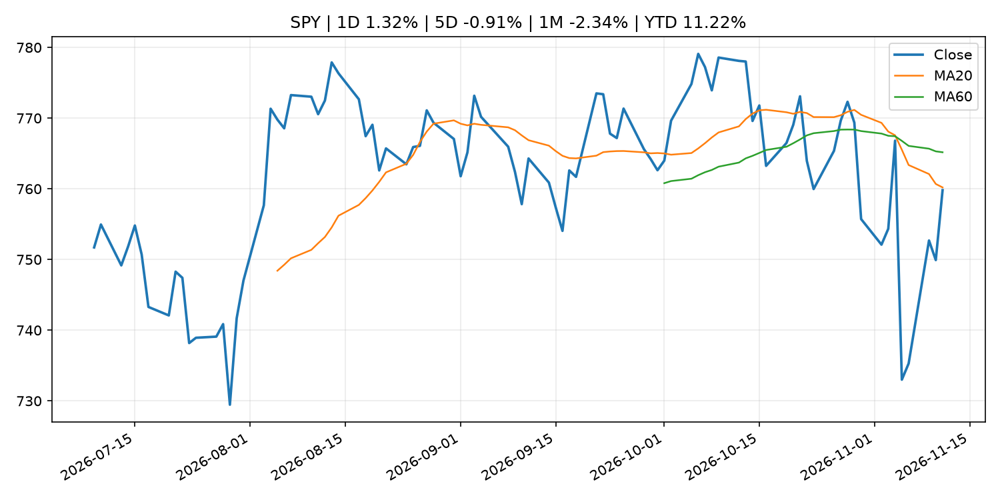
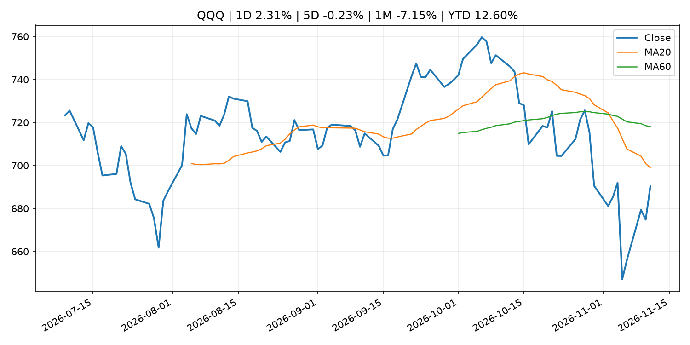
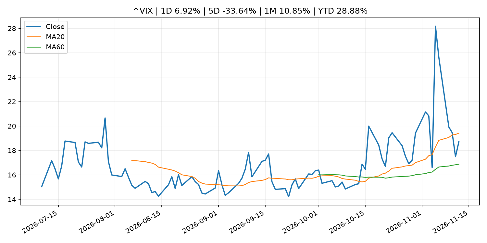
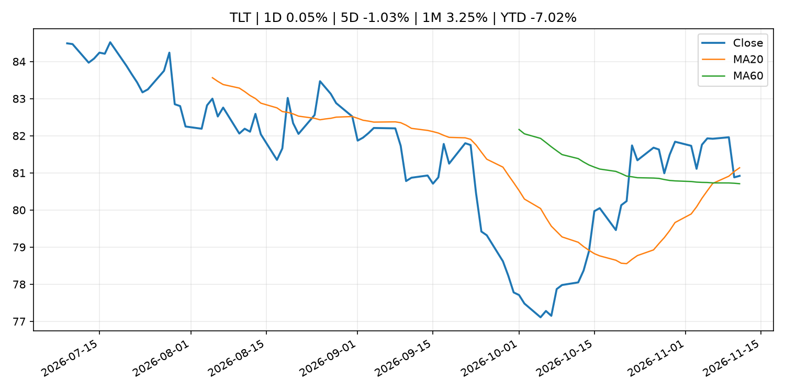
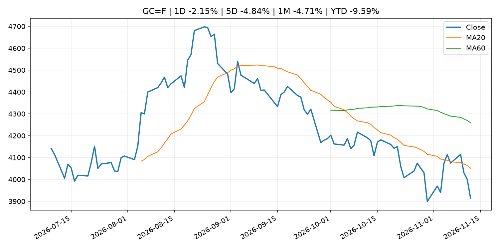
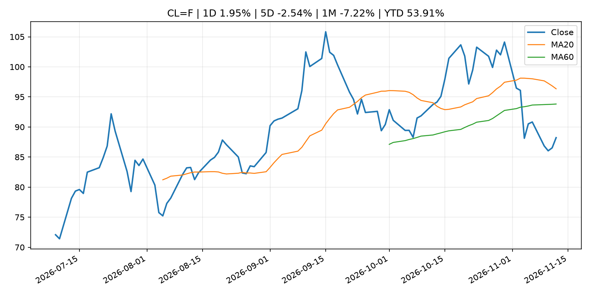
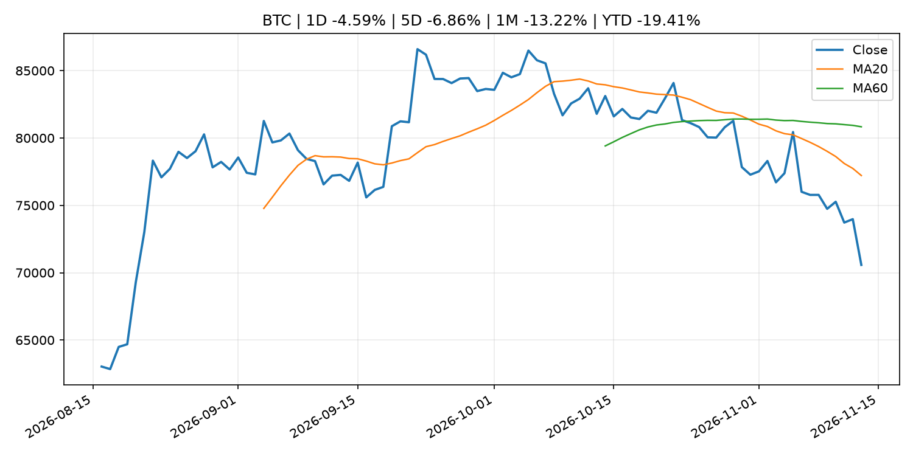
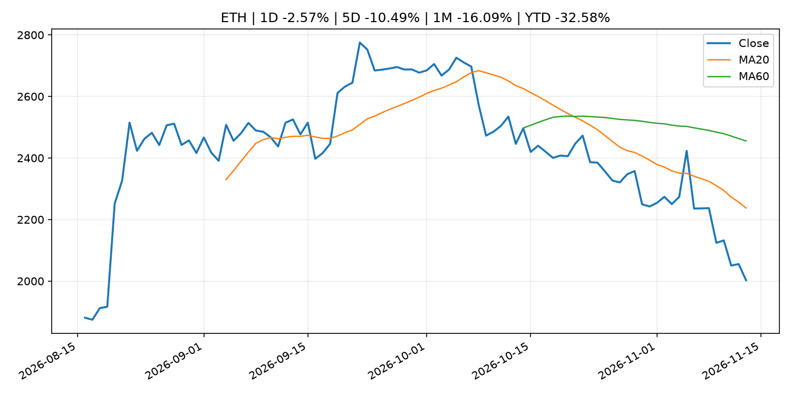
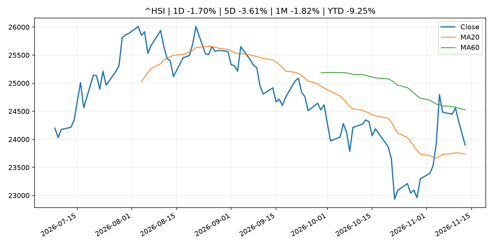

# Global Macro Morning Briefing - 2026-11-13

> Not financial advice / 非投资建议。

## 0. 今日总览
- 市场状态：mixed。市场信号不足，暂不判断明确状态。 但存在信号冲突，需要降低单一叙事置信度。
- 今日三大主线：
  1. earnings: Bitcoin dips with Nvidia as ETF outflows reach day five
  2. earnings: Live updates: Bitcoin slumps below $72,000 as Nvidia's Huang resigns, interest rates surge
  3. earnings: China's Ministry of State Security thrust into the spotlight by Nvidia CEO affair
- 一句话结论：今日晨报重点关注：大型科技股盈利和资本开支会影响纳指、半导体和 AI 交易主线。；大型科技股盈利和资本开支会影响纳指、半导体和 AI 交易主线。。跨资产方面，SPY 1D 1.32%；QQQ 1D 2.31%；^VIX 1D 6.92%；TLT 1D 0.05%；GC=F 1D -2.15%；CL=F 1D 1.95%；BTC 1D -4.59%；ETH 1D -2.57%；市场信号不足，暂不判断明确状态。 但存在信号冲突，需要降低单一叙事置信度。政策、通胀、利率、美元、美债、能源和加密监管仍是主要观察线索。所有结论仅基于公开数据与短摘要整理，不构成投资建议。

## 1. 隔夜跨资产市场
- 美股：SPY 1D 1.32%，QQQ 1D 2.31%，整体趋势需结合 VIX 和利率确认。
- 美债/美元：TLT 1D 0.05%，美元指数 1D 0.24%，是判断折现率压力的核心线索。
- 黄金/原油：黄金 1D -2.15%，原油 1D 1.95%，用于观察避险、通胀和地缘风险。
- 加密：BTC 1D -4.59%，ETH 1D -2.57%，关注是否独立于纳指走出加密自身行情。
- 港股/A股：恒生 1D -1.70%，沪深300/上证 1D n/a，重点看中国政策预期与人民币线索。
- 风险观察：关注后续数据是否确认当前跨资产信号。

### US_EQUITY

| symbol | latest close | 1D | 5D | 1M | YTD | trend |
|---|---:|---:|---:|---:|---:|---|
| SPY | 759.81 | 1.32% | -0.91% | -2.34% | 11.22% | downtrend |
| QQQ | 690.38 | 2.31% | -0.23% | -7.15% | 12.60% | downtrend |
| DIA | 524.44 | 0.52% | -1.63% | 1.59% | 8.44% | range_bound |
| IWM | 283.09 | 0.89% | -0.33% | 2.31% | 13.79% | range_bound |
| VTI | 374.25 | 1.27% | -0.71% | -1.85% | 11.28% | range_bound |

### US_MACRO_MARKET

| symbol | latest close | 1D | 5D | 1M | YTD | trend |
|---|---:|---:|---:|---:|---:|---|
| ^VIX | 18.70 | 6.92% | -33.64% | 10.85% | 28.88% | range_bound |
| DX-Y.NYB | 103.15 | 0.24% | 1.58% | 0.59% | 4.81% | uptrend |
| TLT | 80.92 | 0.05% | -1.03% | 3.25% | -7.02% | range_bound |
| IEF | 90.94 | -0.08% | -0.79% | 1.56% | -5.35% | range_bound |

### COMMODITIES

| symbol | latest close | 1D | 5D | 1M | YTD | trend |
|---|---:|---:|---:|---:|---:|---|
| GC=F | 3,914.50 | -2.15% | -4.84% | -4.71% | -9.59% | strong_downtrend |
| SI=F | 50.44 | -2.79% | -3.44% | -9.21% | -28.52% | strong_downtrend |
| CL=F | 88.22 | 1.95% | -2.54% | -7.22% | 53.91% | range_bound |
| BZ=F | 95.27 | 2.71% | -3.07% | -10.17% | 56.82% | range_bound |
| NG=F | 3.35 | 4.14% | 13.61% | 4.69% | -7.46% | range_bound |
| HG=F | 6.24 | -0.56% | -0.15% | -5.63% | 10.63% | strong_downtrend |

### HK_MARKET

| symbol | latest close | 1D | 5D | 1M | YTD | trend |
|---|---:|---:|---:|---:|---:|---|
| ^HSI | 23,901.72 | -1.70% | -3.61% | -1.82% | -9.25% | range_bound |
| 0700.HK | 393.80 | -1.25% | -6.19% | -6.99% | -36.79% | downtrend |
| 9988.HK | 94.20 | 0.43% | -10.20% | -14.75% | -36.78% | strong_downtrend |
| 3690.HK | 72.00 | -0.14% | -10.45% | -6.61% | -31.17% | downtrend |
| 1810.HK | 29.60 | -1.27% | -2.57% | 12.21% | -26.51% | strong_uptrend |
| 1211.HK | 67.35 | -0.30% | -9.17% | -7.55% | -31.80% | strong_downtrend |

### CRYPTO

| symbol | latest close | 1D | 5D | 1M | YTD | trend |
|---|---:|---:|---:|---:|---:|---|
| BTC | 70,578.30 | -4.59% | -6.86% | -13.22% | -19.41% | strong_downtrend |
| ETH | 2,002.48 | -2.57% | -10.49% | -16.09% | -32.58% | strong_downtrend |
| SOLANA | 80.87 | -2.85% | -9.84% | -21.89% | -35.05% | strong_downtrend |
| BINANCECOIN | 651.29 | -4.12% | -6.33% | -10.83% | -24.50% | strong_downtrend |
| RIPPLE | 1.02 | -2.55% | -11.86% | -21.64% | -44.31% | strong_downtrend |

## 2. 今日最重要的 10 条新闻
### 1. Bitcoin dips with Nvidia as ETF outflows reach day five
- 来源：CoinDesk
- 时间：2026-11-12T11:30:00+00:00
- 地区：global
- 事件类型：earnings
- 重要性层级：Tier 2
- 一句话摘要：Bitcoin dips with Nvidia as ETF outflows reach day five
- 为什么重要：大型科技股盈利和资本开支会影响纳指、半导体和 AI 交易主线。
- 可能影响：主要影响 BTC，方向为 mixed，强度 high；加密监管或 ETF 进展会改变 BTC 的资金流和风险溢价。
  - 资产：BTC
    方向：mixed
    强度：high
    原因：加密监管或 ETF 进展会改变 BTC 的资金流和风险溢价。
  - 资产：ETH
    方向：mixed
    强度：high
    原因：监管框架会影响 ETH 产品化和机构参与度。
  - 资产：COIN
    方向：mixed
    强度：medium
    原因：监管清晰度和执法风险会影响交易平台估值。
  - 资产：crypto market
    方向：mixed
    强度：high
    原因：信息影响整个加密市场结构，但方向取决于细节。
  - 资产：QQQ
    方向：mixed
    强度：high
    原因：AI 资本开支会影响大型科技股盈利和估值预期。
  - 资产：SMH
    方向：mixed
    强度：high
    原因：AI 投资周期直接影响半导体需求。
- 原文链接：[https://www.coindesk.com/markets/2026/11/12/bitcoin-dips-with-nvidia-as-etf-outflows-reach-day-five](https://www.coindesk.com/markets/2026/11/12/bitcoin-dips-with-nvidia-as-etf-outflows-reach-day-five)

### 2. Live updates: Bitcoin slumps below $72,000 as Nvidia's Huang resigns, interest rates surge
- 来源：CoinDesk
- 时间：2026-11-12T09:15:04+00:00
- 地区：global
- 事件类型：earnings
- 重要性层级：Tier 2
- 一句话摘要：Live updates: Bitcoin slumps below $72,000 as Nvidia's Huang resigns, interest rates surge
- 为什么重要：大型科技股盈利和资本开支会影响纳指、半导体和 AI 交易主线。
- 可能影响：主要影响 QQQ，方向为 mixed，强度 high；AI 资本开支会影响大型科技股盈利和估值预期。
  - 资产：QQQ
    方向：mixed
    强度：high
    原因：AI 资本开支会影响大型科技股盈利和估值预期。
  - 资产：SMH
    方向：mixed
    强度：high
    原因：AI 投资周期直接影响半导体需求。
  - 资产：NVDA
    方向：mixed
    强度：high
    原因：AI 训练和推理需求是英伟达收入预期核心变量。
  - 资产：MSFT
    方向：mixed
    强度：medium
    原因：云和 AI 资本开支影响利润率与增长叙事。
  - 资产：GOOGL
    方向：mixed
    强度：medium
    原因：AI 投资和搜索商业化影响估值。
  - 资产：META
    方向：mixed
    强度：medium
    原因：AI 基建支出与广告效率共同影响市场预期。
- 原文链接：[https://www.coindesk.com/tech/2026/11/12/live-news-strategy-kicked-out-of-msci-indexes-as-nvidia-slump-rattles-markets](https://www.coindesk.com/tech/2026/11/12/live-news-strategy-kicked-out-of-msci-indexes-as-nvidia-slump-rattles-markets)

### 3. China's Ministry of State Security thrust into the spotlight by Nvidia CEO affair
- 来源：CNBC Economy
- 时间：2026-11-12T07:28:48+00:00
- 地区：US
- 事件类型：earnings
- 重要性层级：Tier 2
- 一句话摘要：China's Ministry of State Security is getting attention after news of Nvidia CEO Jensen Huang's affair with an alleged MSS spy.
- 为什么重要：大型科技股盈利和资本开支会影响纳指、半导体和 AI 交易主线。
- 可能影响：主要影响 QQQ，方向为 mixed，强度 high；AI 资本开支会影响大型科技股盈利和估值预期。
  - 资产：QQQ
    方向：mixed
    强度：high
    原因：AI 资本开支会影响大型科技股盈利和估值预期。
  - 资产：SMH
    方向：mixed
    强度：high
    原因：AI 投资周期直接影响半导体需求。
  - 资产：NVDA
    方向：mixed
    强度：high
    原因：AI 训练和推理需求是英伟达收入预期核心变量。
  - 资产：MSFT
    方向：mixed
    强度：medium
    原因：云和 AI 资本开支影响利润率与增长叙事。
  - 资产：GOOGL
    方向：mixed
    强度：medium
    原因：AI 投资和搜索商业化影响估值。
  - 资产：META
    方向：mixed
    强度：medium
    原因：AI 基建支出与广告效率共同影响市场预期。
- 原文链接：[https://www.cnbc.com/2026/11/12/china-ministry-state-security-nvidia-ceo.html](https://www.cnbc.com/2026/11/12/china-ministry-state-security-nvidia-ceo.html)

### 4. U.S. President Trump names CFTC, SEC nominees for first time in a year
- 来源：CoinDesk
- 时间：2026-11-12T22:47:41+00:00
- 地区：global
- 事件类型：central_bank_speech
- 重要性层级：Tier 2
- 一句话摘要：U.S. President Trump names CFTC, SEC nominees for first time in a year
- 为什么重要：央行官员表态可能影响市场对下一次会议的定价。
- 可能影响：主要影响 BTC，方向为 mixed，强度 high；加密监管或 ETF 进展会改变 BTC 的资金流和风险溢价。
  - 资产：BTC
    方向：mixed
    强度：high
    原因：加密监管或 ETF 进展会改变 BTC 的资金流和风险溢价。
  - 资产：ETH
    方向：mixed
    强度：high
    原因：监管框架会影响 ETH 产品化和机构参与度。
  - 资产：COIN
    方向：mixed
    强度：medium
    原因：监管清晰度和执法风险会影响交易平台估值。
  - 资产：crypto market
    方向：mixed
    强度：high
    原因：信息影响整个加密市场结构，但方向取决于细节。
- 原文链接：[https://www.coindesk.com/policy/2026/11/12/u-s-president-names-cftc-sec-nominees-for-first-time-in-a-year](https://www.coindesk.com/policy/2026/11/12/u-s-president-names-cftc-sec-nominees-for-first-time-in-a-year)

### 5. Alibaba announces plans to list T-Head, its Nvidia chip rival
- 来源：CNBC Economy
- 时间：2026-11-11T07:47:54+00:00
- 地区：US
- 事件类型：earnings
- 重要性层级：Tier 2
- 一句话摘要：Alibaba noted it had already filed confidentially on Sept. 11 to list T-Head on the Hong Kong Stock Exchange.
- 为什么重要：大型科技股盈利和资本开支会影响纳指、半导体和 AI 交易主线。
- 可能影响：主要影响 QQQ，方向为 mixed，强度 high；AI 资本开支会影响大型科技股盈利和估值预期。
  - 资产：QQQ
    方向：mixed
    强度：high
    原因：AI 资本开支会影响大型科技股盈利和估值预期。
  - 资产：SMH
    方向：mixed
    强度：high
    原因：AI 投资周期直接影响半导体需求。
  - 资产：NVDA
    方向：mixed
    强度：high
    原因：AI 训练和推理需求是英伟达收入预期核心变量。
  - 资产：MSFT
    方向：mixed
    强度：medium
    原因：云和 AI 资本开支影响利润率与增长叙事。
  - 资产：GOOGL
    方向：mixed
    强度：medium
    原因：AI 投资和搜索商业化影响估值。
  - 资产：META
    方向：mixed
    强度：medium
    原因：AI 基建支出与广告效率共同影响市场预期。
- 原文链接：[https://www.cnbc.com/2026/11/11/alibaba-pr.html](https://www.cnbc.com/2026/11/11/alibaba-pr.html)

### 6. UK bank Griffin raises $20 million to expand into stablecoin payments
- 来源：CoinDesk
- 时间：2026-11-12T12:04:42+00:00
- 地区：global
- 事件类型：crypto_market_structure
- 重要性层级：Tier 2
- 一句话摘要：UK bank Griffin raises $20 million to expand into stablecoin payments
- 为什么重要：加密市场结构和监管变化会影响 BTC、ETH 及相关股票的风险溢价。
- 可能影响：主要影响 BTC，方向为 mixed，强度 high；加密监管或 ETF 进展会改变 BTC 的资金流和风险溢价。
  - 资产：BTC
    方向：mixed
    强度：high
    原因：加密监管或 ETF 进展会改变 BTC 的资金流和风险溢价。
  - 资产：ETH
    方向：mixed
    强度：high
    原因：监管框架会影响 ETH 产品化和机构参与度。
  - 资产：COIN
    方向：mixed
    强度：medium
    原因：监管清晰度和执法风险会影响交易平台估值。
  - 资产：crypto market
    方向：mixed
    强度：high
    原因：信息影响整个加密市场结构，但方向取决于细节。
- 原文链接：[https://www.coindesk.com/business/2026/11/12/uk-bank-griffin-raises-usd20-million-to-expand-into-stablecoin-payments](https://www.coindesk.com/business/2026/11/12/uk-bank-griffin-raises-usd20-million-to-expand-into-stablecoin-payments)

### 7. Gemini sells UK and European operations to stablecoin payments firm KAST for under $10 million
- 来源：CoinDesk
- 时间：2026-11-12T09:07:00+00:00
- 地区：global
- 事件类型：crypto_market_structure
- 重要性层级：Tier 2
- 一句话摘要：Gemini sells UK and European operations to stablecoin payments firm KAST for under $10 million
- 为什么重要：加密市场结构和监管变化会影响 BTC、ETH 及相关股票的风险溢价。
- 可能影响：主要影响 BTC，方向为 mixed，强度 high；加密监管或 ETF 进展会改变 BTC 的资金流和风险溢价。
  - 资产：BTC
    方向：mixed
    强度：high
    原因：加密监管或 ETF 进展会改变 BTC 的资金流和风险溢价。
  - 资产：ETH
    方向：mixed
    强度：high
    原因：监管框架会影响 ETH 产品化和机构参与度。
  - 资产：COIN
    方向：mixed
    强度：medium
    原因：监管清晰度和执法风险会影响交易平台估值。
  - 资产：crypto market
    方向：mixed
    强度：high
    原因：信息影响整个加密市场结构，但方向取决于细节。
- 原文链接：[https://www.coindesk.com/business/2026/11/12/gemini-sells-uk-and-european-operations-to-stablecoin-payments-firm-kast-for-under-usd10-million](https://www.coindesk.com/business/2026/11/12/gemini-sells-uk-and-european-operations-to-stablecoin-payments-firm-kast-for-under-usd10-million)

### 8. Federal Reserve Board issues enforcement action with former employee of United Community Bank
- 来源：Federal Reserve Press Releases
- 时间：2026-11-12T16:00:00+00:00
- 地区：US
- 事件类型：regulation
- 重要性层级：Tier 2
- 一句话摘要：Federal Reserve Board issues enforcement action with former employee of United Community Bank
- 为什么重要：监管变化会改变行业盈利预期和资产风险溢价。
- 可能影响：可能影响利率、汇率、风险资产或大宗商品预期，但当前公开信息不足以判断明确方向。
  - 资产：暂无明确资产映射
  - 方向：unknown
  - 强度：low
  - 原因：公开信息不足以判断方向。
- 原文链接：[https://www.federalreserve.gov/newsevents/pressreleases/enforcement20261112a.htm](https://www.federalreserve.gov/newsevents/pressreleases/enforcement20261112a.htm)

### 9. Bond yields just saw their biggest surge since 2022 as expectations grow for more Fed rate hikes
- 来源：MarketWatch Top Stories
- 时间：2026-11-12T22:16:00+00:00
- 地区：US
- 事件类型：central_bank_speech
- 重要性层级：Tier 2
- 一句话摘要：Fed Chair Warsh’s quiet style of communicating interest-rate policy has led to more volatile markets.
- 为什么重要：央行官员表态可能影响市场对下一次会议的定价。
- 可能影响：可能影响利率、汇率、风险资产或大宗商品预期，但当前公开信息不足以判断明确方向。
  - 资产：暂无明确资产映射
  - 方向：unknown
  - 强度：low
  - 原因：公开信息不足以判断方向。
- 原文链接：[https://www.marketwatch.com/story/bond-yields-just-saw-their-biggest-surge-since-2022-as-expectations-grow-for-more-fed-rate-hikes-d0a4f195?mod=mw_rss_topstories](https://www.marketwatch.com/story/bond-yields-just-saw-their-biggest-surge-since-2022-as-expectations-grow-for-more-fed-rate-hikes-d0a4f195?mod=mw_rss_topstories)

### 10. Speech by Board Member ASADA in Nagasaki (Economic Activity, Prices, and Monetary Policy in Japan)
- 来源：Bank of Japan Announcements
- 时间：2026-11-12T10:30:00+09:00
- 地区：Japan
- 事件类型：central_bank_speech
- 重要性层级：Tier 2
- 一句话摘要：Speech by Board Member ASADA in Nagasaki (Economic Activity, Prices, and Monetary Policy in Japan)
- 为什么重要：央行官员表态可能影响市场对下一次会议的定价。
- 可能影响：可能影响利率、汇率、风险资产或大宗商品预期，但当前公开信息不足以判断明确方向。
  - 资产：暂无明确资产映射
  - 方向：unknown
  - 强度：low
  - 原因：公开信息不足以判断方向。
- 原文链接：[http://www.boj.or.jp/en/about/press/koen_2026/ko261112a.htm](http://www.boj.or.jp/en/about/press/koen_2026/ko261112a.htm)

## 3. 政策与央行观察
### 1. U.S. President Trump names CFTC, SEC nominees for first time in a year
- 来源：CoinDesk
- 时间：2026-11-12T22:47:41+00:00
- 地区：global
- 事件类型：central_bank_speech
- 重要性层级：Tier 2
- 一句话摘要：U.S. President Trump names CFTC, SEC nominees for first time in a year
- 为什么重要：央行官员表态可能影响市场对下一次会议的定价。
- 可能影响：主要影响 BTC，方向为 mixed，强度 high；加密监管或 ETF 进展会改变 BTC 的资金流和风险溢价。
  - 资产：BTC
    方向：mixed
    强度：high
    原因：加密监管或 ETF 进展会改变 BTC 的资金流和风险溢价。
  - 资产：ETH
    方向：mixed
    强度：high
    原因：监管框架会影响 ETH 产品化和机构参与度。
  - 资产：COIN
    方向：mixed
    强度：medium
    原因：监管清晰度和执法风险会影响交易平台估值。
  - 资产：crypto market
    方向：mixed
    强度：high
    原因：信息影响整个加密市场结构，但方向取决于细节。
- 原文链接：[https://www.coindesk.com/policy/2026/11/12/u-s-president-names-cftc-sec-nominees-for-first-time-in-a-year](https://www.coindesk.com/policy/2026/11/12/u-s-president-names-cftc-sec-nominees-for-first-time-in-a-year)

### 2. UK bank Griffin raises $20 million to expand into stablecoin payments
- 来源：CoinDesk
- 时间：2026-11-12T12:04:42+00:00
- 地区：global
- 事件类型：crypto_market_structure
- 重要性层级：Tier 2
- 一句话摘要：UK bank Griffin raises $20 million to expand into stablecoin payments
- 为什么重要：加密市场结构和监管变化会影响 BTC、ETH 及相关股票的风险溢价。
- 可能影响：主要影响 BTC，方向为 mixed，强度 high；加密监管或 ETF 进展会改变 BTC 的资金流和风险溢价。
  - 资产：BTC
    方向：mixed
    强度：high
    原因：加密监管或 ETF 进展会改变 BTC 的资金流和风险溢价。
  - 资产：ETH
    方向：mixed
    强度：high
    原因：监管框架会影响 ETH 产品化和机构参与度。
  - 资产：COIN
    方向：mixed
    强度：medium
    原因：监管清晰度和执法风险会影响交易平台估值。
  - 资产：crypto market
    方向：mixed
    强度：high
    原因：信息影响整个加密市场结构，但方向取决于细节。
- 原文链接：[https://www.coindesk.com/business/2026/11/12/uk-bank-griffin-raises-usd20-million-to-expand-into-stablecoin-payments](https://www.coindesk.com/business/2026/11/12/uk-bank-griffin-raises-usd20-million-to-expand-into-stablecoin-payments)

### 3. Gemini sells UK and European operations to stablecoin payments firm KAST for under $10 million
- 来源：CoinDesk
- 时间：2026-11-12T09:07:00+00:00
- 地区：global
- 事件类型：crypto_market_structure
- 重要性层级：Tier 2
- 一句话摘要：Gemini sells UK and European operations to stablecoin payments firm KAST for under $10 million
- 为什么重要：加密市场结构和监管变化会影响 BTC、ETH 及相关股票的风险溢价。
- 可能影响：主要影响 BTC，方向为 mixed，强度 high；加密监管或 ETF 进展会改变 BTC 的资金流和风险溢价。
  - 资产：BTC
    方向：mixed
    强度：high
    原因：加密监管或 ETF 进展会改变 BTC 的资金流和风险溢价。
  - 资产：ETH
    方向：mixed
    强度：high
    原因：监管框架会影响 ETH 产品化和机构参与度。
  - 资产：COIN
    方向：mixed
    强度：medium
    原因：监管清晰度和执法风险会影响交易平台估值。
  - 资产：crypto market
    方向：mixed
    强度：high
    原因：信息影响整个加密市场结构，但方向取决于细节。
- 原文链接：[https://www.coindesk.com/business/2026/11/12/gemini-sells-uk-and-european-operations-to-stablecoin-payments-firm-kast-for-under-usd10-million](https://www.coindesk.com/business/2026/11/12/gemini-sells-uk-and-european-operations-to-stablecoin-payments-firm-kast-for-under-usd10-million)

### 4. Federal Reserve Board issues enforcement action with former employee of United Community Bank
- 来源：Federal Reserve Press Releases
- 时间：2026-11-12T16:00:00+00:00
- 地区：US
- 事件类型：regulation
- 重要性层级：Tier 2
- 一句话摘要：Federal Reserve Board issues enforcement action with former employee of United Community Bank
- 为什么重要：监管变化会改变行业盈利预期和资产风险溢价。
- 可能影响：可能影响利率、汇率、风险资产或大宗商品预期，但当前公开信息不足以判断明确方向。
  - 资产：暂无明确资产映射
  - 方向：unknown
  - 强度：low
  - 原因：公开信息不足以判断方向。
- 原文链接：[https://www.federalreserve.gov/newsevents/pressreleases/enforcement20261112a.htm](https://www.federalreserve.gov/newsevents/pressreleases/enforcement20261112a.htm)

### 5. Bond yields just saw their biggest surge since 2022 as expectations grow for more Fed rate hikes
- 来源：MarketWatch Top Stories
- 时间：2026-11-12T22:16:00+00:00
- 地区：US
- 事件类型：central_bank_speech
- 重要性层级：Tier 2
- 一句话摘要：Fed Chair Warsh’s quiet style of communicating interest-rate policy has led to more volatile markets.
- 为什么重要：央行官员表态可能影响市场对下一次会议的定价。
- 可能影响：可能影响利率、汇率、风险资产或大宗商品预期，但当前公开信息不足以判断明确方向。
  - 资产：暂无明确资产映射
  - 方向：unknown
  - 强度：low
  - 原因：公开信息不足以判断方向。
- 原文链接：[https://www.marketwatch.com/story/bond-yields-just-saw-their-biggest-surge-since-2022-as-expectations-grow-for-more-fed-rate-hikes-d0a4f195?mod=mw_rss_topstories](https://www.marketwatch.com/story/bond-yields-just-saw-their-biggest-surge-since-2022-as-expectations-grow-for-more-fed-rate-hikes-d0a4f195?mod=mw_rss_topstories)

### 6. Speech by Board Member ASADA in Nagasaki (Economic Activity, Prices, and Monetary Policy in Japan)
- 来源：Bank of Japan Announcements
- 时间：2026-11-12T10:30:00+09:00
- 地区：Japan
- 事件类型：central_bank_speech
- 重要性层级：Tier 2
- 一句话摘要：Speech by Board Member ASADA in Nagasaki (Economic Activity, Prices, and Monetary Policy in Japan)
- 为什么重要：央行官员表态可能影响市场对下一次会议的定价。
- 可能影响：可能影响利率、汇率、风险资产或大宗商品预期，但当前公开信息不足以判断明确方向。
  - 资产：暂无明确资产映射
  - 方向：unknown
  - 强度：low
  - 原因：公开信息不足以判断方向。
- 原文链接：[http://www.boj.or.jp/en/about/press/koen_2026/ko261112a.htm](http://www.boj.or.jp/en/about/press/koen_2026/ko261112a.htm)

## 4. 市场异动与图表
- SPY 上涨 1.32%
- QQQ 上涨 2.31%
- VIX 上涨 6.92%
- Gold 下跌 -2.15%
- Oil 上涨 1.95%
- BTC 下跌 -4.59%
- ETH 下跌 -2.57%

### 信号矛盾
- 股指上涨但 VIX 同时走高，风险偏好信号不一致。

### SPY

### QQQ

### ^VIX

### TLT

### GC=F

### CL=F

### BTC

### ETH

### ^HSI

## 5. 华尔街与机构公开观点
- 暂无可靠公开观点。

## 6. 今日重点关注
- 经济数据：经济数据：暂无可靠公开日历数据；如配置经济日历源后可自动填充。
- 央行讲话：央行讲话：暂无可靠公开日历数据；重点跟踪 Fed、ECB、BoJ、PBOC 官网 RSS。
- 财报：财报：暂无可靠数据。
- 政策事件：政策事件：暂无可靠数据。
- 风险提醒：风险提醒：关注数据源失败项、突发地缘风险、利率和美元的二阶反应。

## 7. 英文金融表达与宏观概念
- **terminal rate**：终端利率，市场预期本轮加息周期的最高政策利率。 例句：A higher terminal rate can pressure growth stocks.
- **risk-off**：避险模式，资金偏向美元、国债、黄金等防御资产。 例句：A geopolitical shock can push markets into risk-off mode.
- **market structure**：市场结构，指交易、托管、清算、ETF、监管等制度安排。 例句：Crypto market structure rules can affect institutional participation.
- **AI capex**：AI 资本开支，指云厂商和科技公司投入 AI 基建的支出。 例句：AI capex guidance can move semiconductor stocks.
- **inflation expectations**：通胀预期，指家庭、企业或市场对未来通胀的预估。 例句：Inflation expectations can shape wage bargaining and bond yields.
- **real yield**：实际收益率，名义利率扣除通胀预期后的收益率。 例句：Gold often reacts more to real yields than nominal yields.

## 8. 背景材料
- [The bond market now has an even bigger fear than AI fallout](https://www.marketwatch.com/story/the-bond-market-now-has-an-even-bigger-fear-than-the-ai-fallout-b6401b54?mod=mw_rss_topstories)（MarketWatch Top Stories，other）：Carnage in tech stocks made Treasurys look more attractive in recent weeks, but fears of more Fed rate hikes are now driving yields higher
- [Federal Reserve Board announces pricing, effective January 1, 2027, for payment services the Federal Reserve Banks provide to banks and credit unions, and changes to streamline and adjust their check services](https://www.federalreserve.gov/newsevents/pressreleases/other20261112a.htm)（Federal Reserve Press Releases，other）：Federal Reserve Board announces pricing, effective January 1, 2027, for payment services the Federal Reserve Banks provide to banks and credit unions, and changes to streamline and adjust their check services
- [Federal Reserve announces revised tentative schedule of Federal Open Market Committee meetings in 2027](https://www.federalreserve.gov/newsevents/pressreleases/monetary20261112a.htm)（Federal Reserve Press Releases，other）：Federal Reserve announces revised tentative schedule of Federal Open Market Committee meetings in 2027
- [Bitcoin weakness erases September's bullish signal](https://www.coindesk.com/daybook-us/2026/11/12/bitcoin-weakness-erases-september-s-bullish-signal)（CoinDesk，other）：Bitcoin weakness erases September's bullish signal
- [Japanese Government Bonds Held by the Bank of Japan](http://www.boj.or.jp/en/statistics/boj/other/mei/release/2026/mei261110.xlsx)（Bank of Japan Announcements，other）：Japanese Government Bonds Held by the Bank of Japan
- [Canaan may sell more bitcoin for stock buybacks as mining-rig revenue falls 96%](https://www.coindesk.com/markets/2026/11/12/canaan-may-sell-more-bitcoin-for-stock-buybacks-as-mining-rig-revenue-falls-96)（CoinDesk，other）：Canaan may sell more bitcoin for stock buybacks as mining-rig revenue falls 96%
- [Basic Figures on Fails (Oct.)](http://www.boj.or.jp/en/statistics/set/bffail/sjgb2610.pdf)（Bank of Japan Announcements，other）：Basic Figures on Fails (Oct.)
- [MSCI is dropping Strategy from its index, and the exclusion could hit its bitcoin-buying machine](https://www.coindesk.com/markets/2026/11/12/msci-is-dropping-strategy-from-its-index-and-the-exclusion-could-hit-its-bitcoin-buying-machine)（CoinDesk，other）：MSCI is dropping Strategy from its index, and the exclusion could hit its bitcoin-buying machine
- [Zcash holders to vote on pulling 50,000 ZEC, worth $50 million, from grants treasury](https://www.coindesk.com/tech/2026/11/12/zcash-holders-to-vote-on-pulling-50-000-zec-from-grants-treasury)（CoinDesk，other）：Zcash holders to vote on pulling 50,000 ZEC, worth $50 million, from grants treasury
- [Bitcoin Core reveals bug that made thousands of nodes trust any stranger on Tor](https://www.coindesk.com/tech/2026/11/12/bitcoin-core-reveals-bug-that-made-thousands-of-nodes-trust-any-stranger-on-tor)（CoinDesk，other）：Bitcoin Core reveals bug that made thousands of nodes trust any stranger on Tor
- [Bank of Japan Accounts (November 10)](http://www.boj.or.jp/en/statistics/boj/other/acmai/release/2026/ac261110.htm)（Bank of Japan Announcements，routine_announcement）：Bank of Japan Accounts (November 10)
- [Corporate Goods Price Index (Oct.)](http://www.boj.or.jp/en/statistics/pi/cgpi_release/cgpi2610.pdf)（Bank of Japan Announcements，other）：Corporate Goods Price Index (Oct.)
- [Release of Latest "Amounts Outstanding of Deposits by Depositor" Data](http://www.boj.or.jp/en/statistics/outline/notice_2026/not261112a.htm)（Bank of Japan Announcements，other）：Release of Latest "Amounts Outstanding of Deposits by Depositor" Data
- [Fed's Goolsbee calls inflation report 'borderline disturbing' as central bank weighs more hikes](https://www.cnbc.com/2026/11/11/goolsbee-october-inflation-fed-rates-disturbing-distressing.html)（CNBC Economy，other）：The consumer price index rose more than expected in October, raising alarm among Federal Reserve officials.

## 9. 数据源、失败项与免责声明
- 采集时间：2026-11-13T02:23:50
- 数据源：公开 RSS、Yahoo Finance、CoinGecko、AKShare、FRED、SEC data.sec.gov，以及用户自有 inputs/reports 文件。
- 合规说明：不绕过 WSJ、Bloomberg、FT、Reuters 等付费墙；对付费媒体只使用公开 RSS 标题、摘要、链接和发布时间。
- 免责声明：Not financial advice / 非投资建议。本项目仅供个人学习、研究和信息整理，不构成投资建议、交易建议或任何收益承诺。
- 失败或跳过的数据源：
  - crypto data failed coin=dogecoin
  - China market data failed symbol=上证指数: empty dataframe
  - China market data failed symbol=深证成指: empty dataframe
  - China market data failed symbol=创业板指: empty dataframe
  - China market data failed symbol=沪深300: empty dataframe
  - China market data failed symbol=中证500: empty dataframe
  - China market data failed symbol=科创50: empty dataframe
  - FRED_API_KEY not set; skipping FRED macro series
  - SEC failed cik=0000320193
  - SEC failed cik=0000789019
  - SEC failed cik=0001045810
  - SEC failed cik=0001318605
  - SEC failed cik=0001577552
