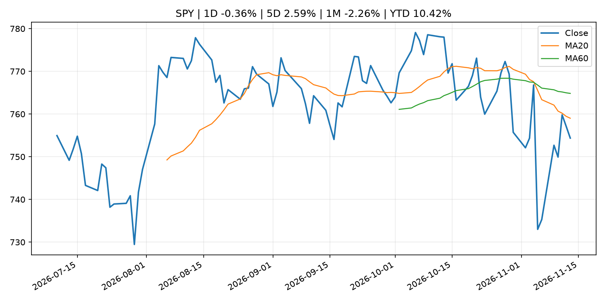
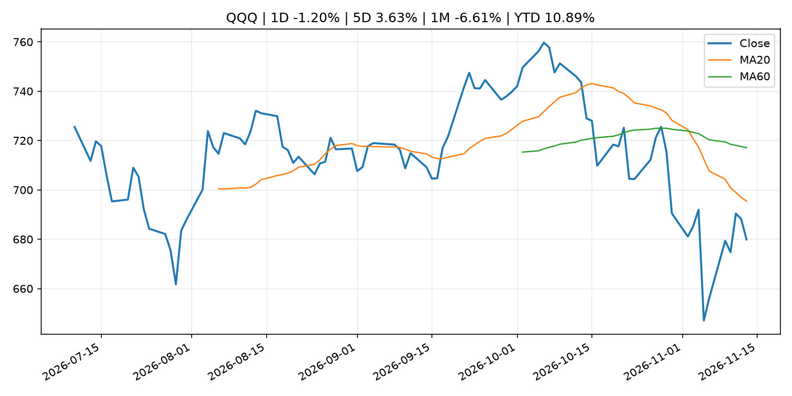
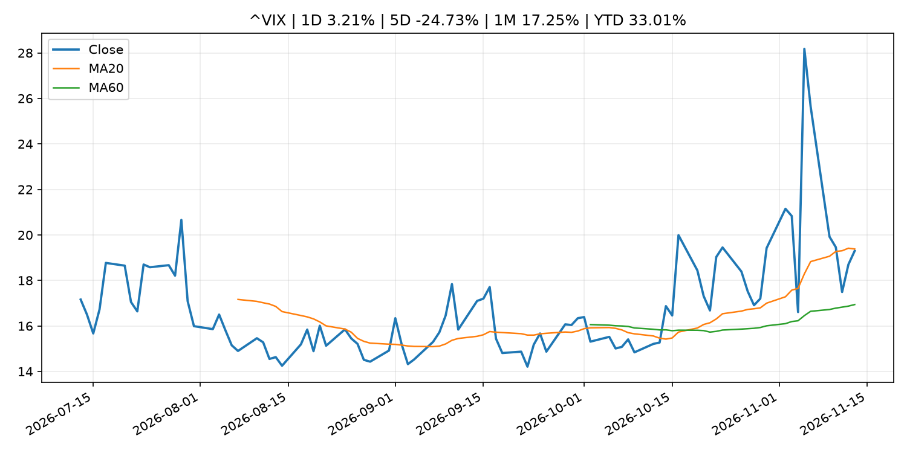
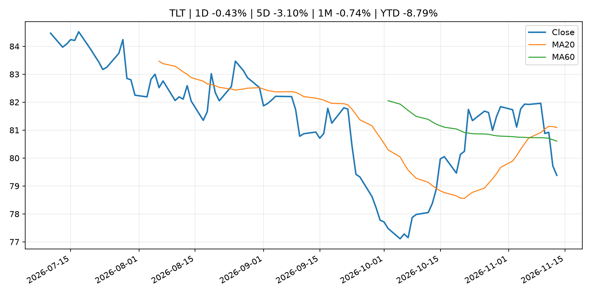
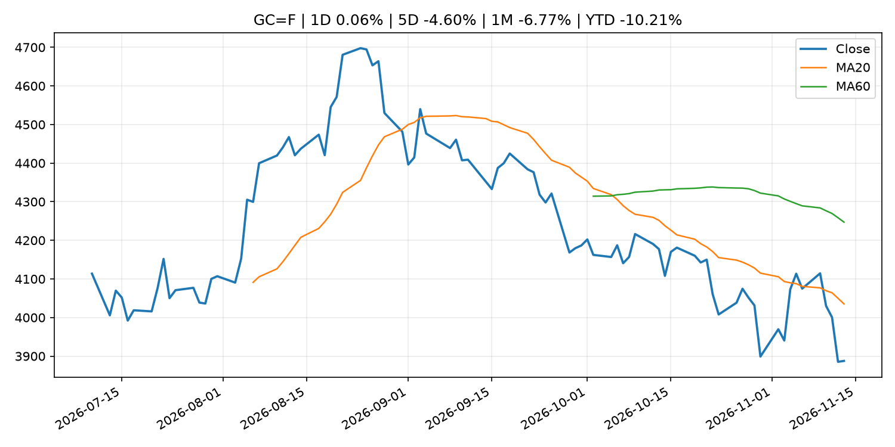
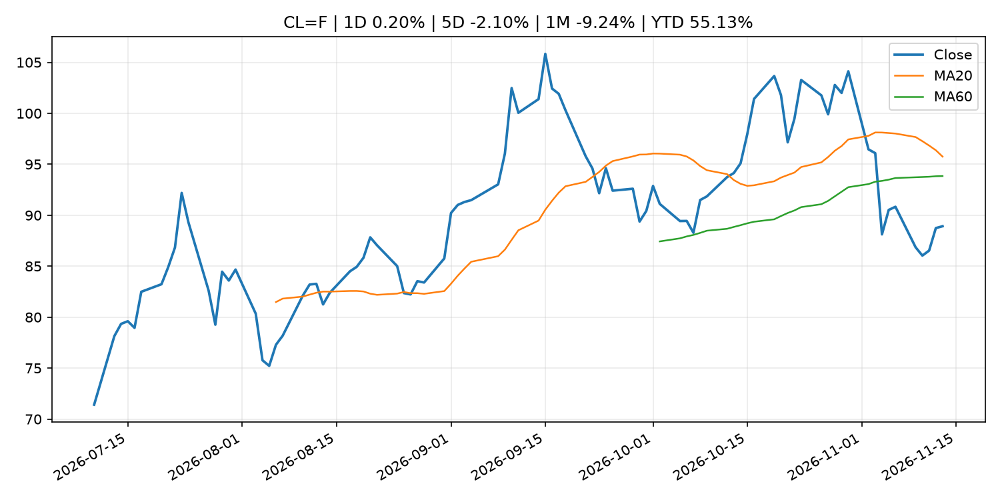
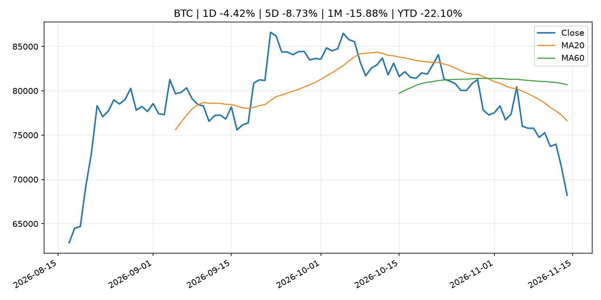
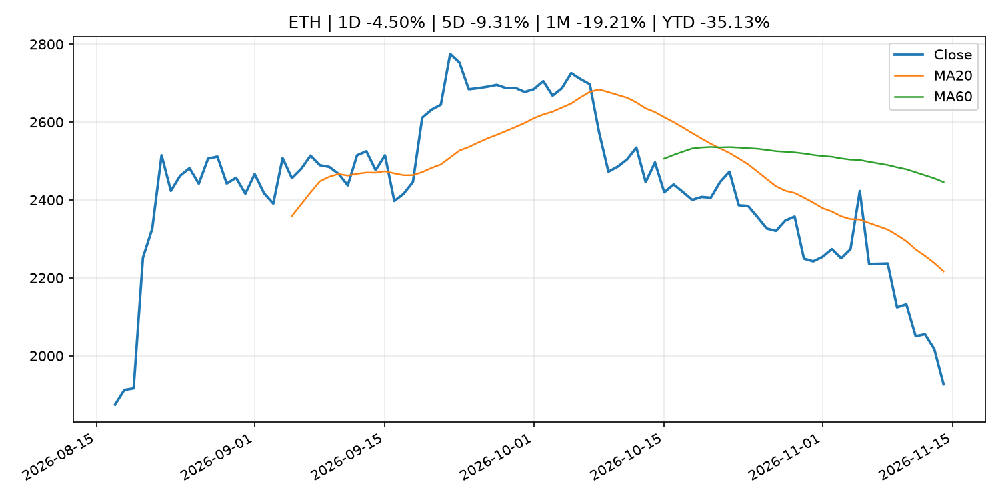
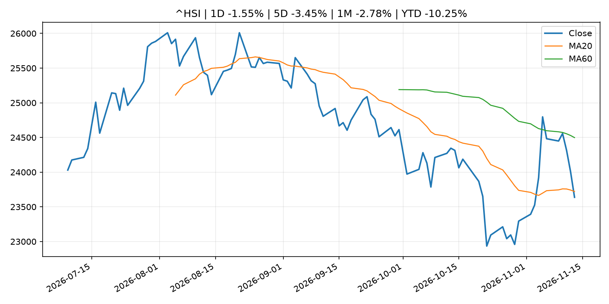

# Global Macro Morning Briefing - 2026-11-14

> Not financial advice / 非投资建议。

## 0. 今日总览
- 市场状态：mixed。市场信号不足，暂不判断明确状态。 但存在信号冲突，需要降低单一叙事置信度。
- 今日三大主线：
  1. geopolitical_risk: FAA declares rare nationwide ground stop on flights, with more than 10,000 delayed or canceled
  2. earnings: Lutnick faces questions over Nvidia spy scandal. His sons' firm has deep ties to the chipmaker
  3. earnings: Nvidia’s stock is on a losing streak not seen in 14 years. What comes next?
- 一句话结论：今日晨报重点关注：地缘风险可能推升避险需求、能源价格和市场波动率。；大型科技股盈利和资本开支会影响纳指、半导体和 AI 交易主线。。跨资产方面，SPY 1D -0.36%；QQQ 1D -1.20%；^VIX 1D 3.21%；TLT 1D -0.43%；GC=F 1D 0.06%；CL=F 1D 0.20%；BTC 1D -4.42%；ETH 1D -4.50%；市场信号不足，暂不判断明确状态。 但存在信号冲突，需要降低单一叙事置信度。政策、通胀、利率、美元、美债、能源和加密监管仍是主要观察线索。所有结论仅基于公开数据与短摘要整理，不构成投资建议。

## 1. 隔夜跨资产市场
- 美股：SPY 1D -0.36%，QQQ 1D -1.20%，整体趋势需结合 VIX 和利率确认。
- 美债/美元：TLT 1D -0.43%，美元指数 1D 0.23%，是判断折现率压力的核心线索。
- 黄金/原油：黄金 1D 0.06%，原油 1D 0.20%，用于观察避险、通胀和地缘风险。
- 加密：BTC 1D -4.42%，ETH 1D -4.50%，关注是否独立于纳指走出加密自身行情。
- 港股/A股：恒生 1D -1.55%，沪深300/上证 1D n/a，重点看中国政策预期与人民币线索。
- 风险观察：关注后续数据是否确认当前跨资产信号。

### US_EQUITY

| symbol | latest close | 1D | 5D | 1M | YTD | trend |
|---|---:|---:|---:|---:|---:|---|
| SPY | 754.37 | -0.36% | 2.59% | -2.26% | 10.42% | downtrend |
| QQQ | 679.89 | -1.20% | 3.63% | -6.61% | 10.89% | strong_downtrend |
| DIA | 523.15 | 0.13% | 2.13% | 0.38% | 8.17% | uptrend |
| IWM | 277.54 | -0.32% | 1.41% | 0.89% | 11.56% | downtrend |
| VTI | 371.11 | -0.41% | 2.54% | -1.93% | 10.35% | downtrend |

### US_MACRO_MARKET

| symbol | latest close | 1D | 5D | 1M | YTD | trend |
|---|---:|---:|---:|---:|---:|---|
| ^VIX | 19.30 | 3.21% | -24.73% | 17.25% | 33.01% | range_bound |
| DX-Y.NYB | 103.41 | 0.23% | 1.09% | 1.38% | 5.07% | uptrend |
| TLT | 79.38 | -0.43% | -3.10% | -0.74% | -8.79% | range_bound |
| IEF | 90.04 | -0.19% | -1.98% | -0.34% | -6.29% | range_bound |

### COMMODITIES

| symbol | latest close | 1D | 5D | 1M | YTD | trend |
|---|---:|---:|---:|---:|---:|---|
| GC=F | 3,887.60 | 0.06% | -4.60% | -6.77% | -10.21% | strong_downtrend |
| SI=F | 48.65 | -2.65% | -6.09% | -14.40% | -31.05% | strong_downtrend |
| CL=F | 88.92 | 0.20% | -2.10% | -9.24% | 55.13% | range_bound |
| BZ=F | 96.08 | 0.27% | -2.28% | -9.29% | 58.16% | range_bound |
| NG=F | 3.24 | -2.93% | 8.14% | 0.19% | -10.39% | range_bound |
| HG=F | 6.06 | -1.92% | -2.48% | -6.88% | 7.51% | strong_downtrend |

### HK_MARKET

| symbol | latest close | 1D | 5D | 1M | YTD | trend |
|---|---:|---:|---:|---:|---:|---|
| ^HSI | 23,637.60 | -1.55% | -3.45% | -2.78% | -10.25% | downtrend |
| 0700.HK | 386.60 | -3.06% | -7.91% | -8.69% | -37.95% | downtrend |
| 9988.HK | 90.55 | -3.46% | -13.68% | -18.05% | -39.23% | strong_downtrend |
| 3690.HK | 69.80 | -3.19% | -13.18% | -9.47% | -33.27% | strong_downtrend |
| 1810.HK | 28.86 | -3.74% | -5.00% | 9.40% | -28.35% | strong_uptrend |
| 1211.HK | 65.00 | -3.77% | -12.34% | -10.78% | -34.18% | strong_downtrend |

### CRYPTO

| symbol | latest close | 1D | 5D | 1M | YTD | trend |
|---|---:|---:|---:|---:|---:|---|
| BTC | 68,219.26 | -4.42% | -8.73% | -15.88% | -22.10% | strong_downtrend |
| ETH | 1,926.58 | -4.50% | -9.31% | -19.21% | -35.13% | strong_downtrend |
| SOLANA | 77.05 | -5.62% | -10.83% | -25.00% | -38.12% | strong_downtrend |
| BINANCECOIN | 630.28 | -3.96% | -7.84% | -14.68% | -26.94% | strong_downtrend |
| RIPPLE | 1.00 | -3.40% | -9.68% | -22.34% | -45.41% | strong_downtrend |

## 2. 今日最重要的 10 条新闻
### 1. FAA declares rare nationwide ground stop on flights, with more than 10,000 delayed or canceled
- 来源：MarketWatch Top Stories
- 时间：2026-11-14T01:28:00+00:00
- 地区：US
- 事件类型：geopolitical_risk
- 重要性层级：Tier 1
- 一句话摘要：Agency cites “extraordinary circumstances,” while  Homeland Security Secretary Mullin says no indication of attack. Reduced flights amid fuel-cost surge may curtail rebooking options.
- 为什么重要：地缘风险可能推升避险需求、能源价格和市场波动率。
- 可能影响：可能影响利率、汇率、风险资产或大宗商品预期，但当前公开信息不足以判断明确方向。
  - 资产：暂无明确资产映射
  - 方向：unknown
  - 强度：low
  - 原因：公开信息不足以判断方向。
- 原文链接：[https://www.marketwatch.com/story/faa-declares-rare-widespread-ground-outage-bdc46393?mod=mw_rss_topstories](https://www.marketwatch.com/story/faa-declares-rare-widespread-ground-outage-bdc46393?mod=mw_rss_topstories)

### 2. Lutnick faces questions over Nvidia spy scandal. His sons' firm has deep ties to the chipmaker
- 来源：CNBC Economy
- 时间：2026-11-13T23:42:18+00:00
- 地区：US
- 事件类型：earnings
- 重要性层级：Tier 2
- 一句话摘要：Jensen Huang’s resignation as Nvidia CEO has brought renewed scrutiny to Commerce Secretary Howard Lutnick and his family's financial ties to the chipmaker.
- 为什么重要：大型科技股盈利和资本开支会影响纳指、半导体和 AI 交易主线。
- 可能影响：主要影响 QQQ，方向为 mixed，强度 high；AI 资本开支会影响大型科技股盈利和估值预期。
  - 资产：QQQ
    方向：mixed
    强度：high
    原因：AI 资本开支会影响大型科技股盈利和估值预期。
  - 资产：SMH
    方向：mixed
    强度：high
    原因：AI 投资周期直接影响半导体需求。
  - 资产：NVDA
    方向：mixed
    强度：high
    原因：AI 训练和推理需求是英伟达收入预期核心变量。
  - 资产：MSFT
    方向：mixed
    强度：medium
    原因：云和 AI 资本开支影响利润率与增长叙事。
  - 资产：GOOGL
    方向：mixed
    强度：medium
    原因：AI 投资和搜索商业化影响估值。
  - 资产：META
    方向：mixed
    强度：medium
    原因：AI 基建支出与广告效率共同影响市场预期。
- 原文链接：[https://www.cnbc.com/2026/11/13/howard-lutnick-nvidia-jensen-huang-china-cantor-fitzgerald.html](https://www.cnbc.com/2026/11/13/howard-lutnick-nvidia-jensen-huang-china-cantor-fitzgerald.html)

### 3. Nvidia’s stock is on a losing streak not seen in 14 years. What comes next?
- 来源：MarketWatch Top Stories
- 时间：2026-11-13T22:21:00+00:00
- 地区：US
- 事件类型：earnings
- 重要性层级：Tier 2
- 一句话摘要：Nvidia wiped out $573 billion in market capitalization this week — its sixth consecutive week of stock declines.
- 为什么重要：大型科技股盈利和资本开支会影响纳指、半导体和 AI 交易主线。
- 可能影响：主要影响 QQQ，方向为 mixed，强度 high；AI 资本开支会影响大型科技股盈利和估值预期。
  - 资产：QQQ
    方向：mixed
    强度：high
    原因：AI 资本开支会影响大型科技股盈利和估值预期。
  - 资产：SMH
    方向：mixed
    强度：high
    原因：AI 投资周期直接影响半导体需求。
  - 资产：NVDA
    方向：mixed
    强度：high
    原因：AI 训练和推理需求是英伟达收入预期核心变量。
  - 资产：MSFT
    方向：mixed
    强度：medium
    原因：云和 AI 资本开支影响利润率与增长叙事。
  - 资产：GOOGL
    方向：mixed
    强度：medium
    原因：AI 投资和搜索商业化影响估值。
  - 资产：META
    方向：mixed
    强度：medium
    原因：AI 基建支出与广告效率共同影响市场预期。
- 原文链接：[https://www.marketwatch.com/story/nvidias-stock-is-on-a-losing-streak-not-seen-in-14-years-what-comes-next-a07e801e?mod=mw_rss_topstories](https://www.marketwatch.com/story/nvidias-stock-is-on-a-losing-streak-not-seen-in-14-years-what-comes-next-a07e801e?mod=mw_rss_topstories)

### 4. AMD and other chip stocks slide as Wall Street rethinks the AI trade without Jensen Huang
- 来源：MarketWatch Top Stories
- 时间：2026-11-13T21:10:00+00:00
- 地区：US
- 事件类型：earnings
- 重要性层级：Tier 2
- 一句话摘要：At first, it looked like Nvidia’s pain might be the rest of the chip sector’s gain. But now, investors aren’t so sure.
- 为什么重要：大型科技股盈利和资本开支会影响纳指、半导体和 AI 交易主线。
- 可能影响：主要影响 QQQ，方向为 mixed，强度 high；AI 资本开支会影响大型科技股盈利和估值预期。
  - 资产：QQQ
    方向：mixed
    强度：high
    原因：AI 资本开支会影响大型科技股盈利和估值预期。
  - 资产：SMH
    方向：mixed
    强度：high
    原因：AI 投资周期直接影响半导体需求。
  - 资产：NVDA
    方向：mixed
    强度：high
    原因：AI 训练和推理需求是英伟达收入预期核心变量。
  - 资产：MSFT
    方向：mixed
    强度：medium
    原因：云和 AI 资本开支影响利润率与增长叙事。
  - 资产：GOOGL
    方向：mixed
    强度：medium
    原因：AI 投资和搜索商业化影响估值。
  - 资产：META
    方向：mixed
    强度：medium
    原因：AI 基建支出与广告效率共同影响市场预期。
- 原文链接：[https://www.marketwatch.com/story/amd-and-other-chip-stocks-slide-as-wall-street-rethinks-the-ai-trade-without-jensen-huang-2fb74547?mod=mw_rss_topstories](https://www.marketwatch.com/story/amd-and-other-chip-stocks-slide-as-wall-street-rethinks-the-ai-trade-without-jensen-huang-2fb74547?mod=mw_rss_topstories)

### 5. SEC Proposes Executive and Director Compensation Disclosure Reforms
- 来源：SEC Press Releases
- 时间：2026-11-13T11:57:00-05:00
- 地区：US
- 事件类型：regulation
- 重要性层级：Tier 2
- 一句话摘要：The Securities and Exchange Commission today proposed rule amendments to make its executive and director compensation disclosure requirements more principles-based and materiality-driven, providing investors with clearer, more concise, and less complex…
- 为什么重要：监管变化会改变行业盈利预期和资产风险溢价。
- 可能影响：主要影响 BTC，方向为 mixed，强度 high；加密监管或 ETF 进展会改变 BTC 的资金流和风险溢价。
  - 资产：BTC
    方向：mixed
    强度：high
    原因：加密监管或 ETF 进展会改变 BTC 的资金流和风险溢价。
  - 资产：ETH
    方向：mixed
    强度：high
    原因：监管框架会影响 ETH 产品化和机构参与度。
  - 资产：COIN
    方向：mixed
    强度：medium
    原因：监管清晰度和执法风险会影响交易平台估值。
  - 资产：crypto market
    方向：mixed
    强度：high
    原因：信息影响整个加密市场结构，但方向取决于细节。
- 原文链接：[https://www.sec.gov/newsroom/press-releases/2026-114-sec-proposes-executive-director-compensation-disclosure-reforms](https://www.sec.gov/newsroom/press-releases/2026-114-sec-proposes-executive-director-compensation-disclosure-reforms)

### 6. China's Ministry of State Security thrust into the spotlight by Nvidia CEO affair
- 来源：CNBC Economy
- 时间：2026-11-12T07:28:48+00:00
- 地区：US
- 事件类型：earnings
- 重要性层级：Tier 2
- 一句话摘要：China's Ministry of State Security is getting attention after news of Nvidia CEO Jensen Huang's affair with an alleged MSS spy.
- 为什么重要：大型科技股盈利和资本开支会影响纳指、半导体和 AI 交易主线。
- 可能影响：主要影响 QQQ，方向为 mixed，强度 high；AI 资本开支会影响大型科技股盈利和估值预期。
  - 资产：QQQ
    方向：mixed
    强度：high
    原因：AI 资本开支会影响大型科技股盈利和估值预期。
  - 资产：SMH
    方向：mixed
    强度：high
    原因：AI 投资周期直接影响半导体需求。
  - 资产：NVDA
    方向：mixed
    强度：high
    原因：AI 训练和推理需求是英伟达收入预期核心变量。
  - 资产：MSFT
    方向：mixed
    强度：medium
    原因：云和 AI 资本开支影响利润率与增长叙事。
  - 资产：GOOGL
    方向：mixed
    强度：medium
    原因：AI 投资和搜索商业化影响估值。
  - 资产：META
    方向：mixed
    强度：medium
    原因：AI 基建支出与广告效率共同影响市场预期。
- 原文链接：[https://www.cnbc.com/2026/11/12/china-ministry-state-security-nvidia-ceo.html](https://www.cnbc.com/2026/11/12/china-ministry-state-security-nvidia-ceo.html)

### 7. U.S. Senate Banking Committee races toward hearing on new SEC nominations
- 来源：CoinDesk
- 时间：2026-11-13T17:05:43+00:00
- 地区：global
- 事件类型：regulation
- 重要性层级：Tier 2
- 一句话摘要：U.S. Senate Banking Committee races toward hearing on new SEC nominations
- 为什么重要：监管变化会改变行业盈利预期和资产风险溢价。
- 可能影响：主要影响 BTC，方向为 mixed，强度 high；加密监管或 ETF 进展会改变 BTC 的资金流和风险溢价。
  - 资产：BTC
    方向：mixed
    强度：high
    原因：加密监管或 ETF 进展会改变 BTC 的资金流和风险溢价。
  - 资产：ETH
    方向：mixed
    强度：high
    原因：监管框架会影响 ETH 产品化和机构参与度。
  - 资产：COIN
    方向：mixed
    强度：medium
    原因：监管清晰度和执法风险会影响交易平台估值。
  - 资产：crypto market
    方向：mixed
    强度：high
    原因：信息影响整个加密市场结构，但方向取决于细节。
- 原文链接：[https://www.coindesk.com/policy/2026/11/13/u-s-senate-banking-committee-races-toward-hearing-on-new-sec-nominations](https://www.coindesk.com/policy/2026/11/13/u-s-senate-banking-committee-races-toward-hearing-on-new-sec-nominations)

### 8. U.S. President Trump names CFTC, SEC nominees for first time in a year
- 来源：CoinDesk
- 时间：2026-11-12T22:47:41+00:00
- 地区：global
- 事件类型：central_bank_speech
- 重要性层级：Tier 2
- 一句话摘要：U.S. President Trump names CFTC, SEC nominees for first time in a year
- 为什么重要：央行官员表态可能影响市场对下一次会议的定价。
- 可能影响：主要影响 BTC，方向为 mixed，强度 high；加密监管或 ETF 进展会改变 BTC 的资金流和风险溢价。
  - 资产：BTC
    方向：mixed
    强度：high
    原因：加密监管或 ETF 进展会改变 BTC 的资金流和风险溢价。
  - 资产：ETH
    方向：mixed
    强度：high
    原因：监管框架会影响 ETH 产品化和机构参与度。
  - 资产：COIN
    方向：mixed
    强度：medium
    原因：监管清晰度和执法风险会影响交易平台估值。
  - 资产：crypto market
    方向：mixed
    强度：high
    原因：信息影响整个加密市场结构，但方向取决于细节。
- 原文链接：[https://www.coindesk.com/policy/2026/11/12/u-s-president-names-cftc-sec-nominees-for-first-time-in-a-year](https://www.coindesk.com/policy/2026/11/12/u-s-president-names-cftc-sec-nominees-for-first-time-in-a-year)

### 9. UK bank Griffin raises $20 million to expand into stablecoin payments
- 来源：CoinDesk
- 时间：2026-11-12T12:04:42+00:00
- 地区：global
- 事件类型：crypto_market_structure
- 重要性层级：Tier 2
- 一句话摘要：UK bank Griffin raises $20 million to expand into stablecoin payments
- 为什么重要：加密市场结构和监管变化会影响 BTC、ETH 及相关股票的风险溢价。
- 可能影响：主要影响 BTC，方向为 mixed，强度 high；加密监管或 ETF 进展会改变 BTC 的资金流和风险溢价。
  - 资产：BTC
    方向：mixed
    强度：high
    原因：加密监管或 ETF 进展会改变 BTC 的资金流和风险溢价。
  - 资产：ETH
    方向：mixed
    强度：high
    原因：监管框架会影响 ETH 产品化和机构参与度。
  - 资产：COIN
    方向：mixed
    强度：medium
    原因：监管清晰度和执法风险会影响交易平台估值。
  - 资产：crypto market
    方向：mixed
    强度：high
    原因：信息影响整个加密市场结构，但方向取决于细节。
- 原文链接：[https://www.coindesk.com/business/2026/11/12/uk-bank-griffin-raises-usd20-million-to-expand-into-stablecoin-payments](https://www.coindesk.com/business/2026/11/12/uk-bank-griffin-raises-usd20-million-to-expand-into-stablecoin-payments)

### 10. Agencies extend comment period for proposed third-party risk management guidance
- 来源：Federal Reserve Press Releases
- 时间：2026-11-13T21:15:00+00:00
- 地区：US
- 事件类型：earnings
- 重要性层级：Tier 2
- 一句话摘要：Agencies extend comment period for proposed third-party risk management guidance
- 为什么重要：大型科技股盈利和资本开支会影响纳指、半导体和 AI 交易主线。
- 可能影响：可能影响利率、汇率、风险资产或大宗商品预期，但当前公开信息不足以判断明确方向。
  - 资产：暂无明确资产映射
  - 方向：unknown
  - 强度：low
  - 原因：公开信息不足以判断方向。
- 原文链接：[https://www.federalreserve.gov/newsevents/pressreleases/bcreg20261113a.htm](https://www.federalreserve.gov/newsevents/pressreleases/bcreg20261113a.htm)

## 3. 政策与央行观察
### 1. SEC Proposes Executive and Director Compensation Disclosure Reforms
- 来源：SEC Press Releases
- 时间：2026-11-13T11:57:00-05:00
- 地区：US
- 事件类型：regulation
- 重要性层级：Tier 2
- 一句话摘要：The Securities and Exchange Commission today proposed rule amendments to make its executive and director compensation disclosure requirements more principles-based and materiality-driven, providing investors with clearer, more concise, and less complex…
- 为什么重要：监管变化会改变行业盈利预期和资产风险溢价。
- 可能影响：主要影响 BTC，方向为 mixed，强度 high；加密监管或 ETF 进展会改变 BTC 的资金流和风险溢价。
  - 资产：BTC
    方向：mixed
    强度：high
    原因：加密监管或 ETF 进展会改变 BTC 的资金流和风险溢价。
  - 资产：ETH
    方向：mixed
    强度：high
    原因：监管框架会影响 ETH 产品化和机构参与度。
  - 资产：COIN
    方向：mixed
    强度：medium
    原因：监管清晰度和执法风险会影响交易平台估值。
  - 资产：crypto market
    方向：mixed
    强度：high
    原因：信息影响整个加密市场结构，但方向取决于细节。
- 原文链接：[https://www.sec.gov/newsroom/press-releases/2026-114-sec-proposes-executive-director-compensation-disclosure-reforms](https://www.sec.gov/newsroom/press-releases/2026-114-sec-proposes-executive-director-compensation-disclosure-reforms)

### 2. U.S. Senate Banking Committee races toward hearing on new SEC nominations
- 来源：CoinDesk
- 时间：2026-11-13T17:05:43+00:00
- 地区：global
- 事件类型：regulation
- 重要性层级：Tier 2
- 一句话摘要：U.S. Senate Banking Committee races toward hearing on new SEC nominations
- 为什么重要：监管变化会改变行业盈利预期和资产风险溢价。
- 可能影响：主要影响 BTC，方向为 mixed，强度 high；加密监管或 ETF 进展会改变 BTC 的资金流和风险溢价。
  - 资产：BTC
    方向：mixed
    强度：high
    原因：加密监管或 ETF 进展会改变 BTC 的资金流和风险溢价。
  - 资产：ETH
    方向：mixed
    强度：high
    原因：监管框架会影响 ETH 产品化和机构参与度。
  - 资产：COIN
    方向：mixed
    强度：medium
    原因：监管清晰度和执法风险会影响交易平台估值。
  - 资产：crypto market
    方向：mixed
    强度：high
    原因：信息影响整个加密市场结构，但方向取决于细节。
- 原文链接：[https://www.coindesk.com/policy/2026/11/13/u-s-senate-banking-committee-races-toward-hearing-on-new-sec-nominations](https://www.coindesk.com/policy/2026/11/13/u-s-senate-banking-committee-races-toward-hearing-on-new-sec-nominations)

### 3. U.S. President Trump names CFTC, SEC nominees for first time in a year
- 来源：CoinDesk
- 时间：2026-11-12T22:47:41+00:00
- 地区：global
- 事件类型：central_bank_speech
- 重要性层级：Tier 2
- 一句话摘要：U.S. President Trump names CFTC, SEC nominees for first time in a year
- 为什么重要：央行官员表态可能影响市场对下一次会议的定价。
- 可能影响：主要影响 BTC，方向为 mixed，强度 high；加密监管或 ETF 进展会改变 BTC 的资金流和风险溢价。
  - 资产：BTC
    方向：mixed
    强度：high
    原因：加密监管或 ETF 进展会改变 BTC 的资金流和风险溢价。
  - 资产：ETH
    方向：mixed
    强度：high
    原因：监管框架会影响 ETH 产品化和机构参与度。
  - 资产：COIN
    方向：mixed
    强度：medium
    原因：监管清晰度和执法风险会影响交易平台估值。
  - 资产：crypto market
    方向：mixed
    强度：high
    原因：信息影响整个加密市场结构，但方向取决于细节。
- 原文链接：[https://www.coindesk.com/policy/2026/11/12/u-s-president-names-cftc-sec-nominees-for-first-time-in-a-year](https://www.coindesk.com/policy/2026/11/12/u-s-president-names-cftc-sec-nominees-for-first-time-in-a-year)

### 4. UK bank Griffin raises $20 million to expand into stablecoin payments
- 来源：CoinDesk
- 时间：2026-11-12T12:04:42+00:00
- 地区：global
- 事件类型：crypto_market_structure
- 重要性层级：Tier 2
- 一句话摘要：UK bank Griffin raises $20 million to expand into stablecoin payments
- 为什么重要：加密市场结构和监管变化会影响 BTC、ETH 及相关股票的风险溢价。
- 可能影响：主要影响 BTC，方向为 mixed，强度 high；加密监管或 ETF 进展会改变 BTC 的资金流和风险溢价。
  - 资产：BTC
    方向：mixed
    强度：high
    原因：加密监管或 ETF 进展会改变 BTC 的资金流和风险溢价。
  - 资产：ETH
    方向：mixed
    强度：high
    原因：监管框架会影响 ETH 产品化和机构参与度。
  - 资产：COIN
    方向：mixed
    强度：medium
    原因：监管清晰度和执法风险会影响交易平台估值。
  - 资产：crypto market
    方向：mixed
    强度：high
    原因：信息影响整个加密市场结构，但方向取决于细节。
- 原文链接：[https://www.coindesk.com/business/2026/11/12/uk-bank-griffin-raises-usd20-million-to-expand-into-stablecoin-payments](https://www.coindesk.com/business/2026/11/12/uk-bank-griffin-raises-usd20-million-to-expand-into-stablecoin-payments)

### 5. Federal Reserve Board issues enforcement action with former employee of United Community Bank
- 来源：Federal Reserve Press Releases
- 时间：2026-11-12T16:00:00+00:00
- 地区：US
- 事件类型：regulation
- 重要性层级：Tier 2
- 一句话摘要：Federal Reserve Board issues enforcement action with former employee of United Community Bank
- 为什么重要：监管变化会改变行业盈利预期和资产风险溢价。
- 可能影响：可能影响利率、汇率、风险资产或大宗商品预期，但当前公开信息不足以判断明确方向。
  - 资产：暂无明确资产映射
  - 方向：unknown
  - 强度：low
  - 原因：公开信息不足以判断方向。
- 原文链接：[https://www.federalreserve.gov/newsevents/pressreleases/enforcement20261112a.htm](https://www.federalreserve.gov/newsevents/pressreleases/enforcement20261112a.htm)

## 4. 市场异动与图表
- QQQ 下跌 -1.20%
- VIX 上涨 3.21%
- TLT 下跌 -0.43%
- BTC 下跌 -4.42%
- ETH 下跌 -4.50%

### 信号矛盾
- 股债同时承压，可能是利率或流动性冲击而非传统避险。

### SPY

### QQQ

### ^VIX

### TLT

### GC=F

### CL=F

### BTC

### ETH

### ^HSI

## 5. 华尔街与机构公开观点
- 暂无可靠公开观点。

## 6. 今日重点关注
- 经济数据：经济数据：暂无可靠公开日历数据；如配置经济日历源后可自动填充。
- 央行讲话：央行讲话：暂无可靠公开日历数据；重点跟踪 Fed、ECB、BoJ、PBOC 官网 RSS。
- 财报：财报：暂无可靠数据。
- 政策事件：政策事件：暂无可靠数据。
- 风险提醒：风险提醒：关注数据源失败项、突发地缘风险、利率和美元的二阶反应。

## 7. 英文金融表达与宏观概念
- **risk-off**：避险模式，资金偏向美元、国债、黄金等防御资产。 例句：A geopolitical shock can push markets into risk-off mode.
- **market structure**：市场结构，指交易、托管、清算、ETF、监管等制度安排。 例句：Crypto market structure rules can affect institutional participation.
- **AI capex**：AI 资本开支，指云厂商和科技公司投入 AI 基建的支出。 例句：AI capex guidance can move semiconductor stocks.
- **inflation expectations**：通胀预期，指家庭、企业或市场对未来通胀的预估。 例句：Inflation expectations can shape wage bargaining and bond yields.
- **real yield**：实际收益率，名义利率扣除通胀预期后的收益率。 例句：Gold often reacts more to real yields than nominal yields.
- **terminal rate**：终端利率，市场预期本轮加息周期的最高政策利率。 例句：A higher terminal rate can pressure growth stocks.

## 8. 背景材料
- [Bitcoin miners pay Paraguay $350 million a year, but AI is pushing them out](https://www.coindesk.com/tech/2026/11/13/bitcoin-miners-pay-paraguay-usd350-million-a-year-but-ai-is-pushing-them-out)（CoinDesk，other）：Bitcoin miners pay Paraguay $350 million a year, but AI is pushing them out
- [‘The thought of living to 100 terrifies me’: Is Social Security a giant Ponzi scheme?](https://www.marketwatch.com/story/the-thought-of-living-to-100-terrifies-me-is-social-security-a-giant-ponzi-scheme-84a64e7e?mod=mw_rss_topstories)（MarketWatch Top Stories，other）：There is already a demographic ‘run’ on Social Security.
- [Bitcoin is now below $69,000 and could fall even further if investors cash out to buy into the Anthropic IPO](https://www.marketwatch.com/story/bitcoin-could-fall-even-further-if-investors-cash-out-to-buy-into-the-anthropic-ipo-5a14f46a?mod=mw_rss_topstories)（MarketWatch Top Stories，other）：Investors may have to sell some of their existing bets in crypto to make room in their portfolio for what could be one of the most sought-after stock offerings in history.
- [Bitcoin plunges to $68,000 as Anthropic IPO frenzy adds to market jitters](https://www.coindesk.com/markets/2026/11/13/bitcoin-slides-to-usd68k-as-nvidia-turmoil-anthropic-ipo-fuel-broader-market-sell-off)（CoinDesk，other）：Bitcoin plunges to $68,000 as Anthropic IPO frenzy adds to market jitters
- [Bitcoin heads for sixth weekly loss as Anthropic’s blockbuster IPO looms](https://www.coindesk.com/markets/2026/11/13/bitcoin-heads-for-sixth-weekly-loss-as-anthropic-s-blockbuster-ipo-looms)（CoinDesk，other）：Bitcoin heads for sixth weekly loss as Anthropic’s blockbuster IPO looms
- [Chicago Fed's Goolsbee says central bank 'has definitely got work to do' on inflation](https://www.cnbc.com/2026/11/13/chicago-feds-goolsbee-says-central-bank-has-definitely-got-work-to-do-on-inflation.html)（CNBC Economy，other）：The policymaker expressed concern about the latest inflation data, telling CNBC that the central bank likely will need to take action.
- [Bitcoin's momentum gauge is turning red, could send prices back below $60,000](https://www.coindesk.com/daybook-us/2026/11/13/bitcoin-s-momentum-gauge-is-turning-red-could-send-prices-back-below-usd60-000)（CoinDesk，other）：Bitcoin's momentum gauge is turning red, could send prices back below $60,000
- [Bitcoin hits 12-week low as dollar rallies on interest-rate outlook, liquidations top $1.6 billion](https://www.coindesk.com/markets/2026/11/13/bitcoin-hits-12-week-low-as-dollar-rallies-on-interest-rate-outlook-liquidations-top-usd1-6-billion)（CoinDesk，other）：Bitcoin hits 12-week low as dollar rallies on interest-rate outlook, liquidations top $1.6 billion
- [Live updates: Bitcoin eyes bear market lows as late summer rally mostly wiped out](https://www.coindesk.com/tech/2026/11/13/live-news-bitcoin-drops-below-200-week-moving-average-as-dollar-strength-pressures-risk-assets)（CoinDesk，other）：Live updates: Bitcoin eyes bear market lows as late summer rally mostly wiped out
- [Isabel Schnabel: Made in Europe](https://www.ecb.europa.eu//press/key/date/2026/html/ecb.sp261113~3883f1f187.en.html)（ECB Press Releases，other）：Isabel Schnabel: Made in Europe
- [Ethereum treasury firm BTCS sold ether at a loss to keep $64 million Aave loan healthy](https://www.coindesk.com/markets/2026/11/13/ethereum-treasury-firm-btcs-sold-ether-at-a-loss-to-keep-usd64-million-aave-loan-healthy)（CoinDesk，other）：Ethereum treasury firm BTCS sold ether at a loss to keep $64 million Aave loan healthy
- [Bitcoin firm Nakamoto owes Kraken $165 million, more than its entire market value](https://www.coindesk.com/markets/2026/11/13/bitcoin-firm-nakamoto-owes-kraken-usd165-million-more-than-its-entire-market-value)（CoinDesk，other）：Bitcoin firm Nakamoto owes Kraken $165 million, more than its entire market value
- [Bitcoin ETFs are now down over $1.5 billion in net outflows for the year](https://www.coindesk.com/markets/2026/11/13/bitcoin-etfs-are-now-down-over-usd1-5-billion-in-net-outflows-for-the-year)（CoinDesk，other）：Bitcoin ETFs are now down over $1.5 billion in net outflows for the year
- [SpaceX-Tesla merger talks put 30,000 bitcoin back in focus](https://www.coindesk.com/markets/2026/11/13/spacex-tesla-merger-talks-put-30-000-bitcoin-back-in-focus)（CoinDesk，other）：SpaceX-Tesla merger talks put 30,000 bitcoin back in focus
- [Bitcoin dips below $70,000 as Dollar Index hits 19-month high](https://www.coindesk.com/markets/2026/11/13/bitcoin-dips-below-usd70-000-as-selloff-gathers-pace)（CoinDesk，other）：Bitcoin dips below $70,000 as Dollar Index hits 19-month high
- [Federal Reserve Board announces pricing, effective January 1, 2027, for payment services the Federal Reserve Banks provide to banks and credit unions, and changes to streamline and adjust their check services](https://www.federalreserve.gov/newsevents/pressreleases/other20261112a.htm)（Federal Reserve Press Releases，other）：Federal Reserve Board announces pricing, effective January 1, 2027, for payment services the Federal Reserve Banks provide to banks and credit unions, and changes to streamline and adjust their check services
- [Federal Reserve announces revised tentative schedule of Federal Open Market Committee meetings in 2027](https://www.federalreserve.gov/newsevents/pressreleases/monetary20261112a.htm)（Federal Reserve Press Releases，other）：Federal Reserve announces revised tentative schedule of Federal Open Market Committee meetings in 2027
- [Bitcoin weakness erases September's bullish signal](https://www.coindesk.com/daybook-us/2026/11/12/bitcoin-weakness-erases-september-s-bullish-signal)（CoinDesk，other）：Bitcoin weakness erases September's bullish signal
- [Japanese Government Bonds Held by the Bank of Japan](http://www.boj.or.jp/en/statistics/boj/other/mei/release/2026/mei261110.xlsx)（Bank of Japan Announcements，other）：Japanese Government Bonds Held by the Bank of Japan
- [Basic Figures on Fails (Oct.)](http://www.boj.or.jp/en/statistics/set/bffail/sjgb2610.pdf)（Bank of Japan Announcements，other）：Basic Figures on Fails (Oct.)

## 9. 数据源、失败项与免责声明
- 采集时间：2026-11-14T02:00:15
- 数据源：公开 RSS、Yahoo Finance、CoinGecko、AKShare、FRED、SEC data.sec.gov，以及用户自有 inputs/reports 文件。
- 合规说明：不绕过 WSJ、Bloomberg、FT、Reuters 等付费墙；对付费媒体只使用公开 RSS 标题、摘要、链接和发布时间。
- 免责声明：Not financial advice / 非投资建议。本项目仅供个人学习、研究和信息整理，不构成投资建议、交易建议或任何收益承诺。
- 失败或跳过的数据源：
  - crypto data failed coin=dogecoin
  - China market data failed symbol=上证指数: empty dataframe
  - China market data failed symbol=深证成指: empty dataframe
  - China market data failed symbol=创业板指: empty dataframe
  - China market data failed symbol=沪深300: empty dataframe
  - China market data failed symbol=中证500: empty dataframe
  - China market data failed symbol=科创50: empty dataframe
  - FRED_API_KEY not set; skipping FRED macro series
  - SEC failed cik=0000320193
  - SEC failed cik=0000789019
  - SEC failed cik=0001045810
  - SEC failed cik=0001318605
  - SEC failed cik=0001577552
