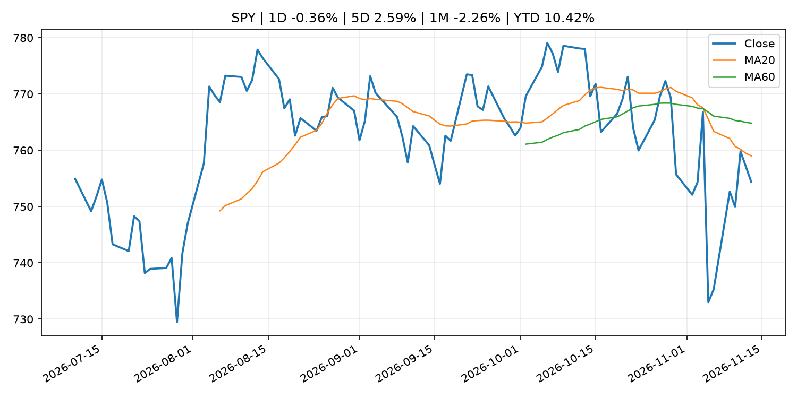
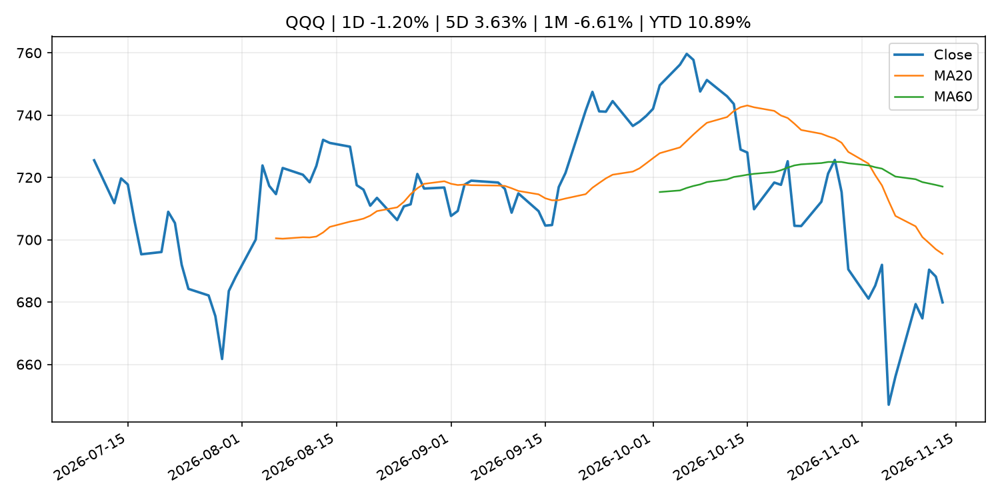
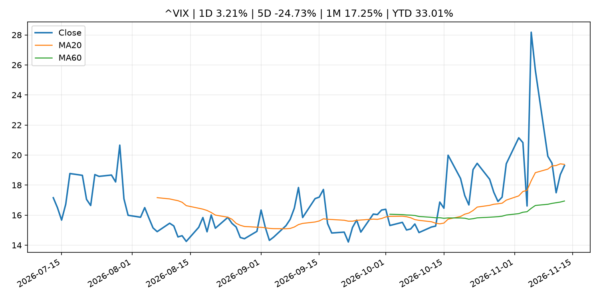
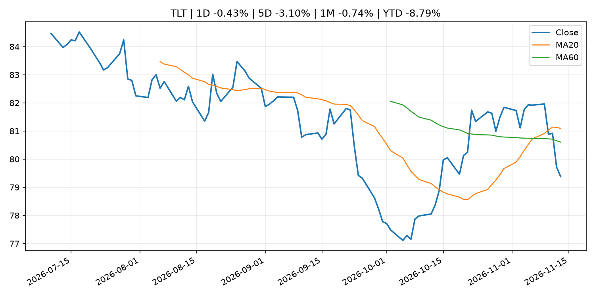
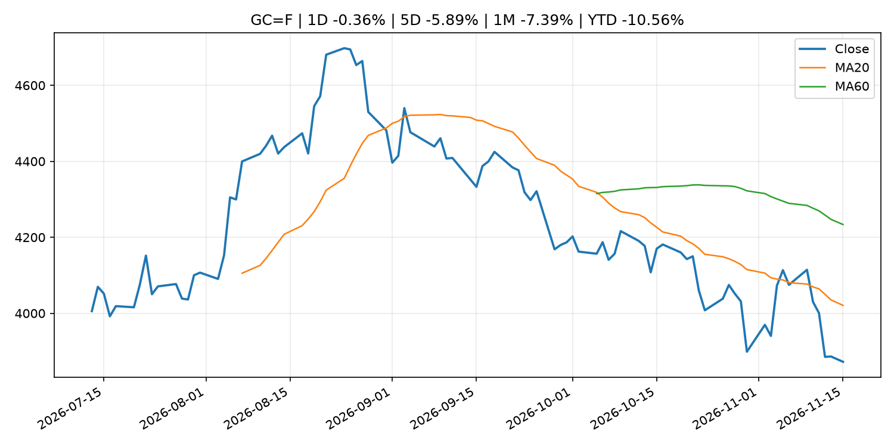
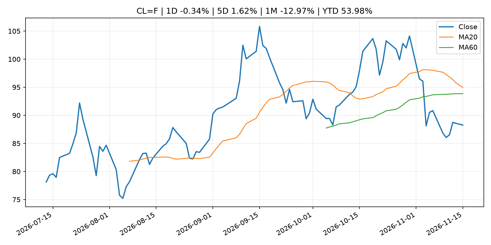
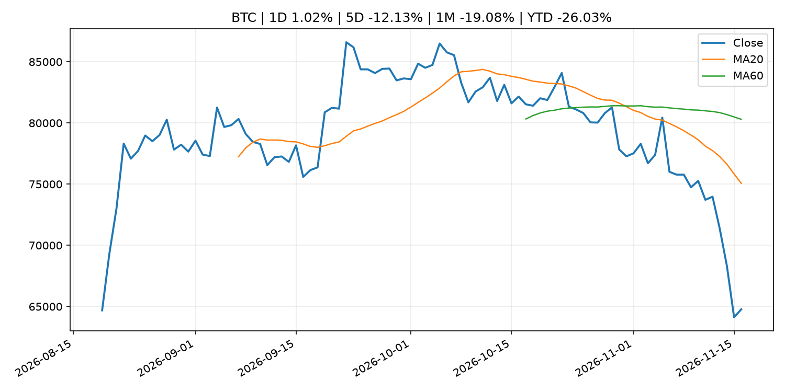
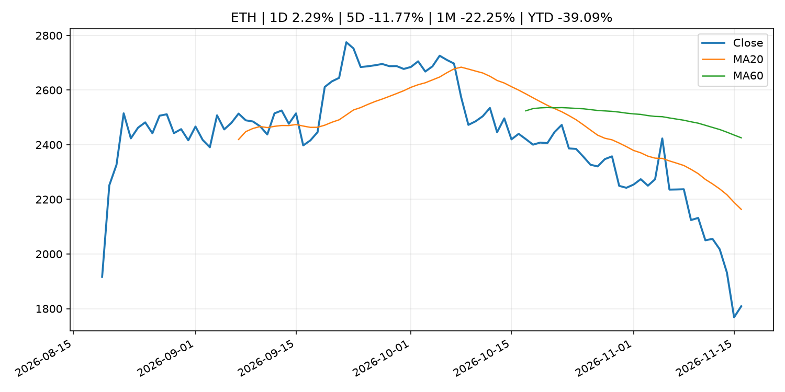
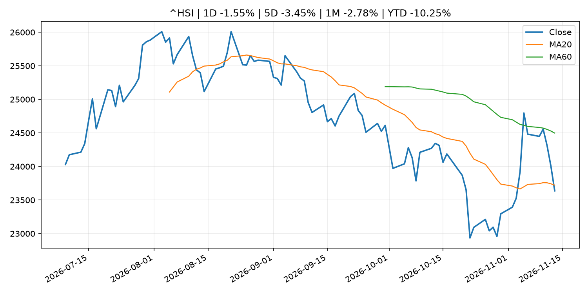

# Global Macro Morning Briefing - 2026-11-16

> Not financial advice / 非投资建议。

## 0. 今日总览
- 市场状态：mixed。市场信号不足，暂不判断明确状态。 但存在信号冲突，需要降低单一叙事置信度。
- 今日三大主线：
  1. earnings: Nvidia is gearing up for one of Wall Street’s most anticipated earnings calls in years
  2. earnings: Lutnick faces questions over Nvidia spy scandal. His sons' firm has ties to the chipmaker
  3. earnings: How Nvidia turmoil and a Democratic Congress could reshape the AI trade, according to ETF experts
- 一句话结论：今日晨报重点关注：大型科技股盈利和资本开支会影响纳指、半导体和 AI 交易主线。；大型科技股盈利和资本开支会影响纳指、半导体和 AI 交易主线。。跨资产方面，SPY 1D -0.36%；QQQ 1D -1.20%；^VIX 1D 3.21%；TLT 1D -0.43%；GC=F 1D -0.36%；CL=F 1D -0.34%；BTC 1D 1.02%；ETH 1D 2.29%；市场信号不足，暂不判断明确状态。 但存在信号冲突，需要降低单一叙事置信度。政策、通胀、利率、美元、美债、能源和加密监管仍是主要观察线索。所有结论仅基于公开数据与短摘要整理，不构成投资建议。

## 1. 隔夜跨资产市场
- 美股：SPY 1D -0.36%，QQQ 1D -1.20%，整体趋势需结合 VIX 和利率确认。
- 美债/美元：TLT 1D -0.43%，美元指数 1D 0.05%，是判断折现率压力的核心线索。
- 黄金/原油：黄金 1D -0.36%，原油 1D -0.34%，用于观察避险、通胀和地缘风险。
- 加密：BTC 1D 1.02%，ETH 1D 2.29%，关注是否独立于纳指走出加密自身行情。
- 港股/A股：恒生 1D -1.55%，沪深300/上证 1D n/a，重点看中国政策预期与人民币线索。
- 风险观察：关注后续数据是否确认当前跨资产信号。

### US_EQUITY

| symbol | latest close | 1D | 5D | 1M | YTD | trend |
|---|---:|---:|---:|---:|---:|---|
| SPY | 754.37 | -0.36% | 2.59% | -2.26% | 10.42% | downtrend |
| QQQ | 679.89 | -1.20% | 3.63% | -6.61% | 10.89% | strong_downtrend |
| DIA | 523.15 | 0.13% | 2.13% | 0.38% | 8.17% | uptrend |
| IWM | 277.54 | -0.32% | 1.41% | 0.89% | 11.56% | downtrend |
| VTI | 371.11 | -0.41% | 2.54% | -1.93% | 10.35% | downtrend |

### US_MACRO_MARKET

| symbol | latest close | 1D | 5D | 1M | YTD | trend |
|---|---:|---:|---:|---:|---:|---|
| ^VIX | 19.30 | 3.21% | -24.73% | 17.25% | 33.01% | range_bound |
| DX-Y.NYB | 103.46 | 0.05% | 1.78% | 1.59% | 5.12% | uptrend |
| TLT | 79.38 | -0.43% | -3.10% | -0.74% | -8.79% | range_bound |
| IEF | 90.04 | -0.19% | -1.98% | -0.34% | -6.29% | range_bound |

### COMMODITIES

| symbol | latest close | 1D | 5D | 1M | YTD | trend |
|---|---:|---:|---:|---:|---:|---|
| GC=F | 3,872.30 | -0.36% | -5.89% | -7.39% | -10.56% | strong_downtrend |
| SI=F | 47.80 | -2.51% | -9.06% | -16.13% | -32.25% | strong_downtrend |
| CL=F | 88.26 | -0.34% | 1.62% | -12.97% | 53.98% | range_bound |
| BZ=F | 95.34 | -0.52% | 2.99% | -13.22% | 56.94% | range_bound |
| NG=F | 3.15 | -2.35% | -1.99% | 1.22% | -12.82% | range_bound |
| HG=F | 6.04 | -0.63% | -4.54% | -7.50% | 7.11% | strong_downtrend |

### HK_MARKET

| symbol | latest close | 1D | 5D | 1M | YTD | trend |
|---|---:|---:|---:|---:|---:|---|
| ^HSI | 23,637.60 | -1.55% | -3.45% | -2.78% | -10.25% | downtrend |
| 0700.HK | 386.60 | -3.06% | -7.91% | -8.69% | -37.95% | downtrend |
| 9988.HK | 90.55 | -3.46% | -13.68% | -18.05% | -39.23% | strong_downtrend |
| 3690.HK | 69.80 | -3.19% | -13.18% | -9.47% | -33.27% | strong_downtrend |
| 1810.HK | 28.86 | -3.74% | -5.00% | 9.40% | -28.35% | strong_uptrend |
| 1211.HK | 65.00 | -3.77% | -12.34% | -10.78% | -34.18% | strong_downtrend |

### CRYPTO

| symbol | latest close | 1D | 5D | 1M | YTD | trend |
|---|---:|---:|---:|---:|---:|---|
| BTC | 64,776.28 | 1.02% | -12.13% | -19.08% | -26.03% | strong_downtrend |
| ETH | 1,809.00 | 2.29% | -11.77% | -22.25% | -39.09% | strong_downtrend |
| SOLANA | 71.29 | 1.49% | -14.39% | -29.58% | -42.75% | strong_downtrend |
| BINANCECOIN | 591.21 | 1.67% | -13.04% | -19.85% | -31.47% | strong_downtrend |
| RIPPLE | 0.96 | 4.91% | -9.17% | -25.94% | -47.92% | strong_downtrend |

## 2. 今日最重要的 10 条新闻
### 1. Nvidia is gearing up for one of Wall Street’s most anticipated earnings calls in years
- 来源：MarketWatch Top Stories
- 时间：2026-11-15T21:32:00+00:00
- 地区：US
- 事件类型：earnings
- 重要性层级：Tier 2
- 一句话摘要：Jensen Huang’s sudden departure has made Tuesday’s earnings call “the most important in the company’s history.”
- 为什么重要：大型科技股盈利和资本开支会影响纳指、半导体和 AI 交易主线。
- 可能影响：主要影响 QQQ，方向为 mixed，强度 high；AI 资本开支会影响大型科技股盈利和估值预期。
  - 资产：QQQ
    方向：mixed
    强度：high
    原因：AI 资本开支会影响大型科技股盈利和估值预期。
  - 资产：SMH
    方向：mixed
    强度：high
    原因：AI 投资周期直接影响半导体需求。
  - 资产：NVDA
    方向：mixed
    强度：high
    原因：AI 训练和推理需求是英伟达收入预期核心变量。
  - 资产：MSFT
    方向：mixed
    强度：medium
    原因：云和 AI 资本开支影响利润率与增长叙事。
  - 资产：GOOGL
    方向：mixed
    强度：medium
    原因：AI 投资和搜索商业化影响估值。
  - 资产：META
    方向：mixed
    强度：medium
    原因：AI 基建支出与广告效率共同影响市场预期。
- 原文链接：[https://www.marketwatch.com/story/nvidia-is-gearing-up-for-one-of-wall-streets-most-anticipated-earnings-calls-in-years-91855b1e?mod=mw_rss_topstories](https://www.marketwatch.com/story/nvidia-is-gearing-up-for-one-of-wall-streets-most-anticipated-earnings-calls-in-years-91855b1e?mod=mw_rss_topstories)

### 2. Lutnick faces questions over Nvidia spy scandal. His sons' firm has ties to the chipmaker
- 来源：CNBC Economy
- 时间：2026-11-15T19:58:21+00:00
- 地区：US
- 事件类型：earnings
- 重要性层级：Tier 2
- 一句话摘要：Jensen Huang’s resignation as Nvidia CEO has brought renewed scrutiny to Commerce Secretary Howard Lutnick and his family's financial ties to the chipmaker.
- 为什么重要：大型科技股盈利和资本开支会影响纳指、半导体和 AI 交易主线。
- 可能影响：主要影响 QQQ，方向为 mixed，强度 high；AI 资本开支会影响大型科技股盈利和估值预期。
  - 资产：QQQ
    方向：mixed
    强度：high
    原因：AI 资本开支会影响大型科技股盈利和估值预期。
  - 资产：SMH
    方向：mixed
    强度：high
    原因：AI 投资周期直接影响半导体需求。
  - 资产：NVDA
    方向：mixed
    强度：high
    原因：AI 训练和推理需求是英伟达收入预期核心变量。
  - 资产：MSFT
    方向：mixed
    强度：medium
    原因：云和 AI 资本开支影响利润率与增长叙事。
  - 资产：GOOGL
    方向：mixed
    强度：medium
    原因：AI 投资和搜索商业化影响估值。
  - 资产：META
    方向：mixed
    强度：medium
    原因：AI 基建支出与广告效率共同影响市场预期。
- 原文链接：[https://www.cnbc.com/2026/11/13/howard-lutnick-nvidia-jensen-huang-china-cantor-fitzgerald.html](https://www.cnbc.com/2026/11/13/howard-lutnick-nvidia-jensen-huang-china-cantor-fitzgerald.html)

### 3. How Nvidia turmoil and a Democratic Congress could reshape the AI trade, according to ETF experts
- 来源：CNBC Economy
- 时间：2026-11-14T15:50:43+00:00
- 地区：US
- 事件类型：earnings
- 重要性层级：Tier 2
- 一句话摘要：ETF experts say Nvidia’s leadership turmoil and Democratic control of Congress could shift AI demand to the benefit of other Big Tech stocks, rival chipmakers.
- 为什么重要：大型科技股盈利和资本开支会影响纳指、半导体和 AI 交易主线。
- 可能影响：主要影响 BTC，方向为 mixed，强度 high；加密监管或 ETF 进展会改变 BTC 的资金流和风险溢价。
  - 资产：BTC
    方向：mixed
    强度：high
    原因：加密监管或 ETF 进展会改变 BTC 的资金流和风险溢价。
  - 资产：ETH
    方向：mixed
    强度：high
    原因：监管框架会影响 ETH 产品化和机构参与度。
  - 资产：COIN
    方向：mixed
    强度：medium
    原因：监管清晰度和执法风险会影响交易平台估值。
  - 资产：crypto market
    方向：mixed
    强度：high
    原因：信息影响整个加密市场结构，但方向取决于细节。
  - 资产：QQQ
    方向：mixed
    强度：high
    原因：AI 资本开支会影响大型科技股盈利和估值预期。
  - 资产：SMH
    方向：mixed
    强度：high
    原因：AI 投资周期直接影响半导体需求。
- 原文链接：[https://www.cnbc.com/2026/11/14/nvidia-ai-trade-data-centers-congress.html](https://www.cnbc.com/2026/11/14/nvidia-ai-trade-data-centers-congress.html)

### 4. Bitcoin crashes to 3-month low below $63,000 as analyst flags fourth capitulation wave
- 来源：CoinDesk
- 时间：2026-11-14T16:33:29+00:00
- 地区：global
- 事件类型：other
- 重要性层级：Tier 3
- 一句话摘要：Bitcoin crashes to 3-month low below $63,000 as analyst flags fourth capitulation wave
- 为什么重要：这条信息暂未匹配到重大宏观、政策或市场事件，更适合作为背景跟踪。
- 可能影响：更偏背景信息，短期市场影响可能有限。
  - 资产：暂无明确资产映射
  - 方向：unknown
  - 强度：low
  - 原因：公开信息不足以判断方向。
- 原文链接：[https://www.coindesk.com/markets/2026/11/14/bitcoin-drifts-back-to-usd65-000-deep-value-zone-says-analyst](https://www.coindesk.com/markets/2026/11/14/bitcoin-drifts-back-to-usd65-000-deep-value-zone-says-analyst)

### 5. UK, Singapore, and Thailand central banks test cross-border FX settlement as stablecoins gain ground
- 来源：CoinDesk
- 时间：2026-11-14T15:00:00+00:00
- 地区：global
- 事件类型：other
- 重要性层级：Tier 3
- 一句话摘要：UK, Singapore, and Thailand central banks test cross-border FX settlement as stablecoins gain ground
- 为什么重要：这条信息暂未匹配到重大宏观、政策或市场事件，更适合作为背景跟踪。
- 可能影响：更偏背景信息，短期市场影响可能有限。
  - 资产：暂无明确资产映射
  - 方向：unknown
  - 强度：low
  - 原因：公开信息不足以判断方向。
- 原文链接：[https://www.coindesk.com/policy/2026/11/14/uk-singapore-and-thailand-central-banks-test-cross-border-fx-settlement-as-stablecoins-gain-ground](https://www.coindesk.com/policy/2026/11/14/uk-singapore-and-thailand-central-banks-test-cross-border-fx-settlement-as-stablecoins-gain-ground)

## 3. 政策与央行观察
暂无可靠数据。

- 为什么重要：没有可靠新闻时，不应为了填充版面编造市场解释。

## 4. 市场异动与图表
- QQQ 下跌 -1.20%
- VIX 上涨 3.21%
- TLT 下跌 -0.43%
- ETH 上涨 2.29%

### 信号矛盾
- 股债同时承压，可能是利率或流动性冲击而非传统避险。
- 加密资产走强但美股走弱，可能是加密市场自身事件驱动。

### SPY

### QQQ

### ^VIX

### TLT

### GC=F

### CL=F

### BTC

### ETH

### ^HSI

## 5. 华尔街与机构公开观点
- 暂无可靠公开观点。

## 6. 今日重点关注
- 经济数据：经济数据：暂无可靠公开日历数据；如配置经济日历源后可自动填充。
- 央行讲话：央行讲话：暂无可靠公开日历数据；重点跟踪 Fed、ECB、BoJ、PBOC 官网 RSS。
- 财报：财报：暂无可靠数据。
- 政策事件：政策事件：暂无可靠数据。
- 风险提醒：风险提醒：关注数据源失败项、突发地缘风险、利率和美元的二阶反应。

## 7. 英文金融表达与宏观概念
- **risk-off**：避险模式，资金偏向美元、国债、黄金等防御资产。 例句：A geopolitical shock can push markets into risk-off mode.
- **supply disruption**：供给扰动，通常指能源或商品供应受冲突、减产或天气影响。 例句：Supply disruption can lift oil prices and inflation expectations.
- **market structure**：市场结构，指交易、托管、清算、ETF、监管等制度安排。 例句：Crypto market structure rules can affect institutional participation.
- **AI capex**：AI 资本开支，指云厂商和科技公司投入 AI 基建的支出。 例句：AI capex guidance can move semiconductor stocks.
- **inflation expectations**：通胀预期，指家庭、企业或市场对未来通胀的预估。 例句：Inflation expectations can shape wage bargaining and bond yields.
- **real yield**：实际收益率，名义利率扣除通胀预期后的收益率。 例句：Gold often reacts more to real yields than nominal yields.

## 8. 背景材料
- [Bitcoin crashes to 3-month low below $63,000 as analyst flags fourth capitulation wave](https://www.coindesk.com/markets/2026/11/14/bitcoin-drifts-back-to-usd65-000-deep-value-zone-says-analyst)（CoinDesk，other）：Bitcoin crashes to 3-month low below $63,000 as analyst flags fourth capitulation wave
- [UK, Singapore, and Thailand central banks test cross-border FX settlement as stablecoins gain ground](https://www.coindesk.com/policy/2026/11/14/uk-singapore-and-thailand-central-banks-test-cross-border-fx-settlement-as-stablecoins-gain-ground)（CoinDesk，other）：UK, Singapore, and Thailand central banks test cross-border FX settlement as stablecoins gain ground
- [Britain could turn wasted Scottish wind power into bitcoin to cut its $1.3 billion grid bill](https://www.coindesk.com/policy/2026/11/13/britain-could-turn-wasted-scottish-wind-power-into-bitcoin-to-cut-its-usd1-3-billion-grid-bill)（CoinDesk，other）：Britain could turn wasted Scottish wind power into bitcoin to cut its $1.3 billion grid bill
- [A behind the scenes force may amplify bitcoin and ether price volatility](https://www.coindesk.com/markets/2026/11/14/a-behind-the-scenes-force-may-amplify-bitcoin-and-ether-price-volatility)（CoinDesk，other）：A behind the scenes force may amplify bitcoin and ether price volatility

## 9. 数据源、失败项与免责声明
- 采集时间：2026-11-16T01:35:30
- 数据源：公开 RSS、Yahoo Finance、CoinGecko、AKShare、FRED、SEC data.sec.gov，以及用户自有 inputs/reports 文件。
- 合规说明：不绕过 WSJ、Bloomberg、FT、Reuters 等付费墙；对付费媒体只使用公开 RSS 标题、摘要、链接和发布时间。
- 免责声明：Not financial advice / 非投资建议。本项目仅供个人学习、研究和信息整理，不构成投资建议、交易建议或任何收益承诺。
- 失败或跳过的数据源：
  - crypto data failed coin=dogecoin
  - China market data failed symbol=上证指数: stock_zh_index_daily_em 已在 1.20.44 更名为 index_zh_daily_em，请改用 ak.index_zh_daily_em；参数与返回的列也可能有调整，用 ak.interface_info("index_zh_daily_em") 查看。完整对照见 https://akshare.akfamily.xyz/changelog.html#changelog-rename
  - China market data failed symbol=深证成指: stock_zh_index_daily_em 已在 1.20.44 更名为 index_zh_daily_em，请改用 ak.index_zh_daily_em；参数与返回的列也可能有调整，用 ak.interface_info("index_zh_daily_em") 查看。完整对照见 https://akshare.akfamily.xyz/changelog.html#changelog-rename
  - China market data failed symbol=创业板指: stock_zh_index_daily_em 已在 1.20.44 更名为 index_zh_daily_em，请改用 ak.index_zh_daily_em；参数与返回的列也可能有调整，用 ak.interface_info("index_zh_daily_em") 查看。完整对照见 https://akshare.akfamily.xyz/changelog.html#changelog-rename
  - China market data failed symbol=沪深300: stock_zh_index_daily_em 已在 1.20.44 更名为 index_zh_daily_em，请改用 ak.index_zh_daily_em；参数与返回的列也可能有调整，用 ak.interface_info("index_zh_daily_em") 查看。完整对照见 https://akshare.akfamily.xyz/changelog.html#changelog-rename
  - China market data failed symbol=中证500: stock_zh_index_daily_em 已在 1.20.44 更名为 index_zh_daily_em，请改用 ak.index_zh_daily_em；参数与返回的列也可能有调整，用 ak.interface_info("index_zh_daily_em") 查看。完整对照见 https://akshare.akfamily.xyz/changelog.html#changelog-rename
  - China market data failed symbol=科创50: stock_zh_index_daily_em 已在 1.20.44 更名为 index_zh_daily_em，请改用 ak.index_zh_daily_em；参数与返回的列也可能有调整，用 ak.interface_info("index_zh_daily_em") 查看。完整对照见 https://akshare.akfamily.xyz/changelog.html#changelog-rename
  - FRED_API_KEY not set; skipping FRED macro series
  - SEC failed cik=0000320193
  - SEC failed cik=0000789019
  - SEC failed cik=0001045810
  - SEC failed cik=0001318605
  - SEC failed cik=0001577552
