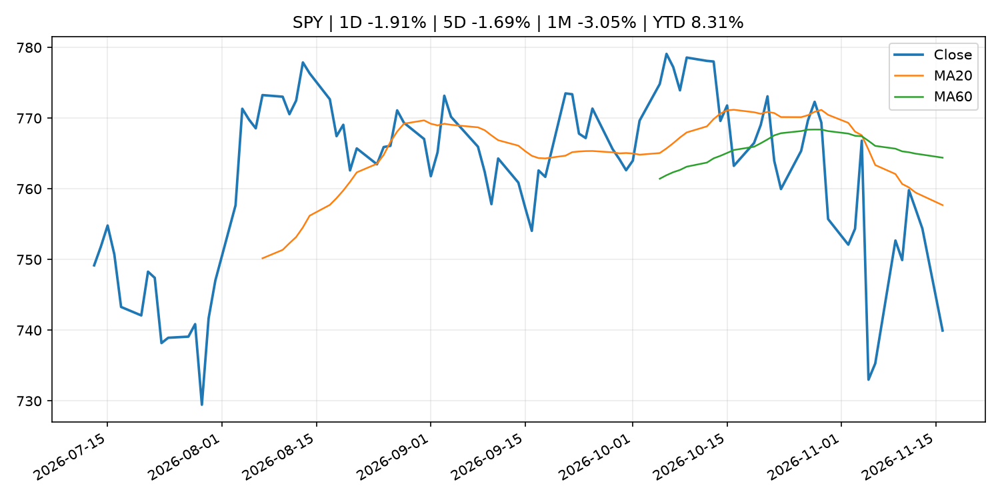
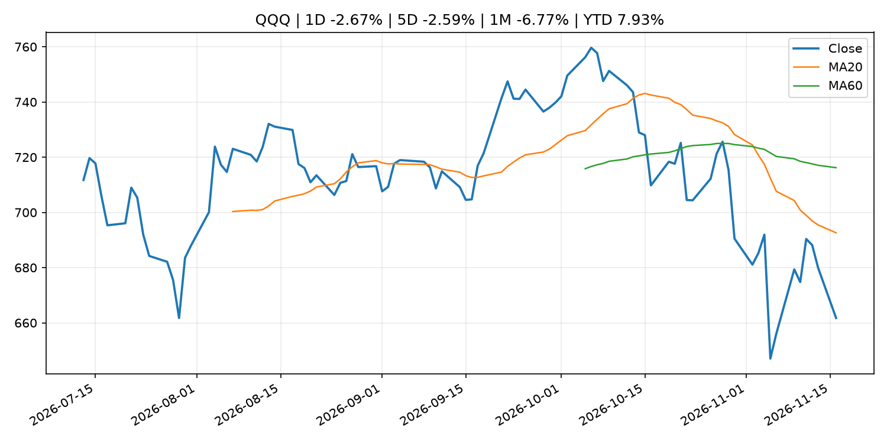
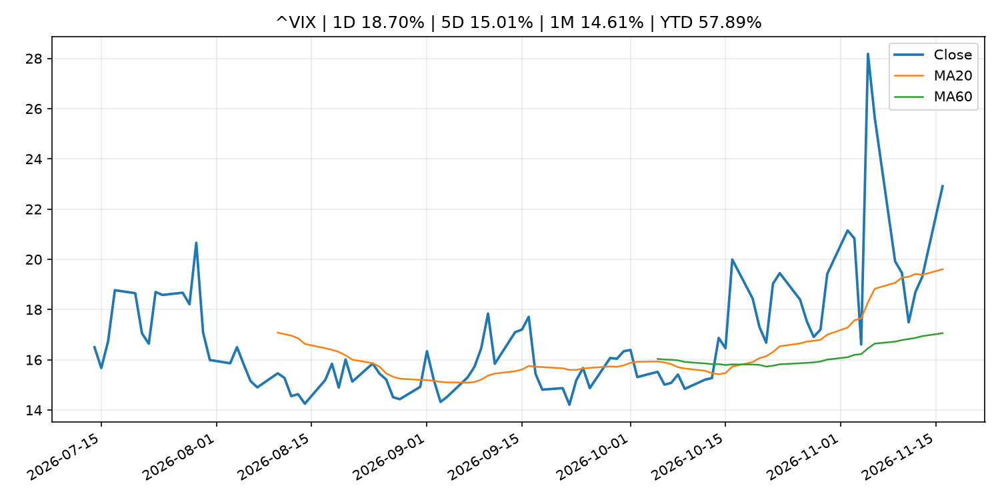
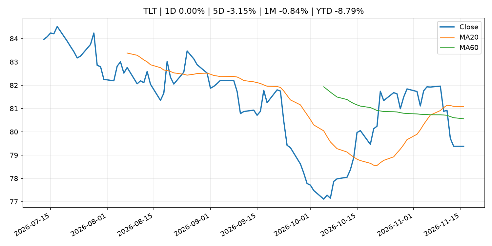
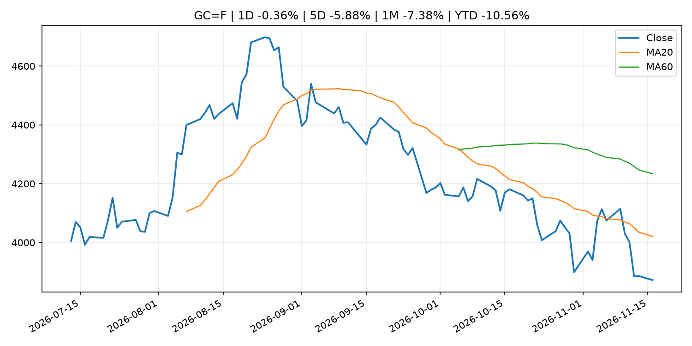
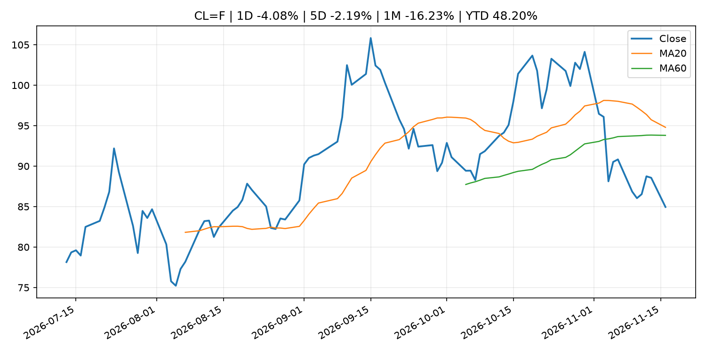
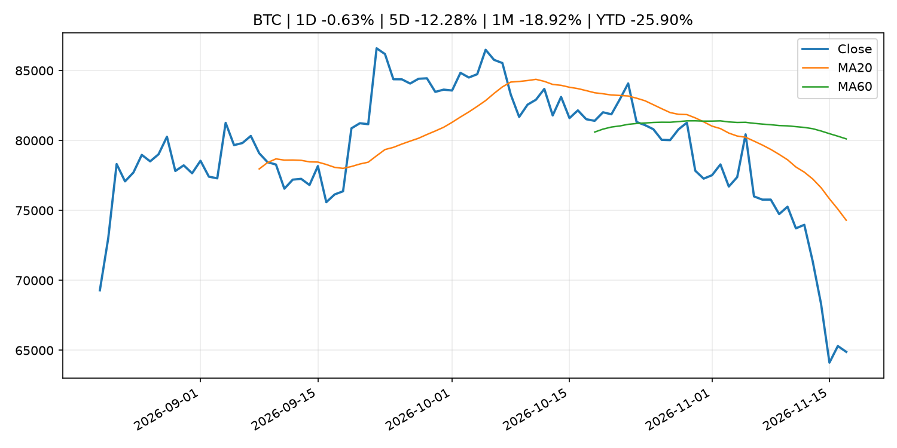
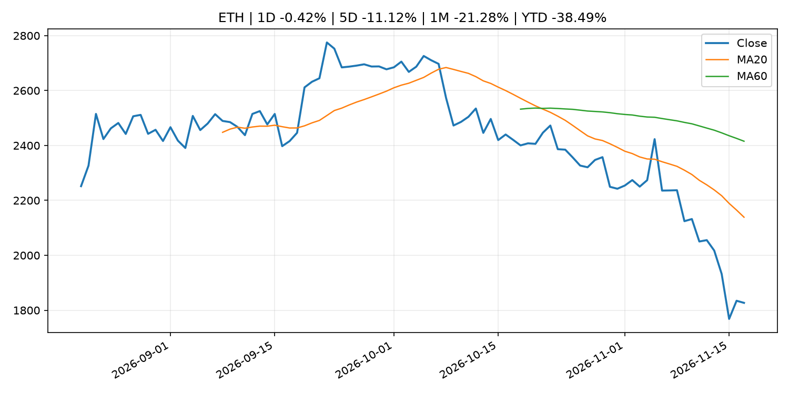
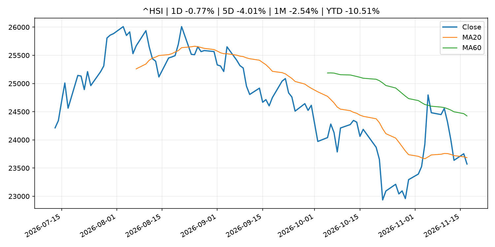

# Global Macro Morning Briefing - 2026-11-17

> Not financial advice / 非投资建议。

## 0. 今日总览
- 市场状态：unknown。市场信号不足，暂不判断明确状态。
- 今日三大主线：
  1. central_bank_decision: FOMC minutes, Nvidia earnings, Russia’s retail crypto rules: Crypto Week Ahead
  2. earnings: Bitcoin risks falling below $60,000 as Nvidia earnings threaten to deepen crypto sell-off
  3. earnings: Lutnick faces questions over Nvidia spy scandal. His sons' firm has ties to the chipmaker
- 一句话结论：今日晨报重点关注：央行决策会重定价利率、汇率、久期资产和风险资产。；大型科技股盈利和资本开支会影响纳指、半导体和 AI 交易主线。。跨资产方面，SPY 1D -1.91%；QQQ 1D -2.67%；^VIX 1D 18.70%；TLT 1D 0.00%；GC=F 1D -0.36%；CL=F 1D -4.08%；BTC 1D -0.63%；ETH 1D -0.42%；市场信号不足，暂不判断明确状态。政策、通胀、利率、美元、美债、能源和加密监管仍是主要观察线索。所有结论仅基于公开数据与短摘要整理，不构成投资建议。

## 1. 隔夜跨资产市场
- 美股：SPY 1D -1.91%，QQQ 1D -2.67%，整体趋势需结合 VIX 和利率确认。
- 美债/美元：TLT 1D 0.00%，美元指数 1D 0.08%，是判断折现率压力的核心线索。
- 黄金/原油：黄金 1D -0.36%，原油 1D -4.08%，用于观察避险、通胀和地缘风险。
- 加密：BTC 1D -0.63%，ETH 1D -0.42%，关注是否独立于纳指走出加密自身行情。
- 港股/A股：恒生 1D -0.77%，沪深300/上证 1D n/a，重点看中国政策预期与人民币线索。
- 风险观察：关注后续数据是否确认当前跨资产信号。

### US_EQUITY

| symbol | latest close | 1D | 5D | 1M | YTD | trend |
|---|---:|---:|---:|---:|---:|---|
| SPY | 739.95 | -1.91% | -1.69% | -3.05% | 8.31% | strong_downtrend |
| QQQ | 661.75 | -2.67% | -2.59% | -6.77% | 7.93% | strong_downtrend |
| DIA | 515.68 | -1.43% | -1.46% | -0.66% | 6.63% | range_bound |
| IWM | 272.94 | -1.66% | -3.39% | 0.92% | 9.71% | downtrend |
| VTI | 364.30 | -1.84% | -1.78% | -2.61% | 8.32% | downtrend |

### US_MACRO_MARKET

| symbol | latest close | 1D | 5D | 1M | YTD | trend |
|---|---:|---:|---:|---:|---:|---|
| ^VIX | 22.91 | 18.70% | 15.01% | 14.61% | 57.89% | strong_uptrend |
| DX-Y.NYB | 103.49 | 0.08% | 1.81% | 1.62% | 5.15% | uptrend |
| TLT | 79.38 | 0.00% | -3.15% | -0.84% | -8.79% | range_bound |
| IEF | 90.24 | 0.22% | -1.70% | -0.20% | -6.08% | range_bound |

### COMMODITIES

| symbol | latest close | 1D | 5D | 1M | YTD | trend |
|---|---:|---:|---:|---:|---:|---|
| GC=F | 3,872.40 | -0.36% | -5.88% | -7.38% | -10.56% | strong_downtrend |
| SI=F | 47.29 | -3.54% | -10.02% | -17.02% | -32.97% | strong_downtrend |
| CL=F | 84.95 | -4.08% | -2.19% | -16.23% | 48.20% | range_bound |
| BZ=F | 91.63 | -4.39% | -1.02% | -16.59% | 50.83% | range_bound |
| NG=F | 3.09 | -4.49% | -4.13% | -0.99% | -14.73% | range_bound |
| HG=F | 5.98 | -1.70% | -5.57% | -8.50% | 5.96% | strong_downtrend |

### HK_MARKET

| symbol | latest close | 1D | 5D | 1M | YTD | trend |
|---|---:|---:|---:|---:|---:|---|
| ^HSI | 23,571.61 | -0.77% | -4.01% | -2.54% | -10.51% | downtrend |
| 0700.HK | 378.60 | -3.02% | -9.38% | -9.38% | -39.23% | downtrend |
| 9988.HK | 85.70 | -4.94% | -15.65% | -21.23% | -42.48% | strong_downtrend |
| 3690.HK | 70.95 | -0.84% | -6.03% | -6.27% | -32.17% | downtrend |
| 1810.HK | 30.24 | 3.99% | -1.18% | 13.43% | -24.93% | strong_uptrend |
| 1211.HK | 64.10 | -1.54% | -10.91% | -13.08% | -35.09% | strong_downtrend |

### CRYPTO

| symbol | latest close | 1D | 5D | 1M | YTD | trend |
|---|---:|---:|---:|---:|---:|---|
| BTC | 64,891.07 | -0.63% | -12.28% | -18.92% | -25.90% | strong_downtrend |
| ETH | 1,826.91 | -0.42% | -11.12% | -21.28% | -38.49% | strong_downtrend |
| SOLANA | 72.84 | 0.18% | -12.49% | -27.70% | -41.50% | strong_downtrend |
| BINANCECOIN | 593.38 | -0.51% | -12.64% | -20.00% | -31.22% | strong_downtrend |
| RIPPLE | 0.96 | -0.96% | -8.28% | -26.18% | -47.59% | strong_downtrend |

## 2. 今日最重要的 10 条新闻
### 1. FOMC minutes, Nvidia earnings, Russia’s retail crypto rules: Crypto Week Ahead
- 来源：CoinDesk
- 时间：2026-11-16T09:23:07+00:00
- 地区：global
- 事件类型：central_bank_decision
- 重要性层级：Tier 1
- 一句话摘要：FOMC minutes, Nvidia earnings, Russia’s retail crypto rules: Crypto Week Ahead
- 为什么重要：央行决策会重定价利率、汇率、久期资产和风险资产。
- 可能影响：主要影响 QQQ，方向为 mixed，强度 high；AI 资本开支会影响大型科技股盈利和估值预期。
  - 资产：QQQ
    方向：mixed
    强度：high
    原因：AI 资本开支会影响大型科技股盈利和估值预期。
  - 资产：SMH
    方向：mixed
    强度：high
    原因：AI 投资周期直接影响半导体需求。
  - 资产：NVDA
    方向：mixed
    强度：high
    原因：AI 训练和推理需求是英伟达收入预期核心变量。
  - 资产：MSFT
    方向：mixed
    强度：medium
    原因：云和 AI 资本开支影响利润率与增长叙事。
  - 资产：GOOGL
    方向：mixed
    强度：medium
    原因：AI 投资和搜索商业化影响估值。
  - 资产：META
    方向：mixed
    强度：medium
    原因：AI 基建支出与广告效率共同影响市场预期。
- 原文链接：[https://www.coindesk.com/markets/2026/11/16/fomc-minutes-nvidia-earnings-russia-s-retail-crypto-rules-crypto-week-ahead](https://www.coindesk.com/markets/2026/11/16/fomc-minutes-nvidia-earnings-russia-s-retail-crypto-rules-crypto-week-ahead)

### 2. Bitcoin risks falling below $60,000 as Nvidia earnings threaten to deepen crypto sell-off
- 来源：CoinDesk
- 时间：2026-11-16T20:35:21+00:00
- 地区：global
- 事件类型：earnings
- 重要性层级：Tier 2
- 一句话摘要：Bitcoin risks falling below $60,000 as Nvidia earnings threaten to deepen crypto sell-off
- 为什么重要：大型科技股盈利和资本开支会影响纳指、半导体和 AI 交易主线。
- 可能影响：主要影响 QQQ，方向为 mixed，强度 high；AI 资本开支会影响大型科技股盈利和估值预期。
  - 资产：QQQ
    方向：mixed
    强度：high
    原因：AI 资本开支会影响大型科技股盈利和估值预期。
  - 资产：SMH
    方向：mixed
    强度：high
    原因：AI 投资周期直接影响半导体需求。
  - 资产：NVDA
    方向：mixed
    强度：high
    原因：AI 训练和推理需求是英伟达收入预期核心变量。
  - 资产：MSFT
    方向：mixed
    强度：medium
    原因：云和 AI 资本开支影响利润率与增长叙事。
  - 资产：GOOGL
    方向：mixed
    强度：medium
    原因：AI 投资和搜索商业化影响估值。
  - 资产：META
    方向：mixed
    强度：medium
    原因：AI 基建支出与广告效率共同影响市场预期。
- 原文链接：[https://www.coindesk.com/markets/2026/11/16/bitcoin-risks-falling-below-usd60-000-as-nvidia-earnings-threaten-to-deepen-crypto-sell-off](https://www.coindesk.com/markets/2026/11/16/bitcoin-risks-falling-below-usd60-000-as-nvidia-earnings-threaten-to-deepen-crypto-sell-off)

### 3. Lutnick faces questions over Nvidia spy scandal. His sons' firm has ties to the chipmaker
- 来源：CNBC Economy
- 时间：2026-11-16T12:14:46+00:00
- 地区：US
- 事件类型：earnings
- 重要性层级：Tier 2
- 一句话摘要：Jensen Huang’s resignation as Nvidia CEO has brought renewed scrutiny to Commerce Secretary Howard Lutnick and his family's financial ties to the chipmaker.
- 为什么重要：大型科技股盈利和资本开支会影响纳指、半导体和 AI 交易主线。
- 可能影响：主要影响 QQQ，方向为 mixed，强度 high；AI 资本开支会影响大型科技股盈利和估值预期。
  - 资产：QQQ
    方向：mixed
    强度：high
    原因：AI 资本开支会影响大型科技股盈利和估值预期。
  - 资产：SMH
    方向：mixed
    强度：high
    原因：AI 投资周期直接影响半导体需求。
  - 资产：NVDA
    方向：mixed
    强度：high
    原因：AI 训练和推理需求是英伟达收入预期核心变量。
  - 资产：MSFT
    方向：mixed
    强度：medium
    原因：云和 AI 资本开支影响利润率与增长叙事。
  - 资产：GOOGL
    方向：mixed
    强度：medium
    原因：AI 投资和搜索商业化影响估值。
  - 资产：META
    方向：mixed
    强度：medium
    原因：AI 基建支出与广告效率共同影响市场预期。
- 原文链接：[https://www.cnbc.com/2026/11/13/howard-lutnick-nvidia-jensen-huang-china-cantor-fitzgerald.html](https://www.cnbc.com/2026/11/13/howard-lutnick-nvidia-jensen-huang-china-cantor-fitzgerald.html)

### 4. How Nvidia turmoil and a Democratic Congress could reshape the AI trade, according to ETF experts
- 来源：CNBC Economy
- 时间：2026-11-16T12:13:23+00:00
- 地区：US
- 事件类型：earnings
- 重要性层级：Tier 2
- 一句话摘要：ETF experts say Nvidia’s leadership turmoil and Democratic control of Congress could shift AI demand to the benefit of other Big Tech stocks, rival chipmakers.
- 为什么重要：大型科技股盈利和资本开支会影响纳指、半导体和 AI 交易主线。
- 可能影响：主要影响 BTC，方向为 mixed，强度 high；加密监管或 ETF 进展会改变 BTC 的资金流和风险溢价。
  - 资产：BTC
    方向：mixed
    强度：high
    原因：加密监管或 ETF 进展会改变 BTC 的资金流和风险溢价。
  - 资产：ETH
    方向：mixed
    强度：high
    原因：监管框架会影响 ETH 产品化和机构参与度。
  - 资产：COIN
    方向：mixed
    强度：medium
    原因：监管清晰度和执法风险会影响交易平台估值。
  - 资产：crypto market
    方向：mixed
    强度：high
    原因：信息影响整个加密市场结构，但方向取决于细节。
  - 资产：QQQ
    方向：mixed
    强度：high
    原因：AI 资本开支会影响大型科技股盈利和估值预期。
  - 资产：SMH
    方向：mixed
    强度：high
    原因：AI 投资周期直接影响半导体需求。
- 原文链接：[https://www.cnbc.com/2026/11/14/nvidia-ai-trade-data-centers-congress.html](https://www.cnbc.com/2026/11/14/nvidia-ai-trade-data-centers-congress.html)

### 5. Brazil's central bank faces backlash over stablecoin money laundering remarks
- 来源：CoinDesk
- 时间：2026-11-16T15:54:11+00:00
- 地区：global
- 事件类型：central_bank_speech
- 重要性层级：Tier 2
- 一句话摘要：Brazil's central bank faces backlash over stablecoin money laundering remarks
- 为什么重要：央行官员表态可能影响市场对下一次会议的定价。
- 可能影响：主要影响 BTC，方向为 mixed，强度 high；加密监管或 ETF 进展会改变 BTC 的资金流和风险溢价。
  - 资产：BTC
    方向：mixed
    强度：high
    原因：加密监管或 ETF 进展会改变 BTC 的资金流和风险溢价。
  - 资产：ETH
    方向：mixed
    强度：high
    原因：监管框架会影响 ETH 产品化和机构参与度。
  - 资产：COIN
    方向：mixed
    强度：medium
    原因：监管清晰度和执法风险会影响交易平台估值。
  - 资产：crypto market
    方向：mixed
    强度：high
    原因：信息影响整个加密市场结构，但方向取决于细节。
- 原文链接：[https://www.coindesk.com/business/2026/11/16/brazil-s-central-bank-faces-backlash-over-stablecoin-money-laundering-remarks](https://www.coindesk.com/business/2026/11/16/brazil-s-central-bank-faces-backlash-over-stablecoin-money-laundering-remarks)

### 6. Speech by Board Member TAKATA at a Meeting Held by the Tokushima Association of Corporate Executives (Economic Activity, Prices, and Monetary Policy in Japan: Japan's Money and Capital Market Transformation -- Will a Paradigm Shift Occur?)
- 来源：Bank of Japan Announcements
- 时间：2026-11-16T13:00:00+09:00
- 地区：Japan
- 事件类型：central_bank_speech
- 重要性层级：Tier 2
- 一句话摘要：Speech by Board Member TAKATA at a Meeting Held by the Tokushima Association of Corporate Executives (Economic Activity, Prices, and Monetary Policy in Japan: Japan's Money and Ca...
- 为什么重要：央行官员表态可能影响市场对下一次会议的定价。
- 可能影响：可能影响利率、汇率、风险资产或大宗商品预期，但当前公开信息不足以判断明确方向。
  - 资产：暂无明确资产映射
  - 方向：unknown
  - 强度：low
  - 原因：公开信息不足以判断方向。
- 原文链接：[http://www.boj.or.jp/en/about/press/koen_2026/ko261116a.htm](http://www.boj.or.jp/en/about/press/koen_2026/ko261116a.htm)

### 7. Changing of Lagarde: How the candidates to be next ECB president view bitcoin, stablecoins and CBDCs
- 来源：CoinDesk
- 时间：2026-11-15T07:00:00+00:00
- 地区：global
- 事件类型：central_bank_speech
- 重要性层级：Tier 2
- 一句话摘要：Changing of Lagarde: How the candidates to be next ECB president view bitcoin, stablecoins and CBDCs
- 为什么重要：央行官员表态可能影响市场对下一次会议的定价。
- 可能影响：可能影响利率、汇率、风险资产或大宗商品预期，但当前公开信息不足以判断明确方向。
  - 资产：暂无明确资产映射
  - 方向：unknown
  - 强度：low
  - 原因：公开信息不足以判断方向。
- 原文链接：[https://www.coindesk.com/policy/2026/11/14/changing-of-lagarde-how-the-candidates-to-be-next-ecb-president-view-bitcoin-stablecoins-and-cbdcs](https://www.coindesk.com/policy/2026/11/14/changing-of-lagarde-how-the-candidates-to-be-next-ecb-president-view-bitcoin-stablecoins-and-cbdcs)

### 8. Release of Latest "Loans and Bills Discounted by Sector" and "Loans to Households" Data
- 来源：Bank of Japan Announcements
- 时间：2026-11-17T08:50:00+09:00
- 地区：Japan
- 事件类型：other
- 重要性层级：Tier 3
- 一句话摘要：Release of Latest "Loans and Bills Discounted by Sector" and "Loans to Households" Data
- 为什么重要：这条信息暂未匹配到重大宏观、政策或市场事件，更适合作为背景跟踪。
- 可能影响：更偏背景信息，短期市场影响可能有限。
  - 资产：暂无明确资产映射
  - 方向：unknown
  - 强度：low
  - 原因：公开信息不足以判断方向。
- 原文链接：[http://www.boj.or.jp/en/statistics/outline/notice_2026/not261117a.htm](http://www.boj.or.jp/en/statistics/outline/notice_2026/not261117a.htm)

### 9. Frank Elderson: Smart supervision for small banks
- 来源：ECB Press Releases
- 时间：2026-11-16T14:00:00+01:00
- 地区：EU
- 事件类型：other
- 重要性层级：Tier 3
- 一句话摘要：Frank Elderson: Smart supervision for small banks
- 为什么重要：这条信息暂未匹配到重大宏观、政策或市场事件，更适合作为背景跟踪。
- 可能影响：更偏背景信息，短期市场影响可能有限。
  - 资产：暂无明确资产映射
  - 方向：unknown
  - 强度：low
  - 原因：公开信息不足以判断方向。
- 原文链接：[https://www.ecb.europa.eu//press/inter/date/2026/html/ecb.in261116_1~11dd7f62af.en.html](https://www.ecb.europa.eu//press/inter/date/2026/html/ecb.in261116_1~11dd7f62af.en.html)

## 3. 政策与央行观察
### 1. FOMC minutes, Nvidia earnings, Russia’s retail crypto rules: Crypto Week Ahead
- 来源：CoinDesk
- 时间：2026-11-16T09:23:07+00:00
- 地区：global
- 事件类型：central_bank_decision
- 重要性层级：Tier 1
- 一句话摘要：FOMC minutes, Nvidia earnings, Russia’s retail crypto rules: Crypto Week Ahead
- 为什么重要：央行决策会重定价利率、汇率、久期资产和风险资产。
- 可能影响：主要影响 QQQ，方向为 mixed，强度 high；AI 资本开支会影响大型科技股盈利和估值预期。
  - 资产：QQQ
    方向：mixed
    强度：high
    原因：AI 资本开支会影响大型科技股盈利和估值预期。
  - 资产：SMH
    方向：mixed
    强度：high
    原因：AI 投资周期直接影响半导体需求。
  - 资产：NVDA
    方向：mixed
    强度：high
    原因：AI 训练和推理需求是英伟达收入预期核心变量。
  - 资产：MSFT
    方向：mixed
    强度：medium
    原因：云和 AI 资本开支影响利润率与增长叙事。
  - 资产：GOOGL
    方向：mixed
    强度：medium
    原因：AI 投资和搜索商业化影响估值。
  - 资产：META
    方向：mixed
    强度：medium
    原因：AI 基建支出与广告效率共同影响市场预期。
- 原文链接：[https://www.coindesk.com/markets/2026/11/16/fomc-minutes-nvidia-earnings-russia-s-retail-crypto-rules-crypto-week-ahead](https://www.coindesk.com/markets/2026/11/16/fomc-minutes-nvidia-earnings-russia-s-retail-crypto-rules-crypto-week-ahead)

### 2. Brazil's central bank faces backlash over stablecoin money laundering remarks
- 来源：CoinDesk
- 时间：2026-11-16T15:54:11+00:00
- 地区：global
- 事件类型：central_bank_speech
- 重要性层级：Tier 2
- 一句话摘要：Brazil's central bank faces backlash over stablecoin money laundering remarks
- 为什么重要：央行官员表态可能影响市场对下一次会议的定价。
- 可能影响：主要影响 BTC，方向为 mixed，强度 high；加密监管或 ETF 进展会改变 BTC 的资金流和风险溢价。
  - 资产：BTC
    方向：mixed
    强度：high
    原因：加密监管或 ETF 进展会改变 BTC 的资金流和风险溢价。
  - 资产：ETH
    方向：mixed
    强度：high
    原因：监管框架会影响 ETH 产品化和机构参与度。
  - 资产：COIN
    方向：mixed
    强度：medium
    原因：监管清晰度和执法风险会影响交易平台估值。
  - 资产：crypto market
    方向：mixed
    强度：high
    原因：信息影响整个加密市场结构，但方向取决于细节。
- 原文链接：[https://www.coindesk.com/business/2026/11/16/brazil-s-central-bank-faces-backlash-over-stablecoin-money-laundering-remarks](https://www.coindesk.com/business/2026/11/16/brazil-s-central-bank-faces-backlash-over-stablecoin-money-laundering-remarks)

### 3. Speech by Board Member TAKATA at a Meeting Held by the Tokushima Association of Corporate Executives (Economic Activity, Prices, and Monetary Policy in Japan: Japan's Money and Capital Market Transformation -- Will a Paradigm Shift Occur?)
- 来源：Bank of Japan Announcements
- 时间：2026-11-16T13:00:00+09:00
- 地区：Japan
- 事件类型：central_bank_speech
- 重要性层级：Tier 2
- 一句话摘要：Speech by Board Member TAKATA at a Meeting Held by the Tokushima Association of Corporate Executives (Economic Activity, Prices, and Monetary Policy in Japan: Japan's Money and Ca...
- 为什么重要：央行官员表态可能影响市场对下一次会议的定价。
- 可能影响：可能影响利率、汇率、风险资产或大宗商品预期，但当前公开信息不足以判断明确方向。
  - 资产：暂无明确资产映射
  - 方向：unknown
  - 强度：low
  - 原因：公开信息不足以判断方向。
- 原文链接：[http://www.boj.or.jp/en/about/press/koen_2026/ko261116a.htm](http://www.boj.or.jp/en/about/press/koen_2026/ko261116a.htm)

### 4. Changing of Lagarde: How the candidates to be next ECB president view bitcoin, stablecoins and CBDCs
- 来源：CoinDesk
- 时间：2026-11-15T07:00:00+00:00
- 地区：global
- 事件类型：central_bank_speech
- 重要性层级：Tier 2
- 一句话摘要：Changing of Lagarde: How the candidates to be next ECB president view bitcoin, stablecoins and CBDCs
- 为什么重要：央行官员表态可能影响市场对下一次会议的定价。
- 可能影响：可能影响利率、汇率、风险资产或大宗商品预期，但当前公开信息不足以判断明确方向。
  - 资产：暂无明确资产映射
  - 方向：unknown
  - 强度：low
  - 原因：公开信息不足以判断方向。
- 原文链接：[https://www.coindesk.com/policy/2026/11/14/changing-of-lagarde-how-the-candidates-to-be-next-ecb-president-view-bitcoin-stablecoins-and-cbdcs](https://www.coindesk.com/policy/2026/11/14/changing-of-lagarde-how-the-candidates-to-be-next-ecb-president-view-bitcoin-stablecoins-and-cbdcs)

## 4. 市场异动与图表
- SPY 下跌 -1.91%
- QQQ 下跌 -2.67%
- VIX 上涨 18.70%
- Oil 下跌 -4.08%

### SPY

### QQQ

### ^VIX

### TLT

### GC=F

### CL=F

### BTC

### ETH

### ^HSI

## 5. 华尔街与机构公开观点
- 暂无可靠公开观点。

## 6. 今日重点关注
- 经济数据：经济数据：暂无可靠公开日历数据；如配置经济日历源后可自动填充。
- 央行讲话：央行讲话：暂无可靠公开日历数据；重点跟踪 Fed、ECB、BoJ、PBOC 官网 RSS。
- 财报：财报：暂无可靠数据。
- 政策事件：政策事件：暂无可靠数据。
- 风险提醒：风险提醒：关注数据源失败项、突发地缘风险、利率和美元的二阶反应。

## 7. 英文金融表达与宏观概念
- **terminal rate**：终端利率，市场预期本轮加息周期的最高政策利率。 例句：A higher terminal rate can pressure growth stocks.
- **risk-off**：避险模式，资金偏向美元、国债、黄金等防御资产。 例句：A geopolitical shock can push markets into risk-off mode.
- **supply disruption**：供给扰动，通常指能源或商品供应受冲突、减产或天气影响。 例句：Supply disruption can lift oil prices and inflation expectations.
- **market structure**：市场结构，指交易、托管、清算、ETF、监管等制度安排。 例句：Crypto market structure rules can affect institutional participation.
- **AI capex**：AI 资本开支，指云厂商和科技公司投入 AI 基建的支出。 例句：AI capex guidance can move semiconductor stocks.
- **inflation expectations**：通胀预期，指家庭、企业或市场对未来通胀的预估。 例句：Inflation expectations can shape wage bargaining and bond yields.

## 8. 背景材料
- [Release of Latest "Loans and Bills Discounted by Sector" and "Loans to Households" Data](http://www.boj.or.jp/en/statistics/outline/notice_2026/not261117a.htm)（Bank of Japan Announcements，other）：Release of Latest "Loans and Bills Discounted by Sector" and "Loans to Households" Data
- [Frank Elderson: Smart supervision for small banks](https://www.ecb.europa.eu//press/inter/date/2026/html/ecb.in261116_1~11dd7f62af.en.html)（ECB Press Releases，other）：Frank Elderson: Smart supervision for small banks
- [Bitcoin was supposed to gain as AI faltered, but it crashed. Here's why.](https://www.coindesk.com/daybook-us/2026/11/16/bitcoin-was-supposed-to-gain-as-ai-faltered-but-it-crashed-here-s-why)（CoinDesk，other）：Bitcoin was supposed to gain as AI faltered, but it crashed. Here's why.
- [Bitcoin slips after rebounding from July 14 low that triggered $2 billion of liquidations](https://www.coindesk.com/markets/2026/11/16/bitcoin-slips-to-usd64-000-after-usd2-billion-weekend-flush)（CoinDesk，other）：Bitcoin slips after rebounding from July 14 low that triggered $2 billion of liquidations
- [Live updates: Bitcoin trades near $65,000 as Nasdaq closes with 2.5% loss](https://www.coindesk.com/tech/2026/11/16/live-news-bitcoin-posts-sixth-weekly-loss-as-tech-stocks-and-metals-slide)（CoinDesk，other）：Live updates: Bitcoin trades near $65,000 as Nasdaq closes with 2.5% loss
- [Boris Vujčić: Risks and resilience in the euro area financial system](https://www.ecb.europa.eu//press/key/date/2026/html/ecb.sp261116~db374b56ab.en.html)（ECB Press Releases，other）：Boris Vujčić: Risks and resilience in the euro area financial system
- [Highlights of the Outlook for Economic Activity and Prices (October 2026)](http://www.boj.or.jp/en/mopo/outlook/highlight/ten202610.htm)（Bank of Japan Announcements，other）：Highlights of the Outlook for Economic Activity and Prices (October 2026)
- [BOJ Current Account Balances by Sector (Oct.)](http://www.boj.or.jp/en/statistics/boj/other/cabs/cabs.xlsx)（Bank of Japan Announcements，other）：BOJ Current Account Balances by Sector (Oct.)
- [Bitcoin miners were hijacked and their BTC rewards redirected to an attacker](https://www.coindesk.com/tech/2026/11/16/bitcoin-miners-were-hijacked-and-their-btc-rewards-redirected-to-an-attacker)（CoinDesk，other）：Bitcoin miners were hijacked and their BTC rewards redirected to an attacker
- [Bitcoin’s biggest bet is now a drop below $60,000, not a rally above $100,000](https://www.coindesk.com/markets/2026/11/16/bitcoin-s-biggest-bet-is-now-a-drop-below-usd60-000-not-a-rally-above-usd100-000)（CoinDesk，other）：Bitcoin’s biggest bet is now a drop below $60,000, not a rally above $100,000

## 9. 数据源、失败项与免责声明
- 采集时间：2026-11-17T04:20:46
- 数据源：公开 RSS、Yahoo Finance、CoinGecko、AKShare、FRED、SEC data.sec.gov，以及用户自有 inputs/reports 文件。
- 合规说明：不绕过 WSJ、Bloomberg、FT、Reuters 等付费墙；对付费媒体只使用公开 RSS 标题、摘要、链接和发布时间。
- 免责声明：Not financial advice / 非投资建议。本项目仅供个人学习、研究和信息整理，不构成投资建议、交易建议或任何收益承诺。
- 失败或跳过的数据源：
  - crypto data failed coin=dogecoin
  - China market data failed symbol=上证指数: stock_zh_index_daily_em 已在 1.20.44 更名为 index_zh_daily_em，请改用 ak.index_zh_daily_em；参数与返回的列也可能有调整，用 ak.interface_info("index_zh_daily_em") 查看。完整对照见 https://akshare.akfamily.xyz/changelog.html#changelog-rename
  - China market data failed symbol=深证成指: stock_zh_index_daily_em 已在 1.20.44 更名为 index_zh_daily_em，请改用 ak.index_zh_daily_em；参数与返回的列也可能有调整，用 ak.interface_info("index_zh_daily_em") 查看。完整对照见 https://akshare.akfamily.xyz/changelog.html#changelog-rename
  - China market data failed symbol=创业板指: stock_zh_index_daily_em 已在 1.20.44 更名为 index_zh_daily_em，请改用 ak.index_zh_daily_em；参数与返回的列也可能有调整，用 ak.interface_info("index_zh_daily_em") 查看。完整对照见 https://akshare.akfamily.xyz/changelog.html#changelog-rename
  - China market data failed symbol=沪深300: stock_zh_index_daily_em 已在 1.20.44 更名为 index_zh_daily_em，请改用 ak.index_zh_daily_em；参数与返回的列也可能有调整，用 ak.interface_info("index_zh_daily_em") 查看。完整对照见 https://akshare.akfamily.xyz/changelog.html#changelog-rename
  - China market data failed symbol=中证500: stock_zh_index_daily_em 已在 1.20.44 更名为 index_zh_daily_em，请改用 ak.index_zh_daily_em；参数与返回的列也可能有调整，用 ak.interface_info("index_zh_daily_em") 查看。完整对照见 https://akshare.akfamily.xyz/changelog.html#changelog-rename
  - China market data failed symbol=科创50: stock_zh_index_daily_em 已在 1.20.44 更名为 index_zh_daily_em，请改用 ak.index_zh_daily_em；参数与返回的列也可能有调整，用 ak.interface_info("index_zh_daily_em") 查看。完整对照见 https://akshare.akfamily.xyz/changelog.html#changelog-rename
  - FRED_API_KEY not set; skipping FRED macro series
  - SEC failed cik=0000320193
  - SEC failed cik=0000789019
  - SEC failed cik=0001045810
  - SEC failed cik=0001318605
  - SEC failed cik=0001577552
