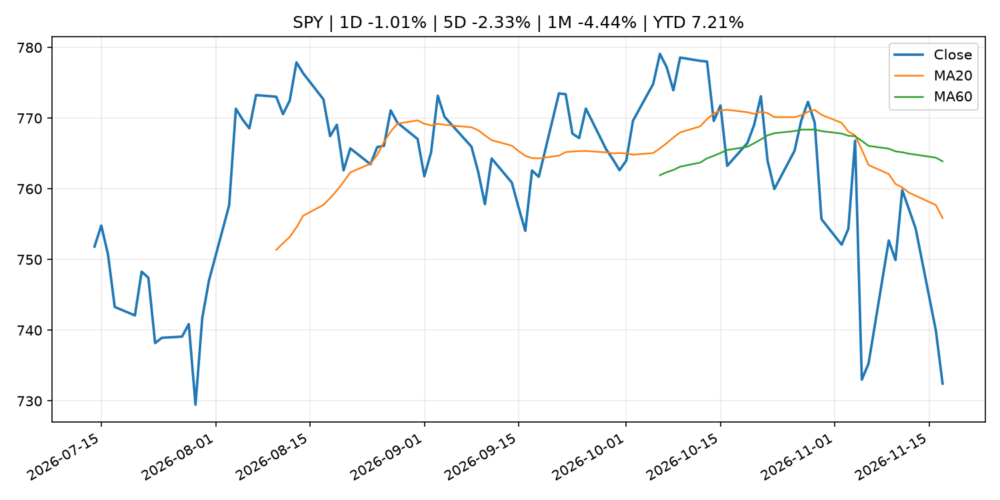
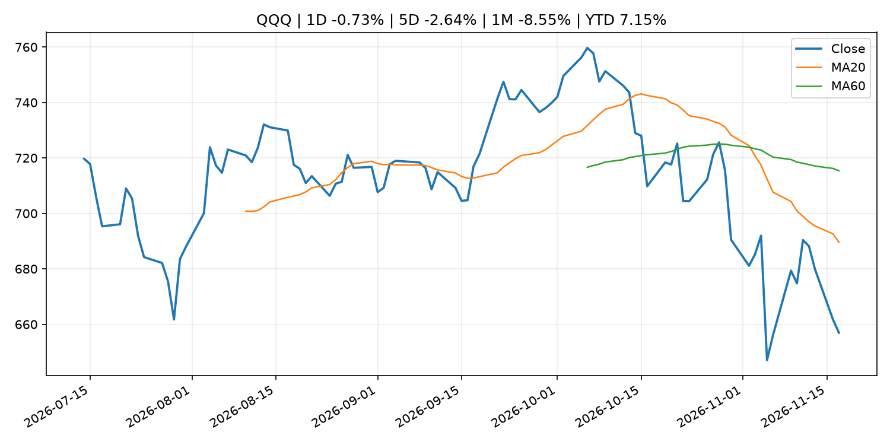
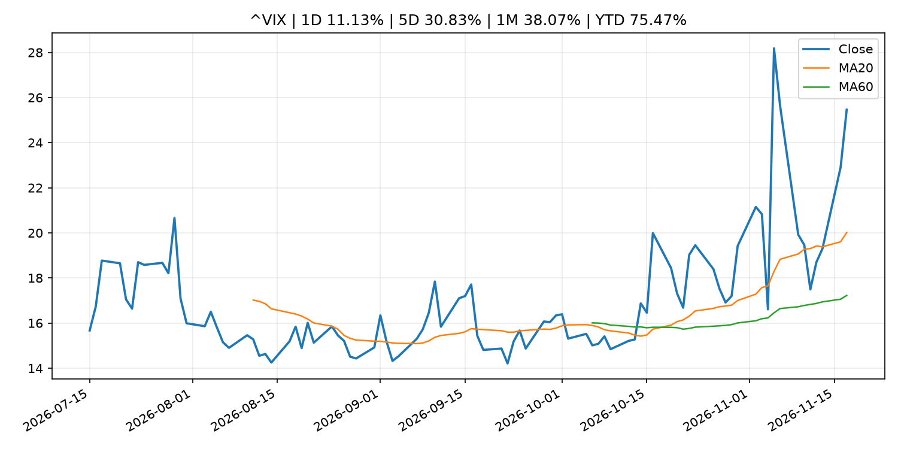
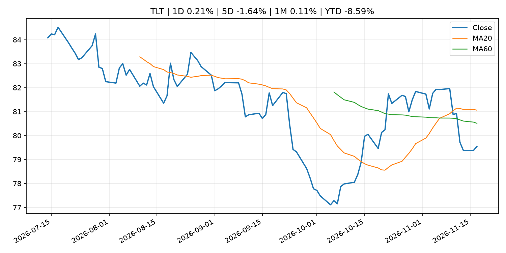
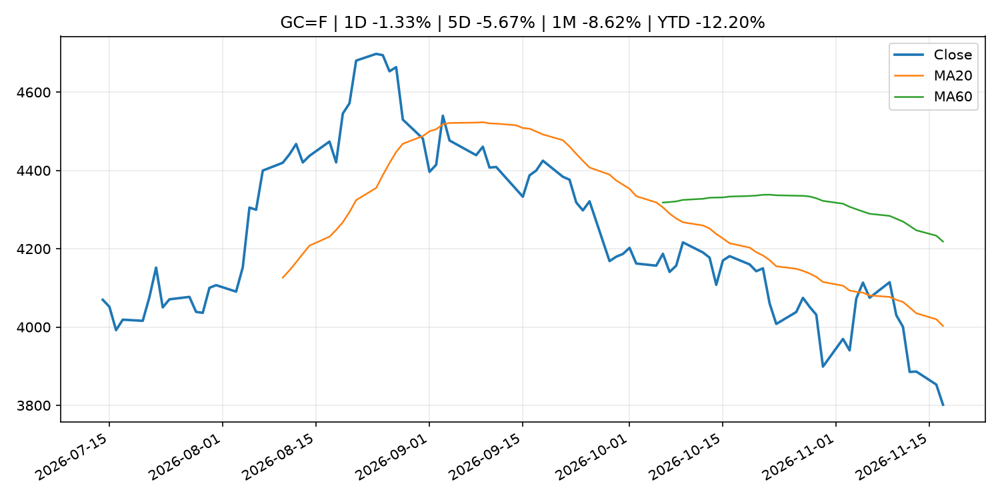
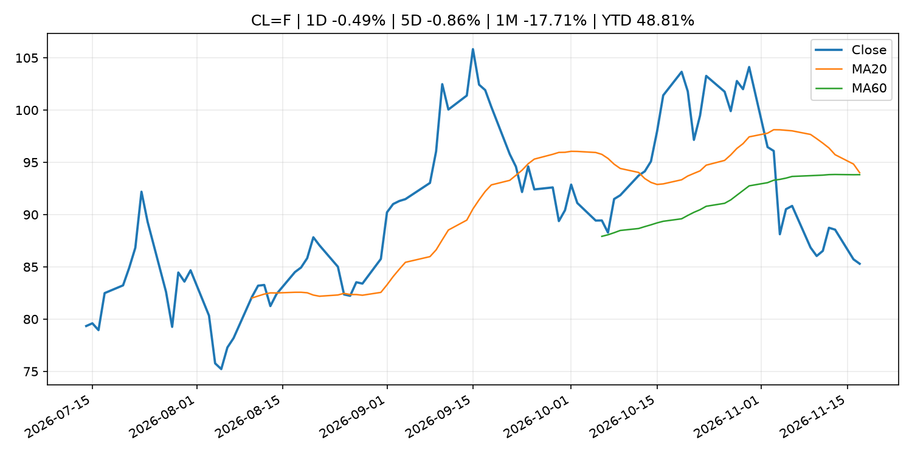
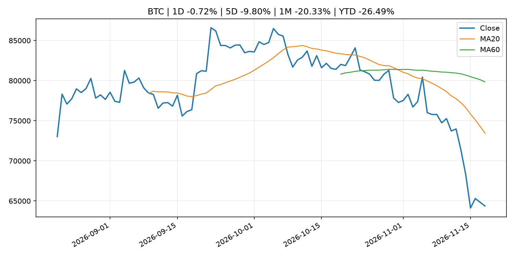
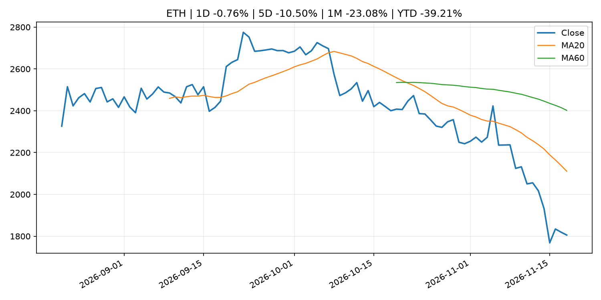
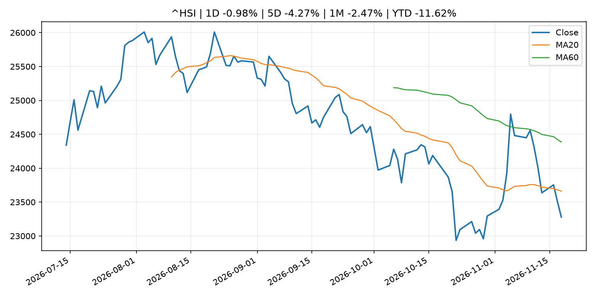

# Global Macro Morning Briefing - 2026-11-18

> Not financial advice / 非投资建议。

## 0. 今日总览
- 市场状态：unknown。市场信号不足，暂不判断明确状态。
- 今日三大主线：
  1. central_bank_decision: Want to earn 5% on shorter-term Treasurys again? Watch for this shift.
  2. central_bank_decision: Bitcoin could slide into the $50,000s as Fed rate hike bets build, Wintermute says
  3. earnings: ‘Nvidia’s turmoil has me spooked’: Has the time come to sell my stocks?
- 一句话结论：今日晨报重点关注：央行决策会重定价利率、汇率、久期资产和风险资产。；央行决策会重定价利率、汇率、久期资产和风险资产。。跨资产方面，SPY 1D -1.01%；QQQ 1D -0.73%；^VIX 1D 11.13%；TLT 1D 0.21%；GC=F 1D -1.33%；CL=F 1D -0.49%；BTC 1D -0.72%；ETH 1D -0.76%；市场信号不足，暂不判断明确状态。政策、通胀、利率、美元、美债、能源和加密监管仍是主要观察线索。所有结论仅基于公开数据与短摘要整理，不构成投资建议。

## 1. 隔夜跨资产市场
- 美股：SPY 1D -1.01%，QQQ 1D -0.73%，整体趋势需结合 VIX 和利率确认。
- 美债/美元：TLT 1D 0.21%，美元指数 1D 0.08%，是判断折现率压力的核心线索。
- 黄金/原油：黄金 1D -1.33%，原油 1D -0.49%，用于观察避险、通胀和地缘风险。
- 加密：BTC 1D -0.72%，ETH 1D -0.76%，关注是否独立于纳指走出加密自身行情。
- 港股/A股：恒生 1D -0.98%，沪深300/上证 1D n/a，重点看中国政策预期与人民币线索。
- 风险观察：关注后续数据是否确认当前跨资产信号。

### US_EQUITY

| symbol | latest close | 1D | 5D | 1M | YTD | trend |
|---|---:|---:|---:|---:|---:|---|
| SPY | 732.44 | -1.01% | -2.33% | -4.44% | 7.21% | strong_downtrend |
| QQQ | 656.95 | -0.73% | -2.64% | -8.55% | 7.15% | strong_downtrend |
| DIA | 507.31 | -1.62% | -2.76% | -2.24% | 4.90% | range_bound |
| IWM | 269.05 | -1.43% | -4.11% | -0.82% | 8.15% | downtrend |
| VTI | 360.19 | -1.13% | -2.53% | -4.09% | 7.10% | strong_downtrend |

### US_MACRO_MARKET

| symbol | latest close | 1D | 5D | 1M | YTD | trend |
|---|---:|---:|---:|---:|---:|---|
| ^VIX | 25.46 | 11.13% | 30.83% | 38.07% | 75.47% | strong_uptrend |
| DX-Y.NYB | 103.63 | 0.08% | 1.37% | 1.62% | 5.29% | uptrend |
| TLT | 79.55 | 0.21% | -1.64% | 0.11% | -8.59% | range_bound |
| IEF | 90.41 | 0.19% | -0.66% | 0.37% | -5.90% | range_bound |

### COMMODITIES

| symbol | latest close | 1D | 5D | 1M | YTD | trend |
|---|---:|---:|---:|---:|---:|---|
| GC=F | 3,801.60 | -1.33% | -5.67% | -8.62% | -12.20% | strong_downtrend |
| SI=F | 45.92 | -1.85% | -10.14% | -19.40% | -34.92% | strong_downtrend |
| CL=F | 85.30 | -0.49% | -0.86% | -17.71% | 48.81% | range_bound |
| BZ=F | 92.96 | 0.56% | 1.61% | -15.14% | 53.02% | range_bound |
| NG=F | 3.19 | 2.08% | -3.31% | 4.22% | -11.91% | range_bound |
| HG=F | 5.91 | -1.43% | -4.95% | -9.58% | 4.81% | strong_downtrend |

### HK_MARKET

| symbol | latest close | 1D | 5D | 1M | YTD | trend |
|---|---:|---:|---:|---:|---:|---|
| ^HSI | 23,278.39 | -0.98% | -4.27% | -2.47% | -11.62% | downtrend |
| 0700.HK | 371.80 | -1.12% | -9.23% | -9.41% | -40.32% | downtrend |
| 9988.HK | 85.05 | -0.47% | -15.46% | -18.92% | -42.92% | strong_downtrend |
| 3690.HK | 70.90 | 0.57% | -2.68% | -6.83% | -32.22% | downtrend |
| 1810.HK | 29.56 | -0.47% | -1.79% | 9.24% | -26.61% | strong_uptrend |
| 1211.HK | 64.00 | -0.23% | -7.51% | -13.10% | -35.19% | strong_downtrend |

### CRYPTO

| symbol | latest close | 1D | 5D | 1M | YTD | trend |
|---|---:|---:|---:|---:|---:|---|
| BTC | 64,376.74 | -0.72% | -9.80% | -20.33% | -26.49% | strong_downtrend |
| ETH | 1,805.62 | -0.76% | -10.50% | -23.08% | -39.21% | strong_downtrend |
| SOLANA | 74.74 | 4.50% | -8.45% | -26.15% | -39.98% | strong_downtrend |
| BINANCECOIN | 591.84 | 0.18% | -9.82% | -20.45% | -31.40% | strong_downtrend |
| RIPPLE | 0.98 | 2.43% | -6.00% | -26.45% | -46.88% | strong_downtrend |

## 2. 今日最重要的 10 条新闻
### 1. Want to earn 5% on shorter-term Treasurys again? Watch for this shift.
- 来源：MarketWatch Top Stories
- 时间：2026-11-17T22:08:00+00:00
- 地区：US
- 事件类型：central_bank_decision
- 重要性层级：Tier 1
- 一句话摘要：Don’t rule out a half-point interest-rate hike in December, BofA Global’s rates team said.
- 为什么重要：央行决策会重定价利率、汇率、久期资产和风险资产。
- 可能影响：主要影响 QQQ，方向为 negative，强度 high；鹰派政策提高折现率，压制成长股估值。
  - 资产：QQQ
    方向：negative
    强度：high
    原因：鹰派政策提高折现率，压制成长股估值。
  - 资产：SPY
    方向：negative
    强度：medium
    原因：更紧政策通常削弱风险偏好。
  - 资产：TLT
    方向：negative
    强度：high
    原因：利率上行通常压低长债价格。
  - 资产：DXY
    方向：positive
    强度：high
    原因：更高利率预期通常支撑美元。
  - 资产：BTC
    方向：negative
    强度：high
    原因：流动性收紧通常压制高 beta 加密资产。
- 原文链接：[https://www.marketwatch.com/story/want-to-earn-5-on-shorter-term-treasurys-again-watch-for-this-shift-d6ff42f2?mod=mw_rss_topstories](https://www.marketwatch.com/story/want-to-earn-5-on-shorter-term-treasurys-again-watch-for-this-shift-d6ff42f2?mod=mw_rss_topstories)

### 2. Bitcoin could slide into the $50,000s as Fed rate hike bets build, Wintermute says
- 来源：CoinDesk
- 时间：2026-11-17T07:38:07+00:00
- 地区：global
- 事件类型：central_bank_decision
- 重要性层级：Tier 1
- 一句话摘要：Bitcoin could slide into the $50,000s as Fed rate hike bets build, Wintermute says
- 为什么重要：央行决策会重定价利率、汇率、久期资产和风险资产。
- 可能影响：主要影响 QQQ，方向为 negative，强度 high；鹰派政策提高折现率，压制成长股估值。
  - 资产：QQQ
    方向：negative
    强度：high
    原因：鹰派政策提高折现率，压制成长股估值。
  - 资产：SPY
    方向：negative
    强度：medium
    原因：更紧政策通常削弱风险偏好。
  - 资产：TLT
    方向：negative
    强度：high
    原因：利率上行通常压低长债价格。
  - 资产：DXY
    方向：positive
    强度：high
    原因：更高利率预期通常支撑美元。
  - 资产：BTC
    方向：negative
    强度：high
    原因：流动性收紧通常压制高 beta 加密资产。
- 原文链接：[https://www.coindesk.com/markets/2026/11/17/bitcoin-could-slide-into-the-usd50-000s-as-fed-rate-hike-bets-build-wintermute-says](https://www.coindesk.com/markets/2026/11/17/bitcoin-could-slide-into-the-usd50-000s-as-fed-rate-hike-bets-build-wintermute-says)

### 3. ‘Nvidia’s turmoil has me spooked’: Has the time come to sell my stocks?
- 来源：MarketWatch Top Stories
- 时间：2026-11-17T22:15:00+00:00
- 地区：US
- 事件类型：earnings
- 重要性层级：Tier 2
- 一句话摘要：“Real estate here in Florida seems to be presenting some interesting opportunities.”
- 为什么重要：大型科技股盈利和资本开支会影响纳指、半导体和 AI 交易主线。
- 可能影响：主要影响 QQQ，方向为 mixed，强度 high；AI 资本开支会影响大型科技股盈利和估值预期。
  - 资产：QQQ
    方向：mixed
    强度：high
    原因：AI 资本开支会影响大型科技股盈利和估值预期。
  - 资产：SMH
    方向：mixed
    强度：high
    原因：AI 投资周期直接影响半导体需求。
  - 资产：NVDA
    方向：mixed
    强度：high
    原因：AI 训练和推理需求是英伟达收入预期核心变量。
  - 资产：MSFT
    方向：mixed
    强度：medium
    原因：云和 AI 资本开支影响利润率与增长叙事。
  - 资产：GOOGL
    方向：mixed
    强度：medium
    原因：AI 投资和搜索商业化影响估值。
  - 资产：META
    方向：mixed
    强度：medium
    原因：AI 基建支出与广告效率共同影响市场预期。
- 原文链接：[https://www.marketwatch.com/story/nvidia-spooked-me-should-i-sell-my-stocks-or-ride-out-the-market-turmoil-560583c6?mod=mw_rss_topstories](https://www.marketwatch.com/story/nvidia-spooked-me-should-i-sell-my-stocks-or-ride-out-the-market-turmoil-560583c6?mod=mw_rss_topstories)

### 4. Nvidia shares rise on earnings beat, raised outlook despite leadership uncertainty
- 来源：CoinDesk
- 时间：2026-11-17T21:25:50+00:00
- 地区：global
- 事件类型：earnings
- 重要性层级：Tier 2
- 一句话摘要：Nvidia shares rise on earnings beat, raised outlook despite leadership uncertainty
- 为什么重要：大型科技股盈利和资本开支会影响纳指、半导体和 AI 交易主线。
- 可能影响：主要影响 QQQ，方向为 mixed，强度 high；AI 资本开支会影响大型科技股盈利和估值预期。
  - 资产：QQQ
    方向：mixed
    强度：high
    原因：AI 资本开支会影响大型科技股盈利和估值预期。
  - 资产：SMH
    方向：mixed
    强度：high
    原因：AI 投资周期直接影响半导体需求。
  - 资产：NVDA
    方向：mixed
    强度：high
    原因：AI 训练和推理需求是英伟达收入预期核心变量。
  - 资产：MSFT
    方向：mixed
    强度：medium
    原因：云和 AI 资本开支影响利润率与增长叙事。
  - 资产：GOOGL
    方向：mixed
    强度：medium
    原因：AI 投资和搜索商业化影响估值。
  - 资产：META
    方向：mixed
    强度：medium
    原因：AI 基建支出与广告效率共同影响市场预期。
- 原文链接：[https://www.coindesk.com/markets/2026/11/17/nvidia-tops-estimates-issues-strong-guidance-adds-usd150-billion-to-buyback-authorization](https://www.coindesk.com/markets/2026/11/17/nvidia-tops-estimates-issues-strong-guidance-adds-usd150-billion-to-buyback-authorization)

### 5. Live updates: Bitcoin and stocks continue slump as Huang signals interest in returning to Nvidia
- 来源：CoinDesk
- 时间：2026-11-17T10:33:26+00:00
- 地区：global
- 事件类型：earnings
- 重要性层级：Tier 2
- 一句话摘要：Live updates: Bitcoin and stocks continue slump as Huang signals interest in returning to Nvidia
- 为什么重要：大型科技股盈利和资本开支会影响纳指、半导体和 AI 交易主线。
- 可能影响：主要影响 QQQ，方向为 mixed，强度 high；AI 资本开支会影响大型科技股盈利和估值预期。
  - 资产：QQQ
    方向：mixed
    强度：high
    原因：AI 资本开支会影响大型科技股盈利和估值预期。
  - 资产：SMH
    方向：mixed
    强度：high
    原因：AI 投资周期直接影响半导体需求。
  - 资产：NVDA
    方向：mixed
    强度：high
    原因：AI 训练和推理需求是英伟达收入预期核心变量。
  - 资产：MSFT
    方向：mixed
    强度：medium
    原因：云和 AI 资本开支影响利润率与增长叙事。
  - 资产：GOOGL
    方向：mixed
    强度：medium
    原因：AI 投资和搜索商业化影响估值。
  - 资产：META
    方向：mixed
    强度：medium
    原因：AI 基建支出与广告效率共同影响市场预期。
- 原文链接：[https://www.coindesk.com/business/2026/11/17/live-updates-bitcoin-holds-near-usd64-000-as-tech-slides-ahead-of-nvidia-earnings](https://www.coindesk.com/business/2026/11/17/live-updates-bitcoin-holds-near-usd64-000-as-tech-slides-ahead-of-nvidia-earnings)

### 6. Nvidia faces first earnings test without Jensen Huang as AI stocks slide
- 来源：CoinDesk
- 时间：2026-11-17T10:17:01+00:00
- 地区：global
- 事件类型：earnings
- 重要性层级：Tier 2
- 一句话摘要：Nvidia faces first earnings test without Jensen Huang as AI stocks slide
- 为什么重要：大型科技股盈利和资本开支会影响纳指、半导体和 AI 交易主线。
- 可能影响：主要影响 QQQ，方向为 mixed，强度 high；AI 资本开支会影响大型科技股盈利和估值预期。
  - 资产：QQQ
    方向：mixed
    强度：high
    原因：AI 资本开支会影响大型科技股盈利和估值预期。
  - 资产：SMH
    方向：mixed
    强度：high
    原因：AI 投资周期直接影响半导体需求。
  - 资产：NVDA
    方向：mixed
    强度：high
    原因：AI 训练和推理需求是英伟达收入预期核心变量。
  - 资产：MSFT
    方向：mixed
    强度：medium
    原因：云和 AI 资本开支影响利润率与增长叙事。
  - 资产：GOOGL
    方向：mixed
    强度：medium
    原因：AI 投资和搜索商业化影响估值。
  - 资产：META
    方向：mixed
    强度：medium
    原因：AI 基建支出与广告效率共同影响市场预期。
- 原文链接：[https://www.coindesk.com/markets/2026/11/17/nvidia-faces-first-earnings-test-without-jensen-huang-as-ai-stocks-slide](https://www.coindesk.com/markets/2026/11/17/nvidia-faces-first-earnings-test-without-jensen-huang-as-ai-stocks-slide)

### 7. Bitcoin risks falling below $60,000 as Nvidia earnings threaten to deepen crypto selloff
- 来源：CoinDesk
- 时间：2026-11-16T20:35:21+00:00
- 地区：global
- 事件类型：earnings
- 重要性层级：Tier 2
- 一句话摘要：Bitcoin risks falling below $60,000 as Nvidia earnings threaten to deepen crypto selloff
- 为什么重要：大型科技股盈利和资本开支会影响纳指、半导体和 AI 交易主线。
- 可能影响：主要影响 QQQ，方向为 mixed，强度 high；AI 资本开支会影响大型科技股盈利和估值预期。
  - 资产：QQQ
    方向：mixed
    强度：high
    原因：AI 资本开支会影响大型科技股盈利和估值预期。
  - 资产：SMH
    方向：mixed
    强度：high
    原因：AI 投资周期直接影响半导体需求。
  - 资产：NVDA
    方向：mixed
    强度：high
    原因：AI 训练和推理需求是英伟达收入预期核心变量。
  - 资产：MSFT
    方向：mixed
    强度：medium
    原因：云和 AI 资本开支影响利润率与增长叙事。
  - 资产：GOOGL
    方向：mixed
    强度：medium
    原因：AI 投资和搜索商业化影响估值。
  - 资产：META
    方向：mixed
    强度：medium
    原因：AI 基建支出与广告效率共同影响市场预期。
- 原文链接：[https://www.coindesk.com/markets/2026/11/16/bitcoin-risks-falling-below-usd60-000-as-nvidia-earnings-threaten-to-deepen-crypto-sell-off](https://www.coindesk.com/markets/2026/11/16/bitcoin-risks-falling-below-usd60-000-as-nvidia-earnings-threaten-to-deepen-crypto-sell-off)

### 8. Lutnick faces questions over Nvidia spy scandal. His sons' firm has ties to the chipmaker
- 来源：CNBC Economy
- 时间：2026-11-16T12:14:46+00:00
- 地区：US
- 事件类型：earnings
- 重要性层级：Tier 2
- 一句话摘要：Jensen Huang’s resignation as Nvidia CEO has brought renewed scrutiny to Commerce Secretary Howard Lutnick and his family's financial ties to the chipmaker.
- 为什么重要：大型科技股盈利和资本开支会影响纳指、半导体和 AI 交易主线。
- 可能影响：主要影响 QQQ，方向为 mixed，强度 high；AI 资本开支会影响大型科技股盈利和估值预期。
  - 资产：QQQ
    方向：mixed
    强度：high
    原因：AI 资本开支会影响大型科技股盈利和估值预期。
  - 资产：SMH
    方向：mixed
    强度：high
    原因：AI 投资周期直接影响半导体需求。
  - 资产：NVDA
    方向：mixed
    强度：high
    原因：AI 训练和推理需求是英伟达收入预期核心变量。
  - 资产：MSFT
    方向：mixed
    强度：medium
    原因：云和 AI 资本开支影响利润率与增长叙事。
  - 资产：GOOGL
    方向：mixed
    强度：medium
    原因：AI 投资和搜索商业化影响估值。
  - 资产：META
    方向：mixed
    强度：medium
    原因：AI 基建支出与广告效率共同影响市场预期。
- 原文链接：[https://www.cnbc.com/2026/11/13/howard-lutnick-nvidia-jensen-huang-china-cantor-fitzgerald.html](https://www.cnbc.com/2026/11/13/howard-lutnick-nvidia-jensen-huang-china-cantor-fitzgerald.html)

### 9. How Nvidia turmoil and a Democratic Congress could reshape the AI trade, according to ETF experts
- 来源：CNBC Economy
- 时间：2026-11-16T12:13:23+00:00
- 地区：US
- 事件类型：earnings
- 重要性层级：Tier 2
- 一句话摘要：ETF experts say Nvidia’s leadership turmoil and Democratic control of Congress could shift AI demand to the benefit of other Big Tech stocks, rival chipmakers.
- 为什么重要：大型科技股盈利和资本开支会影响纳指、半导体和 AI 交易主线。
- 可能影响：主要影响 BTC，方向为 mixed，强度 high；加密监管或 ETF 进展会改变 BTC 的资金流和风险溢价。
  - 资产：BTC
    方向：mixed
    强度：high
    原因：加密监管或 ETF 进展会改变 BTC 的资金流和风险溢价。
  - 资产：ETH
    方向：mixed
    强度：high
    原因：监管框架会影响 ETH 产品化和机构参与度。
  - 资产：COIN
    方向：mixed
    强度：medium
    原因：监管清晰度和执法风险会影响交易平台估值。
  - 资产：crypto market
    方向：mixed
    强度：high
    原因：信息影响整个加密市场结构，但方向取决于细节。
  - 资产：QQQ
    方向：mixed
    强度：high
    原因：AI 资本开支会影响大型科技股盈利和估值预期。
  - 资产：SMH
    方向：mixed
    强度：high
    原因：AI 投资周期直接影响半导体需求。
- 原文链接：[https://www.cnbc.com/2026/11/14/nvidia-ai-trade-data-centers-congress.html](https://www.cnbc.com/2026/11/14/nvidia-ai-trade-data-centers-congress.html)

### 10. Hong Kong, Swift test tokenized deposits as banks chase stablecoin-style speed
- 来源：CoinDesk
- 时间：2026-11-17T15:11:00+00:00
- 地区：global
- 事件类型：crypto_market_structure
- 重要性层级：Tier 2
- 一句话摘要：Hong Kong, Swift test tokenized deposits as banks chase stablecoin-style speed
- 为什么重要：加密市场结构和监管变化会影响 BTC、ETH 及相关股票的风险溢价。
- 可能影响：主要影响 BTC，方向为 mixed，强度 high；加密监管或 ETF 进展会改变 BTC 的资金流和风险溢价。
  - 资产：BTC
    方向：mixed
    强度：high
    原因：加密监管或 ETF 进展会改变 BTC 的资金流和风险溢价。
  - 资产：ETH
    方向：mixed
    强度：high
    原因：监管框架会影响 ETH 产品化和机构参与度。
  - 资产：COIN
    方向：mixed
    强度：medium
    原因：监管清晰度和执法风险会影响交易平台估值。
  - 资产：crypto market
    方向：mixed
    强度：high
    原因：信息影响整个加密市场结构，但方向取决于细节。
- 原文链接：[https://www.coindesk.com/business/2026/11/17/hong-kong-swift-test-tokenized-deposits-as-banks-chase-stablecoin-style-speed](https://www.coindesk.com/business/2026/11/17/hong-kong-swift-test-tokenized-deposits-as-banks-chase-stablecoin-style-speed)

## 3. 政策与央行观察
### 1. Want to earn 5% on shorter-term Treasurys again? Watch for this shift.
- 来源：MarketWatch Top Stories
- 时间：2026-11-17T22:08:00+00:00
- 地区：US
- 事件类型：central_bank_decision
- 重要性层级：Tier 1
- 一句话摘要：Don’t rule out a half-point interest-rate hike in December, BofA Global’s rates team said.
- 为什么重要：央行决策会重定价利率、汇率、久期资产和风险资产。
- 可能影响：主要影响 QQQ，方向为 negative，强度 high；鹰派政策提高折现率，压制成长股估值。
  - 资产：QQQ
    方向：negative
    强度：high
    原因：鹰派政策提高折现率，压制成长股估值。
  - 资产：SPY
    方向：negative
    强度：medium
    原因：更紧政策通常削弱风险偏好。
  - 资产：TLT
    方向：negative
    强度：high
    原因：利率上行通常压低长债价格。
  - 资产：DXY
    方向：positive
    强度：high
    原因：更高利率预期通常支撑美元。
  - 资产：BTC
    方向：negative
    强度：high
    原因：流动性收紧通常压制高 beta 加密资产。
- 原文链接：[https://www.marketwatch.com/story/want-to-earn-5-on-shorter-term-treasurys-again-watch-for-this-shift-d6ff42f2?mod=mw_rss_topstories](https://www.marketwatch.com/story/want-to-earn-5-on-shorter-term-treasurys-again-watch-for-this-shift-d6ff42f2?mod=mw_rss_topstories)

### 2. Bitcoin could slide into the $50,000s as Fed rate hike bets build, Wintermute says
- 来源：CoinDesk
- 时间：2026-11-17T07:38:07+00:00
- 地区：global
- 事件类型：central_bank_decision
- 重要性层级：Tier 1
- 一句话摘要：Bitcoin could slide into the $50,000s as Fed rate hike bets build, Wintermute says
- 为什么重要：央行决策会重定价利率、汇率、久期资产和风险资产。
- 可能影响：主要影响 QQQ，方向为 negative，强度 high；鹰派政策提高折现率，压制成长股估值。
  - 资产：QQQ
    方向：negative
    强度：high
    原因：鹰派政策提高折现率，压制成长股估值。
  - 资产：SPY
    方向：negative
    强度：medium
    原因：更紧政策通常削弱风险偏好。
  - 资产：TLT
    方向：negative
    强度：high
    原因：利率上行通常压低长债价格。
  - 资产：DXY
    方向：positive
    强度：high
    原因：更高利率预期通常支撑美元。
  - 资产：BTC
    方向：negative
    强度：high
    原因：流动性收紧通常压制高 beta 加密资产。
- 原文链接：[https://www.coindesk.com/markets/2026/11/17/bitcoin-could-slide-into-the-usd50-000s-as-fed-rate-hike-bets-build-wintermute-says](https://www.coindesk.com/markets/2026/11/17/bitcoin-could-slide-into-the-usd50-000s-as-fed-rate-hike-bets-build-wintermute-says)

### 3. Hong Kong, Swift test tokenized deposits as banks chase stablecoin-style speed
- 来源：CoinDesk
- 时间：2026-11-17T15:11:00+00:00
- 地区：global
- 事件类型：crypto_market_structure
- 重要性层级：Tier 2
- 一句话摘要：Hong Kong, Swift test tokenized deposits as banks chase stablecoin-style speed
- 为什么重要：加密市场结构和监管变化会影响 BTC、ETH 及相关股票的风险溢价。
- 可能影响：主要影响 BTC，方向为 mixed，强度 high；加密监管或 ETF 进展会改变 BTC 的资金流和风险溢价。
  - 资产：BTC
    方向：mixed
    强度：high
    原因：加密监管或 ETF 进展会改变 BTC 的资金流和风险溢价。
  - 资产：ETH
    方向：mixed
    强度：high
    原因：监管框架会影响 ETH 产品化和机构参与度。
  - 资产：COIN
    方向：mixed
    强度：medium
    原因：监管清晰度和执法风险会影响交易平台估值。
  - 资产：crypto market
    方向：mixed
    强度：high
    原因：信息影响整个加密市场结构，但方向取决于细节。
- 原文链接：[https://www.coindesk.com/business/2026/11/17/hong-kong-swift-test-tokenized-deposits-as-banks-chase-stablecoin-style-speed](https://www.coindesk.com/business/2026/11/17/hong-kong-swift-test-tokenized-deposits-as-banks-chase-stablecoin-style-speed)

### 4. Crypto's 'casino-chips' are disappearing, adding to pain from spot ETF outflows
- 来源：CoinDesk
- 时间：2026-11-17T12:16:53+00:00
- 地区：global
- 事件类型：crypto_market_structure
- 重要性层级：Tier 2
- 一句话摘要：Crypto's 'casino-chips' are disappearing, adding to pain from spot ETF outflows
- 为什么重要：加密市场结构和监管变化会影响 BTC、ETH 及相关股票的风险溢价。
- 可能影响：主要影响 BTC，方向为 mixed，强度 high；加密监管或 ETF 进展会改变 BTC 的资金流和风险溢价。
  - 资产：BTC
    方向：mixed
    强度：high
    原因：加密监管或 ETF 进展会改变 BTC 的资金流和风险溢价。
  - 资产：ETH
    方向：mixed
    强度：high
    原因：监管框架会影响 ETH 产品化和机构参与度。
  - 资产：COIN
    方向：mixed
    强度：medium
    原因：监管清晰度和执法风险会影响交易平台估值。
  - 资产：crypto market
    方向：mixed
    强度：high
    原因：信息影响整个加密市场结构，但方向取决于细节。
- 原文链接：[https://www.coindesk.com/daybook-us/2026/11/17/crypto-s-casino-chips-are-disappearing-adding-to-pain-from-spot-etf-outflows](https://www.coindesk.com/daybook-us/2026/11/17/crypto-s-casino-chips-are-disappearing-adding-to-pain-from-spot-etf-outflows)

### 5. Speech by Board Member TAKATA at a Meeting Held by the Tokushima Association of Corporate Executives (Economic Activity, Prices, and Monetary Policy in Japan: Japan's Money and Capital Market Transformation -- Will a Paradigm Shift Occur?)
- 来源：Bank of Japan Announcements
- 时间：2026-11-16T13:00:00+09:00
- 地区：Japan
- 事件类型：central_bank_speech
- 重要性层级：Tier 2
- 一句话摘要：Speech by Board Member TAKATA at a Meeting Held by the Tokushima Association of Corporate Executives (Economic Activity, Prices, and Monetary Policy in Japan: Japan's Money and Ca...
- 为什么重要：央行官员表态可能影响市场对下一次会议的定价。
- 可能影响：可能影响利率、汇率、风险资产或大宗商品预期，但当前公开信息不足以判断明确方向。
  - 资产：暂无明确资产映射
  - 方向：unknown
  - 强度：low
  - 原因：公开信息不足以判断方向。
- 原文链接：[http://www.boj.or.jp/en/about/press/koen_2026/ko261116a.htm](http://www.boj.or.jp/en/about/press/koen_2026/ko261116a.htm)

## 4. 市场异动与图表
- SPY 下跌 -1.01%
- QQQ 下跌 -0.73%
- VIX 上涨 11.13%
- Gold 下跌 -1.33%

### SPY

### QQQ

### ^VIX

### TLT

### GC=F

### CL=F

### BTC

### ETH

### ^HSI

## 5. 华尔街与机构公开观点
- 暂无可靠公开观点。

## 6. 今日重点关注
- 经济数据：经济数据：暂无可靠公开日历数据；如配置经济日历源后可自动填充。
- 央行讲话：央行讲话：暂无可靠公开日历数据；重点跟踪 Fed、ECB、BoJ、PBOC 官网 RSS。
- 财报：财报：暂无可靠数据。
- 政策事件：政策事件：暂无可靠数据。
- 风险提醒：风险提醒：关注数据源失败项、突发地缘风险、利率和美元的二阶反应。

## 7. 英文金融表达与宏观概念
- **real yield**：实际收益率，名义利率扣除通胀预期后的收益率。 例句：Gold often reacts more to real yields than nominal yields.
- **terminal rate**：终端利率，市场预期本轮加息周期的最高政策利率。 例句：A higher terminal rate can pressure growth stocks.
- **risk-off**：避险模式，资金偏向美元、国债、黄金等防御资产。 例句：A geopolitical shock can push markets into risk-off mode.
- **supply disruption**：供给扰动，通常指能源或商品供应受冲突、减产或天气影响。 例句：Supply disruption can lift oil prices and inflation expectations.
- **market structure**：市场结构，指交易、托管、清算、ETF、监管等制度安排。 例句：Crypto market structure rules can affect institutional participation.
- **AI capex**：AI 资本开支，指云厂商和科技公司投入 AI 基建的支出。 例句：AI capex guidance can move semiconductor stocks.

## 8. 背景材料
- [Philip R. Lane: The practice and science of monetary policy communication: the ECB experience](https://www.ecb.europa.eu//press/key/date/2026/html/ecb.sp261117~7f5d3b1a0e.en.pdf)（ECB Press Releases，other）：Philip R. Lane: The practice and science of monetary policy communication: the ECB experience
- [Ex-OpenAI researcher fund dumps bitcoin miners, cuts IREN 94% after portfolio slump](https://www.coindesk.com/business/2026/11/17/ex-openai-researcher-fund-dumps-bitcoin-miners-cuts-iren-94-after-portfolio-slump)（CoinDesk，other）：Ex-OpenAI researcher fund dumps bitcoin miners, cuts IREN 94% after portfolio slump
- [Bitcoin remains penned in near $64,000 even as ETF outflow streak ends](https://www.coindesk.com/markets/2026/11/17/bitcoin-remains-penned-in-near-usd64-000-even-as-etf-outflow-streak-ends)（CoinDesk，other）：Bitcoin remains penned in near $64,000 even as ETF outflow streak ends
- [Cardano Foundation seeks $5 million from treasury using ADA price 33% above market](https://www.coindesk.com/tech/2026/11/17/cardano-foundation-seeks-usd5-million-from-treasury-using-ada-price-33-above-market)（CoinDesk，other）：Cardano Foundation seeks $5 million from treasury using ADA price 33% above market
- [Wells Fargo's reported BlackRock bitcoin ETF holdings double to $2.35 billion](https://www.coindesk.com/markets/2026/11/17/wells-fargo-s-reported-blackrock-bitcoin-etf-holdings-double-to-usd2-35-billion)（CoinDesk，other）：Wells Fargo's reported BlackRock bitcoin ETF holdings double to $2.35 billion
- [Release of Latest "Loans and Bills Discounted by Sector" and "Loans to Households" Data](http://www.boj.or.jp/en/statistics/outline/notice_2026/not261117a.htm)（Bank of Japan Announcements，other）：Release of Latest "Loans and Bills Discounted by Sector" and "Loans to Households" Data
- [Frank Elderson: Smart supervision for small banks](https://www.ecb.europa.eu//press/inter/date/2026/html/ecb.in261116_1~11dd7f62af.en.html)（ECB Press Releases，other）：Frank Elderson: Smart supervision for small banks
- [Boris Vujčić: Risks and resilience in the euro area financial system](https://www.ecb.europa.eu//press/key/date/2026/html/ecb.sp261116~db374b56ab.en.html)（ECB Press Releases，other）：Boris Vujčić: Risks and resilience in the euro area financial system
- [Highlights of the Outlook for Economic Activity and Prices (October 2026)](http://www.boj.or.jp/en/mopo/outlook/highlight/ten202610.htm)（Bank of Japan Announcements，other）：Highlights of the Outlook for Economic Activity and Prices (October 2026)
- [BOJ Current Account Balances by Sector (Oct.)](http://www.boj.or.jp/en/statistics/boj/other/cabs/cabs.xlsx)（Bank of Japan Announcements，other）：BOJ Current Account Balances by Sector (Oct.)

## 9. 数据源、失败项与免责声明
- 采集时间：2026-11-18T03:20:31
- 数据源：公开 RSS、Yahoo Finance、CoinGecko、AKShare、FRED、SEC data.sec.gov，以及用户自有 inputs/reports 文件。
- 合规说明：不绕过 WSJ、Bloomberg、FT、Reuters 等付费墙；对付费媒体只使用公开 RSS 标题、摘要、链接和发布时间。
- 免责声明：Not financial advice / 非投资建议。本项目仅供个人学习、研究和信息整理，不构成投资建议、交易建议或任何收益承诺。
- 失败或跳过的数据源：
  - crypto data failed coin=dogecoin
  - China market data failed symbol=上证指数: stock_zh_index_daily_em 已在 1.20.44 更名为 index_zh_daily_em，请改用 ak.index_zh_daily_em；参数与返回的列也可能有调整，用 ak.interface_info("index_zh_daily_em") 查看。完整对照见 https://akshare.akfamily.xyz/changelog.html#changelog-rename
  - China market data failed symbol=深证成指: stock_zh_index_daily_em 已在 1.20.44 更名为 index_zh_daily_em，请改用 ak.index_zh_daily_em；参数与返回的列也可能有调整，用 ak.interface_info("index_zh_daily_em") 查看。完整对照见 https://akshare.akfamily.xyz/changelog.html#changelog-rename
  - China market data failed symbol=创业板指: stock_zh_index_daily_em 已在 1.20.44 更名为 index_zh_daily_em，请改用 ak.index_zh_daily_em；参数与返回的列也可能有调整，用 ak.interface_info("index_zh_daily_em") 查看。完整对照见 https://akshare.akfamily.xyz/changelog.html#changelog-rename
  - China market data failed symbol=沪深300: stock_zh_index_daily_em 已在 1.20.44 更名为 index_zh_daily_em，请改用 ak.index_zh_daily_em；参数与返回的列也可能有调整，用 ak.interface_info("index_zh_daily_em") 查看。完整对照见 https://akshare.akfamily.xyz/changelog.html#changelog-rename
  - China market data failed symbol=中证500: stock_zh_index_daily_em 已在 1.20.44 更名为 index_zh_daily_em，请改用 ak.index_zh_daily_em；参数与返回的列也可能有调整，用 ak.interface_info("index_zh_daily_em") 查看。完整对照见 https://akshare.akfamily.xyz/changelog.html#changelog-rename
  - China market data failed symbol=科创50: stock_zh_index_daily_em 已在 1.20.44 更名为 index_zh_daily_em，请改用 ak.index_zh_daily_em；参数与返回的列也可能有调整，用 ak.interface_info("index_zh_daily_em") 查看。完整对照见 https://akshare.akfamily.xyz/changelog.html#changelog-rename
  - FRED_API_KEY not set; skipping FRED macro series
  - SEC failed cik=0000320193
  - SEC failed cik=0000789019
  - SEC failed cik=0001045810
  - SEC failed cik=0001318605
  - SEC failed cik=0001577552
