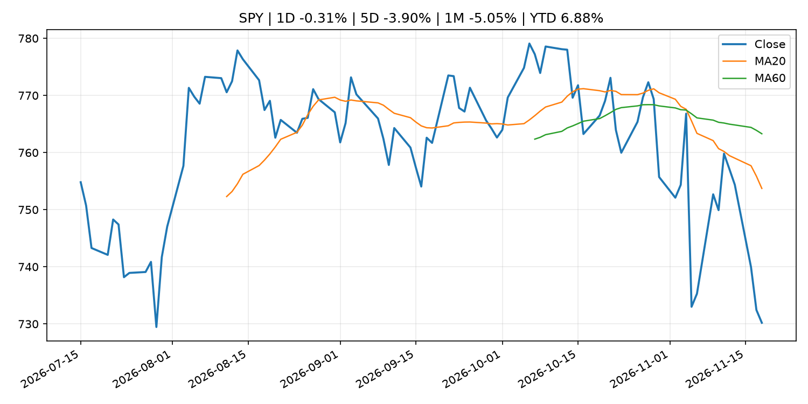
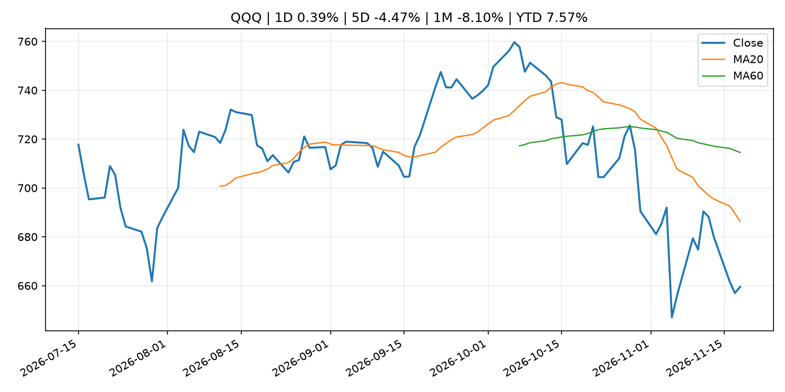
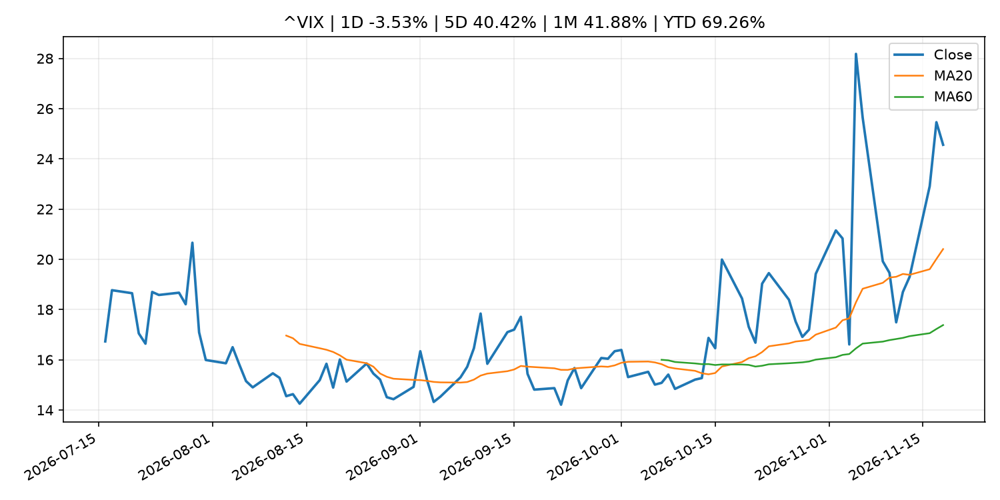
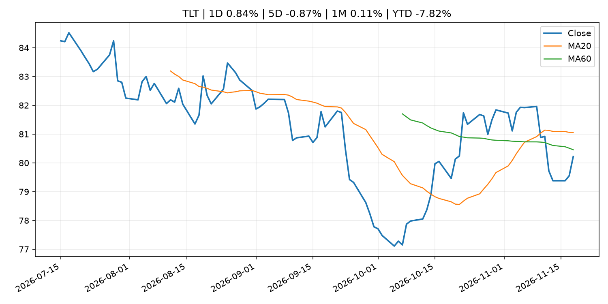
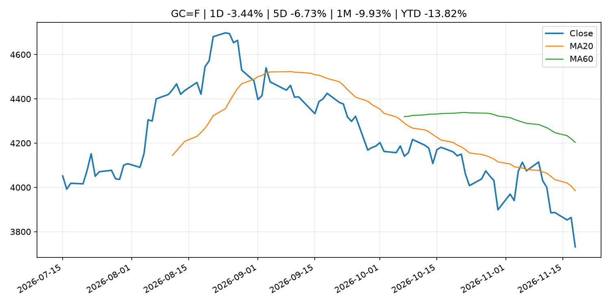
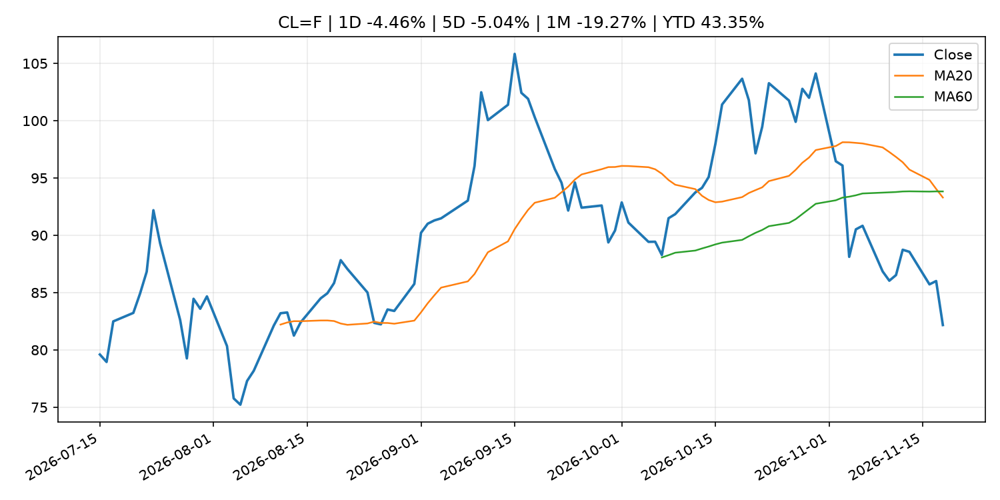
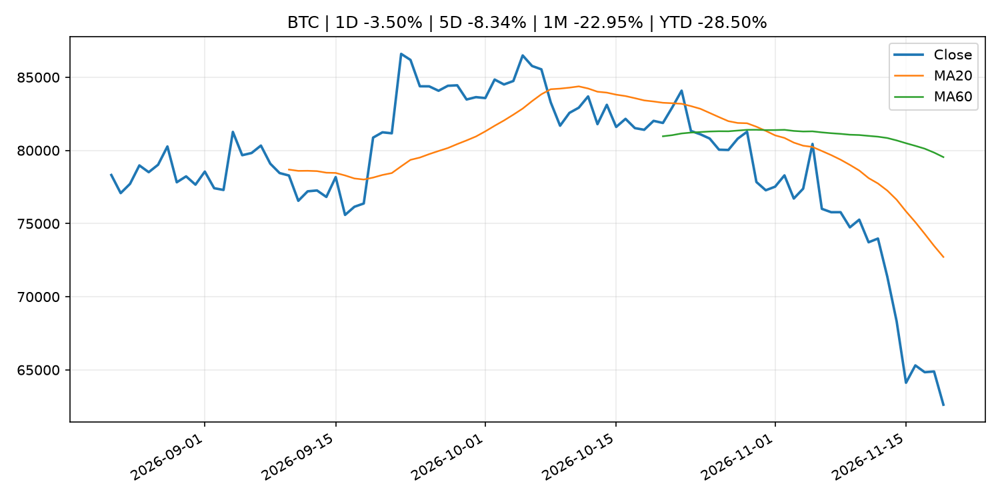
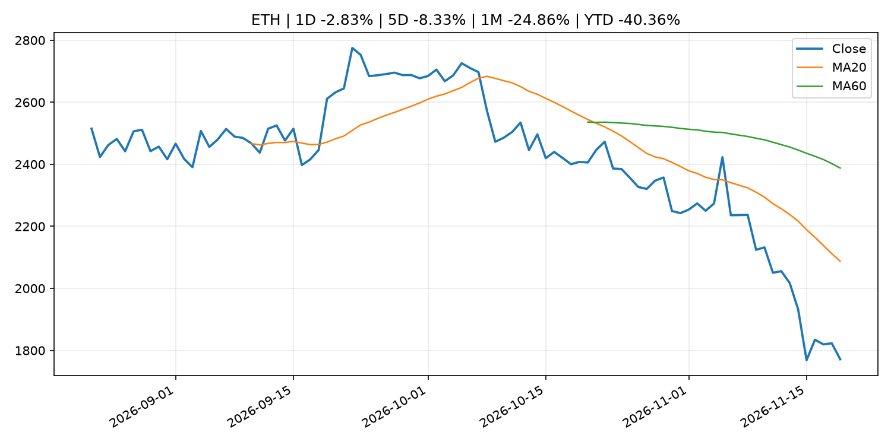
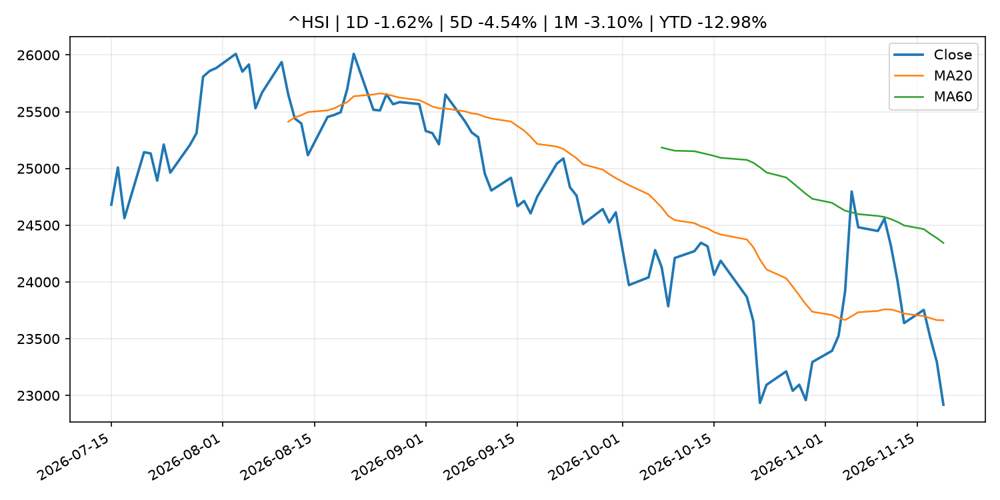

# Global Macro Morning Briefing - 2026-11-19

> Not financial advice / 非投资建议。

## 0. 今日总览
- 市场状态：unknown。市场信号不足，暂不判断明确状态。
- 今日三大主线：
  1. central_bank_decision: Fed’s Waller says central bank may need to ‘shock people’ with half-point rate hike
  2. central_bank_decision: Bitcoin outpaces gold even as both assets tumble ahead of a likely Fed rate hike
  3. financial_stability: Boris Vujčić: Financial Stability Review - November 2026
- 一句话结论：今日晨报重点关注：央行决策会重定价利率、汇率、久期资产和风险资产。；央行决策会重定价利率、汇率、久期资产和风险资产。。跨资产方面，SPY 1D -0.31%；QQQ 1D 0.39%；^VIX 1D -3.53%；TLT 1D 0.84%；GC=F 1D -3.44%；CL=F 1D -4.46%；BTC 1D -3.50%；ETH 1D -2.83%；市场信号不足，暂不判断明确状态。政策、通胀、利率、美元、美债、能源和加密监管仍是主要观察线索。所有结论仅基于公开数据与短摘要整理，不构成投资建议。

## 1. 隔夜跨资产市场
- 美股：SPY 1D -0.31%，QQQ 1D 0.39%，整体趋势需结合 VIX 和利率确认。
- 美债/美元：TLT 1D 0.84%，美元指数 1D 0.36%，是判断折现率压力的核心线索。
- 黄金/原油：黄金 1D -3.44%，原油 1D -4.46%，用于观察避险、通胀和地缘风险。
- 加密：BTC 1D -3.50%，ETH 1D -2.83%，关注是否独立于纳指走出加密自身行情。
- 港股/A股：恒生 1D -1.62%，沪深300/上证 1D n/a，重点看中国政策预期与人民币线索。
- 风险观察：关注后续数据是否确认当前跨资产信号。

### US_EQUITY

| symbol | latest close | 1D | 5D | 1M | YTD | trend |
|---|---:|---:|---:|---:|---:|---|
| SPY | 730.20 | -0.31% | -3.90% | -5.05% | 6.88% | strong_downtrend |
| QQQ | 659.51 | 0.39% | -4.47% | -8.10% | 7.57% | strong_downtrend |
| DIA | 501.73 | -1.10% | -4.33% | -4.32% | 3.74% | strong_downtrend |
| IWM | 270.12 | 0.40% | -4.58% | -2.05% | 8.58% | downtrend |
| VTI | 359.48 | -0.20% | -3.95% | -4.67% | 6.89% | strong_downtrend |

### US_MACRO_MARKET

| symbol | latest close | 1D | 5D | 1M | YTD | trend |
|---|---:|---:|---:|---:|---:|---|
| ^VIX | 24.56 | -3.53% | 40.42% | 41.88% | 69.26% | strong_uptrend |
| DX-Y.NYB | 103.86 | 0.36% | 0.93% | 2.10% | 5.53% | uptrend |
| TLT | 80.22 | 0.84% | -0.87% | 0.11% | -7.82% | range_bound |
| IEF | 90.67 | 0.29% | -0.30% | 0.47% | -5.63% | range_bound |

### COMMODITIES

| symbol | latest close | 1D | 5D | 1M | YTD | trend |
|---|---:|---:|---:|---:|---:|---|
| GC=F | 3,731.30 | -3.44% | -6.73% | -9.93% | -13.82% | strong_downtrend |
| SI=F | 45.03 | -4.79% | -13.21% | -21.98% | -36.19% | strong_downtrend |
| CL=F | 82.17 | -4.46% | -5.04% | -19.27% | 43.35% | strong_downtrend |
| BZ=F | 89.24 | -4.19% | -3.79% | -17.97% | 46.90% | range_bound |
| NG=F | 3.38 | 5.33% | 5.10% | 14.04% | -6.61% | range_bound |
| HG=F | 5.65 | -5.38% | -9.88% | -13.89% | 0.26% | strong_downtrend |

### HK_MARKET

| symbol | latest close | 1D | 5D | 1M | YTD | trend |
|---|---:|---:|---:|---:|---:|---|
| ^HSI | 22,918.46 | -1.62% | -4.54% | -3.10% | -12.98% | downtrend |
| 0700.HK | 350.40 | -6.01% | -12.14% | -11.02% | -43.76% | strong_downtrend |
| 9988.HK | 81.05 | -4.93% | -13.59% | -21.84% | -45.60% | strong_downtrend |
| 3690.HK | 67.90 | -3.21% | -5.83% | -9.10% | -35.09% | strong_downtrend |
| 1810.HK | 28.56 | -3.71% | -4.74% | 6.57% | -29.10% | strong_uptrend |
| 1211.HK | 63.00 | -1.64% | -6.74% | -11.45% | -36.20% | strong_downtrend |

### CRYPTO

| symbol | latest close | 1D | 5D | 1M | YTD | trend |
|---|---:|---:|---:|---:|---:|---|
| BTC | 62,619.15 | -3.50% | -8.34% | -22.95% | -28.50% | strong_downtrend |
| ETH | 1,771.35 | -2.83% | -8.33% | -24.86% | -40.36% | strong_downtrend |
| SOLANA | 73.29 | -2.44% | -6.34% | -28.37% | -41.14% | strong_downtrend |
| BINANCECOIN | 580.13 | -2.80% | -8.02% | -23.57% | -32.75% | strong_downtrend |
| RIPPLE | 0.96 | -2.10% | -4.83% | -27.36% | -47.72% | strong_downtrend |

## 2. 今日最重要的 10 条新闻
### 1. Fed’s Waller says central bank may need to ‘shock people’ with half-point rate hike
- 来源：CNBC Economy
- 时间：2026-11-18T15:13:39+00:00
- 地区：US
- 事件类型：central_bank_decision
- 重要性层级：Tier 1
- 一句话摘要：Continued inflation above the Fed's 2% target is pushing central bank officials into a more aggressive stance.
- 为什么重要：央行决策会重定价利率、汇率、久期资产和风险资产。
- 可能影响：主要影响 DXY，方向为 positive，强度 high；通胀压力可能推高政策利率预期并支撑美元。
  - 资产：DXY
    方向：positive
    强度：high
    原因：通胀压力可能推高政策利率预期并支撑美元。
  - 资产：TLT
    方向：negative
    强度：high
    原因：通胀上行通常推升收益率、压低长债价格。
  - 资产：QQQ
    方向：negative
    强度：high
    原因：更高利率对成长股估值折现率不利。
  - 资产：SPY
    方向：mixed
    强度：medium
    原因：名义增长可能支撑收入，但更高利率压制估值。
  - 资产：GC=F
    方向：mixed
    强度：medium
    原因：通胀对黄金是支撑，但实际利率上行会形成压力。
  - 资产：BTC
    方向：negative
    强度：high
    原因：流动性收紧通常压制高 beta 加密资产。
- 原文链接：[https://www.cnbc.com/2026/11/18/federal-reserve-governor-christopher-waller.html](https://www.cnbc.com/2026/11/18/federal-reserve-governor-christopher-waller.html)

### 2. Bitcoin outpaces gold even as both assets tumble ahead of a likely Fed rate hike
- 来源：CoinDesk
- 时间：2026-11-18T10:58:36+00:00
- 地区：global
- 事件类型：central_bank_decision
- 重要性层级：Tier 1
- 一句话摘要：Bitcoin outpaces gold even as both assets tumble ahead of a likely Fed rate hike
- 为什么重要：央行决策会重定价利率、汇率、久期资产和风险资产。
- 可能影响：主要影响 QQQ，方向为 negative，强度 high；鹰派政策提高折现率，压制成长股估值。
  - 资产：QQQ
    方向：negative
    强度：high
    原因：鹰派政策提高折现率，压制成长股估值。
  - 资产：SPY
    方向：negative
    强度：medium
    原因：更紧政策通常削弱风险偏好。
  - 资产：TLT
    方向：negative
    强度：high
    原因：利率上行通常压低长债价格。
  - 资产：DXY
    方向：positive
    强度：high
    原因：更高利率预期通常支撑美元。
  - 资产：BTC
    方向：negative
    强度：high
    原因：流动性收紧通常压制高 beta 加密资产。
- 原文链接：[https://www.coindesk.com/markets/2026/11/18/bitcoin-outpaces-gold-even-as-both-assets-tumble-ahead-of-a-likely-fed-rate-hike](https://www.coindesk.com/markets/2026/11/18/bitcoin-outpaces-gold-even-as-both-assets-tumble-ahead-of-a-likely-fed-rate-hike)

### 3. Boris Vujčić: Financial Stability Review - November 2026
- 来源：ECB Press Releases
- 时间：2026-11-18T10:00:00+01:00
- 地区：EU
- 事件类型：financial_stability
- 重要性层级：Tier 1
- 一句话摘要：Boris Vujčić: Financial Stability Review - November 2026
- 为什么重要：金融稳定信号可能放大跨资产波动，并影响央行反应函数。
- 可能影响：可能影响利率、汇率、风险资产或大宗商品预期，但当前公开信息不足以判断明确方向。
  - 资产：暂无明确资产映射
  - 方向：unknown
  - 强度：low
  - 原因：公开信息不足以判断方向。
- 原文链接：[https://www.ecb.europa.eu//press/key/date/2026/html/ecb.sp261118~86f1e8147e.en.pdf](https://www.ecb.europa.eu//press/key/date/2026/html/ecb.sp261118~86f1e8147e.en.pdf)

### 4. Risks from AI valuations, fiscal imbalances and geoeconomic tensions weigh on financial stability outlook
- 来源：ECB Press Releases
- 时间：2026-11-18T10:00:00+01:00
- 地区：EU
- 事件类型：fiscal_policy
- 重要性层级：Tier 1
- 一句话摘要：Risks from AI valuations, fiscal imbalances and geoeconomic tensions weigh on financial stability outlook
- 为什么重要：财政和贸易政策会影响增长、通胀、企业利润和跨境资本流。
- 可能影响：可能影响利率、汇率、风险资产或大宗商品预期，但当前公开信息不足以判断明确方向。
  - 资产：暂无明确资产映射
  - 方向：unknown
  - 强度：low
  - 原因：公开信息不足以判断方向。
- 原文链接：[https://www.ecb.europa.eu//press/pr/date/2026/html/ecb.pr261118~83c5c60158.en.html](https://www.ecb.europa.eu//press/pr/date/2026/html/ecb.pr261118~83c5c60158.en.html)

### 5. ‘Nvidia’s turmoil has me spooked’: Should I sell my stocks and buy real estate — or ride out the storm?
- 来源：MarketWatch Top Stories
- 时间：2026-11-19T00:30:00+00:00
- 地区：US
- 事件类型：earnings
- 重要性层级：Tier 2
- 一句话摘要：Tempted to ditch stocks for property or CDs? Take a deep breath before making any sudden moves.
- 为什么重要：大型科技股盈利和资本开支会影响纳指、半导体和 AI 交易主线。
- 可能影响：主要影响 QQQ，方向为 mixed，强度 high；AI 资本开支会影响大型科技股盈利和估值预期。
  - 资产：QQQ
    方向：mixed
    强度：high
    原因：AI 资本开支会影响大型科技股盈利和估值预期。
  - 资产：SMH
    方向：mixed
    强度：high
    原因：AI 投资周期直接影响半导体需求。
  - 资产：NVDA
    方向：mixed
    强度：high
    原因：AI 训练和推理需求是英伟达收入预期核心变量。
  - 资产：MSFT
    方向：mixed
    强度：medium
    原因：云和 AI 资本开支影响利润率与增长叙事。
  - 资产：GOOGL
    方向：mixed
    强度：medium
    原因：AI 投资和搜索商业化影响估值。
  - 资产：META
    方向：mixed
    强度：medium
    原因：AI 基建支出与广告效率共同影响市场预期。
- 原文链接：[https://www.marketwatch.com/story/nvidia-spooked-me-should-i-sell-my-stocks-or-ride-out-the-market-turmoil-560583c6?mod=mw_rss_topstories](https://www.marketwatch.com/story/nvidia-spooked-me-should-i-sell-my-stocks-or-ride-out-the-market-turmoil-560583c6?mod=mw_rss_topstories)

### 6. Bitcoin drops as Nvidia earnings report drives stock index futures higher
- 来源：CoinDesk
- 时间：2026-11-18T11:42:52+00:00
- 地区：global
- 事件类型：earnings
- 重要性层级：Tier 2
- 一句话摘要：Bitcoin drops as Nvidia earnings report drives stock index futures higher
- 为什么重要：大型科技股盈利和资本开支会影响纳指、半导体和 AI 交易主线。
- 可能影响：主要影响 QQQ，方向为 mixed，强度 high；AI 资本开支会影响大型科技股盈利和估值预期。
  - 资产：QQQ
    方向：mixed
    强度：high
    原因：AI 资本开支会影响大型科技股盈利和估值预期。
  - 资产：SMH
    方向：mixed
    强度：high
    原因：AI 投资周期直接影响半导体需求。
  - 资产：NVDA
    方向：mixed
    强度：high
    原因：AI 训练和推理需求是英伟达收入预期核心变量。
  - 资产：MSFT
    方向：mixed
    强度：medium
    原因：云和 AI 资本开支影响利润率与增长叙事。
  - 资产：GOOGL
    方向：mixed
    强度：medium
    原因：AI 投资和搜索商业化影响估值。
  - 资产：META
    方向：mixed
    强度：medium
    原因：AI 基建支出与广告效率共同影响市场预期。
- 原文链接：[https://www.coindesk.com/markets/2026/11/18/bitcoin-drops-as-nvidia-earnings-report-drives-stock-index-futures-higher](https://www.coindesk.com/markets/2026/11/18/bitcoin-drops-as-nvidia-earnings-report-drives-stock-index-futures-higher)

### 7. Nvidia shares rise on earnings beat, raised outlook despite leadership uncertainty
- 来源：CoinDesk
- 时间：2026-11-17T21:25:50+00:00
- 地区：global
- 事件类型：earnings
- 重要性层级：Tier 2
- 一句话摘要：Nvidia shares rise on earnings beat, raised outlook despite leadership uncertainty
- 为什么重要：大型科技股盈利和资本开支会影响纳指、半导体和 AI 交易主线。
- 可能影响：主要影响 QQQ，方向为 mixed，强度 high；AI 资本开支会影响大型科技股盈利和估值预期。
  - 资产：QQQ
    方向：mixed
    强度：high
    原因：AI 资本开支会影响大型科技股盈利和估值预期。
  - 资产：SMH
    方向：mixed
    强度：high
    原因：AI 投资周期直接影响半导体需求。
  - 资产：NVDA
    方向：mixed
    强度：high
    原因：AI 训练和推理需求是英伟达收入预期核心变量。
  - 资产：MSFT
    方向：mixed
    强度：medium
    原因：云和 AI 资本开支影响利润率与增长叙事。
  - 资产：GOOGL
    方向：mixed
    强度：medium
    原因：AI 投资和搜索商业化影响估值。
  - 资产：META
    方向：mixed
    强度：medium
    原因：AI 基建支出与广告效率共同影响市场预期。
- 原文链接：[https://www.coindesk.com/markets/2026/11/17/nvidia-tops-estimates-issues-strong-guidance-adds-usd150-billion-to-buyback-authorization](https://www.coindesk.com/markets/2026/11/17/nvidia-tops-estimates-issues-strong-guidance-adds-usd150-billion-to-buyback-authorization)

### 8. Statement by Governor UEDA concerning the Bank's Semiannual Report on Currency and Monetary Control (Committee on Financial Affairs, Senate)
- 来源：Bank of Japan Announcements
- 时间：2026-11-19T10:13:00+09:00
- 地区：Japan
- 事件类型：central_bank_speech
- 重要性层级：Tier 2
- 一句话摘要：Statement by Governor UEDA concerning the Bank's Semiannual Report on Currency and Monetary Control (Committee on Financial Affairs, Senate)
- 为什么重要：央行官员表态可能影响市场对下一次会议的定价。
- 可能影响：可能影响利率、汇率、风险资产或大宗商品预期，但当前公开信息不足以判断明确方向。
  - 资产：暂无明确资产映射
  - 方向：unknown
  - 强度：low
  - 原因：公开信息不足以判断方向。
- 原文链接：[http://www.boj.or.jp/en/mopo/diet/d_state/dst261119a.htm](http://www.boj.or.jp/en/mopo/diet/d_state/dst261119a.htm)

### 9. Palo Alto Networks’ stock gets a fresh AI-fueled boost from earnings
- 来源：MarketWatch Top Stories
- 时间：2026-11-19T01:02:00+00:00
- 地区：US
- 事件类型：earnings
- 重要性层级：Tier 2
- 一句话摘要：The company boosts its outlook in the face of the “current threat environment and demand we see ahead of us.”
- 为什么重要：大型科技股盈利和资本开支会影响纳指、半导体和 AI 交易主线。
- 可能影响：可能影响利率、汇率、风险资产或大宗商品预期，但当前公开信息不足以判断明确方向。
  - 资产：暂无明确资产映射
  - 方向：unknown
  - 强度：low
  - 原因：公开信息不足以判断方向。
- 原文链接：[https://www.marketwatch.com/story/palo-alto-networks-stock-soars-as-earnings-show-ai-has-upped-the-stakes-for-cybersecurity-308e34b8?mod=mw_rss_topstories](https://www.marketwatch.com/story/palo-alto-networks-stock-soars-as-earnings-show-ai-has-upped-the-stakes-for-cybersecurity-308e34b8?mod=mw_rss_topstories)

### 10. Putin says EU is losing industry, falling behind competition, ahead of meeting with Trump and Xi
- 来源：CNBC Economy
- 时间：2026-11-18T08:29:35+00:00
- 地区：US
- 事件类型：central_bank_speech
- 重要性层级：Tier 2
- 一句话摘要：Putin used the speech to emphasize Russia's economic resilience despite U.S. sanctions, and played up opportunities for APEC members in the country.
- 为什么重要：央行官员表态可能影响市场对下一次会议的定价。
- 可能影响：可能影响利率、汇率、风险资产或大宗商品预期，但当前公开信息不足以判断明确方向。
  - 资产：暂无明确资产映射
  - 方向：unknown
  - 强度：low
  - 原因：公开信息不足以判断方向。
- 原文链接：[https://www.cnbc.com/2026/11/18/putin-apec-eu-trump-xi-meeting.html](https://www.cnbc.com/2026/11/18/putin-apec-eu-trump-xi-meeting.html)

## 3. 政策与央行观察
### 1. Fed’s Waller says central bank may need to ‘shock people’ with half-point rate hike
- 来源：CNBC Economy
- 时间：2026-11-18T15:13:39+00:00
- 地区：US
- 事件类型：central_bank_decision
- 重要性层级：Tier 1
- 一句话摘要：Continued inflation above the Fed's 2% target is pushing central bank officials into a more aggressive stance.
- 为什么重要：央行决策会重定价利率、汇率、久期资产和风险资产。
- 可能影响：主要影响 DXY，方向为 positive，强度 high；通胀压力可能推高政策利率预期并支撑美元。
  - 资产：DXY
    方向：positive
    强度：high
    原因：通胀压力可能推高政策利率预期并支撑美元。
  - 资产：TLT
    方向：negative
    强度：high
    原因：通胀上行通常推升收益率、压低长债价格。
  - 资产：QQQ
    方向：negative
    强度：high
    原因：更高利率对成长股估值折现率不利。
  - 资产：SPY
    方向：mixed
    强度：medium
    原因：名义增长可能支撑收入，但更高利率压制估值。
  - 资产：GC=F
    方向：mixed
    强度：medium
    原因：通胀对黄金是支撑，但实际利率上行会形成压力。
  - 资产：BTC
    方向：negative
    强度：high
    原因：流动性收紧通常压制高 beta 加密资产。
- 原文链接：[https://www.cnbc.com/2026/11/18/federal-reserve-governor-christopher-waller.html](https://www.cnbc.com/2026/11/18/federal-reserve-governor-christopher-waller.html)

### 2. Bitcoin outpaces gold even as both assets tumble ahead of a likely Fed rate hike
- 来源：CoinDesk
- 时间：2026-11-18T10:58:36+00:00
- 地区：global
- 事件类型：central_bank_decision
- 重要性层级：Tier 1
- 一句话摘要：Bitcoin outpaces gold even as both assets tumble ahead of a likely Fed rate hike
- 为什么重要：央行决策会重定价利率、汇率、久期资产和风险资产。
- 可能影响：主要影响 QQQ，方向为 negative，强度 high；鹰派政策提高折现率，压制成长股估值。
  - 资产：QQQ
    方向：negative
    强度：high
    原因：鹰派政策提高折现率，压制成长股估值。
  - 资产：SPY
    方向：negative
    强度：medium
    原因：更紧政策通常削弱风险偏好。
  - 资产：TLT
    方向：negative
    强度：high
    原因：利率上行通常压低长债价格。
  - 资产：DXY
    方向：positive
    强度：high
    原因：更高利率预期通常支撑美元。
  - 资产：BTC
    方向：negative
    强度：high
    原因：流动性收紧通常压制高 beta 加密资产。
- 原文链接：[https://www.coindesk.com/markets/2026/11/18/bitcoin-outpaces-gold-even-as-both-assets-tumble-ahead-of-a-likely-fed-rate-hike](https://www.coindesk.com/markets/2026/11/18/bitcoin-outpaces-gold-even-as-both-assets-tumble-ahead-of-a-likely-fed-rate-hike)

### 3. Boris Vujčić: Financial Stability Review - November 2026
- 来源：ECB Press Releases
- 时间：2026-11-18T10:00:00+01:00
- 地区：EU
- 事件类型：financial_stability
- 重要性层级：Tier 1
- 一句话摘要：Boris Vujčić: Financial Stability Review - November 2026
- 为什么重要：金融稳定信号可能放大跨资产波动，并影响央行反应函数。
- 可能影响：可能影响利率、汇率、风险资产或大宗商品预期，但当前公开信息不足以判断明确方向。
  - 资产：暂无明确资产映射
  - 方向：unknown
  - 强度：low
  - 原因：公开信息不足以判断方向。
- 原文链接：[https://www.ecb.europa.eu//press/key/date/2026/html/ecb.sp261118~86f1e8147e.en.pdf](https://www.ecb.europa.eu//press/key/date/2026/html/ecb.sp261118~86f1e8147e.en.pdf)

### 4. Risks from AI valuations, fiscal imbalances and geoeconomic tensions weigh on financial stability outlook
- 来源：ECB Press Releases
- 时间：2026-11-18T10:00:00+01:00
- 地区：EU
- 事件类型：fiscal_policy
- 重要性层级：Tier 1
- 一句话摘要：Risks from AI valuations, fiscal imbalances and geoeconomic tensions weigh on financial stability outlook
- 为什么重要：财政和贸易政策会影响增长、通胀、企业利润和跨境资本流。
- 可能影响：可能影响利率、汇率、风险资产或大宗商品预期，但当前公开信息不足以判断明确方向。
  - 资产：暂无明确资产映射
  - 方向：unknown
  - 强度：low
  - 原因：公开信息不足以判断方向。
- 原文链接：[https://www.ecb.europa.eu//press/pr/date/2026/html/ecb.pr261118~83c5c60158.en.html](https://www.ecb.europa.eu//press/pr/date/2026/html/ecb.pr261118~83c5c60158.en.html)

### 5. Statement by Governor UEDA concerning the Bank's Semiannual Report on Currency and Monetary Control (Committee on Financial Affairs, Senate)
- 来源：Bank of Japan Announcements
- 时间：2026-11-19T10:13:00+09:00
- 地区：Japan
- 事件类型：central_bank_speech
- 重要性层级：Tier 2
- 一句话摘要：Statement by Governor UEDA concerning the Bank's Semiannual Report on Currency and Monetary Control (Committee on Financial Affairs, Senate)
- 为什么重要：央行官员表态可能影响市场对下一次会议的定价。
- 可能影响：可能影响利率、汇率、风险资产或大宗商品预期，但当前公开信息不足以判断明确方向。
  - 资产：暂无明确资产映射
  - 方向：unknown
  - 强度：low
  - 原因：公开信息不足以判断方向。
- 原文链接：[http://www.boj.or.jp/en/mopo/diet/d_state/dst261119a.htm](http://www.boj.or.jp/en/mopo/diet/d_state/dst261119a.htm)

### 6. Putin says EU is losing industry, falling behind competition, ahead of meeting with Trump and Xi
- 来源：CNBC Economy
- 时间：2026-11-18T08:29:35+00:00
- 地区：US
- 事件类型：central_bank_speech
- 重要性层级：Tier 2
- 一句话摘要：Putin used the speech to emphasize Russia's economic resilience despite U.S. sanctions, and played up opportunities for APEC members in the country.
- 为什么重要：央行官员表态可能影响市场对下一次会议的定价。
- 可能影响：可能影响利率、汇率、风险资产或大宗商品预期，但当前公开信息不足以判断明确方向。
  - 资产：暂无明确资产映射
  - 方向：unknown
  - 强度：low
  - 原因：公开信息不足以判断方向。
- 原文链接：[https://www.cnbc.com/2026/11/18/putin-apec-eu-trump-xi-meeting.html](https://www.cnbc.com/2026/11/18/putin-apec-eu-trump-xi-meeting.html)

## 4. 市场异动与图表
- VIX 下跌 -3.53%
- TLT 上涨 0.84%
- DXY 上涨 0.36%
- Gold 下跌 -3.44%
- Oil 下跌 -4.46%
- BTC 下跌 -3.50%
- ETH 下跌 -2.83%

### SPY

### QQQ

### ^VIX

### TLT

### GC=F

### CL=F

### BTC

### ETH

### ^HSI

## 5. 华尔街与机构公开观点
- 暂无可靠公开观点。

## 6. 今日重点关注
- 经济数据：经济数据：暂无可靠公开日历数据；如配置经济日历源后可自动填充。
- 央行讲话：央行讲话：暂无可靠公开日历数据；重点跟踪 Fed、ECB、BoJ、PBOC 官网 RSS。
- 财报：财报：暂无可靠数据。
- 政策事件：政策事件：暂无可靠数据。
- 风险提醒：风险提醒：关注数据源失败项、突发地缘风险、利率和美元的二阶反应。

## 7. 英文金融表达与宏观概念
- **inflation expectations**：通胀预期，指家庭、企业或市场对未来通胀的预估。 例句：Inflation expectations can shape wage bargaining and bond yields.
- **real yield**：实际收益率，名义利率扣除通胀预期后的收益率。 例句：Gold often reacts more to real yields than nominal yields.
- **terminal rate**：终端利率，市场预期本轮加息周期的最高政策利率。 例句：A higher terminal rate can pressure growth stocks.
- **risk-off**：避险模式，资金偏向美元、国债、黄金等防御资产。 例句：A geopolitical shock can push markets into risk-off mode.
- **supply disruption**：供给扰动，通常指能源或商品供应受冲突、减产或天气影响。 例句：Supply disruption can lift oil prices and inflation expectations.
- **AI capex**：AI 资本开支，指云厂商和科技公司投入 AI 基建的支出。 例句：AI capex guidance can move semiconductor stocks.

## 8. 背景材料
- [The stock market is being rocked by the biggest shake-up in a generation as tech falls behind](https://www.marketwatch.com/story/the-stock-market-is-being-rocked-by-the-biggest-shake-up-in-a-generation-as-tech-falls-behind-66c1f281?mod=mw_rss_topstories)（MarketWatch Top Stories，other）：Tech stocks are looking cheap, while defensive sectors like consumer staples are screening as expensive.
- [Is Social Security a Ponzi scheme? No, but fear is fueling such talk.](https://www.marketwatch.com/story/the-thought-of-living-to-100-terrifies-me-is-social-security-a-giant-ponzi-scheme-84a64e7e?mod=mw_rss_topstories)（MarketWatch Top Stories，other）：Wisconsin Republican Sen. Ron Johnson called Social Security a “scam” and urged lawmakers to shut it down.
- [Fed officials expect more rate hikes, worry about AI impact on inflation, minutes show](https://www.cnbc.com/2026/11/18/fed-minutes-october-2026.html)（CNBC Economy，other）：The Federal Reserve on Wednesday released minutes from its October policy meeting at which it voted to hold its benchmark interest rate in a range between 3.75%-4%.
- [Minutes of the Federal Open Market Committee, October 27-28, 2026](https://www.federalreserve.gov/newsevents/pressreleases/monetary20261118a.htm)（Federal Reserve Press Releases，other）：Minutes of the Federal Open Market Committee, October 27-28, 2026
- [German judge proposes dropping Movie2k case if operator hands over $2.56 billion in bitcoin](https://www.coindesk.com/business/2026/11/18/german-judge-proposes-dropping-movie2k-case-if-operator-hands-over-usd2-56-billion-in-bitcoin)（CoinDesk，other）：German judge proposes dropping Movie2k case if operator hands over $2.56 billion in bitcoin
- [Hong Kong wants banks to use AI to catch crypto crime before money disappears](https://www.coindesk.com/business/2026/11/18/hong-kong-wants-banks-to-use-ai-to-catch-crypto-crime-before-money-disappears)（CoinDesk，other）：Hong Kong wants banks to use AI to catch crypto crime before money disappears
- [Bitcoin miner MARA raises $185 million in debt after selling $1 billion BTC to repay loans](https://www.coindesk.com/markets/2026/11/18/bitcoin-miner-mara-raises-usd185-million-in-debt-after-selling-usd1-billion-btc-to-repay-loans)（CoinDesk，other）：Bitcoin miner MARA raises $185 million in debt after selling $1 billion BTC to repay loans
- [Blaming Anthropic’s IPO for bitcoin’s slide is 'easy to believe,' but flawed, analysts say](https://www.coindesk.com/daybook-us/2026/11/18/blaming-anthropic-s-ipo-for-bitcoin-s-slide-is-easy-to-believe-but-flawed-analysts-say)（CoinDesk，other）：Blaming Anthropic’s IPO for bitcoin’s slide is 'easy to believe,' but flawed, analysts say
- [Bitcoin falls below $63,000 as Anthropic prices IPO at $83, raising nearly $100 billion](https://www.coindesk.com/business/2026/11/18/live-updates-bitcoin-stuck-near-usd65-000-as-popular-basis-trade-returns-dry-up)（CoinDesk，other）：Bitcoin falls below $63,000 as Anthropic prices IPO at $83, raising nearly $100 billion
- [Bitcoin's 12% slide through key support looks scary, but history says give it 3 months](https://www.coindesk.com/markets/2026/11/18/bitcoin-s-rare-12-crash-through-its-200-week-average-has-a-bullish-track-record)（CoinDesk，other）：Bitcoin's 12% slide through key support looks scary, but history says give it 3 months
- [Philip R. Lane: The practice and science of monetary policy communication: the ECB experience](https://www.ecb.europa.eu//press/key/date/2026/html/ecb.sp261117~7f5d3b1a0e.en.pdf)（ECB Press Releases，other）：Philip R. Lane: The practice and science of monetary policy communication: the ECB experience

## 9. 数据源、失败项与免责声明
- 采集时间：2026-11-19T02:58:17
- 数据源：公开 RSS、Yahoo Finance、CoinGecko、AKShare、FRED、SEC data.sec.gov，以及用户自有 inputs/reports 文件。
- 合规说明：不绕过 WSJ、Bloomberg、FT、Reuters 等付费墙；对付费媒体只使用公开 RSS 标题、摘要、链接和发布时间。
- 免责声明：Not financial advice / 非投资建议。本项目仅供个人学习、研究和信息整理，不构成投资建议、交易建议或任何收益承诺。
- 失败或跳过的数据源：
  - crypto data failed coin=dogecoin
  - China market data failed symbol=上证指数: stock_zh_index_daily_em 已在 1.20.44 更名为 index_zh_daily_em，请改用 ak.index_zh_daily_em；参数与返回的列也可能有调整，用 ak.interface_info("index_zh_daily_em") 查看。完整对照见 https://akshare.akfamily.xyz/changelog.html#changelog-rename
  - China market data failed symbol=深证成指: stock_zh_index_daily_em 已在 1.20.44 更名为 index_zh_daily_em，请改用 ak.index_zh_daily_em；参数与返回的列也可能有调整，用 ak.interface_info("index_zh_daily_em") 查看。完整对照见 https://akshare.akfamily.xyz/changelog.html#changelog-rename
  - China market data failed symbol=创业板指: stock_zh_index_daily_em 已在 1.20.44 更名为 index_zh_daily_em，请改用 ak.index_zh_daily_em；参数与返回的列也可能有调整，用 ak.interface_info("index_zh_daily_em") 查看。完整对照见 https://akshare.akfamily.xyz/changelog.html#changelog-rename
  - China market data failed symbol=沪深300: stock_zh_index_daily_em 已在 1.20.44 更名为 index_zh_daily_em，请改用 ak.index_zh_daily_em；参数与返回的列也可能有调整，用 ak.interface_info("index_zh_daily_em") 查看。完整对照见 https://akshare.akfamily.xyz/changelog.html#changelog-rename
  - China market data failed symbol=中证500: stock_zh_index_daily_em 已在 1.20.44 更名为 index_zh_daily_em，请改用 ak.index_zh_daily_em；参数与返回的列也可能有调整，用 ak.interface_info("index_zh_daily_em") 查看。完整对照见 https://akshare.akfamily.xyz/changelog.html#changelog-rename
  - China market data failed symbol=科创50: stock_zh_index_daily_em 已在 1.20.44 更名为 index_zh_daily_em，请改用 ak.index_zh_daily_em；参数与返回的列也可能有调整，用 ak.interface_info("index_zh_daily_em") 查看。完整对照见 https://akshare.akfamily.xyz/changelog.html#changelog-rename
  - FRED_API_KEY not set; skipping FRED macro series
  - SEC failed cik=0000320193
  - SEC failed cik=0000789019
  - SEC failed cik=0001045810
  - SEC failed cik=0001318605
  - SEC failed cik=0001577552
