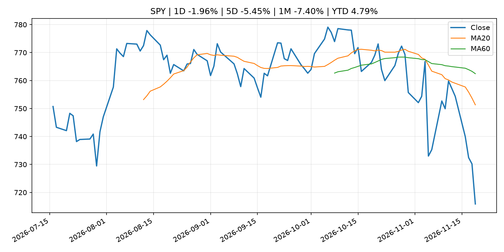
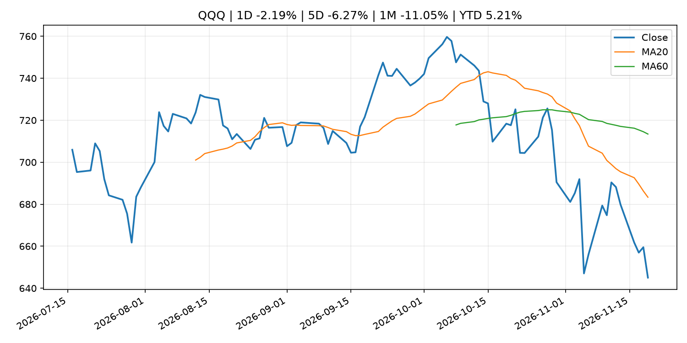
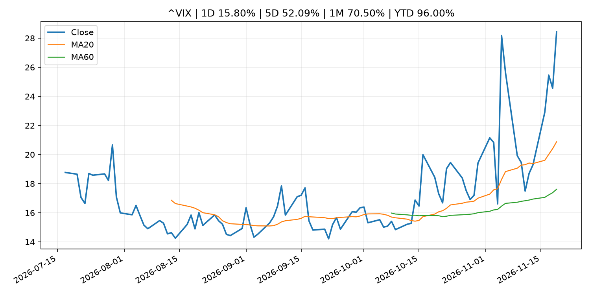
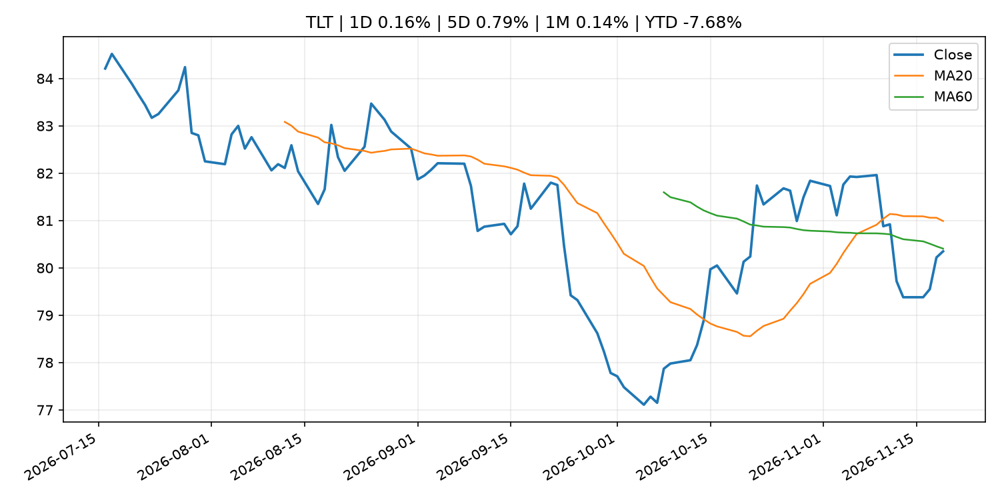
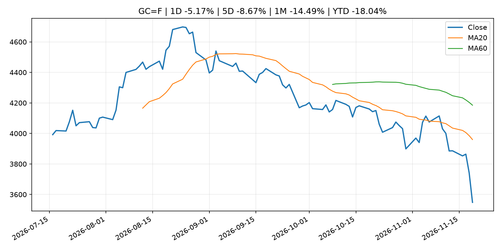
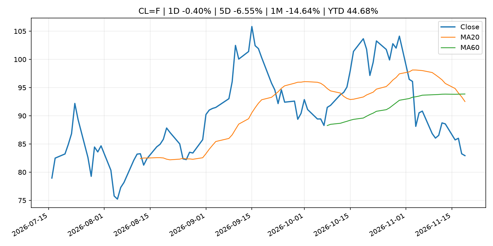
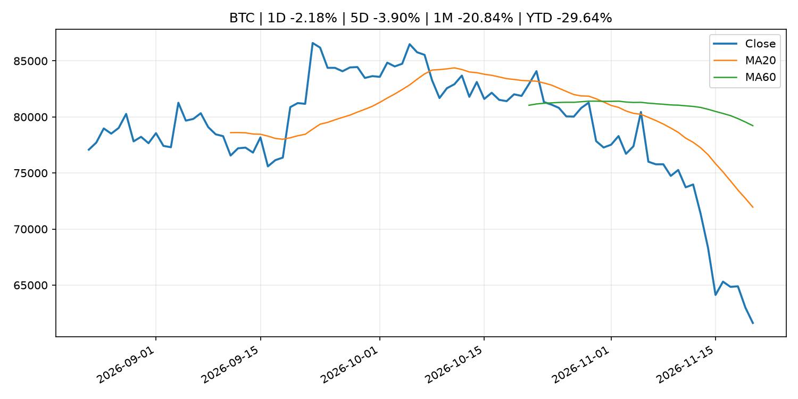
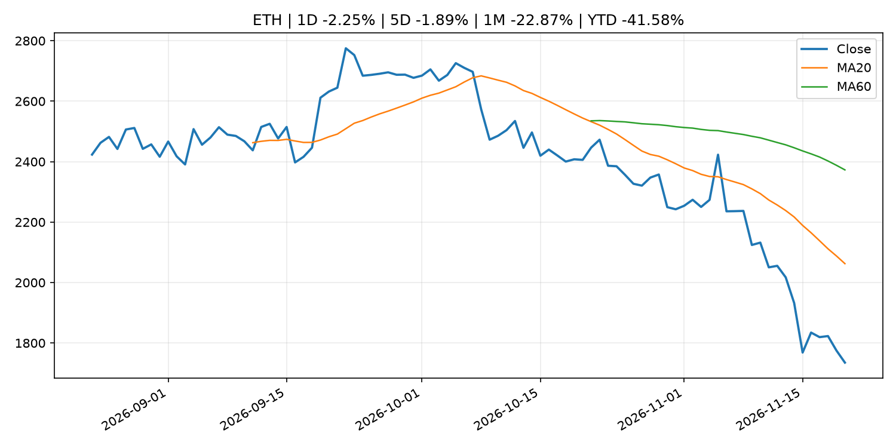
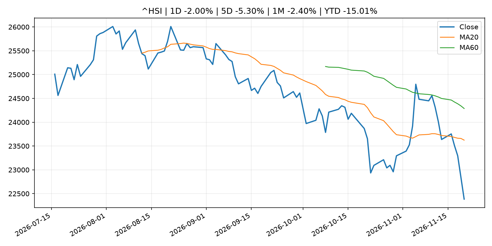

# Global Macro Morning Briefing - 2026-11-20

> Not financial advice / 非投资建议。

## 0. 今日总览
- 市场状态：unknown。市场信号不足，暂不判断明确状态。
- 今日三大主线：
  1. central_bank_decision: Fed’s Waller says central bank may need to ‘shock people’ with half-point rate hike
  2. central_bank_decision: Fed's rate hike push may be a mistake. Here's why
  3. financial_stability: Boris Vujčić: Financial Stability Review - November 2026
- 一句话结论：今日晨报重点关注：央行决策会重定价利率、汇率、久期资产和风险资产。；央行决策会重定价利率、汇率、久期资产和风险资产。。跨资产方面，SPY 1D -1.96%；QQQ 1D -2.19%；^VIX 1D 15.80%；TLT 1D 0.16%；GC=F 1D -5.17%；CL=F 1D -0.40%；BTC 1D -2.18%；ETH 1D -2.25%；市场信号不足，暂不判断明确状态。政策、通胀、利率、美元、美债、能源和加密监管仍是主要观察线索。所有结论仅基于公开数据与短摘要整理，不构成投资建议。

## 1. 隔夜跨资产市场
- 美股：SPY 1D -1.96%，QQQ 1D -2.19%，整体趋势需结合 VIX 和利率确认。
- 美债/美元：TLT 1D 0.16%，美元指数 1D 0.03%，是判断折现率压力的核心线索。
- 黄金/原油：黄金 1D -5.17%，原油 1D -0.40%，用于观察避险、通胀和地缘风险。
- 加密：BTC 1D -2.18%，ETH 1D -2.25%，关注是否独立于纳指走出加密自身行情。
- 港股/A股：恒生 1D -2.00%，沪深300/上证 1D n/a，重点看中国政策预期与人民币线索。
- 风险观察：关注后续数据是否确认当前跨资产信号。

### US_EQUITY

| symbol | latest close | 1D | 5D | 1M | YTD | trend |
|---|---:|---:|---:|---:|---:|---|
| SPY | 715.87 | -1.96% | -5.45% | -7.40% | 4.79% | strong_downtrend |
| QQQ | 645.04 | -2.19% | -6.27% | -11.05% | 5.21% | strong_downtrend |
| DIA | 490.79 | -2.18% | -6.06% | -6.99% | 1.48% | strong_downtrend |
| IWM | 264.22 | -2.18% | -5.11% | -4.43% | 6.21% | strong_downtrend |
| VTI | 352.41 | -1.97% | -5.42% | -7.05% | 4.79% | strong_downtrend |

### US_MACRO_MARKET

| symbol | latest close | 1D | 5D | 1M | YTD | trend |
|---|---:|---:|---:|---:|---:|---|
| ^VIX | 28.44 | 15.80% | 52.09% | 70.50% | 96.00% | strong_uptrend |
| DX-Y.NYB | 103.89 | 0.03% | 0.69% | 2.07% | 5.55% | uptrend |
| TLT | 80.35 | 0.16% | 0.79% | 0.14% | -7.68% | range_bound |
| IEF | 90.82 | 0.17% | 0.68% | 0.65% | -5.47% | range_bound |

### COMMODITIES

| symbol | latest close | 1D | 5D | 1M | YTD | trend |
|---|---:|---:|---:|---:|---:|---|
| GC=F | 3,548.50 | -5.17% | -8.67% | -14.49% | -18.04% | strong_downtrend |
| SI=F | 41.89 | -6.91% | -16.17% | -27.05% | -40.63% | strong_downtrend |
| CL=F | 82.93 | -0.40% | -6.55% | -14.64% | 44.68% | strong_downtrend |
| BZ=F | 90.01 | -2.11% | -6.06% | -17.29% | 48.16% | strong_downtrend |
| NG=F | 3.24 | -3.88% | -2.96% | 16.16% | -10.42% | strong_uptrend |
| HG=F | 5.53 | -2.35% | -10.61% | -15.54% | -2.01% | strong_downtrend |

### HK_MARKET

| symbol | latest close | 1D | 5D | 1M | YTD | trend |
|---|---:|---:|---:|---:|---:|---|
| ^HSI | 22,384.98 | -2.00% | -5.30% | -2.40% | -15.01% | downtrend |
| 0700.HK | 342.60 | -1.66% | -11.38% | -10.41% | -45.01% | strong_downtrend |
| 9988.HK | 82.50 | 2.42% | -8.89% | -15.25% | -44.63% | strong_downtrend |
| 3690.HK | 66.95 | -0.89% | -4.08% | -6.10% | -35.99% | strong_downtrend |
| 1810.HK | 27.72 | -2.81% | -3.95% | 7.44% | -31.18% | range_bound |
| 1211.HK | 62.90 | -0.47% | -3.23% | -6.68% | -36.30% | strong_downtrend |

### CRYPTO

| symbol | latest close | 1D | 5D | 1M | YTD | trend |
|---|---:|---:|---:|---:|---:|---|
| BTC | 61,620.29 | -2.18% | -3.90% | -20.84% | -29.64% | strong_downtrend |
| ETH | 1,735.11 | -2.25% | -1.89% | -22.87% | -41.58% | strong_downtrend |
| SOLANA | 72.01 | -2.11% | 2.52% | -24.58% | -42.17% | strong_downtrend |
| BINANCECOIN | 570.55 | -1.96% | -1.88% | -18.15% | -33.86% | strong_downtrend |
| RIPPLE | 0.95 | -1.72% | 3.99% | -23.10% | -48.37% | strong_downtrend |

## 2. 今日最重要的 10 条新闻
### 1. Fed’s Waller says central bank may need to ‘shock people’ with half-point rate hike
- 来源：CNBC Economy
- 时间：2026-11-18T15:13:39+00:00
- 地区：US
- 事件类型：central_bank_decision
- 重要性层级：Tier 1
- 一句话摘要：Continued inflation above the Fed's 2% target is pushing central bank officials into a more aggressive stance.
- 为什么重要：央行决策会重定价利率、汇率、久期资产和风险资产。
- 可能影响：主要影响 DXY，方向为 positive，强度 high；通胀压力可能推高政策利率预期并支撑美元。
  - 资产：DXY
    方向：positive
    强度：high
    原因：通胀压力可能推高政策利率预期并支撑美元。
  - 资产：TLT
    方向：negative
    强度：high
    原因：通胀上行通常推升收益率、压低长债价格。
  - 资产：QQQ
    方向：negative
    强度：high
    原因：更高利率对成长股估值折现率不利。
  - 资产：SPY
    方向：mixed
    强度：medium
    原因：名义增长可能支撑收入，但更高利率压制估值。
  - 资产：GC=F
    方向：mixed
    强度：medium
    原因：通胀对黄金是支撑，但实际利率上行会形成压力。
  - 资产：BTC
    方向：negative
    强度：high
    原因：流动性收紧通常压制高 beta 加密资产。
- 原文链接：[https://www.cnbc.com/2026/11/18/federal-reserve-governor-christopher-waller.html](https://www.cnbc.com/2026/11/18/federal-reserve-governor-christopher-waller.html)

### 2. Fed's rate hike push may be a mistake. Here's why
- 来源：CoinDesk
- 时间：2026-11-19T06:23:19+00:00
- 地区：global
- 事件类型：central_bank_decision
- 重要性层级：Tier 1
- 一句话摘要：Fed's rate hike push may be a mistake. Here's why
- 为什么重要：央行决策会重定价利率、汇率、久期资产和风险资产。
- 可能影响：主要影响 QQQ，方向为 negative，强度 high；鹰派政策提高折现率，压制成长股估值。
  - 资产：QQQ
    方向：negative
    强度：high
    原因：鹰派政策提高折现率，压制成长股估值。
  - 资产：SPY
    方向：negative
    强度：medium
    原因：更紧政策通常削弱风险偏好。
  - 资产：TLT
    方向：negative
    强度：high
    原因：利率上行通常压低长债价格。
  - 资产：DXY
    方向：positive
    强度：high
    原因：更高利率预期通常支撑美元。
  - 资产：BTC
    方向：negative
    强度：high
    原因：流动性收紧通常压制高 beta 加密资产。
- 原文链接：[https://www.coindesk.com/markets/2026/11/19/fed-s-push-for-more-rate-hikes-leans-on-backward-looking-data-as-gas-prices-slide-analysts-argue](https://www.coindesk.com/markets/2026/11/19/fed-s-push-for-more-rate-hikes-leans-on-backward-looking-data-as-gas-prices-slide-analysts-argue)

### 3. Boris Vujčić: Financial Stability Review - November 2026
- 来源：ECB Press Releases
- 时间：2026-11-18T10:00:00+01:00
- 地区：EU
- 事件类型：financial_stability
- 重要性层级：Tier 1
- 一句话摘要：Boris Vujčić: Financial Stability Review - November 2026
- 为什么重要：金融稳定信号可能放大跨资产波动，并影响央行反应函数。
- 可能影响：可能影响利率、汇率、风险资产或大宗商品预期，但当前公开信息不足以判断明确方向。
  - 资产：暂无明确资产映射
  - 方向：unknown
  - 强度：low
  - 原因：公开信息不足以判断方向。
- 原文链接：[https://www.ecb.europa.eu//press/key/date/2026/html/ecb.sp261118~86f1e8147e.en.pdf](https://www.ecb.europa.eu//press/key/date/2026/html/ecb.sp261118~86f1e8147e.en.pdf)

### 4. Risks from AI valuations, fiscal imbalances and geoeconomic tensions weigh on financial stability outlook
- 来源：ECB Press Releases
- 时间：2026-11-18T10:00:00+01:00
- 地区：EU
- 事件类型：fiscal_policy
- 重要性层级：Tier 1
- 一句话摘要：Risks from AI valuations, fiscal imbalances and geoeconomic tensions weigh on financial stability outlook
- 为什么重要：财政和贸易政策会影响增长、通胀、企业利润和跨境资本流。
- 可能影响：可能影响利率、汇率、风险资产或大宗商品预期，但当前公开信息不足以判断明确方向。
  - 资产：暂无明确资产映射
  - 方向：unknown
  - 强度：low
  - 原因：公开信息不足以判断方向。
- 原文链接：[https://www.ecb.europa.eu//press/pr/date/2026/html/ecb.pr261118~83c5c60158.en.html](https://www.ecb.europa.eu//press/pr/date/2026/html/ecb.pr261118~83c5c60158.en.html)

### 5. SEC: Eight Entities Used Fake Crypto Asset Trading Platforms to Steal More Than $37 Million From U.S. Investors
- 来源：SEC Press Releases
- 时间：2026-11-19T09:39:02-05:00
- 地区：US
- 事件类型：regulation
- 重要性层级：Tier 2
- 一句话摘要：The Securities and Exchange Commission today charged eight Colorado-based entities, likely operated by individuals located overseas, for defrauding U.S. investors out of more than $37 million. The defendants allegedly lured investors to believe they were…
- 为什么重要：监管变化会改变行业盈利预期和资产风险溢价。
- 可能影响：主要影响 BTC，方向为 mixed，强度 high；加密监管或 ETF 进展会改变 BTC 的资金流和风险溢价。
  - 资产：BTC
    方向：mixed
    强度：high
    原因：加密监管或 ETF 进展会改变 BTC 的资金流和风险溢价。
  - 资产：ETH
    方向：mixed
    强度：high
    原因：监管框架会影响 ETH 产品化和机构参与度。
  - 资产：COIN
    方向：mixed
    强度：medium
    原因：监管清晰度和执法风险会影响交易平台估值。
  - 资产：crypto market
    方向：mixed
    强度：high
    原因：信息影响整个加密市场结构，但方向取决于细节。
- 原文链接：[https://www.sec.gov/newsroom/press-releases/2026-115-sec-eight-entities-used-fake-crypto-asset-trading-platforms-steal-more-37-million-us-investors](https://www.sec.gov/newsroom/press-releases/2026-115-sec-eight-entities-used-fake-crypto-asset-trading-platforms-steal-more-37-million-us-investors)

### 6. Sky's USDS stablecoin shrinks 35% as $1.5 billion exits reserves after illicit-finance report
- 来源：CoinDesk
- 时间：2026-11-19T19:53:42+00:00
- 地区：global
- 事件类型：crypto_market_structure
- 重要性层级：Tier 2
- 一句话摘要：Sky's USDS stablecoin shrinks 35% as $1.5 billion exits reserves after illicit-finance report
- 为什么重要：加密市场结构和监管变化会影响 BTC、ETH 及相关股票的风险溢价。
- 可能影响：主要影响 BTC，方向为 mixed，强度 high；加密监管或 ETF 进展会改变 BTC 的资金流和风险溢价。
  - 资产：BTC
    方向：mixed
    强度：high
    原因：加密监管或 ETF 进展会改变 BTC 的资金流和风险溢价。
  - 资产：ETH
    方向：mixed
    强度：high
    原因：监管框架会影响 ETH 产品化和机构参与度。
  - 资产：COIN
    方向：mixed
    强度：medium
    原因：监管清晰度和执法风险会影响交易平台估值。
  - 资产：crypto market
    方向：mixed
    强度：high
    原因：信息影响整个加密市场结构，但方向取决于细节。
- 原文链接：[https://www.coindesk.com/business/2026/11/19/sky-s-usds-stablecoin-shrinks-35-as-usd1-5-billion-exits-reserves-after-illicit-finance-report](https://www.coindesk.com/business/2026/11/19/sky-s-usds-stablecoin-shrinks-35-as-usd1-5-billion-exits-reserves-after-illicit-finance-report)

### 7. Trump's Democratic SEC pick suggests tokenization policy deserves full rule process
- 来源：CoinDesk
- 时间：2026-11-19T18:15:56+00:00
- 地区：global
- 事件类型：regulation
- 重要性层级：Tier 2
- 一句话摘要：Trump's Democratic SEC pick suggests tokenization policy deserves full rule process
- 为什么重要：监管变化会改变行业盈利预期和资产风险溢价。
- 可能影响：主要影响 BTC，方向为 mixed，强度 high；加密监管或 ETF 进展会改变 BTC 的资金流和风险溢价。
  - 资产：BTC
    方向：mixed
    强度：high
    原因：加密监管或 ETF 进展会改变 BTC 的资金流和风险溢价。
  - 资产：ETH
    方向：mixed
    强度：high
    原因：监管框架会影响 ETH 产品化和机构参与度。
  - 资产：COIN
    方向：mixed
    强度：medium
    原因：监管清晰度和执法风险会影响交易平台估值。
  - 资产：crypto market
    方向：mixed
    强度：high
    原因：信息影响整个加密市场结构，但方向取决于细节。
- 原文链接：[https://www.coindesk.com/policy/2026/11/19/trump-s-democratic-sec-pick-suggests-tokenization-policy-deserves-full-rule-process](https://www.coindesk.com/policy/2026/11/19/trump-s-democratic-sec-pick-suggests-tokenization-policy-deserves-full-rule-process)

### 8. North Korean hackers used Sky's stablecoin system, putting billions at freeze risk
- 来源：CoinDesk
- 时间：2026-11-19T11:30:00+00:00
- 地区：global
- 事件类型：crypto_market_structure
- 重要性层级：Tier 2
- 一句话摘要：North Korean hackers used Sky's stablecoin system, putting billions at freeze risk
- 为什么重要：加密市场结构和监管变化会影响 BTC、ETH 及相关股票的风险溢价。
- 可能影响：主要影响 BTC，方向为 mixed，强度 high；加密监管或 ETF 进展会改变 BTC 的资金流和风险溢价。
  - 资产：BTC
    方向：mixed
    强度：high
    原因：加密监管或 ETF 进展会改变 BTC 的资金流和风险溢价。
  - 资产：ETH
    方向：mixed
    强度：high
    原因：监管框架会影响 ETH 产品化和机构参与度。
  - 资产：COIN
    方向：mixed
    强度：medium
    原因：监管清晰度和执法风险会影响交易平台估值。
  - 资产：crypto market
    方向：mixed
    强度：high
    原因：信息影响整个加密市场结构，但方向取决于细节。
- 原文链接：[https://www.coindesk.com/business/2026/11/19/north-korean-hackers-used-sky-s-stablecoin-system-putting-billions-at-freeze-risk](https://www.coindesk.com/business/2026/11/19/north-korean-hackers-used-sky-s-stablecoin-system-putting-billions-at-freeze-risk)

### 9. Federal Reserve Board issues enforcement action with former employee of First Security Bancorp
- 来源：Federal Reserve Press Releases
- 时间：2026-11-19T16:00:00+00:00
- 地区：US
- 事件类型：regulation
- 重要性层级：Tier 2
- 一句话摘要：Federal Reserve Board issues enforcement action with former employee of First Security Bancorp
- 为什么重要：监管变化会改变行业盈利预期和资产风险溢价。
- 可能影响：可能影响利率、汇率、风险资产或大宗商品预期，但当前公开信息不足以判断明确方向。
  - 资产：暂无明确资产映射
  - 方向：unknown
  - 强度：low
  - 原因：公开信息不足以判断方向。
- 原文链接：[https://www.federalreserve.gov/newsevents/pressreleases/enforcement20261119a.htm](https://www.federalreserve.gov/newsevents/pressreleases/enforcement20261119a.htm)

### 10. Anthropic’s stock surges in its debut — and the rest of the market dives anyway
- 来源：MarketWatch Top Stories
- 时间：2026-11-19T22:12:00+00:00
- 地区：US
- 事件类型：central_bank_speech
- 重要性层级：Tier 2
- 一句话摘要：All four major U.S. stock indexes are now on pace for their worst week since President Trump’s “liberation day” tariffs of April 2025
- 为什么重要：央行官员表态可能影响市场对下一次会议的定价。
- 可能影响：可能影响利率、汇率、风险资产或大宗商品预期，但当前公开信息不足以判断明确方向。
  - 资产：暂无明确资产映射
  - 方向：unknown
  - 强度：low
  - 原因：公开信息不足以判断方向。
- 原文链接：[https://www.marketwatch.com/story/anthropics-stock-surges-in-its-debut-and-the-rest-of-the-market-dives-anyway-19671218?mod=mw_rss_topstories](https://www.marketwatch.com/story/anthropics-stock-surges-in-its-debut-and-the-rest-of-the-market-dives-anyway-19671218?mod=mw_rss_topstories)

## 3. 政策与央行观察
### 1. Fed’s Waller says central bank may need to ‘shock people’ with half-point rate hike
- 来源：CNBC Economy
- 时间：2026-11-18T15:13:39+00:00
- 地区：US
- 事件类型：central_bank_decision
- 重要性层级：Tier 1
- 一句话摘要：Continued inflation above the Fed's 2% target is pushing central bank officials into a more aggressive stance.
- 为什么重要：央行决策会重定价利率、汇率、久期资产和风险资产。
- 可能影响：主要影响 DXY，方向为 positive，强度 high；通胀压力可能推高政策利率预期并支撑美元。
  - 资产：DXY
    方向：positive
    强度：high
    原因：通胀压力可能推高政策利率预期并支撑美元。
  - 资产：TLT
    方向：negative
    强度：high
    原因：通胀上行通常推升收益率、压低长债价格。
  - 资产：QQQ
    方向：negative
    强度：high
    原因：更高利率对成长股估值折现率不利。
  - 资产：SPY
    方向：mixed
    强度：medium
    原因：名义增长可能支撑收入，但更高利率压制估值。
  - 资产：GC=F
    方向：mixed
    强度：medium
    原因：通胀对黄金是支撑，但实际利率上行会形成压力。
  - 资产：BTC
    方向：negative
    强度：high
    原因：流动性收紧通常压制高 beta 加密资产。
- 原文链接：[https://www.cnbc.com/2026/11/18/federal-reserve-governor-christopher-waller.html](https://www.cnbc.com/2026/11/18/federal-reserve-governor-christopher-waller.html)

### 2. Fed's rate hike push may be a mistake. Here's why
- 来源：CoinDesk
- 时间：2026-11-19T06:23:19+00:00
- 地区：global
- 事件类型：central_bank_decision
- 重要性层级：Tier 1
- 一句话摘要：Fed's rate hike push may be a mistake. Here's why
- 为什么重要：央行决策会重定价利率、汇率、久期资产和风险资产。
- 可能影响：主要影响 QQQ，方向为 negative，强度 high；鹰派政策提高折现率，压制成长股估值。
  - 资产：QQQ
    方向：negative
    强度：high
    原因：鹰派政策提高折现率，压制成长股估值。
  - 资产：SPY
    方向：negative
    强度：medium
    原因：更紧政策通常削弱风险偏好。
  - 资产：TLT
    方向：negative
    强度：high
    原因：利率上行通常压低长债价格。
  - 资产：DXY
    方向：positive
    强度：high
    原因：更高利率预期通常支撑美元。
  - 资产：BTC
    方向：negative
    强度：high
    原因：流动性收紧通常压制高 beta 加密资产。
- 原文链接：[https://www.coindesk.com/markets/2026/11/19/fed-s-push-for-more-rate-hikes-leans-on-backward-looking-data-as-gas-prices-slide-analysts-argue](https://www.coindesk.com/markets/2026/11/19/fed-s-push-for-more-rate-hikes-leans-on-backward-looking-data-as-gas-prices-slide-analysts-argue)

### 3. Boris Vujčić: Financial Stability Review - November 2026
- 来源：ECB Press Releases
- 时间：2026-11-18T10:00:00+01:00
- 地区：EU
- 事件类型：financial_stability
- 重要性层级：Tier 1
- 一句话摘要：Boris Vujčić: Financial Stability Review - November 2026
- 为什么重要：金融稳定信号可能放大跨资产波动，并影响央行反应函数。
- 可能影响：可能影响利率、汇率、风险资产或大宗商品预期，但当前公开信息不足以判断明确方向。
  - 资产：暂无明确资产映射
  - 方向：unknown
  - 强度：low
  - 原因：公开信息不足以判断方向。
- 原文链接：[https://www.ecb.europa.eu//press/key/date/2026/html/ecb.sp261118~86f1e8147e.en.pdf](https://www.ecb.europa.eu//press/key/date/2026/html/ecb.sp261118~86f1e8147e.en.pdf)

### 4. Risks from AI valuations, fiscal imbalances and geoeconomic tensions weigh on financial stability outlook
- 来源：ECB Press Releases
- 时间：2026-11-18T10:00:00+01:00
- 地区：EU
- 事件类型：fiscal_policy
- 重要性层级：Tier 1
- 一句话摘要：Risks from AI valuations, fiscal imbalances and geoeconomic tensions weigh on financial stability outlook
- 为什么重要：财政和贸易政策会影响增长、通胀、企业利润和跨境资本流。
- 可能影响：可能影响利率、汇率、风险资产或大宗商品预期，但当前公开信息不足以判断明确方向。
  - 资产：暂无明确资产映射
  - 方向：unknown
  - 强度：low
  - 原因：公开信息不足以判断方向。
- 原文链接：[https://www.ecb.europa.eu//press/pr/date/2026/html/ecb.pr261118~83c5c60158.en.html](https://www.ecb.europa.eu//press/pr/date/2026/html/ecb.pr261118~83c5c60158.en.html)

### 5. SEC: Eight Entities Used Fake Crypto Asset Trading Platforms to Steal More Than $37 Million From U.S. Investors
- 来源：SEC Press Releases
- 时间：2026-11-19T09:39:02-05:00
- 地区：US
- 事件类型：regulation
- 重要性层级：Tier 2
- 一句话摘要：The Securities and Exchange Commission today charged eight Colorado-based entities, likely operated by individuals located overseas, for defrauding U.S. investors out of more than $37 million. The defendants allegedly lured investors to believe they were…
- 为什么重要：监管变化会改变行业盈利预期和资产风险溢价。
- 可能影响：主要影响 BTC，方向为 mixed，强度 high；加密监管或 ETF 进展会改变 BTC 的资金流和风险溢价。
  - 资产：BTC
    方向：mixed
    强度：high
    原因：加密监管或 ETF 进展会改变 BTC 的资金流和风险溢价。
  - 资产：ETH
    方向：mixed
    强度：high
    原因：监管框架会影响 ETH 产品化和机构参与度。
  - 资产：COIN
    方向：mixed
    强度：medium
    原因：监管清晰度和执法风险会影响交易平台估值。
  - 资产：crypto market
    方向：mixed
    强度：high
    原因：信息影响整个加密市场结构，但方向取决于细节。
- 原文链接：[https://www.sec.gov/newsroom/press-releases/2026-115-sec-eight-entities-used-fake-crypto-asset-trading-platforms-steal-more-37-million-us-investors](https://www.sec.gov/newsroom/press-releases/2026-115-sec-eight-entities-used-fake-crypto-asset-trading-platforms-steal-more-37-million-us-investors)

### 6. Sky's USDS stablecoin shrinks 35% as $1.5 billion exits reserves after illicit-finance report
- 来源：CoinDesk
- 时间：2026-11-19T19:53:42+00:00
- 地区：global
- 事件类型：crypto_market_structure
- 重要性层级：Tier 2
- 一句话摘要：Sky's USDS stablecoin shrinks 35% as $1.5 billion exits reserves after illicit-finance report
- 为什么重要：加密市场结构和监管变化会影响 BTC、ETH 及相关股票的风险溢价。
- 可能影响：主要影响 BTC，方向为 mixed，强度 high；加密监管或 ETF 进展会改变 BTC 的资金流和风险溢价。
  - 资产：BTC
    方向：mixed
    强度：high
    原因：加密监管或 ETF 进展会改变 BTC 的资金流和风险溢价。
  - 资产：ETH
    方向：mixed
    强度：high
    原因：监管框架会影响 ETH 产品化和机构参与度。
  - 资产：COIN
    方向：mixed
    强度：medium
    原因：监管清晰度和执法风险会影响交易平台估值。
  - 资产：crypto market
    方向：mixed
    强度：high
    原因：信息影响整个加密市场结构，但方向取决于细节。
- 原文链接：[https://www.coindesk.com/business/2026/11/19/sky-s-usds-stablecoin-shrinks-35-as-usd1-5-billion-exits-reserves-after-illicit-finance-report](https://www.coindesk.com/business/2026/11/19/sky-s-usds-stablecoin-shrinks-35-as-usd1-5-billion-exits-reserves-after-illicit-finance-report)

### 7. Trump's Democratic SEC pick suggests tokenization policy deserves full rule process
- 来源：CoinDesk
- 时间：2026-11-19T18:15:56+00:00
- 地区：global
- 事件类型：regulation
- 重要性层级：Tier 2
- 一句话摘要：Trump's Democratic SEC pick suggests tokenization policy deserves full rule process
- 为什么重要：监管变化会改变行业盈利预期和资产风险溢价。
- 可能影响：主要影响 BTC，方向为 mixed，强度 high；加密监管或 ETF 进展会改变 BTC 的资金流和风险溢价。
  - 资产：BTC
    方向：mixed
    强度：high
    原因：加密监管或 ETF 进展会改变 BTC 的资金流和风险溢价。
  - 资产：ETH
    方向：mixed
    强度：high
    原因：监管框架会影响 ETH 产品化和机构参与度。
  - 资产：COIN
    方向：mixed
    强度：medium
    原因：监管清晰度和执法风险会影响交易平台估值。
  - 资产：crypto market
    方向：mixed
    强度：high
    原因：信息影响整个加密市场结构，但方向取决于细节。
- 原文链接：[https://www.coindesk.com/policy/2026/11/19/trump-s-democratic-sec-pick-suggests-tokenization-policy-deserves-full-rule-process](https://www.coindesk.com/policy/2026/11/19/trump-s-democratic-sec-pick-suggests-tokenization-policy-deserves-full-rule-process)

### 8. North Korean hackers used Sky's stablecoin system, putting billions at freeze risk
- 来源：CoinDesk
- 时间：2026-11-19T11:30:00+00:00
- 地区：global
- 事件类型：crypto_market_structure
- 重要性层级：Tier 2
- 一句话摘要：North Korean hackers used Sky's stablecoin system, putting billions at freeze risk
- 为什么重要：加密市场结构和监管变化会影响 BTC、ETH 及相关股票的风险溢价。
- 可能影响：主要影响 BTC，方向为 mixed，强度 high；加密监管或 ETF 进展会改变 BTC 的资金流和风险溢价。
  - 资产：BTC
    方向：mixed
    强度：high
    原因：加密监管或 ETF 进展会改变 BTC 的资金流和风险溢价。
  - 资产：ETH
    方向：mixed
    强度：high
    原因：监管框架会影响 ETH 产品化和机构参与度。
  - 资产：COIN
    方向：mixed
    强度：medium
    原因：监管清晰度和执法风险会影响交易平台估值。
  - 资产：crypto market
    方向：mixed
    强度：high
    原因：信息影响整个加密市场结构，但方向取决于细节。
- 原文链接：[https://www.coindesk.com/business/2026/11/19/north-korean-hackers-used-sky-s-stablecoin-system-putting-billions-at-freeze-risk](https://www.coindesk.com/business/2026/11/19/north-korean-hackers-used-sky-s-stablecoin-system-putting-billions-at-freeze-risk)

### 9. Federal Reserve Board issues enforcement action with former employee of First Security Bancorp
- 来源：Federal Reserve Press Releases
- 时间：2026-11-19T16:00:00+00:00
- 地区：US
- 事件类型：regulation
- 重要性层级：Tier 2
- 一句话摘要：Federal Reserve Board issues enforcement action with former employee of First Security Bancorp
- 为什么重要：监管变化会改变行业盈利预期和资产风险溢价。
- 可能影响：可能影响利率、汇率、风险资产或大宗商品预期，但当前公开信息不足以判断明确方向。
  - 资产：暂无明确资产映射
  - 方向：unknown
  - 强度：low
  - 原因：公开信息不足以判断方向。
- 原文链接：[https://www.federalreserve.gov/newsevents/pressreleases/enforcement20261119a.htm](https://www.federalreserve.gov/newsevents/pressreleases/enforcement20261119a.htm)

### 10. Anthropic’s stock surges in its debut — and the rest of the market dives anyway
- 来源：MarketWatch Top Stories
- 时间：2026-11-19T22:12:00+00:00
- 地区：US
- 事件类型：central_bank_speech
- 重要性层级：Tier 2
- 一句话摘要：All four major U.S. stock indexes are now on pace for their worst week since President Trump’s “liberation day” tariffs of April 2025
- 为什么重要：央行官员表态可能影响市场对下一次会议的定价。
- 可能影响：可能影响利率、汇率、风险资产或大宗商品预期，但当前公开信息不足以判断明确方向。
  - 资产：暂无明确资产映射
  - 方向：unknown
  - 强度：low
  - 原因：公开信息不足以判断方向。
- 原文链接：[https://www.marketwatch.com/story/anthropics-stock-surges-in-its-debut-and-the-rest-of-the-market-dives-anyway-19671218?mod=mw_rss_topstories](https://www.marketwatch.com/story/anthropics-stock-surges-in-its-debut-and-the-rest-of-the-market-dives-anyway-19671218?mod=mw_rss_topstories)

## 4. 市场异动与图表
- SPY 下跌 -1.96%
- QQQ 下跌 -2.19%
- VIX 上涨 15.80%
- Gold 下跌 -5.17%
- BTC 下跌 -2.18%
- ETH 下跌 -2.25%

### SPY

### QQQ

### ^VIX

### TLT

### GC=F

### CL=F

### BTC

### ETH

### ^HSI

## 5. 华尔街与机构公开观点
- 暂无可靠公开观点。

## 6. 今日重点关注
- 经济数据：经济数据：暂无可靠公开日历数据；如配置经济日历源后可自动填充。
- 央行讲话：央行讲话：暂无可靠公开日历数据；重点跟踪 Fed、ECB、BoJ、PBOC 官网 RSS。
- 财报：财报：暂无可靠数据。
- 政策事件：政策事件：暂无可靠数据。
- 风险提醒：风险提醒：关注数据源失败项、突发地缘风险、利率和美元的二阶反应。

## 7. 英文金融表达与宏观概念
- **inflation expectations**：通胀预期，指家庭、企业或市场对未来通胀的预估。 例句：Inflation expectations can shape wage bargaining and bond yields.
- **real yield**：实际收益率，名义利率扣除通胀预期后的收益率。 例句：Gold often reacts more to real yields than nominal yields.
- **terminal rate**：终端利率，市场预期本轮加息周期的最高政策利率。 例句：A higher terminal rate can pressure growth stocks.
- **market structure**：市场结构，指交易、托管、清算、ETF、监管等制度安排。 例句：Crypto market structure rules can affect institutional participation.
- **soft landing**：软着陆，指通胀回落而经济避免明显衰退。 例句：Markets often rally when data support a soft landing.
- **risk-off**：避险模式，资金偏向美元、国债、黄金等防御资产。 例句：A geopolitical shock can push markets into risk-off mode.

## 8. 背景材料
- [Monetary and Economic Studies (2026)](http://www.boj.or.jp/en/research/imes/mes/mes26.htm)（Bank of Japan Announcements，other）：Monetary and Economic Studies (2026)
- [After Anthropic’s ‘bittersweet’ IPO, here’s what lies ahead](https://www.marketwatch.com/story/after-anthropics-bittersweet-ipo-heres-what-lies-ahead-8c32fdb7?mod=mw_rss_topstories)（MarketWatch Top Stories，other）：Retail investors showed up, but Anthropic has so far failed to provide a broad lift to the technology sector.
- [These were the only stocks that rose amid the stock market’s wipeout Thursday](https://www.marketwatch.com/story/these-were-the-only-stocks-that-rose-amid-the-stock-markets-wipeout-thursday-1eaf32ba?mod=mw_rss_topstories)（MarketWatch Top Stories，other）：All 11 sectors of the S&P 500 declined — 10 of them by more than 1% — but cybersecurity stocks bucked the weakness.
- [Markets are sending troubling signals about the state of the economy](https://www.marketwatch.com/story/markets-are-sending-troubling-signals-about-the-state-of-the-economy-8043f20e?mod=mw_rss_topstories)（MarketWatch Top Stories，other）：A number of recession trades have started to emerge, even as economic data has largely held up.
- [Trump Media wants to clear $884 million of debt without selling its bitcoin](https://www.coindesk.com/markets/2026/11/19/trump-media-wants-to-clear-usd884-million-of-debt-without-selling-its-bitcoin)（CoinDesk，other）：Trump Media wants to clear $884 million of debt without selling its bitcoin
- [Bitcoin ETF outflows show waning crypto appetite ahead of Anthropic's Nasdaq debut](https://www.coindesk.com/daybook-us/2026/11/19/bitcoin-etf-outflows-show-waning-crypto-appetite-ahead-of-anthropic-s-nasdaq-debut)（CoinDesk，other）：Bitcoin ETF outflows show waning crypto appetite ahead of Anthropic's Nasdaq debut
- [Bitcoin holds above $63,750 but Fed rate-hike threats loom large](https://www.coindesk.com/markets/2026/11/19/bitcoin-holds-above-usd63-750-but-fed-rate-hike-threats-loom-large)（CoinDesk，other）：Bitcoin holds above $63,750 but Fed rate-hike threats loom large
- [Live updates: Bitcoin plunges to lowest since July as Anthropic gains, but broader markets tumble](https://www.coindesk.com/markets/2026/11/19/live-updates-bitcoin-nears-usd64-000-as-anthropic-s-record-ipo-lifts-tech)（CoinDesk，other）：Live updates: Bitcoin plunges to lowest since July as Anthropic gains, but broader markets tumble
- [Roundhill scraps Solana and XRP income ETFs as rival funds indicate low demand](https://www.coindesk.com/markets/2026/11/19/roundhill-scraps-solana-and-xrp-income-etfs-as-rival-funds-attract-just-usd12-million)（CoinDesk，other）：Roundhill scraps Solana and XRP income ETFs as rival funds indicate low demand
- [Developments in Real Exports and Real Imports](http://www.boj.or.jp/en/research/research_data/reri/index.htm)（Bank of Japan Announcements，other）：Developments in Real Exports and Real Imports
- [Bitcoin miner that sold its last BTC warns it may run short of cash for $1.2 billion AI deal](https://www.coindesk.com/markets/2026/11/19/bitcoin-miner-that-sold-its-last-btc-warns-it-may-run-short-of-cash-for-usd1-2-billion-ai-deal)（CoinDesk，other）：Bitcoin miner that sold its last BTC warns it may run short of cash for $1.2 billion AI deal
- [Fed officials expect more rate hikes, worry about AI impact on inflation, minutes show](https://www.cnbc.com/2026/11/18/fed-minutes-october-2026.html)（CNBC Economy，other）：The Federal Reserve on Wednesday released minutes from its October policy meeting at which it voted to hold its benchmark interest rate in a range between 3.75%-4%.
- [Minutes of the Federal Open Market Committee, October 27-28, 2026](https://www.federalreserve.gov/newsevents/pressreleases/monetary20261118a.htm)（Federal Reserve Press Releases，other）：Minutes of the Federal Open Market Committee, October 27-28, 2026
- [German judge proposes dropping Movie2k case if operator hands over $2.56 billion in bitcoin](https://www.coindesk.com/business/2026/11/18/german-judge-proposes-dropping-movie2k-case-if-operator-hands-over-usd2-56-billion-in-bitcoin)（CoinDesk，other）：German judge proposes dropping Movie2k case if operator hands over $2.56 billion in bitcoin
- [Hong Kong wants banks to use AI to catch crypto crime before money disappears](https://www.coindesk.com/business/2026/11/18/hong-kong-wants-banks-to-use-ai-to-catch-crypto-crime-before-money-disappears)（CoinDesk，other）：Hong Kong wants banks to use AI to catch crypto crime before money disappears

## 9. 数据源、失败项与免责声明
- 采集时间：2026-11-20T02:51:50
- 数据源：公开 RSS、Yahoo Finance、CoinGecko、AKShare、FRED、SEC data.sec.gov，以及用户自有 inputs/reports 文件。
- 合规说明：不绕过 WSJ、Bloomberg、FT、Reuters 等付费墙；对付费媒体只使用公开 RSS 标题、摘要、链接和发布时间。
- 免责声明：Not financial advice / 非投资建议。本项目仅供个人学习、研究和信息整理，不构成投资建议、交易建议或任何收益承诺。
- 失败或跳过的数据源：
  - crypto data failed coin=dogecoin
  - China market data failed symbol=上证指数: stock_zh_index_daily_em 已在 1.20.44 更名为 index_zh_daily_em，请改用 ak.index_zh_daily_em；参数与返回的列也可能有调整，用 ak.interface_info("index_zh_daily_em") 查看。完整对照见 https://akshare.akfamily.xyz/changelog.html#changelog-rename
  - China market data failed symbol=深证成指: stock_zh_index_daily_em 已在 1.20.44 更名为 index_zh_daily_em，请改用 ak.index_zh_daily_em；参数与返回的列也可能有调整，用 ak.interface_info("index_zh_daily_em") 查看。完整对照见 https://akshare.akfamily.xyz/changelog.html#changelog-rename
  - China market data failed symbol=创业板指: stock_zh_index_daily_em 已在 1.20.44 更名为 index_zh_daily_em，请改用 ak.index_zh_daily_em；参数与返回的列也可能有调整，用 ak.interface_info("index_zh_daily_em") 查看。完整对照见 https://akshare.akfamily.xyz/changelog.html#changelog-rename
  - China market data failed symbol=沪深300: stock_zh_index_daily_em 已在 1.20.44 更名为 index_zh_daily_em，请改用 ak.index_zh_daily_em；参数与返回的列也可能有调整，用 ak.interface_info("index_zh_daily_em") 查看。完整对照见 https://akshare.akfamily.xyz/changelog.html#changelog-rename
  - China market data failed symbol=中证500: stock_zh_index_daily_em 已在 1.20.44 更名为 index_zh_daily_em，请改用 ak.index_zh_daily_em；参数与返回的列也可能有调整，用 ak.interface_info("index_zh_daily_em") 查看。完整对照见 https://akshare.akfamily.xyz/changelog.html#changelog-rename
  - China market data failed symbol=科创50: stock_zh_index_daily_em 已在 1.20.44 更名为 index_zh_daily_em，请改用 ak.index_zh_daily_em；参数与返回的列也可能有调整，用 ak.interface_info("index_zh_daily_em") 查看。完整对照见 https://akshare.akfamily.xyz/changelog.html#changelog-rename
  - FRED_API_KEY not set; skipping FRED macro series
  - SEC failed cik=0000320193
  - SEC failed cik=0000789019
  - SEC failed cik=0001045810
  - SEC failed cik=0001318605
  - SEC failed cik=0001577552
