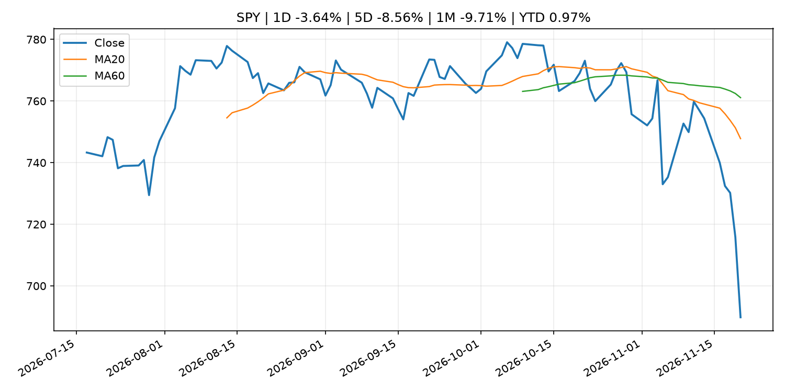
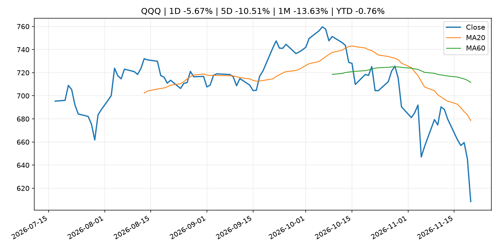
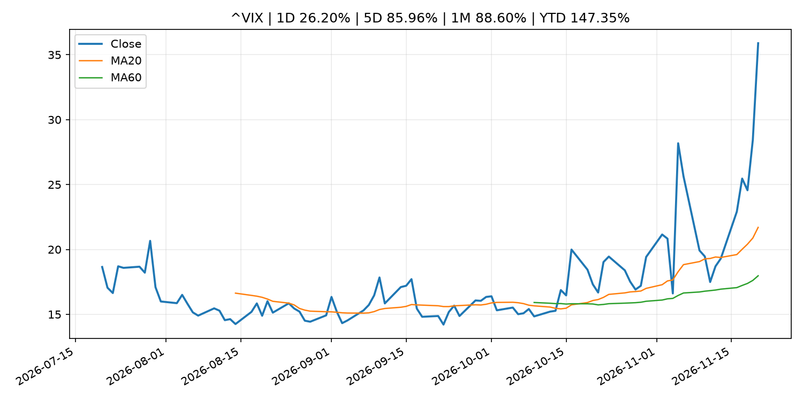
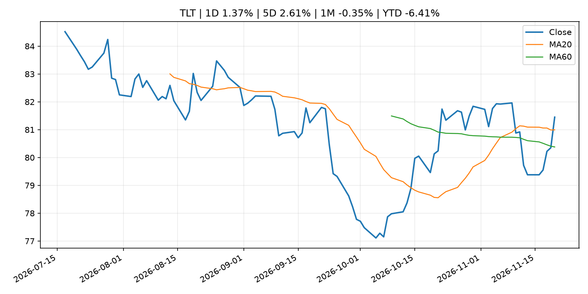
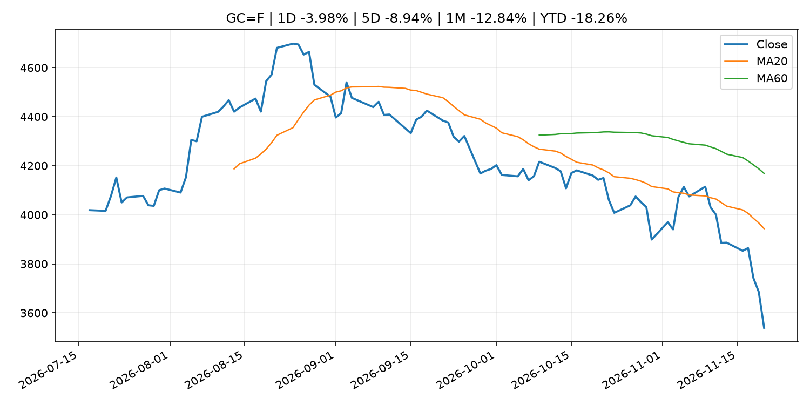
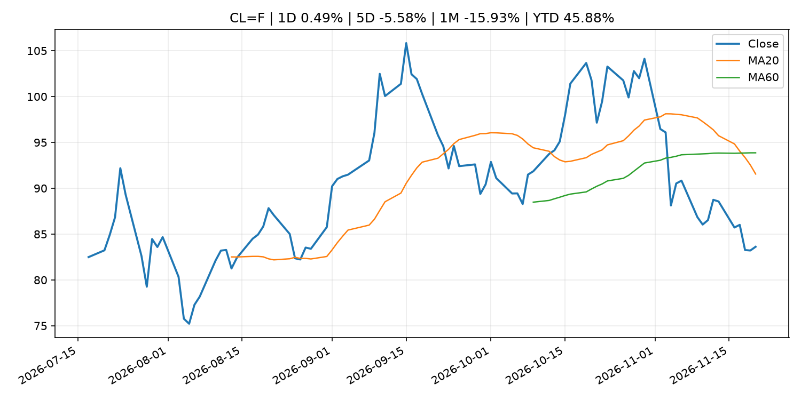
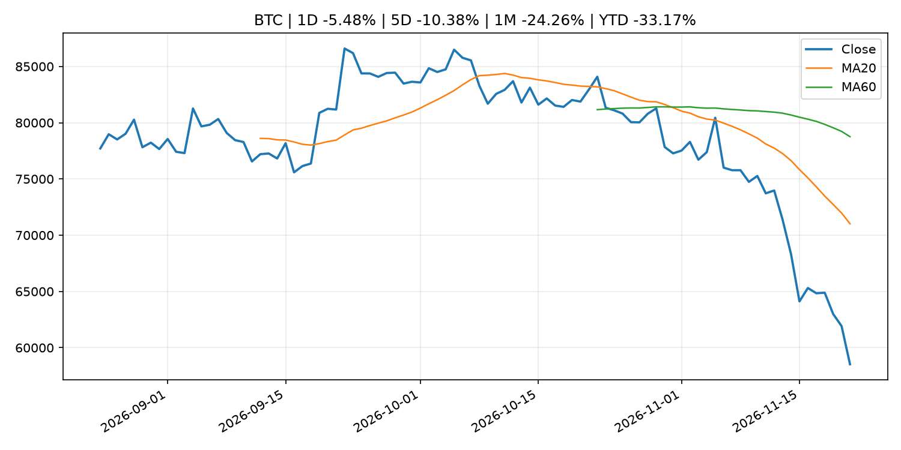
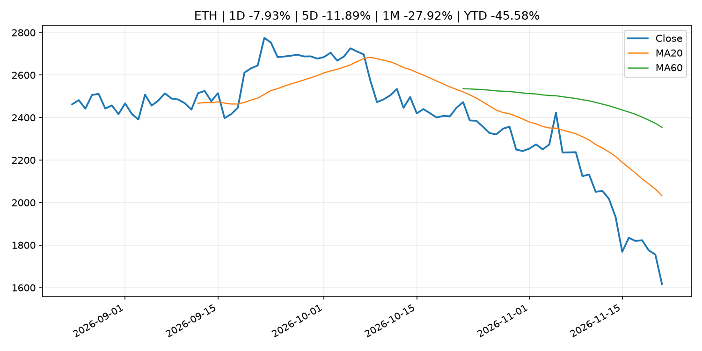
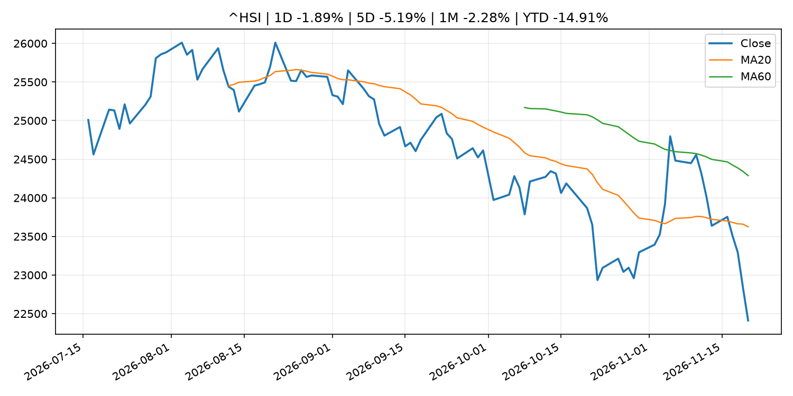

# Global Macro Morning Briefing - 2026-11-21

> Not financial advice / 非投资建议。

## 0. 今日总览
- 市场状态：risk_off。股指回落、VIX 抬升且避险资产走强，市场偏风险规避。
- 今日三大主线：
  1. regulation: SEC Issues Proposal to Restructure the Consolidated Audit Trail
  2. regulation: Fairmint plans tokenized stock venue on Canton, Ethereum under SEC experiment
  3. regulation: SEC Charges Indianapolis-Based Backward Hat Capital and Its Co-Founders With $560 Million Dollar Offering Fraud and Obtains Emergency Relief
- 一句话结论：今日晨报重点关注：监管变化会改变行业盈利预期和资产风险溢价。；监管变化会改变行业盈利预期和资产风险溢价。。跨资产方面，SPY 1D -3.64%；QQQ 1D -5.67%；^VIX 1D 26.20%；TLT 1D 1.37%；GC=F 1D -3.98%；CL=F 1D 0.49%；BTC 1D -5.48%；ETH 1D -7.93%；股指回落、VIX 抬升且避险资产走强，市场偏风险规避。政策、通胀、利率、美元、美债、能源和加密监管仍是主要观察线索。所有结论仅基于公开数据与短摘要整理，不构成投资建议。

## 1. 隔夜跨资产市场
- 美股：SPY 1D -3.64%，QQQ 1D -5.67%，整体趋势需结合 VIX 和利率确认。
- 美债/美元：TLT 1D 1.37%，美元指数 1D -0.06%，是判断折现率压力的核心线索。
- 黄金/原油：黄金 1D -3.98%，原油 1D 0.49%，用于观察避险、通胀和地缘风险。
- 加密：BTC 1D -5.48%，ETH 1D -7.93%，关注是否独立于纳指走出加密自身行情。
- 港股/A股：恒生 1D -1.89%，沪深300/上证 1D n/a，重点看中国政策预期与人民币线索。
- 风险观察：关注避险是否演变为信用或流动性压力。

### US_EQUITY

| symbol | latest close | 1D | 5D | 1M | YTD | trend |
|---|---:|---:|---:|---:|---:|---|
| SPY | 689.81 | -3.64% | -8.56% | -9.71% | 0.97% | strong_downtrend |
| QQQ | 608.45 | -5.67% | -10.51% | -13.63% | -0.76% | strong_downtrend |
| DIA | 481.08 | -1.98% | -8.04% | -8.87% | -0.53% | strong_downtrend |
| IWM | 256.61 | -2.88% | -7.54% | -7.25% | 3.15% | strong_downtrend |
| VTI | 340.02 | -3.52% | -8.38% | -9.30% | 1.10% | strong_downtrend |

### US_MACRO_MARKET

| symbol | latest close | 1D | 5D | 1M | YTD | trend |
|---|---:|---:|---:|---:|---:|---|
| ^VIX | 35.89 | 26.20% | 85.96% | 88.60% | 147.35% | strong_uptrend |
| DX-Y.NYB | 103.84 | -0.06% | 0.42% | 2.19% | 5.51% | uptrend |
| TLT | 81.45 | 1.37% | 2.61% | -0.35% | -6.41% | uptrend |
| IEF | 91.65 | 0.91% | 1.79% | 0.49% | -4.61% | uptrend |

### COMMODITIES

| symbol | latest close | 1D | 5D | 1M | YTD | trend |
|---|---:|---:|---:|---:|---:|---|
| GC=F | 3,539.00 | -3.98% | -8.94% | -12.84% | -18.26% | strong_downtrend |
| SI=F | 41.08 | -7.31% | -16.22% | -24.99% | -41.78% | strong_downtrend |
| CL=F | 83.62 | 0.49% | -5.58% | -15.93% | 45.88% | strong_downtrend |
| BZ=F | 89.87 | -2.29% | -6.23% | -20.59% | 47.93% | strong_downtrend |
| NG=F | 3.79 | 16.00% | 17.37% | 35.59% | 4.78% | strong_uptrend |
| HG=F | 5.47 | -2.84% | -10.11% | -14.11% | -3.10% | strong_downtrend |

### HK_MARKET

| symbol | latest close | 1D | 5D | 1M | YTD | trend |
|---|---:|---:|---:|---:|---:|---|
| ^HSI | 22,410.80 | -1.89% | -5.19% | -2.28% | -14.91% | downtrend |
| 0700.HK | 344.00 | -1.26% | -11.02% | -10.04% | -44.78% | strong_downtrend |
| 9988.HK | 83.35 | 3.48% | -7.95% | -14.38% | -44.06% | strong_downtrend |
| 3690.HK | 66.50 | -1.55% | -4.73% | -6.73% | -36.42% | strong_downtrend |
| 1810.HK | 27.64 | -3.09% | -4.23% | 7.13% | -31.38% | range_bound |
| 1211.HK | 62.35 | -1.34% | -4.08% | -7.49% | -36.86% | strong_downtrend |

### CRYPTO

| symbol | latest close | 1D | 5D | 1M | YTD | trend |
|---|---:|---:|---:|---:|---:|---|
| BTC | 58,529.80 | -5.48% | -10.38% | -24.26% | -33.17% | strong_downtrend |
| ETH | 1,616.44 | -7.93% | -11.89% | -27.92% | -45.58% | strong_downtrend |
| SOLANA | 68.48 | -6.28% | -5.82% | -28.86% | -45.01% | strong_downtrend |
| BINANCECOIN | 534.86 | -7.72% | -10.32% | -23.98% | -38.00% | strong_downtrend |
| RIPPLE | 0.90 | -6.16% | -7.56% | -28.25% | -51.08% | strong_downtrend |

## 2. 今日最重要的 10 条新闻
### 1. SEC Issues Proposal to Restructure the Consolidated Audit Trail
- 来源：SEC Press Releases
- 时间：2026-11-20T13:03:24-05:00
- 地区：US
- 事件类型：regulation
- 重要性层级：Tier 2
- 一句话摘要：The Securities and Exchange Commission today issued a proposal to address the inefficiencies in the current governance and funding model of the Consolidated Audit Trail (CAT). The Commission is proposing to rescind Rule 613 of Regulation NMS, which…
- 为什么重要：监管变化会改变行业盈利预期和资产风险溢价。
- 可能影响：主要影响 BTC，方向为 mixed，强度 high；加密监管或 ETF 进展会改变 BTC 的资金流和风险溢价。
  - 资产：BTC
    方向：mixed
    强度：high
    原因：加密监管或 ETF 进展会改变 BTC 的资金流和风险溢价。
  - 资产：ETH
    方向：mixed
    强度：high
    原因：监管框架会影响 ETH 产品化和机构参与度。
  - 资产：COIN
    方向：mixed
    强度：medium
    原因：监管清晰度和执法风险会影响交易平台估值。
  - 资产：crypto market
    方向：mixed
    强度：high
    原因：信息影响整个加密市场结构，但方向取决于细节。
- 原文链接：[https://www.sec.gov/newsroom/press-releases/2026-117-sec-issues-proposal-restructure-consolidated-audit-trail](https://www.sec.gov/newsroom/press-releases/2026-117-sec-issues-proposal-restructure-consolidated-audit-trail)

### 2. Fairmint plans tokenized stock venue on Canton, Ethereum under SEC experiment
- 来源：CoinDesk
- 时间：2026-11-20T22:05:31+00:00
- 地区：global
- 事件类型：regulation
- 重要性层级：Tier 2
- 一句话摘要：Fairmint plans tokenized stock venue on Canton, Ethereum under SEC experiment
- 为什么重要：监管变化会改变行业盈利预期和资产风险溢价。
- 可能影响：主要影响 BTC，方向为 mixed，强度 high；加密监管或 ETF 进展会改变 BTC 的资金流和风险溢价。
  - 资产：BTC
    方向：mixed
    强度：high
    原因：加密监管或 ETF 进展会改变 BTC 的资金流和风险溢价。
  - 资产：ETH
    方向：mixed
    强度：high
    原因：监管框架会影响 ETH 产品化和机构参与度。
  - 资产：COIN
    方向：mixed
    强度：medium
    原因：监管清晰度和执法风险会影响交易平台估值。
  - 资产：crypto market
    方向：mixed
    强度：high
    原因：信息影响整个加密市场结构，但方向取决于细节。
- 原文链接：[https://www.coindesk.com/business/2026/11/20/fairmint-plans-tokenized-stock-venue-on-canton-ethereum-under-sec-experiment](https://www.coindesk.com/business/2026/11/20/fairmint-plans-tokenized-stock-venue-on-canton-ethereum-under-sec-experiment)

### 3. SEC Charges Indianapolis-Based Backward Hat Capital and Its Co-Founders With $560 Million Dollar Offering Fraud and Obtains Emergency Relief
- 来源：SEC Press Releases
- 时间：2026-11-20T09:28:28-05:00
- 地区：US
- 事件类型：regulation
- 重要性层级：Tier 2
- 一句话摘要：The Securities and Exchange Commission today announced that it has obtained a temporary restraining order, asset freeze, expedited discovery, and other relief against Indianapolis-based Backward Hat Capital, its co-founders Phillip Williams and Devin…
- 为什么重要：监管变化会改变行业盈利预期和资产风险溢价。
- 可能影响：主要影响 BTC，方向为 mixed，强度 high；加密监管或 ETF 进展会改变 BTC 的资金流和风险溢价。
  - 资产：BTC
    方向：mixed
    强度：high
    原因：加密监管或 ETF 进展会改变 BTC 的资金流和风险溢价。
  - 资产：ETH
    方向：mixed
    强度：high
    原因：监管框架会影响 ETH 产品化和机构参与度。
  - 资产：COIN
    方向：mixed
    强度：medium
    原因：监管清晰度和执法风险会影响交易平台估值。
  - 资产：crypto market
    方向：mixed
    强度：high
    原因：信息影响整个加密市场结构，但方向取决于细节。
- 原文链接：[https://www.sec.gov/newsroom/press-releases/2026-116-sec-charges-indianapolis-based-backward-hat-capital-its-co-founders-560-million-dollar-offering](https://www.sec.gov/newsroom/press-releases/2026-116-sec-charges-indianapolis-based-backward-hat-capital-its-co-founders-560-million-dollar-offering)

### 4. SEC: Eight Entities Used Fake Crypto Asset Trading Platforms to Steal More Than $37 Million From U.S. Investors
- 来源：SEC Press Releases
- 时间：2026-11-19T09:39:02-05:00
- 地区：US
- 事件类型：regulation
- 重要性层级：Tier 2
- 一句话摘要：The Securities and Exchange Commission today charged eight Colorado-based entities, likely operated by individuals located overseas, for defrauding U.S. investors out of more than $37 million. The defendants allegedly lured investors to believe they were…
- 为什么重要：监管变化会改变行业盈利预期和资产风险溢价。
- 可能影响：主要影响 BTC，方向为 mixed，强度 high；加密监管或 ETF 进展会改变 BTC 的资金流和风险溢价。
  - 资产：BTC
    方向：mixed
    强度：high
    原因：加密监管或 ETF 进展会改变 BTC 的资金流和风险溢价。
  - 资产：ETH
    方向：mixed
    强度：high
    原因：监管框架会影响 ETH 产品化和机构参与度。
  - 资产：COIN
    方向：mixed
    强度：medium
    原因：监管清晰度和执法风险会影响交易平台估值。
  - 资产：crypto market
    方向：mixed
    强度：high
    原因：信息影响整个加密市场结构，但方向取决于细节。
- 原文链接：[https://www.sec.gov/newsroom/press-releases/2026-115-sec-eight-entities-used-fake-crypto-asset-trading-platforms-steal-more-37-million-us-investors](https://www.sec.gov/newsroom/press-releases/2026-115-sec-eight-entities-used-fake-crypto-asset-trading-platforms-steal-more-37-million-us-investors)

### 5. Sky's USDS stablecoin shrinks 35% as $1.5 billion exits reserves after illicit-finance report
- 来源：CoinDesk
- 时间：2026-11-19T19:53:42+00:00
- 地区：global
- 事件类型：crypto_market_structure
- 重要性层级：Tier 2
- 一句话摘要：Sky's USDS stablecoin shrinks 35% as $1.5 billion exits reserves after illicit-finance report
- 为什么重要：加密市场结构和监管变化会影响 BTC、ETH 及相关股票的风险溢价。
- 可能影响：主要影响 BTC，方向为 mixed，强度 high；加密监管或 ETF 进展会改变 BTC 的资金流和风险溢价。
  - 资产：BTC
    方向：mixed
    强度：high
    原因：加密监管或 ETF 进展会改变 BTC 的资金流和风险溢价。
  - 资产：ETH
    方向：mixed
    强度：high
    原因：监管框架会影响 ETH 产品化和机构参与度。
  - 资产：COIN
    方向：mixed
    强度：medium
    原因：监管清晰度和执法风险会影响交易平台估值。
  - 资产：crypto market
    方向：mixed
    强度：high
    原因：信息影响整个加密市场结构，但方向取决于细节。
- 原文链接：[https://www.coindesk.com/business/2026/11/19/sky-s-usds-stablecoin-shrinks-35-as-usd1-5-billion-exits-reserves-after-illicit-finance-report](https://www.coindesk.com/business/2026/11/19/sky-s-usds-stablecoin-shrinks-35-as-usd1-5-billion-exits-reserves-after-illicit-finance-report)

### 6. Trump's Democratic SEC pick suggests tokenization policy deserves full rule process
- 来源：CoinDesk
- 时间：2026-11-19T18:15:56+00:00
- 地区：global
- 事件类型：regulation
- 重要性层级：Tier 2
- 一句话摘要：Trump's Democratic SEC pick suggests tokenization policy deserves full rule process
- 为什么重要：监管变化会改变行业盈利预期和资产风险溢价。
- 可能影响：主要影响 BTC，方向为 mixed，强度 high；加密监管或 ETF 进展会改变 BTC 的资金流和风险溢价。
  - 资产：BTC
    方向：mixed
    强度：high
    原因：加密监管或 ETF 进展会改变 BTC 的资金流和风险溢价。
  - 资产：ETH
    方向：mixed
    强度：high
    原因：监管框架会影响 ETH 产品化和机构参与度。
  - 资产：COIN
    方向：mixed
    强度：medium
    原因：监管清晰度和执法风险会影响交易平台估值。
  - 资产：crypto market
    方向：mixed
    强度：high
    原因：信息影响整个加密市场结构，但方向取决于细节。
- 原文链接：[https://www.coindesk.com/policy/2026/11/19/trump-s-democratic-sec-pick-suggests-tokenization-policy-deserves-full-rule-process](https://www.coindesk.com/policy/2026/11/19/trump-s-democratic-sec-pick-suggests-tokenization-policy-deserves-full-rule-process)

### 7. Federal Reserve Board issues enforcement action with former employee of First Security Bancorp
- 来源：Federal Reserve Press Releases
- 时间：2026-11-19T16:00:00+00:00
- 地区：US
- 事件类型：regulation
- 重要性层级：Tier 2
- 一句话摘要：Federal Reserve Board issues enforcement action with former employee of First Security Bancorp
- 为什么重要：监管变化会改变行业盈利预期和资产风险溢价。
- 可能影响：可能影响利率、汇率、风险资产或大宗商品预期，但当前公开信息不足以判断明确方向。
  - 资产：暂无明确资产映射
  - 方向：unknown
  - 强度：low
  - 原因：公开信息不足以判断方向。
- 原文链接：[https://www.federalreserve.gov/newsevents/pressreleases/enforcement20261119a.htm](https://www.federalreserve.gov/newsevents/pressreleases/enforcement20261119a.htm)

### 8. Federal Reserve announces College Fed Challenge winners
- 来源：Federal Reserve Press Releases
- 时间：2026-11-20T21:15:00+00:00
- 地区：US
- 事件类型：other
- 重要性层级：Tier 3
- 一句话摘要：Federal Reserve announces College Fed Challenge winners
- 为什么重要：这条信息暂未匹配到重大宏观、政策或市场事件，更适合作为背景跟踪。
- 可能影响：更偏背景信息，短期市场影响可能有限。
  - 资产：暂无明确资产映射
  - 方向：unknown
  - 强度：low
  - 原因：公开信息不足以判断方向。
- 原文链接：[https://www.federalreserve.gov/newsevents/pressreleases/other20261120b.htm](https://www.federalreserve.gov/newsevents/pressreleases/other20261120b.htm)

### 9. Federal Reserve Board releases results from survey of senior financial officers at banks about their strategies and practices for managing reserve balances
- 来源：Federal Reserve Press Releases
- 时间：2026-11-20T15:00:00+00:00
- 地区：US
- 事件类型：other
- 重要性层级：Tier 3
- 一句话摘要：Federal Reserve Board releases results from survey of senior financial officers at banks about their strategies and practices for managing reserve balances
- 为什么重要：这条信息暂未匹配到重大宏观、政策或市场事件，更适合作为背景跟踪。
- 可能影响：更偏背景信息，短期市场影响可能有限。
  - 资产：暂无明确资产映射
  - 方向：unknown
  - 强度：low
  - 原因：公开信息不足以判断方向。
- 原文链接：[https://www.federalreserve.gov/newsevents/pressreleases/other20261120a.htm](https://www.federalreserve.gov/newsevents/pressreleases/other20261120a.htm)

## 3. 政策与央行观察
### 1. SEC Issues Proposal to Restructure the Consolidated Audit Trail
- 来源：SEC Press Releases
- 时间：2026-11-20T13:03:24-05:00
- 地区：US
- 事件类型：regulation
- 重要性层级：Tier 2
- 一句话摘要：The Securities and Exchange Commission today issued a proposal to address the inefficiencies in the current governance and funding model of the Consolidated Audit Trail (CAT). The Commission is proposing to rescind Rule 613 of Regulation NMS, which…
- 为什么重要：监管变化会改变行业盈利预期和资产风险溢价。
- 可能影响：主要影响 BTC，方向为 mixed，强度 high；加密监管或 ETF 进展会改变 BTC 的资金流和风险溢价。
  - 资产：BTC
    方向：mixed
    强度：high
    原因：加密监管或 ETF 进展会改变 BTC 的资金流和风险溢价。
  - 资产：ETH
    方向：mixed
    强度：high
    原因：监管框架会影响 ETH 产品化和机构参与度。
  - 资产：COIN
    方向：mixed
    强度：medium
    原因：监管清晰度和执法风险会影响交易平台估值。
  - 资产：crypto market
    方向：mixed
    强度：high
    原因：信息影响整个加密市场结构，但方向取决于细节。
- 原文链接：[https://www.sec.gov/newsroom/press-releases/2026-117-sec-issues-proposal-restructure-consolidated-audit-trail](https://www.sec.gov/newsroom/press-releases/2026-117-sec-issues-proposal-restructure-consolidated-audit-trail)

### 2. Fairmint plans tokenized stock venue on Canton, Ethereum under SEC experiment
- 来源：CoinDesk
- 时间：2026-11-20T22:05:31+00:00
- 地区：global
- 事件类型：regulation
- 重要性层级：Tier 2
- 一句话摘要：Fairmint plans tokenized stock venue on Canton, Ethereum under SEC experiment
- 为什么重要：监管变化会改变行业盈利预期和资产风险溢价。
- 可能影响：主要影响 BTC，方向为 mixed，强度 high；加密监管或 ETF 进展会改变 BTC 的资金流和风险溢价。
  - 资产：BTC
    方向：mixed
    强度：high
    原因：加密监管或 ETF 进展会改变 BTC 的资金流和风险溢价。
  - 资产：ETH
    方向：mixed
    强度：high
    原因：监管框架会影响 ETH 产品化和机构参与度。
  - 资产：COIN
    方向：mixed
    强度：medium
    原因：监管清晰度和执法风险会影响交易平台估值。
  - 资产：crypto market
    方向：mixed
    强度：high
    原因：信息影响整个加密市场结构，但方向取决于细节。
- 原文链接：[https://www.coindesk.com/business/2026/11/20/fairmint-plans-tokenized-stock-venue-on-canton-ethereum-under-sec-experiment](https://www.coindesk.com/business/2026/11/20/fairmint-plans-tokenized-stock-venue-on-canton-ethereum-under-sec-experiment)

### 3. SEC Charges Indianapolis-Based Backward Hat Capital and Its Co-Founders With $560 Million Dollar Offering Fraud and Obtains Emergency Relief
- 来源：SEC Press Releases
- 时间：2026-11-20T09:28:28-05:00
- 地区：US
- 事件类型：regulation
- 重要性层级：Tier 2
- 一句话摘要：The Securities and Exchange Commission today announced that it has obtained a temporary restraining order, asset freeze, expedited discovery, and other relief against Indianapolis-based Backward Hat Capital, its co-founders Phillip Williams and Devin…
- 为什么重要：监管变化会改变行业盈利预期和资产风险溢价。
- 可能影响：主要影响 BTC，方向为 mixed，强度 high；加密监管或 ETF 进展会改变 BTC 的资金流和风险溢价。
  - 资产：BTC
    方向：mixed
    强度：high
    原因：加密监管或 ETF 进展会改变 BTC 的资金流和风险溢价。
  - 资产：ETH
    方向：mixed
    强度：high
    原因：监管框架会影响 ETH 产品化和机构参与度。
  - 资产：COIN
    方向：mixed
    强度：medium
    原因：监管清晰度和执法风险会影响交易平台估值。
  - 资产：crypto market
    方向：mixed
    强度：high
    原因：信息影响整个加密市场结构，但方向取决于细节。
- 原文链接：[https://www.sec.gov/newsroom/press-releases/2026-116-sec-charges-indianapolis-based-backward-hat-capital-its-co-founders-560-million-dollar-offering](https://www.sec.gov/newsroom/press-releases/2026-116-sec-charges-indianapolis-based-backward-hat-capital-its-co-founders-560-million-dollar-offering)

### 4. SEC: Eight Entities Used Fake Crypto Asset Trading Platforms to Steal More Than $37 Million From U.S. Investors
- 来源：SEC Press Releases
- 时间：2026-11-19T09:39:02-05:00
- 地区：US
- 事件类型：regulation
- 重要性层级：Tier 2
- 一句话摘要：The Securities and Exchange Commission today charged eight Colorado-based entities, likely operated by individuals located overseas, for defrauding U.S. investors out of more than $37 million. The defendants allegedly lured investors to believe they were…
- 为什么重要：监管变化会改变行业盈利预期和资产风险溢价。
- 可能影响：主要影响 BTC，方向为 mixed，强度 high；加密监管或 ETF 进展会改变 BTC 的资金流和风险溢价。
  - 资产：BTC
    方向：mixed
    强度：high
    原因：加密监管或 ETF 进展会改变 BTC 的资金流和风险溢价。
  - 资产：ETH
    方向：mixed
    强度：high
    原因：监管框架会影响 ETH 产品化和机构参与度。
  - 资产：COIN
    方向：mixed
    强度：medium
    原因：监管清晰度和执法风险会影响交易平台估值。
  - 资产：crypto market
    方向：mixed
    强度：high
    原因：信息影响整个加密市场结构，但方向取决于细节。
- 原文链接：[https://www.sec.gov/newsroom/press-releases/2026-115-sec-eight-entities-used-fake-crypto-asset-trading-platforms-steal-more-37-million-us-investors](https://www.sec.gov/newsroom/press-releases/2026-115-sec-eight-entities-used-fake-crypto-asset-trading-platforms-steal-more-37-million-us-investors)

### 5. Sky's USDS stablecoin shrinks 35% as $1.5 billion exits reserves after illicit-finance report
- 来源：CoinDesk
- 时间：2026-11-19T19:53:42+00:00
- 地区：global
- 事件类型：crypto_market_structure
- 重要性层级：Tier 2
- 一句话摘要：Sky's USDS stablecoin shrinks 35% as $1.5 billion exits reserves after illicit-finance report
- 为什么重要：加密市场结构和监管变化会影响 BTC、ETH 及相关股票的风险溢价。
- 可能影响：主要影响 BTC，方向为 mixed，强度 high；加密监管或 ETF 进展会改变 BTC 的资金流和风险溢价。
  - 资产：BTC
    方向：mixed
    强度：high
    原因：加密监管或 ETF 进展会改变 BTC 的资金流和风险溢价。
  - 资产：ETH
    方向：mixed
    强度：high
    原因：监管框架会影响 ETH 产品化和机构参与度。
  - 资产：COIN
    方向：mixed
    强度：medium
    原因：监管清晰度和执法风险会影响交易平台估值。
  - 资产：crypto market
    方向：mixed
    强度：high
    原因：信息影响整个加密市场结构，但方向取决于细节。
- 原文链接：[https://www.coindesk.com/business/2026/11/19/sky-s-usds-stablecoin-shrinks-35-as-usd1-5-billion-exits-reserves-after-illicit-finance-report](https://www.coindesk.com/business/2026/11/19/sky-s-usds-stablecoin-shrinks-35-as-usd1-5-billion-exits-reserves-after-illicit-finance-report)

### 6. Trump's Democratic SEC pick suggests tokenization policy deserves full rule process
- 来源：CoinDesk
- 时间：2026-11-19T18:15:56+00:00
- 地区：global
- 事件类型：regulation
- 重要性层级：Tier 2
- 一句话摘要：Trump's Democratic SEC pick suggests tokenization policy deserves full rule process
- 为什么重要：监管变化会改变行业盈利预期和资产风险溢价。
- 可能影响：主要影响 BTC，方向为 mixed，强度 high；加密监管或 ETF 进展会改变 BTC 的资金流和风险溢价。
  - 资产：BTC
    方向：mixed
    强度：high
    原因：加密监管或 ETF 进展会改变 BTC 的资金流和风险溢价。
  - 资产：ETH
    方向：mixed
    强度：high
    原因：监管框架会影响 ETH 产品化和机构参与度。
  - 资产：COIN
    方向：mixed
    强度：medium
    原因：监管清晰度和执法风险会影响交易平台估值。
  - 资产：crypto market
    方向：mixed
    强度：high
    原因：信息影响整个加密市场结构，但方向取决于细节。
- 原文链接：[https://www.coindesk.com/policy/2026/11/19/trump-s-democratic-sec-pick-suggests-tokenization-policy-deserves-full-rule-process](https://www.coindesk.com/policy/2026/11/19/trump-s-democratic-sec-pick-suggests-tokenization-policy-deserves-full-rule-process)

### 7. Federal Reserve Board issues enforcement action with former employee of First Security Bancorp
- 来源：Federal Reserve Press Releases
- 时间：2026-11-19T16:00:00+00:00
- 地区：US
- 事件类型：regulation
- 重要性层级：Tier 2
- 一句话摘要：Federal Reserve Board issues enforcement action with former employee of First Security Bancorp
- 为什么重要：监管变化会改变行业盈利预期和资产风险溢价。
- 可能影响：可能影响利率、汇率、风险资产或大宗商品预期，但当前公开信息不足以判断明确方向。
  - 资产：暂无明确资产映射
  - 方向：unknown
  - 强度：low
  - 原因：公开信息不足以判断方向。
- 原文链接：[https://www.federalreserve.gov/newsevents/pressreleases/enforcement20261119a.htm](https://www.federalreserve.gov/newsevents/pressreleases/enforcement20261119a.htm)

## 4. 市场异动与图表
- SPY 下跌 -3.64%
- QQQ 下跌 -5.67%
- VIX 上涨 26.20%
- TLT 上涨 1.37%
- Gold 下跌 -3.98%
- BTC 下跌 -5.48%
- ETH 下跌 -7.93%

### SPY

### QQQ

### ^VIX

### TLT

### GC=F

### CL=F

### BTC

### ETH

### ^HSI

## 5. 华尔街与机构公开观点
- 暂无可靠公开观点。

## 6. 今日重点关注
- 经济数据：经济数据：暂无可靠公开日历数据；如配置经济日历源后可自动填充。
- 央行讲话：央行讲话：暂无可靠公开日历数据；重点跟踪 Fed、ECB、BoJ、PBOC 官网 RSS。
- 财报：财报：暂无可靠数据。
- 政策事件：政策事件：暂无可靠数据。
- 风险提醒：风险提醒：关注数据源失败项、突发地缘风险、利率和美元的二阶反应。

## 7. 英文金融表达与宏观概念
- **risk-off**：避险模式，资金偏向美元、国债、黄金等防御资产。 例句：A geopolitical shock can push markets into risk-off mode.
- **market structure**：市场结构，指交易、托管、清算、ETF、监管等制度安排。 例句：Crypto market structure rules can affect institutional participation.
- **inflation expectations**：通胀预期，指家庭、企业或市场对未来通胀的预估。 例句：Inflation expectations can shape wage bargaining and bond yields.
- **real yield**：实际收益率，名义利率扣除通胀预期后的收益率。 例句：Gold often reacts more to real yields than nominal yields.
- **terminal rate**：终端利率，市场预期本轮加息周期的最高政策利率。 例句：A higher terminal rate can pressure growth stocks.
- **soft landing**：软着陆，指通胀回落而经济避免明显衰退。 例句：Markets often rally when data support a soft landing.

## 8. 背景材料
- [Dow, S&P 500 enter correction as Nasdaq suffers worst week since 2020](https://www.marketwatch.com/story/dow-s-p-500-enter-correction-as-nasdaq-suffers-worst-week-since-2020-bd74dadf?mod=mw_rss_topstories)（MarketWatch Top Stories，other）：All 11 S&P 500 sectors finished more than 1% lower this week for the first time since April 2025.
- [Federal Reserve announces College Fed Challenge winners](https://www.federalreserve.gov/newsevents/pressreleases/other20261120b.htm)（Federal Reserve Press Releases，other）：Federal Reserve announces College Fed Challenge winners
- [Bitcoin plunges below $59,000 as rush to cash puts new bear market lows back in play](https://www.coindesk.com/markets/2026/11/20/bitcoin-plunges-below-usd59-000-as-rush-to-cash-puts-new-bear-market-lows-back-in-play)（CoinDesk，other）：Bitcoin plunges below $59,000 as rush to cash puts new bear market lows back in play
- [Federal Reserve Board releases results from survey of senior financial officers at banks about their strategies and practices for managing reserve balances](https://www.federalreserve.gov/newsevents/pressreleases/other20261120a.htm)（Federal Reserve Press Releases，other）：Federal Reserve Board releases results from survey of senior financial officers at banks about their strategies and practices for managing reserve balances
- [Hong Kong moves to extend crypto licensing rules to brokers, advisers and custodians](https://www.coindesk.com/policy/2026/11/20/hong-kong-moves-to-extend-crypto-licensing-rules-to-brokers-advisers-and-custodians)（CoinDesk，other）：Hong Kong moves to extend crypto licensing rules to brokers, advisers and custodians
- [Live news: Bitcoin slips to fresh lows below $59,000 as Anthropic slides after Nasdaq debut](https://www.coindesk.com/tech/2026/11/20/live-news-bitcoin-hovers-just-above-usd61-000-as-anthropic-slides-13-after-nasdaq-debut)（CoinDesk，other）：Live news: Bitcoin slips to fresh lows below $59,000 as Anthropic slides after Nasdaq debut
- [Bitcoin bots pounced within seconds when researchers exposed their wallet keys](https://www.coindesk.com/tech/2026/11/20/bitcoin-bots-pounced-within-seconds-when-researchers-exposed-their-keys)（CoinDesk，other）：Bitcoin bots pounced within seconds when researchers exposed their wallet keys
- [Bitcoin, stocks and gold traders getting nervous, and volatility gauges are surging](https://www.coindesk.com/daybook-us/2026/11/20/bitcoin-stocks-and-gold-traders-getting-nervous-and-volatility-gauges-are-surging)（CoinDesk，other）：Bitcoin, stocks and gold traders getting nervous, and volatility gauges are surging
- [Bitcoin drops for third straight day as Asian tech shares slide](https://www.coindesk.com/markets/2026/11/20/bitcoin-drops-for-third-straight-day-as-asian-tech-shares-slide)（CoinDesk，other）：Bitcoin drops for third straight day as Asian tech shares slide
- [Christine Lagarde: Acting in time](https://www.ecb.europa.eu//press/key/date/2026/html/ecb.sp261120~e52bcc4db2.en.html)（ECB Press Releases，other）：Christine Lagarde: Acting in time
- [Here's what's crashing gold and likely weighing on bitcoin too](https://www.coindesk.com/markets/2026/11/20/here-s-what-s-crashing-gold-and-likely-weighing-on-bitcoin-too)（CoinDesk，other）：Here's what's crashing gold and likely weighing on bitcoin too
- [This Bitcoin miner sold 267 BTC to clear $22 million debt. It still may not survive](https://www.coindesk.com/markets/2026/11/20/this-bitcoin-miner-sold-267-btc-to-clear-usd22-million-debt-it-still-may-not-survive)（CoinDesk，other）：This Bitcoin miner sold 267 BTC to clear $22 million debt. It still may not survive
- [Big money bought a net $4 billion of bitcoin funds in Q3, ending 9 months of selling](https://www.coindesk.com/markets/2026/11/20/big-money-bought-a-net-usd4-billion-of-bitcoin-funds-in-q3-ending-9-months-of-selling)（CoinDesk，other）：Big money bought a net $4 billion of bitcoin funds in Q3, ending 9 months of selling
- [VanEck drops Gemini as custodian of its bitcoin, ether and SOL ETFs](https://www.coindesk.com/markets/2026/11/20/vaneck-drops-gemini-as-custodian-of-its-bitcoin-ether-and-sol-etfs)（CoinDesk，other）：VanEck drops Gemini as custodian of its bitcoin, ether and SOL ETFs
- [Bitcoin hits four-month low after Anthropic's IPO as tech stocks wilt](https://www.coindesk.com/markets/2026/11/20/bitcoin-hits-four-month-low-after-anthropic-s-ipo-as-tech-stocks-wilt)（CoinDesk，other）：Bitcoin hits four-month low after Anthropic's IPO as tech stocks wilt
- [Monetary and Economic Studies (2026)](http://www.boj.or.jp/en/research/imes/mes/mes26.htm)（Bank of Japan Announcements，other）：Monetary and Economic Studies (2026)
- [Developments in Real Exports and Real Imports](http://www.boj.or.jp/en/research/research_data/reri/index.htm)（Bank of Japan Announcements，other）：Developments in Real Exports and Real Imports

## 9. 数据源、失败项与免责声明
- 采集时间：2026-11-21T03:00:52
- 数据源：公开 RSS、Yahoo Finance、CoinGecko、AKShare、FRED、SEC data.sec.gov，以及用户自有 inputs/reports 文件。
- 合规说明：不绕过 WSJ、Bloomberg、FT、Reuters 等付费墙；对付费媒体只使用公开 RSS 标题、摘要、链接和发布时间。
- 免责声明：Not financial advice / 非投资建议。本项目仅供个人学习、研究和信息整理，不构成投资建议、交易建议或任何收益承诺。
- 失败或跳过的数据源：
  - crypto data failed coin=dogecoin
  - China market data failed symbol=上证指数: stock_zh_index_daily_em 已在 1.20.44 更名为 index_zh_daily_em，请改用 ak.index_zh_daily_em；参数与返回的列也可能有调整，用 ak.interface_info("index_zh_daily_em") 查看。完整对照见 https://akshare.akfamily.xyz/changelog.html#changelog-rename
  - China market data failed symbol=深证成指: stock_zh_index_daily_em 已在 1.20.44 更名为 index_zh_daily_em，请改用 ak.index_zh_daily_em；参数与返回的列也可能有调整，用 ak.interface_info("index_zh_daily_em") 查看。完整对照见 https://akshare.akfamily.xyz/changelog.html#changelog-rename
  - China market data failed symbol=创业板指: stock_zh_index_daily_em 已在 1.20.44 更名为 index_zh_daily_em，请改用 ak.index_zh_daily_em；参数与返回的列也可能有调整，用 ak.interface_info("index_zh_daily_em") 查看。完整对照见 https://akshare.akfamily.xyz/changelog.html#changelog-rename
  - China market data failed symbol=沪深300: stock_zh_index_daily_em 已在 1.20.44 更名为 index_zh_daily_em，请改用 ak.index_zh_daily_em；参数与返回的列也可能有调整，用 ak.interface_info("index_zh_daily_em") 查看。完整对照见 https://akshare.akfamily.xyz/changelog.html#changelog-rename
  - China market data failed symbol=中证500: stock_zh_index_daily_em 已在 1.20.44 更名为 index_zh_daily_em，请改用 ak.index_zh_daily_em；参数与返回的列也可能有调整，用 ak.interface_info("index_zh_daily_em") 查看。完整对照见 https://akshare.akfamily.xyz/changelog.html#changelog-rename
  - China market data failed symbol=科创50: stock_zh_index_daily_em 已在 1.20.44 更名为 index_zh_daily_em，请改用 ak.index_zh_daily_em；参数与返回的列也可能有调整，用 ak.interface_info("index_zh_daily_em") 查看。完整对照见 https://akshare.akfamily.xyz/changelog.html#changelog-rename
  - FRED_API_KEY not set; skipping FRED macro series
  - SEC failed cik=0000320193
  - SEC failed cik=0000789019
  - SEC failed cik=0001045810
  - SEC failed cik=0001318605
  - SEC failed cik=0001577552
