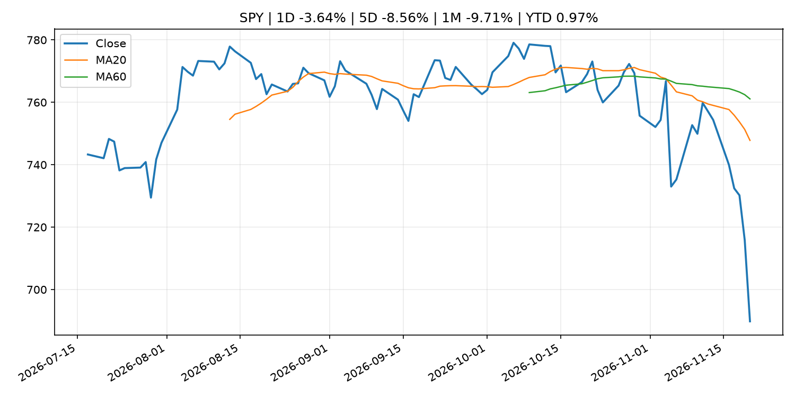
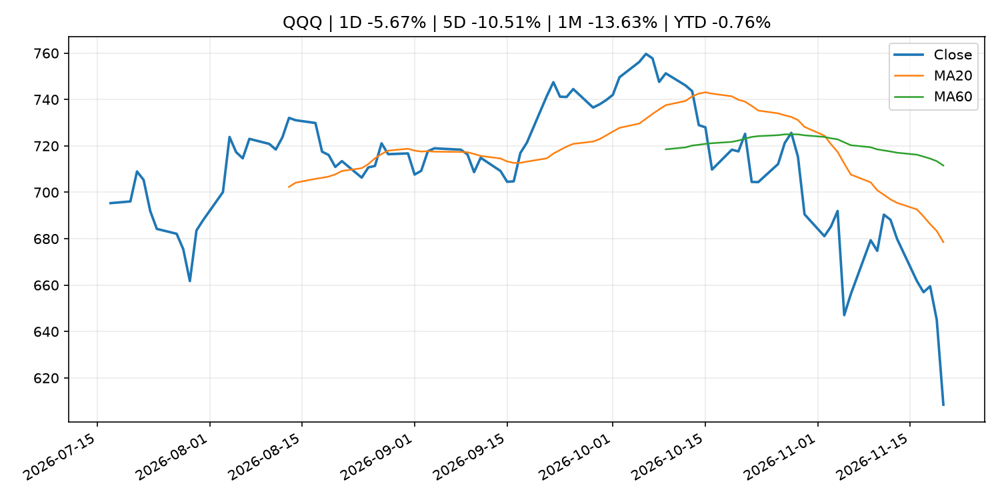
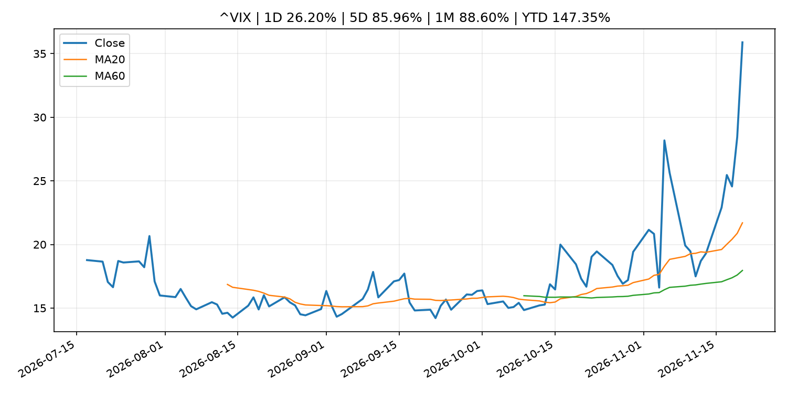
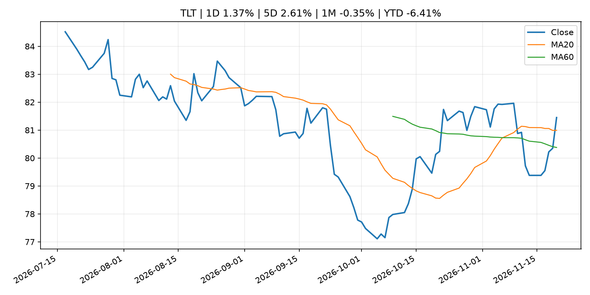
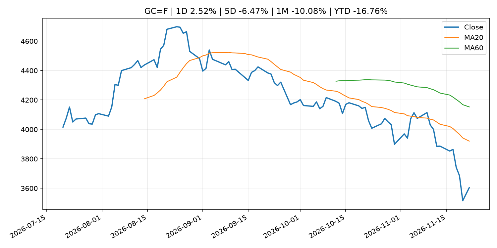
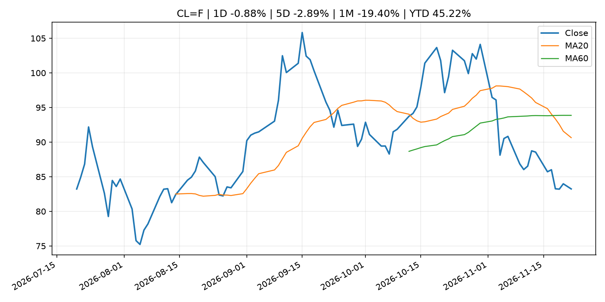
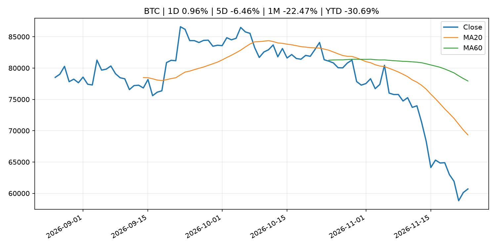
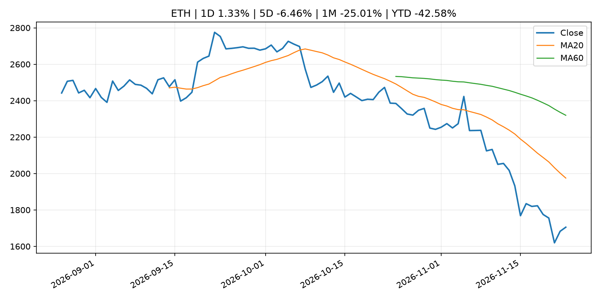
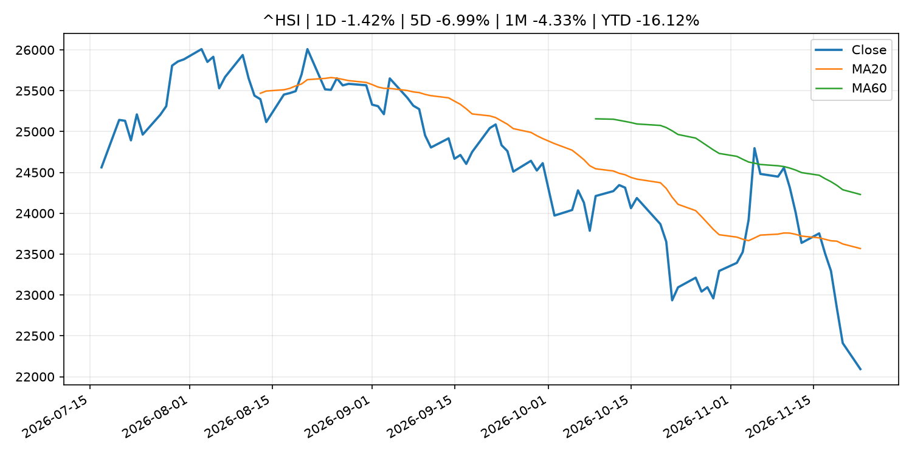

# Global Macro Morning Briefing - 2026-11-23

> Not financial advice / 非投资建议。

## 0. 今日总览
- 市场状态：risk_off。股指回落、VIX 抬升且避险资产走强，市场偏风险规避。
- 今日三大主线：
  1. earnings: ‘Nvidia’s turmoil has me spooked’: Is it time to sell my stocks and buy real estate?
  2. regulation: Ether treasury firm BTCS warns SEC its $54 million Aave loan could be liquidated
  3. earnings: Corporate America hunts for ‘generational’ growth in AI, trading cards and the L.A. airport
- 一句话结论：今日晨报重点关注：大型科技股盈利和资本开支会影响纳指、半导体和 AI 交易主线。；监管变化会改变行业盈利预期和资产风险溢价。。跨资产方面，SPY 1D -3.64%；QQQ 1D -5.67%；^VIX 1D 26.20%；TLT 1D 1.37%；GC=F 1D 2.52%；CL=F 1D -0.88%；BTC 1D 0.96%；ETH 1D 1.33%；股指回落、VIX 抬升且避险资产走强，市场偏风险规避。政策、通胀、利率、美元、美债、能源和加密监管仍是主要观察线索。所有结论仅基于公开数据与短摘要整理，不构成投资建议。

## 1. 隔夜跨资产市场
- 美股：SPY 1D -3.64%，QQQ 1D -5.67%，整体趋势需结合 VIX 和利率确认。
- 美债/美元：TLT 1D 1.37%，美元指数 1D -0.06%，是判断折现率压力的核心线索。
- 黄金/原油：黄金 1D 2.52%，原油 1D -0.88%，用于观察避险、通胀和地缘风险。
- 加密：BTC 1D 0.96%，ETH 1D 1.33%，关注是否独立于纳指走出加密自身行情。
- 港股/A股：恒生 1D -1.42%，沪深300/上证 1D n/a，重点看中国政策预期与人民币线索。
- 风险观察：关注避险是否演变为信用或流动性压力。

### US_EQUITY

| symbol | latest close | 1D | 5D | 1M | YTD | trend |
|---|---:|---:|---:|---:|---:|---|
| SPY | 689.81 | -3.64% | -8.56% | -9.71% | 0.97% | strong_downtrend |
| QQQ | 608.45 | -5.67% | -10.51% | -13.63% | -0.76% | strong_downtrend |
| DIA | 481.08 | -1.98% | -8.04% | -8.87% | -0.53% | strong_downtrend |
| IWM | 256.61 | -2.88% | -7.54% | -7.25% | 3.15% | strong_downtrend |
| VTI | 340.02 | -3.52% | -8.38% | -9.30% | 1.10% | strong_downtrend |

### US_MACRO_MARKET

| symbol | latest close | 1D | 5D | 1M | YTD | trend |
|---|---:|---:|---:|---:|---:|---|
| ^VIX | 35.89 | 26.20% | 85.96% | 88.60% | 147.35% | strong_uptrend |
| DX-Y.NYB | 103.74 | -0.06% | 0.19% | 1.90% | 5.41% | uptrend |
| TLT | 81.45 | 1.37% | 2.61% | -0.35% | -6.41% | uptrend |
| IEF | 91.65 | 0.91% | 1.79% | 0.49% | -4.61% | uptrend |

### COMMODITIES

| symbol | latest close | 1D | 5D | 1M | YTD | trend |
|---|---:|---:|---:|---:|---:|---|
| GC=F | 3,603.90 | 2.52% | -6.47% | -10.08% | -16.76% | strong_downtrend |
| SI=F | 42.10 | 2.58% | -10.02% | -21.63% | -40.34% | strong_downtrend |
| CL=F | 83.24 | -0.88% | -2.89% | -19.40% | 45.22% | strong_downtrend |
| BZ=F | 89.74 | -3.06% | -2.92% | -23.12% | 47.72% | strong_downtrend |
| NG=F | 3.61 | 5.92% | 15.73% | 36.86% | -0.14% | strong_uptrend |
| HG=F | 5.50 | 0.43% | -8.29% | -15.06% | -2.47% | strong_downtrend |

### HK_MARKET

| symbol | latest close | 1D | 5D | 1M | YTD | trend |
|---|---:|---:|---:|---:|---:|---|
| ^HSI | 22,092.75 | -1.42% | -6.99% | -4.33% | -16.12% | strong_downtrend |
| 0700.HK | 335.40 | -2.50% | -14.09% | -13.11% | -46.16% | strong_downtrend |
| 9988.HK | 80.15 | -3.84% | -11.09% | -18.05% | -46.21% | strong_downtrend |
| 3690.HK | 64.15 | -3.53% | -10.34% | -10.47% | -38.67% | strong_downtrend |
| 1810.HK | 27.12 | -1.88% | -6.74% | 1.19% | -32.67% | range_bound |
| 1211.HK | 60.00 | -3.77% | -7.83% | -16.20% | -39.24% | strong_downtrend |

### CRYPTO

| symbol | latest close | 1D | 5D | 1M | YTD | trend |
|---|---:|---:|---:|---:|---:|---|
| BTC | 60,700.53 | 0.96% | -6.46% | -22.47% | -30.69% | strong_downtrend |
| ETH | 1,705.24 | 1.33% | -6.46% | -25.01% | -42.58% | strong_downtrend |
| SOLANA | 70.28 | 0.11% | -6.45% | -25.61% | -43.56% | strong_downtrend |
| BINANCECOIN | 554.76 | 1.29% | -7.05% | -22.07% | -35.69% | strong_downtrend |
| RIPPLE | 0.92 | -1.36% | -6.58% | -26.52% | -50.11% | strong_downtrend |

## 2. 今日最重要的 10 条新闻
### 1. ‘Nvidia’s turmoil has me spooked’: Is it time to sell my stocks and buy real estate?
- 来源：MarketWatch Top Stories
- 时间：2026-11-22T17:00:00+00:00
- 地区：US
- 事件类型：earnings
- 重要性层级：Tier 2
- 一句话摘要：If you are tempted to ditch stocks for property or CDs, take a deep breath before making any sudden moves.
- 为什么重要：大型科技股盈利和资本开支会影响纳指、半导体和 AI 交易主线。
- 可能影响：主要影响 QQQ，方向为 mixed，强度 high；AI 资本开支会影响大型科技股盈利和估值预期。
  - 资产：QQQ
    方向：mixed
    强度：high
    原因：AI 资本开支会影响大型科技股盈利和估值预期。
  - 资产：SMH
    方向：mixed
    强度：high
    原因：AI 投资周期直接影响半导体需求。
  - 资产：NVDA
    方向：mixed
    强度：high
    原因：AI 训练和推理需求是英伟达收入预期核心变量。
  - 资产：MSFT
    方向：mixed
    强度：medium
    原因：云和 AI 资本开支影响利润率与增长叙事。
  - 资产：GOOGL
    方向：mixed
    强度：medium
    原因：AI 投资和搜索商业化影响估值。
  - 资产：META
    方向：mixed
    强度：medium
    原因：AI 基建支出与广告效率共同影响市场预期。
- 原文链接：[https://www.marketwatch.com/story/nvidia-spooked-me-should-i-sell-my-stocks-or-ride-out-the-market-turmoil-560583c6?mod=mw_rss_topstories](https://www.marketwatch.com/story/nvidia-spooked-me-should-i-sell-my-stocks-or-ride-out-the-market-turmoil-560583c6?mod=mw_rss_topstories)

### 2. Ether treasury firm BTCS warns SEC its $54 million Aave loan could be liquidated
- 来源：CoinDesk
- 时间：2026-11-21T12:30:00+00:00
- 地区：global
- 事件类型：regulation
- 重要性层级：Tier 2
- 一句话摘要：Ether treasury firm BTCS warns SEC its $54 million Aave loan could be liquidated
- 为什么重要：监管变化会改变行业盈利预期和资产风险溢价。
- 可能影响：主要影响 BTC，方向为 mixed，强度 high；加密监管或 ETF 进展会改变 BTC 的资金流和风险溢价。
  - 资产：BTC
    方向：mixed
    强度：high
    原因：加密监管或 ETF 进展会改变 BTC 的资金流和风险溢价。
  - 资产：ETH
    方向：mixed
    强度：high
    原因：监管框架会影响 ETH 产品化和机构参与度。
  - 资产：COIN
    方向：mixed
    强度：medium
    原因：监管清晰度和执法风险会影响交易平台估值。
  - 资产：crypto market
    方向：mixed
    强度：high
    原因：信息影响整个加密市场结构，但方向取决于细节。
- 原文链接：[https://www.coindesk.com/markets/2026/11/21/ether-treasury-firm-btcs-warns-sec-its-usd54-million-aave-loan-could-be-liquidated](https://www.coindesk.com/markets/2026/11/21/ether-treasury-firm-btcs-warns-sec-its-usd54-million-aave-loan-could-be-liquidated)

### 3. Corporate America hunts for ‘generational’ growth in AI, trading cards and the L.A. airport
- 来源：MarketWatch Top Stories
- 时间：2026-11-22T21:51:00+00:00
- 地区：US
- 事件类型：earnings
- 重要性层级：Tier 2
- 一句话摘要：There’s been no shortage of trends deemed once-in-a-generation by executives on earnings calls.
- 为什么重要：大型科技股盈利和资本开支会影响纳指、半导体和 AI 交易主线。
- 可能影响：可能影响利率、汇率、风险资产或大宗商品预期，但当前公开信息不足以判断明确方向。
  - 资产：暂无明确资产映射
  - 方向：unknown
  - 强度：low
  - 原因：公开信息不足以判断方向。
- 原文链接：[https://www.marketwatch.com/story/corporate-america-hunts-for-generational-growth-in-ai-trading-cards-and-the-l-a-airport-3072eb1a?mod=mw_rss_topstories](https://www.marketwatch.com/story/corporate-america-hunts-for-generational-growth-in-ai-trading-cards-and-the-l-a-airport-3072eb1a?mod=mw_rss_topstories)

### 4. Ron Johnson’s Social Security gaffe buried important news
- 来源：MarketWatch Top Stories
- 时间：2026-11-22T21:28:00+00:00
- 地区：US
- 事件类型：central_bank_speech
- 重要性层级：Tier 2
- 一句话摘要：The Wisconsin Republican’s remarks overshadowed what might have been a useful Senate committee hearing about fixing Social Security.
- 为什么重要：央行官员表态可能影响市场对下一次会议的定价。
- 可能影响：可能影响利率、汇率、风险资产或大宗商品预期，但当前公开信息不足以判断明确方向。
  - 资产：暂无明确资产映射
  - 方向：unknown
  - 强度：low
  - 原因：公开信息不足以判断方向。
- 原文链接：[https://www.marketwatch.com/story/ron-johnsons-social-security-gaffe-buried-important-news-b96e0ce8?mod=mw_rss_topstories](https://www.marketwatch.com/story/ron-johnsons-social-security-gaffe-buried-important-news-b96e0ce8?mod=mw_rss_topstories)

### 5. XRP falls 10% as long bets unwind and ETF assets slip below $1 billion
- 来源：CoinDesk
- 时间：2026-11-21T05:59:19+00:00
- 地区：global
- 事件类型：other
- 重要性层级：Tier 3
- 一句话摘要：XRP falls 10% as long bets unwind and ETF assets slip below $1 billion
- 为什么重要：这条信息暂未匹配到重大宏观、政策或市场事件，更适合作为背景跟踪。
- 可能影响：主要影响 BTC，方向为 mixed，强度 high；加密监管或 ETF 进展会改变 BTC 的资金流和风险溢价。
  - 资产：BTC
    方向：mixed
    强度：high
    原因：加密监管或 ETF 进展会改变 BTC 的资金流和风险溢价。
  - 资产：ETH
    方向：mixed
    强度：high
    原因：监管框架会影响 ETH 产品化和机构参与度。
  - 资产：COIN
    方向：mixed
    强度：medium
    原因：监管清晰度和执法风险会影响交易平台估值。
  - 资产：crypto market
    方向：mixed
    强度：high
    原因：信息影响整个加密市场结构，但方向取决于细节。
- 原文链接：[https://www.coindesk.com/markets/2026/11/21/xrp-falls-10-as-long-bets-unwind-and-etf-assets-slip-below-usd1-billion](https://www.coindesk.com/markets/2026/11/21/xrp-falls-10-as-long-bets-unwind-and-etf-assets-slip-below-usd1-billion)

### 6. Social Security should be shut down, this Republican senator says
- 来源：MarketWatch Top Stories
- 时间：2026-11-22T20:26:00+00:00
- 地区：US
- 事件类型：other
- 重要性层级：Tier 3
- 一句话摘要：The program’s trust funds are forecast to run out of money in the next six years.
- 为什么重要：这条信息暂未匹配到重大宏观、政策或市场事件，更适合作为背景跟踪。
- 可能影响：更偏背景信息，短期市场影响可能有限。
  - 资产：暂无明确资产映射
  - 方向：unknown
  - 强度：low
  - 原因：公开信息不足以判断方向。
- 原文链接：[https://www.marketwatch.com/story/social-security-should-be-shut-down-this-republican-senator-says-8f7fef81?mod=mw_rss_topstories](https://www.marketwatch.com/story/social-security-should-be-shut-down-this-republican-senator-says-8f7fef81?mod=mw_rss_topstories)

## 3. 政策与央行观察
### 1. Ether treasury firm BTCS warns SEC its $54 million Aave loan could be liquidated
- 来源：CoinDesk
- 时间：2026-11-21T12:30:00+00:00
- 地区：global
- 事件类型：regulation
- 重要性层级：Tier 2
- 一句话摘要：Ether treasury firm BTCS warns SEC its $54 million Aave loan could be liquidated
- 为什么重要：监管变化会改变行业盈利预期和资产风险溢价。
- 可能影响：主要影响 BTC，方向为 mixed，强度 high；加密监管或 ETF 进展会改变 BTC 的资金流和风险溢价。
  - 资产：BTC
    方向：mixed
    强度：high
    原因：加密监管或 ETF 进展会改变 BTC 的资金流和风险溢价。
  - 资产：ETH
    方向：mixed
    强度：high
    原因：监管框架会影响 ETH 产品化和机构参与度。
  - 资产：COIN
    方向：mixed
    强度：medium
    原因：监管清晰度和执法风险会影响交易平台估值。
  - 资产：crypto market
    方向：mixed
    强度：high
    原因：信息影响整个加密市场结构，但方向取决于细节。
- 原文链接：[https://www.coindesk.com/markets/2026/11/21/ether-treasury-firm-btcs-warns-sec-its-usd54-million-aave-loan-could-be-liquidated](https://www.coindesk.com/markets/2026/11/21/ether-treasury-firm-btcs-warns-sec-its-usd54-million-aave-loan-could-be-liquidated)

### 2. Ron Johnson’s Social Security gaffe buried important news
- 来源：MarketWatch Top Stories
- 时间：2026-11-22T21:28:00+00:00
- 地区：US
- 事件类型：central_bank_speech
- 重要性层级：Tier 2
- 一句话摘要：The Wisconsin Republican’s remarks overshadowed what might have been a useful Senate committee hearing about fixing Social Security.
- 为什么重要：央行官员表态可能影响市场对下一次会议的定价。
- 可能影响：可能影响利率、汇率、风险资产或大宗商品预期，但当前公开信息不足以判断明确方向。
  - 资产：暂无明确资产映射
  - 方向：unknown
  - 强度：low
  - 原因：公开信息不足以判断方向。
- 原文链接：[https://www.marketwatch.com/story/ron-johnsons-social-security-gaffe-buried-important-news-b96e0ce8?mod=mw_rss_topstories](https://www.marketwatch.com/story/ron-johnsons-social-security-gaffe-buried-important-news-b96e0ce8?mod=mw_rss_topstories)

## 4. 市场异动与图表
- SPY 下跌 -3.64%
- QQQ 下跌 -5.67%
- VIX 上涨 26.20%
- TLT 上涨 1.37%
- Gold 上涨 2.52%

### SPY

### QQQ

### ^VIX

### TLT

### GC=F

### CL=F

### BTC

### ETH

### ^HSI

## 5. 华尔街与机构公开观点
- 暂无可靠公开观点。

## 6. 今日重点关注
- 经济数据：经济数据：暂无可靠公开日历数据；如配置经济日历源后可自动填充。
- 央行讲话：央行讲话：暂无可靠公开日历数据；重点跟踪 Fed、ECB、BoJ、PBOC 官网 RSS。
- 财报：财报：暂无可靠数据。
- 政策事件：政策事件：暂无可靠数据。
- 风险提醒：风险提醒：关注数据源失败项、突发地缘风险、利率和美元的二阶反应。

## 7. 英文金融表达与宏观概念
- **real yield**：实际收益率，名义利率扣除通胀预期后的收益率。 例句：Gold often reacts more to real yields than nominal yields.
- **risk-off**：避险模式，资金偏向美元、国债、黄金等防御资产。 例句：A geopolitical shock can push markets into risk-off mode.
- **supply disruption**：供给扰动，通常指能源或商品供应受冲突、减产或天气影响。 例句：Supply disruption can lift oil prices and inflation expectations.
- **market structure**：市场结构，指交易、托管、清算、ETF、监管等制度安排。 例句：Crypto market structure rules can affect institutional participation.
- **AI capex**：AI 资本开支，指云厂商和科技公司投入 AI 基建的支出。 例句：AI capex guidance can move semiconductor stocks.
- **inflation expectations**：通胀预期，指家庭、企业或市场对未来通胀的预估。 例句：Inflation expectations can shape wage bargaining and bond yields.

## 8. 背景材料
- [Social Security should be shut down, this Republican senator says](https://www.marketwatch.com/story/social-security-should-be-shut-down-this-republican-senator-says-8f7fef81?mod=mw_rss_topstories)（MarketWatch Top Stories，other）：The program’s trust funds are forecast to run out of money in the next six years.
- [Bitcoin's quantum security challenge extends to bridges, custodians and millions of coins](https://www.coindesk.com/tech/2026/11/22/bitcoin-s-quantum-security-challenge-extends-to-bridges-custodians-and-millions-of-coins)（CoinDesk，other）：Bitcoin's quantum security challenge extends to bridges, custodians and millions of coins
- [Bitcoin rebounds above $60,000 after $1.8 billion crypto liquidation wave](https://www.coindesk.com/markets/2026/11/21/bitcoin-bounces-9-from-two-year-low-to-retake-usd60-000-as-traders-eye-monday-s-stock-open)（CoinDesk，other）：Bitcoin rebounds above $60,000 after $1.8 billion crypto liquidation wave
- [Bitcoin nodes could be stalled by repeating one ID 50,000 times. AI found the bug](https://www.coindesk.com/markets/2026/11/21/bitcoin-nodes-could-be-stalled-by-repeating-one-id-50-000-times-ai-found-the-bug)（CoinDesk，other）：Bitcoin nodes could be stalled by repeating one ID 50,000 times. AI found the bug
- [XRP falls 10% as long bets unwind and ETF assets slip below $1 billion](https://www.coindesk.com/markets/2026/11/21/xrp-falls-10-as-long-bets-unwind-and-etf-assets-slip-below-usd1-billion)（CoinDesk，other）：XRP falls 10% as long bets unwind and ETF assets slip below $1 billion
- [Bitcoin tanks below $57,000 for the first time in two years, and its not alone](https://www.coindesk.com/markets/2026/11/21/bitcoin-tanks-below-usd57-000-for-the-first-time-in-two-years-and-its-not-alone)（CoinDesk，other）：Bitcoin tanks below $57,000 for the first time in two years, and its not alone

## 9. 数据源、失败项与免责声明
- 采集时间：2026-11-23T02:14:43
- 数据源：公开 RSS、Yahoo Finance、CoinGecko、AKShare、FRED、SEC data.sec.gov，以及用户自有 inputs/reports 文件。
- 合规说明：不绕过 WSJ、Bloomberg、FT、Reuters 等付费墙；对付费媒体只使用公开 RSS 标题、摘要、链接和发布时间。
- 免责声明：Not financial advice / 非投资建议。本项目仅供个人学习、研究和信息整理，不构成投资建议、交易建议或任何收益承诺。
- 失败或跳过的数据源：
  - crypto data failed coin=dogecoin
  - China market data failed symbol=上证指数: stock_zh_index_daily_em 已在 1.20.44 更名为 index_zh_daily_em，请改用 ak.index_zh_daily_em；参数与返回的列也可能有调整，用 ak.interface_info("index_zh_daily_em") 查看。完整对照见 https://akshare.akfamily.xyz/changelog.html#changelog-rename
  - China market data failed symbol=深证成指: stock_zh_index_daily_em 已在 1.20.44 更名为 index_zh_daily_em，请改用 ak.index_zh_daily_em；参数与返回的列也可能有调整，用 ak.interface_info("index_zh_daily_em") 查看。完整对照见 https://akshare.akfamily.xyz/changelog.html#changelog-rename
  - China market data failed symbol=创业板指: stock_zh_index_daily_em 已在 1.20.44 更名为 index_zh_daily_em，请改用 ak.index_zh_daily_em；参数与返回的列也可能有调整，用 ak.interface_info("index_zh_daily_em") 查看。完整对照见 https://akshare.akfamily.xyz/changelog.html#changelog-rename
  - China market data failed symbol=沪深300: stock_zh_index_daily_em 已在 1.20.44 更名为 index_zh_daily_em，请改用 ak.index_zh_daily_em；参数与返回的列也可能有调整，用 ak.interface_info("index_zh_daily_em") 查看。完整对照见 https://akshare.akfamily.xyz/changelog.html#changelog-rename
  - China market data failed symbol=中证500: stock_zh_index_daily_em 已在 1.20.44 更名为 index_zh_daily_em，请改用 ak.index_zh_daily_em；参数与返回的列也可能有调整，用 ak.interface_info("index_zh_daily_em") 查看。完整对照见 https://akshare.akfamily.xyz/changelog.html#changelog-rename
  - China market data failed symbol=科创50: stock_zh_index_daily_em 已在 1.20.44 更名为 index_zh_daily_em，请改用 ak.index_zh_daily_em；参数与返回的列也可能有调整，用 ak.interface_info("index_zh_daily_em") 查看。完整对照见 https://akshare.akfamily.xyz/changelog.html#changelog-rename
  - FRED_API_KEY not set; skipping FRED macro series
  - SEC failed cik=0000320193
  - SEC failed cik=0000789019
  - SEC failed cik=0001045810
  - SEC failed cik=0001318605
  - SEC failed cik=0001577552
