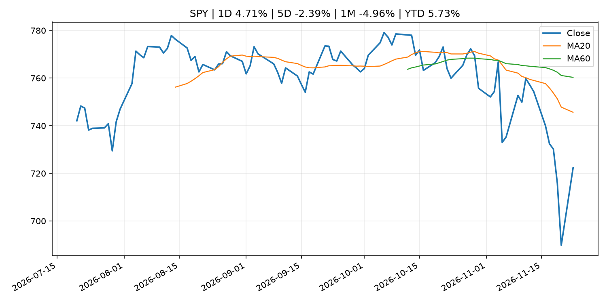
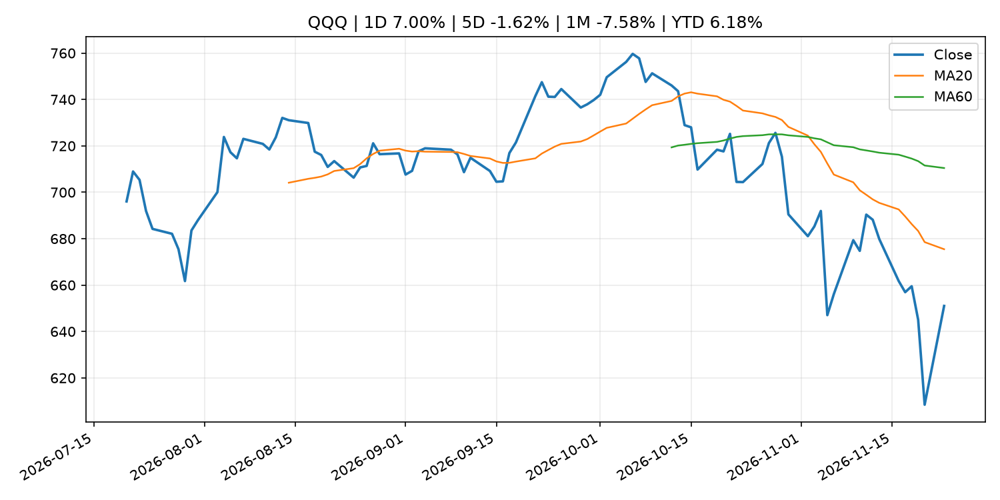
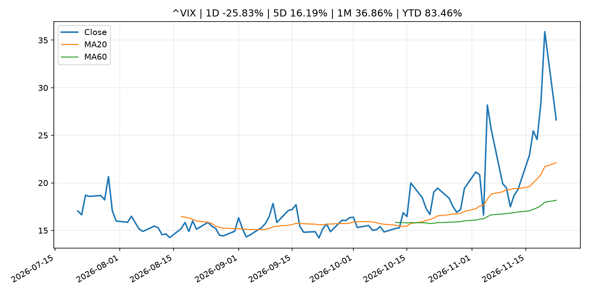
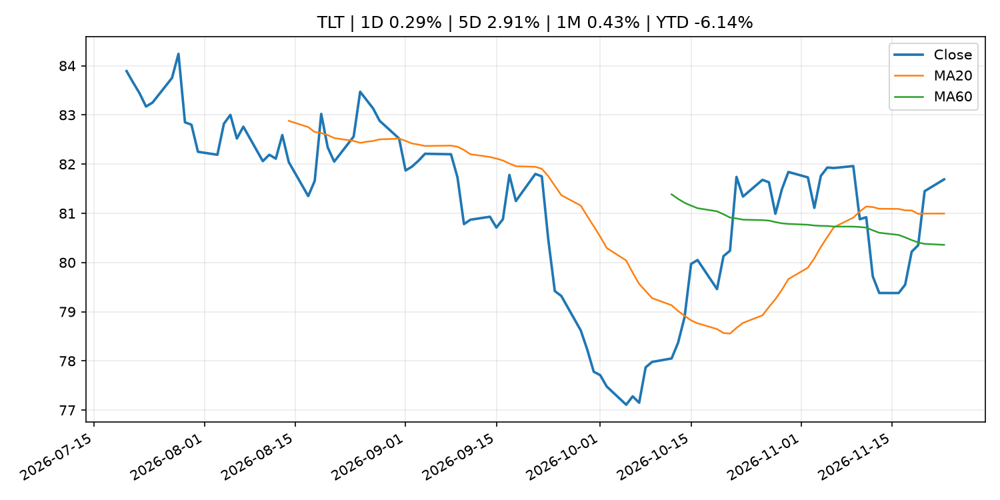
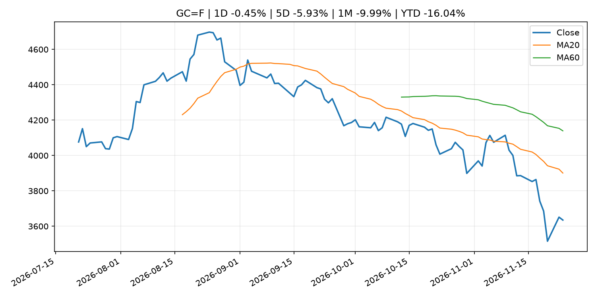
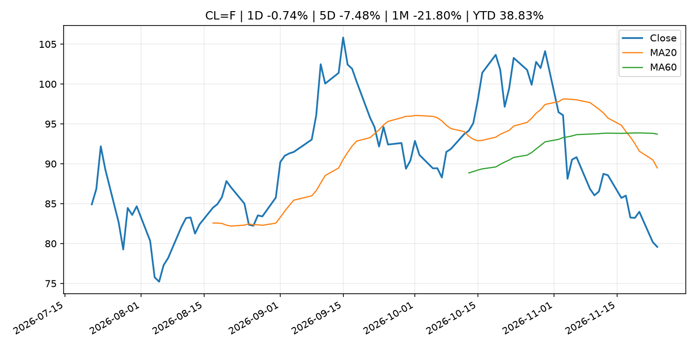
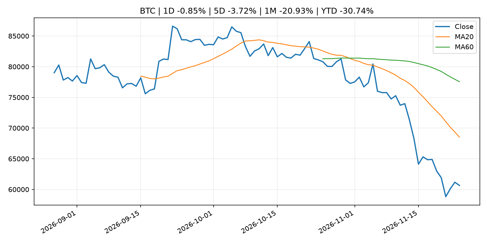
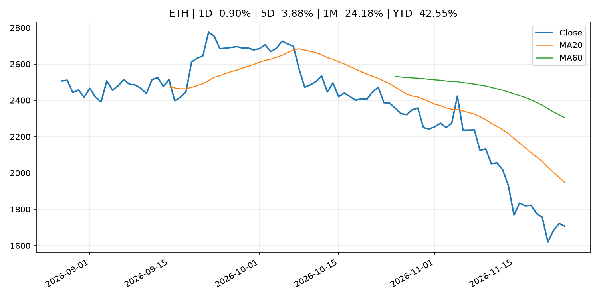
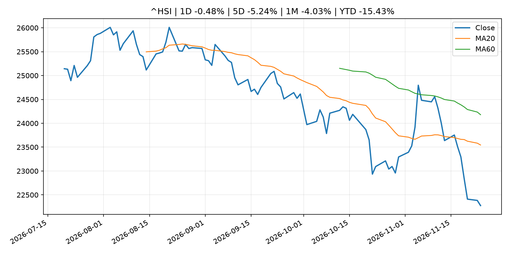

# Global Macro Morning Briefing - 2026-11-24

> Not financial advice / 非投资建议。

## 0. 今日总览
- 市场状态：risk_on。股指上涨、波动率或美元回落，市场更接近风险偏好改善。
- 今日三大主线：
  1. central_bank_decision: Market rout kills 50 basis points December Fed rate hike bets
  2. earnings: These stocks are the biggest gainers after Jensen Huang’s return to Nvidia
- 一句话结论：今日晨报重点关注：央行决策会重定价利率、汇率、久期资产和风险资产。；大型科技股盈利和资本开支会影响纳指、半导体和 AI 交易主线。。跨资产方面，SPY 1D 4.71%；QQQ 1D 7.00%；^VIX 1D -25.83%；TLT 1D 0.29%；GC=F 1D -0.45%；CL=F 1D -0.74%；BTC 1D -0.85%；ETH 1D -0.90%；股指上涨、波动率或美元回落，市场更接近风险偏好改善。政策、通胀、利率、美元、美债、能源和加密监管仍是主要观察线索。所有结论仅基于公开数据与短摘要整理，不构成投资建议。

## 1. 隔夜跨资产市场
- 美股：SPY 1D 4.71%，QQQ 1D 7.00%，整体趋势需结合 VIX 和利率确认。
- 美债/美元：TLT 1D 0.29%，美元指数 1D -0.05%，是判断折现率压力的核心线索。
- 黄金/原油：黄金 1D -0.45%，原油 1D -0.74%，用于观察避险、通胀和地缘风险。
- 加密：BTC 1D -0.85%，ETH 1D -0.90%，关注是否独立于纳指走出加密自身行情。
- 港股/A股：恒生 1D -0.48%，沪深300/上证 1D n/a，重点看中国政策预期与人民币线索。
- 风险观察：确认风险偏好是否扩散到小盘股、信用利差和周期品。

### US_EQUITY

| symbol | latest close | 1D | 5D | 1M | YTD | trend |
|---|---:|---:|---:|---:|---:|---|
| SPY | 722.29 | 4.71% | -2.39% | -4.96% | 5.73% | strong_downtrend |
| QQQ | 651.03 | 7.00% | -1.62% | -7.58% | 6.18% | strong_downtrend |
| DIA | 495.80 | 3.06% | -3.86% | -4.90% | 2.52% | strong_downtrend |
| IWM | 265.74 | 3.56% | -2.64% | -3.63% | 6.82% | strong_downtrend |
| VTI | 355.27 | 4.49% | -2.48% | -4.76% | 5.64% | strong_downtrend |

### US_MACRO_MARKET

| symbol | latest close | 1D | 5D | 1M | YTD | trend |
|---|---:|---:|---:|---:|---:|---|
| ^VIX | 26.62 | -25.83% | 16.19% | 36.86% | 83.46% | strong_uptrend |
| DX-Y.NYB | 104.27 | -0.05% | 0.76% | 2.27% | 5.95% | uptrend |
| TLT | 81.69 | 0.29% | 2.91% | 0.43% | -6.14% | uptrend |
| IEF | 91.64 | -0.01% | 1.55% | 0.65% | -4.62% | uptrend |

### COMMODITIES

| symbol | latest close | 1D | 5D | 1M | YTD | trend |
|---|---:|---:|---:|---:|---:|---|
| GC=F | 3,635.00 | -0.45% | -5.93% | -9.99% | -16.04% | strong_downtrend |
| SI=F | 42.38 | -1.79% | -10.39% | -21.68% | -39.94% | strong_downtrend |
| CL=F | 79.58 | -0.74% | -7.48% | -21.80% | 38.83% | strong_downtrend |
| BZ=F | 86.18 | -3.57% | -7.47% | -25.59% | 41.86% | strong_downtrend |
| NG=F | 3.54 | 11.21% | 10.38% | 36.09% | -2.13% | strong_uptrend |
| HG=F | 5.49 | -2.38% | -8.08% | -15.60% | -2.61% | strong_downtrend |

### HK_MARKET

| symbol | latest close | 1D | 5D | 1M | YTD | trend |
|---|---:|---:|---:|---:|---:|---|
| ^HSI | 22,275.45 | -0.48% | -5.24% | -4.03% | -15.43% | strong_downtrend |
| 0700.HK | 342.80 | -0.35% | -8.83% | -11.28% | -44.98% | strong_downtrend |
| 9988.HK | 82.50 | -0.66% | -3.45% | -15.77% | -44.63% | strong_downtrend |
| 3690.HK | 64.40 | -3.01% | -8.65% | -13.03% | -38.43% | strong_downtrend |
| 1810.HK | 26.20 | -4.80% | -11.78% | -2.60% | -34.96% | range_bound |
| 1211.HK | 60.50 | -1.14% | -5.69% | -14.55% | -38.73% | strong_downtrend |

### CRYPTO

| symbol | latest close | 1D | 5D | 1M | YTD | trend |
|---|---:|---:|---:|---:|---:|---|
| BTC | 60,650.39 | -0.85% | -3.72% | -20.93% | -30.74% | strong_downtrend |
| ETH | 1,706.15 | -0.90% | -3.88% | -24.18% | -42.55% | strong_downtrend |
| SOLANA | 71.83 | 1.74% | -2.34% | -21.79% | -42.31% | strong_downtrend |
| BINANCECOIN | 554.92 | -0.68% | -4.65% | -20.52% | -35.68% | strong_downtrend |
| RIPPLE | 0.96 | 3.33% | -0.85% | -23.24% | -47.92% | strong_downtrend |

## 2. 今日最重要的 10 条新闻
### 1. Market rout kills 50 basis points December Fed rate hike bets
- 来源：CoinDesk
- 时间：2026-11-23T04:45:47+00:00
- 地区：global
- 事件类型：central_bank_decision
- 重要性层级：Tier 1
- 一句话摘要：Market rout kills 50 basis points December Fed rate hike bets
- 为什么重要：央行决策会重定价利率、汇率、久期资产和风险资产。
- 可能影响：主要影响 QQQ，方向为 negative，强度 high；鹰派政策提高折现率，压制成长股估值。
  - 资产：QQQ
    方向：negative
    强度：high
    原因：鹰派政策提高折现率，压制成长股估值。
  - 资产：SPY
    方向：negative
    强度：medium
    原因：更紧政策通常削弱风险偏好。
  - 资产：TLT
    方向：negative
    强度：high
    原因：利率上行通常压低长债价格。
  - 资产：DXY
    方向：positive
    强度：high
    原因：更高利率预期通常支撑美元。
  - 资产：BTC
    方向：negative
    强度：high
    原因：流动性收紧通常压制高 beta 加密资产。
- 原文链接：[https://www.coindesk.com/markets/2026/11/23/market-rout-kills-50-basis-points-december-fed-rate-hike-bets](https://www.coindesk.com/markets/2026/11/23/market-rout-kills-50-basis-points-december-fed-rate-hike-bets)

### 2. These stocks are the biggest gainers after Jensen Huang’s return to Nvidia
- 来源：MarketWatch Top Stories
- 时间：2026-11-23T21:36:00+00:00
- 地区：US
- 事件类型：earnings
- 重要性层级：Tier 2
- 一句话摘要：Huang’s comeback offers relief to the battered AI trade and drives major boosts across the tech sector.
- 为什么重要：大型科技股盈利和资本开支会影响纳指、半导体和 AI 交易主线。
- 可能影响：主要影响 QQQ，方向为 mixed，强度 high；AI 资本开支会影响大型科技股盈利和估值预期。
  - 资产：QQQ
    方向：mixed
    强度：high
    原因：AI 资本开支会影响大型科技股盈利和估值预期。
  - 资产：SMH
    方向：mixed
    强度：high
    原因：AI 投资周期直接影响半导体需求。
  - 资产：NVDA
    方向：mixed
    强度：high
    原因：AI 训练和推理需求是英伟达收入预期核心变量。
  - 资产：MSFT
    方向：mixed
    强度：medium
    原因：云和 AI 资本开支影响利润率与增长叙事。
  - 资产：GOOGL
    方向：mixed
    强度：medium
    原因：AI 投资和搜索商业化影响估值。
  - 资产：META
    方向：mixed
    强度：medium
    原因：AI 基建支出与广告效率共同影响市场预期。
- 原文链接：[https://www.marketwatch.com/story/these-stocks-are-the-biggest-gainers-after-jensen-huangs-return-to-nvidia-bb886140?mod=mw_rss_topstories](https://www.marketwatch.com/story/these-stocks-are-the-biggest-gainers-after-jensen-huangs-return-to-nvidia-bb886140?mod=mw_rss_topstories)

### 3. Fed's John Williams indicates higher interest rates likely 'over time' to address inflation
- 来源：CNBC Economy
- 时间：2026-11-23T21:02:17+00:00
- 地区：US
- 事件类型：other
- 重要性层级：Tier 3
- 一句话摘要：The influential central banker expressed confidence that inflation will get closer to the Fed's 2% target in 2027.
- 为什么重要：这条信息暂未匹配到重大宏观、政策或市场事件，更适合作为背景跟踪。
- 可能影响：主要影响 DXY，方向为 positive，强度 high；通胀压力可能推高政策利率预期并支撑美元。
  - 资产：DXY
    方向：positive
    强度：high
    原因：通胀压力可能推高政策利率预期并支撑美元。
  - 资产：TLT
    方向：negative
    强度：high
    原因：通胀上行通常推升收益率、压低长债价格。
  - 资产：QQQ
    方向：negative
    强度：high
    原因：更高利率对成长股估值折现率不利。
  - 资产：SPY
    方向：mixed
    强度：medium
    原因：名义增长可能支撑收入，但更高利率压制估值。
  - 资产：GC=F
    方向：mixed
    强度：medium
    原因：通胀对黄金是支撑，但实际利率上行会形成压力。
  - 资产：BTC
    方向：mixed
    强度：medium
    原因：抗通胀叙事和流动性收紧可能相互抵消。
- 原文链接：[https://www.cnbc.com/2026/11/23/john-williams-fed-inflation-rate-hikes.html](https://www.cnbc.com/2026/11/23/john-williams-fed-inflation-rate-hikes.html)

### 4. U.S. inflation, Thanksgiving trading: Crypto Week Ahead
- 来源：CoinDesk
- 时间：2026-11-23T09:40:25+00:00
- 地区：global
- 事件类型：other
- 重要性层级：Tier 3
- 一句话摘要：U.S. inflation, Thanksgiving trading: Crypto Week Ahead
- 为什么重要：这条信息暂未匹配到重大宏观、政策或市场事件，更适合作为背景跟踪。
- 可能影响：主要影响 DXY，方向为 positive，强度 high；通胀压力可能推高政策利率预期并支撑美元。
  - 资产：DXY
    方向：positive
    强度：high
    原因：通胀压力可能推高政策利率预期并支撑美元。
  - 资产：TLT
    方向：negative
    强度：high
    原因：通胀上行通常推升收益率、压低长债价格。
  - 资产：QQQ
    方向：negative
    强度：high
    原因：更高利率对成长股估值折现率不利。
  - 资产：SPY
    方向：mixed
    强度：medium
    原因：名义增长可能支撑收入，但更高利率压制估值。
  - 资产：GC=F
    方向：mixed
    强度：medium
    原因：通胀对黄金是支撑，但实际利率上行会形成压力。
  - 资产：BTC
    方向：mixed
    强度：medium
    原因：抗通胀叙事和流动性收紧可能相互抵消。
- 原文链接：[https://www.coindesk.com/markets/2026/11/23/u-s-inflation-thanksgiving-trading-crypto-week-ahead](https://www.coindesk.com/markets/2026/11/23/u-s-inflation-thanksgiving-trading-crypto-week-ahead)

## 3. 政策与央行观察
### 1. Market rout kills 50 basis points December Fed rate hike bets
- 来源：CoinDesk
- 时间：2026-11-23T04:45:47+00:00
- 地区：global
- 事件类型：central_bank_decision
- 重要性层级：Tier 1
- 一句话摘要：Market rout kills 50 basis points December Fed rate hike bets
- 为什么重要：央行决策会重定价利率、汇率、久期资产和风险资产。
- 可能影响：主要影响 QQQ，方向为 negative，强度 high；鹰派政策提高折现率，压制成长股估值。
  - 资产：QQQ
    方向：negative
    强度：high
    原因：鹰派政策提高折现率，压制成长股估值。
  - 资产：SPY
    方向：negative
    强度：medium
    原因：更紧政策通常削弱风险偏好。
  - 资产：TLT
    方向：negative
    强度：high
    原因：利率上行通常压低长债价格。
  - 资产：DXY
    方向：positive
    强度：high
    原因：更高利率预期通常支撑美元。
  - 资产：BTC
    方向：negative
    强度：high
    原因：流动性收紧通常压制高 beta 加密资产。
- 原文链接：[https://www.coindesk.com/markets/2026/11/23/market-rout-kills-50-basis-points-december-fed-rate-hike-bets](https://www.coindesk.com/markets/2026/11/23/market-rout-kills-50-basis-points-december-fed-rate-hike-bets)

## 4. 市场异动与图表
- SPY 上涨 4.71%
- QQQ 上涨 7.00%
- VIX 下跌 -25.83%

### SPY

### QQQ

### ^VIX

### TLT

### GC=F

### CL=F

### BTC

### ETH

### ^HSI

## 5. 华尔街与机构公开观点
- 暂无可靠公开观点。

## 6. 今日重点关注
- 经济数据：经济数据：暂无可靠公开日历数据；如配置经济日历源后可自动填充。
- 央行讲话：央行讲话：暂无可靠公开日历数据；重点跟踪 Fed、ECB、BoJ、PBOC 官网 RSS。
- 财报：财报：暂无可靠数据。
- 政策事件：政策事件：暂无可靠数据。
- 风险提醒：风险提醒：关注数据源失败项、突发地缘风险、利率和美元的二阶反应。

## 7. 英文金融表达与宏观概念
- **inflation expectations**：通胀预期，指家庭、企业或市场对未来通胀的预估。 例句：Inflation expectations can shape wage bargaining and bond yields.
- **real yield**：实际收益率，名义利率扣除通胀预期后的收益率。 例句：Gold often reacts more to real yields than nominal yields.
- **terminal rate**：终端利率，市场预期本轮加息周期的最高政策利率。 例句：A higher terminal rate can pressure growth stocks.
- **market structure**：市场结构，指交易、托管、清算、ETF、监管等制度安排。 例句：Crypto market structure rules can affect institutional participation.
- **AI capex**：AI 资本开支，指云厂商和科技公司投入 AI 基建的支出。 例句：AI capex guidance can move semiconductor stocks.
- **soft landing**：软着陆，指通胀回落而经济避免明显衰退。 例句：Markets often rally when data support a soft landing.

## 8. 背景材料
- [Statistics on Securities Financing Transactions in Japan](http://www.boj.or.jp/en/statistics/bis/repo/index.htm)（Bank of Japan Announcements，other）：Statistics on Securities Financing Transactions in Japan
- [Fed's John Williams indicates higher interest rates likely 'over time' to address inflation](https://www.cnbc.com/2026/11/23/john-williams-fed-inflation-rate-hikes.html)（CNBC Economy，other）：The influential central banker expressed confidence that inflation will get closer to the Fed's 2% target in 2027.
- [Bitcoin rebound already losing steam as AI trade returns with a bang](https://www.coindesk.com/markets/2026/11/23/bitcoin-rebound-already-losing-steam-as-ai-trade-returns-with-a-bank)（CoinDesk，other）：Bitcoin rebound already losing steam as AI trade returns with a bang
- [Cathie Wood's ARK Invest pulls the plug on two planned crypto ETFs](https://www.coindesk.com/business/2026/11/23/cathie-wood-s-ark-invest-pulls-the-plug-on-two-planned-crypto-etfs)（CoinDesk，other）：Cathie Wood's ARK Invest pulls the plug on two planned crypto ETFs
- [Eric Trump-backed American Bitcoin secures $150 million loan against its bitcoin](https://www.coindesk.com/business/2026/11/23/eric-trump-backed-american-bitcoin-secures-usd150-million-loan-against-its-bitcoin)（CoinDesk，other）：Eric Trump-backed American Bitcoin secures $150 million loan against its bitcoin
- [Bitcoin's 5-year return is nearly zero, great narratives are fading and what's left is the Fed](https://www.coindesk.com/opinion/2026/11/23/bitcoin-s-5-year-return-is-nearly-zero-great-narratives-are-fading-and-what-s-left-is-the-fed)（CoinDesk，other）：Bitcoin's 5-year return is nearly zero, great narratives are fading and what's left is the Fed
- [Philip R. Lane: Climate change and monetary policy](https://www.ecb.europa.eu//press/key/date/2026/html/ecb.sp261123~b5816801a0.en.pdf)（ECB Press Releases，other）：Philip R. Lane: Climate change and monetary policy
- [Fidelity Investments, Strive, Etoro join OKX-ICE tokenized securities venue](https://www.coindesk.com/business/2026/11/23/fidelity-investments-strive-etoro-join-okx-ice-tokenized-securities-venue)（CoinDesk，other）：Fidelity Investments, Strive, Etoro join OKX-ICE tokenized securities venue
- [Live updates: Bitcoin climbs only modestly as Nasdaq soars 6% on Huang return](https://www.coindesk.com/tech/2026/11/23/live-news-wall-street-rebounds-as-dollar-index-hits-highest-since-march-2025)（CoinDesk，other）：Live updates: Bitcoin climbs only modestly as Nasdaq soars 6% on Huang return
- [Bitcoin's losing streak is second-longest ever, and some observers see more downside](https://www.coindesk.com/daybook-us/2026/11/23/bitcoin-s-losing-streak-is-second-longest-ever-and-some-observers-see-more-downside)（CoinDesk，other）：Bitcoin's losing streak is second-longest ever, and some observers see more downside
- [Bitcoin rebounds from 2-year low as Wall Street futures recover](https://www.coindesk.com/markets/2026/11/23/bitcoin-rebounds-from-2-year-low-as-wall-street-futures-recover)（CoinDesk，other）：Bitcoin rebounds from 2-year low as Wall Street futures recover
- [Live updates: Bitcoin climbs back above $61,000 as stocks rebound from AI rout](https://www.coindesk.com/markets/2026/11/23/live-updates-bitcoin-climbs-back-above-usd61-000-as-stocks-rebound-from-ai-rout)（CoinDesk，other）：Live updates: Bitcoin climbs back above $61,000 as stocks rebound from AI rout
- [Bitcoin breaks a record streak of 'lower highs.' Here's what it means](https://www.coindesk.com/markets/2026/11/23/bitcoin-breaks-a-record-streak-of-lower-highs-here-s-what-it-means)（CoinDesk，other）：Bitcoin breaks a record streak of 'lower highs.' Here's what it means
- [ECB expands acceptance of DLT-based assets as eligible Eurosystem collateral](https://www.ecb.europa.eu//press/pr/date/2026/html/ecb.pr261123~76b6f57b74.en.html)（ECB Press Releases，other）：ECB expands acceptance of DLT-based assets as eligible Eurosystem collateral
- [U.S. inflation, Thanksgiving trading: Crypto Week Ahead](https://www.coindesk.com/markets/2026/11/23/u-s-inflation-thanksgiving-trading-crypto-week-ahead)（CoinDesk，other）：U.S. inflation, Thanksgiving trading: Crypto Week Ahead
- [This Swedish bitcoin treasury firm lost 30 BTC trading part of its own stack](https://www.coindesk.com/markets/2026/11/23/this-swedish-bitcoin-treasury-firm-lost-30-btc-trading-part-of-its-own-stack)（CoinDesk，other）：This Swedish bitcoin treasury firm lost 30 BTC trading part of its own stack
- [Bitcoin sold for $17,000 on Kraken's Canadian dollar market, and the trades stand](https://www.coindesk.com/markets/2026/11/23/bitcoin-sold-for-usd17-000-on-kraken-s-canadian-dollar-market-and-the-trades-stand)（CoinDesk，other）：Bitcoin sold for $17,000 on Kraken's Canadian dollar market, and the trades stand

## 9. 数据源、失败项与免责声明
- 采集时间：2026-11-24T05:46:22
- 数据源：公开 RSS、Yahoo Finance、CoinGecko、AKShare、FRED、SEC data.sec.gov，以及用户自有 inputs/reports 文件。
- 合规说明：不绕过 WSJ、Bloomberg、FT、Reuters 等付费墙；对付费媒体只使用公开 RSS 标题、摘要、链接和发布时间。
- 免责声明：Not financial advice / 非投资建议。本项目仅供个人学习、研究和信息整理，不构成投资建议、交易建议或任何收益承诺。
- 失败或跳过的数据源：
  - crypto data failed coin=dogecoin
  - China market data failed symbol=上证指数: stock_zh_index_daily_em 已在 1.20.44 更名为 index_zh_daily_em，请改用 ak.index_zh_daily_em；参数与返回的列也可能有调整，用 ak.interface_info("index_zh_daily_em") 查看。完整对照见 https://akshare.akfamily.xyz/changelog.html#changelog-rename
  - China market data failed symbol=深证成指: stock_zh_index_daily_em 已在 1.20.44 更名为 index_zh_daily_em，请改用 ak.index_zh_daily_em；参数与返回的列也可能有调整，用 ak.interface_info("index_zh_daily_em") 查看。完整对照见 https://akshare.akfamily.xyz/changelog.html#changelog-rename
  - China market data failed symbol=创业板指: stock_zh_index_daily_em 已在 1.20.44 更名为 index_zh_daily_em，请改用 ak.index_zh_daily_em；参数与返回的列也可能有调整，用 ak.interface_info("index_zh_daily_em") 查看。完整对照见 https://akshare.akfamily.xyz/changelog.html#changelog-rename
  - China market data failed symbol=沪深300: stock_zh_index_daily_em 已在 1.20.44 更名为 index_zh_daily_em，请改用 ak.index_zh_daily_em；参数与返回的列也可能有调整，用 ak.interface_info("index_zh_daily_em") 查看。完整对照见 https://akshare.akfamily.xyz/changelog.html#changelog-rename
  - China market data failed symbol=中证500: stock_zh_index_daily_em 已在 1.20.44 更名为 index_zh_daily_em，请改用 ak.index_zh_daily_em；参数与返回的列也可能有调整，用 ak.interface_info("index_zh_daily_em") 查看。完整对照见 https://akshare.akfamily.xyz/changelog.html#changelog-rename
  - China market data failed symbol=科创50: stock_zh_index_daily_em 已在 1.20.44 更名为 index_zh_daily_em，请改用 ak.index_zh_daily_em；参数与返回的列也可能有调整，用 ak.interface_info("index_zh_daily_em") 查看。完整对照见 https://akshare.akfamily.xyz/changelog.html#changelog-rename
  - FRED_API_KEY not set; skipping FRED macro series
  - SEC failed cik=0000320193
  - SEC failed cik=0000789019
  - SEC failed cik=0001045810
  - SEC failed cik=0001318605
  - SEC failed cik=0001577552
