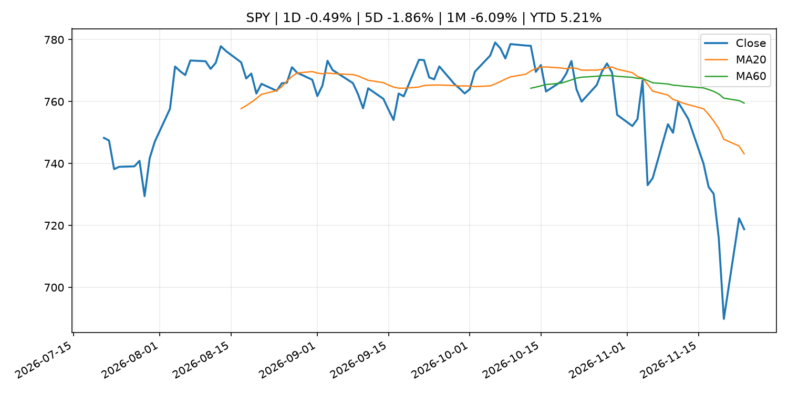
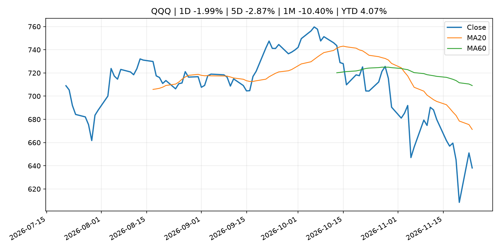
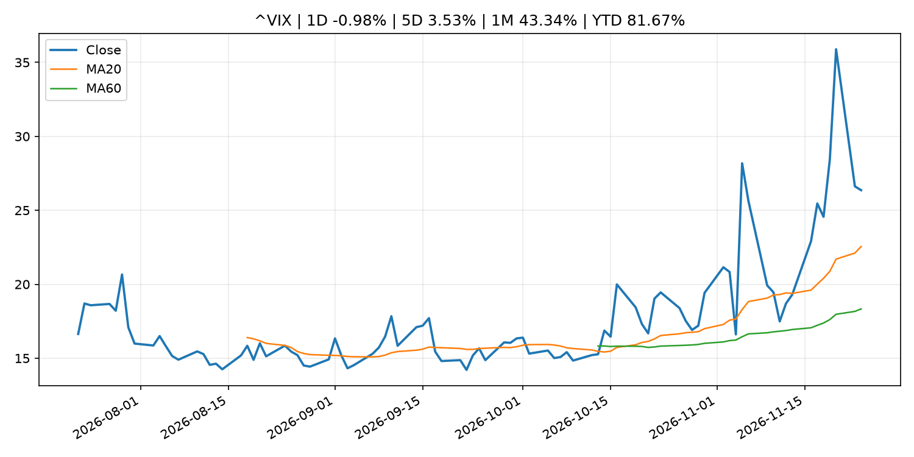
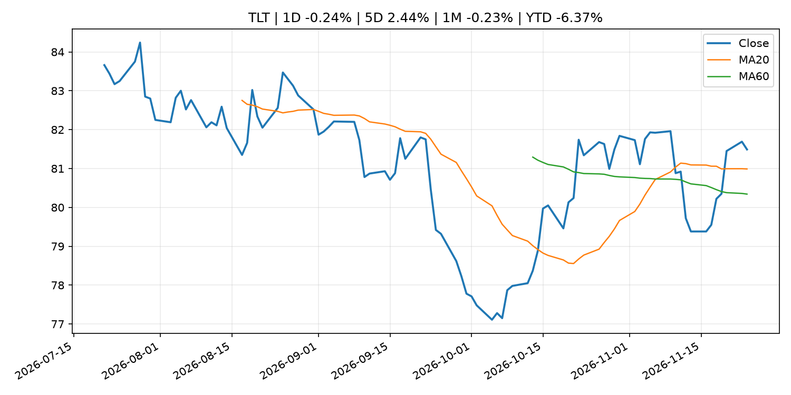
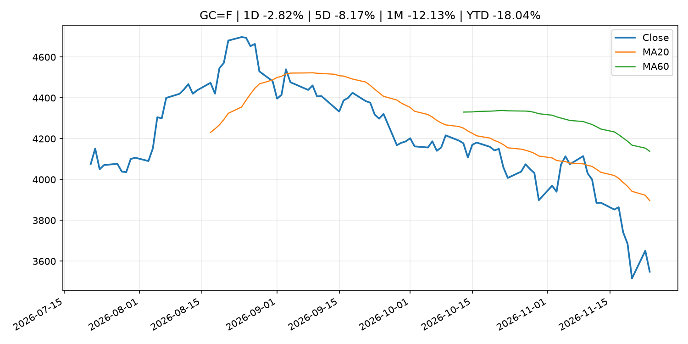
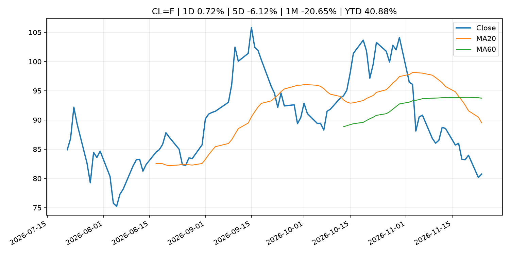
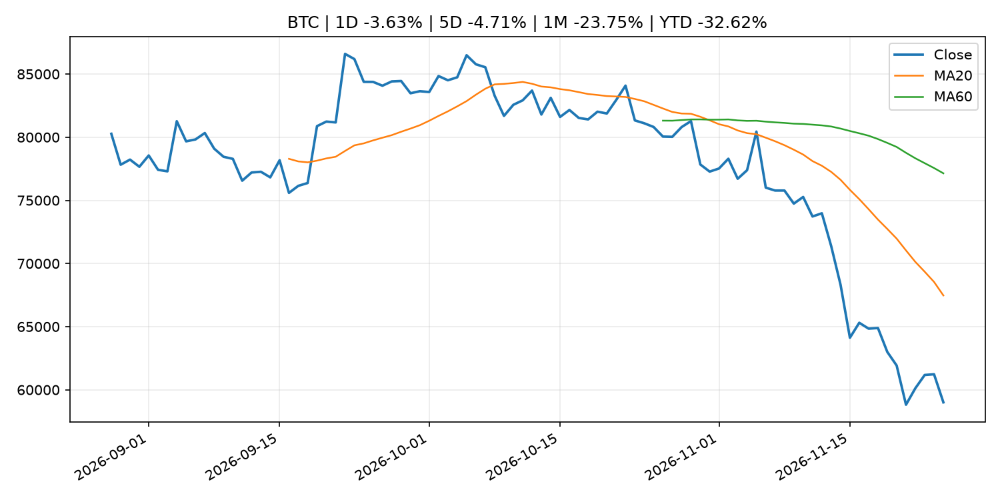
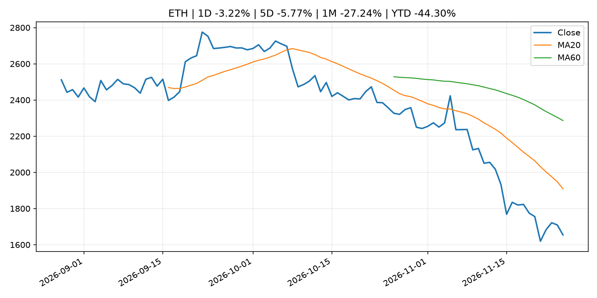
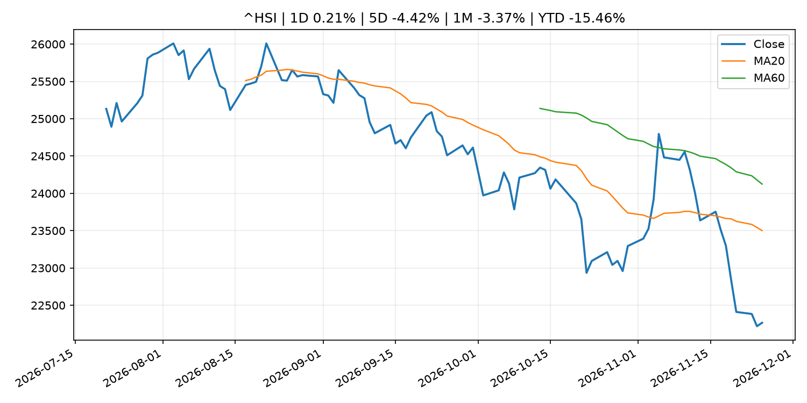

# Global Macro Morning Briefing - 2026-11-25

> Not financial advice / 非投资建议。

## 0. 今日总览
- 市场状态：unknown。市场信号不足，暂不判断明确状态。
- 今日三大主线：
  1. fiscal_policy: Micron boosted CEO Sanjay Mehrotra’s security budget by 2,000%, new filing shows
  2. earnings: Bitcoin hands back Monday's Nvidia-driven gains, liquidations triple
  3. earnings: Bitcoin falls below $60,000 as rally on Jensen Huang’s Nvidia return fades
- 一句话结论：今日晨报重点关注：财政和贸易政策会影响增长、通胀、企业利润和跨境资本流。；大型科技股盈利和资本开支会影响纳指、半导体和 AI 交易主线。。跨资产方面，SPY 1D -0.49%；QQQ 1D -1.99%；^VIX 1D -0.98%；TLT 1D -0.24%；GC=F 1D -2.82%；CL=F 1D 0.72%；BTC 1D -3.63%；ETH 1D -3.22%；市场信号不足，暂不判断明确状态。政策、通胀、利率、美元、美债、能源和加密监管仍是主要观察线索。所有结论仅基于公开数据与短摘要整理，不构成投资建议。

## 1. 隔夜跨资产市场
- 美股：SPY 1D -0.49%，QQQ 1D -1.99%，整体趋势需结合 VIX 和利率确认。
- 美债/美元：TLT 1D -0.24%，美元指数 1D -0.34%，是判断折现率压力的核心线索。
- 黄金/原油：黄金 1D -2.82%，原油 1D 0.72%，用于观察避险、通胀和地缘风险。
- 加密：BTC 1D -3.63%，ETH 1D -3.22%，关注是否独立于纳指走出加密自身行情。
- 港股/A股：恒生 1D 0.21%，沪深300/上证 1D n/a，重点看中国政策预期与人民币线索。
- 风险观察：关注后续数据是否确认当前跨资产信号。

### US_EQUITY

| symbol | latest close | 1D | 5D | 1M | YTD | trend |
|---|---:|---:|---:|---:|---:|---|
| SPY | 718.78 | -0.49% | -1.86% | -6.09% | 5.21% | strong_downtrend |
| QQQ | 638.10 | -1.99% | -2.87% | -10.40% | 4.07% | strong_downtrend |
| DIA | 499.74 | 0.79% | -1.49% | -4.44% | 3.33% | strong_downtrend |
| IWM | 267.14 | 0.53% | -0.71% | -3.56% | 7.38% | strong_downtrend |
| VTI | 353.84 | -0.40% | -1.76% | -5.79% | 5.21% | strong_downtrend |

### US_MACRO_MARKET

| symbol | latest close | 1D | 5D | 1M | YTD | trend |
|---|---:|---:|---:|---:|---:|---|
| ^VIX | 26.36 | -0.98% | 3.53% | 43.34% | 81.67% | strong_uptrend |
| DX-Y.NYB | 103.96 | -0.34% | 0.46% | 1.97% | 5.63% | uptrend |
| TLT | 81.49 | -0.24% | 2.44% | -0.23% | -6.37% | uptrend |
| IEF | 91.64 | 0.00% | 1.36% | 0.57% | -4.62% | uptrend |

### COMMODITIES

| symbol | latest close | 1D | 5D | 1M | YTD | trend |
|---|---:|---:|---:|---:|---:|---|
| GC=F | 3,548.40 | -2.82% | -8.17% | -12.13% | -18.04% | strong_downtrend |
| SI=F | 40.58 | -5.94% | -14.17% | -24.99% | -42.48% | strong_downtrend |
| CL=F | 80.75 | 0.72% | -6.12% | -20.65% | 40.88% | strong_downtrend |
| BZ=F | 87.53 | -2.06% | -6.02% | -24.42% | 44.08% | strong_downtrend |
| NG=F | 3.70 | 16.17% | 15.31% | 42.16% | 2.24% | strong_uptrend |
| HG=F | 5.45 | -3.15% | -8.80% | -16.26% | -3.37% | strong_downtrend |

### HK_MARKET

| symbol | latest close | 1D | 5D | 1M | YTD | trend |
|---|---:|---:|---:|---:|---:|---|
| ^HSI | 22,265.68 | 0.21% | -4.42% | -3.37% | -15.46% | strong_downtrend |
| 0700.HK | 341.80 | 0.06% | -8.32% | -11.27% | -45.14% | strong_downtrend |
| 9988.HK | 82.65 | 0.55% | -3.05% | -14.79% | -44.53% | strong_downtrend |
| 3690.HK | 64.20 | 0.00% | -8.48% | -10.65% | -38.62% | strong_downtrend |
| 1810.HK | 27.58 | 4.08% | -7.01% | 7.48% | -31.53% | range_bound |
| 1211.HK | 60.20 | -0.17% | -6.01% | -14.06% | -39.04% | strong_downtrend |

### CRYPTO

| symbol | latest close | 1D | 5D | 1M | YTD | trend |
|---|---:|---:|---:|---:|---:|---|
| BTC | 59,003.73 | -3.63% | -4.71% | -23.75% | -32.62% | strong_downtrend |
| ETH | 1,654.22 | -3.22% | -5.77% | -27.24% | -44.30% | strong_downtrend |
| SOLANA | 68.67 | -4.61% | -6.02% | -25.99% | -44.85% | strong_downtrend |
| BINANCECOIN | 540.41 | -2.83% | -6.76% | -22.52% | -37.36% | strong_downtrend |
| RIPPLE | 0.92 | -2.43% | -4.43% | -28.15% | -50.18% | strong_downtrend |

## 2. 今日最重要的 10 条新闻
### 1. Micron boosted CEO Sanjay Mehrotra’s security budget by 2,000%, new filing shows
- 来源：MarketWatch Top Stories
- 时间：2026-11-24T23:11:00+00:00
- 地区：US
- 事件类型：fiscal_policy
- 重要性层级：Tier 1
- 一句话摘要：Steeply higher security expenses of $764,748 for Mehrotra were part of a $39.7 million total compensation package in the latest fiscal year.
- 为什么重要：财政和贸易政策会影响增长、通胀、企业利润和跨境资本流。
- 可能影响：可能影响利率、汇率、风险资产或大宗商品预期，但当前公开信息不足以判断明确方向。
  - 资产：暂无明确资产映射
  - 方向：unknown
  - 强度：low
  - 原因：公开信息不足以判断方向。
- 原文链接：[https://www.marketwatch.com/story/micron-boosted-ceo-sanjay-mehrotras-security-budget-by-2-000-new-filing-shows-d6202acc?mod=mw_rss_topstories](https://www.marketwatch.com/story/micron-boosted-ceo-sanjay-mehrotras-security-budget-by-2-000-new-filing-shows-d6202acc?mod=mw_rss_topstories)

### 2. Bitcoin hands back Monday's Nvidia-driven gains, liquidations triple
- 来源：CoinDesk
- 时间：2026-11-24T11:31:56+00:00
- 地区：global
- 事件类型：earnings
- 重要性层级：Tier 2
- 一句话摘要：Bitcoin hands back Monday's Nvidia-driven gains, liquidations triple
- 为什么重要：大型科技股盈利和资本开支会影响纳指、半导体和 AI 交易主线。
- 可能影响：主要影响 QQQ，方向为 mixed，强度 high；AI 资本开支会影响大型科技股盈利和估值预期。
  - 资产：QQQ
    方向：mixed
    强度：high
    原因：AI 资本开支会影响大型科技股盈利和估值预期。
  - 资产：SMH
    方向：mixed
    强度：high
    原因：AI 投资周期直接影响半导体需求。
  - 资产：NVDA
    方向：mixed
    强度：high
    原因：AI 训练和推理需求是英伟达收入预期核心变量。
  - 资产：MSFT
    方向：mixed
    强度：medium
    原因：云和 AI 资本开支影响利润率与增长叙事。
  - 资产：GOOGL
    方向：mixed
    强度：medium
    原因：AI 投资和搜索商业化影响估值。
  - 资产：META
    方向：mixed
    强度：medium
    原因：AI 基建支出与广告效率共同影响市场预期。
- 原文链接：[https://www.coindesk.com/markets/2026/11/24/bitcoin-hands-back-monday-s-nvidia-driven-gains-liquidations-triple](https://www.coindesk.com/markets/2026/11/24/bitcoin-hands-back-monday-s-nvidia-driven-gains-liquidations-triple)

### 3. Bitcoin falls below $60,000 as rally on Jensen Huang’s Nvidia return fades
- 来源：CoinDesk
- 时间：2026-11-24T10:08:38+00:00
- 地区：global
- 事件类型：earnings
- 重要性层级：Tier 2
- 一句话摘要：Bitcoin falls below $60,000 as rally on Jensen Huang’s Nvidia return fades
- 为什么重要：大型科技股盈利和资本开支会影响纳指、半导体和 AI 交易主线。
- 可能影响：主要影响 QQQ，方向为 mixed，强度 high；AI 资本开支会影响大型科技股盈利和估值预期。
  - 资产：QQQ
    方向：mixed
    强度：high
    原因：AI 资本开支会影响大型科技股盈利和估值预期。
  - 资产：SMH
    方向：mixed
    强度：high
    原因：AI 投资周期直接影响半导体需求。
  - 资产：NVDA
    方向：mixed
    强度：high
    原因：AI 训练和推理需求是英伟达收入预期核心变量。
  - 资产：MSFT
    方向：mixed
    强度：medium
    原因：云和 AI 资本开支影响利润率与增长叙事。
  - 资产：GOOGL
    方向：mixed
    强度：medium
    原因：AI 投资和搜索商业化影响估值。
  - 资产：META
    方向：mixed
    强度：medium
    原因：AI 基建支出与广告效率共同影响市场预期。
- 原文链接：[https://www.coindesk.com/markets/2026/11/24/bitcoin-falls-below-usd60-000-as-rally-on-jensen-huang-s-nvidia-return-fades](https://www.coindesk.com/markets/2026/11/24/bitcoin-falls-below-usd60-000-as-rally-on-jensen-huang-s-nvidia-return-fades)

### 4. Bitcoin drops as November spot ETF outflows increase to record $4.71 billion
- 来源：CoinDesk
- 时间：2026-11-24T12:36:28+00:00
- 地区：global
- 事件类型：crypto_market_structure
- 重要性层级：Tier 2
- 一句话摘要：Bitcoin drops as November spot ETF outflows increase to record $4.71 billion
- 为什么重要：加密市场结构和监管变化会影响 BTC、ETH 及相关股票的风险溢价。
- 可能影响：主要影响 BTC，方向为 mixed，强度 high；加密监管或 ETF 进展会改变 BTC 的资金流和风险溢价。
  - 资产：BTC
    方向：mixed
    强度：high
    原因：加密监管或 ETF 进展会改变 BTC 的资金流和风险溢价。
  - 资产：ETH
    方向：mixed
    强度：high
    原因：监管框架会影响 ETH 产品化和机构参与度。
  - 资产：COIN
    方向：mixed
    强度：medium
    原因：监管清晰度和执法风险会影响交易平台估值。
  - 资产：crypto market
    方向：mixed
    强度：high
    原因：信息影响整个加密市场结构，但方向取决于细节。
- 原文链接：[https://www.coindesk.com/daybook-us/2026/11/24/bitcoin-drops-as-november-spot-etf-outflows-increase-to-record-usd4-71-billion](https://www.coindesk.com/daybook-us/2026/11/24/bitcoin-drops-as-november-spot-etf-outflows-increase-to-record-usd4-71-billion)

### 5. Fed's John Williams indicates higher interest rates likely 'over time' to address inflation
- 来源：CNBC Economy
- 时间：2026-11-24T13:33:26+00:00
- 地区：US
- 事件类型：other
- 重要性层级：Tier 3
- 一句话摘要：The influential central banker expressed confidence that inflation will get closer to the Fed's 2% target in 2027.
- 为什么重要：这条信息暂未匹配到重大宏观、政策或市场事件，更适合作为背景跟踪。
- 可能影响：主要影响 DXY，方向为 positive，强度 high；通胀压力可能推高政策利率预期并支撑美元。
  - 资产：DXY
    方向：positive
    强度：high
    原因：通胀压力可能推高政策利率预期并支撑美元。
  - 资产：TLT
    方向：negative
    强度：high
    原因：通胀上行通常推升收益率、压低长债价格。
  - 资产：QQQ
    方向：negative
    强度：high
    原因：更高利率对成长股估值折现率不利。
  - 资产：SPY
    方向：mixed
    强度：medium
    原因：名义增长可能支撑收入，但更高利率压制估值。
  - 资产：GC=F
    方向：mixed
    强度：medium
    原因：通胀对黄金是支撑，但实际利率上行会形成压力。
  - 资产：BTC
    方向：mixed
    强度：medium
    原因：抗通胀叙事和流动性收紧可能相互抵消。
- 原文链接：[https://www.cnbc.com/2026/11/23/john-williams-fed-inflation-rate-hikes.html](https://www.cnbc.com/2026/11/23/john-williams-fed-inflation-rate-hikes.html)

### 6. Average Contract Interest Rates on Loans and Discounts (Sept.)
- 来源：Bank of Japan Announcements
- 时间：2026-11-25T08:50:00+09:00
- 地区：Japan
- 事件类型：other
- 重要性层级：Tier 3
- 一句话摘要：Average Contract Interest Rates on Loans and Discounts (Sept.)
- 为什么重要：这条信息暂未匹配到重大宏观、政策或市场事件，更适合作为背景跟踪。
- 可能影响：更偏背景信息，短期市场影响可能有限。
  - 资产：暂无明确资产映射
  - 方向：unknown
  - 强度：low
  - 原因：公开信息不足以判断方向。
- 原文链接：[http://www.boj.or.jp/en/statistics/dl/loan/yaku/yaku2609.pdf](http://www.boj.or.jp/en/statistics/dl/loan/yaku/yaku2609.pdf)

## 3. 政策与央行观察
### 1. Micron boosted CEO Sanjay Mehrotra’s security budget by 2,000%, new filing shows
- 来源：MarketWatch Top Stories
- 时间：2026-11-24T23:11:00+00:00
- 地区：US
- 事件类型：fiscal_policy
- 重要性层级：Tier 1
- 一句话摘要：Steeply higher security expenses of $764,748 for Mehrotra were part of a $39.7 million total compensation package in the latest fiscal year.
- 为什么重要：财政和贸易政策会影响增长、通胀、企业利润和跨境资本流。
- 可能影响：可能影响利率、汇率、风险资产或大宗商品预期，但当前公开信息不足以判断明确方向。
  - 资产：暂无明确资产映射
  - 方向：unknown
  - 强度：low
  - 原因：公开信息不足以判断方向。
- 原文链接：[https://www.marketwatch.com/story/micron-boosted-ceo-sanjay-mehrotras-security-budget-by-2-000-new-filing-shows-d6202acc?mod=mw_rss_topstories](https://www.marketwatch.com/story/micron-boosted-ceo-sanjay-mehrotras-security-budget-by-2-000-new-filing-shows-d6202acc?mod=mw_rss_topstories)

### 2. Bitcoin drops as November spot ETF outflows increase to record $4.71 billion
- 来源：CoinDesk
- 时间：2026-11-24T12:36:28+00:00
- 地区：global
- 事件类型：crypto_market_structure
- 重要性层级：Tier 2
- 一句话摘要：Bitcoin drops as November spot ETF outflows increase to record $4.71 billion
- 为什么重要：加密市场结构和监管变化会影响 BTC、ETH 及相关股票的风险溢价。
- 可能影响：主要影响 BTC，方向为 mixed，强度 high；加密监管或 ETF 进展会改变 BTC 的资金流和风险溢价。
  - 资产：BTC
    方向：mixed
    强度：high
    原因：加密监管或 ETF 进展会改变 BTC 的资金流和风险溢价。
  - 资产：ETH
    方向：mixed
    强度：high
    原因：监管框架会影响 ETH 产品化和机构参与度。
  - 资产：COIN
    方向：mixed
    强度：medium
    原因：监管清晰度和执法风险会影响交易平台估值。
  - 资产：crypto market
    方向：mixed
    强度：high
    原因：信息影响整个加密市场结构，但方向取决于细节。
- 原文链接：[https://www.coindesk.com/daybook-us/2026/11/24/bitcoin-drops-as-november-spot-etf-outflows-increase-to-record-usd4-71-billion](https://www.coindesk.com/daybook-us/2026/11/24/bitcoin-drops-as-november-spot-etf-outflows-increase-to-record-usd4-71-billion)

## 4. 市场异动与图表
- SPY 下跌 -0.49%
- QQQ 下跌 -1.99%
- DXY 下跌 -0.34%
- Gold 下跌 -2.82%
- BTC 下跌 -3.63%
- ETH 下跌 -3.22%

### SPY

### QQQ

### ^VIX

### TLT

### GC=F

### CL=F

### BTC

### ETH

### ^HSI

## 5. 华尔街与机构公开观点
- 暂无可靠公开观点。

## 6. 今日重点关注
- 经济数据：经济数据：暂无可靠公开日历数据；如配置经济日历源后可自动填充。
- 央行讲话：央行讲话：暂无可靠公开日历数据；重点跟踪 Fed、ECB、BoJ、PBOC 官网 RSS。
- 财报：财报：暂无可靠数据。
- 政策事件：政策事件：暂无可靠数据。
- 风险提醒：风险提醒：关注数据源失败项、突发地缘风险、利率和美元的二阶反应。

## 7. 英文金融表达与宏观概念
- **inflation expectations**：通胀预期，指家庭、企业或市场对未来通胀的预估。 例句：Inflation expectations can shape wage bargaining and bond yields.
- **real yield**：实际收益率，名义利率扣除通胀预期后的收益率。 例句：Gold often reacts more to real yields than nominal yields.
- **market structure**：市场结构，指交易、托管、清算、ETF、监管等制度安排。 例句：Crypto market structure rules can affect institutional participation.
- **AI capex**：AI 资本开支，指云厂商和科技公司投入 AI 基建的支出。 例句：AI capex guidance can move semiconductor stocks.
- **terminal rate**：终端利率，市场预期本轮加息周期的最高政策利率。 例句：A higher terminal rate can pressure growth stocks.
- **soft landing**：软着陆，指通胀回落而经济避免明显衰退。 例句：Markets often rally when data support a soft landing.

## 8. 背景材料
- [Bank of Japan Accounts (November 20)](http://www.boj.or.jp/en/statistics/boj/other/acmai/release/2026/ac261120.htm)（Bank of Japan Announcements，routine_announcement）：Bank of Japan Accounts (November 20)
- [My husband secretly sends his ex-wife $1,500 a month after she lost her job. We have $2.4 million saved. Has he lied by omission?](https://www.marketwatch.com/story/my-husband-secretly-sends-his-ex-wife-1-500-a-month-after-she-lost-her-job-we-have-2-4-million-saved-has-he-lied-by-omission-ede1972a?mod=mw_rss_topstories)（MarketWatch Top Stories，other）：“He explained that he wasn’t trying to hide the payment, but his former wife lost her job in a medical billing company.”
- [Average Contract Interest Rates on Loans and Discounts (Sept.)](http://www.boj.or.jp/en/statistics/dl/loan/yaku/yaku2609.pdf)（Bank of Japan Announcements，other）：Average Contract Interest Rates on Loans and Discounts (Sept.)
- [Services Producer Price Index (Oct.)](http://www.boj.or.jp/en/statistics/pi/cspi_release/sppi2610.pdf)（Bank of Japan Announcements，other）：Services Producer Price Index (Oct.)
- [Minutes of the Board's discount rate meetings on October 19 and October 28, 2026](https://www.federalreserve.gov/newsevents/pressreleases/monetary20261124a.htm)（Federal Reserve Press Releases，other）：Minutes of the Board's discount rate meetings on October 19 and October 28, 2026
- ['AI trade never died': Traders see room for market recovery, but bitcoin's participation is another story](https://www.coindesk.com/markets/2026/11/24/ai-trade-never-died-traders-see-room-for-market-recovery-despite-bitcoin-s-weakness)（CoinDesk，other）：'AI trade never died': Traders see room for market recovery, but bitcoin's participation is another story
- [Fed's John Williams indicates higher interest rates likely 'over time' to address inflation](https://www.cnbc.com/2026/11/23/john-williams-fed-inflation-rate-hikes.html)（CNBC Economy，other）：The influential central banker expressed confidence that inflation will get closer to the Fed's 2% target in 2027.
- [Live updates: Bitcoin pulls back below $60,000, stock rally fades, as tariffs re-enter the picture](https://www.coindesk.com/tech/2026/11/24/live-updates-bitcoin-pulls-back-to-usd60-000-as-stock-rally-fails-to-budge-crypto)（CoinDesk，other）：Live updates: Bitcoin pulls back below $60,000, stock rally fades, as tariffs re-enter the picture
- [JPMorgan, HSBC and StoneX complete first digital gold trades in London](https://www.coindesk.com/business/2026/11/24/jpmorgan-hsbc-and-stonex-complete-first-digital-gold-trades-in-london)（CoinDesk，other）：JPMorgan, HSBC and StoneX complete first digital gold trades in London
- [Bitcoin’s drop to $55,000 left a record 11.6 million BTC underwater](https://www.coindesk.com/markets/2026/11/24/bitcoin-s-drop-to-usd55-000-left-a-record-11-6-million-btc-underwater)（CoinDesk，other）：Bitcoin’s drop to $55,000 left a record 11.6 million BTC underwater
- [Boris Vujčić: Resilience in an age of shocks: lessons from central and eastern Europe](https://www.ecb.europa.eu//press/key/date/2026/html/ecb.sp261124~17928e5456.en.html)（ECB Press Releases，other）：Boris Vujčić: Resilience in an age of shocks: lessons from central and eastern Europe
- [South Korea regulator backs bank-controlled stablecoins after months of dispute](https://www.coindesk.com/policy/2026/11/24/south-korea-regulator-backs-bank-controlled-stablecoins-after-months-of-dispute)（CoinDesk，other）：South Korea regulator backs bank-controlled stablecoins after months of dispute
- [Statistics on Securities Financing Transactions in Japan](http://www.boj.or.jp/en/statistics/bis/repo/index.htm)（Bank of Japan Announcements，other）：Statistics on Securities Financing Transactions in Japan
- [Bitcoin rebound already losing steam as AI trade returns with a bang](https://www.coindesk.com/markets/2026/11/23/bitcoin-rebound-already-losing-steam-as-ai-trade-returns-with-a-bank)（CoinDesk，other）：Bitcoin rebound already losing steam as AI trade returns with a bang
- [Cathie Wood's ARK Invest pulls the plug on two planned crypto ETFs](https://www.coindesk.com/business/2026/11/23/cathie-wood-s-ark-invest-pulls-the-plug-on-two-planned-crypto-etfs)（CoinDesk，other）：Cathie Wood's ARK Invest pulls the plug on two planned crypto ETFs
- [Eric Trump-backed American Bitcoin secures $150 million loan against its bitcoin](https://www.coindesk.com/business/2026/11/23/eric-trump-backed-american-bitcoin-secures-usd150-million-loan-against-its-bitcoin)（CoinDesk，other）：Eric Trump-backed American Bitcoin secures $150 million loan against its bitcoin
- [Bitcoin's 5-year return is nearly zero, great narratives are fading and what's left is the Fed](https://www.coindesk.com/opinion/2026/11/23/bitcoin-s-5-year-return-is-nearly-zero-great-narratives-are-fading-and-what-s-left-is-the-fed)（CoinDesk，other）：Bitcoin's 5-year return is nearly zero, great narratives are fading and what's left is the Fed
- [Philip R. Lane: Climate change and monetary policy](https://www.ecb.europa.eu//press/key/date/2026/html/ecb.sp261123~b5816801a0.en.pdf)（ECB Press Releases，other）：Philip R. Lane: Climate change and monetary policy
- [Fidelity Investments, Strive, Etoro join OKX-ICE tokenized securities venue](https://www.coindesk.com/business/2026/11/23/fidelity-investments-strive-etoro-join-okx-ice-tokenized-securities-venue)（CoinDesk，other）：Fidelity Investments, Strive, Etoro join OKX-ICE tokenized securities venue
- [ECB expands acceptance of DLT-based assets as eligible Eurosystem collateral](https://www.ecb.europa.eu//press/pr/date/2026/html/ecb.pr261123~76b6f57b74.en.html)（ECB Press Releases，other）：ECB expands acceptance of DLT-based assets as eligible Eurosystem collateral

## 9. 数据源、失败项与免责声明
- 采集时间：2026-11-25T04:48:20
- 数据源：公开 RSS、Yahoo Finance、CoinGecko、AKShare、FRED、SEC data.sec.gov，以及用户自有 inputs/reports 文件。
- 合规说明：不绕过 WSJ、Bloomberg、FT、Reuters 等付费墙；对付费媒体只使用公开 RSS 标题、摘要、链接和发布时间。
- 免责声明：Not financial advice / 非投资建议。本项目仅供个人学习、研究和信息整理，不构成投资建议、交易建议或任何收益承诺。
- 失败或跳过的数据源：
  - crypto data failed coin=dogecoin
  - China market data failed symbol=上证指数: stock_zh_index_daily_em 已在 1.20.44 更名为 index_zh_daily_em，请改用 ak.index_zh_daily_em；参数与返回的列也可能有调整，用 ak.interface_info("index_zh_daily_em") 查看。完整对照见 https://akshare.akfamily.xyz/changelog.html#changelog-rename
  - China market data failed symbol=深证成指: stock_zh_index_daily_em 已在 1.20.44 更名为 index_zh_daily_em，请改用 ak.index_zh_daily_em；参数与返回的列也可能有调整，用 ak.interface_info("index_zh_daily_em") 查看。完整对照见 https://akshare.akfamily.xyz/changelog.html#changelog-rename
  - China market data failed symbol=创业板指: stock_zh_index_daily_em 已在 1.20.44 更名为 index_zh_daily_em，请改用 ak.index_zh_daily_em；参数与返回的列也可能有调整，用 ak.interface_info("index_zh_daily_em") 查看。完整对照见 https://akshare.akfamily.xyz/changelog.html#changelog-rename
  - China market data failed symbol=沪深300: stock_zh_index_daily_em 已在 1.20.44 更名为 index_zh_daily_em，请改用 ak.index_zh_daily_em；参数与返回的列也可能有调整，用 ak.interface_info("index_zh_daily_em") 查看。完整对照见 https://akshare.akfamily.xyz/changelog.html#changelog-rename
  - China market data failed symbol=中证500: stock_zh_index_daily_em 已在 1.20.44 更名为 index_zh_daily_em，请改用 ak.index_zh_daily_em；参数与返回的列也可能有调整，用 ak.interface_info("index_zh_daily_em") 查看。完整对照见 https://akshare.akfamily.xyz/changelog.html#changelog-rename
  - China market data failed symbol=科创50: stock_zh_index_daily_em 已在 1.20.44 更名为 index_zh_daily_em，请改用 ak.index_zh_daily_em；参数与返回的列也可能有调整，用 ak.interface_info("index_zh_daily_em") 查看。完整对照见 https://akshare.akfamily.xyz/changelog.html#changelog-rename
  - FRED_API_KEY not set; skipping FRED macro series
  - SEC failed cik=0000320193
  - SEC failed cik=0000789019
  - SEC failed cik=0001045810
  - SEC failed cik=0001318605
  - SEC failed cik=0001577552
