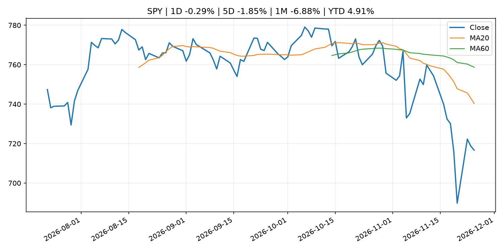
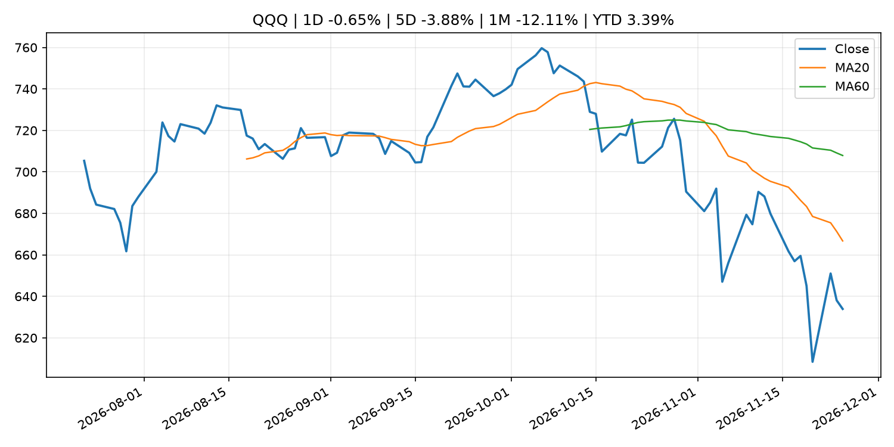
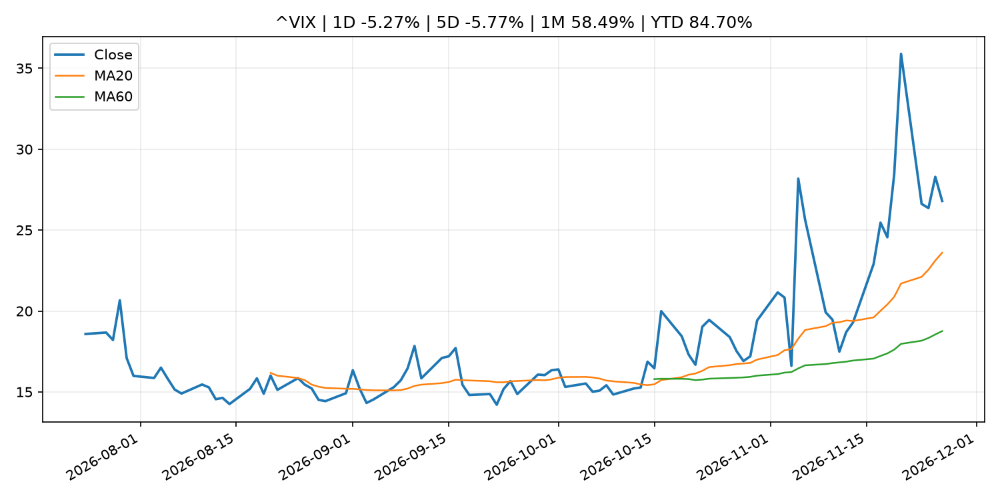
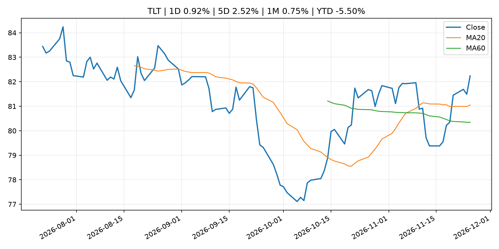
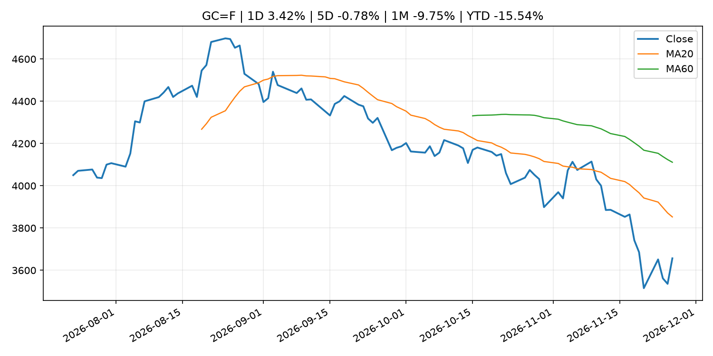
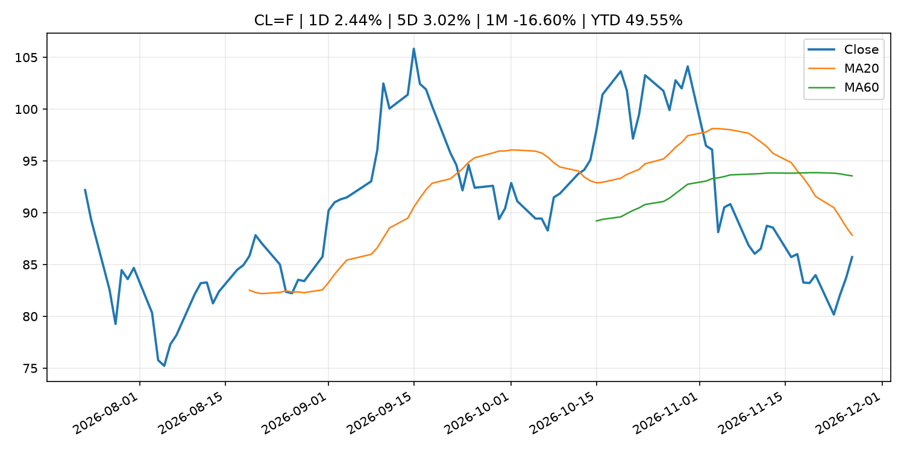
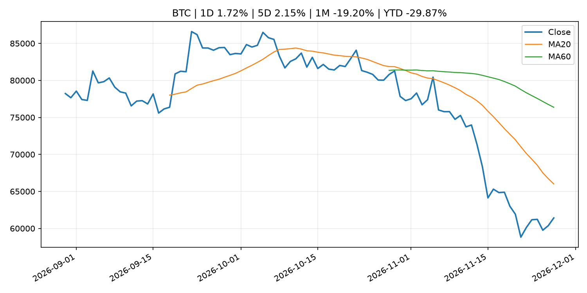
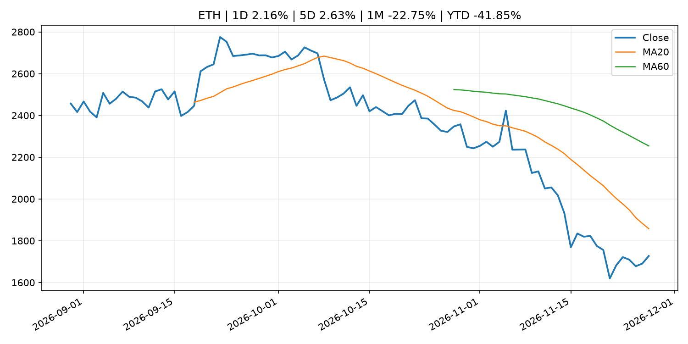
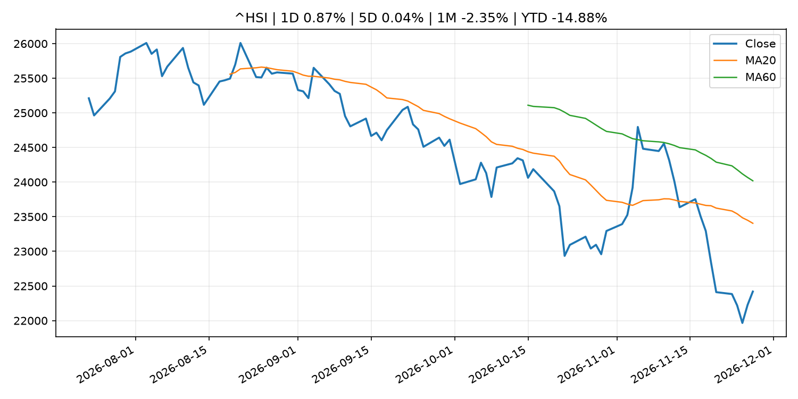

# Global Macro Morning Briefing - 2026-11-27

> Not financial advice / 非投资建议。

## 0. 今日总览
- 市场状态：unknown。市场信号不足，暂不判断明确状态。
- 今日三大主线：
  1. macro_data: Indicators for Core CPI
  2. earnings: Buyer beware? Nvidia's volatile swings expose risks of single-stock ETFs
  3. earnings: Liesman: Nvidia whiplash tests Kevin Warsh’s push to read market signals
- 一句话结论：今日晨报重点关注：这类宏观数据会直接改变市场对通胀、增长和政策路径的预期。；大型科技股盈利和资本开支会影响纳指、半导体和 AI 交易主线。。跨资产方面，SPY 1D -0.29%；QQQ 1D -0.65%；^VIX 1D -5.27%；TLT 1D 0.92%；GC=F 1D 3.42%；CL=F 1D 2.44%；BTC 1D 1.72%；ETH 1D 2.16%；市场信号不足，暂不判断明确状态。政策、通胀、利率、美元、美债、能源和加密监管仍是主要观察线索。所有结论仅基于公开数据与短摘要整理，不构成投资建议。

## 1. 隔夜跨资产市场
- 美股：SPY 1D -0.29%，QQQ 1D -0.65%，整体趋势需结合 VIX 和利率确认。
- 美债/美元：TLT 1D 0.92%，美元指数 1D 0.03%，是判断折现率压力的核心线索。
- 黄金/原油：黄金 1D 3.42%，原油 1D 2.44%，用于观察避险、通胀和地缘风险。
- 加密：BTC 1D 1.72%，ETH 1D 2.16%，关注是否独立于纳指走出加密自身行情。
- 港股/A股：恒生 1D 0.87%，沪深300/上证 1D n/a，重点看中国政策预期与人民币线索。
- 风险观察：关注后续数据是否确认当前跨资产信号。

### US_EQUITY

| symbol | latest close | 1D | 5D | 1M | YTD | trend |
|---|---:|---:|---:|---:|---:|---|
| SPY | 716.70 | -0.29% | -1.85% | -6.88% | 4.91% | strong_downtrend |
| QQQ | 633.93 | -0.65% | -3.88% | -12.11% | 3.39% | downtrend |
| DIA | 501.27 | 0.31% | -0.09% | -4.21% | 3.65% | strong_downtrend |
| IWM | 268.87 | 0.65% | -0.46% | -4.04% | 8.08% | downtrend |
| VTI | 353.20 | -0.18% | -1.75% | -6.54% | 5.02% | strong_downtrend |

### US_MACRO_MARKET

| symbol | latest close | 1D | 5D | 1M | YTD | trend |
|---|---:|---:|---:|---:|---:|---|
| ^VIX | 26.80 | -5.27% | -5.77% | 58.49% | 84.70% | uptrend |
| DX-Y.NYB | 103.70 | 0.03% | -0.19% | 1.48% | 5.36% | uptrend |
| TLT | 82.24 | 0.92% | 2.52% | 0.75% | -5.50% | uptrend |
| IEF | 92.06 | 0.46% | 1.53% | 1.05% | -4.18% | uptrend |

### COMMODITIES

| symbol | latest close | 1D | 5D | 1M | YTD | trend |
|---|---:|---:|---:|---:|---:|---|
| GC=F | 3,656.60 | 3.42% | -0.78% | -9.75% | -15.54% | strong_downtrend |
| SI=F | 43.81 | 9.40% | -1.13% | -18.04% | -37.90% | strong_downtrend |
| CL=F | 85.72 | 2.44% | 3.02% | -16.60% | 49.55% | strong_downtrend |
| BZ=F | 92.26 | -2.48% | 0.30% | -20.00% | 51.87% | strong_downtrend |
| NG=F | 3.60 | 10.19% | 10.22% | 27.87% | -0.44% | strong_uptrend |
| HG=F | 5.65 | 5.92% | 0.41% | -14.96% | 0.14% | strong_downtrend |

### HK_MARKET

| symbol | latest close | 1D | 5D | 1M | YTD | trend |
|---|---:|---:|---:|---:|---:|---|
| ^HSI | 22,419.58 | 0.87% | 0.04% | -2.35% | -14.88% | downtrend |
| 0700.HK | 344.60 | 1.06% | 0.17% | -8.74% | -44.69% | strong_downtrend |
| 9988.HK | 85.00 | 3.03% | 1.98% | -11.55% | -42.95% | strong_downtrend |
| 3690.HK | 65.70 | 4.78% | -1.20% | -5.06% | -37.19% | strong_downtrend |
| 1810.HK | 26.94 | 1.28% | -2.53% | 4.91% | -33.12% | range_bound |
| 1211.HK | 57.60 | 1.23% | -7.62% | -16.10% | -41.67% | strong_downtrend |

### CRYPTO

| symbol | latest close | 1D | 5D | 1M | YTD | trend |
|---|---:|---:|---:|---:|---:|---|
| BTC | 61,414.98 | 1.72% | 2.15% | -19.20% | -29.87% | strong_downtrend |
| ETH | 1,727.11 | 2.16% | 2.63% | -22.75% | -41.85% | strong_downtrend |
| SOLANA | 72.63 | 3.20% | 3.46% | -18.60% | -41.67% | strong_downtrend |
| BINANCECOIN | 562.01 | 1.55% | 2.62% | -18.41% | -34.85% | strong_downtrend |
| RIPPLE | 0.96 | 2.64% | 3.24% | -20.34% | -47.78% | strong_downtrend |

## 2. 今日最重要的 10 条新闻
### 1. Indicators for Core CPI
- 来源：Bank of Japan Announcements
- 时间：2026-11-25T14:00:00+09:00
- 地区：Japan
- 事件类型：macro_data
- 重要性层级：Tier 1
- 一句话摘要：Indicators for Core CPI
- 为什么重要：这类宏观数据会直接改变市场对通胀、增长和政策路径的预期。
- 可能影响：主要影响 DXY，方向为 positive，强度 high；通胀压力可能推高政策利率预期并支撑美元。
  - 资产：DXY
    方向：positive
    强度：high
    原因：通胀压力可能推高政策利率预期并支撑美元。
  - 资产：TLT
    方向：negative
    强度：high
    原因：通胀上行通常推升收益率、压低长债价格。
  - 资产：QQQ
    方向：negative
    强度：high
    原因：更高利率对成长股估值折现率不利。
  - 资产：SPY
    方向：mixed
    强度：medium
    原因：名义增长可能支撑收入，但更高利率压制估值。
  - 资产：GC=F
    方向：mixed
    强度：medium
    原因：通胀对黄金是支撑，但实际利率上行会形成压力。
  - 资产：BTC
    方向：mixed
    强度：medium
    原因：抗通胀叙事和流动性收紧可能相互抵消。
- 原文链接：[http://www.boj.or.jp/en/research/research_data/cpi/index.htm](http://www.boj.or.jp/en/research/research_data/cpi/index.htm)

### 2. Buyer beware? Nvidia's volatile swings expose risks of single-stock ETFs
- 来源：CNBC Economy
- 时间：2026-11-26T16:00:01+00:00
- 地区：US
- 事件类型：earnings
- 重要性层级：Tier 2
- 一句话摘要：ETF Action founding partner Mike Akins and GraniteShares CEO Will Rhind react to Nvidia's  sharp losses and latest comeback.
- 为什么重要：大型科技股盈利和资本开支会影响纳指、半导体和 AI 交易主线。
- 可能影响：主要影响 BTC，方向为 mixed，强度 high；加密监管或 ETF 进展会改变 BTC 的资金流和风险溢价。
  - 资产：BTC
    方向：mixed
    强度：high
    原因：加密监管或 ETF 进展会改变 BTC 的资金流和风险溢价。
  - 资产：ETH
    方向：mixed
    强度：high
    原因：监管框架会影响 ETH 产品化和机构参与度。
  - 资产：COIN
    方向：mixed
    强度：medium
    原因：监管清晰度和执法风险会影响交易平台估值。
  - 资产：crypto market
    方向：mixed
    强度：high
    原因：信息影响整个加密市场结构，但方向取决于细节。
  - 资产：QQQ
    方向：mixed
    强度：high
    原因：AI 资本开支会影响大型科技股盈利和估值预期。
  - 资产：SMH
    方向：mixed
    强度：high
    原因：AI 投资周期直接影响半导体需求。
- 原文链接：[https://www.cnbc.com/2026/11/26/nvidias-volatile-swings-expose-risks-of-single-stock-etfs.html](https://www.cnbc.com/2026/11/26/nvidias-volatile-swings-expose-risks-of-single-stock-etfs.html)

### 3. Liesman: Nvidia whiplash tests Kevin Warsh’s push to read market signals
- 来源：CNBC Economy
- 时间：2026-11-25T12:26:41+00:00
- 地区：US
- 事件类型：earnings
- 重要性层级：Tier 2
- 一句话摘要：The extreme market gyrations and the drama surrounding Nvidia this past week have highlighted the dilemma facing Federal Reserve Chairman Kevin Warsh.
- 为什么重要：大型科技股盈利和资本开支会影响纳指、半导体和 AI 交易主线。
- 可能影响：主要影响 QQQ，方向为 mixed，强度 high；AI 资本开支会影响大型科技股盈利和估值预期。
  - 资产：QQQ
    方向：mixed
    强度：high
    原因：AI 资本开支会影响大型科技股盈利和估值预期。
  - 资产：SMH
    方向：mixed
    强度：high
    原因：AI 投资周期直接影响半导体需求。
  - 资产：NVDA
    方向：mixed
    强度：high
    原因：AI 训练和推理需求是英伟达收入预期核心变量。
  - 资产：MSFT
    方向：mixed
    强度：medium
    原因：云和 AI 资本开支影响利润率与增长叙事。
  - 资产：GOOGL
    方向：mixed
    强度：medium
    原因：AI 投资和搜索商业化影响估值。
  - 资产：META
    方向：mixed
    强度：medium
    原因：AI 基建支出与广告效率共同影响市场预期。
- 原文链接：[https://www.cnbc.com/2026/11/25/nvidia-kevin-warsh-fed-market-signals.html](https://www.cnbc.com/2026/11/25/nvidia-kevin-warsh-fed-market-signals.html)

### 4. Ripple is worth $90 a share to one fund and $300 to another, SEC filings show
- 来源：CoinDesk
- 时间：2026-11-26T05:30:38+00:00
- 地区：global
- 事件类型：regulation
- 重要性层级：Tier 2
- 一句话摘要：Ripple is worth $90 a share to one fund and $300 to another, SEC filings show
- 为什么重要：监管变化会改变行业盈利预期和资产风险溢价。
- 可能影响：主要影响 BTC，方向为 mixed，强度 high；加密监管或 ETF 进展会改变 BTC 的资金流和风险溢价。
  - 资产：BTC
    方向：mixed
    强度：high
    原因：加密监管或 ETF 进展会改变 BTC 的资金流和风险溢价。
  - 资产：ETH
    方向：mixed
    强度：high
    原因：监管框架会影响 ETH 产品化和机构参与度。
  - 资产：COIN
    方向：mixed
    强度：medium
    原因：监管清晰度和执法风险会影响交易平台估值。
  - 资产：crypto market
    方向：mixed
    强度：high
    原因：信息影响整个加密市场结构，但方向取决于细节。
- 原文链接：[https://www.coindesk.com/markets/2026/11/26/ripple-is-worth-usd90-a-share-to-one-fund-and-usd300-to-another-sec-filings-show](https://www.coindesk.com/markets/2026/11/26/ripple-is-worth-usd90-a-share-to-one-fund-and-usd300-to-another-sec-filings-show)

### 5. SEC Investor Advisory Committee to Host Dec. 3 Virtual Meeting
- 来源：SEC Press Releases
- 时间：2026-11-25T09:10:24-05:00
- 地区：US
- 事件类型：regulation
- 重要性层级：Tier 2
- 一句话摘要：The Securities and Exchange Commission’s Investor Advisory Committee will hold a virtual public meeting on Dec. 3, at 9:30 a.m. ET to discuss the trading of tokenized securities, bankruptcy, and accounting oversight. The meeting will be webcast…
- 为什么重要：监管变化会改变行业盈利预期和资产风险溢价。
- 可能影响：主要影响 BTC，方向为 mixed，强度 high；加密监管或 ETF 进展会改变 BTC 的资金流和风险溢价。
  - 资产：BTC
    方向：mixed
    强度：high
    原因：加密监管或 ETF 进展会改变 BTC 的资金流和风险溢价。
  - 资产：ETH
    方向：mixed
    强度：high
    原因：监管框架会影响 ETH 产品化和机构参与度。
  - 资产：COIN
    方向：mixed
    强度：medium
    原因：监管清晰度和执法风险会影响交易平台估值。
  - 资产：crypto market
    方向：mixed
    强度：high
    原因：信息影响整个加密市场结构，但方向取决于细节。
- 原文链接：[https://www.sec.gov/newsroom/press-releases/2026-118-sec-investor-advisory-committee-host-dec-3-virtual-meeting](https://www.sec.gov/newsroom/press-releases/2026-118-sec-investor-advisory-committee-host-dec-3-virtual-meeting)

### 6. Keynote speech by Executive Director KAMIYAMA at the IMF MCM-OAP Seminar in Tokyo (Digital Money and Payments: Transitioning Toward a New Paradigm)
- 来源：Bank of Japan Announcements
- 时间：2026-11-27T10:15:00+09:00
- 地区：Japan
- 事件类型：central_bank_speech
- 重要性层级：Tier 2
- 一句话摘要：Keynote speech by Executive Director KAMIYAMA at the IMF MCM-OAP Seminar in Tokyo (Digital Money and Payments: Transitioning Toward a New Paradigm)
- 为什么重要：央行官员表态可能影响市场对下一次会议的定价。
- 可能影响：可能影响利率、汇率、风险资产或大宗商品预期，但当前公开信息不足以判断明确方向。
  - 资产：暂无明确资产映射
  - 方向：unknown
  - 强度：low
  - 原因：公开信息不足以判断方向。
- 原文链接：[http://www.boj.or.jp/en/about/press/koen_2026/ko261127a.htm](http://www.boj.or.jp/en/about/press/koen_2026/ko261127a.htm)

### 7. Speech by Board Member TAMURA in Yamanashi (Economic Activity, Prices, and Monetary Policy in Japan)
- 来源：Bank of Japan Announcements
- 时间：2026-11-26T10:00:00+09:00
- 地区：Japan
- 事件类型：central_bank_speech
- 重要性层级：Tier 2
- 一句话摘要：Speech by Board Member TAMURA in Yamanashi (Economic Activity, Prices, and Monetary Policy in Japan)
- 为什么重要：央行官员表态可能影响市场对下一次会议的定价。
- 可能影响：可能影响利率、汇率、风险资产或大宗商品预期，但当前公开信息不足以判断明确方向。
  - 资产：暂无明确资产映射
  - 方向：unknown
  - 强度：low
  - 原因：公开信息不足以判断方向。
- 原文链接：[http://www.boj.or.jp/en/about/press/koen_2026/ko261126a.htm](http://www.boj.or.jp/en/about/press/koen_2026/ko261126a.htm)

### 8. Fed’s preferred inflation gauge lands with a December rate increase already priced in
- 来源：CoinDesk
- 时间：2026-11-25T12:18:46+00:00
- 地区：global
- 事件类型：other
- 重要性层级：Tier 3
- 一句话摘要：Fed’s preferred inflation gauge lands with a December rate increase already priced in
- 为什么重要：这条信息暂未匹配到重大宏观、政策或市场事件，更适合作为背景跟踪。
- 可能影响：主要影响 DXY，方向为 positive，强度 high；通胀压力可能推高政策利率预期并支撑美元。
  - 资产：DXY
    方向：positive
    强度：high
    原因：通胀压力可能推高政策利率预期并支撑美元。
  - 资产：TLT
    方向：negative
    强度：high
    原因：通胀上行通常推升收益率、压低长债价格。
  - 资产：QQQ
    方向：negative
    强度：high
    原因：更高利率对成长股估值折现率不利。
  - 资产：SPY
    方向：mixed
    强度：medium
    原因：名义增长可能支撑收入，但更高利率压制估值。
  - 资产：GC=F
    方向：mixed
    强度：medium
    原因：通胀对黄金是支撑，但实际利率上行会形成压力。
  - 资产：BTC
    方向：mixed
    强度：medium
    原因：抗通胀叙事和流动性收紧可能相互抵消。
- 原文链接：[https://www.coindesk.com/daybook-us/2026/11/25/fed-s-preferred-inflation-gauge-lands-with-a-december-rate-increase-already-priced-in](https://www.coindesk.com/daybook-us/2026/11/25/fed-s-preferred-inflation-gauge-lands-with-a-december-rate-increase-already-priced-in)

### 9. Meeting of 28-29 October 2026
- 来源：ECB Press Releases
- 时间：2026-11-26T13:30:00+01:00
- 地区：EU
- 事件类型：other
- 重要性层级：Tier 3
- 一句话摘要：Meeting of 28-29 October 2026
- 为什么重要：这条信息暂未匹配到重大宏观、政策或市场事件，更适合作为背景跟踪。
- 可能影响：更偏背景信息，短期市场影响可能有限。
  - 资产：暂无明确资产映射
  - 方向：unknown
  - 强度：low
  - 原因：公开信息不足以判断方向。
- 原文链接：[https://www.ecb.europa.eu//press/accounts/2026/html/ecb.mg261126~ccf28c8071.en.html](https://www.ecb.europa.eu//press/accounts/2026/html/ecb.mg261126~ccf28c8071.en.html)

## 3. 政策与央行观察
### 1. Ripple is worth $90 a share to one fund and $300 to another, SEC filings show
- 来源：CoinDesk
- 时间：2026-11-26T05:30:38+00:00
- 地区：global
- 事件类型：regulation
- 重要性层级：Tier 2
- 一句话摘要：Ripple is worth $90 a share to one fund and $300 to another, SEC filings show
- 为什么重要：监管变化会改变行业盈利预期和资产风险溢价。
- 可能影响：主要影响 BTC，方向为 mixed，强度 high；加密监管或 ETF 进展会改变 BTC 的资金流和风险溢价。
  - 资产：BTC
    方向：mixed
    强度：high
    原因：加密监管或 ETF 进展会改变 BTC 的资金流和风险溢价。
  - 资产：ETH
    方向：mixed
    强度：high
    原因：监管框架会影响 ETH 产品化和机构参与度。
  - 资产：COIN
    方向：mixed
    强度：medium
    原因：监管清晰度和执法风险会影响交易平台估值。
  - 资产：crypto market
    方向：mixed
    强度：high
    原因：信息影响整个加密市场结构，但方向取决于细节。
- 原文链接：[https://www.coindesk.com/markets/2026/11/26/ripple-is-worth-usd90-a-share-to-one-fund-and-usd300-to-another-sec-filings-show](https://www.coindesk.com/markets/2026/11/26/ripple-is-worth-usd90-a-share-to-one-fund-and-usd300-to-another-sec-filings-show)

### 2. SEC Investor Advisory Committee to Host Dec. 3 Virtual Meeting
- 来源：SEC Press Releases
- 时间：2026-11-25T09:10:24-05:00
- 地区：US
- 事件类型：regulation
- 重要性层级：Tier 2
- 一句话摘要：The Securities and Exchange Commission’s Investor Advisory Committee will hold a virtual public meeting on Dec. 3, at 9:30 a.m. ET to discuss the trading of tokenized securities, bankruptcy, and accounting oversight. The meeting will be webcast…
- 为什么重要：监管变化会改变行业盈利预期和资产风险溢价。
- 可能影响：主要影响 BTC，方向为 mixed，强度 high；加密监管或 ETF 进展会改变 BTC 的资金流和风险溢价。
  - 资产：BTC
    方向：mixed
    强度：high
    原因：加密监管或 ETF 进展会改变 BTC 的资金流和风险溢价。
  - 资产：ETH
    方向：mixed
    强度：high
    原因：监管框架会影响 ETH 产品化和机构参与度。
  - 资产：COIN
    方向：mixed
    强度：medium
    原因：监管清晰度和执法风险会影响交易平台估值。
  - 资产：crypto market
    方向：mixed
    强度：high
    原因：信息影响整个加密市场结构，但方向取决于细节。
- 原文链接：[https://www.sec.gov/newsroom/press-releases/2026-118-sec-investor-advisory-committee-host-dec-3-virtual-meeting](https://www.sec.gov/newsroom/press-releases/2026-118-sec-investor-advisory-committee-host-dec-3-virtual-meeting)

### 3. Keynote speech by Executive Director KAMIYAMA at the IMF MCM-OAP Seminar in Tokyo (Digital Money and Payments: Transitioning Toward a New Paradigm)
- 来源：Bank of Japan Announcements
- 时间：2026-11-27T10:15:00+09:00
- 地区：Japan
- 事件类型：central_bank_speech
- 重要性层级：Tier 2
- 一句话摘要：Keynote speech by Executive Director KAMIYAMA at the IMF MCM-OAP Seminar in Tokyo (Digital Money and Payments: Transitioning Toward a New Paradigm)
- 为什么重要：央行官员表态可能影响市场对下一次会议的定价。
- 可能影响：可能影响利率、汇率、风险资产或大宗商品预期，但当前公开信息不足以判断明确方向。
  - 资产：暂无明确资产映射
  - 方向：unknown
  - 强度：low
  - 原因：公开信息不足以判断方向。
- 原文链接：[http://www.boj.or.jp/en/about/press/koen_2026/ko261127a.htm](http://www.boj.or.jp/en/about/press/koen_2026/ko261127a.htm)

### 4. Speech by Board Member TAMURA in Yamanashi (Economic Activity, Prices, and Monetary Policy in Japan)
- 来源：Bank of Japan Announcements
- 时间：2026-11-26T10:00:00+09:00
- 地区：Japan
- 事件类型：central_bank_speech
- 重要性层级：Tier 2
- 一句话摘要：Speech by Board Member TAMURA in Yamanashi (Economic Activity, Prices, and Monetary Policy in Japan)
- 为什么重要：央行官员表态可能影响市场对下一次会议的定价。
- 可能影响：可能影响利率、汇率、风险资产或大宗商品预期，但当前公开信息不足以判断明确方向。
  - 资产：暂无明确资产映射
  - 方向：unknown
  - 强度：low
  - 原因：公开信息不足以判断方向。
- 原文链接：[http://www.boj.or.jp/en/about/press/koen_2026/ko261126a.htm](http://www.boj.or.jp/en/about/press/koen_2026/ko261126a.htm)

## 4. 市场异动与图表
- QQQ 下跌 -0.65%
- VIX 下跌 -5.27%
- TLT 上涨 0.92%
- Gold 上涨 3.42%
- Oil 上涨 2.44%
- ETH 上涨 2.16%

### SPY

### QQQ

### ^VIX

### TLT

### GC=F

### CL=F

### BTC

### ETH

### ^HSI

## 5. 华尔街与机构公开观点
- 暂无可靠公开观点。

## 6. 今日重点关注
- 经济数据：经济数据：暂无可靠公开日历数据；如配置经济日历源后可自动填充。
- 央行讲话：央行讲话：暂无可靠公开日历数据；重点跟踪 Fed、ECB、BoJ、PBOC 官网 RSS。
- 财报：财报：暂无可靠数据。
- 政策事件：政策事件：暂无可靠数据。
- 风险提醒：风险提醒：关注数据源失败项、突发地缘风险、利率和美元的二阶反应。

## 7. 英文金融表达与宏观概念
- **inflation expectations**：通胀预期，指家庭、企业或市场对未来通胀的预估。 例句：Inflation expectations can shape wage bargaining and bond yields.
- **real yield**：实际收益率，名义利率扣除通胀预期后的收益率。 例句：Gold often reacts more to real yields than nominal yields.
- **risk-off**：避险模式，资金偏向美元、国债、黄金等防御资产。 例句：A geopolitical shock can push markets into risk-off mode.
- **market structure**：市场结构，指交易、托管、清算、ETF、监管等制度安排。 例句：Crypto market structure rules can affect institutional participation.
- **AI capex**：AI 资本开支，指云厂商和科技公司投入 AI 基建的支出。 例句：AI capex guidance can move semiconductor stocks.
- **terminal rate**：终端利率，市场预期本轮加息周期的最高政策利率。 例句：A higher terminal rate can pressure growth stocks.

## 8. 背景材料
- [A tiny payment can expose the IP address behind a bitcoin wallet, developer finds](https://www.coindesk.com/tech/2026/11/26/a-tiny-payment-can-expose-the-ip-address-behind-a-bitcoin-wallet-developer-finds)（CoinDesk，other）：A tiny payment can expose the IP address behind a bitcoin wallet, developer finds
- [Bitcoin’s dormant supply rises, a behavior seen during previous bear-market bottoming phases](https://www.coindesk.com/markets/2026/11/26/bitcoin-s-dormant-supply-rises-a-behavior-seen-during-previous-bear-market-bottoming-phases)（CoinDesk，other）：Bitcoin’s dormant supply rises, a behavior seen during previous bear-market bottoming phases
- [My husband secretly sends his ex-wife $1,500 a month after she lost her job. We have $2.4 million saved. Has he lied by omission?](https://www.marketwatch.com/story/my-husband-secretly-sends-his-ex-wife-1-500-a-month-after-she-lost-her-job-we-have-2-4-million-saved-has-he-lied-by-omission-ede1972a?mod=mw_rss_topstories)（MarketWatch Top Stories，other）：“He explained that he wasn’t trying to hide the payment, but his former wife lost her job in a medical billing company.”
- [Meeting of 28-29 October 2026](https://www.ecb.europa.eu//press/accounts/2026/html/ecb.mg261126~ccf28c8071.en.html)（ECB Press Releases，other）：Meeting of 28-29 October 2026
- [Bitcoin ETFs are bleeding cash and the Fed is unlikely to help](https://www.coindesk.com/daybook-us/2026/11/26/bitcoin-etfs-are-bleeding-cash-and-the-fed-is-unlikely-to-help)（CoinDesk，other）：Bitcoin ETFs are bleeding cash and the Fed is unlikely to help
- [Hong Kong-based crypto trading firm Auros is winding down operations](https://www.coindesk.com/markets/2026/11/26/major-crypto-trading-firm-auros-is-winding-down-operations-sources)（CoinDesk，other）：Hong Kong-based crypto trading firm Auros is winding down operations
- [Bitcoin little changed, DeFi tokens lead the bounce as U.S. marks Thanksgiving](https://www.coindesk.com/markets/2026/11/26/bitcoin-little-changed-defi-tokens-lead-the-bounce-as-u-s-marks-thanksgiving)（CoinDesk，other）：Bitcoin little changed, DeFi tokens lead the bounce as U.S. marks Thanksgiving
- [$7 billion of bitcoin options expire Friday, and the biggest bets look starkly different from October](https://www.coindesk.com/markets/2026/11/26/usd7-billion-of-bitcoin-options-expire-friday-and-the-biggest-bets-look-starkly-different-from-october)（CoinDesk，other）：$7 billion of bitcoin options expire Friday, and the biggest bets look starkly different from October
- [Over 1,000 Bitcoin miners were tricked into working for a thief by a fake internet route](https://www.coindesk.com/markets/2026/11/26/hackers-hijacked-1-000-plus-bitcoin-mines-in-one-second-by-faking-internet-routes)（CoinDesk，other）：Over 1,000 Bitcoin miners were tricked into working for a thief by a fake internet route
- [Beware higher correlation but nab high U.S. credit yields, fund managers say](https://www.cnbc.com/2026/11/26/mispricing-risk-fund-managers-ai-volatility.html)（CNBC Economy，other）：The AI boom could trigger a recession, but data centers remain an attractive investment opportunity, a hedge fund manager said.
- [Bill to lock up U.S. government bitcoin for 20 years advances to full House](https://www.coindesk.com/policy/2026/11/26/strategic-bitcoin-reserve-bill-to-lock-up-u-s-government-held-bitcoin-for-20-years-goes-to-full-house)（CoinDesk，other）：Bill to lock up U.S. government bitcoin for 20 years advances to full House
- [Agencies announce dollar thresholds for applicability of truth in lending and consumer leasing rules for consumer credit and lease transactions](https://www.federalreserve.gov/newsevents/pressreleases/bcreg20261125b.htm)（Federal Reserve Press Releases，other）：Agencies announce dollar thresholds for applicability of truth in lending and consumer leasing rules for consumer credit and lease transactions
- [Agencies announce dollar thresholds for smaller loan exemption from appraisal requirements for higher-priced mortgage loans](https://www.federalreserve.gov/newsevents/pressreleases/bcreg20261125a.htm)（Federal Reserve Press Releases，other）：Agencies announce dollar thresholds for smaller loan exemption from appraisal requirements for higher-priced mortgage loans
- ['This time actually seems different': Crypto veterans brace for more pain as bitcoin tumbles](https://www.coindesk.com/markets/2026/11/25/this-time-actually-seems-different-crypto-veterans-brace-for-more-pain-as-bitcoin-tumbles)（CoinDesk，other）：'This time actually seems different': Crypto veterans brace for more pain as bitcoin tumbles
- [ECB and Sveriges Riksbank conclude agreement for Sweden to join T2](https://www.ecb.europa.eu//press/pr/date/2026/html/ecb.pr261125_1~6333a90f3a.en.html)（ECB Press Releases，other）：ECB and Sveriges Riksbank conclude agreement for Sweden to join T2
- [Crypto Long & Short: Bitcoin investors can’t keep ignoring Japan](https://www.coindesk.com/coindesk-indices/2026/11/25/crypto-long-and-short-bitcoin-investors-can-t-keep-ignoring-japan)（CoinDesk，other）：Crypto Long & Short: Bitcoin investors can’t keep ignoring Japan
- [Fed’s preferred inflation gauge lands with a December rate increase already priced in](https://www.coindesk.com/daybook-us/2026/11/25/fed-s-preferred-inflation-gauge-lands-with-a-december-rate-increase-already-priced-in)（CoinDesk，other）：Fed’s preferred inflation gauge lands with a December rate increase already priced in
- [Ether, DeFi fall twice as hard as bitcoin as equities selloff resumes](https://www.coindesk.com/markets/2026/11/25/ether-defi-fall-twice-as-hard-as-bitcoin-as-equities-selloff-resumes)（CoinDesk，other）：Ether, DeFi fall twice as hard as bitcoin as equities selloff resumes
- [Italy’s UniCredit launches six-year bitcoin certificate with gains capped at 65%](https://www.coindesk.com/business/2026/11/25/italy-s-unicredit-debuts-six-year-bitcoin-certificate-with-100-capital-protection-and-65-cap)（CoinDesk，other）：Italy’s UniCredit launches six-year bitcoin certificate with gains capped at 65%
- [Gold's haven status has lost its edge over bitcoin, and the Fed's to blame](https://www.coindesk.com/markets/2026/11/25/bitcoin-hasn-t-paid-its-holders-for-the-risk-it-carries-and-now-gold-is-doing-the-same)（CoinDesk，other）：Gold's haven status has lost its edge over bitcoin, and the Fed's to blame

## 9. 数据源、失败项与免责声明
- 采集时间：2026-11-27T03:58:18
- 数据源：公开 RSS、Yahoo Finance、CoinGecko、AKShare、FRED、SEC data.sec.gov，以及用户自有 inputs/reports 文件。
- 合规说明：不绕过 WSJ、Bloomberg、FT、Reuters 等付费墙；对付费媒体只使用公开 RSS 标题、摘要、链接和发布时间。
- 免责声明：Not financial advice / 非投资建议。本项目仅供个人学习、研究和信息整理，不构成投资建议、交易建议或任何收益承诺。
- 失败或跳过的数据源：
  - crypto data failed coin=dogecoin
  - China market data failed symbol=上证指数: stock_zh_index_daily_em 已在 1.20.44 更名为 index_zh_daily_em，请改用 ak.index_zh_daily_em；参数与返回的列也可能有调整，用 ak.interface_info("index_zh_daily_em") 查看。完整对照见 https://akshare.akfamily.xyz/changelog.html#changelog-rename
  - China market data failed symbol=深证成指: stock_zh_index_daily_em 已在 1.20.44 更名为 index_zh_daily_em，请改用 ak.index_zh_daily_em；参数与返回的列也可能有调整，用 ak.interface_info("index_zh_daily_em") 查看。完整对照见 https://akshare.akfamily.xyz/changelog.html#changelog-rename
  - China market data failed symbol=创业板指: stock_zh_index_daily_em 已在 1.20.44 更名为 index_zh_daily_em，请改用 ak.index_zh_daily_em；参数与返回的列也可能有调整，用 ak.interface_info("index_zh_daily_em") 查看。完整对照见 https://akshare.akfamily.xyz/changelog.html#changelog-rename
  - China market data failed symbol=沪深300: stock_zh_index_daily_em 已在 1.20.44 更名为 index_zh_daily_em，请改用 ak.index_zh_daily_em；参数与返回的列也可能有调整，用 ak.interface_info("index_zh_daily_em") 查看。完整对照见 https://akshare.akfamily.xyz/changelog.html#changelog-rename
  - China market data failed symbol=中证500: stock_zh_index_daily_em 已在 1.20.44 更名为 index_zh_daily_em，请改用 ak.index_zh_daily_em；参数与返回的列也可能有调整，用 ak.interface_info("index_zh_daily_em") 查看。完整对照见 https://akshare.akfamily.xyz/changelog.html#changelog-rename
  - China market data failed symbol=科创50: stock_zh_index_daily_em 已在 1.20.44 更名为 index_zh_daily_em，请改用 ak.index_zh_daily_em；参数与返回的列也可能有调整，用 ak.interface_info("index_zh_daily_em") 查看。完整对照见 https://akshare.akfamily.xyz/changelog.html#changelog-rename
  - FRED_API_KEY not set; skipping FRED macro series
  - SEC failed cik=0000320193
  - SEC failed cik=0000789019
  - SEC failed cik=0001045810
  - SEC failed cik=0001318605
  - SEC failed cik=0001577552
