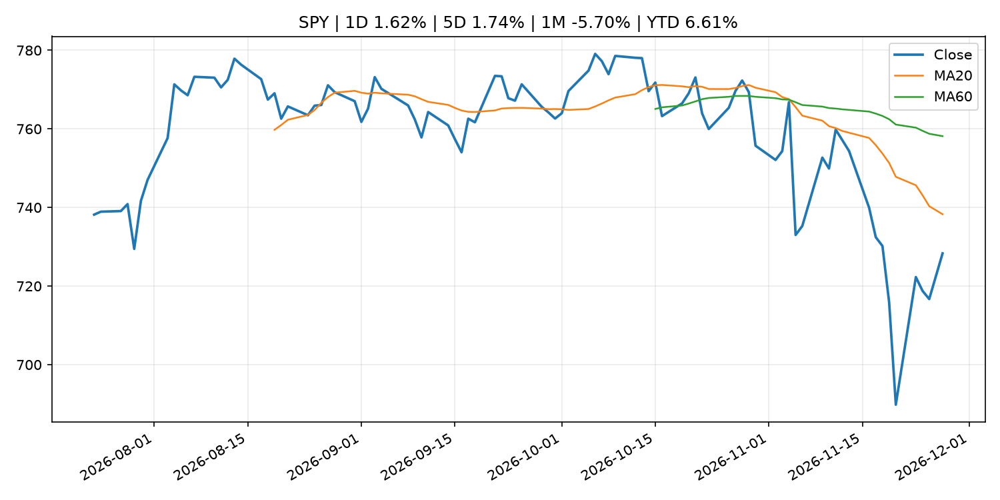
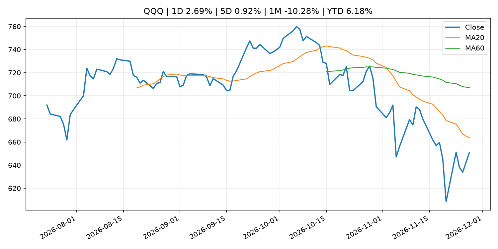
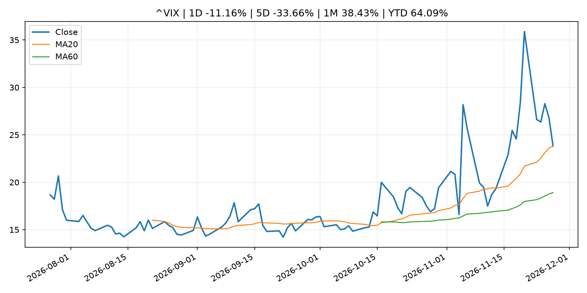
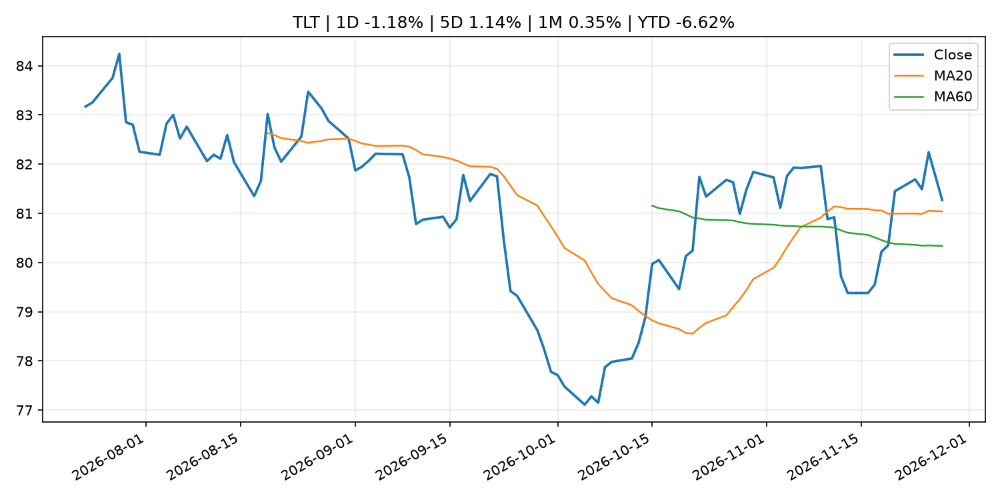
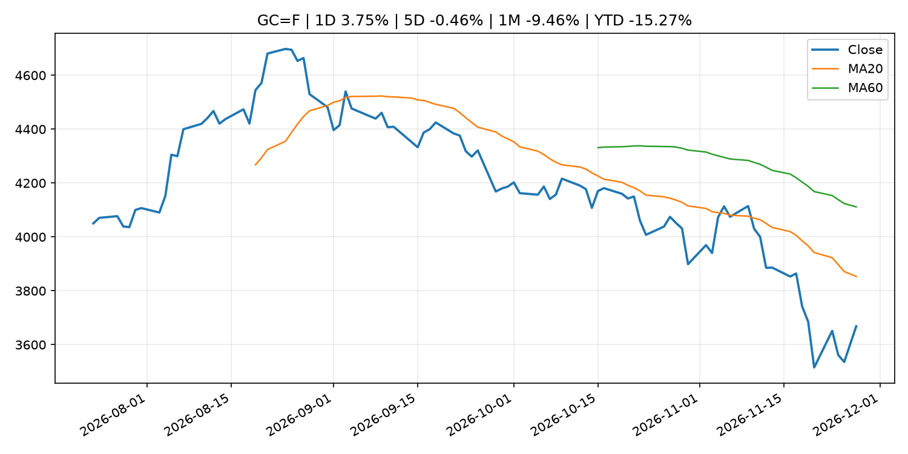
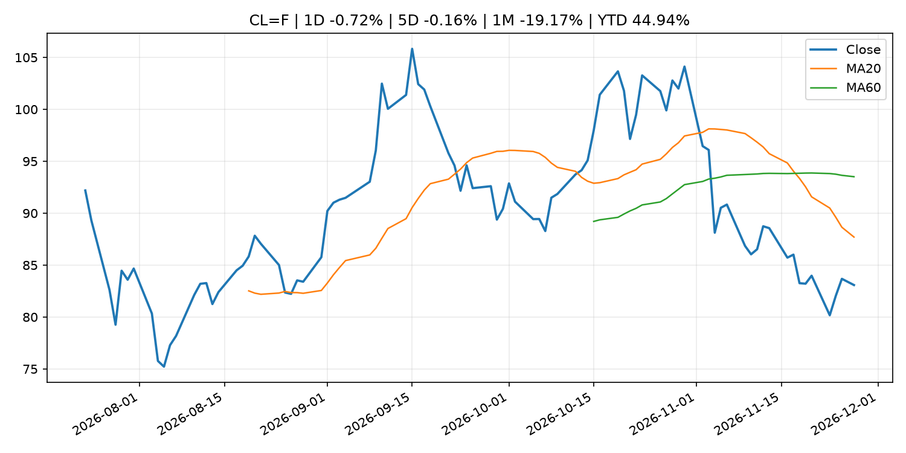
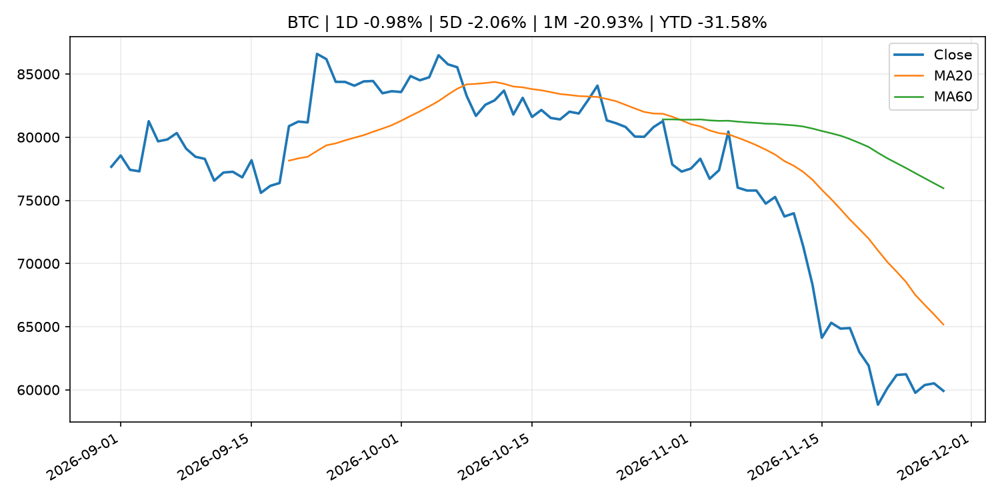
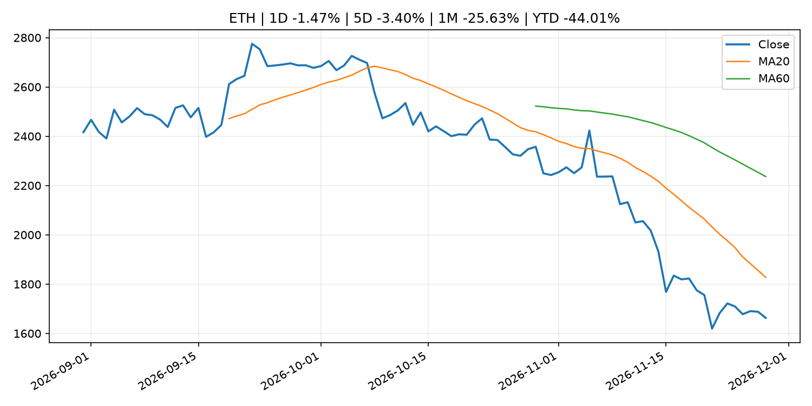
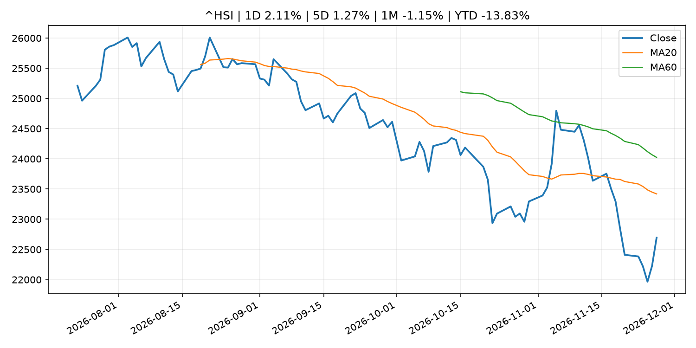

# Global Macro Morning Briefing - 2026-11-28

> Not financial advice / 非投资建议。

## 0. 今日总览
- 市场状态：mixed。股指上涨、波动率或美元回落，市场更接近风险偏好改善。 但存在信号冲突，需要降低单一叙事置信度。
- 今日三大主线：
  1. earnings: Liesman: Nvidia whiplash tests Kevin Warsh’s push to read market signals
  2. earnings: Buyer beware? Nvidia's volatile swings expose risks of single-stock ETFs
  3. regulation: Injective asks SEC to allow order books for tokenized stock trading
- 一句话结论：今日晨报重点关注：大型科技股盈利和资本开支会影响纳指、半导体和 AI 交易主线。；大型科技股盈利和资本开支会影响纳指、半导体和 AI 交易主线。。跨资产方面，SPY 1D 1.62%；QQQ 1D 2.69%；^VIX 1D -11.16%；TLT 1D -1.18%；GC=F 1D 3.75%；CL=F 1D -0.72%；BTC 1D -0.98%；ETH 1D -1.47%；股指上涨、波动率或美元回落，市场更接近风险偏好改善。 但存在信号冲突，需要降低单一叙事置信度。政策、通胀、利率、美元、美债、能源和加密监管仍是主要观察线索。所有结论仅基于公开数据与短摘要整理，不构成投资建议。

## 1. 隔夜跨资产市场
- 美股：SPY 1D 1.62%，QQQ 1D 2.69%，整体趋势需结合 VIX 和利率确认。
- 美债/美元：TLT 1D -1.18%，美元指数 1D 0.33%，是判断折现率压力的核心线索。
- 黄金/原油：黄金 1D 3.75%，原油 1D -0.72%，用于观察避险、通胀和地缘风险。
- 加密：BTC 1D -0.98%，ETH 1D -1.47%，关注是否独立于纳指走出加密自身行情。
- 港股/A股：恒生 1D 2.11%，沪深300/上证 1D n/a，重点看中国政策预期与人民币线索。
- 风险观察：确认风险偏好是否扩散到小盘股、信用利差和周期品。

### US_EQUITY

| symbol | latest close | 1D | 5D | 1M | YTD | trend |
|---|---:|---:|---:|---:|---:|---|
| SPY | 728.32 | 1.62% | 1.74% | -5.70% | 6.61% | downtrend |
| QQQ | 650.99 | 2.69% | 0.92% | -10.28% | 6.18% | downtrend |
| DIA | 507.60 | 1.26% | 3.43% | -3.26% | 4.96% | downtrend |
| IWM | 273.79 | 1.83% | 3.62% | -2.67% | 10.05% | downtrend |
| VTI | 359.40 | 1.76% | 1.98% | -5.21% | 6.87% | downtrend |

### US_MACRO_MARKET

| symbol | latest close | 1D | 5D | 1M | YTD | trend |
|---|---:|---:|---:|---:|---:|---|
| ^VIX | 23.81 | -11.16% | -33.66% | 38.43% | 64.09% | range_bound |
| DX-Y.NYB | 104.01 | 0.33% | 0.11% | 1.78% | 5.68% | uptrend |
| TLT | 81.27 | -1.18% | 1.14% | 0.35% | -6.62% | uptrend |
| IEF | 91.66 | -0.43% | 0.92% | 0.89% | -4.60% | uptrend |

### COMMODITIES

| symbol | latest close | 1D | 5D | 1M | YTD | trend |
|---|---:|---:|---:|---:|---:|---|
| GC=F | 3,668.50 | 3.75% | -0.46% | -9.46% | -15.27% | strong_downtrend |
| SI=F | 43.70 | 9.11% | -1.39% | -18.25% | -38.06% | strong_downtrend |
| CL=F | 83.08 | -0.72% | -0.16% | -19.17% | 44.94% | strong_downtrend |
| BZ=F | 90.84 | -3.98% | -1.24% | -21.23% | 49.53% | strong_downtrend |
| NG=F | 3.49 | 6.79% | 6.82% | 23.93% | -3.51% | strong_uptrend |
| HG=F | 5.60 | 5.03% | -0.44% | -15.67% | -0.70% | strong_downtrend |

### HK_MARKET

| symbol | latest close | 1D | 5D | 1M | YTD | trend |
|---|---:|---:|---:|---:|---:|---|
| ^HSI | 22,694.77 | 2.11% | 1.27% | -1.15% | -13.83% | downtrend |
| 0700.HK | 352.00 | 3.23% | 2.33% | -6.78% | -43.50% | strong_downtrend |
| 9988.HK | 88.30 | 7.03% | 5.94% | -8.12% | -40.74% | strong_downtrend |
| 3690.HK | 67.85 | 8.21% | 2.03% | -1.95% | -35.13% | downtrend |
| 1810.HK | 27.80 | 4.51% | 0.58% | 8.26% | -30.98% | range_bound |
| 1211.HK | 59.00 | 3.69% | -5.37% | -14.06% | -40.25% | strong_downtrend |

### CRYPTO

| symbol | latest close | 1D | 5D | 1M | YTD | trend |
|---|---:|---:|---:|---:|---:|---|
| BTC | 59,914.81 | -0.98% | -2.06% | -20.93% | -31.58% | strong_downtrend |
| ETH | 1,663.05 | -1.47% | -3.40% | -25.63% | -44.01% | strong_downtrend |
| SOLANA | 71.68 | 1.00% | 1.52% | -20.40% | -42.43% | strong_downtrend |
| BINANCECOIN | 554.10 | 0.09% | -0.83% | -20.00% | -35.77% | strong_downtrend |
| RIPPLE | 0.95 | 0.57% | 2.20% | -19.55% | -48.48% | strong_downtrend |

## 2. 今日最重要的 10 条新闻
### 1. Liesman: Nvidia whiplash tests Kevin Warsh’s push to read market signals
- 来源：CNBC Economy
- 时间：2026-11-27T13:29:43+00:00
- 地区：US
- 事件类型：earnings
- 重要性层级：Tier 2
- 一句话摘要：The extreme market gyrations and the drama surrounding Nvidia this past week have highlighted the dilemma facing Federal Reserve Chairman Kevin Warsh.
- 为什么重要：大型科技股盈利和资本开支会影响纳指、半导体和 AI 交易主线。
- 可能影响：主要影响 QQQ，方向为 mixed，强度 high；AI 资本开支会影响大型科技股盈利和估值预期。
  - 资产：QQQ
    方向：mixed
    强度：high
    原因：AI 资本开支会影响大型科技股盈利和估值预期。
  - 资产：SMH
    方向：mixed
    强度：high
    原因：AI 投资周期直接影响半导体需求。
  - 资产：NVDA
    方向：mixed
    强度：high
    原因：AI 训练和推理需求是英伟达收入预期核心变量。
  - 资产：MSFT
    方向：mixed
    强度：medium
    原因：云和 AI 资本开支影响利润率与增长叙事。
  - 资产：GOOGL
    方向：mixed
    强度：medium
    原因：AI 投资和搜索商业化影响估值。
  - 资产：META
    方向：mixed
    强度：medium
    原因：AI 基建支出与广告效率共同影响市场预期。
- 原文链接：[https://www.cnbc.com/2026/11/25/nvidia-kevin-warsh-fed-market-signals.html](https://www.cnbc.com/2026/11/25/nvidia-kevin-warsh-fed-market-signals.html)

### 2. Buyer beware? Nvidia's volatile swings expose risks of single-stock ETFs
- 来源：CNBC Economy
- 时间：2026-11-26T16:00:01+00:00
- 地区：US
- 事件类型：earnings
- 重要性层级：Tier 2
- 一句话摘要：ETF Action founding partner Mike Akins and GraniteShares CEO Will Rhind react to Nvidia's  sharp losses and latest comeback.
- 为什么重要：大型科技股盈利和资本开支会影响纳指、半导体和 AI 交易主线。
- 可能影响：主要影响 BTC，方向为 mixed，强度 high；加密监管或 ETF 进展会改变 BTC 的资金流和风险溢价。
  - 资产：BTC
    方向：mixed
    强度：high
    原因：加密监管或 ETF 进展会改变 BTC 的资金流和风险溢价。
  - 资产：ETH
    方向：mixed
    强度：high
    原因：监管框架会影响 ETH 产品化和机构参与度。
  - 资产：COIN
    方向：mixed
    强度：medium
    原因：监管清晰度和执法风险会影响交易平台估值。
  - 资产：crypto market
    方向：mixed
    强度：high
    原因：信息影响整个加密市场结构，但方向取决于细节。
  - 资产：QQQ
    方向：mixed
    强度：high
    原因：AI 资本开支会影响大型科技股盈利和估值预期。
  - 资产：SMH
    方向：mixed
    强度：high
    原因：AI 投资周期直接影响半导体需求。
- 原文链接：[https://www.cnbc.com/2026/11/26/nvidias-volatile-swings-expose-risks-of-single-stock-etfs.html](https://www.cnbc.com/2026/11/26/nvidias-volatile-swings-expose-risks-of-single-stock-etfs.html)

### 3. Injective asks SEC to allow order books for tokenized stock trading
- 来源：CoinDesk
- 时间：2026-11-27T11:07:17+00:00
- 地区：global
- 事件类型：regulation
- 重要性层级：Tier 2
- 一句话摘要：Injective asks SEC to allow order books for tokenized stock trading
- 为什么重要：监管变化会改变行业盈利预期和资产风险溢价。
- 可能影响：主要影响 BTC，方向为 mixed，强度 high；加密监管或 ETF 进展会改变 BTC 的资金流和风险溢价。
  - 资产：BTC
    方向：mixed
    强度：high
    原因：加密监管或 ETF 进展会改变 BTC 的资金流和风险溢价。
  - 资产：ETH
    方向：mixed
    强度：high
    原因：监管框架会影响 ETH 产品化和机构参与度。
  - 资产：COIN
    方向：mixed
    强度：medium
    原因：监管清晰度和执法风险会影响交易平台估值。
  - 资产：crypto market
    方向：mixed
    强度：high
    原因：信息影响整个加密市场结构，但方向取决于细节。
- 原文链接：[https://www.coindesk.com/markets/2026/11/27/injective-asks-sec-to-allow-order-books-for-tokenized-stock-trading](https://www.coindesk.com/markets/2026/11/27/injective-asks-sec-to-allow-order-books-for-tokenized-stock-trading)

### 4. Brazil’s stock exchange teams up with major banks to launch real-pegged stablecoin
- 来源：CoinDesk
- 时间：2026-11-27T10:51:27+00:00
- 地区：global
- 事件类型：crypto_market_structure
- 重要性层级：Tier 2
- 一句话摘要：Brazil’s stock exchange teams up with major banks to launch real-pegged stablecoin
- 为什么重要：加密市场结构和监管变化会影响 BTC、ETH 及相关股票的风险溢价。
- 可能影响：主要影响 BTC，方向为 mixed，强度 high；加密监管或 ETF 进展会改变 BTC 的资金流和风险溢价。
  - 资产：BTC
    方向：mixed
    强度：high
    原因：加密监管或 ETF 进展会改变 BTC 的资金流和风险溢价。
  - 资产：ETH
    方向：mixed
    强度：high
    原因：监管框架会影响 ETH 产品化和机构参与度。
  - 资产：COIN
    方向：mixed
    强度：medium
    原因：监管清晰度和执法风险会影响交易平台估值。
  - 资产：crypto market
    方向：mixed
    强度：high
    原因：信息影响整个加密市场结构，但方向取决于细节。
- 原文链接：[https://www.coindesk.com/business/2026/11/27/brazil-s-stock-exchange-teams-up-with-major-banks-to-launch-real-pegged-stablecoin](https://www.coindesk.com/business/2026/11/27/brazil-s-stock-exchange-teams-up-with-major-banks-to-launch-real-pegged-stablecoin)

### 5. Keynote speech by Executive Director KAMIYAMA at the IMF MCM-OAP Seminar in Tokyo (Digital Money and Payments: Transitioning Toward a New Paradigm)
- 来源：Bank of Japan Announcements
- 时间：2026-11-27T10:15:00+09:00
- 地区：Japan
- 事件类型：central_bank_speech
- 重要性层级：Tier 2
- 一句话摘要：Keynote speech by Executive Director KAMIYAMA at the IMF MCM-OAP Seminar in Tokyo (Digital Money and Payments: Transitioning Toward a New Paradigm)
- 为什么重要：央行官员表态可能影响市场对下一次会议的定价。
- 可能影响：可能影响利率、汇率、风险资产或大宗商品预期，但当前公开信息不足以判断明确方向。
  - 资产：暂无明确资产映射
  - 方向：unknown
  - 强度：low
  - 原因：公开信息不足以判断方向。
- 原文链接：[http://www.boj.or.jp/en/about/press/koen_2026/ko261127a.htm](http://www.boj.or.jp/en/about/press/koen_2026/ko261127a.htm)

### 6. Decisions taken by the Governing Council of the ECB (in addition to decisions setting interest rates)
- 来源：ECB Press Releases
- 时间：2026-11-27T15:00:00+01:00
- 地区：EU
- 事件类型：other
- 重要性层级：Tier 3
- 一句话摘要：Decisions taken by the Governing Council of the ECB (in addition to decisions setting interest rates)
- 为什么重要：这条信息暂未匹配到重大宏观、政策或市场事件，更适合作为背景跟踪。
- 可能影响：更偏背景信息，短期市场影响可能有限。
  - 资产：暂无明确资产映射
  - 方向：unknown
  - 强度：low
  - 原因：公开信息不足以判断方向。
- 原文链接：[https://www.ecb.europa.eu//press/govcdec/otherdec/2026/html/ecb.gc261127~13ecadc0f2.en.html](https://www.ecb.europa.eu//press/govcdec/otherdec/2026/html/ecb.gc261127~13ecadc0f2.en.html)

### 7. ECB Consumer Expectations Survey results – October 2026
- 来源：ECB Press Releases
- 时间：2026-11-27T10:00:00+01:00
- 地区：EU
- 事件类型：other
- 重要性层级：Tier 3
- 一句话摘要：ECB Consumer Expectations Survey results – October 2026
- 为什么重要：这条信息暂未匹配到重大宏观、政策或市场事件，更适合作为背景跟踪。
- 可能影响：更偏背景信息，短期市场影响可能有限。
  - 资产：暂无明确资产映射
  - 方向：unknown
  - 强度：low
  - 原因：公开信息不足以判断方向。
- 原文链接：[https://www.ecb.europa.eu//press/pr/date/2026/html/ecb.pr261127~2e53af695e.en.html](https://www.ecb.europa.eu//press/pr/date/2026/html/ecb.pr261127~2e53af695e.en.html)

## 3. 政策与央行观察
### 1. Injective asks SEC to allow order books for tokenized stock trading
- 来源：CoinDesk
- 时间：2026-11-27T11:07:17+00:00
- 地区：global
- 事件类型：regulation
- 重要性层级：Tier 2
- 一句话摘要：Injective asks SEC to allow order books for tokenized stock trading
- 为什么重要：监管变化会改变行业盈利预期和资产风险溢价。
- 可能影响：主要影响 BTC，方向为 mixed，强度 high；加密监管或 ETF 进展会改变 BTC 的资金流和风险溢价。
  - 资产：BTC
    方向：mixed
    强度：high
    原因：加密监管或 ETF 进展会改变 BTC 的资金流和风险溢价。
  - 资产：ETH
    方向：mixed
    强度：high
    原因：监管框架会影响 ETH 产品化和机构参与度。
  - 资产：COIN
    方向：mixed
    强度：medium
    原因：监管清晰度和执法风险会影响交易平台估值。
  - 资产：crypto market
    方向：mixed
    强度：high
    原因：信息影响整个加密市场结构，但方向取决于细节。
- 原文链接：[https://www.coindesk.com/markets/2026/11/27/injective-asks-sec-to-allow-order-books-for-tokenized-stock-trading](https://www.coindesk.com/markets/2026/11/27/injective-asks-sec-to-allow-order-books-for-tokenized-stock-trading)

### 2. Brazil’s stock exchange teams up with major banks to launch real-pegged stablecoin
- 来源：CoinDesk
- 时间：2026-11-27T10:51:27+00:00
- 地区：global
- 事件类型：crypto_market_structure
- 重要性层级：Tier 2
- 一句话摘要：Brazil’s stock exchange teams up with major banks to launch real-pegged stablecoin
- 为什么重要：加密市场结构和监管变化会影响 BTC、ETH 及相关股票的风险溢价。
- 可能影响：主要影响 BTC，方向为 mixed，强度 high；加密监管或 ETF 进展会改变 BTC 的资金流和风险溢价。
  - 资产：BTC
    方向：mixed
    强度：high
    原因：加密监管或 ETF 进展会改变 BTC 的资金流和风险溢价。
  - 资产：ETH
    方向：mixed
    强度：high
    原因：监管框架会影响 ETH 产品化和机构参与度。
  - 资产：COIN
    方向：mixed
    强度：medium
    原因：监管清晰度和执法风险会影响交易平台估值。
  - 资产：crypto market
    方向：mixed
    强度：high
    原因：信息影响整个加密市场结构，但方向取决于细节。
- 原文链接：[https://www.coindesk.com/business/2026/11/27/brazil-s-stock-exchange-teams-up-with-major-banks-to-launch-real-pegged-stablecoin](https://www.coindesk.com/business/2026/11/27/brazil-s-stock-exchange-teams-up-with-major-banks-to-launch-real-pegged-stablecoin)

### 3. Keynote speech by Executive Director KAMIYAMA at the IMF MCM-OAP Seminar in Tokyo (Digital Money and Payments: Transitioning Toward a New Paradigm)
- 来源：Bank of Japan Announcements
- 时间：2026-11-27T10:15:00+09:00
- 地区：Japan
- 事件类型：central_bank_speech
- 重要性层级：Tier 2
- 一句话摘要：Keynote speech by Executive Director KAMIYAMA at the IMF MCM-OAP Seminar in Tokyo (Digital Money and Payments: Transitioning Toward a New Paradigm)
- 为什么重要：央行官员表态可能影响市场对下一次会议的定价。
- 可能影响：可能影响利率、汇率、风险资产或大宗商品预期，但当前公开信息不足以判断明确方向。
  - 资产：暂无明确资产映射
  - 方向：unknown
  - 强度：low
  - 原因：公开信息不足以判断方向。
- 原文链接：[http://www.boj.or.jp/en/about/press/koen_2026/ko261127a.htm](http://www.boj.or.jp/en/about/press/koen_2026/ko261127a.htm)

## 4. 市场异动与图表
- SPY 上涨 1.62%
- QQQ 上涨 2.69%
- VIX 下跌 -11.16%
- TLT 下跌 -1.18%
- DXY 上涨 0.33%
- Gold 上涨 3.75%

### 信号矛盾
- 黄金和美元同时上涨，可能反映避险或地缘风险。

### SPY

### QQQ

### ^VIX

### TLT

### GC=F

### CL=F

### BTC

### ETH

### ^HSI

## 5. 华尔街与机构公开观点
- 暂无可靠公开观点。

## 6. 今日重点关注
- 经济数据：经济数据：暂无可靠公开日历数据；如配置经济日历源后可自动填充。
- 央行讲话：央行讲话：暂无可靠公开日历数据；重点跟踪 Fed、ECB、BoJ、PBOC 官网 RSS。
- 财报：财报：暂无可靠数据。
- 政策事件：政策事件：暂无可靠数据。
- 风险提醒：风险提醒：关注数据源失败项、突发地缘风险、利率和美元的二阶反应。

## 7. 英文金融表达与宏观概念
- **risk-off**：避险模式，资金偏向美元、国债、黄金等防御资产。 例句：A geopolitical shock can push markets into risk-off mode.
- **market structure**：市场结构，指交易、托管、清算、ETF、监管等制度安排。 例句：Crypto market structure rules can affect institutional participation.
- **AI capex**：AI 资本开支，指云厂商和科技公司投入 AI 基建的支出。 例句：AI capex guidance can move semiconductor stocks.
- **inflation expectations**：通胀预期，指家庭、企业或市场对未来通胀的预估。 例句：Inflation expectations can shape wage bargaining and bond yields.
- **real yield**：实际收益率，名义利率扣除通胀预期后的收益率。 例句：Gold often reacts more to real yields than nominal yields.
- **terminal rate**：终端利率，市场预期本轮加息周期的最高政策利率。 例句：A higher terminal rate can pressure growth stocks.

## 8. 背景材料
- [My husband secretly sends his ex-wife $1,500 a month after she lost her job. We have $2.4 million saved. Has he lied by omission?](https://www.marketwatch.com/story/my-husband-secretly-sends-his-ex-wife-1-500-a-month-after-she-lost-her-job-we-have-2-4-million-saved-has-he-lied-by-omission-ede1972a?mod=mw_rss_topstories)（MarketWatch Top Stories，other）：“He explained that he wasn’t trying to hide the payment, but his former wife lost her job in a medical billing company.”
- [Decisions taken by the Governing Council of the ECB (in addition to decisions setting interest rates)](https://www.ecb.europa.eu//press/govcdec/otherdec/2026/html/ecb.gc261127~13ecadc0f2.en.html)（ECB Press Releases，other）：Decisions taken by the Governing Council of the ECB (in addition to decisions setting interest rates)
- [The S&P 500 is in a correction. Bear markets and recessions don't always follow](https://www.cnbc.com/2026/11/27/the-sp-500-is-in-a-correction-bear-markets-and-recessions-dont-always-follow.html)（CNBC Economy，other）：The November sell-off has so far pushed the S&P 500 into a correction. History shows that a correction doesn't always lead to a bear market, or a recession.
- [Bitcoin 'death cross' is coming. Here's what happened after previous 13.](https://www.coindesk.com/daybook-us/2026/11/27/bitcoin-death-cross-is-coming-here-s-what-happened-after-previous-13)（CoinDesk，other）：Bitcoin 'death cross' is coming. Here's what happened after previous 13.
- [Bitcoin on course to end seven-week losing streak while trailing stock rebound](https://www.coindesk.com/markets/2026/11/27/bitcoin-on-course-to-end-seven-week-losing-streak-while-trailing-stock-rebound)（CoinDesk，other）：Bitcoin on course to end seven-week losing streak while trailing stock rebound
- [Live updates: Bitcoin's Thanksgiving gains prove fleeting](https://www.coindesk.com/tech/2026/11/27/live-news-bitcoin-rebounds-above-usd61-000-as-ai-stocks-lead-premarket-gains)（CoinDesk，other）：Live updates: Bitcoin's Thanksgiving gains prove fleeting
- [Next ECB chief favors tokenized bank deposits over stablecoins and bitcoin](https://www.coindesk.com/policy/2026/11/27/next-ecb-chief-favors-tokenized-bank-deposits-over-stablecoins-and-bitcoin)（CoinDesk，other）：Next ECB chief favors tokenized bank deposits over stablecoins and bitcoin
- [Bitcoin tops $61,000 as Nasdaq futures extend Wednesday’s rebound](https://www.coindesk.com/markets/2026/11/27/bitcoin-tops-usd61-000-as-nasdaq-futures-extend-wednesday-s-rebound)（CoinDesk，other）：Bitcoin tops $61,000 as Nasdaq futures extend Wednesday’s rebound
- [ECB Consumer Expectations Survey results – October 2026](https://www.ecb.europa.eu//press/pr/date/2026/html/ecb.pr261127~2e53af695e.en.html)（ECB Press Releases，other）：ECB Consumer Expectations Survey results – October 2026
- [Ripple's lending plan moves closer to tapping XRP Ledger's $800 million in stablecoins](https://www.coindesk.com/markets/2026/11/27/ripple-s-lending-plan-moves-closer-to-tapping-xrp-ledger-s-usd950-million-in-stablecoins)（CoinDesk，other）：Ripple's lending plan moves closer to tapping XRP Ledger's $800 million in stablecoins
- [(BOJ Review) Developments in JGB Market-Making Business by Securities Companies](http://www.boj.or.jp/en/research/wps_rev/rev_2026/rev26e14.htm)（Bank of Japan Announcements，other）：(BOJ Review) Developments in JGB Market-Making Business by Securities Companies
- [A tiny payment can expose the IP address behind a bitcoin wallet, developer finds](https://www.coindesk.com/tech/2026/11/26/a-tiny-payment-can-expose-the-ip-address-behind-a-bitcoin-wallet-developer-finds)（CoinDesk，other）：A tiny payment can expose the IP address behind a bitcoin wallet, developer finds
- [Bitcoin’s dormant supply rises, a behavior seen during previous bear-market bottoming phases](https://www.coindesk.com/markets/2026/11/26/bitcoin-s-dormant-supply-rises-a-behavior-seen-during-previous-bear-market-bottoming-phases)（CoinDesk，other）：Bitcoin’s dormant supply rises, a behavior seen during previous bear-market bottoming phases
- [Meeting of 28-29 October 2026](https://www.ecb.europa.eu//press/accounts/2026/html/ecb.mg261126~ccf28c8071.en.html)（ECB Press Releases，other）：Meeting of 28-29 October 2026
- [Bitcoin ETFs are bleeding cash and the Fed is unlikely to help](https://www.coindesk.com/daybook-us/2026/11/26/bitcoin-etfs-are-bleeding-cash-and-the-fed-is-unlikely-to-help)（CoinDesk，other）：Bitcoin ETFs are bleeding cash and the Fed is unlikely to help
- [Hong Kong-based crypto trading firm Auros is winding down operations](https://www.coindesk.com/markets/2026/11/26/major-crypto-trading-firm-auros-is-winding-down-operations-sources)（CoinDesk，other）：Hong Kong-based crypto trading firm Auros is winding down operations
- [Bitcoin little changed, DeFi tokens lead the bounce as U.S. marks Thanksgiving](https://www.coindesk.com/markets/2026/11/26/bitcoin-little-changed-defi-tokens-lead-the-bounce-as-u-s-marks-thanksgiving)（CoinDesk，other）：Bitcoin little changed, DeFi tokens lead the bounce as U.S. marks Thanksgiving
- [$7 billion of bitcoin options expire Friday, and the biggest bets look starkly different from October](https://www.coindesk.com/markets/2026/11/26/usd7-billion-of-bitcoin-options-expire-friday-and-the-biggest-bets-look-starkly-different-from-october)（CoinDesk，other）：$7 billion of bitcoin options expire Friday, and the biggest bets look starkly different from October
- [Beware higher correlation but nab high U.S. credit yields, fund managers say](https://www.cnbc.com/2026/11/26/mispricing-risk-fund-managers-ai-volatility.html)（CNBC Economy，other）：The AI boom could trigger a recession, but data centers remain an attractive investment opportunity, a hedge fund manager said.

## 9. 数据源、失败项与免责声明
- 采集时间：2026-11-28T03:45:05
- 数据源：公开 RSS、Yahoo Finance、CoinGecko、AKShare、FRED、SEC data.sec.gov，以及用户自有 inputs/reports 文件。
- 合规说明：不绕过 WSJ、Bloomberg、FT、Reuters 等付费墙；对付费媒体只使用公开 RSS 标题、摘要、链接和发布时间。
- 免责声明：Not financial advice / 非投资建议。本项目仅供个人学习、研究和信息整理，不构成投资建议、交易建议或任何收益承诺。
- 失败或跳过的数据源：
  - crypto data failed coin=dogecoin
  - China market data failed symbol=上证指数: stock_zh_index_daily_em 已在 1.20.44 更名为 index_zh_daily_em，请改用 ak.index_zh_daily_em；参数与返回的列也可能有调整，用 ak.interface_info("index_zh_daily_em") 查看。完整对照见 https://akshare.akfamily.xyz/changelog.html#changelog-rename
  - China market data failed symbol=深证成指: stock_zh_index_daily_em 已在 1.20.44 更名为 index_zh_daily_em，请改用 ak.index_zh_daily_em；参数与返回的列也可能有调整，用 ak.interface_info("index_zh_daily_em") 查看。完整对照见 https://akshare.akfamily.xyz/changelog.html#changelog-rename
  - China market data failed symbol=创业板指: stock_zh_index_daily_em 已在 1.20.44 更名为 index_zh_daily_em，请改用 ak.index_zh_daily_em；参数与返回的列也可能有调整，用 ak.interface_info("index_zh_daily_em") 查看。完整对照见 https://akshare.akfamily.xyz/changelog.html#changelog-rename
  - China market data failed symbol=沪深300: stock_zh_index_daily_em 已在 1.20.44 更名为 index_zh_daily_em，请改用 ak.index_zh_daily_em；参数与返回的列也可能有调整，用 ak.interface_info("index_zh_daily_em") 查看。完整对照见 https://akshare.akfamily.xyz/changelog.html#changelog-rename
  - China market data failed symbol=中证500: stock_zh_index_daily_em 已在 1.20.44 更名为 index_zh_daily_em，请改用 ak.index_zh_daily_em；参数与返回的列也可能有调整，用 ak.interface_info("index_zh_daily_em") 查看。完整对照见 https://akshare.akfamily.xyz/changelog.html#changelog-rename
  - China market data failed symbol=科创50: stock_zh_index_daily_em 已在 1.20.44 更名为 index_zh_daily_em，请改用 ak.index_zh_daily_em；参数与返回的列也可能有调整，用 ak.interface_info("index_zh_daily_em") 查看。完整对照见 https://akshare.akfamily.xyz/changelog.html#changelog-rename
  - FRED_API_KEY not set; skipping FRED macro series
  - SEC failed cik=0000320193
  - SEC failed cik=0000789019
  - SEC failed cik=0001045810
  - SEC failed cik=0001318605
  - SEC failed cik=0001577552
